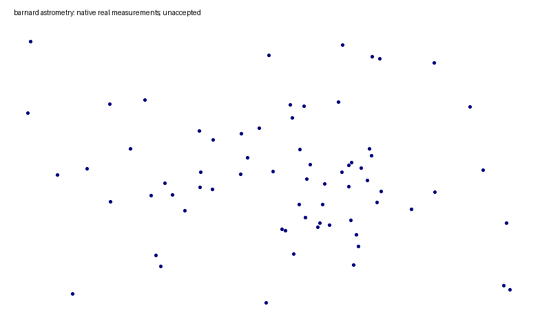

# G3-pm-barnard — INCONCLUSIVE (L3)

# Native target acceptance
Complete measurements and rejected frames:
```json
{
  "name": "NAME Barnard's star",
  "points": [
    {
      "visit": "V1",
      "mjd": 60902.86836524,
      "xi": -5.8579574493947675,
      "eta": -4.039356220896861,
      "s_xi": 0.37490515309665773,
      "s_eta": 0.8382255165961456,
      "band": 3,
      "frame_id": "level2_2025W33_2C_0321_3D3_spx_l2b-v20-2025-267.fits",
      "native_xy": [
        87.70146697720992,
        48.966916139412035
      ],
      "flux_snr": 3.8166547463700513,
      "rchi2": 823.9229002635707,
      "cov_xi_eta": 0.04128417113250667,
      "fit_included": true
    },
    {
      "visit": "V1",
      "mjd": 60903.139031826,
      "xi": -0.29578968211678197,
      "eta": -15.105162793771044,
      "s_xi": 0.7467120922374576,
      "s_eta": 2.2946170986880903,
      "band": 3,
      "frame_id": "level2_2025W33_2C_0386_3D3_spx_l2b-v20-2025-267.fits",
      "native_xy": [
        87.75701297840848,
        91.00261005422463
      ],
      "flux_snr": 1.1085852208571614,
      "rchi2": 800.7093783636224,
      "cov_xi_eta": -0.7399888309110254,
      "fit_included": true
    },
    {
      "visit": "V1",
      "mjd": 60903.139031814,
      "xi": 1.1014704033207676,
      "eta": -5.793820574478767,
      "s_xi": 0.23243368689914526,
      "s_eta": 0.18551660793352426,
      "band": 6,
      "frame_id": "level2_2025W33_2C_0386_3D6_spx_l2b-v20-2025-266.fits",
      "native_xy": [
        88.43746225752778,
        89.4662371992216
      ],
      "flux_snr": 13.133466125474726,
      "rchi2": 1017.8124533250648,
      "cov_xi_eta": -0.0017147783796579194,
      "fit_included": true
    },
    {
      "visit": "V1",
      "mjd": 60903.140524094,
      "xi": 3.373893891674266,
      "eta": 1.767862632975269,
      "s_xi": 1.0838873801837459,
      "s_eta": 1.1022567436810053,
      "band": 3,
      "frame_id": "level2_2025W33_2C_0386_4D3_spx_l2b-v20-2025-267.fits",
      "native_xy": [
        89.16358547050957,
        87.73668266259689
      ],
      "flux_snr": 1.9584138399766908,
      "rchi2": 700.9164183578301,
      "cov_xi_eta": 0.550010473600032,
      "fit_included": true
    },
    {
      "visit": "V1",
      "mjd": 60908.982594812,
      "xi": 0.3805265895710952,
      "eta": -7.210656571996822,
      "s_xi": 0.2747463777321229,
      "s_eta": 0.2022529373474556,
      "band": 5,
      "frame_id": "level2_2025W34_2B_0090_4D5_spx_l2b-v20-2025-267.fits",
      "native_xy": [
        88.74951976513961,
        89.2882962308842
      ],
      "flux_snr": 6.133572164471719,
      "rchi2": 1634.5003335236452,
      "cov_xi_eta": 0.0010184492893593267,
      "fit_included": true
    },
    {
      "visit": "V1",
      "mjd": 60911.491270541,
      "xi": -3.6499257035288943,
      "eta": -3.2992383015517253,
      "s_xi": 0.9510044587869102,
      "s_eta": 0.5739689420246864,
      "band": 5,
      "frame_id": "level2_2025W34_2B_0557_1D5_spx_l2b-v20-2025-269.fits",
      "native_xy": [
        88.02508382079289,
        88.35861974133034
      ],
      "flux_snr": 4.680924647119504,
      "rchi2": 874.9195288255315,
      "cov_xi_eta": -0.03630040943348945,
      "fit_included": true
    },
    {
      "visit": "V1",
      "mjd": 60911.492762798,
      "xi": 0.8701479155655488,
      "eta": -4.3598495694880235,
      "s_xi": 0.3048289683342208,
      "s_eta": 0.26990830844783104,
      "band": 5,
      "frame_id": "level2_2025W34_2B_0557_2D5_spx_l2b-v20-2025-269.fits",
      "native_xy": [
        89.14159482216358,
        88.66967521414719
      ],
      "flux_snr": 6.1368507373594525,
      "rchi2": 1132.749478843028,
      "cov_xi_eta": -0.009165185351698411,
      "fit_included": true
    },
    {
      "visit": "V1",
      "mjd": 60911.494255043,
      "xi": -7.726369771229342,
      "eta": -1.1256548847951506,
      "s_xi": 0.9938807221065724,
      "s_eta": 0.9794372745703797,
      "band": 2,
      "frame_id": "level2_2025W34_2B_0557_3D2_spx_l2b-v20-2025-267.fits",
      "native_xy": [
        87.71712634274812,
        88.69765701243246
      ],
      "flux_snr": 2.036835680930942,
      "rchi2": 1142.276495684873,
      "cov_xi_eta": -0.04051305694553217,
      "fit_included": true
    },
    {
      "visit": "V1",
      "mjd": 60911.494255043,
      "xi": 1.9418269278815652,
      "eta": -6.647745416639604,
      "s_xi": 0.23814726525706909,
      "s_eta": 0.26432728681831114,
      "band": 5,
      "frame_id": "level2_2025W34_2B_0557_3D5_spx_l2b-v20-2025-269.fits",
      "native_xy": [
        89.2572124014328,
        89.24415997004385
      ],
      "flux_snr": 5.912802006750575,
      "rchi2": 1387.7194889230416,
      "cov_xi_eta": -0.008176172207156844,
      "fit_included": true
    },
    {
      "visit": "V1",
      "mjd": 60911.495747312,
      "xi": 4.877984467238489,
      "eta": -4.878900765977862,
      "s_xi": 0.3789955166140715,
      "s_eta": 0.26233851230587063,
      "band": 5,
      "frame_id": "level2_2025W34_2B_0557_4D5_spx_l2b-v20-2025-269.fits",
      "native_xy": [
        89.28105818482472,
        89.06373757886035
      ],
      "flux_snr": 6.505985122201895,
      "rchi2": 945.129385496929,
      "cov_xi_eta": 0.0004196859862838458,
      "fit_included": true
    },
    {
      "visit": "V1",
      "mjd": 60912.71481281,
      "xi": 2.700533867417679,
      "eta": -6.063443207289947,
      "s_xi": 0.32675011844533625,
      "s_eta": 0.25182362843621486,
      "band": 5,
      "frame_id": "level2_2025W35_1A_0146_1D5_spx_l2b-v20-2025-269.fits",
      "native_xy": [
        89.54197281661772,
        89.68004250168906
      ],
      "flux_snr": 5.660227102197586,
      "rchi2": 2488.784625243664,
      "cov_xi_eta": 0.006367891181534311,
      "fit_included": true
    },
    {
      "visit": "V1",
      "mjd": 60912.716305055,
      "xi": 1.5231224715159393,
      "eta": -6.866148918986434,
      "s_xi": 0.15856840232319527,
      "s_eta": 0.15263234637388395,
      "band": 5,
      "frame_id": "level2_2025W35_1A_0146_2D5_spx_l2b-v20-2025-269.fits",
      "native_xy": [
        89.29788743395777,
        90.3424494578211
      ],
      "flux_snr": 9.939710366326944,
      "rchi2": 2001.4249012429427,
      "cov_xi_eta": -0.004263713652319551,
      "fit_included": true
    },
    {
      "visit": "V1",
      "mjd": 60912.7177973,
      "xi": 8.360283565755315,
      "eta": -13.685021672561428,
      "s_xi": 1086817.9194853662,
      "s_eta": 252475.49828450274,
      "band": 2,
      "frame_id": "level2_2025W35_1A_0146_3D2_spx_l2b-v20-2025-269.fits",
      "native_xy": [
        89.87660729114924,
        91.45625591837307
      ],
      "flux_snr": 0.0001611935203332544,
      "rchi2": 1034.3365660954826,
      "cov_xi_eta": 274394266275.9517,
      "fit_included": true
    },
    {
      "visit": "V1",
      "mjd": 60912.717797312,
      "xi": 0.25171932181838264,
      "eta": -7.059532835703022,
      "s_xi": 0.1389852694192107,
      "s_eta": 0.19014722087220695,
      "band": 5,
      "frame_id": "level2_2025W35_1A_0146_3D5_spx_l2b-v20-2025-269.fits",
      "native_xy": [
        88.65302127351443,
        89.93252520749597
      ],
      "flux_snr": 9.396932106753715,
      "rchi2": 1408.6413939446013,
      "cov_xi_eta": -0.003131854667076144,
      "fit_included": true
    },
    {
      "visit": "V1",
      "mjd": 60914.213196455,
      "xi": -1.2208899083156861,
      "eta": -1.0360296881035136,
      "s_xi": 0.5205754367713343,
      "s_eta": 0.47556683804785316,
      "band": 1,
      "frame_id": "level2_2025W35_1A_0432_4D1_spx_l2b-v20-2025-269.fits",
      "native_xy": [
        87.78824481099109,
        88.79023812793142
      ],
      "flux_snr": 4.810908260692181,
      "rchi2": 504.2350006962721,
      "cov_xi_eta": 0.00465467841343137,
      "fit_included": true
    },
    {
      "visit": "V1",
      "mjd": 60914.276937069,
      "xi": 1.7864496825460856,
      "eta": -2.0840084837292525,
      "s_xi": 0.48650680966188947,
      "s_eta": 0.43901221941965834,
      "band": 5,
      "frame_id": "level2_2025W35_1A_0444_1D5_spx_l2b-v20-2025-269.fits",
      "native_xy": [
        89.46053000891003,
        88.9588850224505
      ],
      "flux_snr": 4.644179709696969,
      "rchi2": 1846.9462551210656,
      "cov_xi_eta": -0.03857008286428053,
      "fit_included": true
    },
    {
      "visit": "V1",
      "mjd": 60914.278429326,
      "xi": 8.1635859867499,
      "eta": -13.228242466215312,
      "s_xi": 10.743905668153136,
      "s_eta": 5.938199901865519,
      "band": 2,
      "frame_id": "level2_2025W35_1A_0444_2D2_spx_l2b-v20-2025-269.fits",
      "native_xy": [
        89.5637966890689,
        90.62559702816607
      ],
      "flux_snr": 0.21834433789385427,
      "rchi2": 1082.959966127699,
      "cov_xi_eta": -61.942488302537306,
      "fit_included": true
    },
    {
      "visit": "V1",
      "mjd": 60914.278429326,
      "xi": -3.189802135446589,
      "eta": -5.038824130324867,
      "s_xi": 0.4220336051850649,
      "s_eta": 0.3891766317466697,
      "band": 5,
      "frame_id": "level2_2025W35_1A_0444_2D5_spx_l2b-v20-2025-269.fits",
      "native_xy": [
        87.94548526692658,
        89.34237152471387
      ],
      "flux_snr": 4.1623155687698175,
      "rchi2": 1498.8578030316755,
      "cov_xi_eta": -0.023688853927079,
      "fit_included": true
    },
    {
      "visit": "V1",
      "mjd": 60914.279921571,
      "xi": -2.668865810367176,
      "eta": -2.4509652775763136,
      "s_xi": 0.5403162513736125,
      "s_eta": 0.37660045666679975,
      "band": 5,
      "frame_id": "level2_2025W35_1A_0444_3D5_spx_l2b-v20-2025-269.fits",
      "native_xy": [
        87.85169321639223,
        88.8352961496884
      ],
      "flux_snr": 3.0024389756072694,
      "rchi2": 2577.4754267110693,
      "cov_xi_eta": -0.03002096336195101,
      "fit_included": true
    },
    {
      "visit": "V1",
      "mjd": 60914.28141384,
      "xi": 2.9856089077296444,
      "eta": -8.92865515972698,
      "s_xi": 0.3729093071582514,
      "s_eta": 0.3439216496823117,
      "band": 5,
      "frame_id": "level2_2025W35_1A_0444_4D5_spx_l2b-v20-2025-269.fits",
      "native_xy": [
        89.30521855976893,
        89.71952747819971
      ],
      "flux_snr": 5.771852386507497,
      "rchi2": 1880.018573994576,
      "cov_xi_eta": 0.035834368566264964,
      "fit_included": true
    },
    {
      "visit": "V1",
      "mjd": 60915.431800136,
      "xi": 2.8050404445350363,
      "eta": -11.002557323831974,
      "s_xi": 0.8502555084908046,
      "s_eta": 0.9470566774202784,
      "band": 1,
      "frame_id": "level2_2025W35_1A_0658_1D1_spx_l2b-v20-2025-269.fits",
      "native_xy": [
        88.94267253602754,
        90.01974221427865
      ],
      "flux_snr": 2.761363845322029,
      "rchi2": 398.1529157230353,
      "cov_xi_eta": -0.06883664414088626,
      "fit_included": true
    },
    {
      "visit": "V1",
      "mjd": 60915.433292393,
      "xi": 0.6643850831396038,
      "eta": -9.778051505935677,
      "s_xi": 0.32086362081704517,
      "s_eta": 0.5423757287261709,
      "band": 1,
      "frame_id": "level2_2025W35_1A_0658_2D1_spx_l2b-v20-2025-269.fits",
      "native_xy": [
        88.3229234685599,
        90.06117859195699
      ],
      "flux_snr": 4.099646672561366,
      "rchi2": 351.79508838151713,
      "cov_xi_eta": 0.06158641400098603,
      "fit_included": true
    },
    {
      "visit": "V1",
      "mjd": 60915.436276907,
      "xi": 2.378555908418838,
      "eta": -0.8101067343019897,
      "s_xi": 1.505289114445424,
      "s_eta": 1.2246614418139754,
      "band": 1,
      "frame_id": "level2_2025W35_1A_0658_4D1_spx_l2b-v20-2025-269.fits",
      "native_xy": [
        88.70025407131398,
        87.96271978682597
      ],
      "flux_snr": 2.1769724118935994,
      "rchi2": 603.1906651898022,
      "cov_xi_eta": 0.2577551309015276,
      "fit_included": true
    },
    {
      "visit": "V1",
      "mjd": 60916.656728076,
      "xi": -4.0512364045509655,
      "eta": -11.15259979198332,
      "s_xi": 1.0677706410972971,
      "s_eta": 0.8657455844737946,
      "band": 2,
      "frame_id": "level2_2025W35_2A_0221_1D2_spx_l2b-v20-2025-270.fits",
      "native_xy": [
        88.43385394652668,
        90.1347167058709
      ],
      "flux_snr": 2.34279862491062,
      "rchi2": 1481.197476108425,
      "cov_xi_eta": -0.2965483617694287,
      "fit_included": true
    },
    {
      "visit": "V1",
      "mjd": 60916.656728087,
      "xi": 2.6430425869791208,
      "eta": -2.4290922498200618,
      "s_xi": 0.40628601288037625,
      "s_eta": 0.40524035415591975,
      "band": 5,
      "frame_id": "level2_2025W35_2A_0221_1D5_spx_l2b-v20-2025-271.fits",
      "native_xy": [
        89.09510068590444,
        89.07677780216177
      ],
      "flux_snr": 4.255263934578033,
      "rchi2": 2173.2430835199207,
      "cov_xi_eta": -0.019923060411213417,
      "fit_included": true
    },
    {
      "visit": "V1",
      "mjd": 60916.658238111,
      "xi": -0.9598582719213546,
      "eta": 0.7527261518866855,
      "s_xi": 0.5240566246061699,
      "s_eta": 0.6636015223133992,
      "band": 2,
      "frame_id": "level2_2025W35_2A_0221_2D2_spx_l2b-v20-2025-270.fits",
      "native_xy": [
        88.77984473060889,
        88.77662196939757
      ],
      "flux_snr": 3.7355184622742432,
      "rchi2": 768.9949264952801,
      "cov_xi_eta": -0.04849506674003359,
      "fit_included": true
    },
    {
      "visit": "V1",
      "mjd": 60916.658238111,
      "xi": 2.900409998998866,
      "eta": -7.665997376756059,
      "s_xi": 0.21336024530662837,
      "s_eta": 0.38061699649305775,
      "band": 5,
      "frame_id": "level2_2025W35_2A_0221_2D5_spx_l2b-v20-2025-271.fits",
      "native_xy": [
        89.51525397079907,
        89.63879525525046
      ],
      "flux_snr": 6.839359407651403,
      "rchi2": 1457.6609526896648,
      "cov_xi_eta": 0.015379602607751165,
      "fit_included": true
    },
    {
      "visit": "V1",
      "mjd": 60916.659730356,
      "xi": -6.674842360780687,
      "eta": -0.4291502700576588,
      "s_xi": 1.0214038348004155,
      "s_eta": 0.9064665399256367,
      "band": 2,
      "frame_id": "level2_2025W35_2A_0221_3D2_spx_l2b-v20-2025-270.fits",
      "native_xy": [
        87.21627514918214,
        88.59662519399679
      ],
      "flux_snr": 1.8589818059117407,
      "rchi2": 743.6674970096986,
      "cov_xi_eta": -0.5760699131664362,
      "fit_included": true
    },
    {
      "visit": "V1",
      "mjd": 60916.661222613,
      "xi": -4.241738350767639,
      "eta": -9.917444457037881,
      "s_xi": 1.2677787635522448,
      "s_eta": 1.3013175382091635,
      "band": 5,
      "frame_id": "level2_2025W35_2A_0221_4D5_spx_l2b-v20-2025-271.fits",
      "native_xy": [
        87.63618945447227,
        90.3828006734868
      ],
      "flux_snr": 1.950476073588743,
      "rchi2": 2368.5666655007526,
      "cov_xi_eta": 0.7315347222941793,
      "fit_included": true
    },
    {
      "visit": "V1",
      "mjd": 60916.725638273,
      "xi": -7.205402056212526,
      "eta": -14.182789051387797,
      "s_xi": 5.579054166133407,
      "s_eta": 2.956865372794539,
      "band": 1,
      "frame_id": "level2_2025W35_2A_0233_3D1_spx_l2b-v20-2025-271.fits",
      "native_xy": [
        86.87762710786792,
        90.74856660441914
      ],
      "flux_snr": 0.26174844415920395,
      "rchi2": 565.0899614291119,
      "cov_xi_eta": 14.821230092720048,
      "fit_included": true
    },
    {
      "visit": "V1",
      "mjd": 60916.727130541,
      "xi": -2.64749127136973,
      "eta": -0.8482621160906839,
      "s_xi": 0.878361144478481,
      "s_eta": 0.8289535784146517,
      "band": 1,
      "frame_id": "level2_2025W35_2A_0233_4D1_spx_l2b-v20-2025-271.fits",
      "native_xy": [
        87.35829950295974,
        40.42531337052132
      ],
      "flux_snr": 2.212456846549937,
      "rchi2": 288.0869633461432,
      "cov_xi_eta": 0.38855382076533956,
      "fit_included": true
    },
    {
      "visit": "V1",
      "mjd": 60917.674605726,
      "xi": -2.2298844986188064,
      "eta": -2.7253807323562307,
      "s_xi": 0.33388880121649783,
      "s_eta": 0.3334479488618862,
      "band": 5,
      "frame_id": "level2_2025W35_2A_0418_1D5_spx_l2b-v20-2025-271.fits",
      "native_xy": [
        87.92365238849797,
        88.48881123763083
      ],
      "flux_snr": 5.090100625713956,
      "rchi2": 2480.8858809955577,
      "cov_xi_eta": -0.002467063785780068,
      "fit_included": true
    },
    {
      "visit": "V1",
      "mjd": 60918.623981768,
      "xi": 5.710485613846857,
      "eta": -3.02282310963747,
      "s_xi": 0.6574532537469173,
      "s_eta": 0.8135898393925882,
      "band": 1,
      "frame_id": "level2_2025W35_2A_0611_1D1_spx_l2b-v20-2025-271.fits",
      "native_xy": [
        88.97422314443793,
        89.12585720809936
      ],
      "flux_snr": 3.130659362958924,
      "rchi2": 223.76261422214654,
      "cov_xi_eta": 0.0006899728807486964,
      "fit_included": true
    },
    {
      "visit": "V1",
      "mjd": 60918.626984036,
      "xi": -5.147778832008777,
      "eta": 1.7107571172607177,
      "s_xi": 2.8779556649003375,
      "s_eta": 5.342075315369464,
      "band": 1,
      "frame_id": "level2_2025W35_2A_0611_3D1_spx_l2b-v20-2025-271.fits",
      "native_xy": [
        87.08223500927006,
        87.84648700419413
      ],
      "flux_snr": 0.49981499724863354,
      "rchi2": 108.07050589603239,
      "cov_xi_eta": -11.540813885658903,
      "fit_included": true
    },
    {
      "visit": "V2",
      "mjd": 60948.653903284,
      "xi": -4.413477942651206,
      "eta": -3.417442335235386,
      "s_xi": 0.606615965717341,
      "s_eta": 0.5614997149162739,
      "band": 1,
      "frame_id": "level2_2025W40_1A_0367_1D1_spx_l2b-v20-2025-277.fits",
      "native_xy": [
        87.18028751065391,
        88.32535394074489
      ],
      "flux_snr": 5.471648181638989,
      "rchi2": 238.81416392380922,
      "cov_xi_eta": 0.00801947632058466,
      "fit_included": false
    },
    {
      "visit": "V2",
      "mjd": 60949.266580483,
      "xi": 7.428268180499787,
      "eta": -0.5666291412126392,
      "s_xi": 0.42810991657746633,
      "s_eta": 1.298693257449282,
      "band": 1,
      "frame_id": "level2_2025W40_1A_0500_1D1_spx_l2b-v20-2025-277.fits",
      "native_xy": [
        89.91873001019229,
        88.42088085322494
      ],
      "flux_snr": 2.4961313896144866,
      "rchi2": 125.43014789041445,
      "cov_xi_eta": -0.05515342639717691,
      "fit_included": false
    },
    {
      "visit": "V3",
      "mjd": 61110.09505362,
      "xi": 1.6926555090191937,
      "eta": -4.341753506755797,
      "s_xi": 0.3213640254547322,
      "s_eta": 0.3344027149421302,
      "band": 1,
      "frame_id": "level2_2026W11_1A_0430_4D1_spx_l2b-v24-2026-094.fits",
      "native_xy": [
        90.29980605596452,
        89.7647710654143
      ],
      "flux_snr": 5.158196705922312,
      "rchi2": 286.5471360682185,
      "cov_xi_eta": -0.015321123178674985,
      "fit_included": true
    },
    {
      "visit": "V3",
      "mjd": 61114.03266965,
      "xi": 3.2871828031304395,
      "eta": -1.6916965242925432,
      "s_xi": 0.7539750487782484,
      "s_eta": 0.39949774396602417,
      "band": 5,
      "frame_id": "level2_2026W11_2A_0501_1D5_spx_l2b-v24-2026-094.fits",
      "native_xy": [
        90.36487457179933,
        90.69765809691845
      ],
      "flux_snr": 2.8543124865143112,
      "rchi2": 3248.1140055473534,
      "cov_xi_eta": -0.05268752809943848,
      "fit_included": true
    },
    {
      "visit": "V3",
      "mjd": 61114.034161884,
      "xi": -0.06474096755449617,
      "eta": -0.7579571481205418,
      "s_xi": 0.201827632026963,
      "s_eta": 0.24491831311988216,
      "band": 5,
      "frame_id": "level2_2026W11_2A_0501_2D5_spx_l2b-v24-2026-094.fits",
      "native_xy": [
        91.6805101797043,
        90.44912594531381
      ],
      "flux_snr": 8.820764095072024,
      "rchi2": 1355.4136319066115,
      "cov_xi_eta": -0.005431228854338972,
      "fit_included": true
    },
    {
      "visit": "V3",
      "mjd": 61114.035654141,
      "xi": 1.6072033039895708,
      "eta": -6.433775943333436,
      "s_xi": 1.2025126110498447,
      "s_eta": 0.8407882523832197,
      "band": 5,
      "frame_id": "level2_2026W11_2A_0501_3D5_spx_l2b-v24-2026-094.fits",
      "native_xy": [
        91.2030846083901,
        90.09824832519708
      ],
      "flux_snr": 1.7408859559244168,
      "rchi2": 1983.7146161827256,
      "cov_xi_eta": -0.18084345826838008,
      "fit_included": true
    },
    {
      "visit": "V3",
      "mjd": 61114.101721953,
      "xi": 2.258642652216492,
      "eta": 6.867660915801811,
      "s_xi": 1.8875207981899607,
      "s_eta": 0.8942990517115667,
      "band": 2,
      "frame_id": "level2_2026W11_2A_0513_2D2_spx_l2b-v24-2026-094.fits",
      "native_xy": [
        91.41367373713774,
        92.12210068758047
      ],
      "flux_snr": 1.738441283143823,
      "rchi2": 792.4795294452431,
      "cov_xi_eta": 1.0526891915952237,
      "fit_included": true
    },
    {
      "visit": "V3",
      "mjd": 61114.101721953,
      "xi": 0.6191541555859315,
      "eta": 5.141529408465786,
      "s_xi": 0.6023642774228531,
      "s_eta": 0.5831214753062768,
      "band": 5,
      "frame_id": "level2_2026W11_2A_0513_2D5_spx_l2b-v24-2026-094.fits",
      "native_xy": [
        91.01610728113177,
        91.08200449371004
      ],
      "flux_snr": 4.117563023219633,
      "rchi2": 1022.4652312500026,
      "cov_xi_eta": -0.0545159618236846,
      "fit_included": true
    },
    {
      "visit": "V3",
      "mjd": 61114.304757393,
      "xi": 3.0689540757408604,
      "eta": -0.3573836903301308,
      "s_xi": 0.3475070192052381,
      "s_eta": 0.4167980309612109,
      "band": 5,
      "frame_id": "level2_2026W11_2A_0550_1D5_spx_l2b-v24-2026-094.fits",
      "native_xy": [
        90.89646436652727,
        90.39133287301786
      ],
      "flux_snr": 4.916686518071534,
      "rchi2": 2508.971522852513,
      "cov_xi_eta": -0.012190439499752122,
      "fit_included": true
    },
    {
      "visit": "V3",
      "mjd": 61116.682309673,
      "xi": 2.6464809099010114,
      "eta": -0.04504173344133422,
      "s_xi": 0.40184277206238667,
      "s_eta": 0.27333929873809243,
      "band": 5,
      "frame_id": "level2_2026W12_1A_0311_2D5_spx_l2b-v24-2026-082.fits",
      "native_xy": [
        90.75198221739761,
        90.29970568810784
      ],
      "flux_snr": 5.326703861233765,
      "rchi2": 2595.8789471178093,
      "cov_xi_eta": -0.02837276717406096,
      "fit_included": true
    },
    {
      "visit": "V3",
      "mjd": 61116.685294187,
      "xi": 3.793584863406565,
      "eta": -2.942186165534947,
      "s_xi": 0.8162891917844469,
      "s_eta": 0.6571414732761136,
      "band": 5,
      "frame_id": "level2_2026W12_1A_0311_4D5_spx_l2b-v24-2026-082.fits",
      "native_xy": [
        91.07337578548753,
        90.26825364265068
      ],
      "flux_snr": 2.802402688151219,
      "rchi2": 2571.9854601392162,
      "cov_xi_eta": 0.0172854954568516,
      "fit_included": true
    },
    {
      "visit": "V3",
      "mjd": 61118.309897451,
      "xi": 8.255290694374613,
      "eta": -6.428501834082386,
      "s_xi": 3.5036695206828004,
      "s_eta": 9.064484606214513,
      "band": 3,
      "frame_id": "level2_2026W12_1A_0598_1D3_spx_l2b-v24-2026-082.fits",
      "native_xy": [
        89.3698041053798,
        89.90656917297429
      ],
      "flux_snr": 0.4248679852382927,
      "rchi2": 1891.3682425566253,
      "cov_xi_eta": 20.450451619286223,
      "fit_included": true
    },
    {
      "visit": "V3",
      "mjd": 61118.311389719,
      "xi": 1.130483469762693,
      "eta": -1.5887085154374891,
      "s_xi": 0.23329530945519322,
      "s_eta": 0.3376914844584291,
      "band": 3,
      "frame_id": "level2_2026W12_1A_0598_2D3_spx_l2b-v24-2026-082.fits",
      "native_xy": [
        90.72079490562065,
        90.80551940915531
      ],
      "flux_snr": 4.829963286354846,
      "rchi2": 789.6953030942324,
      "cov_xi_eta": 0.0013008891743287033,
      "fit_included": true
    },
    {
      "visit": "V3",
      "mjd": 61120.551245923,
      "xi": 6.949398248127178,
      "eta": 6.366204739949874,
      "s_xi": 2.0063351568601795,
      "s_eta": 3.401932392054459,
      "band": 5,
      "frame_id": "level2_2026W12_2A_0371_2D5_spx_l2b-v24-2026-083.fits",
      "native_xy": [
        90.228612053293,
        91.3359790392364
      ],
      "flux_snr": 0.7995323884237814,
      "rchi2": 802.3719925701944,
      "cov_xi_eta": 4.639084519077389,
      "fit_included": true
    },
    {
      "visit": "V3",
      "mjd": 61120.55273818,
      "xi": -5.8719522070743375,
      "eta": 6.661122014229853,
      "s_xi": 1.9856706672630595,
      "s_eta": 1.9975712573007391,
      "band": 5,
      "frame_id": "level2_2026W12_2A_0371_3D5_spx_l2b-v24-2026-083.fits",
      "native_xy": [
        92.56165348957934,
        91.63150498147549
      ],
      "flux_snr": 0.9658201800352474,
      "rchi2": 1664.7607220914044,
      "cov_xi_eta": -2.52532339921105,
      "fit_included": true
    },
    {
      "visit": "V3",
      "mjd": 61120.554230425,
      "xi": 3.6413553102800416,
      "eta": -4.103536383817478,
      "s_xi": 0.7996748054101572,
      "s_eta": 1.1075370909625968,
      "band": 5,
      "frame_id": "level2_2026W12_2A_0371_4D5_spx_l2b-v24-2026-083.fits",
      "native_xy": [
        90.28684559422666,
        90.17038100885858
      ],
      "flux_snr": 3.26289324327059,
      "rchi2": 1026.1580849243546,
      "cov_xi_eta": 0.2794176281660981,
      "fit_included": true
    },
    {
      "visit": "V5",
      "mjd": 61268.631477786,
      "xi": -1.197820330430317,
      "eta": 3.4227904740703146,
      "s_xi": 0.14687556545272695,
      "s_eta": 0.12716524106502922,
      "band": 6,
      "frame_id": "level2_2026W33_2A_0594_4D6_spx_l2b-v27-2026-241.fits",
      "native_xy": [
        87.68996507189416,
        87.31703993835748
      ],
      "flux_snr": 16.305597388083246,
      "rchi2": 743.3159943899856,
      "cov_xi_eta": -0.0006594911558469055,
      "fit_included": true
    },
    {
      "visit": "V5",
      "mjd": 61269.034084627,
      "xi": -2.685784875969496,
      "eta": 3.69649126839241,
      "s_xi": 0.27569318200909804,
      "s_eta": 0.26333991659622763,
      "band": 6,
      "frame_id": "level2_2026W34_1A_0007_1D6_spx_l2b-v27-2026-243.fits",
      "native_xy": [
        87.50369015845489,
        88.23803661227073
      ],
      "flux_snr": 7.745538415348126,
      "rchi2": 1408.651635132156,
      "cov_xi_eta": -0.0010922984074887563,
      "fit_included": true
    },
    {
      "visit": "V5",
      "mjd": 61270.86778171,
      "xi": -3.9005812617787727,
      "eta": -2.017222134765373,
      "s_xi": 1.0962197948201449,
      "s_eta": 1.0994518426203408,
      "band": 5,
      "frame_id": "level2_2026W34_1A_0363_1D5_spx_l2b-v27-2026-243.fits",
      "native_xy": [
        88.30662437033354,
        89.08397031075418
      ],
      "flux_snr": 1.994358962058424,
      "rchi2": 2945.040730311697,
      "cov_xi_eta": 0.1904688533307124,
      "fit_included": true
    },
    {
      "visit": "V5",
      "mjd": 61270.869273955,
      "xi": 1.0373697985421557,
      "eta": 6.391356905595115,
      "s_xi": 0.22967877528805122,
      "s_eta": 0.2311325582886948,
      "band": 5,
      "frame_id": "level2_2026W34_1A_0363_2D5_spx_l2b-v27-2026-243.fits",
      "native_xy": [
        88.33125379342636,
        87.2955302388942
      ],
      "flux_snr": 7.938297005350086,
      "rchi2": 1543.343489343377,
      "cov_xi_eta": -0.00611213682031726,
      "fit_included": true
    },
    {
      "visit": "V5",
      "mjd": 61273.383829997,
      "xi": 3.45856675194876,
      "eta": 11.837141858893302,
      "s_xi": 0.7640843493380933,
      "s_eta": 1.419400837932275,
      "band": 5,
      "frame_id": "level2_2026W34_2A_0178_4D5_spx_l2b-v27-2026-243.fits",
      "native_xy": [
        88.7235735479819,
        86.38441872676827
      ],
      "flux_snr": 1.5590418120301948,
      "rchi2": 680.4368949264111,
      "cov_xi_eta": -0.09431140331372555,
      "fit_included": true
    },
    {
      "visit": "V5",
      "mjd": 61273.51552149,
      "xi": 0.9059609049626625,
      "eta": 1.6479778324977759,
      "s_xi": 0.3013692593382371,
      "s_eta": 0.25326132079828234,
      "band": 5,
      "frame_id": "level2_2026W34_2A_0206_2D5_spx_l2b-v27-2026-243.fits",
      "native_xy": [
        89.20470529412957,
        87.9516702609098
      ],
      "flux_snr": 4.854012409283416,
      "rchi2": 815.0388979717836,
      "cov_xi_eta": -0.008111856540241812,
      "fit_included": true
    },
    {
      "visit": "V5",
      "mjd": 61273.518505992,
      "xi": 5.672788639732352,
      "eta": 11.187458561860286,
      "s_xi": 2.4601362810218195,
      "s_eta": 7.435059792018146,
      "band": 5,
      "frame_id": "level2_2026W34_2A_0206_4D5_spx_l2b-v27-2026-243.fits",
      "native_xy": [
        89.73689117750548,
        87.41983842600402
      ],
      "flux_snr": 0.3542663065769688,
      "rchi2": 1276.3437052828706,
      "cov_xi_eta": 7.6831679630025045,
      "fit_included": true
    },
    {
      "visit": "V5",
      "mjd": 61273.651476548,
      "xi": 0.5448609495223338,
      "eta": 6.580891721569342,
      "s_xi": 0.539625788537097,
      "s_eta": 0.33953035358821365,
      "band": 5,
      "frame_id": "level2_2026W34_2A_0233_2D5_spx_l2b-v27-2026-243.fits",
      "native_xy": [
        88.6732460559816,
        87.29727110567829
      ],
      "flux_snr": 4.4341624022185835,
      "rchi2": 931.2991084733922,
      "cov_xi_eta": -0.04204206420882189,
      "fit_included": true
    },
    {
      "visit": "V5",
      "mjd": 61273.654461062,
      "xi": -4.61828954653384,
      "eta": 7.117717389117619,
      "s_xi": 0.3078106044975825,
      "s_eta": 0.2664802239533432,
      "band": 5,
      "frame_id": "level2_2026W34_2A_0233_4D5_spx_l2b-v27-2026-243.fits",
      "native_xy": [
        87.68907152263483,
        86.88119377751168
      ],
      "flux_snr": 5.400735298648727,
      "rchi2": 815.1918737779357,
      "cov_xi_eta": -0.019591396307238565,
      "fit_included": true
    },
    {
      "visit": "V5",
      "mjd": 61273.720351201,
      "xi": 2.7340736819401927,
      "eta": 0.1936944614947058,
      "s_xi": 0.6460675095223,
      "s_eta": 0.675857518463613,
      "band": 5,
      "frame_id": "level2_2026W34_2A_0249_1D5_spx_l2b-v27-2026-243.fits",
      "native_xy": [
        89.1108210190871,
        88.68906168612662
      ],
      "flux_snr": 4.86988924102662,
      "rchi2": 1445.4058754373534,
      "cov_xi_eta": -0.17879000186481644,
      "fit_included": true
    },
    {
      "visit": "V5",
      "mjd": 61273.721843458,
      "xi": 1.250892610792696,
      "eta": -0.010784670283123882,
      "s_xi": 0.40122763549673446,
      "s_eta": 0.5005741993604019,
      "band": 5,
      "frame_id": "level2_2026W34_2A_0249_2D5_spx_l2b-v27-2026-243.fits",
      "native_xy": [
        88.69151731414581,
        88.2823590476099
      ],
      "flux_snr": 4.189123842477865,
      "rchi2": 1303.7366101348207,
      "cov_xi_eta": -0.014420167004209616,
      "fit_included": true
    },
    {
      "visit": "V5",
      "mjd": 61273.723335726,
      "xi": 3.4464694936623523,
      "eta": 1.0065669134506303,
      "s_xi": 1.421112539178771,
      "s_eta": 1.2233909093015711,
      "band": 5,
      "frame_id": "level2_2026W34_2A_0249_3D5_spx_l2b-v27-2026-243.fits",
      "native_xy": [
        88.90574192772833,
        87.72533129381694
      ],
      "flux_snr": 1.8604492347994595,
      "rchi2": 2788.6641319250202,
      "cov_xi_eta": 0.8691391433334363,
      "fit_included": true
    },
    {
      "visit": "V5",
      "mjd": 61273.788888354,
      "xi": -0.544751320114471,
      "eta": 4.018963781622885,
      "s_xi": 0.18916901837992575,
      "s_eta": 0.15463221090512136,
      "band": 5,
      "frame_id": "level2_2026W34_2A_0264_1D5_spx_l2b-v27-2026-243.fits",
      "native_xy": [
        88.64075689506703,
        87.09403844997293
      ],
      "flux_snr": 9.99269539499031,
      "rchi2": 1518.671301798325,
      "cov_xi_eta": -0.002236118785307098,
      "fit_included": true
    },
    {
      "visit": "V5",
      "mjd": 61276.233841027,
      "xi": -0.21107252199692647,
      "eta": 12.013539719151943,
      "s_xi": 1.0342545890311203,
      "s_eta": 1.5650752645908055,
      "band": 1,
      "frame_id": "level2_2026W35_1A_0053_1D1_spx_l2b-v27-2026-243.fits",
      "native_xy": [
        88.0592627686755,
        85.85467234830541
      ],
      "flux_snr": 1.5684707813090075,
      "rchi2": 356.3188078701656,
      "cov_xi_eta": 0.2706377853487244,
      "fit_included": true
    },
    {
      "visit": "V5",
      "mjd": 61276.366616155,
      "xi": 3.737661455090924,
      "eta": 11.607530657118918,
      "s_xi": 2.1950738209824325,
      "s_eta": 3.301693119602324,
      "band": 1,
      "frame_id": "level2_2026W35_1A_0079_2D1_spx_l2b-v27-2026-243.fits",
      "native_xy": [
        89.10900670461821,
        86.78247201791355
      ],
      "flux_snr": 0.8487907331990647,
      "rchi2": 547.140035788875,
      "cov_xi_eta": 6.247334189997772,
      "fit_included": true
    },
    {
      "visit": "V5",
      "mjd": 61276.438351004,
      "xi": -2.1935257603597735,
      "eta": 2.744144535451016,
      "s_xi": 0.18638018072394205,
      "s_eta": 0.2400483950348433,
      "band": 5,
      "frame_id": "level2_2026W35_1A_0092_1D5_spx_l2b-v27-2026-243.fits",
      "native_xy": [
        87.4641548035038,
        88.13501547819169
      ],
      "flux_snr": 7.262612038973055,
      "rchi2": 2091.7023994269,
      "cov_xi_eta": 0.0007699888025872379,
      "fit_included": true
    },
    {
      "visit": "V5",
      "mjd": 61277.252376062,
      "xi": -8.803991939184913,
      "eta": 5.646734076205494,
      "s_xi": 1.576498129804098,
      "s_eta": 0.6488502861319448,
      "band": 1,
      "frame_id": "level2_2026W35_1A_0249_4D1_spx_l2b-v27-2026-243.fits",
      "native_xy": [
        86.33864939219755,
        87.67402854359202
      ],
      "flux_snr": 2.4359766445068893,
      "rchi2": 615.7248491284615,
      "cov_xi_eta": 0.248548601600309,
      "fit_included": true
    },
    {
      "visit": "V5",
      "mjd": 61277.252376062,
      "xi": 2.4105249974157794,
      "eta": 13.14947587663307,
      "s_xi": 1.492429398136351,
      "s_eta": 3.1497214445243142,
      "band": 4,
      "frame_id": "level2_2026W35_1A_0249_4D4_spx_l2b-v27-2026-243.fits",
      "native_xy": [
        88.58783807203037,
        86.57540327975262
      ],
      "flux_snr": 1.1309948862437198,
      "rchi2": 8697.29000230952,
      "cov_xi_eta": 2.894867012826323,
      "fit_included": true
    },
    {
      "visit": "V5",
      "mjd": 61281.662753423,
      "xi": -8.683200076002105,
      "eta": 13.530998524357852,
      "s_xi": 269146.31250399083,
      "s_eta": 468249.4643739768,
      "band": 1,
      "frame_id": "level2_2026W35_2A_0412_3D1_spx_l2b-v27-2026-246.fits",
      "native_xy": [
        86.47339538685763,
        86.0977578381785
      ],
      "flux_snr": 6.5571775614519835e-06,
      "rchi2": 1018.2688018768448,
      "cov_xi_eta": 76629823359.38329,
      "fit_included": true
    }
  ],
  "fit": {
    "pmra": -1.746405980701101,
    "pmdec": 9.93695162600576,
    "e_pmra": 0.552659429508843,
    "e_pmdec": 0.5331472165619702,
    "mu": 10.089248805882779,
    "e_mu": 0.5389195430056233,
    "pa_deg": 350.0321390901695,
    "plx_fixed": 546.9759,
    "chi2": 4187.655035471843,
    "dof": 130,
    "delta_chi2": 11336.799785611503
  },
  "catalogue": {
    "source": "Gaia DR3 4472832130942575872",
    "pmra": -0.801551,
    "pmdec": 10.362394,
    "mu": 10.393348518010786,
    "pa_deg": 355.576869477875
  },
  "validity": "unvalidated",
  "skipped": [
    [
      "level2_2025W33_2C_0321_1D3_spx_l2b-v20-2025-267.fits",
      "target native centroid unconstrained"
    ],
    [
      "level2_2025W33_2C_0321_1D6_spx_l2b-v20-2025-266.fits",
      "fewer than five isolated unsaturated registration stars"
    ],
    [
      "level2_2025W33_2C_0321_2D3_spx_l2b-v20-2025-267.fits",
      "target native centroid unconstrained"
    ],
    [
      "level2_2025W33_2C_0321_2D6_spx_l2b-v20-2025-266.fits",
      "fewer than five isolated unsaturated registration stars"
    ],
    [
      "level2_2025W33_2C_0321_3D6_spx_l2b-v20-2025-266.fits",
      "fewer than five isolated unsaturated registration stars"
    ],
    [
      "level2_2025W33_2C_0386_4D6_spx_l2b-v20-2025-266.fits",
      "fewer than five isolated unsaturated registration stars"
    ],
    [
      "level2_2025W34_1B_0164_1D3_spx_l2b-v20-2025-267.fits",
      "target native centroid unconstrained"
    ],
    [
      "level2_2025W34_1B_0164_1D6_spx_l2b-v20-2025-267.fits",
      "fewer than five isolated unsaturated registration stars"
    ],
    [
      "level2_2025W34_1B_0164_2D3_spx_l2b-v20-2025-267.fits",
      "target native centroid unconstrained"
    ],
    [
      "level2_2025W34_1B_0164_2D6_spx_l2b-v20-2025-267.fits",
      "fewer than five isolated unsaturated registration stars"
    ],
    [
      "level2_2025W34_1B_0164_3D3_spx_l2b-v20-2025-267.fits",
      "target native centroid unconstrained"
    ],
    [
      "level2_2025W34_1B_0164_3D6_spx_l2b-v20-2025-267.fits",
      "fewer than five isolated unsaturated registration stars"
    ],
    [
      "level2_2025W34_2B_0030_1D3_spx_l2b-v20-2025-269.fits",
      "target native centroid unconstrained"
    ],
    [
      "level2_2025W34_2B_0030_1D6_spx_l2b-v20-2025-269.fits",
      "fewer than five isolated unsaturated registration stars"
    ],
    [
      "level2_2025W34_2B_0030_2D3_spx_l2b-v20-2025-269.fits",
      "target native centroid unconstrained"
    ],
    [
      "level2_2025W34_2B_0030_2D6_spx_l2b-v20-2025-267.fits",
      "fewer than five isolated unsaturated registration stars"
    ],
    [
      "level2_2025W34_2B_0030_3D3_spx_l2b-v20-2025-269.fits",
      "target native centroid unconstrained"
    ],
    [
      "level2_2025W34_2B_0030_3D6_spx_l2b-v20-2025-269.fits",
      "fewer than five isolated unsaturated registration stars"
    ],
    [
      "level2_2025W34_2B_0030_4D3_spx_l2b-v20-2025-269.fits",
      "target native centroid unconstrained"
    ],
    [
      "level2_2025W34_2B_0030_4D6_spx_l2b-v20-2025-267.fits",
      "fewer than five isolated unsaturated registration stars"
    ],
    [
      "level2_2025W34_2B_0090_4D2_spx_l2b-v20-2025-267.fits",
      "target native centroid unconstrained"
    ],
    [
      "level2_2025W34_2B_0557_1D2_spx_l2b-v20-2025-267.fits",
      "target native centroid unconstrained"
    ],
    [
      "level2_2025W34_2B_0557_2D2_spx_l2b-v20-2025-267.fits",
      "target native centroid unconstrained"
    ],
    [
      "level2_2025W34_2B_0557_4D2_spx_l2b-v20-2025-267.fits",
      "target native centroid unconstrained"
    ],
    [
      "level2_2025W35_1A_0008_1D3_spx_l2b-v20-2025-269.fits",
      "target native centroid unconstrained"
    ],
    [
      "level2_2025W35_1A_0008_1D6_spx_l2b-v20-2025-270.fits",
      "fewer than five isolated unsaturated registration stars"
    ],
    [
      "level2_2025W35_1A_0008_2D3_spx_l2b-v20-2025-269.fits",
      "target native centroid unconstrained"
    ],
    [
      "level2_2025W35_1A_0008_2D6_spx_l2b-v20-2025-270.fits",
      "fewer than five isolated unsaturated registration stars"
    ],
    [
      "level2_2025W35_1A_0008_3D3_spx_l2b-v20-2025-269.fits",
      "target native centroid unconstrained"
    ],
    [
      "level2_2025W35_1A_0008_3D6_spx_l2b-v20-2025-270.fits",
      "fewer than five isolated unsaturated registration stars"
    ],
    [
      "level2_2025W35_1A_0008_4D3_spx_l2b-v20-2025-269.fits",
      "target native centroid unconstrained"
    ],
    [
      "level2_2025W35_1A_0008_4D6_spx_l2b-v20-2025-270.fits",
      "fewer than five isolated unsaturated registration stars"
    ],
    [
      "level2_2025W35_1A_0146_1D2_spx_l2b-v20-2025-269.fits",
      "target native centroid unconstrained"
    ],
    [
      "level2_2025W35_1A_0146_2D2_spx_l2b-v20-2025-269.fits",
      "target native centroid unconstrained"
    ],
    [
      "level2_2025W35_1A_0146_4D2_spx_l2b-v20-2025-269.fits",
      "target native centroid unconstrained"
    ],
    [
      "level2_2025W35_1A_0146_4D5_spx_l2b-v20-2025-269.fits",
      "fewer than five isolated unsaturated registration stars"
    ],
    [
      "level2_2025W35_1A_0432_4D4_spx_l2b-v20-2025-270.fits",
      "target native centroid unconstrained"
    ],
    [
      "level2_2025W35_1A_0444_1D2_spx_l2b-v20-2025-269.fits",
      "target native centroid unconstrained"
    ],
    [
      "level2_2025W35_1A_0444_3D2_spx_l2b-v20-2025-269.fits",
      "target native centroid unconstrained"
    ],
    [
      "level2_2025W35_1A_0444_4D2_spx_l2b-v20-2025-269.fits",
      "target native centroid unconstrained"
    ],
    [
      "level2_2025W35_1A_0484_1D3_spx_l2b-v20-2025-269.fits",
      "target native centroid unconstrained"
    ],
    [
      "level2_2025W35_1A_0484_1D6_spx_l2b-v20-2025-270.fits",
      "fewer than five isolated unsaturated registration stars"
    ],
    [
      "level2_2025W35_1A_0484_2D3_spx_l2b-v20-2025-269.fits",
      "target native centroid unconstrained"
    ],
    [
      "level2_2025W35_1A_0484_2D6_spx_l2b-v20-2025-270.fits",
      "fewer than five isolated unsaturated registration stars"
    ],
    [
      "level2_2025W35_1A_0658_1D4_spx_l2b-v20-2025-270.fits",
      "target native centroid unconstrained"
    ],
    [
      "level2_2025W35_1A_0658_2D4_spx_l2b-v20-2025-270.fits",
      "target native centroid unconstrained"
    ],
    [
      "level2_2025W35_1A_0658_3D1_spx_l2b-v20-2025-269.fits",
      "target native centroid unconstrained"
    ],
    [
      "level2_2025W35_1A_0658_3D4_spx_l2b-v20-2025-270.fits",
      "target native centroid unconstrained"
    ],
    [
      "level2_2025W35_1A_0658_4D4_spx_l2b-v20-2025-270.fits",
      "target native centroid unconstrained"
    ],
    [
      "level2_2025W35_2A_0221_3D5_spx_l2b-v20-2025-271.fits",
      "target native centroid unconstrained"
    ],
    [
      "level2_2025W35_2A_0221_4D2_spx_l2b-v20-2025-270.fits",
      "target native centroid unconstrained"
    ],
    [
      "level2_2025W35_2A_0233_1D1_spx_l2b-v20-2025-271.fits",
      "target native centroid unconstrained"
    ],
    [
      "level2_2025W35_2A_0233_1D4_spx_l2b-v20-2025-271.fits",
      "target native centroid unconstrained"
    ],
    [
      "level2_2025W35_2A_0233_2D1_spx_l2b-v20-2025-271.fits",
      "target native centroid unconstrained"
    ],
    [
      "level2_2025W35_2A_0233_2D4_spx_l2b-v20-2025-271.fits",
      "target native centroid unconstrained"
    ],
    [
      "level2_2025W35_2A_0233_3D4_spx_l2b-v20-2025-271.fits",
      "target native centroid unconstrained"
    ],
    [
      "level2_2025W35_2A_0233_4D4_spx_l2b-v20-2025-271.fits",
      "target native centroid unconstrained"
    ],
    [
      "level2_2025W35_2A_0418_1D2_spx_l2b-v20-2025-270.fits",
      "target native centroid unconstrained"
    ],
    [
      "level2_2025W35_2A_0474_1D1_spx_l2b-v20-2025-271.fits",
      "target native centroid unconstrained"
    ],
    [
      "level2_2025W35_2A_0474_1D4_spx_l2b-v20-2025-271.fits",
      "target native centroid unconstrained"
    ],
    [
      "level2_2025W35_2A_0474_2D1_spx_l2b-v20-2025-271.fits",
      "target native centroid unconstrained"
    ],
    [
      "level2_2025W35_2A_0474_2D4_spx_l2b-v20-2025-271.fits",
      "target native centroid unconstrained"
    ],
    [
      "level2_2025W35_2A_0474_3D1_spx_l2b-v20-2025-271.fits",
      "target native centroid unconstrained"
    ],
    [
      "level2_2025W35_2A_0474_3D4_spx_l2b-v20-2025-271.fits",
      "target native centroid unconstrained"
    ],
    [
      "level2_2025W35_2A_0474_4D1_spx_l2b-v20-2025-271.fits",
      "target native centroid unconstrained"
    ],
    [
      "level2_2025W35_2A_0611_1D4_spx_l2b-v20-2025-271.fits",
      "target native centroid unconstrained"
    ],
    [
      "level2_2025W35_2A_0611_2D1_spx_l2b-v20-2025-271.fits",
      "target native centroid unconstrained"
    ],
    [
      "level2_2025W35_2A_0611_2D4_spx_l2b-v20-2025-271.fits",
      "target native centroid unconstrained"
    ],
    [
      "level2_2025W35_2A_0611_3D4_spx_l2b-v20-2025-271.fits",
      "target native centroid unconstrained"
    ],
    [
      "level2_2025W35_2A_0611_4D1_spx_l2b-v20-2025-271.fits",
      "target native centroid unconstrained"
    ],
    [
      "level2_2025W35_2A_0611_4D4_spx_l2b-v20-2025-271.fits",
      "target native centroid unconstrained"
    ],
    [
      "level2_2025W36_1A_0024_1D1_spx_l2b-v20-2025-271.fits",
      "target native centroid unconstrained"
    ],
    [
      "level2_2025W36_1A_0024_1D4_spx_l2b-v20-2025-271.fits",
      "target native centroid unconstrained"
    ],
    [
      "level2_2025W36_2B_0123_1D1_spx_l2b-v20-2025-271.fits",
      "target native centroid unconstrained"
    ],
    [
      "level2_2025W36_2B_0123_1D4_spx_l2b-v20-2025-272.fits",
      "target native centroid unconstrained"
    ],
    [
      "level2_2025W40_1A_0353_1D1_spx_l2b-v20-2025-277.fits",
      "target native centroid unconstrained"
    ],
    [
      "level2_2025W40_1A_0353_1D4_spx_l2b-v20-2025-277.fits",
      "target native centroid unconstrained"
    ],
    [
      "level2_2025W40_1A_0367_1D4_spx_l2b-v20-2025-277.fits",
      "target native centroid unconstrained"
    ],
    [
      "level2_2025W40_1A_0441_1D1_spx_l2b-v20-2025-277.fits",
      "target native centroid unconstrained"
    ],
    [
      "level2_2025W40_1A_0441_1D4_spx_l2b-v20-2025-277.fits",
      "target native centroid unconstrained"
    ],
    [
      "level2_2025W40_1A_0471_1D1_spx_l2b-v20-2025-277.fits",
      "target native centroid unconstrained"
    ],
    [
      "level2_2025W40_1A_0471_1D4_spx_l2b-v20-2025-277.fits",
      "target native centroid unconstrained"
    ],
    [
      "level2_2025W40_1A_0500_1D4_spx_l2b-v20-2025-277.fits",
      "target native centroid unconstrained"
    ],
    [
      "level2_2026W11_1A_0430_2D1_spx_l2b-v24-2026-094.fits",
      "target native centroid unconstrained"
    ],
    [
      "level2_2026W11_1A_0430_2D4_spx_l2b-v24-2026-094.fits",
      "target native centroid unconstrained"
    ],
    [
      "level2_2026W11_1A_0430_3D1_spx_l2b-v24-2026-094.fits",
      "target native centroid unconstrained"
    ],
    [
      "level2_2026W11_1A_0430_3D4_spx_l2b-v24-2026-094.fits",
      "target native centroid unconstrained"
    ],
    [
      "level2_2026W11_1A_0430_4D4_spx_l2b-v24-2026-094.fits",
      "target native centroid unconstrained"
    ],
    [
      "level2_2026W11_1A_0444_1D1_spx_l2b-v24-2026-094.fits",
      "target native centroid unconstrained"
    ],
    [
      "level2_2026W11_1A_0444_1D4_spx_l2b-v24-2026-094.fits",
      "target native centroid unconstrained"
    ],
    [
      "level2_2026W11_1A_0511_1D1_spx_l2b-v24-2026-094.fits",
      "target native centroid unconstrained"
    ],
    [
      "level2_2026W11_1A_0511_1D4_spx_l2b-v24-2026-094.fits",
      "target native centroid unconstrained"
    ],
    [
      "level2_2026W11_1A_0511_2D1_spx_l2b-v24-2026-094.fits",
      "target native centroid unconstrained"
    ],
    [
      "level2_2026W11_1A_0511_2D4_spx_l2b-v24-2026-094.fits",
      "target native centroid unconstrained"
    ],
    [
      "level2_2026W11_1A_0511_3D1_spx_l2b-v24-2026-094.fits",
      "target native centroid unconstrained"
    ],
    [
      "level2_2026W11_1A_0511_3D4_spx_l2b-v24-2026-094.fits",
      "target native centroid unconstrained"
    ],
    [
      "level2_2026W11_1A_0511_4D1_spx_l2b-v24-2026-094.fits",
      "target native centroid unconstrained"
    ],
    [
      "level2_2026W11_1A_0511_4D4_spx_l2b-v24-2026-094.fits",
      "target native centroid unconstrained"
    ],
    [
      "level2_2026W11_1A_0539_1D1_spx_l2b-v24-2026-094.fits",
      "target native centroid unconstrained"
    ],
    [
      "level2_2026W11_1A_0539_1D4_spx_l2b-v24-2026-094.fits",
      "target native centroid unconstrained"
    ],
    [
      "level2_2026W11_1A_0539_2D1_spx_l2b-v24-2026-094.fits",
      "target native centroid unconstrained"
    ],
    [
      "level2_2026W11_1A_0539_2D4_spx_l2b-v24-2026-094.fits",
      "target native centroid unconstrained"
    ],
    [
      "level2_2026W11_1A_0539_3D1_spx_l2b-v24-2026-094.fits",
      "target native centroid unconstrained"
    ],
    [
      "level2_2026W11_1A_0539_3D4_spx_l2b-v24-2026-094.fits",
      "target native centroid unconstrained"
    ],
    [
      "level2_2026W11_1A_0539_4D1_spx_l2b-v24-2026-094.fits",
      "target native centroid unconstrained"
    ],
    [
      "level2_2026W11_1A_0539_4D4_spx_l2b-v24-2026-094.fits",
      "target native centroid unconstrained"
    ],
    [
      "level2_2026W11_1A_0556_1D1_spx_l2b-v24-2026-094.fits",
      "target native centroid unconstrained"
    ],
    [
      "level2_2026W11_1A_0556_1D4_spx_l2b-v24-2026-094.fits",
      "target native centroid unconstrained"
    ],
    [
      "level2_2026W11_1A_0556_2D1_spx_l2b-v24-2026-094.fits",
      "target native centroid unconstrained"
    ],
    [
      "level2_2026W11_1A_0556_2D4_spx_l2b-v24-2026-094.fits",
      "target native centroid unconstrained"
    ],
    [
      "level2_2026W11_1A_0556_3D1_spx_l2b-v24-2026-094.fits",
      "target native centroid unconstrained"
    ],
    [
      "level2_2026W11_1A_0556_3D4_spx_l2b-v24-2026-094.fits",
      "target native centroid unconstrained"
    ],
    [
      "level2_2026W11_1A_0556_4D1_spx_l2b-v24-2026-094.fits",
      "target native centroid unconstrained"
    ],
    [
      "level2_2026W11_1A_0556_4D4_spx_l2b-v24-2026-094.fits",
      "target native centroid unconstrained"
    ],
    [
      "level2_2026W11_1A_0570_1D1_spx_l2b-v24-2026-094.fits",
      "target native centroid unconstrained"
    ],
    [
      "level2_2026W11_1A_0570_1D4_spx_l2b-v24-2026-094.fits",
      "target native centroid unconstrained"
    ],
    [
      "level2_2026W11_1A_0587_1D1_spx_l2b-v24-2026-094.fits",
      "target native centroid unconstrained"
    ],
    [
      "level2_2026W11_1A_0587_1D4_spx_l2b-v24-2026-094.fits",
      "target native centroid unconstrained"
    ],
    [
      "level2_2026W11_2A_0501_1D2_spx_l2b-v24-2026-094.fits",
      "target native centroid unconstrained"
    ],
    [
      "level2_2026W11_2A_0501_2D2_spx_l2b-v24-2026-094.fits",
      "target native centroid unconstrained"
    ],
    [
      "level2_2026W11_2A_0501_3D2_spx_l2b-v24-2026-094.fits",
      "target native centroid unconstrained"
    ],
    [
      "level2_2026W11_2A_0501_4D2_spx_l2b-v24-2026-094.fits",
      "target native centroid unconstrained"
    ],
    [
      "level2_2026W11_2A_0501_4D5_spx_l2b-v24-2026-094.fits",
      "fewer than five isolated unsaturated registration stars"
    ],
    [
      "level2_2026W11_2A_0513_1D2_spx_l2b-v24-2026-094.fits",
      "target native centroid unconstrained"
    ],
    [
      "level2_2026W11_2A_0513_1D5_spx_l2b-v24-2026-094.fits",
      "target native centroid unconstrained"
    ],
    [
      "level2_2026W11_2A_0513_3D2_spx_l2b-v24-2026-094.fits",
      "target native centroid unconstrained"
    ],
    [
      "level2_2026W11_2A_0513_3D5_spx_l2b-v24-2026-094.fits",
      "target native centroid unconstrained"
    ],
    [
      "level2_2026W11_2A_0513_4D2_spx_l2b-v24-2026-094.fits",
      "target native centroid unconstrained"
    ],
    [
      "level2_2026W11_2A_0513_4D5_spx_l2b-v24-2026-094.fits",
      "target native centroid unconstrained"
    ],
    [
      "level2_2026W11_2A_0550_1D2_spx_l2b-v24-2026-094.fits",
      "target native centroid unconstrained"
    ],
    [
      "level2_2026W11_2A_0550_2D2_spx_l2b-v24-2026-094.fits",
      "target native centroid unconstrained"
    ],
    [
      "level2_2026W11_2A_0550_2D5_spx_l2b-v24-2026-094.fits",
      "fewer than five isolated unsaturated registration stars"
    ],
    [
      "level2_2026W12_1A_0311_1D2_spx_l2b-v24-2026-082.fits",
      "target native centroid unconstrained"
    ],
    [
      "level2_2026W12_1A_0311_1D5_spx_l2b-v24-2026-082.fits",
      "fewer than five isolated unsaturated registration stars"
    ],
    [
      "level2_2026W12_1A_0311_2D2_spx_l2b-v24-2026-082.fits",
      "target native centroid unconstrained"
    ],
    [
      "level2_2026W12_1A_0311_3D2_spx_l2b-v24-2026-082.fits",
      "target native centroid unconstrained"
    ],
    [
      "level2_2026W12_1A_0311_3D5_spx_l2b-v24-2026-082.fits",
      "fewer than five isolated unsaturated registration stars"
    ],
    [
      "level2_2026W12_1A_0311_4D2_spx_l2b-v24-2026-082.fits",
      "target native centroid unconstrained"
    ],
    [
      "level2_2026W12_1A_0598_1D6_spx_l2b-v24-2026-082.fits",
      "fewer than five isolated unsaturated registration stars"
    ],
    [
      "level2_2026W12_1A_0598_2D6_spx_l2b-v24-2026-082.fits",
      "fewer than five isolated unsaturated registration stars"
    ],
    [
      "level2_2026W12_1A_0598_3D3_spx_l2b-v24-2026-082.fits",
      "target native centroid unconstrained"
    ],
    [
      "level2_2026W12_1A_0598_3D6_spx_l2b-v24-2026-082.fits",
      "fewer than five isolated unsaturated registration stars"
    ],
    [
      "level2_2026W12_1A_0598_4D3_spx_l2b-v24-2026-082.fits",
      "target native centroid unconstrained"
    ],
    [
      "level2_2026W12_1A_0598_4D6_spx_l2b-v24-2026-082.fits",
      "fewer than five isolated unsaturated registration stars"
    ],
    [
      "level2_2026W12_1A_0610_1D3_spx_l2b-v24-2026-082.fits",
      "target native centroid unconstrained"
    ],
    [
      "level2_2026W12_1A_0610_1D6_spx_l2b-v24-2026-082.fits",
      "fewer than five isolated unsaturated registration stars"
    ],
    [
      "level2_2026W12_1A_0610_2D3_spx_l2b-v24-2026-082.fits",
      "target native centroid unconstrained"
    ],
    [
      "level2_2026W12_1A_0610_2D6_spx_l2b-v24-2026-082.fits",
      "fewer than five isolated unsaturated registration stars"
    ],
    [
      "level2_2026W12_1A_0610_3D3_spx_l2b-v24-2026-082.fits",
      "target native centroid unconstrained"
    ],
    [
      "level2_2026W12_1A_0610_3D6_spx_l2b-v24-2026-082.fits",
      "fewer than five isolated unsaturated registration stars"
    ],
    [
      "level2_2026W12_1A_0610_4D3_spx_l2b-v24-2026-082.fits",
      "target native centroid unconstrained"
    ],
    [
      "level2_2026W12_1A_0610_4D6_spx_l2b-v24-2026-082.fits",
      "fewer than five isolated unsaturated registration stars"
    ],
    [
      "level2_2026W12_2A_0324_1D3_spx_l2b-v24-2026-083.fits",
      "target native centroid unconstrained"
    ],
    [
      "level2_2026W12_2A_0324_1D6_spx_l2b-v24-2026-083.fits",
      "fewer than five isolated unsaturated registration stars"
    ],
    [
      "level2_2026W12_2A_0324_2D3_spx_l2b-v24-2026-083.fits",
      "target native centroid unconstrained"
    ],
    [
      "level2_2026W12_2A_0324_2D6_spx_l2b-v24-2026-083.fits",
      "fewer than five isolated unsaturated registration stars"
    ],
    [
      "level2_2026W12_2A_0371_1D5_spx_l2b-v24-2026-083.fits",
      "target native centroid unconstrained"
    ],
    [
      "level2_2026W12_2A_0371_2D2_spx_l2b-v24-2026-083.fits",
      "target native centroid unconstrained"
    ],
    [
      "level2_2026W12_2A_0371_3D2_spx_l2b-v24-2026-083.fits",
      "target native centroid unconstrained"
    ],
    [
      "level2_2026W12_2A_0371_4D2_spx_l2b-v24-2026-083.fits",
      "target native centroid unconstrained"
    ],
    [
      "level2_2026W12_2A_0496_1D2_spx_l2b-v24-2026-083.fits",
      "target native centroid unconstrained"
    ],
    [
      "level2_2026W12_2A_0496_1D5_spx_l2b-v24-2026-083.fits",
      "target native centroid unconstrained"
    ],
    [
      "level2_2026W12_2A_0520_1D3_spx_l2b-v24-2026-083.fits",
      "fewer than five isolated unsaturated registration stars"
    ],
    [
      "level2_2026W12_2A_0520_1D6_spx_l2b-v24-2026-083.fits",
      "fewer than five isolated unsaturated registration stars"
    ],
    [
      "level2_2026W12_2A_0520_2D3_spx_l2b-v24-2026-083.fits",
      "target native centroid unconstrained"
    ],
    [
      "level2_2026W12_2A_0520_2D6_spx_l2b-v24-2026-083.fits",
      "fewer than five isolated unsaturated registration stars"
    ],
    [
      "level2_2026W12_2A_0520_3D3_spx_l2b-v24-2026-083.fits",
      "target native centroid unconstrained"
    ],
    [
      "level2_2026W12_2A_0520_3D6_spx_l2b-v24-2026-083.fits",
      "fewer than five isolated unsaturated registration stars"
    ],
    [
      "level2_2026W12_2A_0520_4D3_spx_l2b-v24-2026-083.fits",
      "target native centroid unconstrained"
    ],
    [
      "level2_2026W12_2A_0520_4D6_spx_l2b-v24-2026-083.fits",
      "fewer than five isolated unsaturated registration stars"
    ],
    [
      "level2_2026W13_1A_0129_1D3_spx_l2b-v24-2026-088.fits",
      "frame QA"
    ],
    [
      "level2_2026W13_1A_0129_1D6_spx_l2b-v24-2026-088.fits",
      "fewer than five isolated unsaturated registration stars"
    ],
    [
      "level2_2026W13_1A_0129_2D3_spx_l2b-v24-2026-088.fits",
      "target native centroid unconstrained"
    ],
    [
      "level2_2026W13_1A_0129_2D6_spx_l2b-v24-2026-088.fits",
      "fewer than five isolated unsaturated registration stars"
    ],
    [
      "level2_2026W13_1A_0129_3D3_spx_l2b-v24-2026-088.fits",
      "target native centroid unconstrained"
    ],
    [
      "level2_2026W13_1A_0129_3D6_spx_l2b-v24-2026-088.fits",
      "fewer than five isolated unsaturated registration stars"
    ],
    [
      "level2_2026W13_1A_0129_4D3_spx_l2b-v24-2026-088.fits",
      "target native centroid unconstrained"
    ],
    [
      "level2_2026W13_1A_0129_4D6_spx_l2b-v24-2026-088.fits",
      "fewer than five isolated unsaturated registration stars"
    ],
    [
      "level2_2026W13_1A_0549_1D3_spx_l2b-v24-2026-088.fits",
      "target native centroid unconstrained"
    ],
    [
      "level2_2026W13_1A_0549_1D6_spx_l2b-v24-2026-088.fits",
      "fewer than five isolated unsaturated registration stars"
    ],
    [
      "level2_2026W15_2A_0137_1D3_spx_l2b-v24-2026-105.fits",
      "target native centroid unconstrained"
    ],
    [
      "level2_2026W15_2A_0137_1D6_spx_l2b-v24-2026-105.fits",
      "fewer than five isolated unsaturated registration stars"
    ],
    [
      "level2_2026W19_1A_0046_1D3_spx_l2b-v24-2026-131.fits",
      "target native centroid unconstrained"
    ],
    [
      "level2_2026W19_1A_0046_1D6_spx_l2b-v24-2026-131.fits",
      "fewer than five isolated unsaturated registration stars"
    ],
    [
      "level2_2026W19_1A_0216_1D3_spx_l2b-v24-2026-131.fits",
      "target native centroid unconstrained"
    ],
    [
      "level2_2026W19_1A_0216_1D6_spx_l2b-v24-2026-131.fits",
      "fewer than five isolated unsaturated registration stars"
    ],
    [
      "level2_2026W19_1A_0326_1D3_spx_l2b-v24-2026-131.fits",
      "target native centroid unconstrained"
    ],
    [
      "level2_2026W19_1A_0326_1D6_spx_l2b-v24-2026-131.fits",
      "fewer than five isolated unsaturated registration stars"
    ],
    [
      "level2_2026W19_1A_0403_1D3_spx_l2b-v24-2026-131.fits",
      "target native centroid unconstrained"
    ],
    [
      "level2_2026W19_1A_0403_1D6_spx_l2b-v24-2026-131.fits",
      "fewer than five isolated unsaturated registration stars"
    ],
    [
      "level2_2026W33_2A_0594_4D3_spx_l2b-v27-2026-241.fits",
      "target native centroid unconstrained"
    ],
    [
      "level2_2026W34_1A_0007_1D3_spx_l2b-v27-2026-243.fits",
      "target native centroid unconstrained"
    ],
    [
      "level2_2026W34_1A_0007_2D3_spx_l2b-v27-2026-243.fits",
      "target native centroid unconstrained"
    ],
    [
      "level2_2026W34_1A_0007_2D6_spx_l2b-v27-2026-243.fits",
      "fewer than five isolated unsaturated registration stars"
    ],
    [
      "level2_2026W34_1A_0007_3D3_spx_l2b-v27-2026-243.fits",
      "target native centroid unconstrained"
    ],
    [
      "level2_2026W34_1A_0007_3D6_spx_l2b-v27-2026-243.fits",
      "fewer than five isolated unsaturated registration stars"
    ],
    [
      "level2_2026W34_1A_0007_4D3_spx_l2b-v27-2026-243.fits",
      "target native centroid unconstrained"
    ],
    [
      "level2_2026W34_1A_0007_4D6_spx_l2b-v27-2026-243.fits",
      "fewer than five isolated unsaturated registration stars"
    ],
    [
      "level2_2026W34_1A_0176_1D3_spx_l2b-v27-2026-243.fits",
      "target native centroid unconstrained"
    ],
    [
      "level2_2026W34_1A_0176_1D6_spx_l2b-v27-2026-243.fits",
      "fewer than five isolated unsaturated registration stars"
    ],
    [
      "level2_2026W34_1A_0176_2D3_spx_l2b-v27-2026-243.fits",
      "target native centroid unconstrained"
    ],
    [
      "level2_2026W34_1A_0176_2D6_spx_l2b-v27-2026-243.fits",
      "fewer than five isolated unsaturated registration stars"
    ],
    [
      "level2_2026W34_1A_0238_1D3_spx_l2b-v27-2026-243.fits",
      "target native centroid unconstrained"
    ],
    [
      "level2_2026W34_1A_0238_1D6_spx_l2b-v27-2026-243.fits",
      "fewer than five isolated unsaturated registration stars"
    ],
    [
      "level2_2026W34_1A_0308_1D3_spx_l2b-v27-2026-243.fits",
      "target native centroid unconstrained"
    ],
    [
      "level2_2026W34_1A_0308_1D6_spx_l2b-v27-2026-243.fits",
      "fewer than five isolated unsaturated registration stars"
    ],
    [
      "level2_2026W34_1A_0308_2D3_spx_l2b-v27-2026-243.fits",
      "target native centroid unconstrained"
    ],
    [
      "level2_2026W34_1A_0308_2D6_spx_l2b-v27-2026-243.fits",
      "fewer than five isolated unsaturated registration stars"
    ],
    [
      "level2_2026W34_1A_0308_3D3_spx_l2b-v27-2026-243.fits",
      "target native centroid unconstrained"
    ],
    [
      "level2_2026W34_1A_0308_3D6_spx_l2b-v27-2026-243.fits",
      "fewer than five isolated unsaturated registration stars"
    ],
    [
      "level2_2026W34_1A_0308_4D3_spx_l2b-v27-2026-243.fits",
      "target native centroid unconstrained"
    ],
    [
      "level2_2026W34_1A_0308_4D6_spx_l2b-v27-2026-243.fits",
      "fewer than five isolated unsaturated registration stars"
    ],
    [
      "level2_2026W34_1A_0363_1D2_spx_l2b-v27-2026-243.fits",
      "target native centroid unconstrained"
    ],
    [
      "level2_2026W34_1A_0363_2D2_spx_l2b-v27-2026-243.fits",
      "target native centroid unconstrained"
    ],
    [
      "level2_2026W34_1A_0363_3D2_spx_l2b-v27-2026-243.fits",
      "target native centroid unconstrained"
    ],
    [
      "level2_2026W34_1A_0363_3D5_spx_l2b-v27-2026-243.fits",
      "fewer than five isolated unsaturated registration stars"
    ],
    [
      "level2_2026W34_1A_0431_1D3_spx_l2b-v27-2026-243.fits",
      "target native centroid unconstrained"
    ],
    [
      "level2_2026W34_1A_0431_1D6_spx_l2b-v27-2026-243.fits",
      "fewer than five isolated unsaturated registration stars"
    ],
    [
      "level2_2026W34_1A_0431_2D3_spx_l2b-v27-2026-243.fits",
      "target native centroid unconstrained"
    ],
    [
      "level2_2026W34_1A_0431_2D6_spx_l2b-v27-2026-243.fits",
      "fewer than five isolated unsaturated registration stars"
    ],
    [
      "level2_2026W34_1A_0431_3D3_spx_l2b-v27-2026-243.fits",
      "target native centroid unconstrained"
    ],
    [
      "level2_2026W34_1A_0431_3D6_spx_l2b-v27-2026-243.fits",
      "fewer than five isolated unsaturated registration stars"
    ],
    [
      "level2_2026W34_1A_0431_4D3_spx_l2b-v27-2026-243.fits",
      "target native centroid unconstrained"
    ],
    [
      "level2_2026W34_1A_0431_4D6_spx_l2b-v27-2026-243.fits",
      "fewer than five isolated unsaturated registration stars"
    ],
    [
      "level2_2026W34_1A_0456_1D2_spx_l2b-v27-2026-243.fits",
      "target native centroid unconstrained"
    ],
    [
      "level2_2026W34_1A_0456_1D5_spx_l2b-v27-2026-243.fits",
      "fewer than five isolated unsaturated registration stars"
    ],
    [
      "level2_2026W34_1A_0456_2D2_spx_l2b-v27-2026-243.fits",
      "target native centroid unconstrained"
    ],
    [
      "level2_2026W34_2A_0081_1D3_spx_l2b-v27-2026-243.fits",
      "target native centroid unconstrained"
    ],
    [
      "level2_2026W34_2A_0081_1D6_spx_l2b-v27-2026-243.fits",
      "fewer than five isolated unsaturated registration stars"
    ],
    [
      "level2_2026W34_2A_0178_2D2_spx_l2b-v27-2026-243.fits",
      "target native centroid unconstrained"
    ],
    [
      "level2_2026W34_2A_0178_2D5_spx_l2b-v27-2026-243.fits",
      "fewer than five isolated unsaturated registration stars"
    ],
    [
      "level2_2026W34_2A_0178_3D2_spx_l2b-v27-2026-243.fits",
      "target native centroid unconstrained"
    ],
    [
      "level2_2026W34_2A_0178_3D5_spx_l2b-v27-2026-243.fits",
      "target native centroid unconstrained"
    ],
    [
      "level2_2026W34_2A_0178_4D2_spx_l2b-v27-2026-243.fits",
      "target native centroid unconstrained"
    ],
    [
      "level2_2026W34_2A_0206_1D2_spx_l2b-v27-2026-243.fits",
      "target native centroid unconstrained"
    ],
    [
      "level2_2026W34_2A_0206_1D5_spx_l2b-v27-2026-243.fits",
      "target native centroid unconstrained"
    ],
    [
      "level2_2026W34_2A_0206_2D2_spx_l2b-v27-2026-243.fits",
      "target native centroid unconstrained"
    ],
    [
      "level2_2026W34_2A_0206_3D2_spx_l2b-v27-2026-243.fits",
      "target native centroid unconstrained"
    ],
    [
      "level2_2026W34_2A_0206_3D5_spx_l2b-v27-2026-243.fits",
      "target native centroid unconstrained"
    ],
    [
      "level2_2026W34_2A_0206_4D2_spx_l2b-v27-2026-243.fits",
      "target native centroid unconstrained"
    ],
    [
      "level2_2026W34_2A_0233_1D2_spx_l2b-v27-2026-243.fits",
      "target native centroid unconstrained"
    ],
    [
      "level2_2026W34_2A_0233_1D5_spx_l2b-v27-2026-243.fits",
      "target native centroid unconstrained"
    ],
    [
      "level2_2026W34_2A_0233_2D2_spx_l2b-v27-2026-243.fits",
      "target native centroid unconstrained"
    ],
    [
      "level2_2026W34_2A_0233_3D2_spx_l2b-v27-2026-243.fits",
      "target native centroid unconstrained"
    ],
    [
      "level2_2026W34_2A_0233_3D5_spx_l2b-v27-2026-243.fits",
      "fewer than five isolated unsaturated registration stars"
    ],
    [
      "level2_2026W34_2A_0233_4D2_spx_l2b-v27-2026-243.fits",
      "target native centroid unconstrained"
    ],
    [
      "level2_2026W34_2A_0249_1D2_spx_l2b-v27-2026-243.fits",
      "target native centroid unconstrained"
    ],
    [
      "level2_2026W34_2A_0249_2D2_spx_l2b-v27-2026-243.fits",
      "target native centroid unconstrained"
    ],
    [
      "level2_2026W34_2A_0249_3D2_spx_l2b-v27-2026-243.fits",
      "target native centroid unconstrained"
    ],
    [
      "level2_2026W34_2A_0264_1D2_spx_l2b-v27-2026-243.fits",
      "target native centroid unconstrained"
    ],
    [
      "level2_2026W34_2A_0264_2D2_spx_l2b-v27-2026-243.fits",
      "target native centroid unconstrained"
    ],
    [
      "level2_2026W34_2A_0264_2D5_spx_l2b-v27-2026-243.fits",
      "fewer than five isolated unsaturated registration stars"
    ],
    [
      "level2_2026W34_2A_0757_1D1_spx_l2b-v27-2026-243.fits",
      "target native centroid unconstrained"
    ],
    [
      "level2_2026W34_2A_0757_1D4_spx_l2b-v27-2026-243.fits",
      "target native centroid unconstrained"
    ],
    [
      "level2_2026W34_2A_0757_2D1_spx_l2b-v27-2026-243.fits",
      "target native centroid unconstrained"
    ],
    [
      "level2_2026W34_2A_0757_2D4_spx_l2b-v27-2026-243.fits",
      "target native centroid unconstrained"
    ],
    [
      "level2_2026W34_2A_0757_3D1_spx_l2b-v27-2026-243.fits",
      "target native centroid unconstrained"
    ],
    [
      "level2_2026W34_2A_0757_3D4_spx_l2b-v27-2026-243.fits",
      "target native centroid unconstrained"
    ],
    [
      "level2_2026W35_1A_0038_1D2_spx_l2b-v27-2026-243.fits",
      "target native centroid unconstrained"
    ],
    [
      "level2_2026W35_1A_0038_1D5_spx_l2b-v27-2026-243.fits",
      "fewer than five isolated unsaturated registration stars"
    ],
    [
      "level2_2026W35_1A_0053_1D4_spx_l2b-v27-2026-243.fits",
      "target native centroid unconstrained"
    ],
    [
      "level2_2026W35_1A_0079_1D1_spx_l2b-v27-2026-243.fits",
      "target native centroid unconstrained"
    ],
    [
      "level2_2026W35_1A_0079_1D4_spx_l2b-v27-2026-243.fits",
      "target native centroid unconstrained"
    ],
    [
      "level2_2026W35_1A_0079_2D4_spx_l2b-v27-2026-243.fits",
      "target native centroid unconstrained"
    ],
    [
      "level2_2026W35_1A_0079_3D1_spx_l2b-v27-2026-243.fits",
      "target native centroid unconstrained"
    ],
    [
      "level2_2026W35_1A_0079_3D4_spx_l2b-v27-2026-243.fits",
      "target native centroid unconstrained"
    ],
    [
      "level2_2026W35_1A_0079_4D1_spx_l2b-v27-2026-243.fits",
      "target native centroid unconstrained"
    ],
    [
      "level2_2026W35_1A_0079_4D4_spx_l2b-v27-2026-243.fits",
      "target native centroid unconstrained"
    ],
    [
      "level2_2026W35_1A_0092_1D2_spx_l2b-v27-2026-243.fits",
      "target native centroid unconstrained"
    ],
    [
      "level2_2026W35_1A_0375_1D1_spx_l2b-v27-2026-243.fits",
      "target native centroid unconstrained"
    ],
    [
      "level2_2026W35_1A_0375_1D4_spx_l2b-v27-2026-243.fits",
      "target native centroid unconstrained"
    ],
    [
      "level2_2026W35_1A_0375_2D1_spx_l2b-v27-2026-243.fits",
      "target native centroid unconstrained"
    ],
    [
      "level2_2026W35_1A_0375_2D4_spx_l2b-v27-2026-243.fits",
      "target native centroid unconstrained"
    ],
    [
      "level2_2026W35_1A_0375_3D1_spx_l2b-v27-2026-243.fits",
      "target native centroid unconstrained"
    ],
    [
      "level2_2026W35_1A_0375_3D4_spx_l2b-v27-2026-243.fits",
      "target native centroid unconstrained"
    ],
    [
      "level2_2026W35_1A_0375_4D1_spx_l2b-v27-2026-243.fits",
      "target native centroid unconstrained"
    ],
    [
      "level2_2026W35_1A_0375_4D4_spx_l2b-v27-2026-243.fits",
      "target native centroid unconstrained"
    ],
    [
      "level2_2026W35_2A_0126_1D2_spx_l2b-v27-2026-246.fits",
      "target native centroid unconstrained"
    ],
    [
      "level2_2026W35_2A_0126_1D5_spx_l2b-v27-2026-246.fits",
      "fewer than five isolated unsaturated registration stars"
    ],
    [
      "level2_2026W35_2A_0412_1D1_spx_l2b-v27-2026-246.fits",
      "target native centroid unconstrained"
    ],
    [
      "level2_2026W35_2A_0412_1D4_spx_l2b-v27-2026-246.fits",
      "target native centroid unconstrained"
    ],
    [
      "level2_2026W35_2A_0412_2D1_spx_l2b-v27-2026-246.fits",
      "target native centroid unconstrained"
    ],
    [
      "level2_2026W35_2A_0412_2D4_spx_l2b-v27-2026-246.fits",
      "target native centroid unconstrained"
    ],
    [
      "level2_2026W35_2A_0412_3D4_spx_l2b-v27-2026-246.fits",
      "target native centroid unconstrained"
    ],
    [
      "level2_2026W35_2A_0412_4D1_spx_l2b-v27-2026-246.fits",
      "target native centroid unconstrained"
    ],
    [
      "level2_2026W35_2A_0412_4D4_spx_l2b-v27-2026-246.fits",
      "target native centroid unconstrained"
    ],
    [
      "level2_2026W36_1A_0510_1D1_spx_l2b-v27-2026-252.fits",
      "target native centroid unconstrained"
    ],
    [
      "level2_2026W36_1A_0510_1D4_spx_l2b-v27-2026-252.fits",
      "target native centroid unconstrained"
    ],
    [
      "level2_2026W39_1A_0371_1D2_spx_l2b-v27-2026-268.fits",
      "target native centroid unconstrained"
    ],
    [
      "level2_2026W39_1A_0371_1D5_spx_l2b-v27-2026-268.fits",
      "fewer than five isolated unsaturated registration stars"
    ]
  ],
  "registration": [
    {
      "frame": "level2_2025W33_2C_0321_1D3_spx_l2b-v20-2025-267.fits",
      "before": [
        0.20811648443534608,
        0.3024782213144446
      ],
      "after": [
        0.20337425850912064,
        0.2857424396281472
      ],
      "offset_arcsec": [
        0.08213530670772581,
        0.07400572679494977
      ],
      "error_arcsec": [
        0.06095962229512425,
        0.06494086698785138
      ],
      "reference_source_ids": [
        4472831894712172544,
        4472832135230352256,
        4472832165289152896,
        4472832165289153024,
        4472832272669313024,
        4472832341386001664,
        4472832410108266368,
        4472832508888391168,
        4472832581906946944,
        4472832822422325632,
        4472833475259760512,
        4472833475260140928,
        4472834226875454592,
        4472834261235193856,
        4472834364314507008,
        4472835365045780736,
        4472836838215741312,
        4472838113826722688,
        4472838728001567360,
        4472838801019621760,
        4472838904098844288,
        4472839140318491136
      ]
    },
    {
      "frame": "level2_2025W33_2C_0321_2D3_spx_l2b-v20-2025-267.fits",
      "before": [
        0.25535426768649433,
        0.29725871688016586
      ],
      "after": [
        0.2578582537551668,
        0.3031013301674655
      ],
      "offset_arcsec": [
        -0.0209157418614569,
        -0.03371939292930935
      ],
      "error_arcsec": [
        0.061131856846537026,
        0.07039891316878202
      ],
      "reference_source_ids": [
        4472831894712172544,
        4472832135230352256,
        4472832165289152896,
        4472832165289153024,
        4472832272669313024,
        4472832341386001664,
        4472832410108266368,
        4472832508888391168,
        4472832581906946944,
        4472832822422325632,
        4472833475259760512,
        4472834226875454592,
        4472834261235193856,
        4472834364314507008,
        4472835330686037760,
        4472836838215741312,
        4472837083032703744,
        4472838113826722688,
        4472838728001567360,
        4472838762358909184,
        4472838801019621760,
        4472838904098844288,
        4472839140318491136
      ]
    },
    {
      "frame": "level2_2025W33_2C_0321_3D3_spx_l2b-v20-2025-267.fits",
      "before": [
        0.2878052165143671,
        0.15623353632945083
      ],
      "after": [
        0.2884208861914877,
        0.15593352231528845
      ],
      "offset_arcsec": [
        0.12304932565025717,
        -0.003150543151643352
      ],
      "error_arcsec": [
        0.08532235971359903,
        0.08554910842644498
      ],
      "reference_source_ids": [
        4472831825992700288,
        4472831894712172544,
        4472832135230352256,
        4472832165289152896,
        4472832165289153024,
        4472832272669313024,
        4472832341386001664,
        4472832410108266368,
        4472832508888391168,
        4472832581906946944,
        4472832822422325632,
        4472833475260140928,
        4472834226875454592,
        4472837083032703744
      ]
    },
    {
      "frame": "level2_2025W33_2C_0386_3D3_spx_l2b-v20-2025-267.fits",
      "before": [
        0.2490246616741713,
        0.17341667386753495
      ],
      "after": [
        0.2472221136650711,
        0.1587228608954208
      ],
      "offset_arcsec": [
        0.021690113825059597,
        0.042958345194857056
      ],
      "error_arcsec": [
        0.07308236756414177,
        0.06270963629821712
      ],
      "reference_source_ids": [
        4472831894712172544,
        4472832165289152896,
        4472832165289153024,
        4472832410108266368,
        4472832508888391168,
        4472832581906946944,
        4472832822422325632,
        4472833475259760512,
        4472833475260140928,
        4472834226875454592,
        4472834261235193856,
        4472835365045780736,
        4472835399405517696,
        4472836838215741312,
        4472837083032703744,
        4472838113826722688,
        4472838728001567360,
        4472838865440542976,
        4472838904098844288,
        4472839140318491136
      ]
    },
    {
      "frame": "level2_2025W33_2C_0386_3D6_spx_l2b-v20-2025-266.fits",
      "before": [
        0.2431614926892833,
        0.2817744814408429
      ],
      "after": [
        0.1810445630811708,
        0.29001702895007453
      ],
      "offset_arcsec": [
        0.21247615088536634,
        0.06321865667979873
      ],
      "error_arcsec": [
        0.16756624489400157,
        0.09993378750406466
      ],
      "reference_source_ids": [
        4472832165289152896,
        4472832165289153024,
        4472832410108266368,
        4472832508888391168,
        4472838762358909184
      ]
    },
    {
      "frame": "level2_2025W33_2C_0386_4D3_spx_l2b-v20-2025-267.fits",
      "before": [
        0.4281504187811903,
        0.20790591134894865
      ],
      "after": [
        0.415854386524554,
        0.2071285079455691
      ],
      "offset_arcsec": [
        0.09296497929276165,
        0.004524305009125927
      ],
      "error_arcsec": [
        0.12083597979138622,
        0.06654940102916555
      ],
      "reference_source_ids": [
        4472831825992700288,
        4472832135230352256,
        4472832165289152896,
        4472832165289153024,
        4472832272669313024,
        4472832341386001664,
        4472832410108266368,
        4472832508888391168,
        4472832581906946944,
        4472832822422325632,
        4472833475259760512,
        4472833475260140928,
        4472834226875454592,
        4472834261235193856,
        4472834265534129792,
        4472835330686037760,
        4472836838215741312,
        4472837083032703744,
        4472838113826722688,
        4472838728001567360,
        4472838865440542976,
        4472838904098844288,
        4472839140318491136
      ]
    },
    {
      "frame": "level2_2025W34_1B_0164_1D3_spx_l2b-v20-2025-267.fits",
      "before": [
        0.253607347827835,
        0.2590934935819699
      ],
      "after": [
        0.2372765440339573,
        0.2593997964079257
      ],
      "offset_arcsec": [
        -0.07263205293498515,
        -0.004340312336116487
      ],
      "error_arcsec": [
        0.05463331134088861,
        0.07198551402601522
      ],
      "reference_source_ids": [
        4472831825992700288,
        4472831894712172544,
        4472832135230352256,
        4472832165289152896,
        4472832165289153024,
        4472832272669313024,
        4472832341386001664,
        4472832508888391168,
        4472832581906946944,
        4472832822422325632,
        4472833475259760512,
        4472834196814649856,
        4472834226875454592,
        4472834261235193856,
        4472834364314507008,
        4472835330686037760,
        4472836528978002176,
        4472836838215741312,
        4472837083032703744,
        4472838113826722688,
        4472838728001567360,
        4472838904098844288,
        4472839140318491136
      ]
    },
    {
      "frame": "level2_2025W34_1B_0164_2D3_spx_l2b-v20-2025-267.fits",
      "before": [
        0.21025448917896958,
        0.20308973462227126
      ],
      "after": [
        0.2105976793105953,
        0.2027805896538548
      ],
      "offset_arcsec": [
        -0.011642161142857346,
        0.010816938409485676
      ],
      "error_arcsec": [
        0.06882247979731053,
        0.05819396884279003
      ],
      "reference_source_ids": [
        4472831825992700288,
        4472831894712172544,
        4472832165289152896,
        4472832165289153024,
        4472832272669313024,
        4472832341386001664,
        4472832410108266368,
        4472832508888391168,
        4472832581906946944,
        4472832822422325632,
        4472833475259760512,
        4472833475260140928,
        4472834226875454592,
        4472834261235193856,
        4472836838215741312,
        4472837083032703744,
        4472838113826722688,
        4472838728001567360,
        4472838865440542976,
        4472838904098844288,
        4472839140318491136
      ]
    },
    {
      "frame": "level2_2025W34_1B_0164_3D3_spx_l2b-v20-2025-267.fits",
      "before": [
        0.2739518121868631,
        0.19270209099724936
      ],
      "after": [
        0.2748655226487393,
        0.19141251030690845
      ],
      "offset_arcsec": [
        0.018883245305070514,
        0.009802379020498214
      ],
      "error_arcsec": [
        0.06625259321052694,
        0.05966589066803897
      ],
      "reference_source_ids": [
        4472831825992700288,
        4472831894712172544,
        4472832135230352256,
        4472832165289152896,
        4472832165289153024,
        4472832272669313024,
        4472832341386001664,
        4472832410108266368,
        4472832508888391168,
        4472832581906946944,
        4472832822422325632,
        4472833475259760512,
        4472833475260140928,
        4472834226875454592,
        4472834261235193856,
        4472834364314507008,
        4472835330686037760,
        4472835365045780736,
        4472835399405517696,
        4472836838215741312,
        4472837083032703744,
        4472838113826722688,
        4472838728001567360,
        4472838904098844288,
        4472839140318491136
      ]
    },
    {
      "frame": "level2_2025W34_2B_0030_1D3_spx_l2b-v20-2025-269.fits",
      "before": [
        0.2577862280236283,
        0.24604829723512703
      ],
      "after": [
        0.2582453956263651,
        0.24500370876261604
      ],
      "offset_arcsec": [
        -0.005552593900415193,
        0.06331324907408997
      ],
      "error_arcsec": [
        0.053575925190684326,
        0.06360228635402329
      ],
      "reference_source_ids": [
        4472831825992700288,
        4472831894712172544,
        4472832135230352256,
        4472832165289153024,
        4472832272669313024,
        4472832341386001664,
        4472832410108266368,
        4472832508888391168,
        4472832581906946944,
        4472832822422325632,
        4472833475259760512,
        4472833475260140928,
        4472834196814649856,
        4472834226875454592,
        4472834261235193856,
        4472834364314507008,
        4472836838215741312,
        4472837083032703744,
        4472838113826722688,
        4472838728001567360,
        4472838801019621760,
        4472838904098844288,
        4472839140318491136
      ]
    },
    {
      "frame": "level2_2025W34_2B_0030_2D3_spx_l2b-v20-2025-269.fits",
      "before": [
        0.21449108875427728,
        0.19746146365405348
      ],
      "after": [
        0.21579466654257692,
        0.19947916317782213
      ],
      "offset_arcsec": [
        0.11554336200864813,
        -0.03548577310644112
      ],
      "error_arcsec": [
        0.06447412680808118,
        0.05993462232527505
      ],
      "reference_source_ids": [
        4472831825992700288,
        4472831894712172544,
        4472832135230352256,
        4472832165289152896,
        4472832165289153024,
        4472832272669313024,
        4472832341386001664,
        4472832410108266368,
        4472832508888391168,
        4472832822422325632,
        4472833475259760512,
        4472833475260140928,
        4472834261235193856,
        4472834364314507008,
        4472836838215741312,
        4472837083032703744,
        4472838113826722688,
        4472838728001567360,
        4472838865440542976,
        4472838904098844288,
        4472839140318491136
      ]
    },
    {
      "frame": "level2_2025W34_2B_0030_3D3_spx_l2b-v20-2025-269.fits",
      "before": [
        0.18787160782843376,
        0.11482260124238663
      ],
      "after": [
        0.186378631302446,
        0.10739108765916254
      ],
      "offset_arcsec": [
        0.03511227590834411,
        0.04824428747088582
      ],
      "error_arcsec": [
        0.07523124694977565,
        0.06315121243394695
      ],
      "reference_source_ids": [
        4472831825992700288,
        4472831894712172544,
        4472832135230352256,
        4472832165289152896,
        4472832165289153024,
        4472832272669313024,
        4472832341386001664,
        4472832410108266368,
        4472832508888391168,
        4472832581906946944,
        4472832822422325632,
        4472833475259760512,
        4472834226875454592,
        4472834261235193856,
        4472835365045780736,
        4472837083032703744,
        4472838113826722688,
        4472838728001567360,
        4472838801019621760,
        4472838904098844288,
        4472839140318491136
      ]
    },
    {
      "frame": "level2_2025W34_2B_0030_4D3_spx_l2b-v20-2025-269.fits",
      "before": [
        0.37513145275893306,
        0.25944977828876953
      ],
      "after": [
        0.3751334168151573,
        0.25314033156316035
      ],
      "offset_arcsec": [
        0.0006799582281246594,
        -0.040461169553946665
      ],
      "error_arcsec": [
        0.0787745095323045,
        0.06760361574944097
      ],
      "reference_source_ids": [
        4472831825992700288,
        4472831894712172544,
        4472832135230352256,
        4472832165289152896,
        4472832165289153024,
        4472832272669313024,
        4472832341386001664,
        4472832508888391168,
        4472832581906946944,
        4472832822422325632,
        4472833475259760512,
        4472833475260140928,
        4472834226875454592,
        4472834261235193856,
        4472834364314507008,
        4472835330686037760,
        4472835365045780736,
        4472835399405517696,
        4472836838215741312,
        4472837083032703744,
        4472838113826722688,
        4472838728001567360,
        4472838801019621760,
        4472838865440542976,
        4472838904098844288,
        4472839140318491136
      ]
    },
    {
      "frame": "level2_2025W34_2B_0090_4D2_spx_l2b-v20-2025-267.fits",
      "before": [
        0.28710054127705087,
        0.29829562962129835
      ],
      "after": [
        0.2867171494984472,
        0.2972581810731773
      ],
      "offset_arcsec": [
        0.006656236697688893,
        0.0033766444275428373
      ],
      "error_arcsec": [
        0.0783007899259429,
        0.05801972612884073
      ],
      "reference_source_ids": [
        4472831894712172544,
        4472832135230352256,
        4472832165289152896,
        4472832165289153024,
        4472832203949832448,
        4472832272669313024,
        4472832341386001664,
        4472832410108266368,
        4472832508888391168,
        4472832581906946944,
        4472832822422325632,
        4472833475259760512,
        4472833475260140928,
        4472834226875454592,
        4472834261235193856,
        4472835777362783616,
        4472836838215741312,
        4472837083032703744,
        4472838113826722688,
        4472838728001567360,
        4472838801019621760,
        4472838904098844288,
        4472839140318491136
      ]
    },
    {
      "frame": "level2_2025W34_2B_0090_4D5_spx_l2b-v20-2025-267.fits",
      "before": [
        0.22782417568192279,
        0.2878933050997937
      ],
      "after": [
        0.22313583734534506,
        0.28279612398336285
      ],
      "offset_arcsec": [
        0.08847230336259809,
        0.025108455169243434
      ],
      "error_arcsec": [
        0.07700792996610208,
        0.08690767898542419
      ],
      "reference_source_ids": [
        4472832165289152896,
        4472832165289153024,
        4472832410108266368,
        4472832508888391168,
        4472832822422325632,
        4472833475260140928,
        4472834226875454592,
        4472838762358909184
      ]
    },
    {
      "frame": "level2_2025W34_2B_0557_1D2_spx_l2b-v20-2025-267.fits",
      "before": [
        0.25119210710300405,
        0.2209583277645119
      ],
      "after": [
        0.2576102942116368,
        0.2110988007129897
      ],
      "offset_arcsec": [
        0.0466807851067435,
        0.051807275046829734
      ],
      "error_arcsec": [
        0.06367111181373712,
        0.05934188728423228
      ],
      "reference_source_ids": [
        4472831825992700288,
        4472831894712172544,
        4472832135230352256,
        4472832165289152896,
        4472832165289153024,
        4472832203949832448,
        4472832272669313024,
        4472832341386001664,
        4472832410108266368,
        4472832508888391168,
        4472832581906946944,
        4472832822422325632,
        4472834226875454592,
        4472834261235193856,
        4472834265534129792,
        4472834364314507008,
        4472835330686037760,
        4472835399405517696,
        4472835777362783616,
        4472836838215741312,
        4472837010014436608,
        4472837083032703744,
        4472838113826722688,
        4472838728001567360,
        4472838801019621760,
        4472838904098844288,
        4472839140318491136
      ]
    },
    {
      "frame": "level2_2025W34_2B_0557_1D5_spx_l2b-v20-2025-269.fits",
      "before": [
        0.10787894830839126,
        0.24804794922914414
      ],
      "after": [
        0.10475423585731695,
        0.23807739629920893
      ],
      "offset_arcsec": [
        0.015729018039740607,
        0.035117696731516004
      ],
      "error_arcsec": [
        0.09830693460892104,
        0.08731619754409849
      ],
      "reference_source_ids": [
        4472832165289152896,
        4472832165289153024,
        4472832410108266368,
        4472832508888391168,
        4472832581906946944,
        4472833475260140928,
        4472834226875454592,
        4472837083032703744,
        4472838762358909184,
        4472839140318491136
      ]
    },
    {
      "frame": "level2_2025W34_2B_0557_2D2_spx_l2b-v20-2025-267.fits",
      "before": [
        0.23525899303557202,
        0.2600750651633109
      ],
      "after": [
        0.20548714596638565,
        0.20342257744774855
      ],
      "offset_arcsec": [
        0.1326363822528256,
        0.12548284439567653
      ],
      "error_arcsec": [
        0.05735541514602579,
        0.05100873129403791
      ],
      "reference_source_ids": [
        4472831825992700288,
        4472831894712172544,
        4472832135230352256,
        4472832165289152896,
        4472832165289153024,
        4472832203949832448,
        4472832272669313024,
        4472832341386001664,
        4472832410108266368,
        4472832508888391168,
        4472832581906946944,
        4472832822422325632,
        4472834226875454592,
        4472834261235193856,
        4472834265534129792,
        4472835330686037760,
        4472835399405517696,
        4472835777362783616,
        4472836116661112576,
        4472836528978002176,
        4472836838215741312,
        4472837010014436608,
        4472837083032703744,
        4472837113093771776,
        4472838113826722688,
        4472838728001567360,
        4472838762358909184,
        4472838801019621760,
        4472838904098844288,
        4472839140318491136
      ]
    },
    {
      "frame": "level2_2025W34_2B_0557_2D5_spx_l2b-v20-2025-269.fits",
      "before": [
        0.2586880322589085,
        0.29987261208696975
      ],
      "after": [
        0.263726887809879,
        0.2797159534432284
      ],
      "offset_arcsec": [
        0.039831834914637,
        0.09262966207406986
      ],
      "error_arcsec": [
        0.1374995916627571,
        0.1054384628844726
      ],
      "reference_source_ids": [
        4472831825992700288,
        4472832165289152896,
        4472832165289153024,
        4472832410108266368,
        4472832508888391168,
        4472832581906946944,
        4472832822422325632,
        4472833475260140928,
        4472834226875454592,
        4472837083032703744,
        4472839140318491136
      ]
    },
    {
      "frame": "level2_2025W34_2B_0557_3D2_spx_l2b-v20-2025-267.fits",
      "before": [
        0.26607195747435347,
        0.3036210872910097
      ],
      "after": [
        0.26293527705637754,
        0.28507057525266233
      ],
      "offset_arcsec": [
        0.04792905944739075,
        0.1279536317655583
      ],
      "error_arcsec": [
        0.052111583143157,
        0.055593409757747805
      ],
      "reference_source_ids": [
        4472831825992700288,
        4472831894712172544,
        4472832135230352256,
        4472832165289152896,
        4472832165289153024,
        4472832203949832448,
        4472832272669313024,
        4472832341386001664,
        4472832410108266368,
        4472832508888391168,
        4472832581906946944,
        4472832822422325632,
        4472834226875454592,
        4472834261235193856,
        4472834364314507008,
        4472835330686037760,
        4472835399405517696,
        4472835777362783616,
        4472836528978002176,
        4472836838215741312,
        4472837010014436608,
        4472837048672970496,
        4472837083032703744,
        4472837250532724736,
        4472838113826722688,
        4472838728001567360,
        4472838801019621760,
        4472838904098844288,
        4472839140318491136
      ]
    },
    {
      "frame": "level2_2025W34_2B_0557_3D5_spx_l2b-v20-2025-269.fits",
      "before": [
        0.2366795442399314,
        0.28746767498853154
      ],
      "after": [
        0.2046425420095439,
        0.2860725620757436
      ],
      "offset_arcsec": [
        0.15369101423404477,
        0.058906194909553046
      ],
      "error_arcsec": [
        0.13360956622088244,
        0.11818691596549975
      ],
      "reference_source_ids": [
        4472831894712172544,
        4472832165289152896,
        4472832165289153024,
        4472832410108266368,
        4472832508888391168,
        4472832581906946944,
        4472834226875454592,
        4472837083032703744,
        4472838762358909184
      ]
    },
    {
      "frame": "level2_2025W34_2B_0557_4D2_spx_l2b-v20-2025-267.fits",
      "before": [
        0.23679494840861257,
        0.17740284613169588
      ],
      "after": [
        0.23788820205124564,
        0.1828700650174621
      ],
      "offset_arcsec": [
        -0.032311311292083505,
        -0.037589080586120996
      ],
      "error_arcsec": [
        0.05812452442008543,
        0.05106599534636476
      ],
      "reference_source_ids": [
        4472831825992700288,
        4472831894712172544,
        4472832135230352256,
        4472832165289152896,
        4472832165289153024,
        4472832272669313024,
        4472832341386001664,
        4472832410108266368,
        4472832508888391168,
        4472832581906946944,
        4472832822422325632,
        4472833475259760512,
        4472833475260140928,
        4472834226875454592,
        4472834261235193856,
        4472834265534129792,
        4472834364314507008,
        4472835330686037760,
        4472835399405517696,
        4472835777362783616,
        4472836528978002176,
        4472836838215741312,
        4472837083032703744,
        4472837838946944000,
        4472838113826722688,
        4472838728001567360,
        4472838801019621760,
        4472838904098844288,
        4472839140318491136,
        4472808525790712320
      ]
    },
    {
      "frame": "level2_2025W34_2B_0557_4D5_spx_l2b-v20-2025-269.fits",
      "before": [
        0.16107112464049583,
        0.2517564169047771
      ],
      "after": [
        0.16999755870836838,
        0.23843639962010799
      ],
      "offset_arcsec": [
        0.061473760526077635,
        0.04777252403357512
      ],
      "error_arcsec": [
        0.11453715584768012,
        0.1335999862929228
      ],
      "reference_source_ids": [
        4472832165289152896,
        4472832165289153024,
        4472832581906946944,
        4472832822422325632,
        4472834226875454592,
        4472838762358909184,
        4472839140318491136
      ]
    },
    {
      "frame": "level2_2025W35_1A_0008_1D3_spx_l2b-v20-2025-269.fits",
      "before": [
        0.21652705475090522,
        0.3120953562780426
      ],
      "after": [
        0.21748215442113072,
        0.3086344398853052
      ],
      "offset_arcsec": [
        0.0048003287514918,
        0.05829977532713653
      ],
      "error_arcsec": [
        0.07003320868563563,
        0.06781819288230899
      ],
      "reference_source_ids": [
        4472831825992700288,
        4472831894712172544,
        4472832135230352256,
        4472832165289152896,
        4472832165289153024,
        4472832272669313024,
        4472832341386001664,
        4472832410108266368,
        4472832581906946944,
        4472832822422325632,
        4472833475259760512,
        4472834196814649856,
        4472834226875454592,
        4472834261235193856,
        4472834265534129792,
        4472836838215741312,
        4472837010014436608,
        4472837083032703744,
        4472838113826722688,
        4472838728001567360,
        4472838801019621760,
        4472838904098844288,
        4472839140318491136
      ]
    },
    {
      "frame": "level2_2025W35_1A_0008_2D3_spx_l2b-v20-2025-269.fits",
      "before": [
        0.27506135327892683,
        0.14543600293447106
      ],
      "after": [
        0.2741433152873073,
        0.1435069617068466
      ],
      "offset_arcsec": [
        0.021945842397908727,
        -0.010360082528871791
      ],
      "error_arcsec": [
        0.08588482759360332,
        0.06016563901337814
      ],
      "reference_source_ids": [
        4472831340657080448,
        4472831825992700288,
        4472831894712172544,
        4472832135230352256,
        4472832165289152896,
        4472832165289153024,
        4472832272669313024,
        4472832410108266368,
        4472832508888391168,
        4472832581906946944,
        4472834226875454592,
        4472834261235193856,
        4472835330686037760,
        4472836528978002176,
        4472836838215741312,
        4472837083032703744,
        4472838728001567360,
        4472838865440542976,
        4472838904098844288,
        4472839140318491136
      ]
    },
    {
      "frame": "level2_2025W35_1A_0008_3D3_spx_l2b-v20-2025-269.fits",
      "before": [
        0.3326263279435362,
        0.21446851339800008
      ],
      "after": [
        0.3231931872490127,
        0.21386590908746353
      ],
      "offset_arcsec": [
        0.050778107873200445,
        -0.01832835779532533
      ],
      "error_arcsec": [
        0.07020076185562571,
        0.06002181546322957
      ],
      "reference_source_ids": [
        4472831825992700288,
        4472831894712172544,
        4472832135230352256,
        4472832165289152896,
        4472832165289153024,
        4472832272669313024,
        4472832410108266368,
        4472832508888391168,
        4472832581906946944,
        4472832822422325632,
        4472833475259760512,
        4472834226875454592,
        4472834261235193856,
        4472835330686037760,
        4472836528978002176,
        4472836838215741312,
        4472837083032703744,
        4472838113826722688,
        4472838728001567360,
        4472838904098844288
      ]
    },
    {
      "frame": "level2_2025W35_1A_0008_4D3_spx_l2b-v20-2025-269.fits",
      "before": [
        0.4778928144545709,
        0.2242171144569935
      ],
      "after": [
        0.48642592924645633,
        0.1756669465495263
      ],
      "offset_arcsec": [
        -0.04779860909580589,
        0.15081966558293386
      ],
      "error_arcsec": [
        0.1743619167119681,
        0.06518366539380373
      ],
      "reference_source_ids": [
        4472831825992700288,
        4472831894712172544,
        4472832135230352256,
        4472832165289152896,
        4472832165289153024,
        4472832272669313024,
        4472832341386001664,
        4472832508888391168,
        4472832581906946944,
        4472832822422325632,
        4472833475259760512,
        4472834226875454592,
        4472834261235193856,
        4472835365045780736,
        4472835399405517696,
        4472836838215741312,
        4472837083032703744,
        4472838113826722688,
        4472838728001567360,
        4472838904098844288,
        4472839140318491136
      ]
    },
    {
      "frame": "level2_2025W35_1A_0146_1D2_spx_l2b-v20-2025-269.fits",
      "before": [
        0.3220385132852009,
        0.30688538776279506
      ],
      "after": [
        0.3220267404856485,
        0.3076473069586274
      ],
      "offset_arcsec": [
        0.034770792089561825,
        0.013184347733790317
      ],
      "error_arcsec": [
        0.09916021454039989,
        0.07748902369456291
      ],
      "reference_source_ids": [
        4472831825992700288,
        4472831894712172544,
        4472832135230352256,
        4472832165289152896,
        4472832165289153024,
        4472832272669313024,
        4472832341386001664,
        4472832410108266368,
        4472832581906946944,
        4472832822422325632,
        4472833475259760512,
        4472833475260140928,
        4472834226875454592,
        4472834261235193856,
        4472834364314507008,
        4472836838215741312,
        4472837083032703744,
        4472838113826722688,
        4472838728001567360,
        4472838904098844288,
        4472839140318491136
      ]
    },
    {
      "frame": "level2_2025W35_1A_0146_1D5_spx_l2b-v20-2025-269.fits",
      "before": [
        0.18550828646293263,
        0.17325862951448082
      ],
      "after": [
        0.18065425709907507,
        0.173649510583186
      ],
      "offset_arcsec": [
        -0.05620809711547867,
        0.0036841183564480864
      ],
      "error_arcsec": [
        0.0963902739938045,
        0.08083235491949321
      ],
      "reference_source_ids": [
        4472832165289152896,
        4472832165289153024,
        4472832508888391168,
        4472832581906946944,
        4472838762358909184,
        4472839140318491136
      ]
    },
    {
      "frame": "level2_2025W35_1A_0146_2D2_spx_l2b-v20-2025-269.fits",
      "before": [
        0.23030934069473738,
        0.21928991557125704
      ],
      "after": [
        0.1909815537087744,
        0.2219954964145057
      ],
      "offset_arcsec": [
        0.13648879699809688,
        0.07923226448641706
      ],
      "error_arcsec": [
        0.05766099374446204,
        0.05790714487616598
      ],
      "reference_source_ids": [
        4472831340657080448,
        4472831825992700288,
        4472831894712172544,
        4472832135230352256,
        4472832165289152896,
        4472832165289153024,
        4472832272669313024,
        4472832341386001664,
        4472832508888391168,
        4472832581906946944,
        4472832822422325632,
        4472833475259760512,
        4472834226875454592,
        4472834261235193856,
        4472835330686037760,
        4472835399405517696,
        4472836528978002176,
        4472836838215741312,
        4472837083032703744,
        4472837250532724736,
        4472838113826722688,
        4472838728001567360,
        4472838865440542976,
        4472838904098844288,
        4472839140318491136
      ]
    },
    {
      "frame": "level2_2025W35_1A_0146_2D5_spx_l2b-v20-2025-269.fits",
      "before": [
        0.24393175872795456,
        0.35725136440609495
      ],
      "after": [
        0.24678348635769182,
        0.3238939889993486
      ],
      "offset_arcsec": [
        -0.07458802301303807,
        0.09040648065427778
      ],
      "error_arcsec": [
        0.10438963014135592,
        0.09317856409082664
      ],
      "reference_source_ids": [
        4472832165289152896,
        4472832165289153024,
        4472832410108266368,
        4472832508888391168,
        4472832581906946944,
        4472832822422325632,
        4472834226875454592,
        4472838762358909184
      ]
    },
    {
      "frame": "level2_2025W35_1A_0146_3D2_spx_l2b-v20-2025-269.fits",
      "before": [
        0.21584278620917013,
        0.28524829249444134
      ],
      "after": [
        0.17228386049755146,
        0.2236949079783295
      ],
      "offset_arcsec": [
        0.1586350740947173,
        -0.18437451205876298
      ],
      "error_arcsec": [
        0.059401845344659567,
        0.058206015589668564
      ],
      "reference_source_ids": [
        4472831825992700288,
        4472831894712172544,
        4472832135230352256,
        4472832165289152896,
        4472832165289153024,
        4472832272669313024,
        4472832341386001664,
        4472832508888391168,
        4472832822422325632,
        4472833475259760512,
        4472833475260140928,
        4472834261235193856,
        4472834364314507008,
        4472835330686037760,
        4472836838215741312,
        4472837083032703744,
        4472837250532724736,
        4472838113826722688,
        4472838728001567360,
        4472838904098844288,
        4472839140318491136
      ]
    },
    {
      "frame": "level2_2025W35_1A_0146_3D5_spx_l2b-v20-2025-269.fits",
      "before": [
        0.1621822893368479,
        0.44230637832000597
      ],
      "after": [
        0.10293067971648193,
        0.3247679727190151
      ],
      "offset_arcsec": [
        0.1293218103694127,
        0.21059346437162718
      ],
      "error_arcsec": [
        0.07611482835420423,
        0.14674048359107114
      ],
      "reference_source_ids": [
        4472832165289152896,
        4472832165289153024,
        4472832508888391168,
        4472834226875454592,
        4472838762358909184,
        4472839140318491136
      ]
    },
    {
      "frame": "level2_2025W35_1A_0146_4D2_spx_l2b-v20-2025-269.fits",
      "before": [
        0.34757156528029604,
        0.32922222165668014
      ],
      "after": [
        0.3072583512114181,
        0.302000282686208
      ],
      "offset_arcsec": [
        0.2558570306764037,
        0.0730584191900486
      ],
      "error_arcsec": [
        0.09120158007339915,
        0.06137092445735719
      ],
      "reference_source_ids": [
        4472831894712172544,
        4472832135230352256,
        4472832165289152896,
        4472832165289153024,
        4472832272669313024,
        4472832341386001664,
        4472832410108266368,
        4472832508888391168,
        4472832581906946944,
        4472832822422325632,
        4472833475259760512,
        4472833475260140928,
        4472834226875454592,
        4472834261235193856,
        4472834364314507008,
        4472835330686037760,
        4472835399405517696,
        4472835777362783616,
        4472836838215741312,
        4472837010014436608,
        4472837083032703744,
        4472838113826722688,
        4472838801019621760,
        4472838904098844288,
        4472839140318491136
      ]
    },
    {
      "frame": "level2_2025W35_1A_0432_4D1_spx_l2b-v20-2025-269.fits",
      "before": [
        0.2418998584866749,
        0.2474629132009785
      ],
      "after": [
        0.2422948769180739,
        0.2339228639536377
      ],
      "offset_arcsec": [
        0.02440481145263524,
        0.06828553241343857
      ],
      "error_arcsec": [
        0.05444883872480437,
        0.055038282202752316
      ],
      "reference_source_ids": [
        4472831825992700288,
        4472831894712172544,
        4472832135230352256,
        4472832165289152896,
        4472832165289153024,
        4472832203949832448,
        4472832272669313024,
        4472832341386001664,
        4472832410108266368,
        4472832508888391168,
        4472832680687096576,
        4472832822422325632,
        4472833475259760512,
        4472834226875454592,
        4472834261235193856,
        4472834364314507008,
        4472835330686037760,
        4472835399405517696,
        4472835777362783616,
        4472836838215741312,
        4472837010014436608,
        4472837083032703744,
        4472837838946944000,
        4472838113826722688,
        4472838728001567360,
        4472838762358909184,
        4472838801019621760,
        4472838904098844288,
        4472839140318491136
      ]
    },
    {
      "frame": "level2_2025W35_1A_0432_4D4_spx_l2b-v20-2025-270.fits",
      "before": [
        0.2740630747465913,
        0.2654283509546773
      ],
      "after": [
        0.2783760317942298,
        0.2635397633929087
      ],
      "offset_arcsec": [
        -0.013087061618964344,
        0.04523892992582322
      ],
      "error_arcsec": [
        0.08546791782483702,
        0.09250856246849004
      ],
      "reference_source_ids": [
        4472831825992700288,
        4472831894712172544,
        4472832135230352256,
        4472832165289152896,
        4472832165289153024,
        4472832272669313024,
        4472832341386001664,
        4472832410108266368,
        4472832508888391168,
        4472832581906946944,
        4472832822422325632,
        4472833475259760512,
        4472833475260140928,
        4472834226875454592,
        4472834261235193856,
        4472836838215741312,
        4472837083032703744,
        4472838113826722688,
        4472838728001567360,
        4472838801019621760,
        4472838904098844288,
        4472839140318491136
      ]
    },
    {
      "frame": "level2_2025W35_1A_0444_1D2_spx_l2b-v20-2025-269.fits",
      "before": [
        0.2150176562045693,
        0.18907804554356958
      ],
      "after": [
        0.20573927320074806,
        0.16412368382291756
      ],
      "offset_arcsec": [
        0.030616210776095144,
        -0.12183582397893873
      ],
      "error_arcsec": [
        0.06634083460812523,
        0.058268743737892925
      ],
      "reference_source_ids": [
        4472831825992700288,
        4472831894712172544,
        4472832135230352256,
        4472832165289152896,
        4472832165289153024,
        4472832272669313024,
        4472832341386001664,
        4472832410108266368,
        4472832508888391168,
        4472832581906946944,
        4472832822422325632,
        4472834226875454592,
        4472834261235193856,
        4472835399405517696,
        4472835777362783616,
        4472836838215741312,
        4472837083032703744,
        4472838113826722688,
        4472838728001567360,
        4472838801019621760,
        4472838904098844288,
        4472839140318491136
      ]
    },
    {
      "frame": "level2_2025W35_1A_0444_1D5_spx_l2b-v20-2025-269.fits",
      "before": [
        0.14620937494832903,
        0.10409046090863296
      ],
      "after": [
        0.12022845835017139,
        0.10645234058774258
      ],
      "offset_arcsec": [
        0.10313636072060865,
        0.013397804314439873
      ],
      "error_arcsec": [
        0.11528307904279361,
        0.04437098740807746
      ],
      "reference_source_ids": [
        4472832165289152896,
        4472832508888391168,
        4472834226875454592,
        4472838762358909184,
        4472839140318491136
      ]
    },
    {
      "frame": "level2_2025W35_1A_0444_2D2_spx_l2b-v20-2025-269.fits",
      "before": [
        0.2549308747892469,
        0.18168652314703715
      ],
      "after": [
        0.2676710976277126,
        0.17447974656924506
      ],
      "offset_arcsec": [
        0.04422119466410185,
        -0.05690618628584038
      ],
      "error_arcsec": [
        0.059222022904231994,
        0.0536728424211979
      ],
      "reference_source_ids": [
        4472831825992700288,
        4472831894712172544,
        4472832135230352256,
        4472832165289152896,
        4472832165289153024,
        4472832203949832448,
        4472832272669313024,
        4472832341386001664,
        4472832410108266368,
        4472832508888391168,
        4472832581906946944,
        4472832822422325632,
        4472833475259760512,
        4472834226875454592,
        4472834261235193856,
        4472834265534129792,
        4472834364314507008,
        4472835330686037760,
        4472835399405517696,
        4472835777362783616,
        4472836528978002176,
        4472836838215741312,
        4472837083032703744,
        4472837113093771776,
        4472838113826722688,
        4472838728001567360,
        4472838801019621760,
        4472838904098844288,
        4472839140318491136
      ]
    },
    {
      "frame": "level2_2025W35_1A_0444_2D5_spx_l2b-v20-2025-269.fits",
      "before": [
        0.312252758481781,
        0.28826434988798444
      ],
      "after": [
        0.3156121502687079,
        0.19135185843098307
      ],
      "offset_arcsec": [
        0.020316406319816308,
        0.17667309118325628
      ],
      "error_arcsec": [
        0.0950371107469185,
        0.09839967046674919
      ],
      "reference_source_ids": [
        4472832165289152896,
        4472832165289153024,
        4472832508888391168,
        4472832822422325632,
        4472834226875454592,
        4472837083032703744,
        4472838762358909184,
        4472839140318491136
      ]
    },
    {
      "frame": "level2_2025W35_1A_0444_3D2_spx_l2b-v20-2025-269.fits",
      "before": [
        0.2504466525867922,
        0.22795335630019567
      ],
      "after": [
        0.25343454419470307,
        0.22013941838564777
      ],
      "offset_arcsec": [
        0.02928680236778594,
        0.035539822856661955
      ],
      "error_arcsec": [
        0.059058211053696824,
        0.05078969608822936
      ],
      "reference_source_ids": [
        4472831825992700288,
        4472831894712172544,
        4472832135230352256,
        4472832165289152896,
        4472832165289153024,
        4472832203949832448,
        4472832272669313024,
        4472832341386001664,
        4472832410108266368,
        4472832508888391168,
        4472832581906946944,
        4472832822422325632,
        4472833475259760512,
        4472833475260140928,
        4472834226875454592,
        4472834261235193856,
        4472834364314507008,
        4472835330686037760,
        4472835399405517696,
        4472835777362783616,
        4472836838215741312,
        4472837010014436608,
        4472837083032703744,
        4472838113826722688,
        4472838728001567360,
        4472838762358909184,
        4472838801019621760,
        4472838904098844288,
        4472839140318491136
      ]
    },
    {
      "frame": "level2_2025W35_1A_0444_3D5_spx_l2b-v20-2025-269.fits",
      "before": [
        0.35744957616129797,
        0.32782436714904956
      ],
      "after": [
        0.2874925210225819,
        0.32422285802705414
      ],
      "offset_arcsec": [
        0.13623155126007933,
        0.14002004045176866
      ],
      "error_arcsec": [
        0.13139884968379995,
        0.10733037339382517
      ],
      "reference_source_ids": [
        4472832165289153024,
        4472832508888391168,
        4472832581906946944,
        4472832822422325632,
        4472834226875454592,
        4472838762358909184
      ]
    },
    {
      "frame": "level2_2025W35_1A_0444_4D2_spx_l2b-v20-2025-269.fits",
      "before": [
        0.24979613308522283,
        0.26314442234128
      ],
      "after": [
        0.23162035132843964,
        0.23677401482770602
      ],
      "offset_arcsec": [
        0.0855791200313811,
        0.12343410773124266
      ],
      "error_arcsec": [
        0.05695476843466685,
        0.0542116198649616
      ],
      "reference_source_ids": [
        4472831825992700288,
        4472831894712172544,
        4472832135230352256,
        4472832165289152896,
        4472832165289153024,
        4472832203949832448,
        4472832272669313024,
        4472832341386001664,
        4472832410108266368,
        4472832508888391168,
        4472832581906946944,
        4472832822422325632,
        4472833475259760512,
        4472833475260140928,
        4472834226875454592,
        4472834261235193856,
        4472834265534129792,
        4472834364314507008,
        4472835330686037760,
        4472835399405517696,
        4472836838215741312,
        4472837083032703744,
        4472838113826722688,
        4472838728001567360,
        4472838904098844288,
        4472839140318491136
      ]
    },
    {
      "frame": "level2_2025W35_1A_0444_4D5_spx_l2b-v20-2025-269.fits",
      "before": [
        0.4259726376863845,
        0.23004573879549242
      ],
      "after": [
        0.42822390095323065,
        0.16343076990095512
      ],
      "offset_arcsec": [
        0.06942069644254045,
        0.1730796664341987
      ],
      "error_arcsec": [
        0.25804753091047733,
        0.08994057774060925
      ],
      "reference_source_ids": [
        4472832165289153024,
        4472832508888391168,
        4472832822422325632,
        4472834226875454592,
        4472837083032703744,
        4472838762358909184
      ]
    },
    {
      "frame": "level2_2025W35_1A_0484_1D3_spx_l2b-v20-2025-269.fits",
      "before": [
        0.16392096934372347,
        0.20538970008369256
      ],
      "after": [
        0.16362778155373173,
        0.20645005881760717
      ],
      "offset_arcsec": [
        0.005471840841091888,
        -0.006742296224062968
      ],
      "error_arcsec": [
        0.06696534013743521,
        0.06707386996332661
      ],
      "reference_source_ids": [
        4472831825992700288,
        4472831894712172544,
        4472832135230352256,
        4472832165289152896,
        4472832165289153024,
        4472832272669313024,
        4472832341386001664,
        4472832410108266368,
        4472832508888391168,
        4472832581906946944,
        4472832822422325632,
        4472833475259760512,
        4472833475260140928,
        4472834196814649856,
        4472834261235193856,
        4472834265534129792,
        4472836838215741312,
        4472837083032703744,
        4472838113826722688,
        4472838728001567360,
        4472838904098844288,
        4472839140318491136
      ]
    },
    {
      "frame": "level2_2025W35_1A_0484_2D3_spx_l2b-v20-2025-269.fits",
      "before": [
        0.2055419957212799,
        0.29836013142644774
      ],
      "after": [
        0.21231336020524383,
        0.257773056518117
      ],
      "offset_arcsec": [
        0.04260111151433731,
        0.11735222294720059
      ],
      "error_arcsec": [
        0.06066111571189179,
        0.061052079577306996
      ],
      "reference_source_ids": [
        4472831825992700288,
        4472831894712172544,
        4472832135230352256,
        4472832165289152896,
        4472832165289153024,
        4472832272669313024,
        4472832341386001664,
        4472832410108266368,
        4472832508888391168,
        4472832581906946944,
        4472832822422325632,
        4472833475259760512,
        4472833475260140928,
        4472834226875454592,
        4472834261235193856,
        4472835330686037760,
        4472835399405517696,
        4472837010014436608,
        4472837083032703744,
        4472838113826722688,
        4472838728001567360,
        4472838904098844288,
        4472839140318491136
      ]
    },
    {
      "frame": "level2_2025W35_1A_0658_1D1_spx_l2b-v20-2025-269.fits",
      "before": [
        0.25055201206351035,
        0.2108476968079132
      ],
      "after": [
        0.24768240521345591,
        0.20743529931071
      ],
      "offset_arcsec": [
        0.04093973318053005,
        0.014761960271487391
      ],
      "error_arcsec": [
        0.05560423811121942,
        0.0496266391845845
      ],
      "reference_source_ids": [
        4472831825992700288,
        4472831894712172544,
        4472832135230352256,
        4472832165289152896,
        4472832165289153024,
        4472832203949832448,
        4472832272669313024,
        4472832341386001664,
        4472832410108266368,
        4472832508888391168,
        4472832822422325632,
        4472833475259760512,
        4472833475260140928,
        4472834226875454592,
        4472834261235193856,
        4472834265534129792,
        4472834364314507008,
        4472835330686037760,
        4472835399405517696,
        4472835777362783616,
        4472836013581953152,
        4472836838215741312,
        4472837083032703744,
        4472837838946944000,
        4472838113826722688,
        4472838728001567360,
        4472838762358909184,
        4472838801019621760,
        4472838904098844288
      ]
    },
    {
      "frame": "level2_2025W35_1A_0658_1D4_spx_l2b-v20-2025-270.fits",
      "before": [
        0.2215606008574349,
        0.33914093496258385
      ],
      "after": [
        0.2208302927948351,
        0.20488256689379147
      ],
      "offset_arcsec": [
        -0.02284656032682208,
        0.33633428907157814
      ],
      "error_arcsec": [
        0.07275954842412469,
        0.08707832231763268
      ],
      "reference_source_ids": [
        4472831825992700288,
        4472832135230352256,
        4472832165289152896,
        4472832165289153024,
        4472832272669313024,
        4472832341386001664,
        4472832410108266368,
        4472832508888391168,
        4472832581906946944,
        4472832822422325632,
        4472833475259760512,
        4472833475260140928,
        4472834226875454592,
        4472834261235193856,
        4472835330686037760,
        4472836838215741312,
        4472837083032703744,
        4472838113826722688,
        4472838728001567360,
        4472838904098844288,
        4472839140318491136
      ]
    },
    {
      "frame": "level2_2025W35_1A_0658_2D1_spx_l2b-v20-2025-269.fits",
      "before": [
        0.18786446066733226,
        0.1844109493797791
      ],
      "after": [
        0.18510468613855205,
        0.18248906333265802
      ],
      "offset_arcsec": [
        0.07866397149537353,
        0.019742444193044523
      ],
      "error_arcsec": [
        0.05426610665217683,
        0.05359300897316849
      ],
      "reference_source_ids": [
        4472831825992700288,
        4472831890413026176,
        4472831894712172544,
        4472832135230352256,
        4472832165289152896,
        4472832165289153024,
        4472832203949832448,
        4472832272669313024,
        4472832341386001664,
        4472832410108266368,
        4472832508888391168,
        4472832822422325632,
        4472832852485802752,
        4472833475259760512,
        4472833475260140928,
        4472834226875454592,
        4472834261235193856,
        4472834265534129792,
        4472834364314507008,
        4472835399405517696,
        4472835777362783616,
        4472836838215741312,
        4472837048672970496,
        4472837083032703744,
        4472837838946944000,
        4472838113826722688,
        4472838728001567360,
        4472838762358909184,
        4472838801019621760,
        4472838904098844288,
        4472839140318491136
      ]
    },
    {
      "frame": "level2_2025W35_1A_0658_2D4_spx_l2b-v20-2025-270.fits",
      "before": [
        0.30859008972809004,
        0.3846880763421108
      ],
      "after": [
        0.31191303079423927,
        0.2984312484466879
      ],
      "offset_arcsec": [
        -0.019890043540543183,
        0.18093037788327918
      ],
      "error_arcsec": [
        0.07928069568040602,
        0.0760332891242423
      ],
      "reference_source_ids": [
        4472831825992700288,
        4472831894712172544,
        4472832135230352256,
        4472832165289152896,
        4472832165289153024,
        4472832272669313024,
        4472832341386001664,
        4472832410108266368,
        4472832508888391168,
        4472832581906946944,
        4472832822422325632,
        4472833475259760512,
        4472834226875454592,
        4472834261235193856,
        4472834364314507008,
        4472836838215741312,
        4472837083032703744,
        4472838113826722688,
        4472838728001567360,
        4472838801019621760,
        4472838904098844288,
        4472839140318491136
      ]
    },
    {
      "frame": "level2_2025W35_1A_0658_3D1_spx_l2b-v20-2025-269.fits",
      "before": [
        0.23112711698978358,
        0.22555340629562784
      ],
      "after": [
        0.2173110841861604,
        0.22498804066195055
      ],
      "offset_arcsec": [
        0.11462528150756059,
        0.00827796428741862
      ],
      "error_arcsec": [
        0.05733418122205403,
        0.05117095666101169
      ],
      "reference_source_ids": [
        4472831825992700288,
        4472831894712172544,
        4472832135230352256,
        4472832165289152896,
        4472832165289153024,
        4472832272669313024,
        4472832341386001664,
        4472832410108266368,
        4472832508888391168,
        4472832581906946944,
        4472832822422325632,
        4472833475259760512,
        4472834226875454592,
        4472834261235193856,
        4472834364314507008,
        4472835330686037760,
        4472835399405517696,
        4472835777362783616,
        4472836838215741312,
        4472837048672970496,
        4472837083032703744,
        4472837838946944000,
        4472838113826722688,
        4472838728001567360,
        4472838762358909184,
        4472838801019621760,
        4472838904098844288,
        4472839140318491136,
        4472808525790712320
      ]
    },
    {
      "frame": "level2_2025W35_1A_0658_3D4_spx_l2b-v20-2025-270.fits",
      "before": [
        0.3580563565096014,
        0.4505704251261326
      ],
      "after": [
        0.3354671536713978,
        0.3703573689022984
      ],
      "offset_arcsec": [
        0.14164872094335249,
        0.15161475481284964
      ],
      "error_arcsec": [
        0.08308535333414187,
        0.08196058056411748
      ],
      "reference_source_ids": [
        4472831825992700288,
        4472831894712172544,
        4472832135230352256,
        4472832165289152896,
        4472832165289153024,
        4472832272669313024,
        4472832341386001664,
        4472832410108266368,
        4472832508888391168,
        4472832581906946944,
        4472832822422325632,
        4472833475259760512,
        4472834226875454592,
        4472834261235193856,
        4472834364314507008,
        4472835330686037760,
        4472836838215741312,
        4472837083032703744,
        4472838113826722688,
        4472838728001567360,
        4472839140318491136
      ]
    },
    {
      "frame": "level2_2025W35_1A_0658_4D1_spx_l2b-v20-2025-269.fits",
      "before": [
        0.21660110569216207,
        0.20288205923250485
      ],
      "after": [
        0.21523002871477354,
        0.2034796166393196
      ],
      "offset_arcsec": [
        0.11630062024541848,
        -0.020106502983055014
      ],
      "error_arcsec": [
        0.05054827340491365,
        0.055781063561733665
      ],
      "reference_source_ids": [
        4472831825992700288,
        4472831894712172544,
        4472832135230352256,
        4472832165289152896,
        4472832165289153024,
        4472832203949832448,
        4472832272669313024,
        4472832341386001664,
        4472832410108266368,
        4472832508888391168,
        4472832581906946944,
        4472832822422325632,
        4472833475259760512,
        4472834226875454592,
        4472834261235193856,
        4472835330686037760,
        4472835399405517696,
        4472835777362783616,
        4472836013581953152,
        4472836116661112576,
        4472836838215741312,
        4472837010014436608,
        4472837083032703744,
        4472837838946944000,
        4472838113826722688,
        4472838728001567360,
        4472838762358909184,
        4472838801019621760,
        4472838904098844288,
        4472839140318491136
      ]
    },
    {
      "frame": "level2_2025W35_1A_0658_4D4_spx_l2b-v20-2025-270.fits",
      "before": [
        0.2815251245240292,
        0.29268568529956895
      ],
      "after": [
        0.27708306319270426,
        0.27704898949543777
      ],
      "offset_arcsec": [
        0.08018992519994177,
        0.055011005257268625
      ],
      "error_arcsec": [
        0.08318917995477348,
        0.07261221687039358
      ],
      "reference_source_ids": [
        4472831825992700288,
        4472831894712172544,
        4472832135230352256,
        4472832165289152896,
        4472832165289153024,
        4472832272669313024,
        4472832341386001664,
        4472832410108266368,
        4472832508888391168,
        4472832581906946944,
        4472832822422325632,
        4472833475259760512,
        4472834226875454592,
        4472834261235193856,
        4472835330686037760,
        4472837083032703744,
        4472838113826722688,
        4472838728001567360,
        4472838762358909184,
        4472838904098844288,
        4472839140318491136
      ]
    },
    {
      "frame": "level2_2025W35_2A_0221_1D2_spx_l2b-v20-2025-270.fits",
      "before": [
        0.3434088489582584,
        0.22418218430758194
      ],
      "after": [
        0.34286068795248986,
        0.17405158576410676
      ],
      "offset_arcsec": [
        0.01911918002863525,
        0.13038054537670407
      ],
      "error_arcsec": [
        0.0691162357386901,
        0.05576883130033581
      ],
      "reference_source_ids": [
        4472831825992700288,
        4472831894712172544,
        4472832135230352256,
        4472832165289152896,
        4472832165289153024,
        4472832272669313024,
        4472832341386001664,
        4472832410108266368,
        4472832508888391168,
        4472832581906946944,
        4472832822422325632,
        4472833475259760512,
        4472834226875454592,
        4472834261235193856,
        4472834364314507008,
        4472835330686037760,
        4472835399405517696,
        4472835777362783616,
        4472836013581953152,
        4472836838215741312,
        4472837010014436608,
        4472837083032703744,
        4472838113826722688,
        4472838728001567360,
        4472838801019621760,
        4472838865440542976,
        4472838904098844288,
        4472839140318491136
      ]
    },
    {
      "frame": "level2_2025W35_2A_0221_1D5_spx_l2b-v20-2025-271.fits",
      "before": [
        0.11020515926584828,
        0.19885857638526633
      ],
      "after": [
        0.10296502480623405,
        0.10588708844413856
      ],
      "offset_arcsec": [
        -0.015200266901005293,
        0.1851952132370401
      ],
      "error_arcsec": [
        0.05074557947982101,
        0.043230511415167795
      ],
      "reference_source_ids": [
        4472832165289152896,
        4472832165289153024,
        4472832508888391168,
        4472838762358909184,
        4472839140318491136
      ]
    },
    {
      "frame": "level2_2025W35_2A_0221_2D2_spx_l2b-v20-2025-270.fits",
      "before": [
        0.2261780551840499,
        0.16911332726310652
      ],
      "after": [
        0.2199028199932983,
        0.15819118120671916
      ],
      "offset_arcsec": [
        0.0764690810777055,
        0.0647977599011737
      ],
      "error_arcsec": [
        0.06530933136356631,
        0.056108601433731656
      ],
      "reference_source_ids": [
        4472831825992700288,
        4472831894712172544,
        4472832135230352256,
        4472832165289152896,
        4472832165289153024,
        4472832272669313024,
        4472832341386001664,
        4472832410108266368,
        4472832508888391168,
        4472832581906946944,
        4472832822422325632,
        4472833475259760512,
        4472833475260140928,
        4472834196814649856,
        4472834226875454592,
        4472834261235193856,
        4472835365045780736,
        4472835399405517696,
        4472835777362783616,
        4472836838215741312,
        4472837083032703744,
        4472838113826722688,
        4472838728001567360,
        4472838801019621760,
        4472838865440542976,
        4472838904098844288,
        4472839140318491136
      ]
    },
    {
      "frame": "level2_2025W35_2A_0221_2D5_spx_l2b-v20-2025-271.fits",
      "before": [
        0.3934090205554744,
        0.2242959781465529
      ],
      "after": [
        0.21991449952936845,
        0.1601708733909648
      ],
      "offset_arcsec": [
        0.27087947596752,
        0.15711862437948196
      ],
      "error_arcsec": [
        0.07810524916289913,
        0.12681965681999996
      ],
      "reference_source_ids": [
        4472832165289152896,
        4472832165289153024,
        4472832508888391168,
        4472832822422325632,
        4472833475260140928,
        4472834226875454592,
        4472838762358909184
      ]
    },
    {
      "frame": "level2_2025W35_2A_0221_3D2_spx_l2b-v20-2025-270.fits",
      "before": [
        0.1906132093645254,
        0.22637059490055597
      ],
      "after": [
        0.18780356973894893,
        0.21041892323142372
      ],
      "offset_arcsec": [
        0.025955728689599677,
        -0.0892015439652604
      ],
      "error_arcsec": [
        0.06797075306779057,
        0.05345854593921215
      ],
      "reference_source_ids": [
        4472831825992700288,
        4472831894712172544,
        4472832135230352256,
        4472832165289152896,
        4472832165289153024,
        4472832272669313024,
        4472832341386001664,
        4472832410108266368,
        4472832508888391168,
        4472832581906946944,
        4472832822422325632,
        4472833475259760512,
        4472833475260140928,
        4472834226875454592,
        4472834261235193856,
        4472834265534129792,
        4472834364314507008,
        4472835330686037760,
        4472836116661112576,
        4472836528978002176,
        4472836838215741312,
        4472837083032703744,
        4472838728001567360,
        4472838801019621760,
        4472838904098844288,
        4472839140318491136
      ]
    },
    {
      "frame": "level2_2025W35_2A_0221_3D5_spx_l2b-v20-2025-271.fits",
      "before": [
        0.2518438124081909,
        0.13156734668597952
      ],
      "after": [
        0.26066460913793854,
        0.10689876915672579
      ],
      "offset_arcsec": [
        -0.06079574143188493,
        0.08051977498892865
      ],
      "error_arcsec": [
        0.07873662801510913,
        0.07230363270588175
      ],
      "reference_source_ids": [
        4472832165289152896,
        4472832165289153024,
        4472832410108266368,
        4472832508888391168,
        4472833475260140928,
        4472838762358909184,
        4472839140318491136
      ]
    },
    {
      "frame": "level2_2025W35_2A_0221_4D2_spx_l2b-v20-2025-270.fits",
      "before": [
        0.243509217255463,
        0.26684720229309844
      ],
      "after": [
        0.24466688729964806,
        0.2667280451045714
      ],
      "offset_arcsec": [
        0.011784493219871729,
        0.0011992946629928152
      ],
      "error_arcsec": [
        0.055757678041142844,
        0.07141870961676325
      ],
      "reference_source_ids": [
        4472831825992700288,
        4472831894712172544,
        4472832165289152896,
        4472832165289153024,
        4472832272669313024,
        4472832341386001664,
        4472832410108266368,
        4472832508888391168,
        4472832581906946944,
        4472832822422325632,
        4472833475259760512,
        4472833475260140928,
        4472834226875454592,
        4472834261235193856,
        4472834265534129792,
        4472834364314507008,
        4472835330686037760,
        4472835399405517696,
        4472836838215741312,
        4472837083032703744,
        4472838113826722688,
        4472838728001567360,
        4472838801019621760,
        4472838904098844288,
        4472839140318491136
      ]
    },
    {
      "frame": "level2_2025W35_2A_0221_4D5_spx_l2b-v20-2025-271.fits",
      "before": [
        0.32064572393965624,
        0.14656758070951353
      ],
      "after": [
        0.21359852499822224,
        0.1453313258529011
      ],
      "offset_arcsec": [
        0.22949812933863545,
        0.12304024542954783
      ],
      "error_arcsec": [
        0.1826448066334836,
        0.05638690274801045
      ],
      "reference_source_ids": [
        4472832165289152896,
        4472832165289153024,
        4472832508888391168,
        4472832822422325632,
        4472838762358909184
      ]
    },
    {
      "frame": "level2_2025W35_2A_0233_1D1_spx_l2b-v20-2025-271.fits",
      "before": [
        0.2975582538862912,
        0.2244549306269589
      ],
      "after": [
        0.29719157388095097,
        0.21802103087959773
      ],
      "offset_arcsec": [
        0.05156721688314839,
        0.03027411694869071
      ],
      "error_arcsec": [
        0.06582639649424007,
        0.05851302079197751
      ],
      "reference_source_ids": [
        4472831825992700288,
        4472831894712172544,
        4472832135230352256,
        4472832165289152896,
        4472832165289153024,
        4472832203949832448,
        4472832272669313024,
        4472832410108266368,
        4472832508888391168,
        4472832581906946944,
        4472832822422325632,
        4472833475259760512,
        4472834226875454592,
        4472834261235193856,
        4472834364314507008,
        4472835399405517696,
        4472835777362783616,
        4472837010014436608,
        4472837083032703744,
        4472838113826722688,
        4472838728001567360,
        4472838801019621760,
        4472838904098844288,
        4472839140318491136
      ]
    },
    {
      "frame": "level2_2025W35_2A_0233_1D4_spx_l2b-v20-2025-271.fits",
      "before": [
        0.33385373715906214,
        0.3488358148779229
      ],
      "after": [
        0.31977519955962563,
        0.2544762206475724
      ],
      "offset_arcsec": [
        0.05313088760149838,
        0.2659966182353503
      ],
      "error_arcsec": [
        0.09277636230304195,
        0.08977526987310334
      ],
      "reference_source_ids": [
        4472831825992700288,
        4472831894712172544,
        4472832135230352256,
        4472832165289152896,
        4472832272669313024,
        4472832341386001664,
        4472832410108266368,
        4472832508888391168,
        4472832581906946944,
        4472832822422325632,
        4472833475259760512,
        4472833475260140928,
        4472834226875454592,
        4472837083032703744,
        4472838904098844288,
        4472839140318491136
      ]
    },
    {
      "frame": "level2_2025W35_2A_0233_2D1_spx_l2b-v20-2025-271.fits",
      "before": [
        0.23000546008592238,
        0.2231392361386345
      ],
      "after": [
        0.21602344944711088,
        0.2233664192267562
      ],
      "offset_arcsec": [
        0.06317142999167537,
        -0.0022557857137752092
      ],
      "error_arcsec": [
        0.06122137734438254,
        0.0532796125546339
      ],
      "reference_source_ids": [
        4472831825992700288,
        4472831894712172544,
        4472832135230352256,
        4472832165289152896,
        4472832165289153024,
        4472832203949832448,
        4472832272669313024,
        4472832341386001664,
        4472832410108266368,
        4472832508888391168,
        4472832581906946944,
        4472832822422325632,
        4472833475259760512,
        4472833475260140928,
        4472834226875454592,
        4472834261235193856,
        4472835330686037760,
        4472835399405517696,
        4472835777362783616,
        4472836838215741312,
        4472837010014436608,
        4472837083032703744,
        4472837113093771776,
        4472837838946944000,
        4472838113826722688,
        4472838728001567360,
        4472838801019621760,
        4472838904098844288,
        4472839140318491136,
        4472808525790712320
      ]
    },
    {
      "frame": "level2_2025W35_2A_0233_2D4_spx_l2b-v20-2025-271.fits",
      "before": [
        0.3314684022742974,
        0.33750056601990164
      ],
      "after": [
        0.331869553531671,
        0.31312961898895314
      ],
      "offset_arcsec": [
        0.021098227425768636,
        0.05805367033137204
      ],
      "error_arcsec": [
        0.08536640013099793,
        0.08696092737946359
      ],
      "reference_source_ids": [
        4472831894712172544,
        4472832135230352256,
        4472832165289152896,
        4472832165289153024,
        4472832341386001664,
        4472832410108266368,
        4472832581906946944,
        4472833475259760512,
        4472833475260140928,
        4472834226875454592,
        4472834261235193856,
        4472834364314507008,
        4472835330686037760,
        4472837083032703744,
        4472838113826722688,
        4472838762358909184,
        4472838801019621760,
        4472838904098844288,
        4472839140318491136
      ]
    },
    {
      "frame": "level2_2025W35_2A_0233_3D1_spx_l2b-v20-2025-271.fits",
      "before": [
        0.15502336325727895,
        0.17288360415090473
      ],
      "after": [
        0.1470393716206108,
        0.17812345937362503
      ],
      "offset_arcsec": [
        0.037000096931000495,
        0.07367507553051433
      ],
      "error_arcsec": [
        0.060733168556394684,
        0.05796254536054429
      ],
      "reference_source_ids": [
        4472831825992700288,
        4472831894712172544,
        4472832135230352256,
        4472832165289152896,
        4472832165289153024,
        4472832203949832448,
        4472832272669313024,
        4472832410108266368,
        4472832508888391168,
        4472832581906946944,
        4472832822422325632,
        4472833475259760512,
        4472834226875454592,
        4472834261235193856,
        4472835330686037760,
        4472835777362783616,
        4472836838215741312,
        4472837048672970496,
        4472837083032703744,
        4472837838946944000,
        4472838728001567360,
        4472838801019621760,
        4472838904098844288,
        4472839140318491136
      ]
    },
    {
      "frame": "level2_2025W35_2A_0233_3D4_spx_l2b-v20-2025-271.fits",
      "before": [
        0.3836106495246298,
        0.28757473238021886
      ],
      "after": [
        0.3838394549488777,
        0.28914143174106555
      ],
      "offset_arcsec": [
        -0.0146234457191433,
        -0.01504059967474816
      ],
      "error_arcsec": [
        0.09428258892248526,
        0.08753464915458879
      ],
      "reference_source_ids": [
        4472831894712172544,
        4472832135230352256,
        4472832165289152896,
        4472832165289153024,
        4472832272669313024,
        4472832341386001664,
        4472832410108266368,
        4472832508888391168,
        4472832581906946944,
        4472832822422325632,
        4472834226875454592,
        4472834261235193856,
        4472834364314507008,
        4472837083032703744,
        4472838113826722688,
        4472838762358909184,
        4472838904098844288,
        4472839140318491136
      ]
    },
    {
      "frame": "level2_2025W35_2A_0233_4D1_spx_l2b-v20-2025-271.fits",
      "before": [
        0.2691375455359116,
        0.18004717240068915
      ],
      "after": [
        0.25398019205616557,
        0.17828351463347808
      ],
      "offset_arcsec": [
        0.12338561643157,
        -0.02174502401373799
      ],
      "error_arcsec": [
        0.06894799836916896,
        0.06291016824857283
      ],
      "reference_source_ids": [
        4472831825992700288,
        4472831894712172544,
        4472832135230352256,
        4472832165289152896,
        4472832165289153024,
        4472832203949832448,
        4472832272669313024,
        4472832341386001664,
        4472832410108266368,
        4472832508888391168,
        4472832581906946944,
        4472832822422325632,
        4472833475259760512,
        4472834226875454592,
        4472834261235193856,
        4472834364314507008,
        4472835330686037760,
        4472835399405517696,
        4472835777362783616,
        4472836838215741312,
        4472837083032703744,
        4472838113826722688
      ]
    },
    {
      "frame": "level2_2025W35_2A_0233_4D4_spx_l2b-v20-2025-271.fits",
      "before": [
        0.29930703232850187,
        0.26922880523190723
      ],
      "after": [
        0.2396901184405941,
        0.2324555232986629
      ],
      "offset_arcsec": [
        0.1635212135756258,
        -0.151165723435004
      ],
      "error_arcsec": [
        0.09259617724995248,
        0.10908809475259275
      ],
      "reference_source_ids": [
        4472831825992700288,
        4472831894712172544,
        4472832135230352256,
        4472832165289152896,
        4472832165289153024,
        4472832272669313024,
        4472832341386001664,
        4472832410108266368,
        4472832508888391168,
        4472832581906946944,
        4472832822422325632,
        4472833475260140928,
        4472834226875454592,
        4472835330686037760,
        4472837083032703744
      ]
    },
    {
      "frame": "level2_2025W35_2A_0418_1D2_spx_l2b-v20-2025-270.fits",
      "before": [
        0.2205425084622764,
        0.21708061908117676
      ],
      "after": [
        0.21431527689013583,
        0.1680603756305784
      ],
      "offset_arcsec": [
        0.032373807613405206,
        0.14948414396407916
      ],
      "error_arcsec": [
        0.057667290386767274,
        0.058206608977892954
      ],
      "reference_source_ids": [
        4472831825992700288,
        4472831894712172544,
        4472832135230352256,
        4472832165289152896,
        4472832165289153024,
        4472832272669313024,
        4472832341386001664,
        4472832410108266368,
        4472832508888391168,
        4472832581906946944,
        4472832822422325632,
        4472833475259760512,
        4472833475260140928,
        4472834226875454592,
        4472834261235193856,
        4472835330686037760,
        4472835777362783616,
        4472836838215741312,
        4472837083032703744,
        4472838113826722688,
        4472838728001567360,
        4472838865440542976,
        4472838904098844288,
        4472839140318491136
      ]
    },
    {
      "frame": "level2_2025W35_2A_0418_1D5_spx_l2b-v20-2025-271.fits",
      "before": [
        0.34772761147502534,
        0.3641508022753763
      ],
      "after": [
        0.337187420277171,
        0.364663750781188
      ],
      "offset_arcsec": [
        0.049428743687884885,
        -0.01108158558167935
      ],
      "error_arcsec": [
        0.08751757908185673,
        0.1137216314280608
      ],
      "reference_source_ids": [
        4472832165289152896,
        4472832165289153024,
        4472832508888391168,
        4472832822422325632,
        4472833475260140928,
        4472834226875454592,
        4472838762358909184,
        4472839140318491136
      ]
    },
    {
      "frame": "level2_2025W35_2A_0474_1D1_spx_l2b-v20-2025-271.fits",
      "before": [
        0.2564940389601255,
        0.175009387227202
      ],
      "after": [
        0.25525438587177574,
        0.17412359999834345
      ],
      "offset_arcsec": [
        0.033631905726263414,
        0.009723085364889996
      ],
      "error_arcsec": [
        0.06385631373814965,
        0.052073262072646266
      ],
      "reference_source_ids": [
        4472831825992700288,
        4472831894712172544,
        4472832135230352256,
        4472832165289153024,
        4472832203949832448,
        4472832272669313024,
        4472832341386001664,
        4472832410108266368,
        4472832508888391168,
        4472832581906946944,
        4472832822422325632,
        4472833475259760512,
        4472833475260140928,
        4472834226875454592,
        4472834261235193856,
        4472834364314507008,
        4472835399405517696,
        4472835777362783616,
        4472836838215741312,
        4472837083032703744,
        4472837113093771776,
        4472837838946944000,
        4472838728001567360,
        4472838762358909184,
        4472838801019621760,
        4472838904098844288
      ]
    },
    {
      "frame": "level2_2025W35_2A_0474_1D4_spx_l2b-v20-2025-271.fits",
      "before": [
        0.30998551493890364,
        0.2523608574292261
      ],
      "after": [
        0.27210026309222385,
        0.24322050657347627
      ],
      "offset_arcsec": [
        0.22103820161005966,
        0.0660488661219588
      ],
      "error_arcsec": [
        0.08344008734647437,
        0.07792309877425856
      ],
      "reference_source_ids": [
        4472831894712172544,
        4472832135230352256,
        4472832165289152896,
        4472832165289153024,
        4472832272669313024,
        4472832341386001664,
        4472832410108266368,
        4472832508888391168,
        4472832581906946944,
        4472832822422325632,
        4472833475259760512,
        4472833475260140928,
        4472834226875454592,
        4472834261235193856,
        4472834364314507008,
        4472836838215741312,
        4472837083032703744,
        4472838113826722688,
        4472838728001567360,
        4472838904098844288
      ]
    },
    {
      "frame": "level2_2025W35_2A_0474_2D1_spx_l2b-v20-2025-271.fits",
      "before": [
        0.19737283230585093,
        0.16165145715816367
      ],
      "after": [
        0.187466397911188,
        0.16224440923335834
      ],
      "offset_arcsec": [
        0.08234452480634322,
        -0.009120346286637021
      ],
      "error_arcsec": [
        0.05638618602620037,
        0.05205027929154454
      ],
      "reference_source_ids": [
        4472831825992700288,
        4472831894712172544,
        4472832135230352256,
        4472832165289152896,
        4472832165289153024,
        4472832203949832448,
        4472832272669313024,
        4472832302729794048,
        4472832341386001664,
        4472832410108266368,
        4472832508888391168,
        4472832581906946944,
        4472832822422325632,
        4472833475259760512,
        4472834226875454592,
        4472834261235193856,
        4472834364314507008,
        4472835399405517696,
        4472835777362783616,
        4472836838215741312,
        4472837048672970496,
        4472837083032703744,
        4472837838946944000,
        4472838113826722688,
        4472838728001567360,
        4472838762358909184,
        4472838801019621760,
        4472838904098844288
      ]
    },
    {
      "frame": "level2_2025W35_2A_0474_2D4_spx_l2b-v20-2025-271.fits",
      "before": [
        0.27488216899749346,
        0.18622397952201905
      ],
      "after": [
        0.24510651561919145,
        0.17493159345317957
      ],
      "offset_arcsec": [
        0.11097715316944952,
        0.05308542867059403
      ],
      "error_arcsec": [
        0.09031228760712899,
        0.07106097095402038
      ],
      "reference_source_ids": [
        4472831825992700288,
        4472831894712172544,
        4472832135230352256,
        4472832165289152896,
        4472832165289153024,
        4472832272669313024,
        4472832341386001664,
        4472832410108266368,
        4472832508888391168,
        4472832581906946944,
        4472832822422325632,
        4472833475259760512,
        4472834226875454592,
        4472834261235193856,
        4472835330686037760,
        4472836838215741312,
        4472837083032703744,
        4472838113826722688,
        4472838801019621760,
        4472839140318491136
      ]
    },
    {
      "frame": "level2_2025W35_2A_0474_3D1_spx_l2b-v20-2025-271.fits",
      "before": [
        0.26548979728944117,
        0.2256311340814099
      ],
      "after": [
        0.25875532044922245,
        0.20568194581097957
      ],
      "offset_arcsec": [
        0.0734697191635713,
        -0.07676749424159433
      ],
      "error_arcsec": [
        0.05603877072797548,
        0.054755467135461935
      ],
      "reference_source_ids": [
        4472831825992700288,
        4472831890413026176,
        4472831894712172544,
        4472832135230352256,
        4472832165289152896,
        4472832165289153024,
        4472832203949832448,
        4472832272669313024,
        4472832341386001664,
        4472832410108266368,
        4472832508888391168,
        4472832581906946944,
        4472832822422325632,
        4472833475259760512,
        4472834226875454592,
        4472834261235193856,
        4472834364314507008,
        4472835399405517696,
        4472835777362783616,
        4472836838215741312,
        4472837048672970496,
        4472837083032703744,
        4472838113826722688,
        4472838728001567360,
        4472838762358909184,
        4472838801019621760,
        4472838904098844288,
        4472839140318491136,
        4472808525790712320
      ]
    },
    {
      "frame": "level2_2025W35_2A_0474_3D4_spx_l2b-v20-2025-271.fits",
      "before": [
        0.2779531590529965,
        0.29331158491933507
      ],
      "after": [
        0.2725477703782128,
        0.2992666838113105
      ],
      "offset_arcsec": [
        0.12253106754851469,
        -0.08596558281231666
      ],
      "error_arcsec": [
        0.07890446938089142,
        0.07427443287898376
      ],
      "reference_source_ids": [
        4472831825992700288,
        4472831894712172544,
        4472832135230352256,
        4472832165289152896,
        4472832165289153024,
        4472832272669313024,
        4472832341386001664,
        4472832410108266368,
        4472832508888391168,
        4472832581906946944,
        4472832822422325632,
        4472833475259760512,
        4472834226875454592,
        4472834261235193856,
        4472834364314507008,
        4472835330686037760,
        4472837083032703744,
        4472838113826722688,
        4472838728001567360,
        4472838904098844288,
        4472839140318491136
      ]
    },
    {
      "frame": "level2_2025W35_2A_0474_4D1_spx_l2b-v20-2025-271.fits",
      "before": [
        0.30771738766833984,
        0.21966817261337104
      ],
      "after": [
        0.3105261874288809,
        0.2042572530032681
      ],
      "offset_arcsec": [
        0.021514171830193603,
        -0.057953789378184295
      ],
      "error_arcsec": [
        0.0609118144184607,
        0.050934159835263525
      ],
      "reference_source_ids": [
        4472831825992700288,
        4472831894712172544,
        4472832135230352256,
        4472832165289152896,
        4472832165289153024,
        4472832203949832448,
        4472832272669313024,
        4472832410108266368,
        4472832508888391168,
        4472832581906946944,
        4472832822422325632,
        4472833475259760512,
        4472834226875454592,
        4472834261235193856,
        4472834265534129792,
        4472835399405517696,
        4472836838215741312,
        4472837083032703744,
        4472837838946944000,
        4472838113826722688,
        4472838728001567360,
        4472838762358909184,
        4472838801019621760,
        4472838904098844288,
        4472839140318491136,
        4472808525790712320
      ]
    },
    {
      "frame": "level2_2025W35_2A_0611_1D1_spx_l2b-v20-2025-271.fits",
      "before": [
        0.28438898702647275,
        0.2920211023281807
      ],
      "after": [
        0.25919545196891,
        0.2628378412781286
      ],
      "offset_arcsec": [
        0.11971439471318415,
        -0.15519124016892247
      ],
      "error_arcsec": [
        0.061702587754193995,
        0.0515800976106658
      ],
      "reference_source_ids": [
        4472831825992700288,
        4472831894712172544,
        4472832135230352256,
        4472832165289152896,
        4472832165289153024,
        4472832203949832448,
        4472832272669313024,
        4472832341386001664,
        4472832410108266368,
        4472832508888391168,
        4472832581906946944,
        4472832680687096576,
        4472832822422325632,
        4472833475259760512,
        4472833475260140928,
        4472834226875454592,
        4472834261235193856,
        4472834265534129792,
        4472834364314507008,
        4472835330686037760,
        4472835399405517696,
        4472835777362783616,
        4472836838215741312,
        4472837010014436608,
        4472837083032703744,
        4472837838946944000,
        4472838113826722688,
        4472838148184228608,
        4472838728001567360,
        4472838801019621760,
        4472838904098844288,
        4472839140318491136,
        4472808525790712320
      ]
    },
    {
      "frame": "level2_2025W35_2A_0611_1D4_spx_l2b-v20-2025-271.fits",
      "before": [
        0.31621525931163036,
        0.28035425480399184
      ],
      "after": [
        0.3201326309350349,
        0.2858743433610823
      ],
      "offset_arcsec": [
        0.0740745126893535,
        -0.03830673805729792
      ],
      "error_arcsec": [
        0.08717453423107559,
        0.0870155282411406
      ],
      "reference_source_ids": [
        4472831825992700288,
        4472831894712172544,
        4472832135230352256,
        4472832165289152896,
        4472832165289153024,
        4472832272669313024,
        4472832341386001664,
        4472832410108266368,
        4472832508888391168,
        4472832581906946944,
        4472832822422325632,
        4472833475260140928,
        4472834226875454592,
        4472834364314507008,
        4472837083032703744,
        4472838113826722688,
        4472838728001567360,
        4472838904098844288,
        4472839140318491136
      ]
    },
    {
      "frame": "level2_2025W35_2A_0611_2D1_spx_l2b-v20-2025-271.fits",
      "before": [
        0.21124667481151457,
        0.17215152788107696
      ],
      "after": [
        0.20911427640015678,
        0.17088563640645058
      ],
      "offset_arcsec": [
        0.03866030919442395,
        -0.014948596682932767
      ],
      "error_arcsec": [
        0.052164259380902196,
        0.04801928435680697
      ],
      "reference_source_ids": [
        4472831894712172544,
        4472832135230352256,
        4472832165289152896,
        4472832165289153024,
        4472832203949832448,
        4472832272669313024,
        4472832341386001664,
        4472832410108266368,
        4472832508888391168,
        4472832822422325632,
        4472833475259760512,
        4472833475260140928,
        4472834226875454592,
        4472834261235193856,
        4472834364314507008,
        4472835399405517696,
        4472835777362783616,
        4472836838215741312,
        4472837083032703744,
        4472837838946944000,
        4472838113826722688,
        4472838728001567360,
        4472838762358909184,
        4472838801019621760,
        4472838904098844288,
        4472839140318491136,
        4472808525790712320
      ]
    },
    {
      "frame": "level2_2025W35_2A_0611_2D4_spx_l2b-v20-2025-271.fits",
      "before": [
        0.21056451079617566,
        0.39207244359864446
      ],
      "after": [
        0.22375745816075837,
        0.391717215044668
      ],
      "offset_arcsec": [
        0.07001201165126222,
        0.021131370048509727
      ],
      "error_arcsec": [
        0.07727113945286687,
        0.0815414946846157
      ],
      "reference_source_ids": [
        4472831825992700288,
        4472831894712172544,
        4472832135230352256,
        4472832165289152896,
        4472832165289153024,
        4472832272669313024,
        4472832341386001664,
        4472832410108266368,
        4472832508888391168,
        4472832581906946944,
        4472832822422325632,
        4472833475259760512,
        4472833475260140928,
        4472834226875454592,
        4472834261235193856,
        4472834364314507008,
        4472837083032703744,
        4472838113826722688,
        4472838728001567360,
        4472838762358909184,
        4472838904098844288,
        4472839140318491136
      ]
    },
    {
      "frame": "level2_2025W35_2A_0611_3D1_spx_l2b-v20-2025-271.fits",
      "before": [
        0.16736834179142865,
        0.1765773096448022
      ],
      "after": [
        0.16658802555665045,
        0.17557329485759543
      ],
      "offset_arcsec": [
        0.05230837954679414,
        0.01723784147160015
      ],
      "error_arcsec": [
        0.05341359532080584,
        0.056071966729086126
      ],
      "reference_source_ids": [
        4472831825992700288,
        4472831894712172544,
        4472832135230352256,
        4472832165289152896,
        4472832165289153024,
        4472832203949832448,
        4472832272669313024,
        4472832341386001664,
        4472832410108266368,
        4472832508888391168,
        4472832581906946944,
        4472832822422325632,
        4472833475259760512,
        4472834226875454592,
        4472834261235193856,
        4472835365045780736,
        4472835399405517696,
        4472835777362783616,
        4472836838215741312,
        4472837083032703744,
        4472837838946944000,
        4472838728001567360,
        4472838762358909184,
        4472838801019621760,
        4472838904098844288,
        4472839140318491136
      ]
    },
    {
      "frame": "level2_2025W35_2A_0611_3D4_spx_l2b-v20-2025-271.fits",
      "before": [
        0.30896255499366565,
        0.4200278707404449
      ],
      "after": [
        0.28308451386595673,
        0.2917609500856541
      ],
      "offset_arcsec": [
        0.11467682424523037,
        0.2769253312607937
      ],
      "error_arcsec": [
        0.07675889409816625,
        0.0785769320924867
      ],
      "reference_source_ids": [
        4472831825992700288,
        4472832135230352256,
        4472832165289152896,
        4472832165289153024,
        4472832272669313024,
        4472832341386001664,
        4472832410108266368,
        4472832508888391168,
        4472832581906946944,
        4472832822422325632,
        4472833475259760512,
        4472833475260140928,
        4472834226875454592,
        4472834261235193856,
        4472834364314507008,
        4472835330686037760,
        4472837083032703744,
        4472838728001567360,
        4472838762358909184,
        4472838904098844288,
        4472839140318491136
      ]
    },
    {
      "frame": "level2_2025W35_2A_0611_4D1_spx_l2b-v20-2025-271.fits",
      "before": [
        0.2580924213952435,
        0.261428978361788
      ],
      "after": [
        0.24620990097038759,
        0.26448903825299896
      ],
      "offset_arcsec": [
        0.12349756458048897,
        -0.02124038995122344
      ],
      "error_arcsec": [
        0.06786869970295945,
        0.05454183889936575
      ],
      "reference_source_ids": [
        4472831825992700288,
        4472831894712172544,
        4472832135230352256,
        4472832165289152896,
        4472832165289153024,
        4472832272669313024,
        4472832341386001664,
        4472832410108266368,
        4472832508888391168,
        4472832822422325632,
        4472833475259760512,
        4472834226875454592,
        4472834261235193856,
        4472834364314507008,
        4472835330686037760,
        4472835399405517696,
        4472835777362783616,
        4472836528978002176,
        4472836838215741312,
        4472837010014436608,
        4472837083032703744,
        4472837838946944000,
        4472838728001567360,
        4472838801019621760,
        4472838904098844288,
        4472839140318491136
      ]
    },
    {
      "frame": "level2_2025W35_2A_0611_4D4_spx_l2b-v20-2025-271.fits",
      "before": [
        0.3725131950965691,
        0.4071590643502011
      ],
      "after": [
        0.3309604417773419,
        0.31322209187311106
      ],
      "offset_arcsec": [
        0.144413828682704,
        0.22109154171583065
      ],
      "error_arcsec": [
        0.08614791031106042,
        0.07898985694797997
      ],
      "reference_source_ids": [
        4472831825992700288,
        4472831894712172544,
        4472832135230352256,
        4472832165289152896,
        4472832165289153024,
        4472832341386001664,
        4472832410108266368,
        4472832508888391168,
        4472832581906946944,
        4472832822422325632,
        4472833475259760512,
        4472834226875454592,
        4472834261235193856,
        4472834364314507008,
        4472835330686037760,
        4472837083032703744,
        4472838113826722688,
        4472838728001567360,
        4472838762358909184,
        4472838904098844288,
        4472839140318491136
      ]
    },
    {
      "frame": "level2_2025W36_1A_0024_1D1_spx_l2b-v20-2025-271.fits",
      "before": [
        0.24737750297088176,
        0.22535238914401126
      ],
      "after": [
        0.24393323547813833,
        0.2248777110722776
      ],
      "offset_arcsec": [
        -0.017473966788938512,
        0.0016796283170357085
      ],
      "error_arcsec": [
        0.06221573676030245,
        0.04978002801723848
      ],
      "reference_source_ids": [
        4472831825992700288,
        4472831894712172544,
        4472832135230352256,
        4472832165289152896,
        4472832165289153024,
        4472832203949832448,
        4472832272669313024,
        4472832341386001664,
        4472832410108266368,
        4472832508888391168,
        4472832581906946944,
        4472832822422325632,
        4472833475259760512,
        4472833475260140928,
        4472834226875454592,
        4472834261235193856,
        4472834364314507008,
        4472835330686037760,
        4472835399405517696,
        4472835777362783616,
        4472836528978002176,
        4472836838215741312,
        4472837010014436608,
        4472837083032703744,
        4472838113826722688,
        4472838728001567360,
        4472838801019621760,
        4472838904098844288,
        4472839140318491136
      ]
    },
    {
      "frame": "level2_2025W36_1A_0024_1D4_spx_l2b-v20-2025-271.fits",
      "before": [
        0.4400393135265604,
        0.5071516371647096
      ],
      "after": [
        0.4354040846821871,
        0.43645782968136826
      ],
      "offset_arcsec": [
        0.043231070728448964,
        0.19426491739271112
      ],
      "error_arcsec": [
        0.09042339692755198,
        0.08144865001774626
      ],
      "reference_source_ids": [
        4472831894712172544,
        4472832135230352256,
        4472832165289152896,
        4472832165289153024,
        4472832272669313024,
        4472832341386001664,
        4472832410108266368,
        4472832508888391168,
        4472832581906946944,
        4472832822422325632,
        4472833475259760512,
        4472833475260140928,
        4472834226875454592,
        4472834364314507008,
        4472835330686037760,
        4472837083032703744,
        4472838728001567360,
        4472838904098844288,
        4472839140318491136
      ]
    },
    {
      "frame": "level2_2025W36_2B_0123_1D1_spx_l2b-v20-2025-271.fits",
      "before": [
        0.16703977057584066,
        0.17326397774844232
      ],
      "after": [
        0.15482868279149967,
        0.16246176569350287
      ],
      "offset_arcsec": [
        0.06091401849532594,
        -0.07165732931306382
      ],
      "error_arcsec": [
        0.055307064745743886,
        0.050146501627154505
      ],
      "reference_source_ids": [
        4472831825992700288,
        4472831894712172544,
        4472832135230352256,
        4472832165289152896,
        4472832165289153024,
        4472832203949832448,
        4472832272669313024,
        4472832341386001664,
        4472832410108266368,
        4472832508888391168,
        4472832822422325632,
        4472833475259760512,
        4472834226875454592,
        4472834261235193856,
        4472835399405517696,
        4472835777362783616,
        4472836838215741312,
        4472837083032703744,
        4472837838946944000,
        4472838113826722688,
        4472838728001567360,
        4472838762358909184,
        4472838801019621760,
        4472838904098844288,
        4472839140318491136
      ]
    },
    {
      "frame": "level2_2025W36_2B_0123_1D4_spx_l2b-v20-2025-272.fits",
      "before": [
        0.18021210358228268,
        0.17186501498842907
      ],
      "after": [
        0.16177361600425713,
        0.16752205295027447
      ],
      "offset_arcsec": [
        0.054926251854223083,
        -0.02602218892734642
      ],
      "error_arcsec": [
        0.09952191553832039,
        0.08849680687245776
      ],
      "reference_source_ids": [
        4472831825992700288,
        4472831894712172544,
        4472832165289152896,
        4472832165289153024,
        4472832410108266368,
        4472832508888391168,
        4472832581906946944,
        4472833475260140928,
        4472834226875454592,
        4472834261235193856,
        4472835330686037760,
        4472836838215741312,
        4472837083032703744,
        4472838113826722688,
        4472838762358909184,
        4472838904098844288,
        4472839140318491136
      ]
    },
    {
      "frame": "level2_2025W40_1A_0353_1D1_spx_l2b-v20-2025-277.fits",
      "before": [
        0.25667539007829376,
        0.2253121820186865
      ],
      "after": [
        0.25566223865764814,
        0.22463890335475875
      ],
      "offset_arcsec": [
        -0.017886823264275736,
        0.009387731908778098
      ],
      "error_arcsec": [
        0.05548131117111775,
        0.049225878558762134
      ],
      "reference_source_ids": [
        4472831894712172544,
        4472832135230352256,
        4472832165289152896,
        4472832165289153024,
        4472832203949832448,
        4472832272669313024,
        4472832341386001664,
        4472832410108266368,
        4472832508888391168,
        4472832581906946944,
        4472832822422325632,
        4472833475259760512,
        4472834226875454592,
        4472834261235193856,
        4472834265534129792,
        4472834364314507008,
        4472835399405517696,
        4472835777362783616,
        4472836838215741312,
        4472837010014436608,
        4472837048672970496,
        4472837083032703744,
        4472837838946944000,
        4472838113826722688,
        4472838728001567360,
        4472838762358909184,
        4472838801019621760,
        4472838904098844288,
        4472839140318491136
      ]
    },
    {
      "frame": "level2_2025W40_1A_0353_1D4_spx_l2b-v20-2025-277.fits",
      "before": [
        0.32690795706912673,
        0.31885346832110995
      ],
      "after": [
        0.3270492583363487,
        0.3183440202575658
      ],
      "offset_arcsec": [
        0.10920911299718722,
        0.03645310260664599
      ],
      "error_arcsec": [
        0.0996392045278017,
        0.08820544463433115
      ],
      "reference_source_ids": [
        4472831825992700288,
        4472831894712172544,
        4472832135230352256,
        4472832165289152896,
        4472832165289153024,
        4472832272669313024,
        4472832341386001664,
        4472832508888391168,
        4472833475259760512,
        4472833475260140928,
        4472834226875454592,
        4472834261235193856,
        4472834364314507008,
        4472836838215741312,
        4472837083032703744,
        4472838113826722688,
        4472838728001567360,
        4472838801019621760,
        4472838904098844288
      ]
    },
    {
      "frame": "level2_2025W40_1A_0367_1D1_spx_l2b-v20-2025-277.fits",
      "before": [
        0.24270230921665464,
        0.2192994587689978
      ],
      "after": [
        0.24811761872659455,
        0.20444170629219824
      ],
      "offset_arcsec": [
        0.05544171404636684,
        0.07709162718168992
      ],
      "error_arcsec": [
        0.05448028686810059,
        0.048998457272938244
      ],
      "reference_source_ids": [
        4472831825992700288,
        4472831894712172544,
        4472832135230352256,
        4472832165289152896,
        4472832165289153024,
        4472832203949832448,
        4472832272669313024,
        4472832341386001664,
        4472832410108266368,
        4472832822422325632,
        4472833475259760512,
        4472833475260140928,
        4472834226875454592,
        4472834261235193856,
        4472834364314507008,
        4472835330686037760,
        4472835399405517696,
        4472835777362783616,
        4472836013581953152,
        4472836838215741312,
        4472837010014436608,
        4472837083032703744,
        4472837838946944000,
        4472838113826722688,
        4472838728001567360,
        4472838762358909184,
        4472838801019621760,
        4472838904098844288,
        4472839140318491136
      ]
    },
    {
      "frame": "level2_2025W40_1A_0367_1D4_spx_l2b-v20-2025-277.fits",
      "before": [
        0.3149786591789464,
        0.5043417171118417
      ],
      "after": [
        0.3080694530318065,
        0.36655477342539844
      ],
      "offset_arcsec": [
        0.12720124031356528,
        0.2636705920721873
      ],
      "error_arcsec": [
        0.0808259119228654,
        0.0800514938468028
      ],
      "reference_source_ids": [
        4472831825992700288,
        4472831894712172544,
        4472832135230352256,
        4472832165289152896,
        4472832165289153024,
        4472832272669313024,
        4472832341386001664,
        4472832410108266368,
        4472832508888391168,
        4472833475259760512,
        4472833475260140928,
        4472834226875454592,
        4472834261235193856,
        4472834364314507008,
        4472835330686037760,
        4472836838215741312,
        4472837010014436608,
        4472837083032703744,
        4472838113826722688,
        4472838728001567360,
        4472838801019621760,
        4472838904098844288,
        4472839140318491136
      ]
    },
    {
      "frame": "level2_2025W40_1A_0441_1D1_spx_l2b-v20-2025-277.fits",
      "before": [
        0.2577679139070843,
        0.24294381852076097
      ],
      "after": [
        0.22394744893503873,
        0.24296635142137757
      ],
      "offset_arcsec": [
        0.11483878834405133,
        -0.006357456502713584
      ],
      "error_arcsec": [
        0.05459283685002657,
        0.054757241817528016
      ],
      "reference_source_ids": [
        4472831825992700288,
        4472831894712172544,
        4472832135230352256,
        4472832165289152896,
        4472832165289153024,
        4472832203949832448,
        4472832272669313024,
        4472832341386001664,
        4472832410108266368,
        4472832508888391168,
        4472832581906946944,
        4472832822422325632,
        4472833475259760512,
        4472834261235193856,
        4472835330686037760,
        4472835399405517696,
        4472835777362783616,
        4472836013581953152,
        4472836116661112576,
        4472836838215741312,
        4472837010014436608,
        4472837048672970496,
        4472837083032703744,
        4472837113093771776,
        4472837838946944000,
        4472838113826722688,
        4472838728001567360,
        4472838762358909184,
        4472838801019621760,
        4472838904098844288,
        4472839140318491136,
        4472808525790712320
      ]
    },
    {
      "frame": "level2_2025W40_1A_0441_1D4_spx_l2b-v20-2025-277.fits",
      "before": [
        0.30185582314730636,
        0.18972293059340326
      ],
      "after": [
        0.2659042184634264,
        0.18936715087859934
      ],
      "offset_arcsec": [
        0.12317675195265877,
        -0.004250716668927007
      ],
      "error_arcsec": [
        0.09017015551491915,
        0.07819394569941823
      ],
      "reference_source_ids": [
        4472831894712172544,
        4472832135230352256,
        4472832165289152896,
        4472832165289153024,
        4472832272669313024,
        4472832341386001664,
        4472832410108266368,
        4472832508888391168,
        4472832581906946944,
        4472832822422325632,
        4472833475259760512,
        4472833475260140928,
        4472834226875454592,
        4472834261235193856,
        4472835330686037760,
        4472838113826722688,
        4472838728001567360,
        4472838762358909184,
        4472838904098844288,
        4472839140318491136
      ]
    },
    {
      "frame": "level2_2025W40_1A_0471_1D1_spx_l2b-v20-2025-277.fits",
      "before": [
        0.3282429461558848,
        0.2698079959977104
      ],
      "after": [
        0.3043662783139434,
        0.27009652341234913
      ],
      "offset_arcsec": [
        0.16213580294743218,
        0.0750850403573101
      ],
      "error_arcsec": [
        0.06556899601937997,
        0.06122632109858946
      ],
      "reference_source_ids": [
        4472831825992700288,
        4472831894712172544,
        4472832135230352256,
        4472832165289152896,
        4472832165289153024,
        4472832203949832448,
        4472832272669313024,
        4472832341386001664,
        4472832410108266368,
        4472832508888391168,
        4472832581906946944,
        4472832680687096576,
        4472832822422325632,
        4472833475259760512,
        4472834226875454592,
        4472834261235193856,
        4472834364314507008,
        4472835330686037760,
        4472835365045780736,
        4472835399405517696,
        4472837838946944000,
        4472838113826722688,
        4472838728001567360,
        4472838801019621760,
        4472838904098844288,
        4472839140318491136
      ]
    },
    {
      "frame": "level2_2025W40_1A_0471_1D4_spx_l2b-v20-2025-277.fits",
      "before": [
        0.398156983262143,
        0.4138960732111963
      ],
      "after": [
        0.367085790953912,
        0.38527471576193467
      ],
      "offset_arcsec": [
        0.10755280126643868,
        0.13816070004304776
      ],
      "error_arcsec": [
        0.14009316947278494,
        0.09147778369911855
      ],
      "reference_source_ids": [
        4472831825992700288,
        4472831894712172544,
        4472832165289152896,
        4472832165289153024,
        4472832341386001664,
        4472832410108266368,
        4472832508888391168,
        4472832822422325632,
        4472833475260140928,
        4472834226875454592,
        4472834261235193856,
        4472834364314507008,
        4472835330686037760,
        4472837083032703744,
        4472838728001567360,
        4472838762358909184,
        4472838904098844288,
        4472839140318491136
      ]
    },
    {
      "frame": "level2_2025W40_1A_0500_1D1_spx_l2b-v20-2025-277.fits",
      "before": [
        0.2572044768223239,
        0.18457445755673998
      ],
      "after": [
        0.23571722180642668,
        0.18038768012138565
      ],
      "offset_arcsec": [
        0.16011110813743332,
        0.024919499613891654
      ],
      "error_arcsec": [
        0.06851963853960193,
        0.059250262848226945
      ],
      "reference_source_ids": [
        4472831825992700288,
        4472831894712172544,
        4472832135230352256,
        4472832165289152896,
        4472832165289153024,
        4472832203949832448,
        4472832272669313024,
        4472832341386001664,
        4472832410108266368,
        4472832508888391168,
        4472832822422325632,
        4472833475259760512,
        4472834226875454592,
        4472834261235193856,
        4472834364314507008,
        4472835330686037760,
        4472835399405517696,
        4472835777362783616,
        4472836838215741312,
        4472837083032703744,
        4472838728001567360,
        4472838904098844288,
        4472839140318491136
      ]
    },
    {
      "frame": "level2_2025W40_1A_0500_1D4_spx_l2b-v20-2025-277.fits",
      "before": [
        0.2242565445422626,
        0.2630176238854868
      ],
      "after": [
        0.2227716435680481,
        0.26295538389198114
      ],
      "offset_arcsec": [
        0.053936123537489805,
        0.003144186296590359
      ],
      "error_arcsec": [
        0.09571131762144774,
        0.08341486895436935
      ],
      "reference_source_ids": [
        4472831825992700288,
        4472831894712172544,
        4472832135230352256,
        4472832165289152896,
        4472832165289153024,
        4472832272669313024,
        4472832341386001664,
        4472832410108266368,
        4472832508888391168,
        4472832581906946944,
        4472832822422325632,
        4472833475259760512,
        4472833475260140928,
        4472834226875454592,
        4472834261235193856,
        4472835330686037760,
        4472837083032703744,
        4472838728001567360,
        4472838762358909184,
        4472838801019621760,
        4472838904098844288
      ]
    },
    {
      "frame": "level2_2026W11_1A_0430_2D1_spx_l2b-v24-2026-094.fits",
      "before": [
        0.3066053324640823,
        0.2364725035558984
      ],
      "after": [
        0.3023049102101443,
        0.2333386801076147
      ],
      "offset_arcsec": [
        0.13013278812814566,
        0.01972077370000009
      ],
      "error_arcsec": [
        0.08100186896785523,
        0.06137255967504919
      ],
      "reference_source_ids": [
        4472831825992700288,
        4472831894712172544,
        4472832135230352256,
        4472832165289152896,
        4472832165289153024,
        4472832203949832448,
        4472832272669313024,
        4472832341386001664,
        4472832410108266368,
        4472832822422325632,
        4472832852485802752,
        4472833475259760512,
        4472833475260140928,
        4472834226875454592,
        4472834261235193856,
        4472834364314507008,
        4472835365045780736,
        4472835399405517696,
        4472835674283431552,
        4472835777362783616,
        4472836838215741312,
        4472837010014436608,
        4472837083032703744,
        4472837838946944000,
        4472808525790712320
      ]
    },
    {
      "frame": "level2_2026W11_1A_0430_2D4_spx_l2b-v24-2026-094.fits",
      "before": [
        0.3115190105591062,
        0.3695506911758994
      ],
      "after": [
        0.3083380648253609,
        0.36465323272495587
      ],
      "offset_arcsec": [
        -0.028147710830739896,
        0.013053237237647597
      ],
      "error_arcsec": [
        0.08666215864266733,
        0.08051109552466622
      ],
      "reference_source_ids": [
        4472831825992700288,
        4472831894712172544,
        4472832135230352256,
        4472832165289152896,
        4472832165289153024,
        4472832272669313024,
        4472832341386001664,
        4472832410108266368,
        4472832508888391168,
        4472832581906946944,
        4472832822422325632,
        4472833475259760512,
        4472833475260140928,
        4472834226875454592,
        4472834261235193856,
        4472836838215741312,
        4472837083032703744,
        4472838762358909184,
        4472838801019621760
      ]
    },
    {
      "frame": "level2_2026W11_1A_0430_3D1_spx_l2b-v24-2026-094.fits",
      "before": [
        0.27670559896643354,
        0.259421905452176
      ],
      "after": [
        0.2762821542900835,
        0.25849090367191496
      ],
      "offset_arcsec": [
        -0.026252603897960337,
        0.0029122513074066074
      ],
      "error_arcsec": [
        0.06191082462526672,
        0.06185596471778384
      ],
      "reference_source_ids": [
        4472831825992700288,
        4472831894712172544,
        4472832135230352256,
        4472832165289152896,
        4472832272669313024,
        4472832341386001664,
        4472832508888391168,
        4472832822422325632,
        4472833475259760512,
        4472834196814649856,
        4472834226875454592,
        4472834261235193856,
        4472834265534129792,
        4472834364314507008,
        4472835330686037760,
        4472835777362783616,
        4472836528978002176,
        4472836838215741312,
        4472837010014436608,
        4472837083032703744,
        4472837838946944000,
        4472838113826722688,
        4472838728001567360,
        4472838762358909184,
        4472838801019621760,
        4472838904098844288,
        4472839140318491136
      ]
    },
    {
      "frame": "level2_2026W11_1A_0430_3D4_spx_l2b-v24-2026-094.fits",
      "before": [
        0.2395677767245615,
        0.38558185056991984
      ],
      "after": [
        0.23947375666117224,
        0.3361904553457516
      ],
      "offset_arcsec": [
        -0.0005439151545191848,
        -0.22079612586591774
      ],
      "error_arcsec": [
        0.07218287331078735,
        0.07421383911560354
      ],
      "reference_source_ids": [
        4472831825992700288,
        4472831894712172544,
        4472832135230352256,
        4472832165289152896,
        4472832165289153024,
        4472832272669313024,
        4472832410108266368,
        4472832508888391168,
        4472832581906946944,
        4472832822422325632,
        4472833475259760512,
        4472833475260140928,
        4472834196814649856,
        4472834226875454592,
        4472834261235193856,
        4472834364314507008,
        4472835330686037760,
        4472837083032703744,
        4472838113826722688,
        4472838728001567360,
        4472838801019621760,
        4472838904098844288,
        4472839140318491136
      ]
    },
    {
      "frame": "level2_2026W11_1A_0430_4D1_spx_l2b-v24-2026-094.fits",
      "before": [
        0.2534945483434627,
        0.13758423684297855
      ],
      "after": [
        0.24797051160975994,
        0.13337613573421558
      ],
      "offset_arcsec": [
        -0.060872343010033005,
        -0.06216115529131269
      ],
      "error_arcsec": [
        0.06379061470500068,
        0.05485573367180412
      ],
      "reference_source_ids": [
        4472831825992700288,
        4472831894712172544,
        4472832135230352256,
        4472832165289152896,
        4472832165289153024,
        4472832272669313024,
        4472832341386001664,
        4472832508888391168,
        4472832822422325632,
        4472833475259760512,
        4472834226875454592,
        4472834261235193856,
        4472834265534129792,
        4472835330686037760,
        4472835399405517696,
        4472835777362783616,
        4472836013581953152,
        4472836116661112576,
        4472836838215741312,
        4472837083032703744,
        4472837113093771776,
        4472837838946944000,
        4472838113826722688,
        4472838762358909184,
        4472838801019621760,
        4472838904098844288,
        4472839140318491136
      ]
    },
    {
      "frame": "level2_2026W11_1A_0430_4D4_spx_l2b-v24-2026-094.fits",
      "before": [
        0.206719418283891,
        0.3041929108418765
      ],
      "after": [
        0.20334907308341568,
        0.20063776795722757
      ],
      "offset_arcsec": [
        -0.09561523572346013,
        -0.23798545359495019
      ],
      "error_arcsec": [
        0.08149219600625529,
        0.07045688236388735
      ],
      "reference_source_ids": [
        4472831825992700288,
        4472831894712172544,
        4472832135230352256,
        4472832165289152896,
        4472832165289153024,
        4472832272669313024,
        4472832341386001664,
        4472832410108266368,
        4472832508888391168,
        4472832581906946944,
        4472833475259760512,
        4472834226875454592,
        4472834261235193856,
        4472834265534129792,
        4472837083032703744,
        4472838040806736512,
        4472838728001567360,
        4472838801019621760,
        4472838904098844288,
        4472839140318491136
      ]
    },
    {
      "frame": "level2_2026W11_1A_0444_1D1_spx_l2b-v24-2026-094.fits",
      "before": [
        0.2324129305437235,
        0.18808860560099022
      ],
      "after": [
        0.21589408202125931,
        0.18311627904068564
      ],
      "offset_arcsec": [
        0.062045128534768616,
        0.016402545524778062
      ],
      "error_arcsec": [
        0.061235029764727125,
        0.05561166955281491
      ],
      "reference_source_ids": [
        4472831825992700288,
        4472831894712172544,
        4472832135230352256,
        4472832165289152896,
        4472832165289153024,
        4472832272669313024,
        4472832341386001664,
        4472832410108266368,
        4472832508888391168,
        4472832581906946944,
        4472832822422325632,
        4472833475259760512,
        4472834226875454592,
        4472834261235193856,
        4472835365045780736,
        4472835399405517696,
        4472835777362783616,
        4472836838215741312,
        4472837010014436608,
        4472837083032703744,
        4472837838946944000,
        4472838113826722688,
        4472838728001567360,
        4472838762358909184,
        4472838801019621760,
        4472838904098844288,
        4472839140318491136
      ]
    },
    {
      "frame": "level2_2026W11_1A_0444_1D4_spx_l2b-v24-2026-094.fits",
      "before": [
        0.3514425324940941,
        0.26818391168170264
      ],
      "after": [
        0.33923633946847614,
        0.27531483317683353
      ],
      "offset_arcsec": [
        -0.09822516568498933,
        -0.13577885066255374
      ],
      "error_arcsec": [
        0.07715366751609788,
        0.06117382754698831
      ],
      "reference_source_ids": [
        4472831894712172544,
        4472832135230352256,
        4472832165289152896,
        4472832165289153024,
        4472832272669313024,
        4472832341386001664,
        4472832410108266368,
        4472832508888391168,
        4472832581906946944,
        4472832822422325632,
        4472833475259760512,
        4472833475260140928,
        4472834226875454592,
        4472834261235193856,
        4472834265534129792,
        4472834364314507008,
        4472836838215741312,
        4472837083032703744,
        4472838113826722688,
        4472838728001567360,
        4472838904098844288,
        4472839140318491136
      ]
    },
    {
      "frame": "level2_2026W11_1A_0511_1D1_spx_l2b-v24-2026-094.fits",
      "before": [
        0.3129574741210782,
        0.19133441560544692
      ],
      "after": [
        0.28215906180855066,
        0.19229953478252013
      ],
      "offset_arcsec": [
        -0.16869753404510715,
        -0.061893058312354594
      ],
      "error_arcsec": [
        0.05419133081825389,
        0.04796968430425314
      ],
      "reference_source_ids": [
        4472831825992700288,
        4472831894712172544,
        4472832135230352256,
        4472832165289152896,
        4472832165289153024,
        4472832272669313024,
        4472832410108266368,
        4472832508888391168,
        4472832581906946944,
        4472832822422325632,
        4472832852485802752,
        4472834196814649856,
        4472834226875454592,
        4472834261235193856,
        4472834364314507008,
        4472835365045780736,
        4472835399405517696,
        4472835777362783616,
        4472836838215741312,
        4472837083032703744,
        4472838728001567360,
        4472838762358909184,
        4472838801019621760,
        4472838904098844288,
        4472839140318491136
      ]
    },
    {
      "frame": "level2_2026W11_1A_0511_1D4_spx_l2b-v24-2026-094.fits",
      "before": [
        0.39515377083368997,
        0.302792999145439
      ],
      "after": [
        0.36049674479707916,
        0.31610382370925727
      ],
      "offset_arcsec": [
        -0.1449465503748421,
        -0.09169206969703703
      ],
      "error_arcsec": [
        0.06678617251809445,
        0.07526707352344998
      ],
      "reference_source_ids": [
        4472831825992700288,
        4472831894712172544,
        4472832135230352256,
        4472832165289152896,
        4472832165289153024,
        4472832272669313024,
        4472832341386001664,
        4472832410108266368,
        4472832508888391168,
        4472832581906946944,
        4472832680687096576,
        4472832822422325632,
        4472833475259760512,
        4472834196814649856,
        4472834226875454592,
        4472834261235193856,
        4472834364314507008,
        4472836838215741312,
        4472837083032703744,
        4472838113826722688,
        4472838728001567360,
        4472838801019621760,
        4472838904098844288,
        4472839140318491136
      ]
    },
    {
      "frame": "level2_2026W11_1A_0511_2D1_spx_l2b-v24-2026-094.fits",
      "before": [
        0.29776851173752467,
        0.27065026628751887
      ],
      "after": [
        0.28756089730580964,
        0.25926209724349203
      ],
      "offset_arcsec": [
        -0.05801085615963762,
        0.04895470609518342
      ],
      "error_arcsec": [
        0.06837401570161446,
        0.060862432427893395
      ],
      "reference_source_ids": [
        4472831825992700288,
        4472831894712172544,
        4472832135230352256,
        4472832165289153024,
        4472832302729794048,
        4472832341386001664,
        4472832508888391168,
        4472832581906946944,
        4472832822422325632,
        4472833475259760512,
        4472833475260140928,
        4472834261235193856,
        4472835365045780736,
        4472835399405517696,
        4472835674283431552,
        4472835777362783616,
        4472837083032703744,
        4472837113093771776,
        4472837838946944000,
        4472838113826722688,
        4472838762358909184,
        4472838801019621760,
        4472838904098844288,
        4472839140318491136,
        4472808525790712320
      ]
    },
    {
      "frame": "level2_2026W11_1A_0511_2D4_spx_l2b-v24-2026-094.fits",
      "before": [
        0.3377109937395993,
        0.30362171551975614
      ],
      "after": [
        0.34430259315001094,
        0.2809849251380614
      ],
      "offset_arcsec": [
        0.0339224635110214,
        -0.10506388803608786
      ],
      "error_arcsec": [
        0.07930860419770962,
        0.07873166449115315
      ],
      "reference_source_ids": [
        4472831340657080448,
        4472831894712172544,
        4472832135230352256,
        4472832165289152896,
        4472832165289153024,
        4472832272669313024,
        4472832341386001664,
        4472832410108266368,
        4472832508888391168,
        4472832822422325632,
        4472833475259760512,
        4472834261235193856,
        4472835330686037760,
        4472835777362783616,
        4472836838215741312,
        4472837083032703744,
        4472838113826722688,
        4472838728001567360,
        4472838801019621760,
        4472838904098844288,
        4472839140318491136
      ]
    },
    {
      "frame": "level2_2026W11_1A_0511_3D1_spx_l2b-v24-2026-094.fits",
      "before": [
        0.26003523405439444,
        0.18640344240174025
      ],
      "after": [
        0.2316730739580867,
        0.18064844325643312
      ],
      "offset_arcsec": [
        -0.08509117813172136,
        0.06354493297056776
      ],
      "error_arcsec": [
        0.06018493308055687,
        0.05350795850723306
      ],
      "reference_source_ids": [
        4472831825992700288,
        4472831894712172544,
        4472832135230352256,
        4472832165289152896,
        4472832165289153024,
        4472832272669313024,
        4472832341386001664,
        4472832410108266368,
        4472832508888391168,
        4472832822422325632,
        4472833475259760512,
        4472833475260140928,
        4472834226875454592,
        4472834261235193856,
        4472834364314507008,
        4472835330686037760,
        4472835777362783616,
        4472836838215741312,
        4472837083032703744,
        4472837838946944000,
        4472838113826722688,
        4472838148184228608,
        4472838728001567360,
        4472838762358909184,
        4472838801019621760,
        4472838904098844288,
        4472839140318491136
      ]
    },
    {
      "frame": "level2_2026W11_1A_0511_3D4_spx_l2b-v24-2026-094.fits",
      "before": [
        0.2973619948556565,
        0.3275244860399597
      ],
      "after": [
        0.2706516271343362,
        0.29547434692307073
      ],
      "offset_arcsec": [
        -0.09336345919030185,
        0.09916789466085882
      ],
      "error_arcsec": [
        0.08383687554213025,
        0.08466163159445511
      ],
      "reference_source_ids": [
        4472831825992700288,
        4472831894712172544,
        4472832135230352256,
        4472832165289152896,
        4472832165289153024,
        4472832272669313024,
        4472832341386001664,
        4472832410108266368,
        4472832508888391168,
        4472832822422325632,
        4472833475259760512,
        4472833475260140928,
        4472834226875454592,
        4472834261235193856,
        4472834364314507008,
        4472835365045780736,
        4472836838215741312,
        4472837083032703744,
        4472838904098844288
      ]
    },
    {
      "frame": "level2_2026W11_1A_0511_4D1_spx_l2b-v24-2026-094.fits",
      "before": [
        0.3354882247871706,
        0.26901246436644116
      ],
      "after": [
        0.2595230681545862,
        0.26441162066020735
      ],
      "offset_arcsec": [
        -0.21594674371270106,
        -0.04111543768278805
      ],
      "error_arcsec": [
        0.05569714135616869,
        0.05358251690999416
      ],
      "reference_source_ids": [
        4472831825992700288,
        4472831894712172544,
        4472832165289152896,
        4472832165289153024,
        4472832272669313024,
        4472832341386001664,
        4472832508888391168,
        4472832581906946944,
        4472833475259760512,
        4472833475260140928,
        4472834261235193856,
        4472834364314507008,
        4472835330686037760,
        4472835399405517696,
        4472835777362783616,
        4472836116661112576,
        4472836838215741312,
        4472837010014436608,
        4472837048672970496,
        4472837083032703744,
        4472837838946944000,
        4472838113826722688,
        4472838148184228608,
        4472838728001567360,
        4472838762358909184,
        4472838801019621760,
        4472838904098844288,
        4472839140318491136,
        4472808525790712320
      ]
    },
    {
      "frame": "level2_2026W11_1A_0511_4D4_spx_l2b-v24-2026-094.fits",
      "before": [
        0.3583939215594216,
        0.3112345735142389
      ],
      "after": [
        0.34470113386334605,
        0.3048968588428158
      ],
      "offset_arcsec": [
        -0.09776255695812522,
        0.06330255319692947
      ],
      "error_arcsec": [
        0.09747048418046793,
        0.07418128052917287
      ],
      "reference_source_ids": [
        4472831825992700288,
        4472831894712172544,
        4472832135230352256,
        4472832165289152896,
        4472832165289153024,
        4472832272669313024,
        4472832341386001664,
        4472832410108266368,
        4472832508888391168,
        4472832822422325632,
        4472833475259760512,
        4472833475260140928,
        4472834226875454592,
        4472834261235193856,
        4472834265534129792,
        4472834364314507008,
        4472836838215741312,
        4472838728001567360,
        4472838801019621760,
        4472838904098844288,
        4472839140318491136
      ]
    },
    {
      "frame": "level2_2026W11_1A_0539_1D1_spx_l2b-v24-2026-094.fits",
      "before": [
        0.3022470926296496,
        0.2894894001284852
      ],
      "after": [
        0.2947901273100905,
        0.27229881493580627
      ],
      "offset_arcsec": [
        -0.051699970737218964,
        0.08085631143581547
      ],
      "error_arcsec": [
        0.06018790684599461,
        0.054652428463580156
      ],
      "reference_source_ids": [
        4472831825992700288,
        4472831894712172544,
        4472832165289152896,
        4472832165289153024,
        4472832203949832448,
        4472832272669313024,
        4472832341386001664,
        4472832410108266368,
        4472832508888391168,
        4472832581906946944,
        4472832822422325632,
        4472833475259760512,
        4472834196814649856,
        4472834226875454592,
        4472834261235193856,
        4472834364314507008,
        4472835330686037760,
        4472835399405517696,
        4472835777362783616,
        4472836528978002176,
        4472836838215741312,
        4472837010014436608,
        4472837048672970496,
        4472837083032703744,
        4472837838946944000,
        4472838148184228608,
        4472838728001567360,
        4472838762358909184,
        4472838801019621760,
        4472838865440542976,
        4472839140318491136
      ]
    },
    {
      "frame": "level2_2026W11_1A_0539_1D4_spx_l2b-v24-2026-094.fits",
      "before": [
        0.34441627117805923,
        0.35815508256966
      ],
      "after": [
        0.34494702028838314,
        0.3564336753900782
      ],
      "offset_arcsec": [
        0.011026660477589363,
        0.01507757956356021
      ],
      "error_arcsec": [
        0.07598983593569311,
        0.0805284047691717
      ],
      "reference_source_ids": [
        4472831825992700288,
        4472831894712172544,
        4472832135230352256,
        4472832165289152896,
        4472832165289153024,
        4472832341386001664,
        4472832410108266368,
        4472832508888391168,
        4472832581906946944,
        4472832822422325632,
        4472833475260140928,
        4472834226875454592,
        4472834261235193856,
        4472835330686037760,
        4472836528978002176,
        4472837010014436608,
        4472837083032703744,
        4472838113826722688,
        4472838728001567360,
        4472839140318491136
      ]
    },
    {
      "frame": "level2_2026W11_1A_0539_2D1_spx_l2b-v24-2026-094.fits",
      "before": [
        0.3042537541947081,
        0.2921348075983137
      ],
      "after": [
        0.2788699017228116,
        0.2616548728611912
      ],
      "offset_arcsec": [
        -0.07128979288707013,
        0.11977318011827079
      ],
      "error_arcsec": [
        0.06461072879052003,
        0.05897216253894805
      ],
      "reference_source_ids": [
        4472831894712172544,
        4472832165289152896,
        4472832165289153024,
        4472832272669313024,
        4472832341386001664,
        4472832410108266368,
        4472832581906946944,
        4472832822422325632,
        4472833475259760512,
        4472833475260140928,
        4472834196814649856,
        4472834226875454592,
        4472834261235193856,
        4472834265534129792,
        4472834364314507008,
        4472835330686037760,
        4472835399405517696,
        4472835777362783616,
        4472836528978002176,
        4472836838215741312,
        4472837010014436608,
        4472837083032703744,
        4472838762358909184,
        4472838801019621760,
        4472838904098844288,
        4472839140318491136
      ]
    },
    {
      "frame": "level2_2026W11_1A_0539_2D4_spx_l2b-v24-2026-094.fits",
      "before": [
        0.1953660794968463,
        0.3279752409367152
      ],
      "after": [
        0.18640659613072746,
        0.32578656405216405
      ],
      "offset_arcsec": [
        -0.07975341786586476,
        -0.08581926189990409
      ],
      "error_arcsec": [
        0.08890973198838595,
        0.09064812702294218
      ],
      "reference_source_ids": [
        4472831825992700288,
        4472831894712172544,
        4472832135230352256,
        4472832165289152896,
        4472832165289153024,
        4472832272669313024,
        4472832341386001664,
        4472832410108266368,
        4472832508888391168,
        4472832822422325632,
        4472833475259760512,
        4472834226875454592,
        4472834261235193856,
        4472836838215741312,
        4472837083032703744,
        4472838728001567360,
        4472838904098844288
      ]
    },
    {
      "frame": "level2_2026W11_1A_0539_3D1_spx_l2b-v24-2026-094.fits",
      "before": [
        0.2036690379211615,
        0.28180291914810507
      ],
      "after": [
        0.1967860045758349,
        0.2770483722009184
      ],
      "offset_arcsec": [
        -0.06572716430101269,
        0.01801468090075619
      ],
      "error_arcsec": [
        0.054601082231889336,
        0.057257798695177824
      ],
      "reference_source_ids": [
        4472831825992700288,
        4472831894712172544,
        4472832135230352256,
        4472832165289152896,
        4472832165289153024,
        4472832341386001664,
        4472832410108266368,
        4472832508888391168,
        4472832822422325632,
        4472833475259760512,
        4472833475260140928,
        4472834226875454592,
        4472834261235193856,
        4472834265534129792,
        4472834364314507008,
        4472835330686037760,
        4472835399405517696,
        4472835777362783616,
        4472836116661112576,
        4472836528978002176,
        4472836838215741312,
        4472837083032703744,
        4472837838946944000,
        4472838113826722688,
        4472838728001567360,
        4472838762358909184,
        4472838904098844288,
        4472839140318491136
      ]
    },
    {
      "frame": "level2_2026W11_1A_0539_3D4_spx_l2b-v24-2026-094.fits",
      "before": [
        0.30755157740708305,
        0.29829960246473897
      ],
      "after": [
        0.29931154592565945,
        0.3035684922242008
      ],
      "offset_arcsec": [
        -0.020685448074747106,
        -0.06242353109900564
      ],
      "error_arcsec": [
        0.08765840119371698,
        0.07353245987498612
      ],
      "reference_source_ids": [
        4472831340657080448,
        4472831825992700288,
        4472832165289152896,
        4472832165289153024,
        4472832272669313024,
        4472832341386001664,
        4472832410108266368,
        4472832508888391168,
        4472832822422325632,
        4472833475259760512,
        4472833475260140928,
        4472834226875454592,
        4472835330686037760,
        4472837083032703744,
        4472838113826722688,
        4472838728001567360,
        4472838904098844288,
        4472839140318491136
      ]
    },
    {
      "frame": "level2_2026W11_1A_0539_4D1_spx_l2b-v24-2026-094.fits",
      "before": [
        0.2673058214742059,
        0.17156812773672736
      ],
      "after": [
        0.2596103975941502,
        0.17202670518516044
      ],
      "offset_arcsec": [
        -0.08142467754336288,
        0.0070482486430362154
      ],
      "error_arcsec": [
        0.053008863116697516,
        0.054692892892910364
      ],
      "reference_source_ids": [
        4472831825992700288,
        4472832165289152896,
        4472832165289153024,
        4472832272669313024,
        4472832341386001664,
        4472832410108266368,
        4472832508888391168,
        4472832680687096576,
        4472832822422325632,
        4472833475259760512,
        4472834226875454592,
        4472834261235193856,
        4472834265534129792,
        4472834364314507008,
        4472835399405517696,
        4472835777362783616,
        4472836528978002176,
        4472836838215741312,
        4472837083032703744,
        4472838113826722688,
        4472838728001567360,
        4472838762358909184,
        4472838801019621760,
        4472838904098844288,
        4472839140318491136
      ]
    },
    {
      "frame": "level2_2026W11_1A_0539_4D4_spx_l2b-v24-2026-094.fits",
      "before": [
        0.28082392717298105,
        0.3431460669448834
      ],
      "after": [
        0.25340830809474385,
        0.32598190385372455
      ],
      "offset_arcsec": [
        -0.15430319367581408,
        -0.10451309162954103
      ],
      "error_arcsec": [
        0.08375118002863921,
        0.08366858070685144
      ],
      "reference_source_ids": [
        4472831894712172544,
        4472832165289152896,
        4472832165289153024,
        4472832272669313024,
        4472832410108266368,
        4472832508888391168,
        4472832822422325632,
        4472833475259760512,
        4472833475260140928,
        4472834226875454592,
        4472835330686037760,
        4472836838215741312,
        4472837083032703744,
        4472838113826722688,
        4472838728001567360,
        4472838904098840704,
        4472838904098844288,
        4472839140318491136
      ]
    },
    {
      "frame": "level2_2026W11_1A_0556_1D1_spx_l2b-v24-2026-094.fits",
      "before": [
        0.2119638481965633,
        0.17867999579639257
      ],
      "after": [
        0.19862952193585356,
        0.17610417827794553
      ],
      "offset_arcsec": [
        -0.08424417185089882,
        0.01824970600220946
      ],
      "error_arcsec": [
        0.06716684200579617,
        0.05694284914337087
      ],
      "reference_source_ids": [
        4472831825992700288,
        4472831894712172544,
        4472832135230352256,
        4472832165289152896,
        4472832165289153024,
        4472832203949832448,
        4472832272669313024,
        4472832341386001664,
        4472832410108266368,
        4472832508888391168,
        4472832581906946944,
        4472832822422325632,
        4472833475259760512,
        4472833475260140928,
        4472834261235193856,
        4472835330686037760,
        4472835399405517696,
        4472835777362783616,
        4472836116661112576,
        4472836838215741312,
        4472837083032703744,
        4472837838946944000,
        4472838113826722688,
        4472838728001567360,
        4472838904098844288
      ]
    },
    {
      "frame": "level2_2026W11_1A_0556_1D4_spx_l2b-v24-2026-094.fits",
      "before": [
        0.3716944448894722,
        0.33041163323893913
      ],
      "after": [
        0.37095020916758314,
        0.3278049969480402
      ],
      "offset_arcsec": [
        -0.003603209402552396,
        -0.022579948005981034
      ],
      "error_arcsec": [
        0.09603568292430519,
        0.08089276685713882
      ],
      "reference_source_ids": [
        4472831825992700288,
        4472831894712172544,
        4472832165289152896,
        4472832165289153024,
        4472832272669313024,
        4472832341386001664,
        4472832410108266368,
        4472832581906946944,
        4472832822422325632,
        4472833475259760512,
        4472833475260140928,
        4472834364314507008,
        4472835330686037760,
        4472836838215741312,
        4472837083032703744,
        4472838728001567360,
        4472838762358909184,
        4472838904098844288,
        4472839140318491136
      ]
    },
    {
      "frame": "level2_2026W11_1A_0556_2D1_spx_l2b-v24-2026-094.fits",
      "before": [
        0.2933430560213677,
        0.23784478490340655
      ],
      "after": [
        0.28191631704666936,
        0.21476743859672998
      ],
      "offset_arcsec": [
        -0.06485557396094645,
        0.05325644529260086
      ],
      "error_arcsec": [
        0.06294731358948981,
        0.04641721583491102
      ],
      "reference_source_ids": [
        4472831825992700288,
        4472831894712172544,
        4472832135230352256,
        4472832165289152896,
        4472832165289153024,
        4472832203949832448,
        4472832272669313024,
        4472832341386001664,
        4472832410108266368,
        4472832508888391168,
        4472832822422325632,
        4472833475259760512,
        4472833475260140928,
        4472834226875454592,
        4472834261235193856,
        4472834265534129792,
        4472834364314507008,
        4472835365045780736,
        4472835399405517696,
        4472835777362783616,
        4472836116661112576,
        4472836838215741312,
        4472837083032703744,
        4472837838946944000,
        4472838148184228608,
        4472838728001567360,
        4472838762358909184,
        4472838801019621760,
        4472838904098844288,
        4472808525790712320
      ]
    },
    {
      "frame": "level2_2026W11_1A_0556_2D4_spx_l2b-v24-2026-094.fits",
      "before": [
        0.3853956553726856,
        0.26858663365329727
      ],
      "after": [
        0.369114478129435,
        0.27612788378763437
      ],
      "offset_arcsec": [
        -0.07179475423629474,
        -0.08296741575793397
      ],
      "error_arcsec": [
        0.08166758229290326,
        0.0783503541641743
      ],
      "reference_source_ids": [
        4472831825992700288,
        4472832165289152896,
        4472832165289153024,
        4472832341386001664,
        4472832410108266368,
        4472832508888391168,
        4472833475260140928,
        4472834226875454592,
        4472834261235193856,
        4472834364314507008,
        4472835330686037760,
        4472836838215741312,
        4472837083032703744,
        4472838113826722688,
        4472838728001567360,
        4472838762358909184,
        4472838801019621760,
        4472838904098844288,
        4472839140318491136
      ]
    },
    {
      "frame": "level2_2026W11_1A_0556_3D1_spx_l2b-v24-2026-094.fits",
      "before": [
        0.22272393263948176,
        0.2909955305874146
      ],
      "after": [
        0.17462150014294087,
        0.28574372256332387
      ],
      "offset_arcsec": [
        -0.15740095267687626,
        0.03810516409445774
      ],
      "error_arcsec": [
        0.04961881202234939,
        0.05461467997480328
      ],
      "reference_source_ids": [
        4472831825992700288,
        4472831890413026176,
        4472831894712172544,
        4472832165289152896,
        4472832165289153024,
        4472832203949832448,
        4472832272669313024,
        4472832341386001664,
        4472832410108266368,
        4472832508888391168,
        4472832822422325632,
        4472833475259760512,
        4472833475260140928,
        4472834226875454592,
        4472834364314507008,
        4472835330686037760,
        4472835399405517696,
        4472835777362783616,
        4472836838215741312,
        4472837010014436608,
        4472837083032703744,
        4472837838946944000,
        4472838113826722688,
        4472838728001567360,
        4472838801019621760,
        4472838904098844288,
        4472839140318491136
      ]
    },
    {
      "frame": "level2_2026W11_1A_0556_3D4_spx_l2b-v24-2026-094.fits",
      "before": [
        0.2372491001699425,
        0.3877992616223415
      ],
      "after": [
        0.2123855696320841,
        0.36423607878981434
      ],
      "offset_arcsec": [
        -0.10556050714946312,
        -0.11111998939089061
      ],
      "error_arcsec": [
        0.09481053050162472,
        0.08620527991356944
      ],
      "reference_source_ids": [
        4472831825992700288,
        4472831894712172544,
        4472832135230352256,
        4472832165289152896,
        4472832165289153024,
        4472832272669313024,
        4472832341386001664,
        4472832508888391168,
        4472832822422325632,
        4472833475259760512,
        4472833475260140928,
        4472834226875454592,
        4472834261235193856,
        4472835330686037760,
        4472837083032703744,
        4472838728001567360,
        4472838762358909184,
        4472838904098844288,
        4472839140318491136
      ]
    },
    {
      "frame": "level2_2026W11_1A_0556_4D1_spx_l2b-v24-2026-094.fits",
      "before": [
        0.3008248918145651,
        0.26666343433723494
      ],
      "after": [
        0.2992083448989624,
        0.266402326048463
      ],
      "offset_arcsec": [
        -0.015478316975790522,
        0.003324271595198637
      ],
      "error_arcsec": [
        0.06755956039714246,
        0.05959049244200993
      ],
      "reference_source_ids": [
        4472832165289152896,
        4472832165289153024,
        4472832272669313024,
        4472832341386001664,
        4472832410108266368,
        4472832508888391168,
        4472832581906946944,
        4472833475259760512,
        4472834226875454592,
        4472835330686037760,
        4472835399405517696,
        4472835777362783616,
        4472836528978002176,
        4472836838215741312,
        4472837010014436608,
        4472838113826722688,
        4472838728001567360,
        4472838801019621760,
        4472838865440542976,
        4472838904098844288,
        4472839140318491136
      ]
    },
    {
      "frame": "level2_2026W11_1A_0556_4D4_spx_l2b-v24-2026-094.fits",
      "before": [
        0.3553771519714858,
        0.27288419033621775
      ],
      "after": [
        0.34424250484523,
        0.27391302816256724
      ],
      "offset_arcsec": [
        -0.06680985063026476,
        0.004657700080203289
      ],
      "error_arcsec": [
        0.0994584790640416,
        0.09728817392878121
      ],
      "reference_source_ids": [
        4472831825992700288,
        4472831894712172544,
        4472832135230352256,
        4472832165289152896,
        4472832165289153024,
        4472832341386001664,
        4472832410108266368,
        4472832508888391168,
        4472832581906946944,
        4472832822422325632,
        4472833475260140928,
        4472834226875454592,
        4472834261235193856,
        4472835330686037760,
        4472837083032703744,
        4472838728001567360,
        4472838762358909184,
        4472838801019621760,
        4472838904098844288
      ]
    },
    {
      "frame": "level2_2026W11_1A_0570_1D1_spx_l2b-v24-2026-094.fits",
      "before": [
        0.25034420117122996,
        0.1504046282156075
      ],
      "after": [
        0.24571932179671663,
        0.14953753053579547
      ],
      "offset_arcsec": [
        -0.021779799477593325,
        -0.0069265090876681375
      ],
      "error_arcsec": [
        0.05649263317781149,
        0.05943204539183643
      ],
      "reference_source_ids": [
        4472831825992700288,
        4472831894712172544,
        4472832135230352256,
        4472832165289153024,
        4472832203949832448,
        4472832272669313024,
        4472832341386001664,
        4472832410108266368,
        4472832508888391168,
        4472832581906946944,
        4472832822422325632,
        4472833475259760512,
        4472834196814649856,
        4472834226875454592,
        4472834261235193856,
        4472835330686037760,
        4472835399405517696,
        4472835777362783616,
        4472836528978002176,
        4472836838215741312,
        4472837048672970496,
        4472837083032703744,
        4472837838946944000,
        4472838113826722688,
        4472838728001567360,
        4472838762358909184,
        4472838801019621760,
        4472838865440542976,
        4472838904098844288,
        4472839140318491136
      ]
    },
    {
      "frame": "level2_2026W11_1A_0570_1D4_spx_l2b-v24-2026-094.fits",
      "before": [
        0.4746279999223848,
        0.4667216081318771
      ],
      "after": [
        0.43202748879890107,
        0.43336147869890057
      ],
      "offset_arcsec": [
        -0.09259675549301026,
        0.12394100840937188
      ],
      "error_arcsec": [
        0.08420966574249002,
        0.09116664458127977
      ],
      "reference_source_ids": [
        4472831894712172544,
        4472832135230352256,
        4472832165289152896,
        4472832165289153024,
        4472832272669313024,
        4472832341386001664,
        4472832410108266368,
        4472832508888391168,
        4472832581906946944,
        4472832822422325632,
        4472833475259760512,
        4472833475260140928,
        4472834196814649856,
        4472834261235193856,
        4472834364314507008,
        4472835330686037760,
        4472836838215741312,
        4472837010014436608,
        4472837083032703744,
        4472838113826722688,
        4472838728001567360,
        4472838801019621760,
        4472838904098844288
      ]
    },
    {
      "frame": "level2_2026W11_1A_0587_1D1_spx_l2b-v24-2026-094.fits",
      "before": [
        0.21541088375181702,
        0.3046625498354054
      ],
      "after": [
        0.20357507538516062,
        0.2891978380270887
      ],
      "offset_arcsec": [
        -0.03249081188515248,
        0.07470885268009533
      ],
      "error_arcsec": [
        0.06596518153660338,
        0.08341901043585365
      ],
      "reference_source_ids": [
        4472831825992700288,
        4472832135230352256,
        4472832165289152896,
        4472832203949832448,
        4472832272669313024,
        4472832341386001664,
        4472832410108266368,
        4472832508888391168,
        4472832822422325632,
        4472833475260140928,
        4472834226875454592,
        4472834364314507008,
        4472836528978002176,
        4472836838215741312,
        4472837083032703744,
        4472838113826722688,
        4472838728001567360,
        4472838904098844288,
        4472839140318491136
      ]
    },
    {
      "frame": "level2_2026W11_1A_0587_1D4_spx_l2b-v24-2026-094.fits",
      "before": [
        0.3781759396706514,
        0.3993638283109979
      ],
      "after": [
        0.3579515071494855,
        0.3992434702279709
      ],
      "offset_arcsec": [
        -0.06585597868921145,
        0.10690034741802296
      ],
      "error_arcsec": [
        0.09464300458284709,
        0.08872080522798047
      ],
      "reference_source_ids": [
        4472831825992700288,
        4472831894712172544,
        4472832165289152896,
        4472832272669313024,
        4472832341386001664,
        4472832410108266368,
        4472832508888391168,
        4472832581906946944,
        4472832822422325632,
        4472833475260140928,
        4472834226875454592,
        4472834261235193856,
        4472834364314507008,
        4472837083032703744,
        4472838728001567360,
        4472838801019621760,
        4472838904098844288
      ]
    },
    {
      "frame": "level2_2026W11_2A_0501_1D2_spx_l2b-v24-2026-094.fits",
      "before": [
        0.2858678377994772,
        0.25767316652704625
      ],
      "after": [
        0.28127078264353045,
        0.1814761498571444
      ],
      "offset_arcsec": [
        -0.05983922197675923,
        0.1767657244845171
      ],
      "error_arcsec": [
        0.07349286649474655,
        0.05167464176462072
      ],
      "reference_source_ids": [
        4472831825992700288,
        4472831894712172544,
        4472832165289152896,
        4472832165289153024,
        4472832341386001664,
        4472832410108266368,
        4472832508888391168,
        4472832581906946944,
        4472832822422325632,
        4472833475259760512,
        4472834226875454592,
        4472834261235193856,
        4472834265534129792,
        4472834364314507008,
        4472835330686037760,
        4472835399405517696,
        4472835777362783616,
        4472836838215741312,
        4472837083032703744,
        4472838728001567360,
        4472838801019621760,
        4472838865440542976,
        4472838904098844288,
        4472839140318491136
      ]
    },
    {
      "frame": "level2_2026W11_2A_0501_1D5_spx_l2b-v24-2026-094.fits",
      "before": [
        0.2127894413086088,
        0.16249877698512394
      ],
      "after": [
        0.16063921622107796,
        0.1277881052838223
      ],
      "offset_arcsec": [
        -0.10580171498157347,
        -0.054723154649276795
      ],
      "error_arcsec": [
        0.048083007488855224,
        0.05095480837319114
      ],
      "reference_source_ids": [
        4472832165289152896,
        4472832165289153024,
        4472832410108266368,
        4472832508888391168,
        4472838762358909184
      ]
    },
    {
      "frame": "level2_2026W11_2A_0501_2D2_spx_l2b-v24-2026-094.fits",
      "before": [
        0.26455800218071523,
        0.16028020131614423
      ],
      "after": [
        0.27772818620268896,
        0.15413361608400444
      ],
      "offset_arcsec": [
        0.07528385647283836,
        -0.03181923600261139
      ],
      "error_arcsec": [
        0.06446858370130717,
        0.0587011262885255
      ],
      "reference_source_ids": [
        4472831825992700288,
        4472831894712172544,
        4472832135230352256,
        4472832165289152896,
        4472832272669313024,
        4472832341386001664,
        4472832410108266368,
        4472832581906946944,
        4472832822422325632,
        4472833475259760512,
        4472834196814649856,
        4472834226875454592,
        4472834261235193856,
        4472834265534129792,
        4472835399405517696,
        4472835777362783616,
        4472836528978002176,
        4472836838215741312,
        4472837083032703744,
        4472838113826722688,
        4472838728001567360,
        4472838801019621760,
        4472838904098844288,
        4472839140318491136
      ]
    },
    {
      "frame": "level2_2026W11_2A_0501_2D5_spx_l2b-v24-2026-094.fits",
      "before": [
        0.06319685380896535,
        0.07305874441497112
      ],
      "after": [
        0.06787861534551867,
        0.07379103329550643
      ],
      "offset_arcsec": [
        0.011224921976377752,
        0.011534780497549366
      ],
      "error_arcsec": [
        0.053273834585603294,
        0.040780286348324146
      ],
      "reference_source_ids": [
        4472832165289152896,
        4472832165289153024,
        4472832410108266368,
        4472832508888391168,
        4472834226875454592,
        4472838762358909184
      ]
    },
    {
      "frame": "level2_2026W11_2A_0501_3D2_spx_l2b-v24-2026-094.fits",
      "before": [
        0.30520312206601913,
        0.2435273747901601
      ],
      "after": [
        0.2933439186999501,
        0.23651983515082511
      ],
      "offset_arcsec": [
        -0.06985208465778653,
        0.03180261032522448
      ],
      "error_arcsec": [
        0.0815920756342193,
        0.062136953010654424
      ],
      "reference_source_ids": [
        4472831340657080448,
        4472831825992700288,
        4472831894712172544,
        4472832135230352256,
        4472832165289152896,
        4472832165289153024,
        4472832272669313024,
        4472832341386001664,
        4472832410108266368,
        4472832581906946944,
        4472832822422325632,
        4472833475259760512,
        4472833475260140928,
        4472834261235193856,
        4472834265534129792,
        4472834364314507008,
        4472835330686037760,
        4472836838215741312,
        4472837083032703744,
        4472838113826722688,
        4472838728001567360,
        4472838801019621760,
        4472838904098844288,
        4472839140318491136
      ]
    },
    {
      "frame": "level2_2026W11_2A_0501_3D5_spx_l2b-v24-2026-094.fits",
      "before": [
        0.17215335701657825,
        0.222245503580314
      ],
      "after": [
        0.14326794272189655,
        0.2225413590512722
      ],
      "offset_arcsec": [
        -0.09993557235212891,
        -0.031182173692441407
      ],
      "error_arcsec": [
        0.06495999234177363,
        0.07177498574710343
      ],
      "reference_source_ids": [
        4472832165289152896,
        4472832165289153024,
        4472832508888391168,
        4472834226875454592,
        4472837083032703744,
        4472838762358909184
      ]
    },
    {
      "frame": "level2_2026W11_2A_0501_4D2_spx_l2b-v24-2026-094.fits",
      "before": [
        0.3006286306729608,
        0.30406839842423694
      ],
      "after": [
        0.29224284831440284,
        0.29229922591939217
      ],
      "offset_arcsec": [
        -0.079032606030761,
        0.05296000972171212
      ],
      "error_arcsec": [
        0.07189441136247782,
        0.07062065046427012
      ],
      "reference_source_ids": [
        4472831825992700288,
        4472831894712172544,
        4472832165289152896,
        4472832165289153024,
        4472832272669313024,
        4472832341386001664,
        4472832410108266368,
        4472832508888391168,
        4472832581906946944,
        4472832822422325632,
        4472833475259760512,
        4472833475260140928,
        4472834226875454592,
        4472834261235193856,
        4472834265534129792,
        4472834364314507008,
        4472835399405517696,
        4472836838215741312,
        4472837083032703744,
        4472838113826722688,
        4472838728001567360,
        4472838801019621760,
        4472838904098844288,
        4472839140318491136
      ]
    },
    {
      "frame": "level2_2026W11_2A_0513_1D2_spx_l2b-v24-2026-094.fits",
      "before": [
        0.3321257770863142,
        0.19443636262315048
      ],
      "after": [
        0.3325454224119254,
        0.17756871854399794
      ],
      "offset_arcsec": [
        -0.008777266590198476,
        0.07795353469451731
      ],
      "error_arcsec": [
        0.08154946329963313,
        0.06003931216140058
      ],
      "reference_source_ids": [
        4472831825992700288,
        4472831894712172544,
        4472832135230352256,
        4472832165289152896,
        4472832165289153024,
        4472832341386001664,
        4472832410108266368,
        4472832508888391168,
        4472832822422325632,
        4472833475259760512,
        4472834226875454592,
        4472834364314507008,
        4472835777362783616,
        4472836838215741312,
        4472837083032703744,
        4472838113826722688,
        4472838728001567360,
        4472838801019621760,
        4472838904098844288,
        4472839140318491136,
        4472808525790712320
      ]
    },
    {
      "frame": "level2_2026W11_2A_0513_1D5_spx_l2b-v24-2026-094.fits",
      "before": [
        0.22885720060355713,
        0.20940833233819733
      ],
      "after": [
        0.1985098685130583,
        0.20385214665798207
      ],
      "offset_arcsec": [
        -0.06395021538176052,
        -0.11955195822847392
      ],
      "error_arcsec": [
        0.08555457217843018,
        0.11374734566275525
      ],
      "reference_source_ids": [
        4472832165289152896,
        4472832165289153024,
        4472832508888391168,
        4472833475260140928,
        4472834226875454592,
        4472838762358909184,
        4472839140318491136
      ]
    },
    {
      "frame": "level2_2026W11_2A_0513_2D2_spx_l2b-v24-2026-094.fits",
      "before": [
        0.2939478024171305,
        0.2776041144115672
      ],
      "after": [
        0.24715787973065148,
        0.27968399401677874
      ],
      "offset_arcsec": [
        0.13770663373376923,
        0.09704907857979711
      ],
      "error_arcsec": [
        0.06581542592840625,
        0.06134400875416995
      ],
      "reference_source_ids": [
        4472831894712172544,
        4472832135230352256,
        4472832165289152896,
        4472832165289153024,
        4472832203949832448,
        4472832272669313024,
        4472832341386001664,
        4472832410108266368,
        4472832822422325632,
        4472833475259760512,
        4472834226875454592,
        4472834261235193856,
        4472835777362783616,
        4472836838215741312,
        4472837083032703744,
        4472838113826722688,
        4472838728001567360,
        4472838801019621760,
        4472838904098844288,
        4472839140318491136,
        4472808525790712320
      ]
    },
    {
      "frame": "level2_2026W11_2A_0513_2D5_spx_l2b-v24-2026-094.fits",
      "before": [
        0.18774550896181685,
        0.416870247472578
      ],
      "after": [
        0.14325415255653826,
        0.4270836412948318
      ],
      "offset_arcsec": [
        0.17365725562648204,
        -0.04621688777110722
      ],
      "error_arcsec": [
        0.11628717309000709,
        0.14359744816167802
      ],
      "reference_source_ids": [
        4472832165289152896,
        4472832165289153024,
        4472832410108266368,
        4472832508888391168,
        4472832822422325632,
        4472833475260140928,
        4472834226875454592,
        4472837083032703744,
        4472838762358909184,
        4472839140318491136
      ]
    },
    {
      "frame": "level2_2026W11_2A_0513_3D2_spx_l2b-v24-2026-094.fits",
      "before": [
        0.2127692695581852,
        0.1860473787235538
      ],
      "after": [
        0.19844969380801358,
        0.1844993734235208
      ],
      "offset_arcsec": [
        0.08751362144690605,
        0.011871344879565992
      ],
      "error_arcsec": [
        0.06458725273325078,
        0.060702700955582084
      ],
      "reference_source_ids": [
        4472831825992700288,
        4472831894712172544,
        4472832135230352256,
        4472832165289152896,
        4472832165289153024,
        4472832341386001664,
        4472832410108266368,
        4472832581906946944,
        4472832822422325632,
        4472833475259760512,
        4472833475260140928,
        4472834261235193856,
        4472835330686037760,
        4472835399405517696,
        4472835777362783616,
        4472836838215741312,
        4472837083032703744,
        4472838728001567360,
        4472838801019621760,
        4472838865440542976,
        4472838904098844288,
        4472839140318491136
      ]
    },
    {
      "frame": "level2_2026W11_2A_0513_3D5_spx_l2b-v24-2026-094.fits",
      "before": [
        0.1639351039355039,
        0.3664146356360407
      ],
      "after": [
        0.1504091992763521,
        0.37699815071506787
      ],
      "offset_arcsec": [
        0.11849953417717847,
        -0.057681510033113254
      ],
      "error_arcsec": [
        0.08373309248690558,
        0.11509822605233483
      ],
      "reference_source_ids": [
        4472832165289152896,
        4472832165289153024,
        4472832410108266368,
        4472832508888391168,
        4472832822422325632,
        4472834226875454592,
        4472838762358909184,
        4472839140318491136
      ]
    },
    {
      "frame": "level2_2026W11_2A_0513_4D2_spx_l2b-v24-2026-094.fits",
      "before": [
        0.22991116554172972,
        0.1598981251904184
      ],
      "after": [
        0.22887262852139764,
        0.15645114028008048
      ],
      "offset_arcsec": [
        0.022340516721571183,
        -0.03503016806498972
      ],
      "error_arcsec": [
        0.06011005039444773,
        0.06389185511059256
      ],
      "reference_source_ids": [
        4472831825992700288,
        4472831894712172544,
        4472832135230352256,
        4472832165289152896,
        4472832272669313024,
        4472832341386001664,
        4472832508888391168,
        4472832581906946944,
        4472832822422325632,
        4472833475259760512,
        4472833475260140928,
        4472834226875454592,
        4472834261235193856,
        4472835330686037760,
        4472835399405517696,
        4472835777362783616,
        4472836838215741312,
        4472837083032703744,
        4472838113826722688,
        4472838728001567360,
        4472838762358909184,
        4472838801019621760,
        4472838904098844288,
        4472839140318491136
      ]
    },
    {
      "frame": "level2_2026W11_2A_0513_4D5_spx_l2b-v24-2026-094.fits",
      "before": [
        0.2003990132025692,
        0.18431243604555964
      ],
      "after": [
        0.2011863371869427,
        0.18436138464759916
      ],
      "offset_arcsec": [
        -0.004141277642834201,
        -0.04358162568196488
      ],
      "error_arcsec": [
        0.11443113019729118,
        0.09000928234353471
      ],
      "reference_source_ids": [
        4472832165289152896,
        4472832165289153024,
        4472832410108266368,
        4472832508888391168,
        4472832822422325632,
        4472834226875454592,
        4472838762358909184,
        4472839140318491136
      ]
    },
    {
      "frame": "level2_2026W11_2A_0550_1D2_spx_l2b-v24-2026-094.fits",
      "before": [
        0.18125980308993483,
        0.15700184105095222
      ],
      "after": [
        0.18176168456552994,
        0.13977026804060877
      ],
      "offset_arcsec": [
        0.03713615019649103,
        0.10755941094867175
      ],
      "error_arcsec": [
        0.07314871501192001,
        0.06291866927503097
      ],
      "reference_source_ids": [
        4472831825992700288,
        4472832135230352256,
        4472832165289152896,
        4472832165289153024,
        4472832272669313024,
        4472832410108266368,
        4472832508888391168,
        4472832581906946944,
        4472832822422325632,
        4472833475259760512,
        4472834226875454592,
        4472834265534129792,
        4472835330686037760,
        4472835777362783616,
        4472836838215741312,
        4472838113826722688,
        4472838728001567360,
        4472838865440542976,
        4472838904098844288,
        4472839140318491136
      ]
    },
    {
      "frame": "level2_2026W11_2A_0550_1D5_spx_l2b-v24-2026-094.fits",
      "before": [
        0.2902292945600261,
        0.2067598341328307
      ],
      "after": [
        0.2201586678979345,
        0.19804642808149686
      ],
      "offset_arcsec": [
        -0.1420202096430701,
        0.03830410710564597
      ],
      "error_arcsec": [
        0.12785759094205007,
        0.09786464582352244
      ],
      "reference_source_ids": [
        4472832165289152896,
        4472832165289153024,
        4472832508888391168,
        4472832581906946944,
        4472838762358909184
      ]
    },
    {
      "frame": "level2_2026W11_2A_0550_2D2_spx_l2b-v24-2026-094.fits",
      "before": [
        0.40355107381369915,
        0.2704887009307864
      ],
      "after": [
        0.3822406558774599,
        0.25395823053813854
      ],
      "offset_arcsec": [
        -0.0760870435022716,
        -0.09604302648694654
      ],
      "error_arcsec": [
        0.07790492030383644,
        0.05583676838712516
      ],
      "reference_source_ids": [
        4472831825992700288,
        4472832135230352256,
        4472832165289152896,
        4472832165289153024,
        4472832272669313024,
        4472832341386001664,
        4472832410108266368,
        4472832508888391168,
        4472832822422325632,
        4472833475259760512,
        4472834226875454592,
        4472834261235193856,
        4472834364314507008,
        4472835330686037760,
        4472835399405517696,
        4472836838215741312,
        4472837083032703744,
        4472837113093771776,
        4472838113826722688,
        4472838904098844288,
        4472839140318491136
      ]
    },
    {
      "frame": "level2_2026W12_1A_0311_1D2_spx_l2b-v24-2026-082.fits",
      "before": [
        0.24623771295783564,
        0.2419426200732507
      ],
      "after": [
        0.23210793300498705,
        0.22411658384727332
      ],
      "offset_arcsec": [
        -0.08917503046418165,
        -0.13734788412551524
      ],
      "error_arcsec": [
        0.06896826554104235,
        0.05487055635229893
      ],
      "reference_source_ids": [
        4472831825992700288,
        4472831894712172544,
        4472832135230352256,
        4472832165289152896,
        4472832165289153024,
        4472832203949832448,
        4472832272669313024,
        4472832410108266368,
        4472832508888391168,
        4472832581906946944,
        4472833475259760512,
        4472834226875454592,
        4472834261235193856,
        4472834364314507008,
        4472835330686037760,
        4472835365045780736,
        4472836838215741312,
        4472837083032703744,
        4472838113826722688,
        4472838904098844288
      ]
    },
    {
      "frame": "level2_2026W12_1A_0311_2D2_spx_l2b-v24-2026-082.fits",
      "before": [
        0.3000695487143831,
        0.24536908799524834
      ],
      "after": [
        0.2937959590595134,
        0.2466054282601486
      ],
      "offset_arcsec": [
        -0.069075185058897,
        -0.061394911328569717
      ],
      "error_arcsec": [
        0.07147419352014962,
        0.06371084904188219
      ],
      "reference_source_ids": [
        4472831340657080448,
        4472831825992700288,
        4472832135230352256,
        4472832165289152896,
        4472832165289153024,
        4472832203949832448,
        4472832272669313024,
        4472832410108266368,
        4472832581906946944,
        4472833475259760512,
        4472834226875454592,
        4472834261235193856,
        4472834364314507008,
        4472835330686037760,
        4472835399405517696,
        4472835777362783616,
        4472836838215741312,
        4472837010014436608,
        4472837083032703744,
        4472838113826722688,
        4472838728001567360,
        4472838801019621760,
        4472838904098844288,
        4472839140318491136,
        4472808525790712320
      ]
    },
    {
      "frame": "level2_2026W12_1A_0311_2D5_spx_l2b-v24-2026-082.fits",
      "before": [
        0.2860903650338278,
        0.2232093892794494
      ],
      "after": [
        0.2625267836412255,
        0.21793012655770921
      ],
      "offset_arcsec": [
        -0.12190360666359083,
        -0.09191215613931611
      ],
      "error_arcsec": [
        0.1974289524415163,
        0.10220474779467269
      ],
      "reference_source_ids": [
        4472832165289152896,
        4472832165289153024,
        4472832508888391168,
        4472832581906946944,
        4472832822422325632,
        4472834226875454592
      ]
    },
    {
      "frame": "level2_2026W12_1A_0311_3D2_spx_l2b-v24-2026-082.fits",
      "before": [
        0.3112139902811542,
        0.200458189883896
      ],
      "after": [
        0.3034916165837092,
        0.19712032612242214
      ],
      "offset_arcsec": [
        0.0841225981144468,
        -0.009799630470222333
      ],
      "error_arcsec": [
        0.06676227820010407,
        0.06341793690748046
      ],
      "reference_source_ids": [
        4472831825992700288,
        4472831894712172544,
        4472832135230352256,
        4472832165289152896,
        4472832165289153024,
        4472832272669313024,
        4472832341386001664,
        4472832410108266368,
        4472832508888391168,
        4472832581906946944,
        4472833475259760512,
        4472833475260140928,
        4472834226875454592,
        4472834261235193856,
        4472834265534129792,
        4472835399405517696,
        4472835777362783616,
        4472836838215741312,
        4472837083032703744,
        4472838113826722688,
        4472838728001567360,
        4472838801019621760,
        4472838904098844288,
        4472839140318491136
      ]
    },
    {
      "frame": "level2_2026W12_1A_0311_4D2_spx_l2b-v24-2026-082.fits",
      "before": [
        0.25803933676417695,
        0.24066426132058832
      ],
      "after": [
        0.23828312006638228,
        0.19934689155032922
      ],
      "offset_arcsec": [
        -0.11816524131498252,
        0.14933642114840182
      ],
      "error_arcsec": [
        0.07132612994024187,
        0.06699980894916283
      ],
      "reference_source_ids": [
        4472831825992700288,
        4472832135230352256,
        4472832165289152896,
        4472832165289153024,
        4472832272669313024,
        4472832341386001664,
        4472832508888391168,
        4472832581906946944,
        4472832822422325632,
        4472833475259760512,
        4472834226875454592,
        4472834265534129792,
        4472834364314507008,
        4472835330686037760,
        4472836838215741312,
        4472837083032703744,
        4472838113826722688,
        4472838728001567360,
        4472838904098844288,
        4472839140318491136
      ]
    },
    {
      "frame": "level2_2026W12_1A_0311_4D5_spx_l2b-v24-2026-082.fits",
      "before": [
        0.3152729964182778,
        0.2970019478710253
      ],
      "after": [
        0.2692999488451484,
        0.25998967874639245
      ],
      "offset_arcsec": [
        -0.20217301790484837,
        0.09043809996800997
      ],
      "error_arcsec": [
        0.2018665938094421,
        0.13972159364725534
      ],
      "reference_source_ids": [
        4472832165289152896,
        4472832165289153024,
        4472832508888391168,
        4472832581906946944,
        4472834226875454592,
        4472838762358909184
      ]
    },
    {
      "frame": "level2_2026W12_1A_0598_1D3_spx_l2b-v24-2026-082.fits",
      "before": [
        0.2240035259635731,
        0.17346991732084846
      ],
      "after": [
        0.22132338264262472,
        0.17260881913318815
      ],
      "offset_arcsec": [
        0.0663522083012712,
        -0.012993408840039865
      ],
      "error_arcsec": [
        0.07366058778050813,
        0.08237036465305463
      ],
      "reference_source_ids": [
        4472831894712172544,
        4472832165289152896,
        4472832165289153024,
        4472832341386001664,
        4472832410108266368,
        4472832508888391168,
        4472834226875454592,
        4472834261235193856,
        4472835330686037760,
        4472836838215741312,
        4472837083032703744,
        4472838801019621760,
        4472838865440542976,
        4472838904098844288,
        4472839140318491136
      ]
    },
    {
      "frame": "level2_2026W12_1A_0598_2D3_spx_l2b-v24-2026-082.fits",
      "before": [
        0.23719406032097598,
        0.22612347541697783
      ],
      "after": [
        0.23802344837148712,
        0.21411898090535508
      ],
      "offset_arcsec": [
        0.012522356935059435,
        0.07335700809171453
      ],
      "error_arcsec": [
        0.06878236264269676,
        0.06058137608617664
      ],
      "reference_source_ids": [
        4472831894712172544,
        4472832135230352256,
        4472832165289152896,
        4472832272669313024,
        4472832341386001664,
        4472832410108266368,
        4472832508888391168,
        4472832581906946944,
        4472833475259760512,
        4472834226875454592,
        4472834261235193856,
        4472835399405517696,
        4472836528978002176,
        4472836838215741312,
        4472837083032703744,
        4472838113826722688,
        4472838865440542976,
        4472839140318491136
      ]
    },
    {
      "frame": "level2_2026W12_1A_0598_3D3_spx_l2b-v24-2026-082.fits",
      "before": [
        0.21053238103623204,
        0.2052876749995184
      ],
      "after": [
        0.20596532803441064,
        0.206089204346645
      ],
      "offset_arcsec": [
        -0.07094428474362396,
        0.011223434169690006
      ],
      "error_arcsec": [
        0.07625650096792393,
        0.06513232861530478
      ],
      "reference_source_ids": [
        4472831825992700288,
        4472831894712172544,
        4472832135230352256,
        4472832272669313024,
        4472832341386001664,
        4472832410108266368,
        4472832508888391168,
        4472832581906946944,
        4472833475259760512,
        4472834226875454592,
        4472834261235193856,
        4472834265534129792,
        4472835330686037760,
        4472836528978002176,
        4472836838215741312,
        4472837083032703744,
        4472838904098844288,
        4472839140318491136
      ]
    },
    {
      "frame": "level2_2026W12_1A_0598_4D3_spx_l2b-v24-2026-082.fits",
      "before": [
        0.19333291933746335,
        0.14695101007420158
      ],
      "after": [
        0.1533192663571814,
        0.1297084131027015
      ],
      "offset_arcsec": [
        0.10093106545164224,
        -0.06665496360451409
      ],
      "error_arcsec": [
        0.08941119627193767,
        0.06724732528130006
      ],
      "reference_source_ids": [
        4472831825992700288,
        4472831894712172544,
        4472832135230352256,
        4472832272669313024,
        4472832341386001664,
        4472832410108266368,
        4472832508888391168,
        4472832581906946944,
        4472832822422325632,
        4472833475259760512,
        4472834226875454592,
        4472834261235193856,
        4472838113826722688,
        4472839140318491136
      ]
    },
    {
      "frame": "level2_2026W12_1A_0610_1D3_spx_l2b-v24-2026-082.fits",
      "before": [
        0.20281059679794589,
        0.30799255426201994
      ],
      "after": [
        0.1870373797411172,
        0.3001635427152805
      ],
      "offset_arcsec": [
        0.07915900398980566,
        0.06361686795507959
      ],
      "error_arcsec": [
        0.0645498566300328,
        0.07653317176495329
      ],
      "reference_source_ids": [
        4472832165289152896,
        4472832341386001664,
        4472832410108266368,
        4472832508888391168,
        4472832822422325632,
        4472834226875454592,
        4472834261235193856,
        4472834364314507008,
        4472835330686037760,
        4472835365045780736,
        4472836838215741312,
        4472837083032703744,
        4472838113826722688,
        4472838728001567360,
        4472838801019621760,
        4472838904098844288
      ]
    },
    {
      "frame": "level2_2026W12_1A_0610_2D3_spx_l2b-v24-2026-082.fits",
      "before": [
        0.25995515465214236,
        0.25601350662371253
      ],
      "after": [
        0.26730240025440716,
        0.25209984578791456
      ],
      "offset_arcsec": [
        0.07460155049920925,
        0.026156548959790735
      ],
      "error_arcsec": [
        0.07100089275814979,
        0.07703366619907419
      ],
      "reference_source_ids": [
        4472831894712172544,
        4472832165289152896,
        4472832272669313024,
        4472832341386001664,
        4472832508888391168,
        4472832822422325632,
        4472833475259760512,
        4472834226875454592,
        4472834364314507008,
        4472835330686037760,
        4472836838215741312,
        4472837083032703744,
        4472838865440542976,
        4472839140318491136
      ]
    },
    {
      "frame": "level2_2026W12_1A_0610_3D3_spx_l2b-v24-2026-082.fits",
      "before": [
        0.20301713654732273,
        0.20358157719008463
      ],
      "after": [
        0.20019911805083915,
        0.2030669338118893
      ],
      "offset_arcsec": [
        -0.04085699995552511,
        0.003809108839291337
      ],
      "error_arcsec": [
        0.07815742730398766,
        0.08137786520147576
      ],
      "reference_source_ids": [
        4472831825992700288,
        4472831894712172544,
        4472832272669313024,
        4472832341386001664,
        4472832410108266368,
        4472832508888391168,
        4472832650626428928,
        4472833475259760512,
        4472834226875454592,
        4472834261235193856,
        4472835330686037760,
        4472836838215741312,
        4472837083032703744,
        4472838801019621760,
        4472838904098844288
      ]
    },
    {
      "frame": "level2_2026W12_1A_0610_4D3_spx_l2b-v24-2026-082.fits",
      "before": [
        0.3523761579098568,
        0.29410099027537945
      ],
      "after": [
        0.34334175197111344,
        0.28776130867525984
      ],
      "offset_arcsec": [
        0.06675156617349651,
        -0.025993532029797015
      ],
      "error_arcsec": [
        0.10172253120960004,
        0.10829696127485398
      ],
      "reference_source_ids": [
        4472831894712172544,
        4472832135230352256,
        4472832341386001664,
        4472832410108266368,
        4472832508888391168,
        4472832581906946944,
        4472832822422325632,
        4472833475259760512,
        4472834226875454592,
        4472834261235193856,
        4472835330686037760,
        4472836838215741312,
        4472838040806736512,
        4472838904098844288,
        4472839140318491136
      ]
    },
    {
      "frame": "level2_2026W12_2A_0324_1D3_spx_l2b-v24-2026-083.fits",
      "before": [
        0.3166791490106168,
        0.23678159738318663
      ],
      "after": [
        0.316961188356913,
        0.13648722104228433
      ],
      "offset_arcsec": [
        0.001732751037051363,
        0.17397056037548136
      ],
      "error_arcsec": [
        0.10292039753575326,
        0.10889524461260497
      ],
      "reference_source_ids": [
        4472831894712172544,
        4472832135230352256,
        4472832272669313024,
        4472832341386001664,
        4472832508888391168,
        4472833475260140928,
        4472834261235193856,
        4472835399405517696
      ]
    },
    {
      "frame": "level2_2026W12_2A_0324_2D3_spx_l2b-v24-2026-083.fits",
      "before": [
        0.15101002173055164,
        0.17763753121029593
      ],
      "after": [
        0.14550301036244467,
        0.16799895942821946
      ],
      "offset_arcsec": [
        0.021001695621172035,
        -0.06812434613470592
      ],
      "error_arcsec": [
        0.10574541585873633,
        0.07907995711583833
      ],
      "reference_source_ids": [
        4472831825992700288,
        4472832165289152896,
        4472832165289153024,
        4472832410108266368,
        4472832581906946944,
        4472832822422325632,
        4472833475260140928,
        4472834226875454592,
        4472834261235193856,
        4472836528978002176,
        4472837083032703744,
        4472839140318491136
      ]
    },
    {
      "frame": "level2_2026W12_2A_0371_1D5_spx_l2b-v24-2026-083.fits",
      "before": [
        0.27006340132227585,
        0.18660574739512292
      ],
      "after": [
        0.22721575324625032,
        0.14497930145549623
      ],
      "offset_arcsec": [
        0.16329937468599445,
        -0.15573026530029663
      ],
      "error_arcsec": [
        0.09382536060350516,
        0.10046052254184022
      ],
      "reference_source_ids": [
        4472832165289152896,
        4472832165289153024,
        4472832508888391168,
        4472832822422325632,
        4472833475260140928,
        4472834226875454592
      ]
    },
    {
      "frame": "level2_2026W12_2A_0371_2D2_spx_l2b-v24-2026-083.fits",
      "before": [
        0.3149861780929271,
        0.31675208477077493
      ],
      "after": [
        0.31744141972383433,
        0.27557759685121275
      ],
      "offset_arcsec": [
        0.010057816587027082,
        0.18634119519183495
      ],
      "error_arcsec": [
        0.06978288616166875,
        0.0545377685850558
      ],
      "reference_source_ids": [
        4472831825992700288,
        4472832165289152896,
        4472832165289153024,
        4472832203949832448,
        4472832302729794048,
        4472832341386001664,
        4472832410108266368,
        4472832508888391168,
        4472832581906946944,
        4472832822422325632,
        4472833475259760512,
        4472834226875454592,
        4472834261235193856,
        4472834265534129792,
        4472834364314507008,
        4472835399405517696,
        4472835777362783616,
        4472836116661112576,
        4472836838215741312,
        4472837083032703744,
        4472838113826722688,
        4472838728001567360,
        4472838762358909184,
        4472838801019621760,
        4472838904098844288,
        4472839140318491136,
        4472808525790712320
      ]
    },
    {
      "frame": "level2_2026W12_2A_0371_2D5_spx_l2b-v24-2026-083.fits",
      "before": [
        0.19525450782418352,
        0.14020718629850842
      ],
      "after": [
        0.08635243543315382,
        0.13569771785830345
      ],
      "offset_arcsec": [
        -0.1436402834378353,
        0.012680977836803331
      ],
      "error_arcsec": [
        0.03915254692422569,
        0.051744880669200695
      ],
      "reference_source_ids": [
        4472832165289152896,
        4472832165289153024,
        4472832508888391168,
        4472832581906946944,
        4472834226875454592,
        4472838762358909184,
        4472839140318491136
      ]
    },
    {
      "frame": "level2_2026W12_2A_0371_3D2_spx_l2b-v24-2026-083.fits",
      "before": [
        0.2892974779815579,
        0.24651641240083663
      ],
      "after": [
        0.2872938091644978,
        0.22384966751967483
      ],
      "offset_arcsec": [
        0.016111645378477535,
        0.10718734129431273
      ],
      "error_arcsec": [
        0.06595552494024132,
        0.06167080761931505
      ],
      "reference_source_ids": [
        4472831825992700288,
        4472831894712172544,
        4472832135230352256,
        4472832165289152896,
        4472832165289153024,
        4472832341386001664,
        4472832410108266368,
        4472832581906946944,
        4472832822422325632,
        4472833475259760512,
        4472834226875454592,
        4472834261235193856,
        4472834265534129792,
        4472835399405517696,
        4472835777362783616,
        4472836838215741312,
        4472837083032703744,
        4472837113093771776,
        4472838113826722688,
        4472838728001567360,
        4472838762358909184,
        4472838801019621760,
        4472838865440542976,
        4472838904098844288
      ]
    },
    {
      "frame": "level2_2026W12_2A_0371_3D5_spx_l2b-v24-2026-083.fits",
      "before": [
        0.21592198703865287,
        0.15873607300293754
      ],
      "after": [
        0.14972935418847824,
        0.16830479879208876
      ],
      "offset_arcsec": [
        -0.15729862726099772,
        -0.053463277142658555
      ],
      "error_arcsec": [
        0.16994420550276004,
        0.11980033361184883
      ],
      "reference_source_ids": [
        4472832165289152896,
        4472832165289153024,
        4472832410108266368,
        4472832822422325632,
        4472834226875454592,
        4472838762358909184,
        4472839140318491136
      ]
    },
    {
      "frame": "level2_2026W12_2A_0371_4D2_spx_l2b-v24-2026-083.fits",
      "before": [
        0.29501772297988227,
        0.280114530350169
      ],
      "after": [
        0.29372073170410257,
        0.21121090301223278
      ],
      "offset_arcsec": [
        -0.012325513395108052,
        0.1544735309881287
      ],
      "error_arcsec": [
        0.07162660832080656,
        0.06527725359500136
      ],
      "reference_source_ids": [
        4472831825992700288,
        4472831894712172544,
        4472832135230352256,
        4472832165289153024,
        4472832272669313024,
        4472832341386001664,
        4472832508888391168,
        4472832822422325632,
        4472833475259760512,
        4472833475260140928,
        4472834196814649856,
        4472834226875454592,
        4472835330686037760,
        4472835399405517696,
        4472836528978002176,
        4472836838215741312,
        4472837083032703744,
        4472838113826722688,
        4472838728001567360,
        4472839140318491136
      ]
    },
    {
      "frame": "level2_2026W12_2A_0371_4D5_spx_l2b-v24-2026-083.fits",
      "before": [
        0.36680279942053695,
        0.19533074403192957
      ],
      "after": [
        0.23054128304037516,
        0.15926015925830955
      ],
      "offset_arcsec": [
        -0.20717274302800504,
        -0.08309686729838278
      ],
      "error_arcsec": [
        0.16827433334586286,
        0.15746791986477188
      ],
      "reference_source_ids": [
        4472832165289152896,
        4472832165289153024,
        4472832410108266368,
        4472832822422325632,
        4472834226875454592,
        4472837083032703744
      ]
    },
    {
      "frame": "level2_2026W12_2A_0496_1D2_spx_l2b-v24-2026-083.fits",
      "before": [
        0.3067283884940007,
        0.31016931433173267
      ],
      "after": [
        0.29739723039943605,
        0.2932542259537598
      ],
      "offset_arcsec": [
        -0.10530790812768333,
        0.14497245633909697
      ],
      "error_arcsec": [
        0.06736579342920203,
        0.05466573172551499
      ],
      "reference_source_ids": [
        4472831894712172544,
        4472832135230352256,
        4472832165289152896,
        4472832165289153024,
        4472832203949832448,
        4472832272669313024,
        4472832341386001664,
        4472832410108266368,
        4472832581906946944,
        4472832822422325632,
        4472833475259760512,
        4472834226875454592,
        4472834261235193856,
        4472834265534129792,
        4472834364314507008,
        4472835365045780736,
        4472835777362783616,
        4472836838215741312,
        4472837083032703744,
        4472838113826722688,
        4472838728001567360,
        4472838762358909184,
        4472839140318491136
      ]
    },
    {
      "frame": "level2_2026W12_2A_0496_1D5_spx_l2b-v24-2026-083.fits",
      "before": [
        0.2964703464088347,
        0.28270797481261695
      ],
      "after": [
        0.28973933843147653,
        0.27976934426646693
      ],
      "offset_arcsec": [
        -0.1184396022923816,
        -0.022138433377888497
      ],
      "error_arcsec": [
        0.16347081412257836,
        0.1170574075326333
      ],
      "reference_source_ids": [
        4472832165289152896,
        4472832165289153024,
        4472832410108266368,
        4472832508888391168,
        4472832581906946944,
        4472832822422325632,
        4472837083032703744,
        4472839140318491136
      ]
    },
    {
      "frame": "level2_2026W12_2A_0520_2D3_spx_l2b-v24-2026-083.fits",
      "before": [
        0.615781853008032,
        0.5711325083797252
      ],
      "after": [
        0.5984838552669591,
        0.48873931292781897
      ],
      "offset_arcsec": [
        -0.09049304622735632,
        0.20326378904543368
      ],
      "error_arcsec": [
        0.23907059556531052,
        0.2179632950392566
      ],
      "reference_source_ids": [
        4472831894712172544,
        4472832135230352256,
        4472834226875454592,
        4472834364314507008,
        4472837083032703744,
        4472838904098844288
      ]
    },
    {
      "frame": "level2_2026W12_2A_0520_3D3_spx_l2b-v24-2026-083.fits",
      "before": [
        0.18996260234761042,
        0.33141668144879916
      ],
      "after": [
        0.19481317803543477,
        0.3512260341442045
      ],
      "offset_arcsec": [
        0.03662457551588001,
        -0.22405187257621298
      ],
      "error_arcsec": [
        0.08252497139143523,
        0.11785922529789154
      ],
      "reference_source_ids": [
        4472831825992700288,
        4472832135230352256,
        4472832165289153024,
        4472832410108266368,
        4472832508888391168,
        4472834226875454592,
        4472834265534129792,
        4472837083032703744,
        4472838040806736512
      ]
    },
    {
      "frame": "level2_2026W12_2A_0520_4D3_spx_l2b-v24-2026-083.fits",
      "before": [
        0.27574439573886855,
        0.2532465503381484
      ],
      "after": [
        0.27012965110444304,
        0.24937662153153892
      ],
      "offset_arcsec": [
        -0.0555322729592112,
        -0.06645869100309792
      ],
      "error_arcsec": [
        0.07808947798788214,
        0.07579114380317585
      ],
      "reference_source_ids": [
        4472831894712172544,
        4472832135230352256,
        4472832165289152896,
        4472832272669313024,
        4472832341386001664,
        4472832410108266368,
        4472832508888391168,
        4472832822422325632,
        4472836838215741312,
        4472837083032703744,
        4472838040806736512,
        4472838728001567360,
        4472838865440542976,
        4472838904098840704,
        4472838904098844288
      ]
    },
    {
      "frame": "level2_2026W13_1A_0129_2D3_spx_l2b-v24-2026-088.fits",
      "before": [
        0.2996741748285292,
        0.21056170725892043
      ],
      "after": [
        0.29961555930457506,
        0.20111015484755412
      ],
      "offset_arcsec": [
        0.0654995909611139,
        0.06395646528525642
      ],
      "error_arcsec": [
        0.16555214732128742,
        0.12297599545307472
      ],
      "reference_source_ids": [
        4472832203949832448,
        4472832581906946944,
        4472832822422325632,
        4472834196814649856,
        4472837113093771776,
        4472838113826722688,
        4472838801019621760,
        4472839140318491136
      ]
    },
    {
      "frame": "level2_2026W13_1A_0129_3D3_spx_l2b-v24-2026-088.fits",
      "before": [
        0.15082003571459018,
        0.1527555829389963
      ],
      "after": [
        0.1487076058242914,
        0.14858782822200525
      ],
      "offset_arcsec": [
        -0.01934767321959944,
        -0.014254026766429591
      ],
      "error_arcsec": [
        0.12711051157237035,
        0.138475167360655
      ],
      "reference_source_ids": [
        4472832135230352256,
        4472832822422325632,
        4472838040806736512,
        4472838113826722688,
        4472839140318491136
      ]
    },
    {
      "frame": "level2_2026W13_1A_0129_4D3_spx_l2b-v24-2026-088.fits",
      "before": [
        0.2441479030650605,
        0.14060174500040817
      ],
      "after": [
        0.2611504607409949,
        0.13939889916942597
      ],
      "offset_arcsec": [
        0.14516445909511164,
        0.011385766115070799
      ],
      "error_arcsec": [
        0.09558264390182639,
        0.08414738064819001
      ],
      "reference_source_ids": [
        4472832135230352256,
        4472832341386001664,
        4472832410108266368,
        4472832581906946944,
        4472832822422325632,
        4472833475260140928,
        4472838113826722688,
        4472838728001567360,
        4472838801019621760,
        4472838904098844288,
        4472839140318491136
      ]
    },
    {
      "frame": "level2_2026W13_1A_0549_1D3_spx_l2b-v24-2026-088.fits",
      "before": [
        0.18973418526162647,
        0.15154166471078612
      ],
      "after": [
        0.17516223871665013,
        0.1483878713104638
      ],
      "offset_arcsec": [
        0.09968663060014744,
        0.018476503990379995
      ],
      "error_arcsec": [
        0.06625051618918561,
        0.05854132432842585
      ],
      "reference_source_ids": [
        4472831894712172544,
        4472832135230352256,
        4472832165289152896,
        4472832165289153024,
        4472832272669313024,
        4472832341386001664,
        4472832508888391168,
        4472832581906946944,
        4472832822422325632,
        4472833475260140928,
        4472834226875454592,
        4472834261235193856,
        4472835365045780736,
        4472836838215741312,
        4472838113826722688,
        4472838728001567360,
        4472838801019621760,
        4472838865440542976,
        4472838904098844288,
        4472839140318491136
      ]
    },
    {
      "frame": "level2_2026W15_2A_0137_1D3_spx_l2b-v24-2026-105.fits",
      "before": [
        0.17925661844220636,
        0.20625379845375172
      ],
      "after": [
        0.1593152090464855,
        0.18559537174945875
      ],
      "offset_arcsec": [
        0.08023581295015872,
        -0.08879146204457311
      ],
      "error_arcsec": [
        0.063569293729632,
        0.06060530750092569
      ],
      "reference_source_ids": [
        4472831825992700288,
        4472831894712172544,
        4472832135230352256,
        4472832165289152896,
        4472832165289153024,
        4472832272669313024,
        4472832341386001664,
        4472832508888391168,
        4472832581906946944,
        4472832822422325632,
        4472833475259760512,
        4472834226875454592,
        4472835365045780736,
        4472836838215741312,
        4472837083032703744,
        4472838113826722688,
        4472838728001567360,
        4472838904098844288,
        4472839140318491136
      ]
    },
    {
      "frame": "level2_2026W19_1A_0046_1D3_spx_l2b-v24-2026-131.fits",
      "before": [
        0.12298202074342328,
        0.21843900834413368
      ],
      "after": [
        0.11173904885937481,
        0.2214517955210773
      ],
      "offset_arcsec": [
        0.04839387994388596,
        0.03204316487203915
      ],
      "error_arcsec": [
        0.06967533931497699,
        0.06619534130272081
      ],
      "reference_source_ids": [
        4472831825992700288,
        4472831894712172544,
        4472832135230352256,
        4472832165289152896,
        4472832165289153024,
        4472832272669313024,
        4472832341386001664,
        4472832410108266368,
        4472832508888391168,
        4472832581906946944,
        4472832822422325632,
        4472833475259760512,
        4472833475260140928,
        4472834226875454592,
        4472834261235193856,
        4472835085869211008,
        4472835365045780736,
        4472837083032703744,
        4472838113826722688,
        4472838904098844288,
        4472839140318491136
      ]
    },
    {
      "frame": "level2_2026W19_1A_0216_1D3_spx_l2b-v24-2026-131.fits",
      "before": [
        0.23849761950810827,
        0.3146906174179392
      ],
      "after": [
        0.2363249151512688,
        0.2972190466098283
      ],
      "offset_arcsec": [
        0.03658005108643063,
        0.05841108826633262
      ],
      "error_arcsec": [
        0.07035313922521381,
        0.09344303054613595
      ],
      "reference_source_ids": [
        4472831825992700288,
        4472831894712172544,
        4472832135230352256,
        4472832203949832448,
        4472832272669313024,
        4472832410108266368,
        4472832508888391168,
        4472832581906946944,
        4472833475259760512,
        4472833475260140928,
        4472834226875454592,
        4472834261235193856,
        4472834364314507008,
        4472835399405517696,
        4472836838215741312,
        4472838113826722688,
        4472838728001567360,
        4472838904098844288,
        4472839140318491136
      ]
    },
    {
      "frame": "level2_2026W19_1A_0326_1D3_spx_l2b-v24-2026-131.fits",
      "before": [
        0.2929205640536403,
        0.349376734706262
      ],
      "after": [
        0.304447990098632,
        0.33673038006658423
      ],
      "offset_arcsec": [
        0.08763356196231013,
        0.1272859602274627
      ],
      "error_arcsec": [
        0.06892663139952632,
        0.07738312605334365
      ],
      "reference_source_ids": [
        4472831825992700288,
        4472831894712172544,
        4472832135230352256,
        4472832165289152896,
        4472832165289153024,
        4472832272669313024,
        4472832341386001664,
        4472832410108266368,
        4472832508888391168,
        4472832581906946944,
        4472832822422325632,
        4472833475259760512,
        4472834226875454592,
        4472834261235193856,
        4472834364314507008,
        4472835365045780736,
        4472836838215741312,
        4472837083032703744,
        4472838113826722688,
        4472838728001567360,
        4472838904098844288
      ]
    },
    {
      "frame": "level2_2026W19_1A_0403_1D3_spx_l2b-v24-2026-131.fits",
      "before": [
        0.172622783121879,
        0.27677853762426935
      ],
      "after": [
        0.17304235384983213,
        0.27807973505651784
      ],
      "offset_arcsec": [
        0.0015771745415050706,
        -0.022013245993742984
      ],
      "error_arcsec": [
        0.06492079857763498,
        0.10790422440707514
      ],
      "reference_source_ids": [
        4472831825992700288,
        4472832165289152896,
        4472832272669313024,
        4472832341386001664,
        4472832410108266368,
        4472832508888391168,
        4472832822422325632,
        4472833475259760512,
        4472834226875454592,
        4472834261235193856,
        4472835330686037760,
        4472836838215741312,
        4472837083032703744,
        4472838728001567360,
        4472838801019621760,
        4472839140318491136
      ]
    },
    {
      "frame": "level2_2026W33_2A_0594_4D3_spx_l2b-v27-2026-241.fits",
      "before": [
        0.31182605100314353,
        0.2314479067719583
      ],
      "after": [
        0.31243482172245385,
        0.2286402695781187
      ],
      "offset_arcsec": [
        0.008437567914668697,
        0.06291379361495734
      ],
      "error_arcsec": [
        0.06682322914306947,
        0.07325483866608222
      ],
      "reference_source_ids": [
        4472831894712172544,
        4472832135230352256,
        4472832165289152896,
        4472832165289153024,
        4472832272669313024,
        4472832341386001664,
        4472832410108266368,
        4472832508888391168,
        4472832581906946944,
        4472832822422325632,
        4472833475259760512,
        4472834226875454592,
        4472834261235193856,
        4472834364314507008,
        4472835399405517696,
        4472836838215741312,
        4472837083032703744,
        4472838728001567360,
        4472838865440542976,
        4472838904098844288
      ]
    },
    {
      "frame": "level2_2026W33_2A_0594_4D6_spx_l2b-v27-2026-241.fits",
      "before": [
        0.26914464804526517,
        0.13571773610200485
      ],
      "after": [
        0.17076532911836528,
        0.14255630452016008
      ],
      "offset_arcsec": [
        0.1967544240206267,
        0.02297203246666447
      ],
      "error_arcsec": [
        0.10414299188869186,
        0.05621555746215934
      ],
      "reference_source_ids": [
        4472832165289152896,
        4472832165289153024,
        4472832508888391168,
        4472834226875454592,
        4472838762358909184,
        4472839140318491136
      ]
    },
    {
      "frame": "level2_2026W34_1A_0007_1D3_spx_l2b-v27-2026-243.fits",
      "before": [
        0.1490181599612146,
        0.18882851659191743
      ],
      "after": [
        0.13839607162898332,
        0.1710202595881554
      ],
      "offset_arcsec": [
        0.06464430778585571,
        -0.08782568800926567
      ],
      "error_arcsec": [
        0.05989842734812968,
        0.05898157312600279
      ],
      "reference_source_ids": [
        4472831825992700288,
        4472831894712172544,
        4472832135230352256,
        4472832165289152896,
        4472832165289153024,
        4472832272669313024,
        4472832410108266368,
        4472832508888391168,
        4472832581906946944,
        4472832822422325632,
        4472833475260140928,
        4472834226875454592,
        4472834261235193856,
        4472835365045780736,
        4472836838215741312,
        4472837083032703744,
        4472838113826722688,
        4472838728001567360,
        4472838865440542976,
        4472838904098844288,
        4472839140318491136
      ]
    },
    {
      "frame": "level2_2026W34_1A_0007_1D6_spx_l2b-v27-2026-243.fits",
      "before": [
        0.19945144472978568,
        0.08863852227790622
      ],
      "after": [
        0.18048168824106117,
        0.08834448780411037
      ],
      "offset_arcsec": [
        0.04277553900809504,
        0.033018551477404734
      ],
      "error_arcsec": [
        0.1426956636981886,
        0.058934075033500996
      ],
      "reference_source_ids": [
        4472832165289152896,
        4472832165289153024,
        4472832508888391168,
        4472833475260140928,
        4472838762358909184
      ]
    },
    {
      "frame": "level2_2026W34_1A_0007_2D3_spx_l2b-v27-2026-243.fits",
      "before": [
        0.20398987080845174,
        0.20848678096569787
      ],
      "after": [
        0.20132385381144396,
        0.1979488096820539
      ],
      "offset_arcsec": [
        -0.014866997297981993,
        0.04318272916015381
      ],
      "error_arcsec": [
        0.057722696218512566,
        0.052265233373088256
      ],
      "reference_source_ids": [
        4472831825992700288,
        4472831894712172544,
        4472832135230352256,
        4472832165289152896,
        4472832165289153024,
        4472832272669313024,
        4472832341386001664,
        4472832410108266368,
        4472832508888391168,
        4472832581906946944,
        4472832822422325632,
        4472833475260140928,
        4472834226875454592,
        4472834261235193856,
        4472835330686037760,
        4472835365045780736,
        4472835399405517696,
        4472836838215741312,
        4472837010014436608,
        4472837083032703744,
        4472838113826722688,
        4472838728001567360,
        4472838904098844288,
        4472839140318491136
      ]
    },
    {
      "frame": "level2_2026W34_1A_0007_3D3_spx_l2b-v27-2026-243.fits",
      "before": [
        0.2166818532768962,
        0.33823402318890994
      ],
      "after": [
        0.21864005900982272,
        0.3303743128984275
      ],
      "offset_arcsec": [
        0.07699499910290576,
        0.09311038556043068
      ],
      "error_arcsec": [
        0.07036243372876837,
        0.07404516348479977
      ],
      "reference_source_ids": [
        4472831825992700288,
        4472831894712172544,
        4472832165289152896,
        4472832165289153024,
        4472832272669313024,
        4472832341386001664,
        4472832581906946944,
        4472832822422325632,
        4472834226875454592,
        4472834261235193856,
        4472834265534129792,
        4472836838215741312,
        4472837010014436608,
        4472837083032703744,
        4472838113826722688,
        4472838728001567360,
        4472838801019621760,
        4472838904098844288,
        4472839140318491136
      ]
    },
    {
      "frame": "level2_2026W34_1A_0007_4D3_spx_l2b-v27-2026-243.fits",
      "before": [
        0.24979427559103456,
        0.2636484539007483
      ],
      "after": [
        0.22091122276907882,
        0.2670735526545918
      ],
      "offset_arcsec": [
        -0.13316351689789982,
        -0.04098935127923959
      ],
      "error_arcsec": [
        0.06587844146749672,
        0.06350255248693283
      ],
      "reference_source_ids": [
        4472831825992700288,
        4472832135230352256,
        4472832165289152896,
        4472832165289153024,
        4472832272669313024,
        4472832410108266368,
        4472832508888391168,
        4472832581906946944,
        4472832822422325632,
        4472833475259760512,
        4472833475260140928,
        4472834226875454592,
        4472834261235193856,
        4472834364314507008,
        4472836838215741312,
        4472837083032703744,
        4472838113826722688,
        4472838728001567360,
        4472838865440542976,
        4472838904098844288,
        4472839140318491136
      ]
    },
    {
      "frame": "level2_2026W34_1A_0176_1D3_spx_l2b-v27-2026-243.fits",
      "before": [
        0.21546479459207168,
        0.20543392972349322
      ],
      "after": [
        0.20458301799721532,
        0.20799714751634638
      ],
      "offset_arcsec": [
        0.08274113927026155,
        -0.11818486895684482
      ],
      "error_arcsec": [
        0.07080673594299525,
        0.059233570805703836
      ],
      "reference_source_ids": [
        4472831825992700288,
        4472831894712172544,
        4472832135230352256,
        4472832165289152896,
        4472832165289153024,
        4472832272669313024,
        4472832341386001664,
        4472832410108266368,
        4472832508888391168,
        4472832581906946944,
        4472832822422325632,
        4472833475259760512,
        4472833475260140928,
        4472834226875454592,
        4472834261235193856,
        4472835330686037760,
        4472836528978002176,
        4472837083032703744,
        4472838113826722688,
        4472838801019621760,
        4472838904098844288,
        4472839140318491136
      ]
    },
    {
      "frame": "level2_2026W34_1A_0176_2D3_spx_l2b-v27-2026-243.fits",
      "before": [
        0.18447310572674727,
        0.279502214350472
      ],
      "after": [
        0.17665994841453198,
        0.2754928083912149
      ],
      "offset_arcsec": [
        0.05048557877784682,
        -0.0744827487664032
      ],
      "error_arcsec": [
        0.0633248199774563,
        0.06848877679402322
      ],
      "reference_source_ids": [
        4472831894712172544,
        4472832135230352256,
        4472832165289152896,
        4472832165289153024,
        4472832272669313024,
        4472832341386001664,
        4472832410108266368,
        4472832508888391168,
        4472832581906946944,
        4472832822422325632,
        4472833475259760512,
        4472833475260140928,
        4472834226875454592,
        4472834261235193856,
        4472837083032703744,
        4472838113826722688,
        4472838728001567360,
        4472838865440542976,
        4472838904098844288,
        4472839140318491136
      ]
    },
    {
      "frame": "level2_2026W34_1A_0238_1D3_spx_l2b-v27-2026-243.fits",
      "before": [
        0.17648008222829806,
        0.23209703861650835
      ],
      "after": [
        0.1747257417633095,
        0.22726335820098204
      ],
      "offset_arcsec": [
        0.03830009041617671,
        -0.05022566668493732
      ],
      "error_arcsec": [
        0.06803397505887177,
        0.07229219175485982
      ],
      "reference_source_ids": [
        4472831894712172544,
        4472832135230352256,
        4472832165289152896,
        4472832165289153024,
        4472832272669313024,
        4472832341386001664,
        4472832410108266368,
        4472832508888391168,
        4472832581906946944,
        4472832822422325632,
        4472833475259760512,
        4472834226875454592,
        4472834261235193856,
        4472835330686037760,
        4472837083032703744,
        4472838113826722688,
        4472838728001567360,
        4472838762358909184,
        4472838904098844288,
        4472839140318491136
      ]
    },
    {
      "frame": "level2_2026W34_1A_0308_1D3_spx_l2b-v27-2026-243.fits",
      "before": [
        0.18726939817417187,
        0.24353481358336104
      ],
      "after": [
        0.1640863817123122,
        0.22276728430622297
      ],
      "offset_arcsec": [
        0.09764409494292825,
        0.08631169306959109
      ],
      "error_arcsec": [
        0.060664412413219355,
        0.05871590694388263
      ],
      "reference_source_ids": [
        4472831894712172544,
        4472832135230352256,
        4472832165289152896,
        4472832165289153024,
        4472832272669313024,
        4472832341386001664,
        4472832410108266368,
        4472832508888391168,
        4472832581906946944,
        4472832822422325632,
        4472833475259760512,
        4472833475260140928,
        4472834196814649856,
        4472834226875454592,
        4472834261235193856,
        4472834265534129792,
        4472835017149696000,
        4472835330686037760,
        4472836528978002176,
        4472836838215741312,
        4472837083032703744,
        4472838113826722688,
        4472838728001567360,
        4472838801019621760,
        4472838904098844288,
        4472839140318491136
      ]
    },
    {
      "frame": "level2_2026W34_1A_0308_2D3_spx_l2b-v27-2026-243.fits",
      "before": [
        0.19264848357130326,
        0.20622105441670263
      ],
      "after": [
        0.19373439479275484,
        0.1972233243182002
      ],
      "offset_arcsec": [
        -0.04130344614163108,
        -0.06698630101001068
      ],
      "error_arcsec": [
        0.056796066515353405,
        0.06554725289351312
      ],
      "reference_source_ids": [
        4472831825992700288,
        4472831894712172544,
        4472832135230352256,
        4472832165289152896,
        4472832165289153024,
        4472832272669313024,
        4472832341386001664,
        4472832410108266368,
        4472832508888391168,
        4472832581906946944,
        4472832650626428928,
        4472832822422325632,
        4472833475259760512,
        4472833475260140928,
        4472834226875454592,
        4472834261235193856,
        4472834364314507008,
        4472836528978002176,
        4472837083032703744,
        4472838113826722688,
        4472838728001567360,
        4472838904098844288,
        4472839140318491136
      ]
    },
    {
      "frame": "level2_2026W34_1A_0308_3D3_spx_l2b-v27-2026-243.fits",
      "before": [
        0.1826148045514257,
        0.21184289550048094
      ],
      "after": [
        0.18231821620054936,
        0.2026518913491231
      ],
      "offset_arcsec": [
        -0.017563389065963147,
        -0.02728322424619644
      ],
      "error_arcsec": [
        0.06381970326571172,
        0.07414370109005691
      ],
      "reference_source_ids": [
        4472831825992700288,
        4472831894712172544,
        4472832135230352256,
        4472832165289152896,
        4472832165289153024,
        4472832272669313024,
        4472832341386001664,
        4472832410108266368,
        4472832508888391168,
        4472832581906946944,
        4472832822422325632,
        4472833475259760512,
        4472834226875454592,
        4472834261235193856,
        4472834265534129792,
        4472836528978002176,
        4472837083032703744,
        4472838113826722688,
        4472838728001567360,
        4472838904098844288,
        4472839140318491136
      ]
    },
    {
      "frame": "level2_2026W34_1A_0308_4D3_spx_l2b-v27-2026-243.fits",
      "before": [
        0.15780212069301094,
        0.17133651242739248
      ],
      "after": [
        0.15899445200063025,
        0.15663130242080325
      ],
      "offset_arcsec": [
        0.01613020459662033,
        0.08238352552710088
      ],
      "error_arcsec": [
        0.059120895794656424,
        0.06464261882930764
      ],
      "reference_source_ids": [
        4472831894712172544,
        4472832135230352256,
        4472832165289152896,
        4472832165289153024,
        4472832272669313024,
        4472832341386001664,
        4472832410108266368,
        4472832508888391168,
        4472832581906946944,
        4472832822422325632,
        4472833475259760512,
        4472833475260140928,
        4472834226875454592,
        4472834261235193856,
        4472836838215741312,
        4472837083032703744,
        4472838113826722688,
        4472838728001567360,
        4472838801019621760,
        4472838904098844288,
        4472839140318491136
      ]
    },
    {
      "frame": "level2_2026W34_1A_0363_1D2_spx_l2b-v27-2026-243.fits",
      "before": [
        0.30490356774706023,
        0.234719531040372
      ],
      "after": [
        0.2857538496553198,
        0.23829925602612512
      ],
      "offset_arcsec": [
        -0.05902285268151691,
        -0.024075121459434332
      ],
      "error_arcsec": [
        0.06763049353224068,
        0.05473760350131478
      ],
      "reference_source_ids": [
        4472831825992700288,
        4472831894712172544,
        4472832135230352256,
        4472832165289152896,
        4472832165289153024,
        4472832272669313024,
        4472832341386001664,
        4472832410108266368,
        4472832508888391168,
        4472832581906946944,
        4472832822422325632,
        4472833475259760512,
        4472833475260140928,
        4472834226875454592,
        4472834261235193856,
        4472834364314507008,
        4472835330686037760,
        4472835399405517696,
        4472836528978002176,
        4472836838215741312,
        4472837083032703744,
        4472838113826722688,
        4472838801019621760,
        4472838865440542976,
        4472838904098844288,
        4472839140318491136
      ]
    },
    {
      "frame": "level2_2026W34_1A_0363_1D5_spx_l2b-v27-2026-243.fits",
      "before": [
        0.27819533918231437,
        0.20383429605028155
      ],
      "after": [
        0.15849076997712241,
        0.1310035122455038
      ],
      "offset_arcsec": [
        0.2033154372497171,
        -0.12951020248660106
      ],
      "error_arcsec": [
        0.06084886466295158,
        0.07995242852724266
      ],
      "reference_source_ids": [
        4472832165289152896,
        4472832165289153024,
        4472832410108266368,
        4472832508888391168,
        4472832822422325632,
        4472838762358909184
      ]
    },
    {
      "frame": "level2_2026W34_1A_0363_2D2_spx_l2b-v27-2026-243.fits",
      "before": [
        0.15579042520994424,
        0.1616489400344238
      ],
      "after": [
        0.15655441168917142,
        0.1600945246843268
      ],
      "offset_arcsec": [
        0.01613019474246157,
        -0.00809495552981378
      ],
      "error_arcsec": [
        0.05998684483497089,
        0.057885816014819236
      ],
      "reference_source_ids": [
        4472831825992700288,
        4472831894712172544,
        4472832135230352256,
        4472832165289152896,
        4472832165289153024,
        4472832272669313024,
        4472832341386001664,
        4472832410108266368,
        4472832508888391168,
        4472832581906946944,
        4472832822422325632,
        4472833475259760512,
        4472833475260140928,
        4472834226875454592,
        4472834261235193856,
        4472834265534129792,
        4472836838215741312,
        4472837083032703744,
        4472838113826722688,
        4472838904098844288,
        4472839140318491136
      ]
    },
    {
      "frame": "level2_2026W34_1A_0363_2D5_spx_l2b-v27-2026-243.fits",
      "before": [
        0.253868138782012,
        0.3114063971443954
      ],
      "after": [
        0.2562223811478006,
        0.2616804459568981
      ],
      "offset_arcsec": [
        -0.016536088753089696,
        0.10496315027963554
      ],
      "error_arcsec": [
        0.10218224534940255,
        0.09363331503719301
      ],
      "reference_source_ids": [
        4472831825992700288,
        4472832165289152896,
        4472832165289153024,
        4472832508888391168,
        4472832822422325632,
        4472834226875454592,
        4472837083032703744,
        4472838762358909184
      ]
    },
    {
      "frame": "level2_2026W34_1A_0363_3D2_spx_l2b-v27-2026-243.fits",
      "before": [
        0.30103047116514464,
        0.20023648080486436
      ],
      "after": [
        0.30044237542582086,
        0.19267705102243093
      ],
      "offset_arcsec": [
        -0.0031504884349708804,
        -0.09723989002363262
      ],
      "error_arcsec": [
        0.07255531640130311,
        0.0632966090907805
      ],
      "reference_source_ids": [
        4472831825992700288,
        4472831894712172544,
        4472832135230352256,
        4472832165289152896,
        4472832165289153024,
        4472832272669313024,
        4472832410108266368,
        4472832508888391168,
        4472832581906946944,
        4472832822422325632,
        4472834196814649856,
        4472834226875454592,
        4472834265534129792,
        4472834364314507008,
        4472835330686037760,
        4472835399405517696,
        4472836528978002176,
        4472836838215741312,
        4472837083032703744,
        4472838801019621760,
        4472838865440542976,
        4472838904098844288,
        4472839140318491136
      ]
    },
    {
      "frame": "level2_2026W34_1A_0431_1D3_spx_l2b-v27-2026-243.fits",
      "before": [
        0.26824052177479474,
        0.27830867045445007
      ],
      "after": [
        0.2683939611296539,
        0.28014794167156487
      ],
      "offset_arcsec": [
        -0.05109410349692568,
        -0.011268615078672939
      ],
      "error_arcsec": [
        0.061470110555981054,
        0.06135581543389211
      ],
      "reference_source_ids": [
        4472831894712172544,
        4472832135230352256,
        4472832165289152896,
        4472832165289153024,
        4472832272669313024,
        4472832341386001664,
        4472832508888391168,
        4472832581906946944,
        4472833475259760512,
        4472833475260140928,
        4472834226875454592,
        4472834261235193856,
        4472834364314507008,
        4472835365045780736,
        4472835399405517696,
        4472836838215741312,
        4472837083032703744,
        4472838113826722688,
        4472838728001567360,
        4472838865440542976,
        4472838904098844288,
        4472839140318491136
      ]
    },
    {
      "frame": "level2_2026W34_1A_0431_2D3_spx_l2b-v27-2026-243.fits",
      "before": [
        0.22527188462015435,
        0.22338086988278938
      ],
      "after": [
        0.2260985420865807,
        0.22073284557803066
      ],
      "offset_arcsec": [
        0.01707217219600343,
        0.02633177394942149
      ],
      "error_arcsec": [
        0.06976535849993729,
        0.06650037706417998
      ],
      "reference_source_ids": [
        4472831825992700288,
        4472831894712172544,
        4472832165289153024,
        4472832341386001664,
        4472832508888391168,
        4472832822422325632,
        4472833475259760512,
        4472834226875454592,
        4472834261235193856,
        4472834265534129792,
        4472835330686037760,
        4472835365045780736,
        4472836838215741312,
        4472837083032703744,
        4472838113826722688,
        4472838728001567360,
        4472838904098844288,
        4472839140318491136
      ]
    },
    {
      "frame": "level2_2026W34_1A_0431_3D3_spx_l2b-v27-2026-243.fits",
      "before": [
        0.1534532535436025,
        0.2014047830538386
      ],
      "after": [
        0.15967099978217156,
        0.18382233183403393
      ],
      "offset_arcsec": [
        0.05973379619877155,
        0.07681376731997747
      ],
      "error_arcsec": [
        0.058592098917728506,
        0.07994097646249919
      ],
      "reference_source_ids": [
        4472831825992700288,
        4472831894712172544,
        4472832135230352256,
        4472832165289152896,
        4472832272669313024,
        4472832341386001664,
        4472832410108266368,
        4472832508888391168,
        4472832581906946944,
        4472832822422325632,
        4472833475259760512,
        4472833475260140928,
        4472834226875454592,
        4472834261235193856,
        4472836838215741312,
        4472837083032703744,
        4472838113826722688,
        4472838728001567360,
        4472838904098844288,
        4472839140318491136
      ]
    },
    {
      "frame": "level2_2026W34_1A_0431_4D3_spx_l2b-v27-2026-243.fits",
      "before": [
        0.23216356983776804,
        0.20874843318451713
      ],
      "after": [
        0.17488996722444203,
        0.20284287483381006
      ],
      "offset_arcsec": [
        0.14112822599954916,
        -0.035798984072013415
      ],
      "error_arcsec": [
        0.061485329781713144,
        0.06222777709898863
      ],
      "reference_source_ids": [
        4472831825992700288,
        4472832135230352256,
        4472832165289152896,
        4472832165289153024,
        4472832272669313024,
        4472832341386001664,
        4472832410108266368,
        4472832508888391168,
        4472832822422325632,
        4472833475259760512,
        4472833475260140928,
        4472834226875454592,
        4472834261235193856,
        4472834265534129792,
        4472836528978002176,
        4472837083032703744,
        4472838113826722688,
        4472838728001567360,
        4472838801019621760,
        4472838904098844288
      ]
    },
    {
      "frame": "level2_2026W34_1A_0456_1D2_spx_l2b-v27-2026-243.fits",
      "before": [
        0.2940202427706818,
        0.27432922821595496
      ],
      "after": [
        0.26090431313589374,
        0.22272188248166533
      ],
      "offset_arcsec": [
        0.1820642423178942,
        0.15738336642634965
      ],
      "error_arcsec": [
        0.07340624606267238,
        0.06249380539040779
      ],
      "reference_source_ids": [
        4472831825992700288,
        4472831894712172544,
        4472832135230352256,
        4472832165289152896,
        4472832165289153024,
        4472832272669313024,
        4472832341386001664,
        4472832410108266368,
        4472832508888391168,
        4472832581906946944,
        4472832822422325632,
        4472833475260140928,
        4472834226875454592,
        4472834261235193856,
        4472835330686037760,
        4472835399405517696,
        4472836528978002176,
        4472837010014436608,
        4472837083032703744,
        4472838113826722688,
        4472838728001567360,
        4472838801019621760,
        4472839140318491136
      ]
    },
    {
      "frame": "level2_2026W34_1A_0456_2D2_spx_l2b-v27-2026-243.fits",
      "before": [
        0.26977225067164406,
        0.2792699534028238
      ],
      "after": [
        0.24852512491326498,
        0.22382928413640632
      ],
      "offset_arcsec": [
        -0.11753636388621297,
        0.1774115741563162
      ],
      "error_arcsec": [
        0.07992723402782989,
        0.07491088045758541
      ],
      "reference_source_ids": [
        4472831825992700288,
        4472831894712172544,
        4472832135230352256,
        4472832165289152896,
        4472832165289153024,
        4472832272669313024,
        4472832341386001664,
        4472832410108266368,
        4472832508888391168,
        4472832581906946944,
        4472832822422325632,
        4472834196814649856,
        4472834226875454592,
        4472834261235193856,
        4472834364314507008,
        4472835330686037760,
        4472835365045780736,
        4472835399405517696
      ]
    },
    {
      "frame": "level2_2026W34_2A_0081_1D3_spx_l2b-v27-2026-243.fits",
      "before": [
        0.25657112159902556,
        0.31647922055712663
      ],
      "after": [
        0.2558023741270774,
        0.3105569456034897
      ],
      "offset_arcsec": [
        -0.022826417872886473,
        0.06379524051306493
      ],
      "error_arcsec": [
        0.0579699665997303,
        0.08315271353708044
      ],
      "reference_source_ids": [
        4472831825992700288,
        4472831894712172544,
        4472832135230352256,
        4472832165289152896,
        4472832165289153024,
        4472832341386001664,
        4472832410108266368,
        4472832508888391168,
        4472832581906946944,
        4472832822422325632,
        4472833475259760512,
        4472834226875454592,
        4472834261235193856,
        4472834364314507008,
        4472835330686037760,
        4472836838215741312,
        4472837083032703744,
        4472838728001567360,
        4472838904098844288,
        4472839140318491136
      ]
    },
    {
      "frame": "level2_2026W34_2A_0178_2D2_spx_l2b-v27-2026-243.fits",
      "before": [
        0.32970848314662754,
        0.25883852195233
      ],
      "after": [
        0.15397472015189634,
        0.2142363285569879
      ],
      "offset_arcsec": [
        0.3138881473710868,
        -0.13374017128033086
      ],
      "error_arcsec": [
        0.09518856102322419,
        0.11074094388962795
      ],
      "reference_source_ids": [
        4472834261235193856,
        4472836116661112576,
        4472836838215741312,
        4472837083032703744,
        4472837250532724736,
        4472837838946944000,
        4472838728001567360,
        4472838904098844288,
        4472839140318491136
      ]
    },
    {
      "frame": "level2_2026W34_2A_0178_3D2_spx_l2b-v27-2026-243.fits",
      "before": [
        0.33157319661311097,
        0.2022871382631886
      ],
      "after": [
        0.3346530600176357,
        0.20765909266943616
      ],
      "offset_arcsec": [
        -0.04397036292069895,
        0.04251328942910019
      ],
      "error_arcsec": [
        0.056732498072856595,
        0.056209141121107135
      ],
      "reference_source_ids": [
        4472831825992700288,
        4472831894712172544,
        4472832135230352256,
        4472832165289152896,
        4472832165289153024,
        4472832272669313024,
        4472832341386001664,
        4472832410108266368,
        4472832508888391168,
        4472832822422325632,
        4472833475259760512,
        4472833475260140928,
        4472834226875454592,
        4472834261235193856,
        4472834364314507008,
        4472835365045780736,
        4472835399405517696,
        4472835777362783616,
        4472836838215741312,
        4472837083032703744,
        4472838113826722688,
        4472838728001567360,
        4472838801019621760,
        4472838865440542976,
        4472838904098844288,
        4472839140318491136,
        4472808525790712320
      ]
    },
    {
      "frame": "level2_2026W34_2A_0178_3D5_spx_l2b-v27-2026-243.fits",
      "before": [
        0.3048007825816396,
        0.31863090635718455
      ],
      "after": [
        0.21040925847849937,
        0.3209768522446139
      ],
      "offset_arcsec": [
        0.17085589161672132,
        -0.005201908172873222
      ],
      "error_arcsec": [
        0.10173409094506994,
        0.09153452279479547
      ],
      "reference_source_ids": [
        4472832165289152896,
        4472832508888391168,
        4472832822422325632,
        4472833475260140928,
        4472837083032703744,
        4472838762358909184
      ]
    },
    {
      "frame": "level2_2026W34_2A_0178_4D2_spx_l2b-v27-2026-243.fits",
      "before": [
        0.3045098786994905,
        0.20008401278917762
      ],
      "after": [
        0.29742137291929305,
        0.17276460776580002
      ],
      "offset_arcsec": [
        0.09115015974629952,
        0.13611195742175197
      ],
      "error_arcsec": [
        0.05988188218694423,
        0.047202830448189105
      ],
      "reference_source_ids": [
        4472831825992700288,
        4472831894712172544,
        4472832135230352256,
        4472832165289152896,
        4472832165289153024,
        4472832203949832448,
        4472832272669313024,
        4472832341386001664,
        4472832410108266368,
        4472832508888391168,
        4472832822422325632,
        4472833475259760512,
        4472834226875454592,
        4472834261235193856,
        4472834265534129792,
        4472834364314507008,
        4472835330686037760,
        4472835399405517696,
        4472835777362783616,
        4472836838215741312,
        4472837083032703744,
        4472837250532724736,
        4472838113826722688,
        4472838728001567360,
        4472838762358909184,
        4472838801019621760,
        4472838904098844288,
        4472839140318491136
      ]
    },
    {
      "frame": "level2_2026W34_2A_0178_4D5_spx_l2b-v27-2026-243.fits",
      "before": [
        0.19791190662924843,
        0.15936619923921055
      ],
      "after": [
        0.1791995537163437,
        0.1525036592072339
      ],
      "offset_arcsec": [
        0.12529524486936727,
        -0.030852632665500722
      ],
      "error_arcsec": [
        0.09683725837016294,
        0.07054992513991823
      ],
      "reference_source_ids": [
        4472832165289152896,
        4472832165289153024,
        4472832410108266368,
        4472832508888391168,
        4472832822422325632,
        4472834226875454592,
        4472838762358909184,
        4472839140318491136
      ]
    },
    {
      "frame": "level2_2026W34_2A_0206_1D2_spx_l2b-v27-2026-243.fits",
      "before": [
        0.2849949474984852,
        0.26552156590695175
      ],
      "after": [
        0.2843788304754179,
        0.24660638964793297
      ],
      "offset_arcsec": [
        0.0058214488773976674,
        0.09287392155075407
      ],
      "error_arcsec": [
        0.07443536382330036,
        0.061831381899452476
      ],
      "reference_source_ids": [
        4472831825992700288,
        4472831894712172544,
        4472832135230352256,
        4472832165289152896,
        4472832165289153024,
        4472832272669313024,
        4472832341386001664,
        4472832410108266368,
        4472832508888391168,
        4472832581906946944,
        4472832822422325632,
        4472833475259760512,
        4472833475260140928,
        4472834226875454592,
        4472834261235193856,
        4472834364314507008,
        4472835365045780736,
        4472835399405517696,
        4472835777362783616,
        4472836838215741312,
        4472837083032703744,
        4472838113826722688,
        4472838801019621760,
        4472838865440542976,
        4472838904098844288
      ]
    },
    {
      "frame": "level2_2026W34_2A_0206_1D5_spx_l2b-v27-2026-243.fits",
      "before": [
        0.16316810683466307,
        0.251200764075443
      ],
      "after": [
        0.14484664082790638,
        0.24091733599933138
      ],
      "offset_arcsec": [
        0.09523436895876938,
        -0.03740943150233659
      ],
      "error_arcsec": [
        0.11193730973429368,
        0.10681858429613404
      ],
      "reference_source_ids": [
        4472832165289152896,
        4472832165289153024,
        4472832410108266368,
        4472832508888391168,
        4472832581906946944,
        4472832822422325632,
        4472834226875454592,
        4472837083032703744,
        4472838762358909184
      ]
    },
    {
      "frame": "level2_2026W34_2A_0206_2D2_spx_l2b-v27-2026-243.fits",
      "before": [
        0.25387108690717564,
        0.156078833059417
      ],
      "after": [
        0.2517828442254463,
        0.14974174861181536
      ],
      "offset_arcsec": [
        0.07868425179812466,
        0.025955445640482813
      ],
      "error_arcsec": [
        0.06436435808010528,
        0.05570719143685292
      ],
      "reference_source_ids": [
        4472831825992700288,
        4472831894712172544,
        4472832135230352256,
        4472832165289152896,
        4472832165289153024,
        4472832341386001664,
        4472832410108266368,
        4472832508888391168,
        4472832581906946944,
        4472832822422325632,
        4472833475259760512,
        4472834196814649856,
        4472834226875454592,
        4472835399405517696,
        4472835777362783616,
        4472836838215741312,
        4472837083032703744,
        4472837250532724736,
        4472838113826722688,
        4472838728001567360,
        4472838904098844288,
        4472839140318491136
      ]
    },
    {
      "frame": "level2_2026W34_2A_0206_2D5_spx_l2b-v27-2026-243.fits",
      "before": [
        0.38473626891565044,
        0.0887796662108698
      ],
      "after": [
        0.26535200507079365,
        0.08368116627271435
      ],
      "offset_arcsec": [
        0.24302203180465784,
        -0.06340460531569563
      ],
      "error_arcsec": [
        0.1709192569881534,
        0.04728977894546537
      ],
      "reference_source_ids": [
        4472832165289152896,
        4472832165289153024,
        4472832410108266368,
        4472832508888391168,
        4472832822422325632
      ]
    },
    {
      "frame": "level2_2026W34_2A_0206_3D2_spx_l2b-v27-2026-243.fits",
      "before": [
        0.25961943772786045,
        0.23518532277316875
      ],
      "after": [
        0.27103229097844656,
        0.2423225426566906
      ],
      "offset_arcsec": [
        -0.12060582829625119,
        -0.05272825118699863
      ],
      "error_arcsec": [
        0.06270787509577977,
        0.06479353199663235
      ],
      "reference_source_ids": [
        4472831825992700288,
        4472831894712172544,
        4472832165289152896,
        4472832165289153024,
        4472832272669313024,
        4472832341386001664,
        4472832410108266368,
        4472832581906946944,
        4472832822422325632,
        4472833475259760512,
        4472833475260140928,
        4472834196814649856,
        4472834226875454592,
        4472834261235193856,
        4472834364314507008,
        4472836838215741312,
        4472837083032703744,
        4472837250532724736,
        4472838113826722688,
        4472838728001567360,
        4472838801019621760,
        4472838865440542976,
        4472838904098844288
      ]
    },
    {
      "frame": "level2_2026W34_2A_0206_3D5_spx_l2b-v27-2026-243.fits",
      "before": [
        0.36358769343411396,
        0.2834254004120669
      ],
      "after": [
        0.36103065163033593,
        0.26432638956224197
      ],
      "offset_arcsec": [
        0.010125269215506499,
        -0.07972704566633945
      ],
      "error_arcsec": [
        0.16305646394178772,
        0.1380312006495982
      ],
      "reference_source_ids": [
        4472831894712172544,
        4472832165289152896,
        4472832165289153024,
        4472832410108266368,
        4472832822422325632,
        4472834226875454592,
        4472838762358909184
      ]
    },
    {
      "frame": "level2_2026W34_2A_0206_4D2_spx_l2b-v27-2026-243.fits",
      "before": [
        0.22602163076612614,
        0.20884333983347608
      ],
      "after": [
        0.23276311909838163,
        0.1738400240267397
      ],
      "offset_arcsec": [
        0.05528479282748236,
        -0.1040201233605391
      ],
      "error_arcsec": [
        0.06581421946093743,
        0.06346542156275384
      ],
      "reference_source_ids": [
        4472831825992700288,
        4472831894712172544,
        4472832165289152896,
        4472832165289153024,
        4472832341386001664,
        4472832410108266368,
        4472832508888391168,
        4472832822422325632,
        4472833475259760512,
        4472834196814649856,
        4472834226875454592,
        4472834261235193856,
        4472835399405517696,
        4472835777362783616,
        4472836838215741312,
        4472837083032703744,
        4472837250532724736,
        4472838113826722688,
        4472838728001567360,
        4472838801019621760,
        4472838904098844288,
        4472839140318491136,
        4472808525790712320
      ]
    },
    {
      "frame": "level2_2026W34_2A_0206_4D5_spx_l2b-v27-2026-243.fits",
      "before": [
        0.18970017554075397,
        0.28540963255689356
      ],
      "after": [
        0.2088534372823734,
        0.27571058384686353
      ],
      "offset_arcsec": [
        -0.12552303695608535,
        0.021623566743729835
      ],
      "error_arcsec": [
        0.07484012451619314,
        0.13293541659804123
      ],
      "reference_source_ids": [
        4472832165289152896,
        4472832165289153024,
        4472832410108266368,
        4472832508888391168,
        4472832581906946944,
        4472832822422325632,
        4472838762358909184
      ]
    },
    {
      "frame": "level2_2026W34_2A_0233_1D2_spx_l2b-v27-2026-243.fits",
      "before": [
        0.33259336919234167,
        0.23882543875505968
      ],
      "after": [
        0.3324825268308025,
        0.23768931903330107
      ],
      "offset_arcsec": [
        -0.006206226363001425,
        0.03248941900019167
      ],
      "error_arcsec": [
        0.07446963416115951,
        0.06306785418655994
      ],
      "reference_source_ids": [
        4472831894712172544,
        4472832135230352256,
        4472832165289152896,
        4472832165289153024,
        4472832272669313024,
        4472832341386001664,
        4472832410108266368,
        4472832508888391168,
        4472832581906946944,
        4472832822422325632,
        4472833475259760512,
        4472833475260140928,
        4472834196814649856,
        4472834226875454592,
        4472834364314507008,
        4472835399405517696,
        4472835777362783616,
        4472836528978002176,
        4472836838215741312,
        4472837083032703744,
        4472838113826722688,
        4472838728001567360,
        4472838904098844288,
        4472839140318491136
      ]
    },
    {
      "frame": "level2_2026W34_2A_0233_1D5_spx_l2b-v27-2026-243.fits",
      "before": [
        0.3041973299106564,
        0.16405198598973983
      ],
      "after": [
        0.20921327898598946,
        0.1423675818886362
      ],
      "offset_arcsec": [
        0.24428972433916576,
        0.10737948640515672
      ],
      "error_arcsec": [
        0.0498719833876216,
        0.0653398861522577
      ],
      "reference_source_ids": [
        4472832165289152896,
        4472832165289153024,
        4472832508888391168,
        4472832581906946944,
        4472837083032703744,
        4472838762358909184,
        4472839140318491136
      ]
    },
    {
      "frame": "level2_2026W34_2A_0233_2D2_spx_l2b-v27-2026-243.fits",
      "before": [
        0.2730424777740705,
        0.3021380812771404
      ],
      "after": [
        0.26647740409495113,
        0.2651792781328028
      ],
      "offset_arcsec": [
        -0.03461223652453455,
        0.10191973658183756
      ],
      "error_arcsec": [
        0.05715575588171858,
        0.053266340790518396
      ],
      "reference_source_ids": [
        4472831825992700288,
        4472831894712172544,
        4472832135230352256,
        4472832165289152896,
        4472832272669313024,
        4472832341386001664,
        4472832410108266368,
        4472832508888391168,
        4472832581906946944,
        4472832822422325632,
        4472833475259760512,
        4472834226875454592,
        4472834261235193856,
        4472834364314507008,
        4472835330686037760,
        4472835399405517696,
        4472835777362783616,
        4472836528978002176,
        4472836838215741312,
        4472837010014436608,
        4472837083032703744,
        4472837250532724736,
        4472838113826722688,
        4472838728001567360,
        4472838801019621760,
        4472838904098844288,
        4472839140318491136
      ]
    },
    {
      "frame": "level2_2026W34_2A_0233_2D5_spx_l2b-v27-2026-243.fits",
      "before": [
        0.2681380114473657,
        0.2585419636103177
      ],
      "after": [
        0.2661265592360977,
        0.2205918494636949
      ],
      "offset_arcsec": [
        0.033143443959750524,
        0.12296063433708929
      ],
      "error_arcsec": [
        0.11332689532082925,
        0.10785343020358527
      ],
      "reference_source_ids": [
        4472832165289152896,
        4472832165289153024,
        4472832410108266368,
        4472832508888391168,
        4472833475260140928,
        4472834226875454592,
        4472837083032703744,
        4472838762358909184,
        4472839140318491136
      ]
    },
    {
      "frame": "level2_2026W34_2A_0233_3D2_spx_l2b-v27-2026-243.fits",
      "before": [
        0.3025593650883945,
        0.22947693470545227
      ],
      "after": [
        0.3015966120320156,
        0.20540670748647818
      ],
      "offset_arcsec": [
        -0.009074117891686606,
        0.06486620070445828
      ],
      "error_arcsec": [
        0.06317699310094398,
        0.056417999621802335
      ],
      "reference_source_ids": [
        4472831825992700288,
        4472831894712172544,
        4472832135230352256,
        4472832165289152896,
        4472832165289153024,
        4472832203949832448,
        4472832272669313024,
        4472832341386001664,
        4472832410108266368,
        4472832508888391168,
        4472832581906946944,
        4472832822422325632,
        4472833475259760512,
        4472833475260140928,
        4472834226875454592,
        4472834364314507008,
        4472835330686037760,
        4472835399405517696,
        4472836838215741312,
        4472837083032703744,
        4472837250532724736,
        4472838113826722688,
        4472838728001567360,
        4472838801019621760,
        4472838904098844288,
        4472839140318491136
      ]
    },
    {
      "frame": "level2_2026W34_2A_0233_4D2_spx_l2b-v27-2026-243.fits",
      "before": [
        0.20980075300179446,
        0.23948738394266347
      ],
      "after": [
        0.21069085988928885,
        0.23956181142316754
      ],
      "offset_arcsec": [
        -0.016390019219633074,
        0.027685144395870494
      ],
      "error_arcsec": [
        0.057046896513313086,
        0.05431968313319586
      ],
      "reference_source_ids": [
        4472831894712172544,
        4472832135230352256,
        4472832165289153024,
        4472832272669313024,
        4472832341386001664,
        4472832410108266368,
        4472832508888391168,
        4472832822422325632,
        4472833475259760512,
        4472834226875454592,
        4472834261235193856,
        4472835017149696000,
        4472835365045780736,
        4472835399405517696,
        4472835777362783616,
        4472836838215741312,
        4472837083032703744,
        4472837250532724736,
        4472838113826722688,
        4472838728001567360,
        4472838904098844288,
        4472839140318491136
      ]
    },
    {
      "frame": "level2_2026W34_2A_0233_4D5_spx_l2b-v27-2026-243.fits",
      "before": [
        0.32516874457813766,
        0.2157115858875957
      ],
      "after": [
        0.29664373925804394,
        0.14042351275623563
      ],
      "offset_arcsec": [
        -0.09210929248697669,
        0.14195154551762684
      ],
      "error_arcsec": [
        0.143478960467231,
        0.06523539746143249
      ],
      "reference_source_ids": [
        4472832165289152896,
        4472832165289153024,
        4472832508888391168,
        4472832581906946944,
        4472832822422325632,
        4472834226875454592,
        4472838762358909184
      ]
    },
    {
      "frame": "level2_2026W34_2A_0249_1D2_spx_l2b-v27-2026-243.fits",
      "before": [
        0.27738930531755973,
        0.2650455161276997
      ],
      "after": [
        0.2660632611646018,
        0.2716548155321698
      ],
      "offset_arcsec": [
        0.12986154581573525,
        -0.05569572297674823
      ],
      "error_arcsec": [
        0.0606719668143052,
        0.05261789974315144
      ],
      "reference_source_ids": [
        4472831825992700288,
        4472831894712172544,
        4472832135230352256,
        4472832165289152896,
        4472832165289153024,
        4472832272669313024,
        4472832341386001664,
        4472832410108266368,
        4472832508888391168,
        4472832581906946944,
        4472832822422325632,
        4472833475259760512,
        4472833475260140928,
        4472834226875454592,
        4472834261235193856,
        4472834364314507008,
        4472835330686037760,
        4472835399405517696,
        4472835777362783616,
        4472836528978002176,
        4472836838215741312,
        4472837010014436608,
        4472837083032703744,
        4472838113826722688,
        4472838728001567360,
        4472838801019621760,
        4472838904098844288,
        4472839140318491136
      ]
    },
    {
      "frame": "level2_2026W34_2A_0249_1D5_spx_l2b-v27-2026-243.fits",
      "before": [
        0.21907655372591792,
        0.20145730079229165
      ],
      "after": [
        0.18292589227725028,
        0.20211935751871177
      ],
      "offset_arcsec": [
        0.15289149224931897,
        -0.012262613669667403
      ],
      "error_arcsec": [
        0.09268562193631649,
        0.08799182686326282
      ],
      "reference_source_ids": [
        4472832165289152896,
        4472832165289153024,
        4472832410108266368,
        4472832508888391168,
        4472834226875454592,
        4472837083032703744,
        4472838762358909184,
        4472839140318491136
      ]
    },
    {
      "frame": "level2_2026W34_2A_0249_2D2_spx_l2b-v27-2026-243.fits",
      "before": [
        0.2586548310089173,
        0.23603583441140524
      ],
      "after": [
        0.25745600542917335,
        0.20351332323013224
      ],
      "offset_arcsec": [
        0.010019642364086888,
        -0.09250691776859701
      ],
      "error_arcsec": [
        0.06065186354323196,
        0.05403537947830302
      ],
      "reference_source_ids": [
        4472831825992700288,
        4472831894712172544,
        4472832135230352256,
        4472832165289152896,
        4472832165289153024,
        4472832272669313024,
        4472832410108266368,
        4472832508888391168,
        4472832581906946944,
        4472832822422325632,
        4472834226875454592,
        4472834261235193856,
        4472834265534129792,
        4472834364314507008,
        4472835330686037760,
        4472835365045780736,
        4472835399405517696,
        4472836838215741312,
        4472837083032703744,
        4472837250532724736,
        4472838113826722688,
        4472838728001567360,
        4472838904098844288,
        4472839140318491136
      ]
    },
    {
      "frame": "level2_2026W34_2A_0249_2D5_spx_l2b-v27-2026-243.fits",
      "before": [
        0.05220798400974286,
        0.5844905511026472
      ],
      "after": [
        0.05084814336334406,
        0.4579501389320844
      ],
      "offset_arcsec": [
        -0.01340116553544112,
        0.25160952333388376
      ],
      "error_arcsec": [
        0.053640743905405706,
        0.16032777866287257
      ],
      "reference_source_ids": [
        4472832165289152896,
        4472832165289153024,
        4472832508888391168,
        4472834226875454592,
        4472837083032703744
      ]
    },
    {
      "frame": "level2_2026W34_2A_0249_3D2_spx_l2b-v27-2026-243.fits",
      "before": [
        0.24793320894477486,
        0.21313074414529937
      ],
      "after": [
        0.2386190532654015,
        0.2172922105857408
      ],
      "offset_arcsec": [
        0.05264650988813814,
        -0.02587746655471957
      ],
      "error_arcsec": [
        0.06637822028156373,
        0.05942936612814934
      ],
      "reference_source_ids": [
        4472831825992700288,
        4472831894712172544,
        4472832135230352256,
        4472832165289152896,
        4472832165289153024,
        4472832341386001664,
        4472832410108266368,
        4472832581906946944,
        4472832822422325632,
        4472833475259760512,
        4472833475260140928,
        4472834226875454592,
        4472834261235193856,
        4472834364314507008,
        4472835330686037760,
        4472835399405517696,
        4472836838215741312,
        4472837083032703744,
        4472837250532724736,
        4472838113826722688,
        4472838728001567360,
        4472838801019621760,
        4472838904098844288,
        4472839140318491136,
        4472808525790712320
      ]
    },
    {
      "frame": "level2_2026W34_2A_0249_3D5_spx_l2b-v27-2026-243.fits",
      "before": [
        0.11131965833290457,
        0.1669866778995357
      ],
      "after": [
        0.09285423004500959,
        0.17948565756257429
      ],
      "offset_arcsec": [
        0.06122737295941797,
        -0.036308378807063627
      ],
      "error_arcsec": [
        0.08184160727486299,
        0.0906876864027833
      ],
      "reference_source_ids": [
        4472832165289152896,
        4472832165289153024,
        4472832508888391168,
        4472832581906946944,
        4472832822422325632,
        4472834226875454592,
        4472838762358909184,
        4472839140318491136
      ]
    },
    {
      "frame": "level2_2026W34_2A_0264_1D2_spx_l2b-v27-2026-243.fits",
      "before": [
        0.25743671094453435,
        0.2527067469327375
      ],
      "after": [
        0.25531643283532285,
        0.22300881031320618
      ],
      "offset_arcsec": [
        0.022792423995680294,
        0.13934473312689027
      ],
      "error_arcsec": [
        0.07523670314321407,
        0.05967922069151559
      ],
      "reference_source_ids": [
        4472831894712172544,
        4472832135230352256,
        4472832165289152896,
        4472832165289153024,
        4472832272669313024,
        4472832341386001664,
        4472832410108266368,
        4472832508888391168,
        4472832581906946944,
        4472832822422325632,
        4472833475259760512,
        4472834364314507008,
        4472835330686037760,
        4472835399405517696,
        4472836528978002176,
        4472836838215741312,
        4472837083032703744,
        4472838113826722688,
        4472838728001567360,
        4472838801019621760,
        4472838865440542976,
        4472838904098844288,
        4472839140318491136
      ]
    },
    {
      "frame": "level2_2026W34_2A_0264_1D5_spx_l2b-v27-2026-243.fits",
      "before": [
        0.20743695898612413,
        0.1752551659263989
      ],
      "after": [
        0.17911246510067666,
        0.142654919629085
      ],
      "offset_arcsec": [
        0.21617842385331418,
        0.15687949533723777
      ],
      "error_arcsec": [
        0.07741965559045758,
        0.04483799301235244
      ],
      "reference_source_ids": [
        4472832165289152896,
        4472832165289153024,
        4472832508888391168,
        4472834226875454592,
        4472838762358909184
      ]
    },
    {
      "frame": "level2_2026W34_2A_0264_2D2_spx_l2b-v27-2026-243.fits",
      "before": [
        0.25171265543593835,
        0.14832702853058652
      ],
      "after": [
        0.24416509513112428,
        0.1313924898108359
      ],
      "offset_arcsec": [
        -0.05400063820734084,
        0.057623553973340735
      ],
      "error_arcsec": [
        0.06424730325432802,
        0.05630701070893669
      ],
      "reference_source_ids": [
        4472831894712172544,
        4472832135230352256,
        4472832165289152896,
        4472832165289153024,
        4472832272669313024,
        4472832341386001664,
        4472832410108266368,
        4472832508888391168,
        4472832581906946944,
        4472832822422325632,
        4472833475259760512,
        4472833475260140928,
        4472834226875454592,
        4472834261235193856,
        4472834265534129792,
        4472835330686037760,
        4472835777362783616,
        4472836838215741312,
        4472837083032703744,
        4472838113826722688,
        4472838904098844288,
        4472839140318491136
      ]
    },
    {
      "frame": "level2_2026W34_2A_0757_1D1_spx_l2b-v27-2026-243.fits",
      "before": [
        0.2109512375434241,
        0.14349891036096432
      ],
      "after": [
        0.21156236917038557,
        0.1446601252634603
      ],
      "offset_arcsec": [
        0.0327420974650969,
        -0.00659812826028375
      ],
      "error_arcsec": [
        0.05426642495080333,
        0.04683093333879073
      ],
      "reference_source_ids": [
        4472831825992700288,
        4472831894712172544,
        4472832135230352256,
        4472832165289152896,
        4472832165289153024,
        4472832203949832448,
        4472832272669313024,
        4472832341386001664,
        4472832410108266368,
        4472832508888391168,
        4472832822422325632,
        4472833475259760512,
        4472834226875454592,
        4472834261235193856,
        4472834364314507008,
        4472835330686037760,
        4472835399405517696,
        4472835777362783616,
        4472836013581953152,
        4472836838215741312,
        4472837083032703744,
        4472838728001567360,
        4472838762358909184,
        4472838801019621760,
        4472838904098844288,
        4472839140318491136
      ]
    },
    {
      "frame": "level2_2026W34_2A_0757_1D4_spx_l2b-v27-2026-243.fits",
      "before": [
        0.3192643045902059,
        0.48662772042847585
      ],
      "after": [
        0.24994167076756474,
        0.32367402552570296
      ],
      "offset_arcsec": [
        0.20246987340497244,
        0.2974049741780959
      ],
      "error_arcsec": [
        0.07759146231289642,
        0.07823625949570125
      ],
      "reference_source_ids": [
        4472831825992700288,
        4472831894712172544,
        4472832135230352256,
        4472832165289152896,
        4472832165289153024,
        4472832272669313024,
        4472832341386001664,
        4472832410108266368,
        4472832508888391168,
        4472832581906946944,
        4472832822422325632,
        4472833475259760512,
        4472834226875454592,
        4472834364314507008,
        4472835330686037760,
        4472836838215741312,
        4472837083032703744,
        4472838113826722688,
        4472838728001567360,
        4472838904098844288,
        4472839140318491136
      ]
    },
    {
      "frame": "level2_2026W34_2A_0757_2D1_spx_l2b-v27-2026-243.fits",
      "before": [
        0.2535680975825906,
        0.26387514374869814
      ],
      "after": [
        0.25983742148889755,
        0.23554190258070962
      ],
      "offset_arcsec": [
        0.07230834965640026,
        0.09906549284773877
      ],
      "error_arcsec": [
        0.05935726735156004,
        0.04933667248511984
      ],
      "reference_source_ids": [
        4472831825992700288,
        4472831894712172544,
        4472832135230352256,
        4472832165289152896,
        4472832165289153024,
        4472832203949832448,
        4472832272669313024,
        4472832341386001664,
        4472832410108266368,
        4472832508888391168,
        4472832822422325632,
        4472832852485802752,
        4472833475259760512,
        4472833475260140928,
        4472834226875454592,
        4472834261235193856,
        4472834364314507008,
        4472835330686037760,
        4472835399405517696,
        4472835674283431552,
        4472835777362783616,
        4472836116661112576,
        4472836838215741312,
        4472837010014436608,
        4472837083032703744,
        4472837838946944000,
        4472838728001567360,
        4472838762358909184,
        4472838801019621760,
        4472838904098844288,
        4472808525790712320
      ]
    },
    {
      "frame": "level2_2026W34_2A_0757_2D4_spx_l2b-v27-2026-243.fits",
      "before": [
        0.2067624647141266,
        0.25742115972348084
      ],
      "after": [
        0.18371119610717732,
        0.1339606215209704
      ],
      "offset_arcsec": [
        0.10058456313021343,
        0.24562241855805314
      ],
      "error_arcsec": [
        0.08018496221971227,
        0.07893443797110737
      ],
      "reference_source_ids": [
        4472831825992700288,
        4472831894712172544,
        4472832135230352256,
        4472832165289152896,
        4472832165289153024,
        4472832272669313024,
        4472832341386001664,
        4472832410108266368,
        4472832508888391168,
        4472832581906946944,
        4472832822422325632,
        4472833475259760512,
        4472833475260140928,
        4472834226875454592,
        4472834261235193856,
        4472835330686037760,
        4472836838215741312,
        4472837083032703744,
        4472838728001567360,
        4472838904098844288,
        4472839140318491136
      ]
    },
    {
      "frame": "level2_2026W34_2A_0757_3D1_spx_l2b-v27-2026-243.fits",
      "before": [
        0.3040505538386217,
        0.2840983290219014
      ],
      "after": [
        0.3063872960344997,
        0.28439341143846947
      ],
      "offset_arcsec": [
        0.09479582482890957,
        0.0790177889819975
      ],
      "error_arcsec": [
        0.07894050263000228,
        0.05462879655911194
      ],
      "reference_source_ids": [
        4472831825992700288,
        4472831894712172544,
        4472832135230352256,
        4472832165289152896,
        4472832272669313024,
        4472832341386001664,
        4472832410108266368,
        4472832581906946944,
        4472833475259760512,
        4472834261235193856,
        4472834364314507008,
        4472835330686037760,
        4472835399405517696,
        4472835777362783616,
        4472836838215741312,
        4472837010014436608,
        4472837083032703744,
        4472837838946944000,
        4472838113826722688,
        4472838728001567360,
        4472838801019621760,
        4472838904098844288,
        4472839140318491136
      ]
    },
    {
      "frame": "level2_2026W34_2A_0757_3D4_spx_l2b-v27-2026-243.fits",
      "before": [
        0.38789706829767984,
        0.3096727567170434
      ],
      "after": [
        0.39470441549279767,
        0.26845797262069615
      ],
      "offset_arcsec": [
        0.06669110814700986,
        0.14224453500443143
      ],
      "error_arcsec": [
        0.09301351890285992,
        0.08426207757917277
      ],
      "reference_source_ids": [
        4472831894712172544,
        4472832165289152896,
        4472832165289153024,
        4472832272669313024,
        4472832341386001664,
        4472832410108266368,
        4472832581906946944,
        4472832822422325632,
        4472833475259760512,
        4472834226875454592,
        4472834261235193856,
        4472834364314507008,
        4472836838215741312,
        4472837083032703744,
        4472838113826722688,
        4472838728001567360,
        4472838801019621760
      ]
    },
    {
      "frame": "level2_2026W35_1A_0038_1D2_spx_l2b-v27-2026-243.fits",
      "before": [
        0.2633700574527835,
        0.23418398543336813
      ],
      "after": [
        0.2669476832066306,
        0.23448448032489042
      ],
      "offset_arcsec": [
        0.01649647712401906,
        -0.06184635836377646
      ],
      "error_arcsec": [
        0.06684666378078898,
        0.05680718412748155
      ],
      "reference_source_ids": [
        4472831340657080448,
        4472831894712172544,
        4472832165289152896,
        4472832165289153024,
        4472832272669313024,
        4472832341386001664,
        4472832410108266368,
        4472832508888391168,
        4472832581906946944,
        4472832822422325632,
        4472833475259760512,
        4472834196814649856,
        4472834226875454592,
        4472834261235193856,
        4472834364314507008,
        4472835330686037760,
        4472836528978002176,
        4472836838215741312,
        4472838113826722688,
        4472838728001567360,
        4472838801019621760,
        4472838865440542976,
        4472838904098844288,
        4472839140318491136
      ]
    },
    {
      "frame": "level2_2026W35_1A_0053_1D1_spx_l2b-v27-2026-243.fits",
      "before": [
        0.2242017930773797,
        0.19035368036904754
      ],
      "after": [
        0.19627792924500595,
        0.17756319199439927
      ],
      "offset_arcsec": [
        0.12018211135337208,
        0.1013067506867131
      ],
      "error_arcsec": [
        0.056039965858618083,
        0.05160022212923787
      ],
      "reference_source_ids": [
        4472831825992700288,
        4472831894712172544,
        4472832135230352256,
        4472832165289152896,
        4472832165289153024,
        4472832203949832448,
        4472832272669313024,
        4472832341386001664,
        4472832410108266368,
        4472832508888391168,
        4472832581906946944,
        4472832822422325632,
        4472832852485802752,
        4472833475259760512,
        4472833475260140928,
        4472834226875454592,
        4472834261235193856,
        4472835399405517696,
        4472835777362783616,
        4472836838215741312,
        4472837838946944000,
        4472838113826722688,
        4472838728001567360,
        4472838762358909184,
        4472838801019621760,
        4472838904098844288,
        4472839140318491136
      ]
    },
    {
      "frame": "level2_2026W35_1A_0053_1D4_spx_l2b-v27-2026-243.fits",
      "before": [
        0.2648243110637805,
        0.22377133300083604
      ],
      "after": [
        0.22320389639891866,
        0.20814425764677436
      ],
      "offset_arcsec": [
        0.11813837588824137,
        0.10692079358580385
      ],
      "error_arcsec": [
        0.08211370585584798,
        0.07520923810993504
      ],
      "reference_source_ids": [
        4472831825992700288,
        4472831894712172544,
        4472832135230352256,
        4472832165289152896,
        4472832165289153024,
        4472832272669313024,
        4472832341386001664,
        4472832410108266368,
        4472832508888391168,
        4472832581906946944,
        4472832822422325632,
        4472833475259760512,
        4472833475260140928,
        4472834226875454592,
        4472834261235193856,
        4472835330686037760,
        4472837083032703744,
        4472838113826722688,
        4472838728001567360,
        4472838904098844288,
        4472839140318491136
      ]
    },
    {
      "frame": "level2_2026W35_1A_0079_1D1_spx_l2b-v27-2026-243.fits",
      "before": [
        0.24177098104090924,
        0.262357129161805
      ],
      "after": [
        0.1959871089483494,
        0.26184457565364233
      ],
      "offset_arcsec": [
        0.10585813291549498,
        0.021344423563507516
      ],
      "error_arcsec": [
        0.052601986118571094,
        0.05068037157449315
      ],
      "reference_source_ids": [
        4472831825992700288,
        4472831894712172544,
        4472832135230352256,
        4472832165289152896,
        4472832165289153024,
        4472832203949832448,
        4472832272669313024,
        4472832341386001664,
        4472832410108266368,
        4472832508888391168,
        4472832581906946944,
        4472832822422325632,
        4472833475259760512,
        4472833475260140928,
        4472834226875454592,
        4472834261235193856,
        4472835330686037760,
        4472835399405517696,
        4472836838215741312,
        4472837048672970496,
        4472837083032703744,
        4472837838946944000,
        4472838728001567360,
        4472838762358909184,
        4472838801019621760,
        4472838904098844288,
        4472839140318491136
      ]
    },
    {
      "frame": "level2_2026W35_1A_0079_1D4_spx_l2b-v27-2026-243.fits",
      "before": [
        0.21955221652232565,
        0.18373380725109945
      ],
      "after": [
        0.2106247696316283,
        0.18741269640226205
      ],
      "offset_arcsec": [
        0.06339058344454496,
        -0.050178121304372346
      ],
      "error_arcsec": [
        0.0818671894611722,
        0.08278860570454138
      ],
      "reference_source_ids": [
        4472831894712172544,
        4472832135230352256,
        4472832165289152896,
        4472832165289153024,
        4472832341386001664,
        4472832410108266368,
        4472832508888391168,
        4472832581906946944,
        4472832822422325632,
        4472833475259760512,
        4472833475260140928,
        4472834226875454592,
        4472834261235193856,
        4472835330686037760,
        4472836838215741312,
        4472837083032703744,
        4472838113826722688,
        4472838728001567360,
        4472839140318491136
      ]
    },
    {
      "frame": "level2_2026W35_1A_0079_2D1_spx_l2b-v27-2026-243.fits",
      "before": [
        0.23070313357232988,
        0.24329532905444545
      ],
      "after": [
        0.17326236588672583,
        0.21262700205285628
      ],
      "offset_arcsec": [
        0.11687128047706782,
        -0.14141295790924352
      ],
      "error_arcsec": [
        0.055788194766019795,
        0.05658399060567572
      ],
      "reference_source_ids": [
        4472831825992700288,
        4472831894712172544,
        4472832135230352256,
        4472832165289152896,
        4472832165289153024,
        4472832203949832448,
        4472832272669313024,
        4472832410108266368,
        4472832508888391168,
        4472832822422325632,
        4472833475259760512,
        4472834226875454592,
        4472834261235193856,
        4472835330686037760,
        4472835399405517696,
        4472835777362783616,
        4472836838215741312,
        4472837010014436608,
        4472837048672970496,
        4472837083032703744,
        4472837838946944000,
        4472838113826722688,
        4472838728001567360,
        4472838762358909184,
        4472838801019621760,
        4472838904098844288,
        4472839140318491136,
        4472808525790712320
      ]
    },
    {
      "frame": "level2_2026W35_1A_0079_2D4_spx_l2b-v27-2026-243.fits",
      "before": [
        0.22234992005219398,
        0.265922573949471
      ],
      "after": [
        0.15901476657864425,
        0.2658100173560701
      ],
      "offset_arcsec": [
        0.14337049708690208,
        -0.002574082955443319
      ],
      "error_arcsec": [
        0.08026629978428439,
        0.0709884152484523
      ],
      "reference_source_ids": [
        4472831825992700288,
        4472831894712172544,
        4472832135230352256,
        4472832165289152896,
        4472832165289153024,
        4472832272669313024,
        4472832341386001664,
        4472832410108266368,
        4472832508888391168,
        4472832581906946944,
        4472832822422325632,
        4472833475259760512,
        4472833475260140928,
        4472834226875454592,
        4472834261235193856,
        4472835330686037760,
        4472836838215741312,
        4472837083032703744,
        4472838113826722688,
        4472838728001567360,
        4472838904098844288,
        4472839140318491136
      ]
    },
    {
      "frame": "level2_2026W35_1A_0079_3D1_spx_l2b-v27-2026-243.fits",
      "before": [
        0.25195680427482825,
        0.26741268599543744
      ],
      "after": [
        0.24030198640860093,
        0.24746674902595736
      ],
      "offset_arcsec": [
        0.15285004959703616,
        -0.13251697579944383
      ],
      "error_arcsec": [
        0.05544649416980986,
        0.05006953603189337
      ],
      "reference_source_ids": [
        4472831825992700288,
        4472831894712172544,
        4472832165289152896,
        4472832165289153024,
        4472832203949832448,
        4472832272669313024,
        4472832341386001664,
        4472832410108266368,
        4472832508888391168,
        4472832680687096576,
        4472832822422325632,
        4472833475259760512,
        4472834226875454592,
        4472834261235193856,
        4472834364314507008,
        4472835330686037760,
        4472835399405517696,
        4472835777362783616,
        4472837083032703744,
        4472837113093771776,
        4472838113826722688,
        4472838728001567360,
        4472838762358909184,
        4472838801019621760,
        4472838865440542976,
        4472838904098844288,
        4472839140318491136
      ]
    },
    {
      "frame": "level2_2026W35_1A_0079_3D4_spx_l2b-v27-2026-243.fits",
      "before": [
        0.32902701700073217,
        0.24229773962364634
      ],
      "after": [
        0.2936041701160921,
        0.23331543950551445
      ],
      "offset_arcsec": [
        0.1633919755895886,
        0.053524904134396985
      ],
      "error_arcsec": [
        0.07585288068898918,
        0.0709883475931753
      ],
      "reference_source_ids": [
        4472831894712172544,
        4472832165289152896,
        4472832165289153024,
        4472832272669313024,
        4472832341386001664,
        4472832410108266368,
        4472832508888391168,
        4472832581906946944,
        4472832822422325632,
        4472833475259760512,
        4472833475260140928,
        4472834226875454592,
        4472834261235193856,
        4472834364314507008,
        4472836838215741312,
        4472837083032703744,
        4472838113826722688,
        4472838728001567360,
        4472838762358909184,
        4472838904098844288,
        4472839140318491136
      ]
    },
    {
      "frame": "level2_2026W35_1A_0079_4D1_spx_l2b-v27-2026-243.fits",
      "before": [
        0.35918644826823215,
        0.2565154220951828
      ],
      "after": [
        0.33908810633675746,
        0.2550898047465136
      ],
      "offset_arcsec": [
        0.2335587072238478,
        -0.07714310105474367
      ],
      "error_arcsec": [
        0.07011029036451807,
        0.05662893361139381
      ],
      "reference_source_ids": [
        4472831825992700288,
        4472831894712172544,
        4472832135230352256,
        4472832165289152896,
        4472832165289153024,
        4472832203949832448,
        4472832272669313024,
        4472832302729794048,
        4472832341386001664,
        4472832410108266368,
        4472832581906946944,
        4472832822422325632,
        4472834265534129792,
        4472834364314507008,
        4472835330686037760,
        4472835399405517696,
        4472835777362783616,
        4472836838215741312,
        4472837083032703744,
        4472837838946944000,
        4472838113826722688,
        4472838762358909184,
        4472838801019621760,
        4472838904098844288,
        4472839140318491136,
        4472808525790712320
      ]
    },
    {
      "frame": "level2_2026W35_1A_0079_4D4_spx_l2b-v27-2026-243.fits",
      "before": [
        0.34952991810738837,
        0.31603378116509484
      ],
      "after": [
        0.34336522778021067,
        0.3024667304989479
      ],
      "offset_arcsec": [
        0.13708677091548607,
        0.09583979582549354
      ],
      "error_arcsec": [
        0.1003487549349935,
        0.08623388116838464
      ],
      "reference_source_ids": [
        4472831894712172544,
        4472832135230352256,
        4472832165289152896,
        4472832165289153024,
        4472832272669313024,
        4472832341386001664,
        4472832410108266368,
        4472832508888391168,
        4472832581906946944,
        4472832822422325632,
        4472834226875454592,
        4472834261235193856,
        4472834265534129792,
        4472834364314507008,
        4472836838215741312,
        4472838113826722688,
        4472838728001567360,
        4472838904098844288
      ]
    },
    {
      "frame": "level2_2026W35_1A_0092_1D2_spx_l2b-v27-2026-243.fits",
      "before": [
        0.22627574530145922,
        0.2072861828767477
      ],
      "after": [
        0.21385137886267847,
        0.16809934188268047
      ],
      "offset_arcsec": [
        -0.07446664672599516,
        -0.11224650576708481
      ],
      "error_arcsec": [
        0.06723396099673404,
        0.06095789374247433
      ],
      "reference_source_ids": [
        4472831825992700288,
        4472831894712172544,
        4472832135230352256,
        4472832165289152896,
        4472832165289153024,
        4472832341386001664,
        4472832410108266368,
        4472832508888391168,
        4472832581906946944,
        4472832822422325632,
        4472833475259760512,
        4472833475260140928,
        4472834226875454592,
        4472834261235193856,
        4472834265534129792,
        4472835330686037760,
        4472835399405517696,
        4472836838215741312,
        4472837083032703744,
        4472838113826722688,
        4472838728001567360,
        4472838904098844288,
        4472839140318491136
      ]
    },
    {
      "frame": "level2_2026W35_1A_0092_1D5_spx_l2b-v27-2026-243.fits",
      "before": [
        0.14674328792348418,
        0.11772716044400422
      ],
      "after": [
        0.086132160217734,
        0.09777769203920088
      ],
      "offset_arcsec": [
        -0.11559601810746613,
        0.05397966018434423
      ],
      "error_arcsec": [
        0.07299024765703607,
        0.07370781417545307
      ],
      "reference_source_ids": [
        4472832165289152896,
        4472832165289153024,
        4472832508888391168,
        4472834226875454592,
        4472838762358909184,
        4472839140318491136
      ]
    },
    {
      "frame": "level2_2026W35_1A_0249_4D1_spx_l2b-v27-2026-243.fits",
      "before": [
        0.26254532884555465,
        0.3155017805357081
      ],
      "after": [
        0.2782526159722045,
        0.2833451532729844
      ],
      "offset_arcsec": [
        -0.10494429653161244,
        -0.17064339864077552
      ],
      "error_arcsec": [
        0.07619195978054245,
        0.07691457444340123
      ],
      "reference_source_ids": [
        4472832508888391168,
        4472832680687096576,
        4472832822422325632,
        4472833475259760512,
        4472834226875454592,
        4472834261235193856,
        4472835399405517696,
        4472835777362783616,
        4472836838215741312,
        4472837010014436608,
        4472837083032703744,
        4472837113093771776,
        4472837838946944000,
        4472838728001567360,
        4472838762358909184,
        4472838801019621760,
        4472838904098844288,
        4472839140318491136
      ]
    },
    {
      "frame": "level2_2026W35_1A_0249_4D4_spx_l2b-v27-2026-243.fits",
      "before": [
        0.4081803532736782,
        0.65587390328585
      ],
      "after": [
        0.3756302279828391,
        0.49588468178150785
      ],
      "offset_arcsec": [
        0.3608683442818892,
        -0.4670068441090034
      ],
      "error_arcsec": [
        0.11847311686927248,
        0.22924228696550017
      ],
      "reference_source_ids": [
        4472832165289153024,
        4472832410108266368,
        4472832508888391168,
        4472833475260140928,
        4472834226875454592,
        4472834364314507008,
        4472836838215741312,
        4472838113826722688,
        4472838762358909184,
        4472838904098844288,
        4472839140318491136
      ]
    },
    {
      "frame": "level2_2026W35_1A_0375_1D1_spx_l2b-v27-2026-243.fits",
      "before": [
        0.23592299980948297,
        0.17051085573448604
      ],
      "after": [
        0.2204744029062899,
        0.15360656364162367
      ],
      "offset_arcsec": [
        0.1369586294106266,
        0.0906362645382777
      ],
      "error_arcsec": [
        0.0559788559262273,
        0.06206873170030617
      ],
      "reference_source_ids": [
        4472831825992700288,
        4472832135230352256,
        4472832165289152896,
        4472832165289153024,
        4472832203949832448,
        4472832272669313024,
        4472832341386001664,
        4472832410108266368,
        4472832508888391168,
        4472832581906946944,
        4472832822422325632,
        4472833475260140928,
        4472834226875454592,
        4472834261235193856,
        4472835330686037760,
        4472835399405517696,
        4472835777362783616,
        4472836116661112576,
        4472836838215741312,
        4472837083032703744,
        4472837113093771776,
        4472837838946944000,
        4472838113826722688,
        4472838728001567360,
        4472838801019621760,
        4472838904098844288,
        4472839140318491136
      ]
    },
    {
      "frame": "level2_2026W35_1A_0375_1D4_spx_l2b-v27-2026-243.fits",
      "before": [
        0.35876125583756113,
        0.34770119377543085
      ],
      "after": [
        0.34197780221984025,
        0.2700723796868157
      ],
      "offset_arcsec": [
        0.12875153807422468,
        0.18066091427849829
      ],
      "error_arcsec": [
        0.09582756887506047,
        0.08988211060041809
      ],
      "reference_source_ids": [
        4472831894712172544,
        4472832165289152896,
        4472832165289153024,
        4472832272669313024,
        4472832341386001664,
        4472832410108266368,
        4472832508888391168,
        4472832581906946944,
        4472832822422325632,
        4472833475260140928,
        4472834226875454592,
        4472834261235193856,
        4472834364314507008,
        4472835330686037760,
        4472835399405517696,
        4472837083032703744,
        4472838904098844288,
        4472839140318491136
      ]
    },
    {
      "frame": "level2_2026W35_1A_0375_2D1_spx_l2b-v27-2026-243.fits",
      "before": [
        0.22114978244791314,
        0.17764961577241503
      ],
      "after": [
        0.20178709051274268,
        0.1780941288871173
      ],
      "offset_arcsec": [
        0.06993215537995913,
        -0.039269445322585604
      ],
      "error_arcsec": [
        0.05761069732634218,
        0.054946638277931434
      ],
      "reference_source_ids": [
        4472831894712172544,
        4472832135230352256,
        4472832165289152896,
        4472832165289153024,
        4472832203949832448,
        4472832272669313024,
        4472832341386001664,
        4472832410108266368,
        4472832508888391168,
        4472832581906946944,
        4472832822422325632,
        4472833475259760512,
        4472834226875454592,
        4472834261235193856,
        4472835330686037760,
        4472835399405517696,
        4472835777362783616,
        4472836116661112576,
        4472836838215741312,
        4472837048672970496,
        4472838113826722688,
        4472838728001567360,
        4472838801019621760,
        4472838904098844288,
        4472839140318491136
      ]
    },
    {
      "frame": "level2_2026W35_1A_0375_2D4_spx_l2b-v27-2026-243.fits",
      "before": [
        0.180841379550773,
        0.25506466306886816
      ],
      "after": [
        0.14893939693816086,
        0.20610907662514866
      ],
      "offset_arcsec": [
        0.08886906540713764,
        0.140044339499122
      ],
      "error_arcsec": [
        0.10499751007143124,
        0.10086190852926642
      ],
      "reference_source_ids": [
        4472831894712172544,
        4472832165289152896,
        4472832272669313024,
        4472832341386001664,
        4472832410108266368,
        4472832508888391168,
        4472832581906946944,
        4472832822422325632,
        4472833475259760512,
        4472833475260140928,
        4472834226875454592,
        4472834261235193856,
        4472835330686037760,
        4472837083032703744,
        4472838904098844288,
        4472839140318491136
      ]
    },
    {
      "frame": "level2_2026W35_1A_0375_3D1_spx_l2b-v27-2026-243.fits",
      "before": [
        0.18598458478327556,
        0.21436190735037694
      ],
      "after": [
        0.18304258960372793,
        0.17138996845790036
      ],
      "offset_arcsec": [
        -0.03956802581136584,
        0.13807834860137252
      ],
      "error_arcsec": [
        0.06213092228341429,
        0.058869138370205375
      ],
      "reference_source_ids": [
        4472831825992700288,
        4472831894712172544,
        4472832135230352256,
        4472832165289152896,
        4472832165289153024,
        4472832272669313024,
        4472832341386001664,
        4472832410108266368,
        4472832508888391168,
        4472832581906946944,
        4472832822422325632,
        4472833475259760512,
        4472833475260140928,
        4472834226875454592,
        4472834261235193856,
        4472835330686037760,
        4472835399405517696,
        4472835777362783616,
        4472836838215741312,
        4472837083032703744,
        4472837838946944000,
        4472838728001567360,
        4472838801019621760,
        4472838904098844288,
        4472839140318491136
      ]
    },
    {
      "frame": "level2_2026W35_1A_0375_3D4_spx_l2b-v27-2026-243.fits",
      "before": [
        0.26472152975206653,
        0.38793087579343244
      ],
      "after": [
        0.2675843607068042,
        0.382470302826443
      ],
      "offset_arcsec": [
        0.012404945836137892,
        0.022193025455779045
      ],
      "error_arcsec": [
        0.08349910761979482,
        0.09518820534393858
      ],
      "reference_source_ids": [
        4472831825992700288,
        4472832135230352256,
        4472832165289152896,
        4472832165289153024,
        4472832272669313024,
        4472832341386001664,
        4472832410108266368,
        4472832508888391168,
        4472832581906946944,
        4472833475259760512,
        4472833475260140928,
        4472834226875454592,
        4472834261235193856,
        4472834364314507008,
        4472835330686037760,
        4472837083032703744,
        4472838762358909184,
        4472838904098844288,
        4472839140318491136
      ]
    },
    {
      "frame": "level2_2026W35_1A_0375_4D1_spx_l2b-v27-2026-243.fits",
      "before": [
        0.1894317868066938,
        0.2585575349263713
      ],
      "after": [
        0.1900019463931176,
        0.25637013866939995
      ],
      "offset_arcsec": [
        0.030440801836875416,
        0.025438027677950312
      ],
      "error_arcsec": [
        0.0711049226118046,
        0.07115052029019832
      ],
      "reference_source_ids": [
        4472831894712172544,
        4472832135230352256,
        4472832165289152896,
        4472832165289153024,
        4472832203949832448,
        4472832410108266368,
        4472832508888391168,
        4472832581906946944,
        4472832822422325632,
        4472833475259760512,
        4472833475260140928,
        4472834226875454592,
        4472834261235193856,
        4472835330686037760,
        4472835777362783616,
        4472836838215741312,
        4472837010014436608,
        4472837838946944000,
        4472838113826722688,
        4472838762358909184,
        4472838801019621760,
        4472838904098844288,
        4472808525790712320
      ]
    },
    {
      "frame": "level2_2026W35_1A_0375_4D4_spx_l2b-v27-2026-243.fits",
      "before": [
        0.17573440723684158,
        0.22362857259879454
      ],
      "after": [
        0.18192754752213905,
        0.20130740553389714
      ],
      "offset_arcsec": [
        0.09396950544736635,
        -0.05369973817962986
      ],
      "error_arcsec": [
        0.08627508041900862,
        0.10091132886826812
      ],
      "reference_source_ids": [
        4472831825992700288,
        4472831894712172544,
        4472832165289152896,
        4472832165289153024,
        4472832341386001664,
        4472832410108266368,
        4472832508888391168,
        4472833475260140928,
        4472834226875454592,
        4472834261235193856,
        4472835330686037760,
        4472837083032703744,
        4472838762358909184,
        4472839140318491136
      ]
    },
    {
      "frame": "level2_2026W35_2A_0126_1D2_spx_l2b-v27-2026-246.fits",
      "before": [
        0.305065055557407,
        0.24539153413859738
      ],
      "after": [
        0.29863921594854026,
        0.2443710251930385
      ],
      "offset_arcsec": [
        -0.1044710705432662,
        -0.016452844310417263
      ],
      "error_arcsec": [
        0.07286199990249215,
        0.06230130512942363
      ],
      "reference_source_ids": [
        4472831825992700288,
        4472831894712172544,
        4472832135230352256,
        4472832165289152896,
        4472832165289153024,
        4472832272669313024,
        4472832341386001664,
        4472832410108266368,
        4472832508888391168,
        4472832581906946944,
        4472832822422325632,
        4472833475259760512,
        4472834226875454592,
        4472834261235193856,
        4472834364314507008,
        4472835330686037760,
        4472836838215741312,
        4472837083032703744,
        4472838113826722688
      ]
    },
    {
      "frame": "level2_2026W35_2A_0412_1D1_spx_l2b-v27-2026-246.fits",
      "before": [
        0.26032882613887054,
        0.20293314269419085
      ],
      "after": [
        0.24088110884205272,
        0.1905884651592119
      ],
      "offset_arcsec": [
        0.11641926768905057,
        0.045804435659565046
      ],
      "error_arcsec": [
        0.059500853418480625,
        0.05126419795895232
      ],
      "reference_source_ids": [
        4472831825992700288,
        4472831894712172544,
        4472832135230352256,
        4472832165289152896,
        4472832165289153024,
        4472832272669313024,
        4472832341386001664,
        4472832410108266368,
        4472832508888391168,
        4472832581906946944,
        4472832822422325632,
        4472833475260140928,
        4472834196814649856,
        4472834226875454592,
        4472834261235193856,
        4472834364314507008,
        4472835330686037760,
        4472835777362783616,
        4472836116661112576,
        4472836838215741312,
        4472837010014436608,
        4472837048672970496,
        4472837083032703744,
        4472837838946944000,
        4472838728001567360,
        4472838762358909184,
        4472838801019621760,
        4472838904098840704,
        4472838904098844288,
        4472839140318491136
      ]
    },
    {
      "frame": "level2_2026W35_2A_0412_1D4_spx_l2b-v27-2026-246.fits",
      "before": [
        0.331119071296404,
        0.2721442134147776
      ],
      "after": [
        0.3307239300354203,
        0.20271486362580304
      ],
      "offset_arcsec": [
        0.04463882981387214,
        0.1446458723697374
      ],
      "error_arcsec": [
        0.08826224643293734,
        0.07883299043587237
      ],
      "reference_source_ids": [
        4472831340657080448,
        4472831825992700288,
        4472831894712172544,
        4472832165289152896,
        4472832165289153024,
        4472832272669313024,
        4472832341386001664,
        4472832410108266368,
        4472832508888391168,
        4472832581906946944,
        4472832822422325632,
        4472833475259760512,
        4472834226875454592,
        4472834261235193856,
        4472835330686037760,
        4472836838215741312,
        4472837083032703744,
        4472838113826722688,
        4472838728001567360,
        4472838762358909184,
        4472839140318491136
      ]
    },
    {
      "frame": "level2_2026W35_2A_0412_2D1_spx_l2b-v27-2026-246.fits",
      "before": [
        0.22233104184510608,
        0.23445237116415102
      ],
      "after": [
        0.19475587791247403,
        0.2154718945471861
      ],
      "offset_arcsec": [
        0.13886891854135036,
        -0.14212736226885822
      ],
      "error_arcsec": [
        0.06154794542136474,
        0.04715623225649597
      ],
      "reference_source_ids": [
        4472831825992700288,
        4472831894712172544,
        4472832135230352256,
        4472832165289152896,
        4472832165289153024,
        4472832203949832448,
        4472832272669313024,
        4472832341386001664,
        4472832410108266368,
        4472832508888391168,
        4472832581906946944,
        4472832822422325632,
        4472833475259760512,
        4472834226875454592,
        4472834261235193856,
        4472835330686037760,
        4472835399405517696,
        4472835777362783616,
        4472836838215741312,
        4472837083032703744,
        4472837838946944000,
        4472838728001567360,
        4472838762358909184,
        4472838801019621760,
        4472838904098844288,
        4472839140318491136,
        4472808525790712320
      ]
    },
    {
      "frame": "level2_2026W35_2A_0412_2D4_spx_l2b-v27-2026-246.fits",
      "before": [
        0.2455714464028146,
        0.3235343420791759
      ],
      "after": [
        0.24378199002195536,
        0.3009808347565463
      ],
      "offset_arcsec": [
        0.06191247994837188,
        0.16026404008227293
      ],
      "error_arcsec": [
        0.08935147658084847,
        0.07597784004526735
      ],
      "reference_source_ids": [
        4472831894712172544,
        4472832135230352256,
        4472832165289152896,
        4472832165289153024,
        4472832272669313024,
        4472832341386001664,
        4472832410108266368,
        4472832508888391168,
        4472832581906946944,
        4472832822422325632,
        4472833475259760512,
        4472835330686037760,
        4472836838215741312,
        4472837083032703744,
        4472838113826722688,
        4472838904098844288,
        4472839140318491136
      ]
    },
    {
      "frame": "level2_2026W35_2A_0412_3D1_spx_l2b-v27-2026-246.fits",
      "before": [
        0.23321389852645638,
        0.17701661107442881
      ],
      "after": [
        0.2379672054585945,
        0.17542760065201263
      ],
      "offset_arcsec": [
        0.04205680930090378,
        -0.03328276467468017
      ],
      "error_arcsec": [
        0.059097505210301146,
        0.05358412169476894
      ],
      "reference_source_ids": [
        4472831825992700288,
        4472831894712172544,
        4472832135230352256,
        4472832165289152896,
        4472832165289153024,
        4472832203949832448,
        4472832272669313024,
        4472832341386001664,
        4472832410108266368,
        4472832508888391168,
        4472832822422325632,
        4472833475259760512,
        4472834226875454592,
        4472834261235193856,
        4472834364314507008,
        4472835777362783616,
        4472836838215741312,
        4472837083032703744,
        4472838113826722688,
        4472838728001567360,
        4472838762358909184,
        4472838801019621760,
        4472838904098844288
      ]
    },
    {
      "frame": "level2_2026W35_2A_0412_3D4_spx_l2b-v27-2026-246.fits",
      "before": [
        0.20276974940557038,
        0.29339067319361933
      ],
      "after": [
        0.20166079272138335,
        0.26427068806441767
      ],
      "offset_arcsec": [
        0.01527979004336945,
        0.18897159461187116
      ],
      "error_arcsec": [
        0.0893869964812545,
        0.08037813897349429
      ],
      "reference_source_ids": [
        4472831825992700288,
        4472831894712172544,
        4472832165289152896,
        4472832165289153024,
        4472832272669313024,
        4472832341386001664,
        4472832410108266368,
        4472832508888391168,
        4472832581906946944,
        4472833475259760512,
        4472833475260140928,
        4472834226875454592,
        4472834261235193856,
        4472834265534129792,
        4472835330686037760,
        4472837083032703744,
        4472838113826722688,
        4472838904098844288
      ]
    },
    {
      "frame": "level2_2026W35_2A_0412_4D1_spx_l2b-v27-2026-246.fits",
      "before": [
        0.23565845442910285,
        0.2680924843540136
      ],
      "after": [
        0.23758617769699392,
        0.2550958991569682
      ],
      "offset_arcsec": [
        0.022273490155164194,
        -0.1018762676148402
      ],
      "error_arcsec": [
        0.05888269594037917,
        0.050473676593684104
      ],
      "reference_source_ids": [
        4472831825992700288,
        4472831894712172544,
        4472832135230352256,
        4472832165289152896,
        4472832165289153024,
        4472832203949832448,
        4472832272669313024,
        4472832341386001664,
        4472832410108266368,
        4472832508888391168,
        4472832581906946944,
        4472832822422325632,
        4472833475259760512,
        4472834226875454592,
        4472834261235193856,
        4472834364314507008,
        4472835330686037760,
        4472835365045780736,
        4472835399405517696,
        4472835777362783616,
        4472836116661112576,
        4472836838215741312,
        4472837010014436608,
        4472837083032703744,
        4472837838946944000,
        4472838728001567360,
        4472838762358909184,
        4472838801019621760,
        4472838904098844288,
        4472839140318491136
      ]
    },
    {
      "frame": "level2_2026W35_2A_0412_4D4_spx_l2b-v27-2026-246.fits",
      "before": [
        0.3897021836993085,
        0.2805808627193952
      ],
      "after": [
        0.3486162116801871,
        0.25580939557233573
      ],
      "offset_arcsec": [
        0.1788284292024245,
        0.17233050109353906
      ],
      "error_arcsec": [
        0.08868257257180658,
        0.08477628048526903
      ],
      "reference_source_ids": [
        4472831894712172544,
        4472832135230352256,
        4472832165289152896,
        4472832272669313024,
        4472832341386001664,
        4472832410108266368,
        4472832508888391168,
        4472832581906946944,
        4472832822422325632,
        4472833475259760512,
        4472833475260140928,
        4472834261235193856,
        4472837083032703744,
        4472838113826722688,
        4472838728001567360,
        4472838762358909184,
        4472838904098844288,
        4472839140318491136
      ]
    },
    {
      "frame": "level2_2026W36_1A_0510_1D1_spx_l2b-v27-2026-252.fits",
      "before": [
        0.2489513976470591,
        0.2204946262552544
      ],
      "after": [
        0.2456906097286279,
        0.20833634282005686
      ],
      "offset_arcsec": [
        -0.018213358121736196,
        0.06348509820533052
      ],
      "error_arcsec": [
        0.05794624326461264,
        0.04897043402209739
      ],
      "reference_source_ids": [
        4472831825992700288,
        4472831894712172544,
        4472832135230352256,
        4472832165289152896,
        4472832165289153024,
        4472832203949832448,
        4472832272669313024,
        4472832341386001664,
        4472832410108266368,
        4472832508888391168,
        4472832581906946944,
        4472832822422325632,
        4472833475259760512,
        4472834226875454592,
        4472834261235193856,
        4472834265534129792,
        4472834364314507008,
        4472835330686037760,
        4472835399405517696,
        4472835777362783616,
        4472836838215741312,
        4472837083032703744,
        4472837113093771776,
        4472837838946944000,
        4472838113826722688,
        4472838728001567360,
        4472838801019621760,
        4472838904098844288
      ]
    },
    {
      "frame": "level2_2026W36_1A_0510_1D4_spx_l2b-v27-2026-252.fits",
      "before": [
        0.33665564604947423,
        0.26742038674975077
      ],
      "after": [
        0.3347752319871952,
        0.2458156496910029
      ],
      "offset_arcsec": [
        -0.02450323677522396,
        0.09052549114153974
      ],
      "error_arcsec": [
        0.08681047913036208,
        0.07099642454095924
      ],
      "reference_source_ids": [
        4472831825992700288,
        4472831894712172544,
        4472832135230352256,
        4472832165289152896,
        4472832165289153024,
        4472832272669313024,
        4472832341386001664,
        4472832410108266368,
        4472832508888391168,
        4472832581906946944,
        4472832822422325632,
        4472833475259760512,
        4472834226875454592,
        4472834261235193856,
        4472834364314507008,
        4472835330686037760,
        4472836838215741312,
        4472837083032703744,
        4472838113826722688,
        4472838728001567360,
        4472838801019621760,
        4472838904098844288
      ]
    },
    {
      "frame": "level2_2026W39_1A_0371_1D2_spx_l2b-v27-2026-268.fits",
      "before": [
        0.2644590633599,
        0.220050503244109
      ],
      "after": [
        0.23468279913076956,
        0.1502143816555883
      ],
      "offset_arcsec": [
        0.1040561011209515,
        0.16732187420467703
      ],
      "error_arcsec": [
        0.07443129953962455,
        0.060541340862289725
      ],
      "reference_source_ids": [
        4472831825992700288,
        4472831894712172544,
        4472832135230352256,
        4472832165289152896,
        4472832165289153024,
        4472832272669313024,
        4472832341386001664,
        4472832410108266368,
        4472832508888391168,
        4472832581906946944,
        4472832822422325632,
        4472834261235193856,
        4472834265534129792,
        4472837083032703744,
        4472838113826722688,
        4472838904098844288,
        4472839140318491136
      ]
    }
  ],
  "joint_fits": [],
  "notes": [],
  "tangent_origin": [
    269.446372443609,
    4.76881587792035
  ],
  "pin": "21a7689afc4b",
  "native_frames": [
    "level2_2025W33_2C_0321_1D3_spx_l2b-v20-2025-267.fits",
    "level2_2025W33_2C_0321_1D6_spx_l2b-v20-2025-266.fits",
    "level2_2025W33_2C_0321_2D3_spx_l2b-v20-2025-267.fits",
    "level2_2025W33_2C_0321_2D6_spx_l2b-v20-2025-266.fits",
    "level2_2025W33_2C_0321_3D3_spx_l2b-v20-2025-267.fits",
    "level2_2025W33_2C_0321_3D6_spx_l2b-v20-2025-266.fits",
    "level2_2025W33_2C_0386_3D3_spx_l2b-v20-2025-267.fits",
    "level2_2025W33_2C_0386_3D6_spx_l2b-v20-2025-266.fits",
    "level2_2025W33_2C_0386_4D3_spx_l2b-v20-2025-267.fits",
    "level2_2025W33_2C_0386_4D6_spx_l2b-v20-2025-266.fits",
    "level2_2025W34_1B_0164_1D3_spx_l2b-v20-2025-267.fits",
    "level2_2025W34_1B_0164_1D6_spx_l2b-v20-2025-267.fits",
    "level2_2025W34_1B_0164_2D3_spx_l2b-v20-2025-267.fits",
    "level2_2025W34_1B_0164_2D6_spx_l2b-v20-2025-267.fits",
    "level2_2025W34_1B_0164_3D3_spx_l2b-v20-2025-267.fits",
    "level2_2025W34_1B_0164_3D6_spx_l2b-v20-2025-267.fits",
    "level2_2025W34_2B_0030_1D3_spx_l2b-v20-2025-269.fits",
    "level2_2025W34_2B_0030_1D6_spx_l2b-v20-2025-269.fits",
    "level2_2025W34_2B_0030_2D3_spx_l2b-v20-2025-269.fits",
    "level2_2025W34_2B_0030_2D6_spx_l2b-v20-2025-267.fits",
    "level2_2025W34_2B_0030_3D3_spx_l2b-v20-2025-269.fits",
    "level2_2025W34_2B_0030_3D6_spx_l2b-v20-2025-269.fits",
    "level2_2025W34_2B_0030_4D3_spx_l2b-v20-2025-269.fits",
    "level2_2025W34_2B_0030_4D6_spx_l2b-v20-2025-267.fits",
    "level2_2025W34_2B_0090_4D2_spx_l2b-v20-2025-267.fits",
    "level2_2025W34_2B_0090_4D5_spx_l2b-v20-2025-267.fits",
    "level2_2025W34_2B_0557_1D2_spx_l2b-v20-2025-267.fits",
    "level2_2025W34_2B_0557_1D5_spx_l2b-v20-2025-269.fits",
    "level2_2025W34_2B_0557_2D2_spx_l2b-v20-2025-267.fits",
    "level2_2025W34_2B_0557_2D5_spx_l2b-v20-2025-269.fits",
    "level2_2025W34_2B_0557_3D2_spx_l2b-v20-2025-267.fits",
    "level2_2025W34_2B_0557_3D5_spx_l2b-v20-2025-269.fits",
    "level2_2025W34_2B_0557_4D2_spx_l2b-v20-2025-267.fits",
    "level2_2025W34_2B_0557_4D5_spx_l2b-v20-2025-269.fits",
    "level2_2025W35_1A_0008_1D3_spx_l2b-v20-2025-269.fits",
    "level2_2025W35_1A_0008_1D6_spx_l2b-v20-2025-270.fits",
    "level2_2025W35_1A_0008_2D3_spx_l2b-v20-2025-269.fits",
    "level2_2025W35_1A_0008_2D6_spx_l2b-v20-2025-270.fits",
    "level2_2025W35_1A_0008_3D3_spx_l2b-v20-2025-269.fits",
    "level2_2025W35_1A_0008_3D6_spx_l2b-v20-2025-270.fits",
    "level2_2025W35_1A_0008_4D3_spx_l2b-v20-2025-269.fits",
    "level2_2025W35_1A_0008_4D6_spx_l2b-v20-2025-270.fits",
    "level2_2025W35_1A_0146_1D2_spx_l2b-v20-2025-269.fits",
    "level2_2025W35_1A_0146_1D5_spx_l2b-v20-2025-269.fits",
    "level2_2025W35_1A_0146_2D2_spx_l2b-v20-2025-269.fits",
    "level2_2025W35_1A_0146_2D5_spx_l2b-v20-2025-269.fits",
    "level2_2025W35_1A_0146_3D2_spx_l2b-v20-2025-269.fits",
    "level2_2025W35_1A_0146_3D5_spx_l2b-v20-2025-269.fits",
    "level2_2025W35_1A_0146_4D2_spx_l2b-v20-2025-269.fits",
    "level2_2025W35_1A_0146_4D5_spx_l2b-v20-2025-269.fits",
    "level2_2025W35_1A_0432_4D1_spx_l2b-v20-2025-269.fits",
    "level2_2025W35_1A_0432_4D4_spx_l2b-v20-2025-270.fits",
    "level2_2025W35_1A_0444_1D2_spx_l2b-v20-2025-269.fits",
    "level2_2025W35_1A_0444_1D5_spx_l2b-v20-2025-269.fits",
    "level2_2025W35_1A_0444_2D2_spx_l2b-v20-2025-269.fits",
    "level2_2025W35_1A_0444_2D5_spx_l2b-v20-2025-269.fits",
    "level2_2025W35_1A_0444_3D2_spx_l2b-v20-2025-269.fits",
    "level2_2025W35_1A_0444_3D5_spx_l2b-v20-2025-269.fits",
    "level2_2025W35_1A_0444_4D2_spx_l2b-v20-2025-269.fits",
    "level2_2025W35_1A_0444_4D5_spx_l2b-v20-2025-269.fits",
    "level2_2025W35_1A_0484_1D3_spx_l2b-v20-2025-269.fits",
    "level2_2025W35_1A_0484_1D6_spx_l2b-v20-2025-270.fits",
    "level2_2025W35_1A_0484_2D3_spx_l2b-v20-2025-269.fits",
    "level2_2025W35_1A_0484_2D6_spx_l2b-v20-2025-270.fits",
    "level2_2025W35_1A_0658_1D1_spx_l2b-v20-2025-269.fits",
    "level2_2025W35_1A_0658_1D4_spx_l2b-v20-2025-270.fits",
    "level2_2025W35_1A_0658_2D1_spx_l2b-v20-2025-269.fits",
    "level2_2025W35_1A_0658_2D4_spx_l2b-v20-2025-270.fits",
    "level2_2025W35_1A_0658_3D1_spx_l2b-v20-2025-269.fits",
    "level2_2025W35_1A_0658_3D4_spx_l2b-v20-2025-270.fits",
    "level2_2025W35_1A_0658_4D1_spx_l2b-v20-2025-269.fits",
    "level2_2025W35_1A_0658_4D4_spx_l2b-v20-2025-270.fits",
    "level2_2025W35_2A_0221_1D2_spx_l2b-v20-2025-270.fits",
    "level2_2025W35_2A_0221_1D5_spx_l2b-v20-2025-271.fits",
    "level2_2025W35_2A_0221_2D2_spx_l2b-v20-2025-270.fits",
    "level2_2025W35_2A_0221_2D5_spx_l2b-v20-2025-271.fits",
    "level2_2025W35_2A_0221_3D2_spx_l2b-v20-2025-270.fits",
    "level2_2025W35_2A_0221_3D5_spx_l2b-v20-2025-271.fits",
    "level2_2025W35_2A_0221_4D2_spx_l2b-v20-2025-270.fits",
    "level2_2025W35_2A_0221_4D5_spx_l2b-v20-2025-271.fits",
    "level2_2025W35_2A_0233_1D1_spx_l2b-v20-2025-271.fits",
    "level2_2025W35_2A_0233_1D4_spx_l2b-v20-2025-271.fits",
    "level2_2025W35_2A_0233_2D1_spx_l2b-v20-2025-271.fits",
    "level2_2025W35_2A_0233_2D4_spx_l2b-v20-2025-271.fits",
    "level2_2025W35_2A_0233_3D1_spx_l2b-v20-2025-271.fits",
    "level2_2025W35_2A_0233_3D4_spx_l2b-v20-2025-271.fits",
    "level2_2025W35_2A_0233_4D1_spx_l2b-v20-2025-271.fits",
    "level2_2025W35_2A_0233_4D4_spx_l2b-v20-2025-271.fits",
    "level2_2025W35_2A_0418_1D2_spx_l2b-v20-2025-270.fits",
    "level2_2025W35_2A_0418_1D5_spx_l2b-v20-2025-271.fits",
    "level2_2025W35_2A_0474_1D1_spx_l2b-v20-2025-271.fits",
    "level2_2025W35_2A_0474_1D4_spx_l2b-v20-2025-271.fits",
    "level2_2025W35_2A_0474_2D1_spx_l2b-v20-2025-271.fits",
    "level2_2025W35_2A_0474_2D4_spx_l2b-v20-2025-271.fits",
    "level2_2025W35_2A_0474_3D1_spx_l2b-v20-2025-271.fits",
    "level2_2025W35_2A_0474_3D4_spx_l2b-v20-2025-271.fits",
    "level2_2025W35_2A_0474_4D1_spx_l2b-v20-2025-271.fits",
    "level2_2025W35_2A_0611_1D1_spx_l2b-v20-2025-271.fits",
    "level2_2025W35_2A_0611_1D4_spx_l2b-v20-2025-271.fits",
    "level2_2025W35_2A_0611_2D1_spx_l2b-v20-2025-271.fits",
    "level2_2025W35_2A_0611_2D4_spx_l2b-v20-2025-271.fits",
    "level2_2025W35_2A_0611_3D1_spx_l2b-v20-2025-271.fits",
    "level2_2025W35_2A_0611_3D4_spx_l2b-v20-2025-271.fits",
    "level2_2025W35_2A_0611_4D1_spx_l2b-v20-2025-271.fits",
    "level2_2025W35_2A_0611_4D4_spx_l2b-v20-2025-271.fits",
    "level2_2025W36_1A_0024_1D1_spx_l2b-v20-2025-271.fits",
    "level2_2025W36_1A_0024_1D4_spx_l2b-v20-2025-271.fits",
    "level2_2025W36_2B_0123_1D1_spx_l2b-v20-2025-271.fits",
    "level2_2025W36_2B_0123_1D4_spx_l2b-v20-2025-272.fits",
    "level2_2025W40_1A_0353_1D1_spx_l2b-v20-2025-277.fits",
    "level2_2025W40_1A_0353_1D4_spx_l2b-v20-2025-277.fits",
    "level2_2025W40_1A_0367_1D1_spx_l2b-v20-2025-277.fits",
    "level2_2025W40_1A_0367_1D4_spx_l2b-v20-2025-277.fits",
    "level2_2025W40_1A_0441_1D1_spx_l2b-v20-2025-277.fits",
    "level2_2025W40_1A_0441_1D4_spx_l2b-v20-2025-277.fits",
    "level2_2025W40_1A_0471_1D1_spx_l2b-v20-2025-277.fits",
    "level2_2025W40_1A_0471_1D4_spx_l2b-v20-2025-277.fits",
    "level2_2025W40_1A_0500_1D1_spx_l2b-v20-2025-277.fits",
    "level2_2025W40_1A_0500_1D4_spx_l2b-v20-2025-277.fits",
    "level2_2026W11_1A_0430_2D1_spx_l2b-v24-2026-094.fits",
    "level2_2026W11_1A_0430_2D4_spx_l2b-v24-2026-094.fits",
    "level2_2026W11_1A_0430_3D1_spx_l2b-v24-2026-094.fits",
    "level2_2026W11_1A_0430_3D4_spx_l2b-v24-2026-094.fits",
    "level2_2026W11_1A_0430_4D1_spx_l2b-v24-2026-094.fits",
    "level2_2026W11_1A_0430_4D4_spx_l2b-v24-2026-094.fits",
    "level2_2026W11_1A_0444_1D1_spx_l2b-v24-2026-094.fits",
    "level2_2026W11_1A_0444_1D4_spx_l2b-v24-2026-094.fits",
    "level2_2026W11_1A_0511_1D1_spx_l2b-v24-2026-094.fits",
    "level2_2026W11_1A_0511_1D4_spx_l2b-v24-2026-094.fits",
    "level2_2026W11_1A_0511_2D1_spx_l2b-v24-2026-094.fits",
    "level2_2026W11_1A_0511_2D4_spx_l2b-v24-2026-094.fits",
    "level2_2026W11_1A_0511_3D1_spx_l2b-v24-2026-094.fits",
    "level2_2026W11_1A_0511_3D4_spx_l2b-v24-2026-094.fits",
    "level2_2026W11_1A_0511_4D1_spx_l2b-v24-2026-094.fits",
    "level2_2026W11_1A_0511_4D4_spx_l2b-v24-2026-094.fits",
    "level2_2026W11_1A_0539_1D1_spx_l2b-v24-2026-094.fits",
    "level2_2026W11_1A_0539_1D4_spx_l2b-v24-2026-094.fits",
    "level2_2026W11_1A_0539_2D1_spx_l2b-v24-2026-094.fits",
    "level2_2026W11_1A_0539_2D4_spx_l2b-v24-2026-094.fits",
    "level2_2026W11_1A_0539_3D1_spx_l2b-v24-2026-094.fits",
    "level2_2026W11_1A_0539_3D4_spx_l2b-v24-2026-094.fits",
    "level2_2026W11_1A_0539_4D1_spx_l2b-v24-2026-094.fits",
    "level2_2026W11_1A_0539_4D4_spx_l2b-v24-2026-094.fits",
    "level2_2026W11_1A_0556_1D1_spx_l2b-v24-2026-094.fits",
    "level2_2026W11_1A_0556_1D4_spx_l2b-v24-2026-094.fits",
    "level2_2026W11_1A_0556_2D1_spx_l2b-v24-2026-094.fits",
    "level2_2026W11_1A_0556_2D4_spx_l2b-v24-2026-094.fits",
    "level2_2026W11_1A_0556_3D1_spx_l2b-v24-2026-094.fits",
    "level2_2026W11_1A_0556_3D4_spx_l2b-v24-2026-094.fits",
    "level2_2026W11_1A_0556_4D1_spx_l2b-v24-2026-094.fits",
    "level2_2026W11_1A_0556_4D4_spx_l2b-v24-2026-094.fits",
    "level2_2026W11_1A_0570_1D1_spx_l2b-v24-2026-094.fits",
    "level2_2026W11_1A_0570_1D4_spx_l2b-v24-2026-094.fits",
    "level2_2026W11_1A_0587_1D1_spx_l2b-v24-2026-094.fits",
    "level2_2026W11_1A_0587_1D4_spx_l2b-v24-2026-094.fits",
    "level2_2026W11_2A_0501_1D2_spx_l2b-v24-2026-094.fits",
    "level2_2026W11_2A_0501_1D5_spx_l2b-v24-2026-094.fits",
    "level2_2026W11_2A_0501_2D2_spx_l2b-v24-2026-094.fits",
    "level2_2026W11_2A_0501_2D5_spx_l2b-v24-2026-094.fits",
    "level2_2026W11_2A_0501_3D2_spx_l2b-v24-2026-094.fits",
    "level2_2026W11_2A_0501_3D5_spx_l2b-v24-2026-094.fits",
    "level2_2026W11_2A_0501_4D2_spx_l2b-v24-2026-094.fits",
    "level2_2026W11_2A_0501_4D5_spx_l2b-v24-2026-094.fits",
    "level2_2026W11_2A_0513_1D2_spx_l2b-v24-2026-094.fits",
    "level2_2026W11_2A_0513_1D5_spx_l2b-v24-2026-094.fits",
    "level2_2026W11_2A_0513_2D2_spx_l2b-v24-2026-094.fits",
    "level2_2026W11_2A_0513_2D5_spx_l2b-v24-2026-094.fits",
    "level2_2026W11_2A_0513_3D2_spx_l2b-v24-2026-094.fits",
    "level2_2026W11_2A_0513_3D5_spx_l2b-v24-2026-094.fits",
    "level2_2026W11_2A_0513_4D2_spx_l2b-v24-2026-094.fits",
    "level2_2026W11_2A_0513_4D5_spx_l2b-v24-2026-094.fits",
    "level2_2026W11_2A_0550_1D2_spx_l2b-v24-2026-094.fits",
    "level2_2026W11_2A_0550_1D5_spx_l2b-v24-2026-094.fits",
    "level2_2026W11_2A_0550_2D2_spx_l2b-v24-2026-094.fits",
    "level2_2026W11_2A_0550_2D5_spx_l2b-v24-2026-094.fits",
    "level2_2026W12_1A_0311_1D2_spx_l2b-v24-2026-082.fits",
    "level2_2026W12_1A_0311_1D5_spx_l2b-v24-2026-082.fits",
    "level2_2026W12_1A_0311_2D2_spx_l2b-v24-2026-082.fits",
    "level2_2026W12_1A_0311_2D5_spx_l2b-v24-2026-082.fits",
    "level2_2026W12_1A_0311_3D2_spx_l2b-v24-2026-082.fits",
    "level2_2026W12_1A_0311_3D5_spx_l2b-v24-2026-082.fits",
    "level2_2026W12_1A_0311_4D2_spx_l2b-v24-2026-082.fits",
    "level2_2026W12_1A_0311_4D5_spx_l2b-v24-2026-082.fits",
    "level2_2026W12_1A_0598_1D3_spx_l2b-v24-2026-082.fits",
    "level2_2026W12_1A_0598_1D6_spx_l2b-v24-2026-082.fits",
    "level2_2026W12_1A_0598_2D3_spx_l2b-v24-2026-082.fits",
    "level2_2026W12_1A_0598_2D6_spx_l2b-v24-2026-082.fits",
    "level2_2026W12_1A_0598_3D3_spx_l2b-v24-2026-082.fits",
    "level2_2026W12_1A_0598_3D6_spx_l2b-v24-2026-082.fits",
    "level2_2026W12_1A_0598_4D3_spx_l2b-v24-2026-082.fits",
    "level2_2026W12_1A_0598_4D6_spx_l2b-v24-2026-082.fits",
    "level2_2026W12_1A_0610_1D3_spx_l2b-v24-2026-082.fits",
    "level2_2026W12_1A_0610_1D6_spx_l2b-v24-2026-082.fits",
    "level2_2026W12_1A_0610_2D3_spx_l2b-v24-2026-082.fits",
    "level2_2026W12_1A_0610_2D6_spx_l2b-v24-2026-082.fits",
    "level2_2026W12_1A_0610_3D3_spx_l2b-v24-2026-082.fits",
    "level2_2026W12_1A_0610_3D6_spx_l2b-v24-2026-082.fits",
    "level2_2026W12_1A_0610_4D3_spx_l2b-v24-2026-082.fits",
    "level2_2026W12_1A_0610_4D6_spx_l2b-v24-2026-082.fits",
    "level2_2026W12_2A_0324_1D3_spx_l2b-v24-2026-083.fits",
    "level2_2026W12_2A_0324_1D6_spx_l2b-v24-2026-083.fits",
    "level2_2026W12_2A_0324_2D3_spx_l2b-v24-2026-083.fits",
    "level2_2026W12_2A_0324_2D6_spx_l2b-v24-2026-083.fits",
    "level2_2026W12_2A_0371_1D5_spx_l2b-v24-2026-083.fits",
    "level2_2026W12_2A_0371_2D2_spx_l2b-v24-2026-083.fits",
    "level2_2026W12_2A_0371_2D5_spx_l2b-v24-2026-083.fits",
    "level2_2026W12_2A_0371_3D2_spx_l2b-v24-2026-083.fits",
    "level2_2026W12_2A_0371_3D5_spx_l2b-v24-2026-083.fits",
    "level2_2026W12_2A_0371_4D2_spx_l2b-v24-2026-083.fits",
    "level2_2026W12_2A_0371_4D5_spx_l2b-v24-2026-083.fits",
    "level2_2026W12_2A_0496_1D2_spx_l2b-v24-2026-083.fits",
    "level2_2026W12_2A_0496_1D5_spx_l2b-v24-2026-083.fits",
    "level2_2026W12_2A_0520_1D3_spx_l2b-v24-2026-083.fits",
    "level2_2026W12_2A_0520_1D6_spx_l2b-v24-2026-083.fits",
    "level2_2026W12_2A_0520_2D3_spx_l2b-v24-2026-083.fits",
    "level2_2026W12_2A_0520_2D6_spx_l2b-v24-2026-083.fits",
    "level2_2026W12_2A_0520_3D3_spx_l2b-v24-2026-083.fits",
    "level2_2026W12_2A_0520_3D6_spx_l2b-v24-2026-083.fits",
    "level2_2026W12_2A_0520_4D3_spx_l2b-v24-2026-083.fits",
    "level2_2026W12_2A_0520_4D6_spx_l2b-v24-2026-083.fits",
    "level2_2026W13_1A_0129_1D3_spx_l2b-v24-2026-088.fits",
    "level2_2026W13_1A_0129_1D6_spx_l2b-v24-2026-088.fits",
    "level2_2026W13_1A_0129_2D3_spx_l2b-v24-2026-088.fits",
    "level2_2026W13_1A_0129_2D6_spx_l2b-v24-2026-088.fits",
    "level2_2026W13_1A_0129_3D3_spx_l2b-v24-2026-088.fits",
    "level2_2026W13_1A_0129_3D6_spx_l2b-v24-2026-088.fits",
    "level2_2026W13_1A_0129_4D3_spx_l2b-v24-2026-088.fits",
    "level2_2026W13_1A_0129_4D6_spx_l2b-v24-2026-088.fits",
    "level2_2026W13_1A_0549_1D3_spx_l2b-v24-2026-088.fits",
    "level2_2026W13_1A_0549_1D6_spx_l2b-v24-2026-088.fits",
    "level2_2026W15_2A_0137_1D3_spx_l2b-v24-2026-105.fits",
    "level2_2026W15_2A_0137_1D6_spx_l2b-v24-2026-105.fits",
    "level2_2026W19_1A_0046_1D3_spx_l2b-v24-2026-131.fits",
    "level2_2026W19_1A_0046_1D6_spx_l2b-v24-2026-131.fits",
    "level2_2026W19_1A_0216_1D3_spx_l2b-v24-2026-131.fits",
    "level2_2026W19_1A_0216_1D6_spx_l2b-v24-2026-131.fits",
    "level2_2026W19_1A_0326_1D3_spx_l2b-v24-2026-131.fits",
    "level2_2026W19_1A_0326_1D6_spx_l2b-v24-2026-131.fits",
    "level2_2026W19_1A_0403_1D3_spx_l2b-v24-2026-131.fits",
    "level2_2026W19_1A_0403_1D6_spx_l2b-v24-2026-131.fits",
    "level2_2026W33_2A_0594_4D3_spx_l2b-v27-2026-241.fits",
    "level2_2026W33_2A_0594_4D6_spx_l2b-v27-2026-241.fits",
    "level2_2026W34_1A_0007_1D3_spx_l2b-v27-2026-243.fits",
    "level2_2026W34_1A_0007_1D6_spx_l2b-v27-2026-243.fits",
    "level2_2026W34_1A_0007_2D3_spx_l2b-v27-2026-243.fits",
    "level2_2026W34_1A_0007_2D6_spx_l2b-v27-2026-243.fits",
    "level2_2026W34_1A_0007_3D3_spx_l2b-v27-2026-243.fits",
    "level2_2026W34_1A_0007_3D6_spx_l2b-v27-2026-243.fits",
    "level2_2026W34_1A_0007_4D3_spx_l2b-v27-2026-243.fits",
    "level2_2026W34_1A_0007_4D6_spx_l2b-v27-2026-243.fits",
    "level2_2026W34_1A_0176_1D3_spx_l2b-v27-2026-243.fits",
    "level2_2026W34_1A_0176_1D6_spx_l2b-v27-2026-243.fits",
    "level2_2026W34_1A_0176_2D3_spx_l2b-v27-2026-243.fits",
    "level2_2026W34_1A_0176_2D6_spx_l2b-v27-2026-243.fits",
    "level2_2026W34_1A_0238_1D3_spx_l2b-v27-2026-243.fits",
    "level2_2026W34_1A_0238_1D6_spx_l2b-v27-2026-243.fits",
    "level2_2026W34_1A_0308_1D3_spx_l2b-v27-2026-243.fits",
    "level2_2026W34_1A_0308_1D6_spx_l2b-v27-2026-243.fits",
    "level2_2026W34_1A_0308_2D3_spx_l2b-v27-2026-243.fits",
    "level2_2026W34_1A_0308_2D6_spx_l2b-v27-2026-243.fits",
    "level2_2026W34_1A_0308_3D3_spx_l2b-v27-2026-243.fits",
    "level2_2026W34_1A_0308_3D6_spx_l2b-v27-2026-243.fits",
    "level2_2026W34_1A_0308_4D3_spx_l2b-v27-2026-243.fits",
    "level2_2026W34_1A_0308_4D6_spx_l2b-v27-2026-243.fits",
    "level2_2026W34_1A_0363_1D2_spx_l2b-v27-2026-243.fits",
    "level2_2026W34_1A_0363_1D5_spx_l2b-v27-2026-243.fits",
    "level2_2026W34_1A_0363_2D2_spx_l2b-v27-2026-243.fits",
    "level2_2026W34_1A_0363_2D5_spx_l2b-v27-2026-243.fits",
    "level2_2026W34_1A_0363_3D2_spx_l2b-v27-2026-243.fits",
    "level2_2026W34_1A_0363_3D5_spx_l2b-v27-2026-243.fits",
    "level2_2026W34_1A_0431_1D3_spx_l2b-v27-2026-243.fits",
    "level2_2026W34_1A_0431_1D6_spx_l2b-v27-2026-243.fits",
    "level2_2026W34_1A_0431_2D3_spx_l2b-v27-2026-243.fits",
    "level2_2026W34_1A_0431_2D6_spx_l2b-v27-2026-243.fits",
    "level2_2026W34_1A_0431_3D3_spx_l2b-v27-2026-243.fits",
    "level2_2026W34_1A_0431_3D6_spx_l2b-v27-2026-243.fits",
    "level2_2026W34_1A_0431_4D3_spx_l2b-v27-2026-243.fits",
    "level2_2026W34_1A_0431_4D6_spx_l2b-v27-2026-243.fits",
    "level2_2026W34_1A_0456_1D2_spx_l2b-v27-2026-243.fits",
    "level2_2026W34_1A_0456_1D5_spx_l2b-v27-2026-243.fits",
    "level2_2026W34_1A_0456_2D2_spx_l2b-v27-2026-243.fits",
    "level2_2026W34_2A_0081_1D3_spx_l2b-v27-2026-243.fits",
    "level2_2026W34_2A_0081_1D6_spx_l2b-v27-2026-243.fits",
    "level2_2026W34_2A_0178_2D2_spx_l2b-v27-2026-243.fits",
    "level2_2026W34_2A_0178_2D5_spx_l2b-v27-2026-243.fits",
    "level2_2026W34_2A_0178_3D2_spx_l2b-v27-2026-243.fits",
    "level2_2026W34_2A_0178_3D5_spx_l2b-v27-2026-243.fits",
    "level2_2026W34_2A_0178_4D2_spx_l2b-v27-2026-243.fits",
    "level2_2026W34_2A_0178_4D5_spx_l2b-v27-2026-243.fits",
    "level2_2026W34_2A_0206_1D2_spx_l2b-v27-2026-243.fits",
    "level2_2026W34_2A_0206_1D5_spx_l2b-v27-2026-243.fits",
    "level2_2026W34_2A_0206_2D2_spx_l2b-v27-2026-243.fits",
    "level2_2026W34_2A_0206_2D5_spx_l2b-v27-2026-243.fits",
    "level2_2026W34_2A_0206_3D2_spx_l2b-v27-2026-243.fits",
    "level2_2026W34_2A_0206_3D5_spx_l2b-v27-2026-243.fits",
    "level2_2026W34_2A_0206_4D2_spx_l2b-v27-2026-243.fits",
    "level2_2026W34_2A_0206_4D5_spx_l2b-v27-2026-243.fits",
    "level2_2026W34_2A_0233_1D2_spx_l2b-v27-2026-243.fits",
    "level2_2026W34_2A_0233_1D5_spx_l2b-v27-2026-243.fits",
    "level2_2026W34_2A_0233_2D2_spx_l2b-v27-2026-243.fits",
    "level2_2026W34_2A_0233_2D5_spx_l2b-v27-2026-243.fits",
    "level2_2026W34_2A_0233_3D2_spx_l2b-v27-2026-243.fits",
    "level2_2026W34_2A_0233_3D5_spx_l2b-v27-2026-243.fits",
    "level2_2026W34_2A_0233_4D2_spx_l2b-v27-2026-243.fits",
    "level2_2026W34_2A_0233_4D5_spx_l2b-v27-2026-243.fits",
    "level2_2026W34_2A_0249_1D2_spx_l2b-v27-2026-243.fits",
    "level2_2026W34_2A_0249_1D5_spx_l2b-v27-2026-243.fits",
    "level2_2026W34_2A_0249_2D2_spx_l2b-v27-2026-243.fits",
    "level2_2026W34_2A_0249_2D5_spx_l2b-v27-2026-243.fits",
    "level2_2026W34_2A_0249_3D2_spx_l2b-v27-2026-243.fits",
    "level2_2026W34_2A_0249_3D5_spx_l2b-v27-2026-243.fits",
    "level2_2026W34_2A_0264_1D2_spx_l2b-v27-2026-243.fits",
    "level2_2026W34_2A_0264_1D5_spx_l2b-v27-2026-243.fits",
    "level2_2026W34_2A_0264_2D2_spx_l2b-v27-2026-243.fits",
    "level2_2026W34_2A_0264_2D5_spx_l2b-v27-2026-243.fits",
    "level2_2026W34_2A_0757_1D1_spx_l2b-v27-2026-243.fits",
    "level2_2026W34_2A_0757_1D4_spx_l2b-v27-2026-243.fits",
    "level2_2026W34_2A_0757_2D1_spx_l2b-v27-2026-243.fits",
    "level2_2026W34_2A_0757_2D4_spx_l2b-v27-2026-243.fits",
    "level2_2026W34_2A_0757_3D1_spx_l2b-v27-2026-243.fits",
    "level2_2026W34_2A_0757_3D4_spx_l2b-v27-2026-243.fits",
    "level2_2026W35_1A_0038_1D2_spx_l2b-v27-2026-243.fits",
    "level2_2026W35_1A_0038_1D5_spx_l2b-v27-2026-243.fits",
    "level2_2026W35_1A_0053_1D1_spx_l2b-v27-2026-243.fits",
    "level2_2026W35_1A_0053_1D4_spx_l2b-v27-2026-243.fits",
    "level2_2026W35_1A_0079_1D1_spx_l2b-v27-2026-243.fits",
    "level2_2026W35_1A_0079_1D4_spx_l2b-v27-2026-243.fits",
    "level2_2026W35_1A_0079_2D1_spx_l2b-v27-2026-243.fits",
    "level2_2026W35_1A_0079_2D4_spx_l2b-v27-2026-243.fits",
    "level2_2026W35_1A_0079_3D1_spx_l2b-v27-2026-243.fits",
    "level2_2026W35_1A_0079_3D4_spx_l2b-v27-2026-243.fits",
    "level2_2026W35_1A_0079_4D1_spx_l2b-v27-2026-243.fits",
    "level2_2026W35_1A_0079_4D4_spx_l2b-v27-2026-243.fits",
    "level2_2026W35_1A_0092_1D2_spx_l2b-v27-2026-243.fits",
    "level2_2026W35_1A_0092_1D5_spx_l2b-v27-2026-243.fits",
    "level2_2026W35_1A_0249_4D1_spx_l2b-v27-2026-243.fits",
    "level2_2026W35_1A_0249_4D4_spx_l2b-v27-2026-243.fits",
    "level2_2026W35_1A_0375_1D1_spx_l2b-v27-2026-243.fits",
    "level2_2026W35_1A_0375_1D4_spx_l2b-v27-2026-243.fits",
    "level2_2026W35_1A_0375_2D1_spx_l2b-v27-2026-243.fits",
    "level2_2026W35_1A_0375_2D4_spx_l2b-v27-2026-243.fits",
    "level2_2026W35_1A_0375_3D1_spx_l2b-v27-2026-243.fits",
    "level2_2026W35_1A_0375_3D4_spx_l2b-v27-2026-243.fits",
    "level2_2026W35_1A_0375_4D1_spx_l2b-v27-2026-243.fits",
    "level2_2026W35_1A_0375_4D4_spx_l2b-v27-2026-243.fits",
    "level2_2026W35_2A_0126_1D2_spx_l2b-v27-2026-246.fits",
    "level2_2026W35_2A_0126_1D5_spx_l2b-v27-2026-246.fits",
    "level2_2026W35_2A_0412_1D1_spx_l2b-v27-2026-246.fits",
    "level2_2026W35_2A_0412_1D4_spx_l2b-v27-2026-246.fits",
    "level2_2026W35_2A_0412_2D1_spx_l2b-v27-2026-246.fits",
    "level2_2026W35_2A_0412_2D4_spx_l2b-v27-2026-246.fits",
    "level2_2026W35_2A_0412_3D1_spx_l2b-v27-2026-246.fits",
    "level2_2026W35_2A_0412_3D4_spx_l2b-v27-2026-246.fits",
    "level2_2026W35_2A_0412_4D1_spx_l2b-v27-2026-246.fits",
    "level2_2026W35_2A_0412_4D4_spx_l2b-v27-2026-246.fits",
    "level2_2026W36_1A_0510_1D1_spx_l2b-v27-2026-252.fits",
    "level2_2026W36_1A_0510_1D4_spx_l2b-v27-2026-252.fits",
    "level2_2026W39_1A_0371_1D2_spx_l2b-v27-2026-268.fits",
    "level2_2026W39_1A_0371_1D5_spx_l2b-v27-2026-268.fits"
  ]
}
```
A passing numerical sample is still subject to foundations, external comparison and I review.

## Metrics

| metric | value | threshold | pass |
|---|---|---|---|
| pm_error_arcsec_yr | 0.3040997121280071 | <1.0 | True |
| pa_error_deg | 5.544730387705499 | <6.0 | True |

## Caveats

- Sources changed during execution: backend/app/measurement.py. Executed snapshot retained; rerun before acceptance.
- recorded on a dirty working tree: code_digest identifies the exact code

## Figures



git d6d2e45 (dirty) · contracts {'spherex.types': '0.1.0', 'http-api': '0.1.0'} · calibration 94e18b883fdc9b28 · author M · reviewer pending
