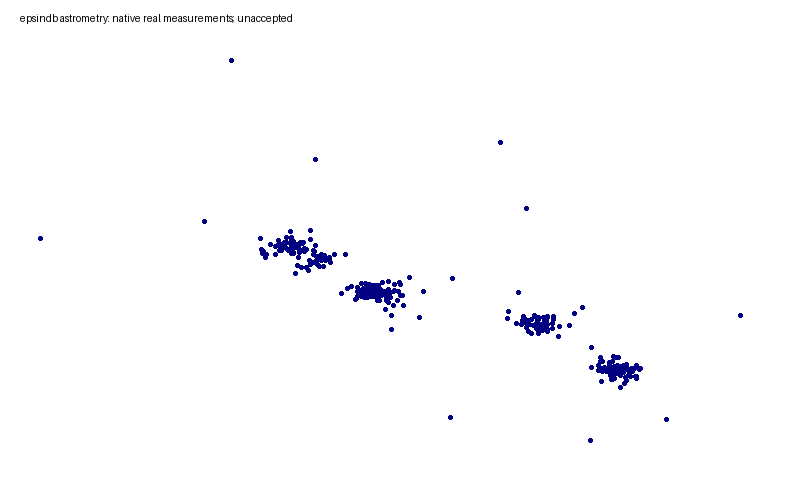

# G3-pm-epsindb — PASS (L3)

# Native target acceptance
Complete measurements and rejected frames:
```json
{
  "name": "* eps Ind B",
  "points": [
    {
      "visit": "V1",
      "mjd": 60789.85618796,
      "xi": -1.304020003547502,
      "eta": 0.975621749350658,
      "s_xi": 0.047632925194678405,
      "s_eta": 0.04674463502525715,
      "band": 2
    },
    {
      "visit": "V1",
      "mjd": 60789.856187972,
      "xi": -0.8696006013826815,
      "eta": 1.1683598588861825,
      "s_xi": 0.26863991159624173,
      "s_eta": 0.31033146694049624,
      "band": 5
    },
    {
      "visit": "V1",
      "mjd": 60789.857680217,
      "xi": -1.2845504226694058,
      "eta": 1.0569032834998429,
      "s_xi": 0.055607044945002966,
      "s_eta": 0.044223806051334316,
      "band": 2
    },
    {
      "visit": "V1",
      "mjd": 60789.857680217,
      "xi": -1.4199273153758174,
      "eta": 0.9305464235938767,
      "s_xi": 0.161393779653098,
      "s_eta": 0.2700682612358312,
      "band": 5
    },
    {
      "visit": "V1",
      "mjd": 60789.924263134,
      "xi": -0.869830470511908,
      "eta": 1.4400631854139094,
      "s_xi": 0.05656900319215476,
      "s_eta": 0.05133726905945754,
      "band": 2
    },
    {
      "visit": "V1",
      "mjd": 60789.924263145,
      "xi": -1.136720532529774,
      "eta": 0.7280881275135567,
      "s_xi": 0.12756078933956339,
      "s_eta": 0.16242142314615599,
      "band": 5
    },
    {
      "visit": "V1",
      "mjd": 60789.925755391,
      "xi": -1.0233723847546912,
      "eta": 1.0624635249934387,
      "s_xi": 0.08072703295549513,
      "s_eta": 0.06418166057607763,
      "band": 2
    },
    {
      "visit": "V1",
      "mjd": 60789.925755391,
      "xi": -1.0928684715261627,
      "eta": 1.0046184622884655,
      "s_xi": 0.1204397123037555,
      "s_eta": 0.17646784175342708,
      "band": 5
    },
    {
      "visit": "V1",
      "mjd": 60790.261636745,
      "xi": -1.246412735594549,
      "eta": 1.2085725619317658,
      "s_xi": 0.09843724038159854,
      "s_eta": 0.12933843212692192,
      "band": 4
    },
    {
      "visit": "V1",
      "mjd": 60790.26312899,
      "xi": 2.139398590590129,
      "eta": 4.169638800045299,
      "s_xi": 5.433129808519503,
      "s_eta": 8.824048812940505,
      "band": 1
    },
    {
      "visit": "V1",
      "mjd": 60790.26312899,
      "xi": -1.1389633234202907,
      "eta": 1.0266269391236125,
      "s_xi": 0.08935936124352224,
      "s_eta": 0.11069662978267927,
      "band": 4
    },
    {
      "visit": "V1",
      "mjd": 60791.075216803,
      "xi": -1.1443501641033698,
      "eta": 1.1017916616078125,
      "s_xi": 0.0538060885816461,
      "s_eta": 0.04938778214289727,
      "band": 2
    },
    {
      "visit": "V1",
      "mjd": 60791.075216803,
      "xi": -1.3851030974567404,
      "eta": 0.9791225222366545,
      "s_xi": 0.1768738017561063,
      "s_eta": 0.2513324526319184,
      "band": 5
    },
    {
      "visit": "V1",
      "mjd": 60791.21127833,
      "xi": -1.500075349173587,
      "eta": 1.0124043361350639,
      "s_xi": 0.07624989346186206,
      "s_eta": 0.0743767794811032,
      "band": 2
    },
    {
      "visit": "V1",
      "mjd": 60791.212770587,
      "xi": -1.2134463631124917,
      "eta": 0.8319404664797979,
      "s_xi": 0.06109200755192503,
      "s_eta": 0.06511698022078445,
      "band": 2
    },
    {
      "visit": "V1",
      "mjd": 60791.214262844,
      "xi": -0.7862111547592839,
      "eta": 0.9818209300713301,
      "s_xi": 0.0547383947202376,
      "s_eta": 0.04934526104997036,
      "band": 2
    },
    {
      "visit": "V1",
      "mjd": 60791.214262833,
      "xi": -1.1674326157081634,
      "eta": 1.1426485191150468,
      "s_xi": 0.12983575856092888,
      "s_eta": 0.11535547498692814,
      "band": 5
    },
    {
      "visit": "V1",
      "mjd": 60791.215755078,
      "xi": -1.1072706742876952,
      "eta": 0.9044380378634503,
      "s_xi": 0.07473117018236605,
      "s_eta": 0.05368855781092872,
      "band": 2
    },
    {
      "visit": "V1",
      "mjd": 60791.21575509,
      "xi": -1.624040427883767,
      "eta": 0.7289492976951912,
      "s_xi": 0.21622823460751714,
      "s_eta": 0.1304336733128791,
      "band": 5
    },
    {
      "visit": "V1",
      "mjd": 60791.8226048,
      "xi": -1.165387346921452,
      "eta": 0.8586907281337328,
      "s_xi": 0.05948188581504737,
      "s_eta": 0.05295548194743735,
      "band": 2
    },
    {
      "visit": "V1",
      "mjd": 60791.824097034,
      "xi": -1.3368653091672311,
      "eta": 0.9169775987190645,
      "s_xi": 0.0506762666989598,
      "s_eta": 0.06074518050531041,
      "band": 2
    },
    {
      "visit": "V1",
      "mjd": 60791.825589314,
      "xi": -1.3126599393563774,
      "eta": 0.9281516793960622,
      "s_xi": 0.05679875154233504,
      "s_eta": 0.04978941947647847,
      "band": 2
    },
    {
      "visit": "V1",
      "mjd": 60792.705183851,
      "xi": -1.0400350744856364,
      "eta": 1.0121006034072129,
      "s_xi": 0.06517080164923579,
      "s_eta": 0.06941157136691763,
      "band": 2
    },
    {
      "visit": "V1",
      "mjd": 60792.705183851,
      "xi": -1.171938883271097,
      "eta": 1.1552669724093778,
      "s_xi": 0.13954297661765983,
      "s_eta": 0.12052011092346492,
      "band": 5
    },
    {
      "visit": "V1",
      "mjd": 60792.706676097,
      "xi": -1.2258957141339142,
      "eta": 0.8493621580956876,
      "s_xi": 0.06250902153043725,
      "s_eta": 0.05620503767950172,
      "band": 2
    },
    {
      "visit": "V1",
      "mjd": 60792.706676097,
      "xi": -0.9345521351108558,
      "eta": 0.8381571633340871,
      "s_xi": 0.16390233005689886,
      "s_eta": 0.16376478072768869,
      "band": 5
    },
    {
      "visit": "V1",
      "mjd": 60792.708168365,
      "xi": -1.0409766925484574,
      "eta": 1.0059161894053812,
      "s_xi": 0.06021012973650587,
      "s_eta": 0.06531450047628634,
      "band": 2
    },
    {
      "visit": "V1",
      "mjd": 60792.708168365,
      "xi": -1.0399169306701053,
      "eta": 0.758863975120255,
      "s_xi": 0.1166842317129762,
      "s_eta": 0.164876815285871,
      "band": 5
    },
    {
      "visit": "V1",
      "mjd": 60792.709660611,
      "xi": -1.2465139331801218,
      "eta": 1.069989295508876,
      "s_xi": 0.07206136088345133,
      "s_eta": 0.060329528185061446,
      "band": 2
    },
    {
      "visit": "V1",
      "mjd": 60792.709660611,
      "xi": -1.1633335971479015,
      "eta": 1.223910131342948,
      "s_xi": 0.16336730865404114,
      "s_eta": 0.1181669931034073,
      "band": 5
    },
    {
      "visit": "V1",
      "mjd": 60792.841849372,
      "xi": -1.3033642460775055,
      "eta": 0.9101417869195481,
      "s_xi": 0.12978597995260513,
      "s_eta": 0.11610153141807172,
      "band": 1
    },
    {
      "visit": "V1",
      "mjd": 60792.841849372,
      "xi": -1.1840781369359785,
      "eta": 0.8548061344583351,
      "s_xi": 0.06636894231531183,
      "s_eta": 0.08154631572345215,
      "band": 4
    },
    {
      "visit": "V1",
      "mjd": 60792.843341641,
      "xi": -1.0421289932670783,
      "eta": 0.8591123946840546,
      "s_xi": 0.1454291507670821,
      "s_eta": 0.15479477867332894,
      "band": 1
    },
    {
      "visit": "V1",
      "mjd": 60792.843341641,
      "xi": -0.9698787739454557,
      "eta": 0.7877334924371329,
      "s_xi": 0.1035547184921305,
      "s_eta": 0.08345492310279046,
      "band": 4
    },
    {
      "visit": "V1",
      "mjd": 60794.065478909,
      "xi": -1.141267267747823,
      "eta": 0.7660042329185791,
      "s_xi": 0.047712296114364505,
      "s_eta": 0.06191283940647932,
      "band": 3
    },
    {
      "visit": "V1",
      "mjd": 60794.065478921,
      "xi": -1.1876427241251453,
      "eta": 1.4044972453032045,
      "s_xi": 0.16923589186290836,
      "s_eta": 0.17352071020737,
      "band": 6
    },
    {
      "visit": "V1",
      "mjd": 60794.066971178,
      "xi": -1.2801686448825023,
      "eta": 1.0643971015779328,
      "s_xi": 0.05700990437531948,
      "s_eta": 0.05383930769309212,
      "band": 3
    },
    {
      "visit": "V1",
      "mjd": 60794.066971178,
      "xi": -0.8210290832408893,
      "eta": 0.8070790812983495,
      "s_xi": 0.1883322352161859,
      "s_eta": 0.2660187459391668,
      "band": 6
    },
    {
      "visit": "V1",
      "mjd": 60794.068463423,
      "xi": -1.2508834694490418,
      "eta": 0.8682361742579952,
      "s_xi": 0.05918567884537892,
      "s_eta": 0.0598220023671865,
      "band": 3
    },
    {
      "visit": "V1",
      "mjd": 60794.132257254,
      "xi": -0.9577282538271076,
      "eta": 0.8681977127692903,
      "s_xi": 0.05725699230447195,
      "s_eta": 0.06444912146656405,
      "band": 3
    },
    {
      "visit": "V1",
      "mjd": 60794.132257254,
      "xi": -1.0364534322971568,
      "eta": 0.7602362623726888,
      "s_xi": 0.19505990733407333,
      "s_eta": 0.15993815454154287,
      "band": 6
    },
    {
      "visit": "V1",
      "mjd": 60794.133749511,
      "xi": -1.2080893599819236,
      "eta": 0.8480627092444377,
      "s_xi": 0.06728147841286852,
      "s_eta": 0.0536944368549366,
      "band": 3
    },
    {
      "visit": "V1",
      "mjd": 60794.135241756,
      "xi": -1.5670350240775217,
      "eta": 0.6988817177910016,
      "s_xi": 0.09229122965804021,
      "s_eta": 0.08237432468191326,
      "band": 3
    },
    {
      "visit": "V1",
      "mjd": 60794.135241756,
      "xi": -1.1804647198154314,
      "eta": 0.8691710201505027,
      "s_xi": 0.2265719316625173,
      "s_eta": 0.19377045721774147,
      "band": 6
    },
    {
      "visit": "V1",
      "mjd": 60794.136734002,
      "xi": -1.1751270474855506,
      "eta": 0.7362030427951535,
      "s_xi": 0.17236077998856014,
      "s_eta": 0.08456828276335711,
      "band": 3
    },
    {
      "visit": "V1",
      "mjd": 60794.679274708,
      "xi": -1.35558364921384,
      "eta": 0.8274159403342249,
      "s_xi": 0.0625095199255048,
      "s_eta": 0.0596010552040341,
      "band": 3
    },
    {
      "visit": "V1",
      "mjd": 60794.680766953,
      "xi": -1.0363010751582282,
      "eta": 1.023926533250754,
      "s_xi": 0.06193548223592171,
      "s_eta": 0.06392296952443467,
      "band": 3
    },
    {
      "visit": "V1",
      "mjd": 60795.083355599,
      "xi": -0.9886140597469536,
      "eta": 1.0295230640832504,
      "s_xi": 0.08639659840049192,
      "s_eta": 0.054313704226103765,
      "band": 3
    },
    {
      "visit": "V1",
      "mjd": 60795.084847844,
      "xi": -1.1321889801907523,
      "eta": 1.031962327167473,
      "s_xi": 0.05592426879374408,
      "s_eta": 0.05809912060124993,
      "band": 3
    },
    {
      "visit": "V1",
      "mjd": 60795.08634009,
      "xi": -1.3502587367947991,
      "eta": 0.9982362728308897,
      "s_xi": 0.08265713256630802,
      "s_eta": 0.09886544167245316,
      "band": 3
    },
    {
      "visit": "V1",
      "mjd": 60795.087832358,
      "xi": -1.6603749538993238,
      "eta": 1.1812782941597177,
      "s_xi": 0.17082799030127105,
      "s_eta": 0.12207622358930054,
      "band": 3
    },
    {
      "visit": "V1",
      "mjd": 60795.902176317,
      "xi": -1.1542285269174404,
      "eta": 0.9197888516293092,
      "s_xi": 0.06217705771531318,
      "s_eta": 0.06145792273641909,
      "band": 3
    },
    {
      "visit": "V1",
      "mjd": 60795.903668597,
      "xi": -1.3711046150809796,
      "eta": 1.1225678832960824,
      "s_xi": 0.1163723289709456,
      "s_eta": 0.1318608586328886,
      "band": 3
    },
    {
      "visit": "V1",
      "mjd": 60796.581027231,
      "xi": -1.2607830958147468,
      "eta": 0.9049710679331066,
      "s_xi": 0.050623096861689615,
      "s_eta": 0.04622204724764387,
      "band": 3
    },
    {
      "visit": "V1",
      "mjd": 60796.582519488,
      "xi": -1.3348104291615612,
      "eta": 0.8277780697737503,
      "s_xi": 0.07827312427190208,
      "s_eta": 0.0669688415026172,
      "band": 3
    },
    {
      "visit": "V1",
      "mjd": 60796.582519488,
      "xi": -0.7235656615725545,
      "eta": 0.636101561373995,
      "s_xi": 0.23718103366496254,
      "s_eta": 0.1540716536669004,
      "band": 6
    },
    {
      "visit": "V1",
      "mjd": 60796.584011745,
      "xi": -1.643927337156486,
      "eta": 0.8616023532430728,
      "s_xi": 0.09963741963439879,
      "s_eta": 0.08990328200968022,
      "band": 3
    },
    {
      "visit": "V1",
      "mjd": 60796.781344476,
      "xi": -0.9758337208268947,
      "eta": 1.0823186435715733,
      "s_xi": 0.09011747713290154,
      "s_eta": 0.08043617253535337,
      "band": 3
    },
    {
      "visit": "V1",
      "mjd": 60796.782836722,
      "xi": -1.1862767896576183,
      "eta": 1.033492337662252,
      "s_xi": 0.1624721436418127,
      "s_eta": 0.15969640513632963,
      "band": 3
    },
    {
      "visit": "V1",
      "mjd": 60799.703372034,
      "xi": -0.9438387277890794,
      "eta": 0.8174003582208378,
      "s_xi": 0.07183969791212082,
      "s_eta": 0.05261576371876816,
      "band": 2
    },
    {
      "visit": "V1",
      "mjd": 60799.704864303,
      "xi": -1.0548616755941338,
      "eta": 0.8730327711113528,
      "s_xi": 0.05134563219401704,
      "s_eta": 0.05462303293653476,
      "band": 2
    },
    {
      "visit": "V1",
      "mjd": 60799.704864291,
      "xi": -0.4903135589613777,
      "eta": 0.7010188898280028,
      "s_xi": 0.1507406066892965,
      "s_eta": 0.4665526479882329,
      "band": 5
    },
    {
      "visit": "V1",
      "mjd": 60799.706356536,
      "xi": -1.0571572458920566,
      "eta": 0.9589494512863803,
      "s_xi": 0.062449695551259954,
      "s_eta": 0.05068213943791759,
      "band": 2
    },
    {
      "visit": "V1",
      "mjd": 60801.740528643,
      "xi": -1.1565849025581985,
      "eta": 1.1161619264538425,
      "s_xi": 0.0731714431638015,
      "s_eta": 0.08587388091393636,
      "band": 3
    },
    {
      "visit": "V1",
      "mjd": 60802.218902381,
      "xi": -1.4173402052580166,
      "eta": 0.7101805916084172,
      "s_xi": 0.13377048192235422,
      "s_eta": 0.06175629694745203,
      "band": 3
    },
    {
      "visit": "V1",
      "mjd": 60802.220394638,
      "xi": -1.6192710418978222,
      "eta": 0.7782575436883922,
      "s_xi": 0.13157616537812383,
      "s_eta": 0.10386492114701393,
      "band": 3
    },
    {
      "visit": "V1",
      "mjd": 60802.220394627,
      "xi": -1.5872578674226796,
      "eta": 0.5977810660187141,
      "s_xi": 0.252159722420139,
      "s_eta": 0.19609563029360053,
      "band": 6
    },
    {
      "visit": "V1",
      "mjd": 60815.131868492,
      "xi": -0.8273266821785594,
      "eta": 0.7018265475128965,
      "s_xi": 0.056721728623208824,
      "s_eta": 0.046091757901372,
      "band": 3
    },
    {
      "visit": "V1",
      "mjd": 60815.131868492,
      "xi": -0.574320493289475,
      "eta": 0.5996042395943401,
      "s_xi": 0.20602634065752787,
      "s_eta": 0.2271078589864406,
      "band": 6
    },
    {
      "visit": "V1",
      "mjd": 60832.652078469,
      "xi": -0.9066828102692819,
      "eta": 0.18839411542764725,
      "s_xi": 0.061855829118696075,
      "s_eta": 0.06885531568642322,
      "band": 2
    },
    {
      "visit": "V1",
      "mjd": 60832.653570715,
      "xi": -1.003109049779292,
      "eta": 0.3041692557743477,
      "s_xi": 0.07430990225900243,
      "s_eta": 0.08725741993959947,
      "band": 2
    },
    {
      "visit": "V1",
      "mjd": 60832.655062983,
      "xi": -1.0664491429416225,
      "eta": 0.36716838659089235,
      "s_xi": 0.06393570214937927,
      "s_eta": 0.0625329523972712,
      "band": 2
    },
    {
      "visit": "V1",
      "mjd": 60832.655062983,
      "xi": -0.8909416397288568,
      "eta": 0.5035879854382975,
      "s_xi": 0.12166551947298535,
      "s_eta": 0.11368454184905641,
      "band": 5
    },
    {
      "visit": "V1",
      "mjd": 60832.721539314,
      "xi": -0.6465640269149473,
      "eta": 0.6741935014227749,
      "s_xi": 0.08386230314654777,
      "s_eta": 0.06020093927222712,
      "band": 2
    },
    {
      "visit": "V1",
      "mjd": 60832.723031571,
      "xi": -0.3106973737773754,
      "eta": 0.7006224960153811,
      "s_xi": 0.05535447340904897,
      "s_eta": 0.05259934266528511,
      "band": 2
    },
    {
      "visit": "V1",
      "mjd": 60832.72303156,
      "xi": -0.7248827318105924,
      "eta": 0.5526824731006403,
      "s_xi": 0.18402102536095682,
      "s_eta": 0.11659694168689211,
      "band": 5
    },
    {
      "visit": "V1",
      "mjd": 60832.724523817,
      "xi": -0.6599981845944085,
      "eta": 0.33116747899101673,
      "s_xi": 0.04721097572646777,
      "s_eta": 0.05154261889966006,
      "band": 2
    },
    {
      "visit": "V1",
      "mjd": 60832.724523805,
      "xi": -0.8158813247151864,
      "eta": 0.46197526655705384,
      "s_xi": 0.12851309444415945,
      "s_eta": 0.12267432116235832,
      "band": 5
    },
    {
      "visit": "V1",
      "mjd": 60832.72601605,
      "xi": -0.5448795927921342,
      "eta": 0.45746621428105894,
      "s_xi": 0.05983720431095364,
      "s_eta": 0.052918519872090224,
      "band": 2
    },
    {
      "visit": "V1",
      "mjd": 60832.726016062,
      "xi": -0.7736404605184094,
      "eta": 0.6345665633396109,
      "s_xi": 0.1465477995514816,
      "s_eta": 0.11392086139807789,
      "band": 5
    },
    {
      "visit": "V1",
      "mjd": 60832.855380229,
      "xi": -0.7584465635712536,
      "eta": 0.39382764808493054,
      "s_xi": 0.048232662629932595,
      "s_eta": 0.05072561540755493,
      "band": 2
    },
    {
      "visit": "V1",
      "mjd": 60832.856872474,
      "xi": -0.8762828105694516,
      "eta": 0.5086711456410152,
      "s_xi": 0.05560177183754474,
      "s_eta": 0.044817059638410324,
      "band": 2
    },
    {
      "visit": "V1",
      "mjd": 60832.856872486,
      "xi": -0.9350447106778844,
      "eta": 0.28012580509787116,
      "s_xi": 0.2653825532669097,
      "s_eta": 0.21649256582664503,
      "band": 5
    },
    {
      "visit": "V1",
      "mjd": 60832.858364731,
      "xi": -0.8690070057910155,
      "eta": 0.3797172886139423,
      "s_xi": 0.06596619202602019,
      "s_eta": 0.06245873614407088,
      "band": 2
    },
    {
      "visit": "V1",
      "mjd": 60832.858364731,
      "xi": -0.5713276141527893,
      "eta": 0.49656150538856475,
      "s_xi": 0.15637819407178488,
      "s_eta": 0.1342757891297266,
      "band": 5
    },
    {
      "visit": "V1",
      "mjd": 60833.536434025,
      "xi": -0.776492434986219,
      "eta": 0.5128959924337015,
      "s_xi": 0.06248272182483846,
      "s_eta": 0.05907126889254105,
      "band": 2
    },
    {
      "visit": "V1",
      "mjd": 60833.536434025,
      "xi": -0.6368170357571393,
      "eta": 0.5454316839781748,
      "s_xi": 0.23481365708609395,
      "s_eta": 0.13883267718278686,
      "band": 5
    },
    {
      "visit": "V1",
      "mjd": 60833.53792627,
      "xi": -0.6265988699609342,
      "eta": 0.5017543826844943,
      "s_xi": 0.072777902614756,
      "s_eta": 0.06578046137298373,
      "band": 2
    },
    {
      "visit": "V1",
      "mjd": 60833.53792627,
      "xi": -0.7256365043451722,
      "eta": 0.3109045005164505,
      "s_xi": 0.1582998888877589,
      "s_eta": 0.13078765456561678,
      "band": 5
    },
    {
      "visit": "V1",
      "mjd": 60833.539418516,
      "xi": -0.7059610965775076,
      "eta": 0.5599001263391489,
      "s_xi": 0.05727532062272409,
      "s_eta": 0.05494291922453694,
      "band": 2
    },
    {
      "visit": "V1",
      "mjd": 60833.539418527,
      "xi": -0.8079559096437081,
      "eta": 0.7860275766109868,
      "s_xi": 0.11835481432304287,
      "s_eta": 0.13007732613459258,
      "band": 5
    },
    {
      "visit": "V1",
      "mjd": 60836.187493319,
      "xi": -0.698163484115277,
      "eta": 0.69590744840188,
      "s_xi": 0.09536524261249123,
      "s_eta": 0.07512097357961853,
      "band": 3
    },
    {
      "visit": "V1",
      "mjd": 60836.188985576,
      "xi": -1.0590031927671466,
      "eta": 0.6051877005679939,
      "s_xi": 0.057805550468414936,
      "s_eta": 0.06500631530407315,
      "band": 3
    },
    {
      "visit": "V1",
      "mjd": 60836.188985576,
      "xi": -0.6927407830095641,
      "eta": 0.5142388952721182,
      "s_xi": 0.21673152091054096,
      "s_eta": 0.19518469194316995,
      "band": 6
    },
    {
      "visit": "V1",
      "mjd": 60836.190477821,
      "xi": -1.0994135345513338,
      "eta": 0.10873931538839546,
      "s_xi": 0.09156591676992037,
      "s_eta": 0.10037113282857231,
      "band": 3
    },
    {
      "visit": "V2",
      "mjd": 60946.964777416,
      "xi": -0.12676453171889307,
      "eta": -0.4344637614110994,
      "s_xi": 0.09059791435995447,
      "s_eta": 0.07999271905792034,
      "band": 3
    },
    {
      "visit": "V2",
      "mjd": 60946.966269661,
      "xi": 0.5373876940817405,
      "eta": -0.18242564749096124,
      "s_xi": 0.13197712735759604,
      "s_eta": 0.0831769554635929,
      "band": 3
    },
    {
      "visit": "V2",
      "mjd": 60947.302613238,
      "xi": 0.06445587646319284,
      "eta": -0.2202253704417378,
      "s_xi": 0.056842605827577775,
      "s_eta": 0.05519754129107892,
      "band": 3
    },
    {
      "visit": "V2",
      "mjd": 60947.304105495,
      "xi": 0.003677928051617957,
      "eta": -0.3566077078788219,
      "s_xi": 0.07580203587023265,
      "s_eta": 0.06818261309029588,
      "band": 3
    },
    {
      "visit": "V2",
      "mjd": 60947.304105506,
      "xi": 0.04079621008391204,
      "eta": -0.6282071313863852,
      "s_xi": 0.2536059428788214,
      "s_eta": 0.4531548794025949,
      "band": 6
    },
    {
      "visit": "V2",
      "mjd": 60947.305597752,
      "xi": 0.46678841083913375,
      "eta": -0.22142099716420044,
      "s_xi": 0.08169270836908901,
      "s_eta": 0.05935043081791741,
      "band": 3
    },
    {
      "visit": "V2",
      "mjd": 60947.307090009,
      "xi": -0.37443757542430794,
      "eta": -0.5142088375994629,
      "s_xi": 0.09358501849766933,
      "s_eta": 0.08573830808407376,
      "band": 3
    },
    {
      "visit": "V2",
      "mjd": 60947.574629962,
      "xi": 0.17324946049741324,
      "eta": -0.5630187878194749,
      "s_xi": 0.05238118558741448,
      "s_eta": 0.06350963453483546,
      "band": 3
    },
    {
      "visit": "V2",
      "mjd": 60947.576122208,
      "xi": 0.34528294970784557,
      "eta": -0.7239871913820763,
      "s_xi": 0.06544975523196819,
      "s_eta": 0.0520841527001764,
      "band": 3
    },
    {
      "visit": "V2",
      "mjd": 60947.577614476,
      "xi": 0.4665310462714287,
      "eta": -0.41583228069133604,
      "s_xi": 0.08064829082012591,
      "s_eta": 0.06555936174664911,
      "band": 3
    },
    {
      "visit": "V2",
      "mjd": 60948.999946536,
      "xi": 0.012430919366087825,
      "eta": -0.5256504506617661,
      "s_xi": 0.06294056865406907,
      "s_eta": 0.05856308624411976,
      "band": 3
    },
    {
      "visit": "V2",
      "mjd": 60949.001438793,
      "xi": -0.08699696012556717,
      "eta": -0.4680460768441385,
      "s_xi": 0.09141387665690337,
      "s_eta": 0.08633144668743294,
      "band": 3
    },
    {
      "visit": "V2",
      "mjd": 60949.002931062,
      "xi": 0.010476647643168156,
      "eta": -0.20080721042326433,
      "s_xi": 0.06112308938782522,
      "s_eta": 0.07285720550322329,
      "band": 3
    },
    {
      "visit": "V2",
      "mjd": 60949.004423296,
      "xi": -0.06381545478119591,
      "eta": -0.20409424570400925,
      "s_xi": 0.12475647670716976,
      "s_eta": 0.1106646923989381,
      "band": 3
    },
    {
      "visit": "V2",
      "mjd": 60949.135706189,
      "xi": -0.017139046846810287,
      "eta": -0.3614729653382134,
      "s_xi": 0.058302023456277205,
      "s_eta": 0.052337656101343825,
      "band": 3
    },
    {
      "visit": "V2",
      "mjd": 60949.204794025,
      "xi": -0.03249381379952748,
      "eta": -0.34327557127167174,
      "s_xi": 0.06855473930868641,
      "s_eta": 0.05692876377136838,
      "band": 3
    },
    {
      "visit": "V2",
      "mjd": 60949.206286282,
      "xi": -0.11993950598857239,
      "eta": -0.6042722847810547,
      "s_xi": 0.0785333614066206,
      "s_eta": 0.075186056489995,
      "band": 3
    },
    {
      "visit": "V2",
      "mjd": 60949.54314502,
      "xi": 0.2003421288808087,
      "eta": -0.41058938005993206,
      "s_xi": 0.061631712137585726,
      "s_eta": 0.06750012726527421,
      "band": 3
    },
    {
      "visit": "V2",
      "mjd": 60949.54314502,
      "xi": -0.05395876143973771,
      "eta": -0.44315396032480736,
      "s_xi": 0.20660633978323473,
      "s_eta": 0.2045317767152823,
      "band": 6
    },
    {
      "visit": "V2",
      "mjd": 60949.746589083,
      "xi": 0.22523988756446572,
      "eta": -0.739879662564286,
      "s_xi": 0.06419762004268678,
      "s_eta": 0.06922509345183446,
      "band": 2
    },
    {
      "visit": "V2",
      "mjd": 60949.746589083,
      "xi": -0.2178864979388105,
      "eta": -0.28294632701396727,
      "s_xi": 0.1389147592660714,
      "s_eta": 0.12514775875220926,
      "band": 5
    },
    {
      "visit": "V2",
      "mjd": 60949.749573597,
      "xi": 0.36244945785285854,
      "eta": -0.13641087497410898,
      "s_xi": 0.1329403541411268,
      "s_eta": 0.11766814646479079,
      "band": 2
    },
    {
      "visit": "V2",
      "mjd": 60950.018872277,
      "xi": 0.31938308016220673,
      "eta": -0.998432580181336,
      "s_xi": 0.08634988750657442,
      "s_eta": 0.16356860445604235,
      "band": 2
    },
    {
      "visit": "V2",
      "mjd": 60950.018872277,
      "xi": 0.05039562673566447,
      "eta": -0.3666066479590484,
      "s_xi": 0.11778603433207963,
      "s_eta": 0.11406974732846159,
      "band": 5
    },
    {
      "visit": "V2",
      "mjd": 60950.021856803,
      "xi": -0.05270096692652142,
      "eta": -0.5311019984892187,
      "s_xi": 0.061767159081985844,
      "s_eta": 0.04761154760357888,
      "band": 2
    },
    {
      "visit": "V2",
      "mjd": 60950.021856803,
      "xi": 0.4108025287206267,
      "eta": -1.6326300548123056,
      "s_xi": 0.231768564635836,
      "s_eta": 0.1967140982839118,
      "band": 5
    },
    {
      "visit": "V2",
      "mjd": 60950.023349048,
      "xi": 0.2179139012579963,
      "eta": -0.7237088389757113,
      "s_xi": 0.06434323097088368,
      "s_eta": 0.07345999217778569,
      "band": 2
    },
    {
      "visit": "V2",
      "mjd": 60950.023349048,
      "xi": 0.36237630296433926,
      "eta": -0.3961986364776623,
      "s_xi": 0.17312283891383864,
      "s_eta": 0.1410949482354292,
      "band": 5
    },
    {
      "visit": "V2",
      "mjd": 60950.087036351,
      "xi": -0.13228431507224306,
      "eta": -0.6743704086661398,
      "s_xi": 0.06196799394015593,
      "s_eta": 0.058712601063275006,
      "band": 2
    },
    {
      "visit": "V2",
      "mjd": 60950.088528608,
      "xi": -0.015075950727083114,
      "eta": -0.4722018220122156,
      "s_xi": 0.11511640548831463,
      "s_eta": 0.07736331385151325,
      "band": 2
    },
    {
      "visit": "V2",
      "mjd": 60950.088528608,
      "xi": 0.1287591047176785,
      "eta": -0.3355405367406713,
      "s_xi": 0.14232446769873158,
      "s_eta": 0.1449330146971501,
      "band": 5
    },
    {
      "visit": "V2",
      "mjd": 60950.090020865,
      "xi": 0.0866775967048436,
      "eta": -0.3172566467299438,
      "s_xi": 0.06942723212837877,
      "s_eta": 0.05645323805609718,
      "band": 2
    },
    {
      "visit": "V2",
      "mjd": 60950.090020865,
      "xi": 0.10517013060218214,
      "eta": -0.6116500526398976,
      "s_xi": 0.1331984185834408,
      "s_eta": 0.16758482429726085,
      "band": 5
    },
    {
      "visit": "V2",
      "mjd": 60950.091513122,
      "xi": 0.254063184025813,
      "eta": -0.4687844411698925,
      "s_xi": 0.05907963416434271,
      "s_eta": 0.07262408643026094,
      "band": 2
    },
    {
      "visit": "V2",
      "mjd": 60950.091513122,
      "xi": -0.2789113948275479,
      "eta": -0.3672608563883364,
      "s_xi": 0.12312931253508684,
      "s_eta": 0.32357380137145736,
      "band": 5
    },
    {
      "visit": "V2",
      "mjd": 60950.902233817,
      "xi": 0.1327342749389446,
      "eta": -0.5185127974178038,
      "s_xi": 0.08290685591319759,
      "s_eta": 0.04201105971707867,
      "band": 2
    },
    {
      "visit": "V2",
      "mjd": 60950.969829395,
      "xi": 0.1844002044865392,
      "eta": -0.4677244592107293,
      "s_xi": 0.07223343394232225,
      "s_eta": 0.049423129391765686,
      "band": 2
    },
    {
      "visit": "V2",
      "mjd": 60950.969829395,
      "xi": 0.21573529017780496,
      "eta": -0.5530790864272299,
      "s_xi": 0.16155930821004863,
      "s_eta": 0.18814599228094192,
      "band": 5
    },
    {
      "visit": "V2",
      "mjd": 60951.721037532,
      "xi": -0.03325996355397387,
      "eta": -0.4183691934046373,
      "s_xi": 0.0651902480222026,
      "s_eta": 0.0761944786194141,
      "band": 1
    },
    {
      "visit": "V2",
      "mjd": 60951.721037532,
      "xi": 0.21040156113281755,
      "eta": -0.4978414523443346,
      "s_xi": 0.08574037948584726,
      "s_eta": 0.08676566648135103,
      "band": 4
    },
    {
      "visit": "V2",
      "mjd": 60951.78493803,
      "xi": -0.12100685832264235,
      "eta": -0.3175940862892396,
      "s_xi": 0.08086888079468939,
      "s_eta": 0.06820815643877175,
      "band": 2
    },
    {
      "visit": "V2",
      "mjd": 60953.279981976,
      "xi": 0.13098316890323286,
      "eta": -0.3940605028925222,
      "s_xi": 0.08591191486808963,
      "s_eta": 0.07295193555493651,
      "band": 1
    },
    {
      "visit": "V2",
      "mjd": 60953.279981976,
      "xi": 0.2749324462554312,
      "eta": -0.18193994858018359,
      "s_xi": 0.08346300945759864,
      "s_eta": 0.10457804788493842,
      "band": 4
    },
    {
      "visit": "V2",
      "mjd": 60953.281474233,
      "xi": 0.1693720182831736,
      "eta": -0.5946605699229423,
      "s_xi": 0.08605030017195632,
      "s_eta": 0.06639904634155847,
      "band": 1
    },
    {
      "visit": "V2",
      "mjd": 60953.282966479,
      "xi": 0.07451232884490575,
      "eta": -0.5047431602495931,
      "s_xi": 0.056191277207338165,
      "s_eta": 0.06010675322099807,
      "band": 1
    },
    {
      "visit": "V2",
      "mjd": 60953.282966479,
      "xi": 0.08080519713289075,
      "eta": -0.6053279313868603,
      "s_xi": 0.09327925101430527,
      "s_eta": 0.09596857358384114,
      "band": 4
    },
    {
      "visit": "V2",
      "mjd": 60954.229606722,
      "xi": 0.12389380958170451,
      "eta": -0.4862439112891578,
      "s_xi": 0.059486370710376726,
      "s_eta": 0.06664858655854408,
      "band": 3
    },
    {
      "visit": "V2",
      "mjd": 60954.298872219,
      "xi": 0.38959666338500554,
      "eta": -0.5656348698009868,
      "s_xi": 0.0899034076840505,
      "s_eta": 0.08786556846587332,
      "band": 2
    },
    {
      "visit": "V2",
      "mjd": 60954.298872219,
      "xi": 0.16851216420092502,
      "eta": -0.2730895153267178,
      "s_xi": 0.13336908919169324,
      "s_eta": 0.1372616768217338,
      "band": 5
    },
    {
      "visit": "V2",
      "mjd": 60954.300364465,
      "xi": -0.09666147762872798,
      "eta": -0.4164913388404372,
      "s_xi": 0.05273928148219104,
      "s_eta": 0.05305080703143914,
      "band": 2
    },
    {
      "visit": "V2",
      "mjd": 60954.300364465,
      "xi": 0.10748465877413668,
      "eta": -0.43298650183565324,
      "s_xi": 0.13208164988591367,
      "s_eta": 0.19502945385980114,
      "band": 5
    },
    {
      "visit": "V2",
      "mjd": 60954.366823111,
      "xi": 0.12137537226085998,
      "eta": -0.589843553951177,
      "s_xi": 0.06960619722188238,
      "s_eta": 0.079427684177739,
      "band": 2
    },
    {
      "visit": "V2",
      "mjd": 60954.366823111,
      "xi": 0.0997219278403346,
      "eta": -0.4241538153481047,
      "s_xi": 0.15480979265423506,
      "s_eta": 0.14571088808728339,
      "band": 5
    },
    {
      "visit": "V2",
      "mjd": 60954.501001675,
      "xi": 0.13512658753714346,
      "eta": -0.5446903529179902,
      "s_xi": 0.05993960756179597,
      "s_eta": 0.08473363223342396,
      "band": 2
    },
    {
      "visit": "V2",
      "mjd": 60954.501001675,
      "xi": 0.27032539250897036,
      "eta": -0.5372647552045376,
      "s_xi": 0.16540065358500539,
      "s_eta": 0.21970909106396533,
      "band": 5
    },
    {
      "visit": "V2",
      "mjd": 60955.181842948,
      "xi": 0.564230119614734,
      "eta": -0.21709561997768803,
      "s_xi": 0.8137451634780292,
      "s_eta": 0.6309632880552637,
      "band": 1
    },
    {
      "visit": "V2",
      "mjd": 60955.181842948,
      "xi": 0.2034244806742854,
      "eta": -0.2741430667267383,
      "s_xi": 0.09206094631061762,
      "s_eta": 0.09512283036405457,
      "band": 4
    },
    {
      "visit": "V2",
      "mjd": 60955.183335194,
      "xi": 0.024326699759817084,
      "eta": -0.39094187503556327,
      "s_xi": 0.520905058023345,
      "s_eta": 0.6859924898161973,
      "band": 1
    },
    {
      "visit": "V2",
      "mjd": 60955.183335194,
      "xi": 0.04395336336800841,
      "eta": -0.36980435002092304,
      "s_xi": 0.07440113459595443,
      "s_eta": 0.09839360257161886,
      "band": 4
    },
    {
      "visit": "V2",
      "mjd": 60955.792015286,
      "xi": 0.6984584300417123,
      "eta": -0.018998909343975454,
      "s_xi": 0.31899574120197277,
      "s_eta": 0.2648143569336198,
      "band": 1
    },
    {
      "visit": "V2",
      "mjd": 60955.792015298,
      "xi": -0.11216828393422831,
      "eta": -0.5533179220263105,
      "s_xi": 0.10235754943818758,
      "s_eta": 0.09875740937048204,
      "band": 4
    },
    {
      "visit": "V2",
      "mjd": 60955.998923516,
      "xi": -0.041401759707525375,
      "eta": -0.5476946173991563,
      "s_xi": 0.08046537214227209,
      "s_eta": 0.08675211813818594,
      "band": 4
    },
    {
      "visit": "V2",
      "mjd": 60956.404195067,
      "xi": 0.14343561205924504,
      "eta": -0.33176023141027383,
      "s_xi": 0.08436393508024508,
      "s_eta": 0.10241799924758835,
      "band": 1
    },
    {
      "visit": "V2",
      "mjd": 60956.404195055,
      "xi": 0.32605128843916326,
      "eta": -0.44697174587400723,
      "s_xi": 0.08600566463620436,
      "s_eta": 0.09125028347827882,
      "band": 4
    },
    {
      "visit": "V2",
      "mjd": 60956.4056873,
      "xi": 0.015848182915569622,
      "eta": -0.6416417509367857,
      "s_xi": 0.08479002384028193,
      "s_eta": 0.07250635666654529,
      "band": 1
    },
    {
      "visit": "V2",
      "mjd": 60956.4056873,
      "xi": 0.1717596854338329,
      "eta": -0.2528045169114972,
      "s_xi": 0.08188835584918702,
      "s_eta": 0.09371409142027368,
      "band": 4
    },
    {
      "visit": "V2",
      "mjd": 60957.829689233,
      "xi": 0.24194628418317216,
      "eta": -0.3905326952688144,
      "s_xi": 0.0503431926145638,
      "s_eta": 0.0665438412826424,
      "band": 2
    },
    {
      "visit": "V2",
      "mjd": 60957.829689233,
      "xi": 0.2529737033533357,
      "eta": -0.5493400474636683,
      "s_xi": 0.17846941657022466,
      "s_eta": 0.1998665440583247,
      "band": 5
    },
    {
      "visit": "V2",
      "mjd": 60957.964862636,
      "xi": -0.06017917386650966,
      "eta": -0.5949173080496418,
      "s_xi": 0.0987758578852921,
      "s_eta": 0.0926389944993997,
      "band": 2
    },
    {
      "visit": "V2",
      "mjd": 60957.964862636,
      "xi": 0.5674335014655573,
      "eta": -0.5604370365687256,
      "s_xi": 0.11672552151218533,
      "s_eta": 0.11948740369063421,
      "band": 5
    },
    {
      "visit": "V2",
      "mjd": 60958.237661027,
      "xi": 0.19072544964185478,
      "eta": -0.4442604029865933,
      "s_xi": 0.059805439317367724,
      "s_eta": 0.0899112776717136,
      "band": 2
    },
    {
      "visit": "V2",
      "mjd": 60958.237661027,
      "xi": -0.03950157267397518,
      "eta": -0.526395089689616,
      "s_xi": 0.1325510114457623,
      "s_eta": 0.13854167899479136,
      "band": 5
    },
    {
      "visit": "V2",
      "mjd": 60958.239153273,
      "xi": 0.2595118370635354,
      "eta": -0.4757321578412543,
      "s_xi": 0.06174974279125338,
      "s_eta": 0.058140606488018325,
      "band": 2
    },
    {
      "visit": "V2",
      "mjd": 60958.239153273,
      "xi": 0.5252175725447475,
      "eta": -0.4576865605391884,
      "s_xi": 0.15119114333594602,
      "s_eta": 0.10634402701241756,
      "band": 5
    },
    {
      "visit": "V2",
      "mjd": 60958.24064553,
      "xi": 0.03907865329811392,
      "eta": -0.5338594555912166,
      "s_xi": 0.06457791613864544,
      "s_eta": 0.05232531773364452,
      "band": 2
    },
    {
      "visit": "V2",
      "mjd": 60958.24064553,
      "xi": 0.08360619712226554,
      "eta": -0.33284338130442936,
      "s_xi": 0.10833496849849873,
      "s_eta": 0.18235886752598235,
      "band": 5
    },
    {
      "visit": "V2",
      "mjd": 60958.373811513,
      "xi": 0.2537453773806514,
      "eta": -0.5780129120915696,
      "s_xi": 0.061403739197420794,
      "s_eta": 0.07565095588468375,
      "band": 1
    },
    {
      "visit": "V2",
      "mjd": 60958.373811513,
      "xi": 0.111314084190231,
      "eta": -0.556366044534892,
      "s_xi": 0.08813435060899981,
      "s_eta": 0.11164068533565855,
      "band": 4
    },
    {
      "visit": "V2",
      "mjd": 60958.37530377,
      "xi": 0.20942040870496817,
      "eta": -0.7395033504083713,
      "s_xi": 0.05503886416191599,
      "s_eta": 0.051489943905040095,
      "band": 1
    },
    {
      "visit": "V2",
      "mjd": 60958.37530377,
      "xi": 0.12338400678448155,
      "eta": -0.2538545850392971,
      "s_xi": 0.08083847766408517,
      "s_eta": 0.0773374075018805,
      "band": 4
    },
    {
      "visit": "V2",
      "mjd": 60958.849911837,
      "xi": -0.7907338655939353,
      "eta": 3.6206622629684393,
      "s_xi": 2.3482154046177834,
      "s_eta": 1.6232968629460165,
      "band": 1
    },
    {
      "visit": "V2",
      "mjd": 60958.849911837,
      "xi": 0.27764132899058147,
      "eta": -0.4429460432204454,
      "s_xi": 0.103646929091874,
      "s_eta": 0.0851135672106289,
      "band": 4
    },
    {
      "visit": "V2",
      "mjd": 60959.121146918,
      "xi": -2.1154011868489215,
      "eta": 6.708496811808004,
      "s_xi": 1.1704551794677203,
      "s_eta": 1.3954899324102803,
      "band": 1
    },
    {
      "visit": "V2",
      "mjd": 60959.121146918,
      "xi": 0.13205024338494317,
      "eta": -0.34286972171356145,
      "s_xi": 0.09740358700355697,
      "s_eta": 0.10041684673975088,
      "band": 4
    },
    {
      "visit": "V2",
      "mjd": 60961.432951791,
      "xi": -0.15941481435984411,
      "eta": -0.6970862616282063,
      "s_xi": 0.17505319717947473,
      "s_eta": 0.13314673372511937,
      "band": 1
    },
    {
      "visit": "V2",
      "mjd": 60961.432951803,
      "xi": 0.18772342528443842,
      "eta": -0.7220850073257187,
      "s_xi": 0.09710972859121758,
      "s_eta": 0.10687497373705955,
      "band": 4
    },
    {
      "visit": "V2",
      "mjd": 60961.771960136,
      "xi": 5.945830024751251,
      "eta": -1.1754211779638286,
      "s_xi": 3.013459235371975,
      "s_eta": 4.411027823142138,
      "band": 1
    },
    {
      "visit": "V2",
      "mjd": 60961.975368689,
      "xi": 0.10885549048065307,
      "eta": -0.5953133173490863,
      "s_xi": 0.12246489536636078,
      "s_eta": 0.17616410898911392,
      "band": 1
    },
    {
      "visit": "V2",
      "mjd": 60964.620390587,
      "xi": 0.13525223604176978,
      "eta": -0.5259656509956928,
      "s_xi": 0.06877870836325717,
      "s_eta": 0.08520865002792186,
      "band": 2
    },
    {
      "visit": "V2",
      "mjd": 60964.621882833,
      "xi": 0.16212765607781465,
      "eta": -0.5479664866972082,
      "s_xi": 0.06989511081799438,
      "s_eta": 0.044033751776312545,
      "band": 2
    },
    {
      "visit": "V2",
      "mjd": 60964.754746814,
      "xi": 2.554398032627618,
      "eta": 2.1295404158359905,
      "s_xi": 5.159715385977404,
      "s_eta": 6.198925611132954,
      "band": 1
    },
    {
      "visit": "V2",
      "mjd": 60964.754746803,
      "xi": -0.012108771048221844,
      "eta": -0.6171489785155756,
      "s_xi": 0.09827799700556836,
      "s_eta": 0.08580975279627646,
      "band": 4
    },
    {
      "visit": "V2",
      "mjd": 60968.086525796,
      "xi": -2.5515931639883385,
      "eta": 1.7215613930163094,
      "s_xi": 4.989755711203167,
      "s_eta": 3.660773450536724,
      "band": 1
    },
    {
      "visit": "V2",
      "mjd": 60968.086525796,
      "xi": 0.28085595611148817,
      "eta": -0.5124381085355337,
      "s_xi": 0.16851611720822204,
      "s_eta": 0.12236992455972666,
      "band": 4
    },
    {
      "visit": "V2",
      "mjd": 60971.614074349,
      "xi": 0.19223682189668168,
      "eta": -0.7237474319230766,
      "s_xi": 0.0632214933478394,
      "s_eta": 0.07759705288760284,
      "band": 2
    },
    {
      "visit": "V2",
      "mjd": 60971.614074349,
      "xi": 0.4455154355510513,
      "eta": -0.4346076011489379,
      "s_xi": 0.14823248616032672,
      "s_eta": 0.1531711291978196,
      "band": 5
    },
    {
      "visit": "V2",
      "mjd": 60971.615566606,
      "xi": 0.22915125294776992,
      "eta": -0.6036142152872489,
      "s_xi": 0.055835676339475344,
      "s_eta": 0.0414733691493936,
      "band": 2
    },
    {
      "visit": "V2",
      "mjd": 60971.615566606,
      "xi": 0.3326977999081605,
      "eta": -0.638879334330716,
      "s_xi": 0.14348735778799288,
      "s_eta": 0.2767521735287689,
      "band": 5
    },
    {
      "visit": "V2",
      "mjd": 60980.445239488,
      "xi": 0.264959299781682,
      "eta": -0.4782386603591927,
      "s_xi": 0.053979383289319366,
      "s_eta": 0.0655992788018713,
      "band": 3
    },
    {
      "visit": "V2",
      "mjd": 60982.00771928,
      "xi": 0.18606191772974578,
      "eta": -0.49994180898983975,
      "s_xi": 0.09668905272927103,
      "s_eta": 0.07955375979634882,
      "band": 3
    },
    {
      "visit": "V2",
      "mjd": 60982.007719291,
      "xi": 0.41788942551776054,
      "eta": -1.1789155152407989,
      "s_xi": 0.3204135672131456,
      "s_eta": 0.27157688438946015,
      "band": 6
    },
    {
      "visit": "V2",
      "mjd": 60983.165051814,
      "xi": 0.23208655774509337,
      "eta": -0.5053302819672663,
      "s_xi": 0.06872267879417128,
      "s_eta": 0.057937533529736684,
      "band": 3
    },
    {
      "visit": "V2",
      "mjd": 60983.504220055,
      "xi": 0.3270281107426299,
      "eta": -0.4917086424485531,
      "s_xi": 0.06187591219645832,
      "s_eta": 0.05995676003178097,
      "band": 3
    },
    {
      "visit": "V2",
      "mjd": 60985.676641398,
      "xi": 0.18898577620518836,
      "eta": -0.5241217645761391,
      "s_xi": 0.10018146175543478,
      "s_eta": 0.06604048167416013,
      "band": 2
    },
    {
      "visit": "V2",
      "mjd": 60985.676641398,
      "xi": 0.39449490452149294,
      "eta": -0.6245583386679603,
      "s_xi": 0.1448247126850311,
      "s_eta": 0.11417905486045259,
      "band": 5
    },
    {
      "visit": "V2",
      "mjd": 60986.490471073,
      "xi": 0.5857402225939472,
      "eta": -0.5614430903598713,
      "s_xi": 0.062389569080333634,
      "s_eta": 0.06131107384496943,
      "band": 2
    },
    {
      "visit": "V2",
      "mjd": 60986.490471073,
      "xi": 0.45500843811421743,
      "eta": -0.87335775713895,
      "s_xi": 0.21536898028276502,
      "s_eta": 0.15026979117764894,
      "band": 5
    },
    {
      "visit": "V2",
      "mjd": 60986.966340506,
      "xi": 0.918324379361012,
      "eta": -0.43470815036165605,
      "s_xi": 0.2602269162185565,
      "s_eta": 0.13414939527494255,
      "band": 2
    },
    {
      "visit": "V2",
      "mjd": 60987.374241293,
      "xi": 0.8603076940739474,
      "eta": -1.2444032044785753,
      "s_xi": 0.0686563839280583,
      "s_eta": 0.07280817812471124,
      "band": 2
    },
    {
      "visit": "V2",
      "mjd": 60987.374241293,
      "xi": 0.5197419505758292,
      "eta": -0.7241877193964129,
      "s_xi": 0.1289091500201792,
      "s_eta": 0.17742814881464233,
      "band": 5
    },
    {
      "visit": "V2",
      "mjd": 60990.15914428,
      "xi": 1.3516321438302612,
      "eta": -4.347009862115704,
      "s_xi": 2.523564370876529,
      "s_eta": 2.274207792587534,
      "band": 1
    },
    {
      "visit": "V2",
      "mjd": 60990.15914428,
      "xi": 0.38695881559974643,
      "eta": -0.5006643445638147,
      "s_xi": 0.08368162805683697,
      "s_eta": 0.08818799978549381,
      "band": 4
    },
    {
      "visit": "V2",
      "mjd": 60990.359976953,
      "xi": 1.378728450687305,
      "eta": -0.039744829403477434,
      "s_xi": 0.5737237824658834,
      "s_eta": 0.673856961568653,
      "band": 1
    },
    {
      "visit": "V2",
      "mjd": 60990.359976953,
      "xi": 0.3710084456030521,
      "eta": -0.7799610223225419,
      "s_xi": 0.10025444549487839,
      "s_eta": 0.1071693194796729,
      "band": 4
    },
    {
      "visit": "V2",
      "mjd": 60991.518588643,
      "xi": 0.3329734129193107,
      "eta": -0.5838762550186798,
      "s_xi": 0.11297883197015028,
      "s_eta": 0.14018424930125165,
      "band": 4
    },
    {
      "visit": "V2",
      "mjd": 60991.858236571,
      "xi": 0.613683550359577,
      "eta": -0.8927743054451744,
      "s_xi": 0.2382406666667808,
      "s_eta": 0.27633586370711416,
      "band": 1
    },
    {
      "visit": "V2",
      "mjd": 60991.858236571,
      "xi": 0.359766159227387,
      "eta": -0.5794285916946129,
      "s_xi": 0.10024556515444846,
      "s_eta": 0.10538741410061994,
      "band": 4
    },
    {
      "visit": "V3",
      "mjd": 61148.845456282,
      "xi": 2.9784814658904906,
      "eta": -1.5869075730491582,
      "s_xi": 0.08619622619068369,
      "s_eta": 0.07591429098141592,
      "band": 1
    },
    {
      "visit": "V3",
      "mjd": 61148.845456282,
      "xi": 2.5186369792853944,
      "eta": -1.372504542672682,
      "s_xi": 0.07502230635567846,
      "s_eta": 0.09190536326370978,
      "band": 4
    },
    {
      "visit": "V3",
      "mjd": 61148.846948527,
      "xi": 2.8399334950931006,
      "eta": -1.3606168129904395,
      "s_xi": 0.0994480359578535,
      "s_eta": 0.0779255314448284,
      "band": 1
    },
    {
      "visit": "V3",
      "mjd": 61148.846948527,
      "xi": 2.3964183310755653,
      "eta": -1.436843139028431,
      "s_xi": 0.09463243169121607,
      "s_eta": 0.09426283742505857,
      "band": 4
    },
    {
      "visit": "V3",
      "mjd": 61150.816759893,
      "xi": 2.279405484130025,
      "eta": -1.0558412723134025,
      "s_xi": 0.10552761312768878,
      "s_eta": 0.1110157097659372,
      "band": 4
    },
    {
      "visit": "V3",
      "mjd": 61150.81825215,
      "xi": 2.4970158559806586,
      "eta": -1.3522054216688353,
      "s_xi": 0.08780884465320739,
      "s_eta": 0.08856793949294692,
      "band": 4
    },
    {
      "visit": "V3",
      "mjd": 61150.819744395,
      "xi": -5.159480610134471,
      "eta": 1.1800318450432496,
      "s_xi": 1.819549500810388,
      "s_eta": 1.9302515601001227,
      "band": 1
    },
    {
      "visit": "V3",
      "mjd": 61150.819744395,
      "xi": 2.667247141231101,
      "eta": -1.5131359233213821,
      "s_xi": 0.09851606748925251,
      "s_eta": 0.08967063696510572,
      "band": 4
    },
    {
      "visit": "V3",
      "mjd": 61150.950494337,
      "xi": 2.4284585355222617,
      "eta": -0.474771633968535,
      "s_xi": 2.037247878407596,
      "s_eta": 1.9277753193290206,
      "band": 1
    },
    {
      "visit": "V3",
      "mjd": 61150.950494326,
      "xi": 2.78289707611727,
      "eta": -1.490843358523497,
      "s_xi": 0.07078110094666458,
      "s_eta": 0.08176755602563124,
      "band": 4
    },
    {
      "visit": "V3",
      "mjd": 61150.951986583,
      "xi": 3.5961133120287134,
      "eta": -2.190185762272945,
      "s_xi": 1.1955399810580971,
      "s_eta": 1.444194399867281,
      "band": 1
    },
    {
      "visit": "V3",
      "mjd": 61150.951986571,
      "xi": 2.5047789835752723,
      "eta": -1.2174342184794922,
      "s_xi": 0.08602120124361236,
      "s_eta": 0.08492348474929783,
      "band": 4
    },
    {
      "visit": "V3",
      "mjd": 61150.95347884,
      "xi": 3.247574281509555,
      "eta": -1.4895260931616636,
      "s_xi": 0.21275786294682802,
      "s_eta": 0.19362498166559408,
      "band": 1
    },
    {
      "visit": "V3",
      "mjd": 61150.95347884,
      "xi": 2.560809220763607,
      "eta": -1.4487694169119718,
      "s_xi": 0.08561036154612559,
      "s_eta": 0.08047779739257185,
      "band": 4
    },
    {
      "visit": "V3",
      "mjd": 61150.954971085,
      "xi": 2.253274131190087,
      "eta": -1.2827304150383383,
      "s_xi": 0.2389460341281251,
      "s_eta": 0.16987120526794558,
      "band": 1
    },
    {
      "visit": "V3",
      "mjd": 61150.954971085,
      "xi": 2.7472457644907022,
      "eta": -1.2443131444483573,
      "s_xi": 0.10682841096360621,
      "s_eta": 0.09159364747045586,
      "band": 4
    },
    {
      "visit": "V3",
      "mjd": 61151.288454418,
      "xi": 2.7489693339363024,
      "eta": -1.7572158289992723,
      "s_xi": 0.16006460626459146,
      "s_eta": 0.1432171803996378,
      "band": 1
    },
    {
      "visit": "V3",
      "mjd": 61151.289946687,
      "xi": 2.7527320566119027,
      "eta": -1.2973672337988829,
      "s_xi": 0.13009587061031475,
      "s_eta": 0.13939874094918822,
      "band": 1
    },
    {
      "visit": "V3",
      "mjd": 61151.289946687,
      "xi": 2.8965431568224487,
      "eta": -1.245840456046257,
      "s_xi": 0.1672072959016185,
      "s_eta": 0.10725616778396958,
      "band": 4
    },
    {
      "visit": "V3",
      "mjd": 61151.291438932,
      "xi": 2.5264986829524716,
      "eta": -1.3858037218249666,
      "s_xi": 0.1054094619665803,
      "s_eta": 0.10239790615953717,
      "band": 1
    },
    {
      "visit": "V3",
      "mjd": 61151.291438944,
      "xi": 2.7327329256862276,
      "eta": -1.4233957751921102,
      "s_xi": 0.11430789762555796,
      "s_eta": 0.0999889237018785,
      "band": 4
    },
    {
      "visit": "V3",
      "mjd": 61151.830764569,
      "xi": 2.745067863600813,
      "eta": -1.2594236252299258,
      "s_xi": 0.1113019502352752,
      "s_eta": 0.07555225443370309,
      "band": 1
    },
    {
      "visit": "V3",
      "mjd": 61151.830764569,
      "xi": 2.682828972551508,
      "eta": -1.1755365301301839,
      "s_xi": 0.09544364920210006,
      "s_eta": 0.10490589458397995,
      "band": 4
    },
    {
      "visit": "V3",
      "mjd": 61151.832256826,
      "xi": 2.5426629003822963,
      "eta": -1.378401444604306,
      "s_xi": 0.08666757690610594,
      "s_eta": 0.07670254783794671,
      "band": 1
    },
    {
      "visit": "V3",
      "mjd": 61151.832256826,
      "xi": 2.530112607883955,
      "eta": -1.4048543773317337,
      "s_xi": 0.0966546685361315,
      "s_eta": 0.12088883812081012,
      "band": 4
    },
    {
      "visit": "V3",
      "mjd": 61151.833749083,
      "xi": 2.7391412839802523,
      "eta": -1.3849882747324307,
      "s_xi": 0.06506376125773738,
      "s_eta": 0.06211545479910448,
      "band": 1
    },
    {
      "visit": "V3",
      "mjd": 61151.833749071,
      "xi": 2.6005191404331076,
      "eta": -1.4704193394895952,
      "s_xi": 0.1376284897929568,
      "s_eta": 0.16145487678210735,
      "band": 4
    },
    {
      "visit": "V3",
      "mjd": 61151.835241317,
      "xi": 2.7888631706838023,
      "eta": -1.4871745185171452,
      "s_xi": 0.07381303056865067,
      "s_eta": 0.07718397313845042,
      "band": 1
    },
    {
      "visit": "V3",
      "mjd": 61151.835241317,
      "xi": 2.612563048733031,
      "eta": -1.3438967168104545,
      "s_xi": 0.08917335613377816,
      "s_eta": 0.09463733599859057,
      "band": 4
    },
    {
      "visit": "V3",
      "mjd": 61151.898093666,
      "xi": 2.823484047342842,
      "eta": -1.4401919090238764,
      "s_xi": 0.06493158081616167,
      "s_eta": 0.06294332873399251,
      "band": 1
    },
    {
      "visit": "V3",
      "mjd": 61151.898093666,
      "xi": 2.8269065168213894,
      "eta": -1.2586202883260698,
      "s_xi": 0.13930704349834103,
      "s_eta": 0.09906029302637419,
      "band": 4
    },
    {
      "visit": "V3",
      "mjd": 61151.899585911,
      "xi": 2.8910287295965253,
      "eta": -1.6307991758723925,
      "s_xi": 0.07394561822616205,
      "s_eta": 0.06709143463239568,
      "band": 1
    },
    {
      "visit": "V3",
      "mjd": 61151.899585911,
      "xi": 2.8889302386299485,
      "eta": -1.4550303852934734,
      "s_xi": 0.08731438234278029,
      "s_eta": 0.09012803002552232,
      "band": 4
    },
    {
      "visit": "V3",
      "mjd": 61154.889584384,
      "xi": 3.453957878387339,
      "eta": -0.9433392894666969,
      "s_xi": 0.0869233665497722,
      "s_eta": 0.08245885271253357,
      "band": 2
    },
    {
      "visit": "V3",
      "mjd": 61154.889584384,
      "xi": 2.7141975227740116,
      "eta": -1.2398368181091306,
      "s_xi": 0.1108337099393212,
      "s_eta": 0.14623427528012178,
      "band": 5
    },
    {
      "visit": "V3",
      "mjd": 61155.092015819,
      "xi": 2.481052764184774,
      "eta": -1.4749929368802586,
      "s_xi": 0.09255392669732397,
      "s_eta": 0.07345669137845,
      "band": 2
    },
    {
      "visit": "V3",
      "mjd": 61155.092015807,
      "xi": 2.7318525206568767,
      "eta": -1.607706895850088,
      "s_xi": 0.17004391527916726,
      "s_eta": 0.11196158583371811,
      "band": 5
    },
    {
      "visit": "V3",
      "mjd": 61155.093508076,
      "xi": 2.9838702992032786,
      "eta": -1.3100403748293414,
      "s_xi": 0.05810265362578144,
      "s_eta": 0.05409661839013687,
      "band": 2
    },
    {
      "visit": "V3",
      "mjd": 61155.093508064,
      "xi": 2.77276858732554,
      "eta": -1.5404106415516527,
      "s_xi": 0.19708448306054552,
      "s_eta": 0.13235248886403006,
      "band": 5
    },
    {
      "visit": "V3",
      "mjd": 61155.095000321,
      "xi": 2.6964143840448838,
      "eta": -1.457675820665289,
      "s_xi": 0.07098827639638408,
      "s_eta": 0.0578436315782362,
      "band": 2
    },
    {
      "visit": "V3",
      "mjd": 61155.095000321,
      "xi": 3.31781880665325,
      "eta": -1.1348934348231485,
      "s_xi": 0.11447851522887549,
      "s_eta": 0.12027487656234932,
      "band": 5
    },
    {
      "visit": "V3",
      "mjd": 61155.096492578,
      "xi": 2.8973785979749698,
      "eta": -1.2346275092370433,
      "s_xi": 0.08625317755999658,
      "s_eta": 0.08996970943884613,
      "band": 2
    },
    {
      "visit": "V3",
      "mjd": 61155.09649259,
      "xi": 2.6402690380507274,
      "eta": -1.7343858388923947,
      "s_xi": 0.10723940088576459,
      "s_eta": 0.13239202205428846,
      "band": 5
    },
    {
      "visit": "V3",
      "mjd": 61155.292208863,
      "xi": 2.96926674815134,
      "eta": -1.4504116781083796,
      "s_xi": 0.10312793887903776,
      "s_eta": 0.11622720588087374,
      "band": 2
    },
    {
      "visit": "V3",
      "mjd": 61157.127646455,
      "xi": 2.8118569902965835,
      "eta": -1.6633994780434782,
      "s_xi": 0.1740160044569624,
      "s_eta": 0.20090483715961246,
      "band": 1
    },
    {
      "visit": "V3",
      "mjd": 61157.127646444,
      "xi": 2.548837319859779,
      "eta": -1.3065598947132124,
      "s_xi": 0.09884293269282801,
      "s_eta": 0.09923963776865781,
      "band": 4
    },
    {
      "visit": "V3",
      "mjd": 61159.163063921,
      "xi": 2.857432722585789,
      "eta": -1.26468854339692,
      "s_xi": 0.06935018677782004,
      "s_eta": 0.0649091983124766,
      "band": 3
    },
    {
      "visit": "V3",
      "mjd": 61159.163063921,
      "xi": 3.0850404650309944,
      "eta": -1.5322861374470151,
      "s_xi": 0.20683913793606734,
      "s_eta": 0.17721771925766377,
      "band": 6
    },
    {
      "visit": "V3",
      "mjd": 61159.231316803,
      "xi": 2.7238771241142548,
      "eta": -1.6034745439509996,
      "s_xi": 0.08484692281018333,
      "s_eta": 0.10384688390006937,
      "band": 3
    },
    {
      "visit": "V3",
      "mjd": 61159.232809048,
      "xi": 2.7754501402216483,
      "eta": -1.466427098481087,
      "s_xi": 0.05238603452577854,
      "s_eta": 0.05563712870154112,
      "band": 3
    },
    {
      "visit": "V3",
      "mjd": 61159.299605217,
      "xi": 2.8907753253219526,
      "eta": -1.673282601174421,
      "s_xi": 0.057290274914321274,
      "s_eta": 0.050390494669338495,
      "band": 3
    },
    {
      "visit": "V3",
      "mjd": 61159.301097462,
      "xi": 2.8693073099610196,
      "eta": -1.3683682612537387,
      "s_xi": 0.07622863795828272,
      "s_eta": 0.06322625508240337,
      "band": 3
    },
    {
      "visit": "V3",
      "mjd": 61159.366614534,
      "xi": 2.591490962975226,
      "eta": -1.6695419986849873,
      "s_xi": 0.05762777815166751,
      "s_eta": 0.061412656686355864,
      "band": 3
    },
    {
      "visit": "V3",
      "mjd": 61159.368106803,
      "xi": 2.6337073367541413,
      "eta": -1.3108167005055282,
      "s_xi": 0.07011639615323932,
      "s_eta": 0.08699098195287173,
      "band": 3
    },
    {
      "visit": "V3",
      "mjd": 61159.43373046,
      "xi": 2.5374715164983552,
      "eta": -1.3007738314126203,
      "s_xi": 0.07883677623293017,
      "s_eta": 0.1021835185508325,
      "band": 3
    },
    {
      "visit": "V3",
      "mjd": 61159.504026317,
      "xi": 2.7290568934705948,
      "eta": -1.5136089073589343,
      "s_xi": 0.07937057851704246,
      "s_eta": 0.061903923005733365,
      "band": 3
    },
    {
      "visit": "V3",
      "mjd": 61159.568708458,
      "xi": 2.557968735253534,
      "eta": -1.549288984044754,
      "s_xi": 0.052314782618387894,
      "s_eta": 0.09057515135753974,
      "band": 3
    },
    {
      "visit": "V3",
      "mjd": 61160.588717786,
      "xi": 2.9857633378477675,
      "eta": -1.2272560564604604,
      "s_xi": 0.07356291157552501,
      "s_eta": 0.05609381260981196,
      "band": 2
    },
    {
      "visit": "V3",
      "mjd": 61161.26891943,
      "xi": 2.871307146618427,
      "eta": -1.4976368796414228,
      "s_xi": 0.0687600487786049,
      "s_eta": 0.049950805345579205,
      "band": 3
    },
    {
      "visit": "V3",
      "mjd": 61163.718313365,
      "xi": 2.8674701618956004,
      "eta": -1.49320477523253,
      "s_xi": 0.090784251958579,
      "s_eta": 0.07004805087873917,
      "band": 1
    },
    {
      "visit": "V3",
      "mjd": 61163.718313365,
      "xi": 2.8511522557721674,
      "eta": -1.5139065877171205,
      "s_xi": 0.0774669249522249,
      "s_eta": 0.08070095373407729,
      "band": 4
    },
    {
      "visit": "V3",
      "mjd": 61164.117615935,
      "xi": 3.06854613618782,
      "eta": -1.8494991255840625,
      "s_xi": 0.06337641179652513,
      "s_eta": 0.0709927403237499,
      "band": 3
    },
    {
      "visit": "V4",
      "mjd": 61305.227572277,
      "xi": 3.7033284633183916,
      "eta": -2.8957564883701905,
      "s_xi": 0.0719732767664016,
      "s_eta": 0.055128919585926674,
      "band": 3
    },
    {
      "visit": "V4",
      "mjd": 61305.229064534,
      "xi": 4.037431349331013,
      "eta": -2.7823603593092785,
      "s_xi": 0.0663911167000986,
      "s_eta": 0.05295780185637837,
      "band": 3
    },
    {
      "visit": "V4",
      "mjd": 61305.23055678,
      "xi": 3.7086509625756894,
      "eta": -2.7216784234005638,
      "s_xi": 0.07082523057694781,
      "s_eta": 0.06049933804413288,
      "band": 3
    },
    {
      "visit": "V4",
      "mjd": 61305.232049048,
      "xi": 4.2285057259560075,
      "eta": -2.883304189511789,
      "s_xi": 0.0921726999663021,
      "s_eta": 0.06965284402258316,
      "band": 3
    },
    {
      "visit": "V4",
      "mjd": 61305.909230726,
      "xi": 3.5971167069541408,
      "eta": -2.787062656781322,
      "s_xi": 0.24287448235293696,
      "s_eta": 0.09141378530606734,
      "band": 3
    },
    {
      "visit": "V4",
      "mjd": 61305.910722972,
      "xi": 4.220975523342099,
      "eta": -2.814379315293561,
      "s_xi": 0.08280848389769405,
      "s_eta": 0.06166230349703411,
      "band": 3
    },
    {
      "visit": "V4",
      "mjd": 61306.720466687,
      "xi": 4.298840295391031,
      "eta": -2.734680659159276,
      "s_xi": 0.08436303795879041,
      "s_eta": 0.06427788407751653,
      "band": 3
    },
    {
      "visit": "V4",
      "mjd": 61306.721958944,
      "xi": 4.1273056508486246,
      "eta": -2.7560843624872717,
      "s_xi": 0.06638794135691994,
      "s_eta": 0.06379233727738055,
      "band": 3
    },
    {
      "visit": "V4",
      "mjd": 61306.723451212,
      "xi": 3.915578193737984,
      "eta": -2.5994137163799507,
      "s_xi": 0.08847541557671795,
      "s_eta": 0.06331648659671368,
      "band": 3
    },
    {
      "visit": "V4",
      "mjd": 61306.724961236,
      "xi": 3.724960318504713,
      "eta": -2.487596379014309,
      "s_xi": 0.07208559565486619,
      "s_eta": 0.10363307846138632,
      "band": 3
    },
    {
      "visit": "V4",
      "mjd": 61308.215137648,
      "xi": 3.772033238222869,
      "eta": -2.600200424548105,
      "s_xi": 0.06173384058818599,
      "s_eta": 0.0781511391560658,
      "band": 3
    },
    {
      "visit": "V4",
      "mjd": 61308.216629893,
      "xi": 3.791497117253543,
      "eta": -2.7878273918452696,
      "s_xi": 0.08376370985182126,
      "s_eta": 0.07781603123516678,
      "band": 3
    },
    {
      "visit": "V4",
      "mjd": 61308.218122138,
      "xi": 4.152477657063251,
      "eta": -2.6892885846179935,
      "s_xi": 0.08820025611820156,
      "s_eta": 0.07924555205330538,
      "band": 3
    },
    {
      "visit": "V4",
      "mjd": 61308.219614407,
      "xi": 3.978525914951455,
      "eta": -2.902062047913505,
      "s_xi": 0.09280607771409455,
      "s_eta": 0.13067139057237306,
      "band": 3
    },
    {
      "visit": "V4",
      "mjd": 61308.281933805,
      "xi": 3.821832096171199,
      "eta": -2.8399561586143496,
      "s_xi": 0.07705358401659333,
      "s_eta": 0.07059789236686047,
      "band": 3
    },
    {
      "visit": "V4",
      "mjd": 61308.283443828,
      "xi": 4.017073493712746,
      "eta": -2.4813641555779684,
      "s_xi": 0.06639153516299216,
      "s_eta": 0.06192879310118753,
      "band": 3
    },
    {
      "visit": "V4",
      "mjd": 61308.963361374,
      "xi": 3.952463887724335,
      "eta": -3.0167435622868615,
      "s_xi": 0.0840575379714655,
      "s_eta": 0.0843199479684429,
      "band": 3
    },
    {
      "visit": "V4",
      "mjd": 61308.96485362,
      "xi": 3.874458549671396,
      "eta": -2.640140773465798,
      "s_xi": 0.07174039435170886,
      "s_eta": 0.049480009886687853,
      "band": 3
    },
    {
      "visit": "V4",
      "mjd": 61309.36794009,
      "xi": 3.9432651510954027,
      "eta": -2.933079099219134,
      "s_xi": 0.06851284513098238,
      "s_eta": 0.06663163800922105,
      "band": 3
    },
    {
      "visit": "V4",
      "mjd": 61309.369432358,
      "xi": 3.974574048254194,
      "eta": -2.9519256153496762,
      "s_xi": 0.08160768570553752,
      "s_eta": 0.05820622557489577,
      "band": 3
    },
    {
      "visit": "V4",
      "mjd": 61309.370924615,
      "xi": 3.942623719982621,
      "eta": -2.896220301415334,
      "s_xi": 0.06665021309893154,
      "s_eta": 0.06600599667651878,
      "band": 3
    },
    {
      "visit": "V4",
      "mjd": 61309.372416872,
      "xi": 3.9906892817198587,
      "eta": -2.7931553046619233,
      "s_xi": 0.062472908199163284,
      "s_eta": 0.07204593437265647,
      "band": 3
    },
    {
      "visit": "V4",
      "mjd": 61310.249418655,
      "xi": 3.9628636735475644,
      "eta": -2.85208792535871,
      "s_xi": 0.054120034863806725,
      "s_eta": 0.04486854206969005,
      "band": 3
    },
    {
      "visit": "V4",
      "mjd": 61310.318026837,
      "xi": 3.9526719256156273,
      "eta": -3.125169299833012,
      "s_xi": 0.06357328296585718,
      "s_eta": 0.05739444634694668,
      "band": 3
    },
    {
      "visit": "V4",
      "mjd": 61310.319519106,
      "xi": 4.198672131967185,
      "eta": -2.979426188286423,
      "s_xi": 0.0551489087562224,
      "s_eta": 0.05917557610158754,
      "band": 3
    },
    {
      "visit": "V4",
      "mjd": 61310.321011351,
      "xi": 3.9367845710976246,
      "eta": -2.470795612780906,
      "s_xi": 0.06563837263743497,
      "s_eta": 0.07462093925685101,
      "band": 3
    },
    {
      "visit": "V4",
      "mjd": 61310.322503608,
      "xi": 3.9513119031744623,
      "eta": -2.830400359343609,
      "s_xi": 0.078937743362215,
      "s_eta": 0.06098707351166062,
      "band": 3
    },
    {
      "visit": "V4",
      "mjd": 61310.589386293,
      "xi": 3.878700621901162,
      "eta": -2.7363440746893826,
      "s_xi": 0.0717149710837627,
      "s_eta": 0.061163078337215425,
      "band": 3
    },
    {
      "visit": "V4",
      "mjd": 61310.657870136,
      "xi": 3.9666357266681804,
      "eta": -2.4860747664059435,
      "s_xi": 0.08701010432518182,
      "s_eta": 0.0776937815463654,
      "band": 3
    },
    {
      "visit": "V4",
      "mjd": 61310.659362381,
      "xi": 3.7325032775310074,
      "eta": -2.6206599232811203,
      "s_xi": 0.11729234808298136,
      "s_eta": 0.062146914149339254,
      "band": 3
    },
    {
      "visit": "V4",
      "mjd": 61310.793043562,
      "xi": 3.9971885530632503,
      "eta": -2.746919981908353,
      "s_xi": 0.07459634241785894,
      "s_eta": 0.047062429727374386,
      "band": 3
    },
    {
      "visit": "V4",
      "mjd": 61310.793043562,
      "xi": 4.27037136276399,
      "eta": -2.8264172537471737,
      "s_xi": 0.17099863335583335,
      "s_eta": 0.17120306791043266,
      "band": 6
    },
    {
      "visit": "V4",
      "mjd": 61310.794535819,
      "xi": 3.8771157166536208,
      "eta": -2.728464815271461,
      "s_xi": 0.09428489596669463,
      "s_eta": 0.048451597966881484,
      "band": 3
    },
    {
      "visit": "V4",
      "mjd": 61310.796028076,
      "xi": 3.9934608152076136,
      "eta": -2.9204199345951953,
      "s_xi": 0.0798151190774157,
      "s_eta": 0.08245361608587065,
      "band": 3
    },
    {
      "visit": "V4",
      "mjd": 61310.797520321,
      "xi": 4.034409804490398,
      "eta": -2.827929381271909,
      "s_xi": 0.060274323310908665,
      "s_eta": 0.0614684681233297,
      "band": 3
    },
    {
      "visit": "V4",
      "mjd": 61310.797520321,
      "xi": 4.045201803218687,
      "eta": -3.40916726742038,
      "s_xi": 0.1881087593390501,
      "s_eta": 0.2064114223096048,
      "band": 6
    },
    {
      "visit": "V4",
      "mjd": 61311.133171085,
      "xi": 3.87064137436193,
      "eta": -2.9328292610807485,
      "s_xi": 0.09309020656035143,
      "s_eta": 0.09454906017232677,
      "band": 2
    },
    {
      "visit": "V4",
      "mjd": 61311.133171085,
      "xi": 3.87095641485726,
      "eta": -2.8499027800583763,
      "s_xi": 0.14370383086275687,
      "s_eta": 0.13625914444551904,
      "band": 5
    },
    {
      "visit": "V4",
      "mjd": 61311.335797995,
      "xi": 3.8911048015938805,
      "eta": -3.049020580314166,
      "s_xi": 0.07786275946624205,
      "s_eta": 0.07207285107573685,
      "band": 3
    },
    {
      "visit": "V4",
      "mjd": 61311.335797995,
      "xi": 3.928464082789076,
      "eta": -3.153781665384032,
      "s_xi": 0.1957601533119177,
      "s_eta": 0.2616947084331643,
      "band": 6
    },
    {
      "visit": "V4",
      "mjd": 61311.33729024,
      "xi": 3.8774754109137413,
      "eta": -2.6525550521129766,
      "s_xi": 0.0550271514875348,
      "s_eta": 0.058422630188622655,
      "band": 3
    },
    {
      "visit": "V4",
      "mjd": 61312.830522231,
      "xi": 4.106027349944213,
      "eta": -2.8599595672197617,
      "s_xi": 0.08276880707908969,
      "s_eta": 0.07044732356275332,
      "band": 2
    },
    {
      "visit": "V4",
      "mjd": 61312.830522231,
      "xi": 4.146409183609588,
      "eta": -3.1872466673399944,
      "s_xi": 0.11589419521896341,
      "s_eta": 0.12086271575492812,
      "band": 5
    },
    {
      "visit": "V4",
      "mjd": 61312.832014488,
      "xi": 3.569435050939113,
      "eta": -5.036734943664447,
      "s_xi": 0.8275616449603318,
      "s_eta": 1.5559471701770482,
      "band": 2
    },
    {
      "visit": "V4",
      "mjd": 61312.832014488,
      "xi": 4.107400489363559,
      "eta": -3.3006105484189563,
      "s_xi": 0.1318457020636432,
      "s_eta": 0.1453948452488871,
      "band": 5
    },
    {
      "visit": "V4",
      "mjd": 61312.833506733,
      "xi": 3.9006293889730683,
      "eta": -2.8513868353291163,
      "s_xi": 0.06333379816359563,
      "s_eta": 0.08779050195284883,
      "band": 2
    },
    {
      "visit": "V4",
      "mjd": 61312.833506745,
      "xi": 4.2844631654725465,
      "eta": -3.0739066072000476,
      "s_xi": 0.16995571565303422,
      "s_eta": 0.15257515714043915,
      "band": 5
    },
    {
      "visit": "V4",
      "mjd": 61312.968840043,
      "xi": 4.368155691768615,
      "eta": -2.8295726402278834,
      "s_xi": 0.13702520475903232,
      "s_eta": 0.12852108462535394,
      "band": 2
    },
    {
      "visit": "V4",
      "mjd": 61313.034019615,
      "xi": 4.180367115173934,
      "eta": -2.864494709950065,
      "s_xi": 0.11701156999643025,
      "s_eta": 0.1344662274829548,
      "band": 2
    },
    {
      "visit": "V4",
      "mjd": 61313.034019604,
      "xi": 4.240252691172941,
      "eta": -2.914527385923375,
      "s_xi": 0.23358164208249046,
      "s_eta": 0.25006985911407814,
      "band": 5
    },
    {
      "visit": "V4",
      "mjd": 61313.307759557,
      "xi": 4.104802262884772,
      "eta": -2.964855371261895,
      "s_xi": 0.05705415552905422,
      "s_eta": 0.0540066936994241,
      "band": 2
    },
    {
      "visit": "V4",
      "mjd": 61313.307759546,
      "xi": 3.8920519454825775,
      "eta": -2.7801237641733176,
      "s_xi": 0.27126475375484993,
      "s_eta": 0.16641584807810644,
      "band": 5
    },
    {
      "visit": "V4",
      "mjd": 61313.507952648,
      "xi": 3.9392464554465825,
      "eta": -2.987397099016748,
      "s_xi": 0.06723587381398378,
      "s_eta": 0.07602799292202725,
      "band": 2
    },
    {
      "visit": "V4",
      "mjd": 61313.507952659,
      "xi": 4.055706085555979,
      "eta": -3.0584844400979563,
      "s_xi": 0.15755392465463244,
      "s_eta": 0.12295759952239416,
      "band": 5
    },
    {
      "visit": "V4",
      "mjd": 61313.509444916,
      "xi": 3.882122307303484,
      "eta": -2.733020494554284,
      "s_xi": 0.056870428147965335,
      "s_eta": 0.06787479478021205,
      "band": 2
    },
    {
      "visit": "V4",
      "mjd": 61313.509444916,
      "xi": 4.034324185129034,
      "eta": -2.7680272168123556,
      "s_xi": 0.1425719032828048,
      "s_eta": 0.09176022489887717,
      "band": 5
    },
    {
      "visit": "V4",
      "mjd": 61313.715518203,
      "xi": 4.145633438890855,
      "eta": -2.8653278082100155,
      "s_xi": 0.0611969614597418,
      "s_eta": 0.0728571867386729,
      "band": 2
    },
    {
      "visit": "V4",
      "mjd": 61313.715518203,
      "xi": 4.176914828610641,
      "eta": -3.028937540100774,
      "s_xi": 0.1138655716456851,
      "s_eta": 0.11073763870147052,
      "band": 5
    },
    {
      "visit": "V4",
      "mjd": 61314.053052057,
      "xi": 3.7448658711947544,
      "eta": -3.23281605191922,
      "s_xi": 0.06881546270817293,
      "s_eta": 0.05934730619309305,
      "band": 2
    },
    {
      "visit": "V4",
      "mjd": 61314.053052046,
      "xi": 4.075980864599507,
      "eta": -2.956889019780357,
      "s_xi": 0.15256185300436748,
      "s_eta": 0.14220278580556503,
      "band": 5
    },
    {
      "visit": "V4",
      "mjd": 61314.187621479,
      "xi": 3.7704204250907054,
      "eta": -2.920778646114574,
      "s_xi": 0.0885314069414349,
      "s_eta": 0.05890335931426716,
      "band": 2
    },
    {
      "visit": "V4",
      "mjd": 61314.187621479,
      "xi": 3.903865500049678,
      "eta": -3.093274418777779,
      "s_xi": 0.15418819727714908,
      "s_eta": 0.17596922115563318,
      "band": 5
    },
    {
      "visit": "V4",
      "mjd": 61314.189113736,
      "xi": 4.148634354633214,
      "eta": -2.8592248904275364,
      "s_xi": 0.06613155614170439,
      "s_eta": 0.055278294579233694,
      "band": 2
    },
    {
      "visit": "V4",
      "mjd": 61314.189113736,
      "xi": 4.135810300624956,
      "eta": -3.0989239050462296,
      "s_xi": 0.19266478572654677,
      "s_eta": 0.15594951753284486,
      "band": 5
    },
    {
      "visit": "V4",
      "mjd": 61314.190605992,
      "xi": 4.022822555977574,
      "eta": -2.967825564083115,
      "s_xi": 0.0878596256862616,
      "s_eta": 0.05970520240007585,
      "band": 2
    },
    {
      "visit": "V4",
      "mjd": 61314.190605981,
      "xi": 4.785678315992018,
      "eta": -4.399062434443117,
      "s_xi": 0.21628789056639364,
      "s_eta": 0.2936739119852745,
      "band": 5
    },
    {
      "visit": "V4",
      "mjd": 61314.254950611,
      "xi": 3.8263666525744187,
      "eta": -2.9251480795602203,
      "s_xi": 0.08917553479142477,
      "s_eta": 0.051828098761328316,
      "band": 2
    },
    {
      "visit": "V4",
      "mjd": 61314.254950611,
      "xi": 3.95082381770237,
      "eta": -2.9853588031177276,
      "s_xi": 0.10372056267888775,
      "s_eta": 0.14597422123834372,
      "band": 5
    },
    {
      "visit": "V4",
      "mjd": 61314.256442856,
      "xi": 4.123491087774982,
      "eta": -2.819818638229414,
      "s_xi": 0.06605615565440898,
      "s_eta": 0.05191913596815143,
      "band": 2
    },
    {
      "visit": "V4",
      "mjd": 61314.256442867,
      "xi": 3.9490497836931926,
      "eta": -2.75896376867352,
      "s_xi": 0.1326966490295335,
      "s_eta": 0.12809930123719165,
      "band": 5
    },
    {
      "visit": "V4",
      "mjd": 61314.257935124,
      "xi": 4.354357082987617,
      "eta": -2.853919020849868,
      "s_xi": 0.08081693277423825,
      "s_eta": 0.0708378168334999,
      "band": 2
    },
    {
      "visit": "V4",
      "mjd": 61314.257935124,
      "xi": 4.141432997708653,
      "eta": -2.7952527197148,
      "s_xi": 0.11704796650840465,
      "s_eta": 0.10741873903011558,
      "band": 5
    },
    {
      "visit": "V4",
      "mjd": 61315.137654939,
      "xi": 4.2094345796819725,
      "eta": -3.0734759982985818,
      "s_xi": 0.09248983279527262,
      "s_eta": 0.08820152816258398,
      "band": 2
    },
    {
      "visit": "V4",
      "mjd": 61315.137654939,
      "xi": 3.757968093432097,
      "eta": -2.8353787008150095,
      "s_xi": 0.18050645419732497,
      "s_eta": 0.13396844953030362,
      "band": 5
    },
    {
      "visit": "V4",
      "mjd": 61315.139147185,
      "xi": 4.297588760156531,
      "eta": -3.0881727872805107,
      "s_xi": 0.058691964827538266,
      "s_eta": 0.06243113069489867,
      "band": 2
    },
    {
      "visit": "V4",
      "mjd": 61315.139147185,
      "xi": 4.103249475955068,
      "eta": -2.741595524293643,
      "s_xi": 0.16153318621298188,
      "s_eta": 0.2274004980401293,
      "band": 5
    },
    {
      "visit": "V4",
      "mjd": 61315.140639442,
      "xi": 4.190101535723434,
      "eta": -2.9849936654700637,
      "s_xi": 0.07088254172295878,
      "s_eta": 0.04513118987126862,
      "band": 2
    },
    {
      "visit": "V4",
      "mjd": 61315.140639442,
      "xi": 4.251357891140483,
      "eta": -2.8639271991028723,
      "s_xi": 0.29355653442530993,
      "s_eta": 0.1354296459313882,
      "band": 5
    },
    {
      "visit": "V4",
      "mjd": 61315.272810587,
      "xi": 3.939438439255689,
      "eta": -3.0087492614069102,
      "s_xi": 0.05880991486711693,
      "s_eta": 0.05187482784606566,
      "band": 2
    },
    {
      "visit": "V4",
      "mjd": 61315.274302844,
      "xi": 4.002652771622317,
      "eta": -2.943635496133574,
      "s_xi": 0.06619945055893385,
      "s_eta": 0.056033527558442715,
      "band": 2
    },
    {
      "visit": "V4",
      "mjd": 61315.477249499,
      "xi": 4.207512806830326,
      "eta": -2.921998581685574,
      "s_xi": 0.06144079953850446,
      "s_eta": 0.05739945850505889,
      "band": 2
    },
    {
      "visit": "V4",
      "mjd": 61315.477249511,
      "xi": 4.3098379303020655,
      "eta": -3.128430806179734,
      "s_xi": 0.12736750485997345,
      "s_eta": 0.11571863164260354,
      "band": 5
    },
    {
      "visit": "V4",
      "mjd": 61315.478741768,
      "xi": 3.865094024191195,
      "eta": -2.8545900027673206,
      "s_xi": 0.08055830020358,
      "s_eta": 0.08829226861695248,
      "band": 2
    },
    {
      "visit": "V4",
      "mjd": 61315.478741768,
      "xi": 3.9141045574943805,
      "eta": -3.1563385898060976,
      "s_xi": 0.13548761795844602,
      "s_eta": 0.12884057860559084,
      "band": 5
    }
  ],
  "fit": {
    "pmra": 3.9402465363081123,
    "pmdec": -2.427386406518966,
    "e_pmra": 0.016860227605349422,
    "e_pmdec": 0.015411664199354401,
    "mu": 4.627931236896367,
    "e_mu": 0.016449017889029027,
    "pa_deg": 121.63511995141627,
    "plx_fixed": 0.270658,
    "chi2": 3035.1612296355415,
    "dof": 712,
    "delta_chi2": 339706.1347160651
  },
  "catalogue": {
    "source": "Gaia DR3 6412596012146801152",
    "pmra": 3.9819769999999997,
    "pmdec": -2.4668319999999997,
    "mu": 4.684164914342043,
    "pa_deg": 121.7781862182898
  },
  "validity": "unvalidated",
  "skipped": [
    [
      "level2_2025W17_4B_0315_1D5_spx_l2b-v20-2025-240.fits",
      "fewer than five isolated unsaturated registration stars"
    ],
    [
      "level2_2025W17_4B_0315_2D5_spx_l2b-v20-2025-240.fits",
      "fewer than five isolated unsaturated registration stars"
    ],
    [
      "level2_2025W17_4B_0315_3D5_spx_l2b-v20-2025-240.fits",
      "fewer than five isolated unsaturated registration stars"
    ],
    [
      "level2_2025W18_1B_0081_4D6_spx_l2b-v20-2025-240.fits",
      "fewer than five isolated unsaturated registration stars"
    ],
    [
      "level2_2025W18_1B_0091_2D6_spx_l2b-v20-2025-240.fits",
      "fewer than five isolated unsaturated registration stars"
    ],
    [
      "level2_2025W18_1B_0091_4D6_spx_l2b-v20-2025-240.fits",
      "fewer than five isolated unsaturated registration stars"
    ],
    [
      "level2_2025W18_1B_0175_1D6_spx_l2b-v20-2025-240.fits",
      "fewer than five isolated unsaturated registration stars"
    ],
    [
      "level2_2025W18_1B_0175_2D6_spx_l2b-v20-2025-240.fits",
      "fewer than five isolated unsaturated registration stars"
    ],
    [
      "level2_2025W18_1B_0238_1D6_spx_l2b-v20-2025-240.fits",
      "fewer than five isolated unsaturated registration stars"
    ],
    [
      "level2_2025W18_1B_0238_2D6_spx_l2b-v20-2025-240.fits",
      "fewer than five isolated unsaturated registration stars"
    ],
    [
      "level2_2025W18_1B_0238_3D6_spx_l2b-v20-2025-240.fits",
      "fewer than five isolated unsaturated registration stars"
    ],
    [
      "level2_2025W18_1B_0238_4D6_spx_l2b-v20-2025-240.fits",
      "fewer than five isolated unsaturated registration stars"
    ],
    [
      "level2_2025W18_1B_0363_1D6_spx_l2b-v20-2025-240.fits",
      "fewer than five isolated unsaturated registration stars"
    ],
    [
      "level2_2025W18_2B_0011_2D6_spx_l2b-v20-2025-241.fits",
      "fewer than five isolated unsaturated registration stars"
    ],
    [
      "level2_2025W18_2B_0011_4D6_spx_l2b-v20-2025-241.fits",
      "fewer than five isolated unsaturated registration stars"
    ],
    [
      "level2_2025W18_2B_0489_3D5_spx_l2b-v20-2025-241.fits",
      "fewer than five isolated unsaturated registration stars"
    ],
    [
      "level2_2025W19_1B_0274_1D6_spx_l2b-v20-2025-241.fits",
      "fewer than five isolated unsaturated registration stars"
    ],
    [
      "level2_2025W19_1B_0344_3D6_spx_l2b-v20-2025-241.fits",
      "fewer than five isolated unsaturated registration stars"
    ],
    [
      "level2_2025W23_2B_0285_1D5_spx_l2b-v20-2025-252.fits",
      "fewer than five isolated unsaturated registration stars"
    ],
    [
      "level2_2025W24_1A_0245_2D6_spx_l2b-v20-2025-252.fits",
      "fewer than five isolated unsaturated registration stars"
    ],
    [
      "level2_2025W24_1A_0245_4D6_spx_l2b-v20-2025-252.fits",
      "fewer than five isolated unsaturated registration stars"
    ],
    [
      "level2_2025W39_2A_0693_3D6_spx_l2b-v20-2025-274.fits",
      "fewer than five isolated unsaturated registration stars"
    ],
    [
      "level2_2025W39_2A_0693_4D6_spx_l2b-v20-2025-274.fits",
      "fewer than five isolated unsaturated registration stars"
    ],
    [
      "level2_2025W40_1A_0067_1D6_spx_l2b-v20-2025-277.fits",
      "fewer than five isolated unsaturated registration stars"
    ],
    [
      "level2_2025W40_1A_0067_3D6_spx_l2b-v20-2025-277.fits",
      "fewer than five isolated unsaturated registration stars"
    ],
    [
      "level2_2025W40_1A_0067_4D6_spx_l2b-v20-2025-277.fits",
      "fewer than five isolated unsaturated registration stars"
    ],
    [
      "level2_2025W40_1A_0125_1D6_spx_l2b-v20-2025-277.fits",
      "fewer than five isolated unsaturated registration stars"
    ],
    [
      "level2_2025W40_1A_0125_2D6_spx_l2b-v20-2025-277.fits",
      "fewer than five isolated unsaturated registration stars"
    ],
    [
      "level2_2025W40_1A_0125_3D6_spx_l2b-v20-2025-277.fits",
      "fewer than five isolated unsaturated registration stars"
    ],
    [
      "level2_2025W40_1A_0125_4D6_spx_l2b-v20-2025-277.fits",
      "fewer than five isolated unsaturated registration stars"
    ],
    [
      "level2_2025W40_1A_0444_1D6_spx_l2b-v20-2025-277.fits",
      "fewer than five isolated unsaturated registration stars"
    ],
    [
      "level2_2025W40_1A_0444_3D6_spx_l2b-v20-2025-277.fits",
      "fewer than five isolated unsaturated registration stars"
    ],
    [
      "level2_2025W40_1A_0444_4D6_spx_l2b-v20-2025-277.fits",
      "fewer than five isolated unsaturated registration stars"
    ],
    [
      "level2_2025W40_1A_0473_1D6_spx_l2b-v20-2025-277.fits",
      "fewer than five isolated unsaturated registration stars"
    ],
    [
      "level2_2025W40_1A_0489_1D6_spx_l2b-v20-2025-277.fits",
      "fewer than five isolated unsaturated registration stars"
    ],
    [
      "level2_2025W40_2B_0093_1D5_spx_l2b-v20-2025-280.fits",
      "fewer than five isolated unsaturated registration stars"
    ],
    [
      "level2_2025W41_1A_0052_1D6_spx_l2b-v20-2025-284.fits",
      "fewer than five isolated unsaturated registration stars"
    ],
    [
      "level2_2025W44_2B_0494_1D6_spx_l2b-v20-2025-307.fits",
      "fewer than five isolated unsaturated registration stars"
    ],
    [
      "level2_2025W45_1A_0251_1D6_spx_l2b-v20-2025-311.fits",
      "fewer than five isolated unsaturated registration stars"
    ],
    [
      "level2_2025W45_1A_0327_1D6_spx_l2b-v20-2025-311.fits",
      "fewer than five isolated unsaturated registration stars"
    ],
    [
      "level2_2025W45_2A_0315_1D5_spx_l2b-v20-2025-314.fits",
      "fewer than five isolated unsaturated registration stars"
    ],
    [
      "level2_2026W17_1B_0162_3D1_spx_l2b-v24-2026-115.fits",
      "target native centroid unconstrained"
    ],
    [
      "level2_2026W18_1A_0457_2D6_spx_l2b-v24-2026-124.fits",
      "fewer than five isolated unsaturated registration stars"
    ],
    [
      "level2_2026W18_1A_0475_1D6_spx_l2b-v24-2026-124.fits",
      "fewer than five isolated unsaturated registration stars"
    ],
    [
      "level2_2026W18_1A_0475_2D6_spx_l2b-v24-2026-124.fits",
      "fewer than five isolated unsaturated registration stars"
    ],
    [
      "level2_2026W18_1A_0490_1D6_spx_l2b-v24-2026-124.fits",
      "fewer than five isolated unsaturated registration stars"
    ],
    [
      "level2_2026W18_1A_0490_2D6_spx_l2b-v24-2026-124.fits",
      "fewer than five isolated unsaturated registration stars"
    ],
    [
      "level2_2026W18_1A_0502_1D6_spx_l2b-v24-2026-124.fits",
      "fewer than five isolated unsaturated registration stars"
    ],
    [
      "level2_2026W18_1A_0516_1D6_spx_l2b-v24-2026-124.fits",
      "fewer than five isolated unsaturated registration stars"
    ],
    [
      "level2_2026W18_1A_0529_1D6_spx_l2b-v24-2026-124.fits",
      "fewer than five isolated unsaturated registration stars"
    ],
    [
      "level2_2026W18_2A_0023_1D5_spx_l2b-v24-2026-125.fits",
      "fewer than five isolated unsaturated registration stars"
    ],
    [
      "level2_2026W18_2A_0174_2D6_spx_l2b-v24-2026-125.fits",
      "fewer than five isolated unsaturated registration stars"
    ],
    [
      "level2_2026W19_1A_0041_1D6_spx_l2b-v24-2026-131.fits",
      "fewer than five isolated unsaturated registration stars"
    ],
    [
      "level2_2026W39_1A_0276_1D6_spx_l2b-v27-2026-268.fits",
      "fewer than five isolated unsaturated registration stars"
    ],
    [
      "level2_2026W39_1A_0276_2D6_spx_l2b-v27-2026-268.fits",
      "fewer than five isolated unsaturated registration stars"
    ],
    [
      "level2_2026W39_1A_0276_3D6_spx_l2b-v27-2026-268.fits",
      "fewer than five isolated unsaturated registration stars"
    ],
    [
      "level2_2026W39_1A_0276_4D6_spx_l2b-v27-2026-268.fits",
      "fewer than five isolated unsaturated registration stars"
    ],
    [
      "level2_2026W39_1A_0434_3D6_spx_l2b-v27-2026-268.fits",
      "fewer than five isolated unsaturated registration stars"
    ],
    [
      "level2_2026W39_1A_0434_4D6_spx_l2b-v27-2026-268.fits",
      "fewer than five isolated unsaturated registration stars"
    ],
    [
      "level2_2026W39_1A_0578_1D6_spx_l2b-v27-2026-268.fits",
      "fewer than five isolated unsaturated registration stars"
    ],
    [
      "level2_2026W39_1A_0578_2D6_spx_l2b-v27-2026-268.fits",
      "fewer than five isolated unsaturated registration stars"
    ],
    [
      "level2_2026W39_1A_0578_3D6_spx_l2b-v27-2026-268.fits",
      "fewer than five isolated unsaturated registration stars"
    ],
    [
      "level2_2026W39_1A_0578_4D6_spx_l2b_retry-v27-2026-269.fits",
      "fewer than five isolated unsaturated registration stars"
    ],
    [
      "level2_2026W39_2A_0155_1D6_spx_l2b-v27-2026-271.fits",
      "fewer than five isolated unsaturated registration stars"
    ],
    [
      "level2_2026W39_2A_0155_2D6_spx_l2b-v27-2026-271.fits",
      "fewer than five isolated unsaturated registration stars"
    ],
    [
      "level2_2026W39_2A_0155_3D6_spx_l2b-v27-2026-271.fits",
      "fewer than five isolated unsaturated registration stars"
    ],
    [
      "level2_2026W39_2A_0155_4D6_spx_l2b-v27-2026-271.fits",
      "fewer than five isolated unsaturated registration stars"
    ],
    [
      "level2_2026W39_2A_0169_1D6_spx_l2b-v27-2026-271.fits",
      "fewer than five isolated unsaturated registration stars"
    ],
    [
      "level2_2026W39_2A_0169_2D6_spx_l2b-v27-2026-271.fits",
      "fewer than five isolated unsaturated registration stars"
    ],
    [
      "level2_2026W39_2A_0312_3D6_spx_l2b-v27-2026-271.fits",
      "fewer than five isolated unsaturated registration stars"
    ],
    [
      "level2_2026W39_2A_0312_4D6_spx_l2b-v27-2026-271.fits",
      "fewer than five isolated unsaturated registration stars"
    ],
    [
      "level2_2026W39_2A_0398_1D6_spx_l2b-v27-2026-271.fits",
      "fewer than five isolated unsaturated registration stars"
    ],
    [
      "level2_2026W39_2A_0398_2D6_spx_l2b-v27-2026-271.fits",
      "fewer than five isolated unsaturated registration stars"
    ],
    [
      "level2_2026W39_2A_0398_3D6_spx_l2b-v27-2026-271.fits",
      "fewer than five isolated unsaturated registration stars"
    ],
    [
      "level2_2026W39_2A_0398_4D6_spx_l2b-v27-2026-271.fits",
      "fewer than five isolated unsaturated registration stars"
    ],
    [
      "level2_2026W39_2A_0581_1D6_spx_l2b-v27-2026-271.fits",
      "fewer than five isolated unsaturated registration stars"
    ],
    [
      "level2_2026W39_2A_0597_1D6_spx_l2b-v27-2026-271.fits",
      "fewer than five isolated unsaturated registration stars"
    ],
    [
      "level2_2026W39_2A_0597_2D6_spx_l2b-v27-2026-271.fits",
      "fewer than five isolated unsaturated registration stars"
    ],
    [
      "level2_2026W39_2A_0597_3D6_spx_l2b-v27-2026-271.fits",
      "fewer than five isolated unsaturated registration stars"
    ],
    [
      "level2_2026W39_2A_0597_4D6_spx_l2b-v27-2026-271.fits",
      "fewer than five isolated unsaturated registration stars"
    ],
    [
      "level2_2026W39_2A_0647_1D6_spx_l2b-v27-2026-271.fits",
      "fewer than five isolated unsaturated registration stars"
    ],
    [
      "level2_2026W39_2A_0659_1D6_spx_l2b-v27-2026-271.fits",
      "fewer than five isolated unsaturated registration stars"
    ],
    [
      "level2_2026W39_2A_0659_2D6_spx_l2b-v27-2026-271.fits",
      "fewer than five isolated unsaturated registration stars"
    ],
    [
      "level2_2026W39_2A_0682_2D6_spx_l2b-v27-2026-271.fits",
      "fewer than five isolated unsaturated registration stars"
    ],
    [
      "level2_2026W39_2A_0682_3D6_spx_l2b-v27-2026-271.fits",
      "fewer than five isolated unsaturated registration stars"
    ],
    [
      "level2_2026W40_1A_0070_2D6_spx_l2b-v27-2026-276.fits",
      "fewer than five isolated unsaturated registration stars"
    ],
    [
      "level2_2026W40_1A_0435_3D5_spx_l2b-v27-2026-276.fits",
      "fewer than five isolated unsaturated registration stars"
    ],
    [
      "level2_2026W40_2A_0172_1D5_spx_l2b-v27-2026-285.fits",
      "fewer than five isolated unsaturated registration stars"
    ],
    [
      "level2_2026W40_2A_0172_2D5_spx_l2b-v27-2026-285.fits",
      "fewer than five isolated unsaturated registration stars"
    ]
  ],
  "registration": [
    {
      "frame": "level2_2025W17_4B_0017_1D2_spx_l2b-v20-2025-240.fits",
      "before": [
        0.2584866635060995,
        0.20757771972025377
      ],
      "after": [
        0.2412348424256473,
        0.19833877689580276
      ]
    },
    {
      "frame": "level2_2025W17_4B_0017_1D5_spx_l2b-v20-2025-240.fits",
      "before": [
        0.43612606572320334,
        0.7681414181540288
      ],
      "after": [
        0.43780634110315175,
        0.6029211022991431
      ]
    },
    {
      "frame": "level2_2025W17_4B_0017_2D2_spx_l2b-v20-2025-240.fits",
      "before": [
        0.30661980200161254,
        0.2028782852203315
      ],
      "after": [
        0.324791436544863,
        0.19288387613914967
      ]
    },
    {
      "frame": "level2_2025W17_4B_0017_2D5_spx_l2b-v20-2025-240.fits",
      "before": [
        0.7400841493188403,
        0.354795270013398
      ],
      "after": [
        0.6079944900545807,
        0.35545116158459433
      ]
    },
    {
      "frame": "level2_2025W17_4B_0027_3D2_spx_l2b-v20-2025-240.fits",
      "before": [
        0.1918919430699368,
        0.230504367337645
      ],
      "after": [
        0.18056483843734375,
        0.22945430826799848
      ]
    },
    {
      "frame": "level2_2025W17_4B_0027_3D5_spx_l2b-v20-2025-240.fits",
      "before": [
        0.31834853809994085,
        0.4619371721902091
      ],
      "after": [
        0.23040368596574512,
        0.3790709276217896
      ]
    },
    {
      "frame": "level2_2025W17_4B_0027_4D2_spx_l2b-v20-2025-240.fits",
      "before": [
        0.2464962514982101,
        0.2248296996045061
      ],
      "after": [
        0.24678050400253362,
        0.20609923342017406
      ]
    },
    {
      "frame": "level2_2025W17_4B_0027_4D5_spx_l2b-v20-2025-240.fits",
      "before": [
        0.2262652511028681,
        0.3666829881533857
      ],
      "after": [
        0.22808525039309355,
        0.334914131104447
      ]
    },
    {
      "frame": "level2_2025W17_4B_0077_2D4_spx_l2b-v20-2025-240.fits",
      "before": [
        0.341659697452558,
        0.484269593821818
      ],
      "after": [
        0.20070601321062798,
        0.3734066051156109
      ]
    },
    {
      "frame": "level2_2025W17_4B_0077_3D1_spx_l2b-v20-2025-241.fits",
      "before": [
        0.1857411105780188,
        0.21019277732652034
      ],
      "after": [
        0.16161986263698128,
        0.18894313958128445
      ]
    },
    {
      "frame": "level2_2025W17_4B_0077_3D4_spx_l2b-v20-2025-240.fits",
      "before": [
        0.2869955329712691,
        0.32432397208400526
      ],
      "after": [
        0.2362719397690282,
        0.3234893513521839
      ]
    },
    {
      "frame": "level2_2025W17_4B_0202_1D2_spx_l2b-v20-2025-240.fits",
      "before": [
        0.21028560249495493,
        0.27936704421649267
      ],
      "after": [
        0.1927904633745691,
        0.21437085299856623
      ]
    },
    {
      "frame": "level2_2025W17_4B_0202_1D5_spx_l2b-v20-2025-240.fits",
      "before": [
        0.22202980490720237,
        0.4864881155916146
      ],
      "after": [
        0.1909421489697899,
        0.29390706084630613
      ]
    },
    {
      "frame": "level2_2025W17_4B_0222_1D2_spx_l2b-v20-2025-240.fits",
      "before": [
        0.22025038404738156,
        0.2761894071490238
      ],
      "after": [
        0.22871683912794305,
        0.2769230561285644
      ]
    },
    {
      "frame": "level2_2025W17_4B_0222_2D2_spx_l2b-v20-2025-240.fits",
      "before": [
        0.2711513074581329,
        0.24926474097515403
      ],
      "after": [
        0.23248818786371817,
        0.2429135643874446
      ]
    },
    {
      "frame": "level2_2025W17_4B_0222_3D2_spx_l2b-v20-2025-240.fits",
      "before": [
        0.25691873841894103,
        0.2263825365731156
      ],
      "after": [
        0.22157810161236735,
        0.19949699504387147
      ]
    },
    {
      "frame": "level2_2025W17_4B_0222_3D5_spx_l2b-v20-2025-240.fits",
      "before": [
        0.3931949324084688,
        0.19438268130344705
      ],
      "after": [
        0.3452513485079111,
        0.09807634751498566
      ]
    },
    {
      "frame": "level2_2025W17_4B_0222_4D2_spx_l2b-v20-2025-240.fits",
      "before": [
        0.2777888762042537,
        0.22343508588529984
      ],
      "after": [
        0.25373938311362887,
        0.19496805364998282
      ]
    },
    {
      "frame": "level2_2025W17_4B_0222_4D5_spx_l2b-v20-2025-240.fits",
      "before": [
        0.2989741034514797,
        0.2079649785576201
      ],
      "after": [
        0.2612084371283564,
        0.21329790986782063
      ]
    },
    {
      "frame": "level2_2025W17_4B_0315_1D2_spx_l2b-v20-2025-240.fits",
      "before": [
        0.27796322685088193,
        0.22928435879342143
      ],
      "after": [
        0.24640952333891472,
        0.21179525344316893
      ]
    },
    {
      "frame": "level2_2025W17_4B_0315_2D2_spx_l2b-v20-2025-240.fits",
      "before": [
        0.1851958206257247,
        0.24161189213962006
      ],
      "after": [
        0.16914230158002228,
        0.21225227409710756
      ]
    },
    {
      "frame": "level2_2025W17_4B_0315_3D2_spx_l2b-v20-2025-240.fits",
      "before": [
        0.1892761168010191,
        0.2557958768478594
      ],
      "after": [
        0.18359761787319112,
        0.2177923615759996
      ]
    },
    {
      "frame": "level2_2025W17_4B_0447_1D2_spx_l2b-v20-2025-240.fits",
      "before": [
        0.2994572413918828,
        0.26402065760415716
      ],
      "after": [
        0.29701026912057343,
        0.2342331478946734
      ]
    },
    {
      "frame": "level2_2025W17_4B_0447_1D5_spx_l2b-v20-2025-240.fits",
      "before": [
        0.27498558761806696,
        0.1780079036467223
      ],
      "after": [
        0.27357640347212026,
        0.15436041333710318
      ]
    },
    {
      "frame": "level2_2025W17_4B_0447_2D2_spx_l2b-v20-2025-240.fits",
      "before": [
        0.24838559326303464,
        0.24870131231098813
      ],
      "after": [
        0.22094703464446358,
        0.2558459435598236
      ]
    },
    {
      "frame": "level2_2025W17_4B_0447_2D5_spx_l2b-v20-2025-240.fits",
      "before": [
        0.45442135700011005,
        0.4259877536645906
      ],
      "after": [
        0.367466550820517,
        0.40287426412825406
      ]
    },
    {
      "frame": "level2_2025W17_4B_0447_3D2_spx_l2b-v20-2025-240.fits",
      "before": [
        0.22413030306543813,
        0.1789740010339446
      ],
      "after": [
        0.21994900657646693,
        0.09696039298715065
      ]
    },
    {
      "frame": "level2_2025W17_4B_0447_3D5_spx_l2b-v20-2025-240.fits",
      "before": [
        0.3038811791587302,
        0.19247910760956183
      ],
      "after": [
        0.31448836370019545,
        0.18311816636286482
      ]
    },
    {
      "frame": "level2_2025W17_4B_0447_4D2_spx_l2b-v20-2025-240.fits",
      "before": [
        0.25386668995522443,
        0.200349619085196
      ],
      "after": [
        0.25509797777640414,
        0.15672400565490316
      ]
    },
    {
      "frame": "level2_2025W17_4B_0447_4D5_spx_l2b-v20-2025-240.fits",
      "before": [
        0.3880056379692474,
        0.3245412448846726
      ],
      "after": [
        0.33238500793948844,
        0.3216877364809518
      ]
    },
    {
      "frame": "level2_2025W17_4B_0468_1D1_spx_l2b-v20-2025-241.fits",
      "before": [
        0.20172402491766872,
        0.25919120507420046
      ],
      "after": [
        0.20151608796737522,
        0.18134748946249013
      ]
    },
    {
      "frame": "level2_2025W17_4B_0468_1D4_spx_l2b-v20-2025-240.fits",
      "before": [
        0.2435632569744806,
        0.22651013918026094
      ],
      "after": [
        0.16635615059598793,
        0.22278914318440968
      ]
    },
    {
      "frame": "level2_2025W17_4B_0468_2D1_spx_l2b-v20-2025-241.fits",
      "before": [
        0.17205979754406908,
        0.23274184692352615
      ],
      "after": [
        0.1671649448021378,
        0.2359244453247385
      ]
    },
    {
      "frame": "level2_2025W17_4B_0468_2D4_spx_l2b-v20-2025-240.fits",
      "before": [
        0.34103001197379557,
        0.2508511390385175
      ],
      "after": [
        0.23822371037328416,
        0.23651326563222982
      ]
    },
    {
      "frame": "level2_2025W18_1B_0081_2D3_spx_l2b-v20-2025-240.fits",
      "before": [
        0.28893187389617625,
        0.2638545234457509
      ],
      "after": [
        0.13225307383522897,
        0.26392192215052046
      ]
    },
    {
      "frame": "level2_2025W18_1B_0081_2D6_spx_l2b-v20-2025-240.fits",
      "before": [
        0.14766567859091548,
        0.5222590321219199
      ],
      "after": [
        0.14722928983671713,
        0.365546195770411
      ]
    },
    {
      "frame": "level2_2025W18_1B_0081_3D3_spx_l2b-v20-2025-240.fits",
      "before": [
        0.23930489256446524,
        0.2599999437437102
      ],
      "after": [
        0.24155759973471685,
        0.2612928494613431
      ]
    },
    {
      "frame": "level2_2025W18_1B_0081_3D6_spx_l2b-v20-2025-240.fits",
      "before": [
        0.3998566264558971,
        0.31862540938338113
      ],
      "after": [
        0.37457951102786463,
        0.3145342343921625
      ]
    },
    {
      "frame": "level2_2025W18_1B_0081_4D3_spx_l2b-v20-2025-240.fits",
      "before": [
        0.2475576222821216,
        0.2642037469415902
      ],
      "after": [
        0.24722345158042958,
        0.2643560096107852
      ]
    },
    {
      "frame": "level2_2025W18_1B_0091_1D3_spx_l2b-v20-2025-240.fits",
      "before": [
        0.1686341545294088,
        0.2072256565550623
      ],
      "after": [
        0.12160800913628439,
        0.17400441961779267
      ]
    },
    {
      "frame": "level2_2025W18_1B_0091_1D6_spx_l2b-v20-2025-240.fits",
      "before": [
        0.1795829279703164,
        0.21936399003037352
      ],
      "after": [
        0.16875363788450198,
        0.20944081131894843
      ]
    },
    {
      "frame": "level2_2025W18_1B_0091_2D3_spx_l2b-v20-2025-240.fits",
      "before": [
        0.14736342561541446,
        0.2063306084387008
      ],
      "after": [
        0.14723833336124426,
        0.11326473944585498
      ]
    },
    {
      "frame": "level2_2025W18_1B_0091_3D3_spx_l2b-v20-2025-240.fits",
      "before": [
        0.2880252330996709,
        0.3019480992815339
      ],
      "after": [
        0.25967362178979814,
        0.2724688581349247
      ]
    },
    {
      "frame": "level2_2025W18_1B_0091_3D6_spx_l2b-v20-2025-240.fits",
      "before": [
        0.2813118739716432,
        0.2279949735366211
      ],
      "after": [
        0.29189739570700346,
        0.1835517177233674
      ]
    },
    {
      "frame": "level2_2025W18_1B_0091_4D3_spx_l2b-v20-2025-240.fits",
      "before": [
        0.5098849046828597,
        0.19420805709177263
      ],
      "after": [
        0.4838147339863407,
        0.19324534293683684
      ]
    },
    {
      "frame": "level2_2025W18_1B_0175_1D3_spx_l2b-v20-2025-240.fits",
      "before": [
        0.1973250285781227,
        0.20546105165663564
      ],
      "after": [
        0.19582993329306575,
        0.1896592531780622
      ]
    },
    {
      "frame": "level2_2025W18_1B_0175_2D3_spx_l2b-v20-2025-240.fits",
      "before": [
        0.18253125871295328,
        0.24321339049350643
      ],
      "after": [
        0.17323607216463874,
        0.24312077754834424
      ]
    },
    {
      "frame": "level2_2025W18_1B_0238_1D3_spx_l2b-v20-2025-240.fits",
      "before": [
        0.2985650272528317,
        0.2256158171368168
      ],
      "after": [
        0.27997598517419336,
        0.1753262843661495
      ]
    },
    {
      "frame": "level2_2025W18_1B_0238_2D3_spx_l2b-v20-2025-240.fits",
      "before": [
        0.1390558917268641,
        0.21528430292092468
      ],
      "after": [
        0.13496791779858652,
        0.22509219549505222
      ]
    },
    {
      "frame": "level2_2025W18_1B_0238_3D3_spx_l2b-v20-2025-240.fits",
      "before": [
        0.13281469790802652,
        0.22411489985141733
      ],
      "after": [
        0.12257142006481522,
        0.2139071376911349
      ]
    },
    {
      "frame": "level2_2025W18_1B_0238_4D3_spx_l2b-v20-2025-240.fits",
      "before": [
        0.36643098294826754,
        0.29369535157330845
      ],
      "after": [
        0.3698112376946417,
        0.28417394802145324
      ]
    },
    {
      "frame": "level2_2025W18_1B_0363_1D3_spx_l2b-v20-2025-240.fits",
      "before": [
        0.24982535437364048,
        0.3111741896736312
      ],
      "after": [
        0.24966958820119436,
        0.3105173624026388
      ]
    },
    {
      "frame": "level2_2025W18_1B_0363_2D3_spx_l2b-v20-2025-240.fits",
      "before": [
        0.15612599889417997,
        0.28426971576724275
      ],
      "after": [
        0.0859636568477345,
        0.2526617284013017
      ]
    },
    {
      "frame": "level2_2025W18_2B_0011_2D3_spx_l2b-v20-2025-241.fits",
      "before": [
        0.21914946542507985,
        0.23854435050441486
      ],
      "after": [
        0.1962307759019176,
        0.19578520107491354
      ]
    },
    {
      "frame": "level2_2025W18_2B_0011_3D3_spx_l2b-v20-2025-241.fits",
      "before": [
        0.2546833591503131,
        0.1630781127536308
      ],
      "after": [
        0.23798870909186975,
        0.16115988179203933
      ]
    },
    {
      "frame": "level2_2025W18_2B_0011_3D6_spx_l2b-v20-2025-241.fits",
      "before": [
        0.5109878119469224,
        0.25579801802441116
      ],
      "after": [
        0.3095140633347626,
        0.2144995779695425
      ]
    },
    {
      "frame": "level2_2025W18_2B_0011_4D3_spx_l2b-v20-2025-241.fits",
      "before": [
        0.39524646939134417,
        0.2775203745819695
      ],
      "after": [
        0.32693695839210407,
        0.2384852934379302
      ]
    },
    {
      "frame": "level2_2025W18_2B_0042_1D3_spx_l2b-v20-2025-241.fits",
      "before": [
        0.259465296368064,
        0.36295097060213816
      ],
      "after": [
        0.1747901534250908,
        0.2921443927129197
      ]
    },
    {
      "frame": "level2_2025W18_2B_0042_2D3_spx_l2b-v20-2025-241.fits",
      "before": [
        0.17759859335191244,
        0.4179283653436078
      ],
      "after": [
        0.17082509424013526,
        0.2747630857002206
      ]
    },
    {
      "frame": "level2_2025W18_2B_0489_1D2_spx_l2b-v20-2025-241.fits",
      "before": [
        0.19988593454745038,
        0.16947291176936133
      ],
      "after": [
        0.19952017370709596,
        0.16967235389038046
      ]
    },
    {
      "frame": "level2_2025W18_2B_0489_2D2_spx_l2b-v20-2025-241.fits",
      "before": [
        0.24338665259717246,
        0.2630063890960424
      ],
      "after": [
        0.21298578814216565,
        0.20266861278480722
      ]
    },
    {
      "frame": "level2_2025W18_2B_0489_2D5_spx_l2b-v20-2025-241.fits",
      "before": [
        0.3103703963931611,
        0.496515525482471
      ],
      "after": [
        0.10104134493352826,
        0.5007761340178982
      ]
    },
    {
      "frame": "level2_2025W18_2B_0489_3D2_spx_l2b-v20-2025-241.fits",
      "before": [
        0.28193430643043,
        0.22857830653057165
      ],
      "after": [
        0.2268991826809288,
        0.20913354197623343
      ]
    },
    {
      "frame": "level2_2025W19_1B_0274_1D3_spx_l2b-v20-2025-241.fits",
      "before": [
        0.256880641511963,
        0.2807576655387385
      ],
      "after": [
        0.2645039888646024,
        0.2894723452526488
      ]
    },
    {
      "frame": "level2_2025W19_1B_0344_3D3_spx_l2b-v20-2025-241.fits",
      "before": [
        0.36186452527980406,
        0.20642633395819027
      ],
      "after": [
        0.3072972162226688,
        0.20922537854883477
      ]
    },
    {
      "frame": "level2_2025W19_1B_0344_4D3_spx_l2b-v20-2025-241.fits",
      "before": [
        0.41276225005101064,
        0.3004830563788679
      ],
      "after": [
        0.4046625071595547,
        0.2932765606310738
      ]
    },
    {
      "frame": "level2_2025W19_1B_0344_4D6_spx_l2b-v20-2025-241.fits",
      "before": [
        0.427711075755903,
        0.4952530371314094
      ],
      "after": [
        0.45782711135470516,
        0.498368870020972
      ]
    },
    {
      "frame": "level2_2025W21_1B_0227_1D3_spx_l2b-v20-2025-248.fits",
      "before": [
        0.22777928069358075,
        0.23289344777332943
      ],
      "after": [
        0.21355383990199786,
        0.22301420261324242
      ]
    },
    {
      "frame": "level2_2025W21_1B_0227_1D6_spx_l2b-v20-2025-248.fits",
      "before": [
        0.4109924416713883,
        0.23674609185794324
      ],
      "after": [
        0.1658556106830071,
        0.23791939427439693
      ]
    },
    {
      "frame": "level2_2025W23_2B_0241_2D2_spx_l2b-v20-2025-251.fits",
      "before": [
        0.1993628597212218,
        0.24864863084991987
      ],
      "after": [
        0.21392742542803542,
        0.19247111763904548
      ]
    },
    {
      "frame": "level2_2025W23_2B_0241_3D2_spx_l2b-v20-2025-251.fits",
      "before": [
        0.19965075584331943,
        0.23081281300829462
      ],
      "after": [
        0.18993329799438202,
        0.2005481243657384
      ]
    },
    {
      "frame": "level2_2025W23_2B_0241_4D2_spx_l2b-v20-2025-251.fits",
      "before": [
        0.2673314164480014,
        0.18601929243781387
      ],
      "after": [
        0.2680721975882688,
        0.1922360026462393
      ]
    },
    {
      "frame": "level2_2025W23_2B_0241_4D5_spx_l2b-v20-2025-252.fits",
      "before": [
        0.2844860352358284,
        0.33664197418181285
      ],
      "after": [
        0.23905623499221468,
        0.34446078551553644
      ]
    },
    {
      "frame": "level2_2025W23_2B_0258_1D2_spx_l2b-v20-2025-251.fits",
      "before": [
        0.20376539685299863,
        0.16115168621136566
      ],
      "after": [
        0.20370097055917877,
        0.1591075421994589
      ]
    },
    {
      "frame": "level2_2025W23_2B_0258_2D2_spx_l2b-v20-2025-251.fits",
      "before": [
        0.1807543831611813,
        0.17042594994766933
      ],
      "after": [
        0.14305278753493655,
        0.16266317914024578
      ]
    },
    {
      "frame": "level2_2025W23_2B_0258_2D5_spx_l2b-v20-2025-252.fits",
      "before": [
        0.23632437678945936,
        0.21955526824816413
      ],
      "after": [
        0.23278905083741822,
        0.18076125116512728
      ]
    },
    {
      "frame": "level2_2025W23_2B_0258_3D2_spx_l2b-v20-2025-251.fits",
      "before": [
        0.2615894257251671,
        0.33861039559973044
      ],
      "after": [
        0.22060633673215865,
        0.23460123351003814
      ]
    },
    {
      "frame": "level2_2025W23_2B_0258_3D5_spx_l2b-v20-2025-252.fits",
      "before": [
        0.3066887683469585,
        0.27015785104965934
      ],
      "after": [
        0.31807121979030295,
        0.22111519909082475
      ]
    },
    {
      "frame": "level2_2025W23_2B_0258_4D2_spx_l2b-v20-2025-251.fits",
      "before": [
        0.2765983090199,
        0.23253792505811313
      ],
      "after": [
        0.2007974241901818,
        0.22239336137535196
      ]
    },
    {
      "frame": "level2_2025W23_2B_0258_4D5_spx_l2b-v20-2025-252.fits",
      "before": [
        0.34015507124560823,
        0.22179103074121956
      ],
      "after": [
        0.3225770425336598,
        0.22245628179626187
      ]
    },
    {
      "frame": "level2_2025W23_2B_0285_1D2_spx_l2b-v20-2025-251.fits",
      "before": [
        0.2218498081824955,
        0.21250051486510343
      ],
      "after": [
        0.19226083781239472,
        0.21186546124822908
      ]
    },
    {
      "frame": "level2_2025W23_2B_0285_2D2_spx_l2b-v20-2025-251.fits",
      "before": [
        0.3115659588051101,
        0.2554701538611114
      ],
      "after": [
        0.24741629811373023,
        0.24230701578087124
      ]
    },
    {
      "frame": "level2_2025W23_2B_0285_2D5_spx_l2b-v20-2025-252.fits",
      "before": [
        0.3777978037592909,
        0.40059462972414556
      ],
      "after": [
        0.3250730201212391,
        0.4078943412692124
      ]
    },
    {
      "frame": "level2_2025W23_2B_0285_3D2_spx_l2b-v20-2025-251.fits",
      "before": [
        0.22815670616325315,
        0.19333651030065796
      ],
      "after": [
        0.17271154685243056,
        0.19307092803244566
      ]
    },
    {
      "frame": "level2_2025W23_2B_0285_3D5_spx_l2b-v20-2025-252.fits",
      "before": [
        0.36706605261723074,
        0.317734102737661
      ],
      "after": [
        0.3494681516590716,
        0.1990592872285665
      ]
    },
    {
      "frame": "level2_2025W23_2B_0441_2D2_spx_l2b-v20-2025-251.fits",
      "before": [
        0.26495769577613415,
        0.26215257722876484
      ],
      "after": [
        0.2336159806192974,
        0.23791082952539697
      ]
    },
    {
      "frame": "level2_2025W23_2B_0441_2D5_spx_l2b-v20-2025-252.fits",
      "before": [
        0.3671100557369465,
        0.22282174546847183
      ],
      "after": [
        0.3685773624359928,
        0.17739868838578698
      ]
    },
    {
      "frame": "level2_2025W23_2B_0441_3D2_spx_l2b-v20-2025-251.fits",
      "before": [
        0.26241763218940584,
        0.1380732481514584
      ],
      "after": [
        0.2160587879480261,
        0.13747964003771118
      ]
    },
    {
      "frame": "level2_2025W23_2B_0441_3D5_spx_l2b-v20-2025-252.fits",
      "before": [
        0.3131985967072192,
        0.2417393884377062
      ],
      "after": [
        0.326640509098311,
        0.23443136293602027
      ]
    },
    {
      "frame": "level2_2025W23_2B_0441_4D2_spx_l2b-v20-2025-251.fits",
      "before": [
        0.21274104261052904,
        0.2570168480708454
      ],
      "after": [
        0.2001389144727859,
        0.24174093706326694
      ]
    },
    {
      "frame": "level2_2025W23_2B_0441_4D5_spx_l2b-v20-2025-252.fits",
      "before": [
        0.406614977677206,
        0.40893577468577313
      ],
      "after": [
        0.3824107340761599,
        0.17250949907950147
      ]
    },
    {
      "frame": "level2_2025W24_1A_0245_2D3_spx_l2b-v20-2025-252.fits",
      "before": [
        0.16253717688091787,
        0.20679745215898887
      ],
      "after": [
        0.15307724661377656,
        0.21005050541858034
      ]
    },
    {
      "frame": "level2_2025W24_1A_0245_3D3_spx_l2b-v20-2025-252.fits",
      "before": [
        0.19891887028048852,
        0.14560435753229972
      ],
      "after": [
        0.18352862953298976,
        0.14833157705635203
      ]
    },
    {
      "frame": "level2_2025W24_1A_0245_3D6_spx_l2b-v20-2025-252.fits",
      "before": [
        0.4496697405568973,
        0.26437627993030494
      ],
      "after": [
        0.4737966523332632,
        0.23440984114073804
      ]
    },
    {
      "frame": "level2_2025W24_1A_0245_4D3_spx_l2b-v20-2025-252.fits",
      "before": [
        0.34474111576363653,
        0.44753589752663614
      ],
      "after": [
        0.3463000035896952,
        0.41854695672790004
      ]
    },
    {
      "frame": "level2_2025W39_2A_0693_3D3_spx_l2b-v20-2025-273.fits",
      "before": [
        0.21142823179859582,
        0.17572397023172776
      ],
      "after": [
        0.1772267264320931,
        0.1516798696565858
      ]
    },
    {
      "frame": "level2_2025W39_2A_0693_4D3_spx_l2b-v20-2025-273.fits",
      "before": [
        0.29537625181022753,
        0.12429737379206342
      ],
      "after": [
        0.2948966504705508,
        0.11797605486418798
      ]
    },
    {
      "frame": "level2_2025W40_1A_0067_1D3_spx_l2b-v20-2025-277.fits",
      "before": [
        0.27611147700300565,
        0.28767899617626047
      ],
      "after": [
        0.24599557351344678,
        0.2882512471592532
      ]
    },
    {
      "frame": "level2_2025W40_1A_0067_2D3_spx_l2b-v20-2025-277.fits",
      "before": [
        0.19754764062128835,
        0.24374018254519922
      ],
      "after": [
        0.1582869058374035,
        0.23461691996864825
      ]
    },
    {
      "frame": "level2_2025W40_1A_0067_2D6_spx_l2b-v20-2025-277.fits",
      "before": [
        0.4411207438885358,
        0.6460282236015007
      ],
      "after": [
        0.23740653239150575,
        0.5813082330331584
      ]
    },
    {
      "frame": "level2_2025W40_1A_0067_3D3_spx_l2b-v20-2025-277.fits",
      "before": [
        0.2293349862606413,
        0.25001797265419146
      ],
      "after": [
        0.20987198422336312,
        0.20171390062199307
      ]
    },
    {
      "frame": "level2_2025W40_1A_0067_4D3_spx_l2b-v20-2025-277.fits",
      "before": [
        0.3720665850736233,
        0.2533663483822092
      ],
      "after": [
        0.3276049059875672,
        0.2525220699911755
      ]
    },
    {
      "frame": "level2_2025W40_1A_0125_2D3_spx_l2b-v20-2025-277.fits",
      "before": [
        0.19579738019022197,
        0.21998069452764263
      ],
      "after": [
        0.15941299249287613,
        0.22474543124940644
      ]
    },
    {
      "frame": "level2_2025W40_1A_0125_3D3_spx_l2b-v20-2025-277.fits",
      "before": [
        0.23456110339796046,
        0.18947922916561824
      ],
      "after": [
        0.23185841665144583,
        0.19003433612287943
      ]
    },
    {
      "frame": "level2_2025W40_1A_0125_4D3_spx_l2b-v20-2025-277.fits",
      "before": [
        0.36843794736594915,
        0.24227481904287682
      ],
      "after": [
        0.3154987146313253,
        0.23064776420927677
      ]
    },
    {
      "frame": "level2_2025W40_1A_0444_1D3_spx_l2b-v20-2025-277.fits",
      "before": [
        0.24427906011901138,
        0.20903321028420274
      ],
      "after": [
        0.22126889972766026,
        0.21354918875180437
      ]
    },
    {
      "frame": "level2_2025W40_1A_0444_2D3_spx_l2b-v20-2025-277.fits",
      "before": [
        0.2651665035746484,
        0.24494583736981163
      ],
      "after": [
        0.2555127474119476,
        0.21622803946808022
      ]
    },
    {
      "frame": "level2_2025W40_1A_0444_3D3_spx_l2b-v20-2025-277.fits",
      "before": [
        0.260001771564382,
        0.2052860197391854
      ],
      "after": [
        0.24979063010707891,
        0.1967529970827268
      ]
    },
    {
      "frame": "level2_2025W40_1A_0444_4D3_spx_l2b-v20-2025-277.fits",
      "before": [
        0.33289901534848004,
        0.3159624570796247
      ],
      "after": [
        0.3107549994916904,
        0.3009551705947744
      ]
    },
    {
      "frame": "level2_2025W40_1A_0473_1D3_spx_l2b-v20-2025-277.fits",
      "before": [
        0.1713060160130464,
        0.16079576344523802
      ],
      "after": [
        0.1452604412930088,
        0.1612918904952885
      ]
    },
    {
      "frame": "level2_2025W40_1A_0489_1D3_spx_l2b-v20-2025-277.fits",
      "before": [
        0.25689596916420393,
        0.16329083500400018
      ],
      "after": [
        0.25104403035104367,
        0.1574667922138387
      ]
    },
    {
      "frame": "level2_2025W40_1A_0489_2D3_spx_l2b-v20-2025-277.fits",
      "before": [
        0.23601946143199298,
        0.3624184534567248
      ],
      "after": [
        0.2185054166984103,
        0.3598220823138017
      ]
    },
    {
      "frame": "level2_2025W40_1A_0559_1D3_spx_l2b-v20-2025-277.fits",
      "before": [
        0.2794644751347292,
        0.3789044509456558
      ],
      "after": [
        0.258875078281669,
        0.34421701106940034
      ]
    },
    {
      "frame": "level2_2025W40_1A_0559_1D6_spx_l2b-v20-2025-277.fits",
      "before": [
        0.49038601508055524,
        0.386804942560446
      ],
      "after": [
        0.5475040722612275,
        0.32077407107329925
      ]
    },
    {
      "frame": "level2_2025W40_1A_0603_1D2_spx_l2b-v20-2025-277.fits",
      "before": [
        0.1758333262386759,
        0.21927871304236374
      ],
      "after": [
        0.14767282683170688,
        0.22090101173645135
      ]
    },
    {
      "frame": "level2_2025W40_1A_0603_1D5_spx_l2b-v20-2025-277.fits",
      "before": [
        0.20543154540679337,
        0.171344659848238
      ],
      "after": [
        0.1811719625483637,
        0.17079339684049552
      ]
    },
    {
      "frame": "level2_2025W40_1A_0603_3D2_spx_l2b-v20-2025-277.fits",
      "before": [
        0.2511346695918361,
        0.17212361063842854
      ],
      "after": [
        0.1709534567137498,
        0.17197870220753445
      ]
    },
    {
      "frame": "level2_2025W40_1A_0661_1D2_spx_l2b-v20-2025-277.fits",
      "before": [
        0.24158831130610253,
        0.22330994772764726
      ],
      "after": [
        0.24608574097972952,
        0.22059708758126526
      ]
    },
    {
      "frame": "level2_2025W40_1A_0661_1D5_spx_l2b-v20-2025-277.fits",
      "before": [
        0.26101665536687346,
        0.2560201862340115
      ],
      "after": [
        0.23839717743412048,
        0.23689885891594709
      ]
    },
    {
      "frame": "level2_2025W40_1A_0661_3D2_spx_l2b-v20-2025-277.fits",
      "before": [
        0.1922802565467679,
        0.17342155633857353
      ],
      "after": [
        0.18826110858624379,
        0.14620646506966856
      ]
    },
    {
      "frame": "level2_2025W40_1A_0661_3D5_spx_l2b-v20-2025-277.fits",
      "before": [
        0.28849629063672527,
        0.31505530946603744
      ],
      "after": [
        0.2995807481243071,
        0.20692324075499918
      ]
    },
    {
      "frame": "level2_2025W40_1A_0661_4D2_spx_l2b-v20-2025-277.fits",
      "before": [
        0.23911061111690146,
        0.27298565916467993
      ],
      "after": [
        0.2343260908266979,
        0.27242959234041153
      ]
    },
    {
      "frame": "level2_2025W40_1A_0661_4D5_spx_l2b-v20-2025-277.fits",
      "before": [
        0.2949227807381763,
        0.26367185843659646
      ],
      "after": [
        0.2645572291985519,
        0.23576782951033595
      ]
    },
    {
      "frame": "level2_2025W40_1A_0675_1D2_spx_l2b-v20-2025-277.fits",
      "before": [
        0.18263183987177076,
        0.20661387301246315
      ],
      "after": [
        0.18174221974287172,
        0.20832924557756297
      ]
    },
    {
      "frame": "level2_2025W40_1A_0675_2D2_spx_l2b-v20-2025-277.fits",
      "before": [
        0.28297924617160825,
        0.20356554290149
      ],
      "after": [
        0.28357554387069095,
        0.16922168767074744
      ]
    },
    {
      "frame": "level2_2025W40_1A_0675_2D5_spx_l2b-v20-2025-277.fits",
      "before": [
        0.29191933307773255,
        0.24988527020386292
      ],
      "after": [
        0.27313441217380685,
        0.2658433370365696
      ]
    },
    {
      "frame": "level2_2025W40_1A_0675_3D2_spx_l2b-v20-2025-277.fits",
      "before": [
        0.17370272716224303,
        0.23670590496531407
      ],
      "after": [
        0.1727827752128346,
        0.17614360913587393
      ]
    },
    {
      "frame": "level2_2025W40_1A_0675_3D5_spx_l2b-v20-2025-277.fits",
      "before": [
        0.20510854290642394,
        0.42994187373585757
      ],
      "after": [
        0.20668228716365075,
        0.38950492117126323
      ]
    },
    {
      "frame": "level2_2025W40_1A_0675_4D2_spx_l2b-v20-2025-277.fits",
      "before": [
        0.22092005002208276,
        0.23515028072854555
      ],
      "after": [
        0.20460432799430958,
        0.22373106971714143
      ]
    },
    {
      "frame": "level2_2025W40_1A_0675_4D5_spx_l2b-v20-2025-277.fits",
      "before": [
        0.2619151419372058,
        0.47842461533955793
      ],
      "after": [
        0.30203849172741737,
        0.45974822920313774
      ]
    },
    {
      "frame": "level2_2025W40_2B_0093_1D2_spx_l2b-v20-2025-280.fits",
      "before": [
        0.2489009809330814,
        0.22424380980744615
      ],
      "after": [
        0.21812952469720961,
        0.2207199242354191
      ]
    },
    {
      "frame": "level2_2025W40_2B_0107_1D2_spx_l2b-v20-2025-280.fits",
      "before": [
        0.21859649871038703,
        0.1864634666300464
      ],
      "after": [
        0.20980657670353808,
        0.1686540490339475
      ]
    },
    {
      "frame": "level2_2025W40_2B_0107_1D5_spx_l2b-v20-2025-280.fits",
      "before": [
        0.31965933307379757,
        0.2798126536820039
      ],
      "after": [
        0.32203098116283185,
        0.2586810298547366
      ]
    },
    {
      "frame": "level2_2025W40_2B_0289_3D1_spx_l2b-v20-2025-280.fits",
      "before": [
        0.3481646703756389,
        0.22781680598303983
      ],
      "after": [
        0.1772827164765924,
        0.22084485268364817
      ]
    },
    {
      "frame": "level2_2025W40_2B_0289_3D4_spx_l2b-v20-2025-280.fits",
      "before": [
        0.18137336716265998,
        0.17620502043787514
      ],
      "after": [
        0.18149685342317035,
        0.15707148776999674
      ]
    },
    {
      "frame": "level2_2025W40_2B_0304_1D2_spx_l2b-v20-2025-280.fits",
      "before": [
        0.40876017636384604,
        0.35790343971429317
      ],
      "after": [
        0.2209308313673558,
        0.2919429451135507
      ]
    },
    {
      "frame": "level2_2025W40_2B_0659_1D1_spx_l2b-v20-2025-280.fits",
      "before": [
        0.2534256544694379,
        0.2028662245421174
      ],
      "after": [
        0.24693052040051444,
        0.19959274363211027
      ]
    },
    {
      "frame": "level2_2025W40_2B_0659_1D4_spx_l2b-v20-2025-280.fits",
      "before": [
        0.285462976523172,
        0.3389147895336505
      ],
      "after": [
        0.25502301424187174,
        0.3127035678800024
      ]
    },
    {
      "frame": "level2_2025W40_2B_0659_2D1_spx_l2b-v20-2025-280.fits",
      "before": [
        0.21839988358179793,
        0.2278186433144763
      ],
      "after": [
        0.22341751619818828,
        0.22548178981293457
      ]
    },
    {
      "frame": "level2_2025W40_2B_0659_3D1_spx_l2b-v20-2025-280.fits",
      "before": [
        0.1647090586633617,
        0.13687109619648896
      ],
      "after": [
        0.15284164006027223,
        0.12116385996748134
      ]
    },
    {
      "frame": "level2_2025W40_2B_0659_3D4_spx_l2b-v20-2025-280.fits",
      "before": [
        0.20180864709372964,
        0.2993225294660678
      ],
      "after": [
        0.17757111668433392,
        0.2078750491889558
      ]
    },
    {
      "frame": "level2_2025W41_1A_0052_1D3_spx_l2b-v20-2025-284.fits",
      "before": [
        0.20220015654921417,
        0.23466050135928554
      ],
      "after": [
        0.2070794987905932,
        0.21144855659841882
      ]
    },
    {
      "frame": "level2_2025W41_1A_0067_1D2_spx_l2b-v20-2025-284.fits",
      "before": [
        0.2908827510112739,
        0.24136683804685527
      ],
      "after": [
        0.2678255901503425,
        0.226518397450375
      ]
    },
    {
      "frame": "level2_2025W41_1A_0067_1D5_spx_l2b-v20-2025-284.fits",
      "before": [
        0.3738471326474483,
        0.3784544061383154
      ],
      "after": [
        0.3776052591523825,
        0.37856534998966795
      ]
    },
    {
      "frame": "level2_2025W41_1A_0067_2D2_spx_l2b-v20-2025-284.fits",
      "before": [
        0.199880661702831,
        0.23108657532712934
      ],
      "after": [
        0.1817116947719928,
        0.2218985024521905
      ]
    },
    {
      "frame": "level2_2025W41_1A_0067_2D5_spx_l2b-v20-2025-284.fits",
      "before": [
        0.21046644094438283,
        0.3491180862967237
      ],
      "after": [
        0.17977445201259065,
        0.3596258383193459
      ]
    },
    {
      "frame": "level2_2025W41_1A_0081_1D2_spx_l2b-v20-2025-284.fits",
      "before": [
        0.21915647674832422,
        0.1755506492769968
      ],
      "after": [
        0.13613659258069552,
        0.1759250487216818
      ]
    },
    {
      "frame": "level2_2025W41_1A_0081_1D5_spx_l2b-v20-2025-284.fits",
      "before": [
        0.32789965048585396,
        0.24965940065401007
      ],
      "after": [
        0.25134001991033017,
        0.24540686930902897
      ]
    },
    {
      "frame": "level2_2025W41_1A_0108_1D2_spx_l2b-v20-2025-284.fits",
      "before": [
        0.20096617812038442,
        0.24321881083998578
      ],
      "after": [
        0.1927221759932908,
        0.25172126829996566
      ]
    },
    {
      "frame": "level2_2025W41_1A_0108_1D5_spx_l2b-v20-2025-284.fits",
      "before": [
        0.24362994237544833,
        0.3785319383085001
      ],
      "after": [
        0.24496185148858743,
        0.37993523490918957
      ]
    },
    {
      "frame": "level2_2025W41_1A_0242_2D1_spx_l2b-v20-2025-284.fits",
      "before": [
        0.23351647617448085,
        0.23443075546795347
      ],
      "after": [
        0.22779995814738904,
        0.18272819367025334
      ]
    },
    {
      "frame": "level2_2025W41_1A_0242_2D4_spx_l2b-v20-2025-284.fits",
      "before": [
        0.27885498623905025,
        0.3066825120541953
      ],
      "after": [
        0.25410605225003496,
        0.2602453600215383
      ]
    },
    {
      "frame": "level2_2025W41_1A_0242_3D1_spx_l2b-v20-2025-284.fits",
      "before": [
        0.15065780753897157,
        0.10767311644000853
      ],
      "after": [
        0.15136915083096603,
        0.104002433808651
      ]
    },
    {
      "frame": "level2_2025W41_1A_0242_3D4_spx_l2b-v20-2025-284.fits",
      "before": [
        0.22108812733178318,
        0.40285859649832995
      ],
      "after": [
        0.2205533902497736,
        0.3597654939359744
      ]
    },
    {
      "frame": "level2_2025W41_1A_0373_1D1_spx_l2b-v20-2025-284.fits",
      "before": [
        0.1891126299528574,
        0.3096985695589696
      ],
      "after": [
        0.18369184888588563,
        0.2612357860844888
      ]
    },
    {
      "frame": "level2_2025W41_1A_0373_1D4_spx_l2b-v20-2025-284.fits",
      "before": [
        0.22717426079724545,
        0.16536436989003753
      ],
      "after": [
        0.21371358235732144,
        0.16551674266541075
      ]
    },
    {
      "frame": "level2_2025W41_1A_0417_1D4_spx_l2b-v20-2025-284.fits",
      "before": [
        0.1480192333684619,
        0.1785127328227719
      ],
      "after": [
        0.13637865212522207,
        0.18336392577843702
      ]
    },
    {
      "frame": "level2_2025W41_1A_0513_1D1_spx_l2b-v20-2025-284.fits",
      "before": [
        0.202787275855146,
        0.18669911805713346
      ],
      "after": [
        0.1964251574355472,
        0.18421823223589429
      ]
    },
    {
      "frame": "level2_2025W41_1A_0513_1D4_spx_l2b-v20-2025-284.fits",
      "before": [
        0.2631059464364678,
        0.23662123276466956
      ],
      "after": [
        0.24842605810281956,
        0.2360175831915954
      ]
    },
    {
      "frame": "level2_2025W41_1A_0513_2D1_spx_l2b-v20-2025-284.fits",
      "before": [
        0.2156329842977495,
        0.16675843228013648
      ],
      "after": [
        0.2154075090022121,
        0.16875242049023675
      ]
    },
    {
      "frame": "level2_2025W41_1A_0513_2D4_spx_l2b-v20-2025-284.fits",
      "before": [
        0.2675360176109638,
        0.2983485951858367
      ],
      "after": [
        0.26975052123475757,
        0.29336152438618535
      ]
    },
    {
      "frame": "level2_2025W41_2B_0083_1D2_spx_l2b-v20-2025-286.fits",
      "before": [
        0.27817795590928407,
        0.18812477248842618
      ],
      "after": [
        0.26081260303345477,
        0.16950017276876175
      ]
    },
    {
      "frame": "level2_2025W41_2B_0083_1D5_spx_l2b-v20-2025-286.fits",
      "before": [
        0.389792828625289,
        0.1948520683437547
      ],
      "after": [
        0.4228257956647643,
        0.21945269317674068
      ]
    },
    {
      "frame": "level2_2025W41_2B_0112_1D2_spx_l2b-v20-2025-286.fits",
      "before": [
        0.2762813659797052,
        0.3622460611293814
      ],
      "after": [
        0.2772982589502635,
        0.3343834443505006
      ]
    },
    {
      "frame": "level2_2025W41_2B_0112_1D5_spx_l2b-v20-2025-286.fits",
      "before": [
        0.16307207841038737,
        0.4218277743548592
      ],
      "after": [
        0.1294904596257621,
        0.36927729760260847
      ]
    },
    {
      "frame": "level2_2025W41_2B_0173_1D2_spx_l2b-v20-2025-286.fits",
      "before": [
        0.20284549789335937,
        0.345659652501837
      ],
      "after": [
        0.2027193483699855,
        0.349434004364964
      ]
    },
    {
      "frame": "level2_2025W41_2B_0173_1D5_spx_l2b-v20-2025-286.fits",
      "before": [
        0.21581721669565893,
        0.4228714745044268
      ],
      "after": [
        0.16219957721527628,
        0.28883019458246756
      ]
    },
    {
      "frame": "level2_2025W41_2B_0173_2D2_spx_l2b-v20-2025-286.fits",
      "before": [
        0.24696387041346357,
        0.22900380401047002
      ],
      "after": [
        0.1544011550047905,
        0.22383245573608018
      ]
    },
    {
      "frame": "level2_2025W41_2B_0173_2D5_spx_l2b-v20-2025-286.fits",
      "before": [
        0.31589033693049734,
        0.13000054308800124
      ],
      "after": [
        0.346461406163727,
        0.13276686054542008
      ]
    },
    {
      "frame": "level2_2025W41_2B_0173_3D2_spx_l2b-v20-2025-286.fits",
      "before": [
        0.15109980832697756,
        0.16788834038353115
      ],
      "after": [
        0.1519357975202362,
        0.14778478390758087
      ]
    },
    {
      "frame": "level2_2025W41_2B_0173_3D5_spx_l2b-v20-2025-286.fits",
      "before": [
        0.3626675004730551,
        0.5676040877750766
      ],
      "after": [
        0.3565519524918734,
        0.4831271089498449
      ]
    },
    {
      "frame": "level2_2025W41_2B_0200_1D1_spx_l2b-v20-2025-286.fits",
      "before": [
        0.19473581277344026,
        0.29087605445948617
      ],
      "after": [
        0.19580303367540797,
        0.29831863995073693
      ]
    },
    {
      "frame": "level2_2025W41_2B_0200_1D4_spx_l2b-v20-2025-286.fits",
      "before": [
        0.2066638087001359,
        0.3610170950125904
      ],
      "after": [
        0.21207093669676438,
        0.3196688593294651
      ]
    },
    {
      "frame": "level2_2025W41_2B_0200_2D1_spx_l2b-v20-2025-286.fits",
      "before": [
        0.22079281716753307,
        0.15090310477653623
      ],
      "after": [
        0.2052751960366535,
        0.15133454246032801
      ]
    },
    {
      "frame": "level2_2025W41_2B_0200_2D4_spx_l2b-v20-2025-286.fits",
      "before": [
        0.23151436454308263,
        0.27620185565368477
      ],
      "after": [
        0.23388413445214684,
        0.276315564189543
      ]
    },
    {
      "frame": "level2_2025W41_2B_0301_1D1_spx_l2b-v20-2025-286.fits",
      "before": [
        0.19184742523558884,
        0.14521925251147935
      ],
      "after": [
        0.1634978853414248,
        0.1450941718956196
      ]
    },
    {
      "frame": "level2_2025W41_2B_0301_1D4_spx_l2b-v20-2025-286.fits",
      "before": [
        0.2724508763274759,
        0.2591258893105679
      ],
      "after": [
        0.2537380339006654,
        0.16461462964728985
      ]
    },
    {
      "frame": "level2_2025W41_2B_0356_2D1_spx_l2b-v20-2025-286.fits",
      "before": [
        0.26029169138686664,
        0.22084367550074488
      ],
      "after": [
        0.25804208289927477,
        0.18111853060928063
      ]
    },
    {
      "frame": "level2_2025W41_2B_0356_2D4_spx_l2b-v20-2025-286.fits",
      "before": [
        0.22841293697913964,
        0.3171348849742536
      ],
      "after": [
        0.20991075032595954,
        0.2731715594069474
      ]
    },
    {
      "frame": "level2_2025W42_1A_0124_1D1_spx_l2b-v20-2025-292.fits",
      "before": [
        0.1809247413997399,
        0.17676146819919722
      ],
      "after": [
        0.15325421456165172,
        0.1621965681715291
      ]
    },
    {
      "frame": "level2_2025W42_1A_0124_1D4_spx_l2b-v20-2025-292.fits",
      "before": [
        0.2586179322566169,
        0.3138801870042725
      ],
      "after": [
        0.2548757470979566,
        0.30369491264063964
      ]
    },
    {
      "frame": "level2_2025W42_1A_0210_1D1_spx_l2b-v20-2025-292.fits",
      "before": [
        0.3057680043007504,
        0.20140796135855346
      ],
      "after": [
        0.2685938401331506,
        0.20145911132798414
      ]
    },
    {
      "frame": "level2_2025W42_1A_0259_1D1_spx_l2b-v20-2025-292.fits",
      "before": [
        0.24575275856395312,
        0.23509594647350646
      ],
      "after": [
        0.19017010806573634,
        0.22893704605754023
      ]
    },
    {
      "frame": "level2_2025W42_2A_0033_1D2_spx_l2b-v20-2025-293.fits",
      "before": [
        0.22968173606467363,
        0.24196449806160428
      ],
      "after": [
        0.22838512925719232,
        0.24124026942988422
      ]
    },
    {
      "frame": "level2_2025W42_2A_0033_2D2_spx_l2b-v20-2025-293.fits",
      "before": [
        0.2087092515174129,
        0.16566841051254072
      ],
      "after": [
        0.20844473194110172,
        0.16403992404183265
      ]
    },
    {
      "frame": "level2_2025W42_2A_0059_1D1_spx_l2b-v20-2025-293.fits",
      "before": [
        0.14977724035722473,
        0.2461087162390706
      ],
      "after": [
        0.1495396946388627,
        0.20425577285325716
      ]
    },
    {
      "frame": "level2_2025W42_2A_0059_1D4_spx_l2b-v20-2025-293.fits",
      "before": [
        0.27191220152975965,
        0.3834257601085341
      ],
      "after": [
        0.26843737119352723,
        0.13757457053196614
      ]
    },
    {
      "frame": "level2_2025W43_1A_0019_1D1_spx_l2b-v20-2025-299.fits",
      "before": [
        0.2240145130035606,
        0.2408841210103026
      ],
      "after": [
        0.2198154396921696,
        0.24114512351490164
      ]
    },
    {
      "frame": "level2_2025W43_1A_0019_1D4_spx_l2b-v20-2025-299.fits",
      "before": [
        0.2966716302104056,
        0.25961311661383646
      ],
      "after": [
        0.23769458344427868,
        0.22232712804884022
      ]
    },
    {
      "frame": "level2_2025W43_2A_0023_1D2_spx_l2b-v20-2025-300.fits",
      "before": [
        0.20718122426299962,
        0.28154500777884994
      ],
      "after": [
        0.20364262578193637,
        0.27793770973229476
      ]
    },
    {
      "frame": "level2_2025W43_2A_0023_1D5_spx_l2b-v20-2025-300.fits",
      "before": [
        0.1770059246034737,
        0.164622430475677
      ],
      "after": [
        0.17862165197208285,
        0.1762307140814978
      ]
    },
    {
      "frame": "level2_2025W43_2A_0023_2D2_spx_l2b-v20-2025-300.fits",
      "before": [
        0.21966854354006987,
        0.20663171302823577
      ],
      "after": [
        0.2144860237931384,
        0.15581406709265574
      ]
    },
    {
      "frame": "level2_2025W43_2A_0023_2D5_spx_l2b-v20-2025-300.fits",
      "before": [
        0.40397663818303353,
        0.48822234784706964
      ],
      "after": [
        0.4211779283883859,
        0.50686964752751
      ]
    },
    {
      "frame": "level2_2025W44_2B_0494_1D3_spx_l2b-v20-2025-307.fits",
      "before": [
        0.20441275059969455,
        0.24150747851599008
      ],
      "after": [
        0.20026373826017418,
        0.23845529188834
      ]
    },
    {
      "frame": "level2_2025W45_1A_0003_1D3_spx_l2b-v20-2025-311.fits",
      "before": [
        0.3614271959249315,
        0.24331979338640664
      ],
      "after": [
        0.35783932672846225,
        0.21969948675264298
      ]
    },
    {
      "frame": "level2_2025W45_1A_0003_1D6_spx_l2b-v20-2025-311.fits",
      "before": [
        0.33811342842722025,
        0.4399053956290937
      ],
      "after": [
        0.30700221660568283,
        0.42379930292796475
      ]
    },
    {
      "frame": "level2_2025W45_1A_0251_1D3_spx_l2b-v20-2025-311.fits",
      "before": [
        0.2094941733425219,
        0.22981249494884703
      ],
      "after": [
        0.20507566145323716,
        0.2023303527300475
      ]
    },
    {
      "frame": "level2_2025W45_1A_0327_1D3_spx_l2b-v20-2025-311.fits",
      "before": [
        0.22036776675387246,
        0.19813327402241881
      ],
      "after": [
        0.21993588245044726,
        0.15727568406014097
      ]
    },
    {
      "frame": "level2_2025W45_2A_0041_1D2_spx_l2b-v20-2025-314.fits",
      "before": [
        0.295247392039704,
        0.20326577524812692
      ],
      "after": [
        0.30041361870278827,
        0.20270559484016792
      ]
    },
    {
      "frame": "level2_2025W45_2A_0041_1D5_spx_l2b-v20-2025-314.fits",
      "before": [
        0.3539341469728891,
        0.33841931687017723
      ],
      "after": [
        0.3493146780943322,
        0.3158850094803752
      ]
    },
    {
      "frame": "level2_2025W45_2A_0214_1D2_spx_l2b-v20-2025-314.fits",
      "before": [
        0.3087985354129568,
        0.25722419167729216
      ],
      "after": [
        0.25161306096312896,
        0.2448908414349991
      ]
    },
    {
      "frame": "level2_2025W45_2A_0214_1D5_spx_l2b-v20-2025-314.fits",
      "before": [
        0.3179793053010063,
        0.3378322488338042
      ],
      "after": [
        0.3155510569288185,
        0.30855822734038085
      ]
    },
    {
      "frame": "level2_2025W45_2A_0315_1D2_spx_l2b-v20-2025-314.fits",
      "before": [
        0.22720745304294174,
        0.2413984972068127
      ],
      "after": [
        0.20995925110073352,
        0.2229459393358189
      ]
    },
    {
      "frame": "level2_2025W45_2A_0404_1D2_spx_l2b-v20-2025-314.fits",
      "before": [
        0.20567495932174043,
        0.15546277770556668
      ],
      "after": [
        0.1814694757472343,
        0.12939403436936542
      ]
    },
    {
      "frame": "level2_2025W45_2A_0404_1D5_spx_l2b-v20-2025-314.fits",
      "before": [
        0.2993344670213084,
        0.44838197938893987
      ],
      "after": [
        0.29738746383345244,
        0.4609406175763196
      ]
    },
    {
      "frame": "level2_2025W46_1A_0287_1D1_spx_l2b-v20-2025-318.fits",
      "before": [
        0.14577134784595297,
        0.28181238924213203
      ],
      "after": [
        0.14599735970313876,
        0.21764191917424056
      ]
    },
    {
      "frame": "level2_2025W46_1A_0287_1D4_spx_l2b-v20-2025-318.fits",
      "before": [
        0.34660223322232603,
        0.320502204195056
      ],
      "after": [
        0.294788175503369,
        0.25807449734043525
      ]
    },
    {
      "frame": "level2_2025W46_1A_0348_1D1_spx_l2b-v20-2025-318.fits",
      "before": [
        0.2430547157635217,
        0.24231725752100225
      ],
      "after": [
        0.2422403293013451,
        0.24265998023711
      ]
    },
    {
      "frame": "level2_2025W46_1A_0348_1D4_spx_l2b-v20-2025-318.fits",
      "before": [
        0.24858440790349662,
        0.3097678339643369
      ],
      "after": [
        0.23198025633639027,
        0.2165729040381926
      ]
    },
    {
      "frame": "level2_2025W46_1A_0693_1D4_spx_l2b-v20-2025-318.fits",
      "before": [
        0.2366442872046084,
        0.38988471397498486
      ],
      "after": [
        0.24974061159278382,
        0.38912623391884255
      ]
    },
    {
      "frame": "level2_2025W46_1A_0811_1D1_spx_l2b-v20-2025-318.fits",
      "before": [
        0.13595843748392117,
        0.19317772601602834
      ],
      "after": [
        0.12912906107834363,
        0.13297298193293602
      ]
    },
    {
      "frame": "level2_2025W46_1A_0811_1D4_spx_l2b-v20-2025-318.fits",
      "before": [
        0.26328004831669655,
        0.1601280730262405
      ],
      "after": [
        0.24116307631860592,
        0.1579406577720923
      ]
    },
    {
      "frame": "level2_2026W16_2A_0434_1D1_spx_l2b-v24-2026-110.fits",
      "before": [
        0.2712765741791066,
        0.28559348534058054
      ],
      "after": [
        0.2700875599350173,
        0.2554888874979949
      ]
    },
    {
      "frame": "level2_2026W16_2A_0434_1D4_spx_l2b-v24-2026-110.fits",
      "before": [
        0.3302813370526985,
        0.3462878384881299
      ],
      "after": [
        0.26463269788095173,
        0.33180500018103787
      ]
    },
    {
      "frame": "level2_2026W16_2A_0434_2D1_spx_l2b-v24-2026-110.fits",
      "before": [
        0.23749602157651986,
        0.33504192937392085
      ],
      "after": [
        0.2259133608545253,
        0.30159517231314736
      ]
    },
    {
      "frame": "level2_2026W16_2A_0434_2D4_spx_l2b-v24-2026-110.fits",
      "before": [
        0.31037823260477654,
        0.2966677905286938
      ],
      "after": [
        0.17430383746853215,
        0.2746298948221288
      ]
    },
    {
      "frame": "level2_2026W17_1B_0162_2D4_spx_l2b-v24-2026-115.fits",
      "before": [
        0.2994126472107671,
        0.4860753112024997
      ],
      "after": [
        0.19050845824777243,
        0.2417793587347612
      ]
    },
    {
      "frame": "level2_2026W17_1B_0162_3D4_spx_l2b-v24-2026-115.fits",
      "before": [
        0.31030120953218315,
        0.24192764649804943
      ],
      "after": [
        0.2750681415679269,
        0.23078706440913727
      ]
    },
    {
      "frame": "level2_2026W17_1B_0162_4D1_spx_l2b-v24-2026-115.fits",
      "before": [
        0.1670843538232875,
        0.21848539191867614
      ],
      "after": [
        0.17419976929320585,
        0.18852043305628652
      ]
    },
    {
      "frame": "level2_2026W17_1B_0162_4D4_spx_l2b-v24-2026-115.fits",
      "before": [
        0.22960351674928947,
        0.41775967188196333
      ],
      "after": [
        0.22233545104537494,
        0.25214120622596226
      ]
    },
    {
      "frame": "level2_2026W17_1B_0184_1D1_spx_l2b-v24-2026-115.fits",
      "before": [
        0.19897645191312516,
        0.31982245462504794
      ],
      "after": [
        0.19734033809696536,
        0.2092266920711939
      ]
    },
    {
      "frame": "level2_2026W17_1B_0184_1D4_spx_l2b-v24-2026-115.fits",
      "before": [
        0.25078630396417817,
        0.23043803242089658
      ],
      "after": [
        0.1830484485505796,
        0.22282603125008715
      ]
    },
    {
      "frame": "level2_2026W17_1B_0184_2D1_spx_l2b-v24-2026-115.fits",
      "before": [
        0.20899461287995352,
        0.1519961905414924
      ],
      "after": [
        0.1613970818886821,
        0.13469936638686072
      ]
    },
    {
      "frame": "level2_2026W17_1B_0184_2D4_spx_l2b-v24-2026-115.fits",
      "before": [
        0.3378904893791883,
        0.39417420076271525
      ],
      "after": [
        0.2322737698524172,
        0.22098333957712707
      ]
    },
    {
      "frame": "level2_2026W17_1B_0184_3D1_spx_l2b-v24-2026-115.fits",
      "before": [
        0.3401574427984126,
        0.1828429471983538
      ],
      "after": [
        0.1947657084979896,
        0.18118190681714397
      ]
    },
    {
      "frame": "level2_2026W17_1B_0184_3D4_spx_l2b-v24-2026-115.fits",
      "before": [
        0.2842150628971588,
        0.22535777946684013
      ],
      "after": [
        0.21667791465646796,
        0.21390528910972176
      ]
    },
    {
      "frame": "level2_2026W17_1B_0184_4D1_spx_l2b-v24-2026-115.fits",
      "before": [
        0.22366818148620285,
        0.1707452303641912
      ],
      "after": [
        0.21412341162328474,
        0.1752612485843537
      ]
    },
    {
      "frame": "level2_2026W17_1B_0184_4D4_spx_l2b-v24-2026-115.fits",
      "before": [
        0.3411435384840037,
        0.22661077463085388
      ],
      "after": [
        0.26789742410311207,
        0.20662608211262876
      ]
    },
    {
      "frame": "level2_2026W17_1B_0241_1D1_spx_l2b-v24-2026-115.fits",
      "before": [
        0.2208323444881302,
        0.16821834835441976
      ],
      "after": [
        0.15724559083452128,
        0.11463832502837142
      ]
    },
    {
      "frame": "level2_2026W17_1B_0241_2D1_spx_l2b-v24-2026-115.fits",
      "before": [
        0.24460350705834955,
        0.3455884726644997
      ],
      "after": [
        0.24398140624407177,
        0.3519197555504089
      ]
    },
    {
      "frame": "level2_2026W17_1B_0241_2D4_spx_l2b-v24-2026-115.fits",
      "before": [
        0.42652650110576434,
        0.3112099317901752
      ],
      "after": [
        0.27860701463412674,
        0.3085804130801911
      ]
    },
    {
      "frame": "level2_2026W17_1B_0241_3D1_spx_l2b-v24-2026-115.fits",
      "before": [
        0.16126616475799152,
        0.17369851068287215
      ],
      "after": [
        0.16330143042277534,
        0.16698740272414997
      ]
    },
    {
      "frame": "level2_2026W17_1B_0241_3D4_spx_l2b-v24-2026-115.fits",
      "before": [
        0.4307403478985345,
        0.3224139146993095
      ],
      "after": [
        0.278706101375335,
        0.23524603171870898
      ]
    },
    {
      "frame": "level2_2026W17_1B_0337_1D1_spx_l2b-v24-2026-115.fits",
      "before": [
        0.3634195272184908,
        0.18003679598564404
      ],
      "after": [
        0.2981180202474466,
        0.1803186999313236
      ]
    },
    {
      "frame": "level2_2026W17_1B_0337_1D4_spx_l2b-v24-2026-115.fits",
      "before": [
        0.36222197583693466,
        0.43758396251131815
      ],
      "after": [
        0.30713551194564276,
        0.4423603041637762
      ]
    },
    {
      "frame": "level2_2026W17_1B_0337_2D1_spx_l2b-v24-2026-115.fits",
      "before": [
        0.2895172903358581,
        0.18746827520481804
      ],
      "after": [
        0.2615243807971842,
        0.18533649331567675
      ]
    },
    {
      "frame": "level2_2026W17_1B_0337_2D4_spx_l2b-v24-2026-115.fits",
      "before": [
        0.4645162443036531,
        0.6213536373488179
      ],
      "after": [
        0.417272763520794,
        0.40302968466984535
      ]
    },
    {
      "frame": "level2_2026W17_1B_0337_3D1_spx_l2b-v24-2026-115.fits",
      "before": [
        0.2242314977658846,
        0.20181452154552998
      ],
      "after": [
        0.2260731151419391,
        0.17122674450563713
      ]
    },
    {
      "frame": "level2_2026W17_1B_0337_3D4_spx_l2b-v24-2026-115.fits",
      "before": [
        0.2173383469216102,
        0.2831890186809782
      ],
      "after": [
        0.21725017693477391,
        0.25375791690671395
      ]
    },
    {
      "frame": "level2_2026W17_1B_0337_4D1_spx_l2b-v24-2026-115.fits",
      "before": [
        0.37217985480064425,
        0.20902854592817463
      ],
      "after": [
        0.21188375690210412,
        0.17130025902732238
      ]
    },
    {
      "frame": "level2_2026W17_1B_0337_4D4_spx_l2b-v24-2026-115.fits",
      "before": [
        0.2664046912532005,
        0.3280616859124222
      ],
      "after": [
        0.22592226908080282,
        0.2484206559392038
      ]
    },
    {
      "frame": "level2_2026W17_1B_0351_1D1_spx_l2b-v24-2026-115.fits",
      "before": [
        0.16295428942024084,
        0.18356937152032787
      ],
      "after": [
        0.15035399213958356,
        0.20138838774029083
      ]
    },
    {
      "frame": "level2_2026W17_1B_0351_1D4_spx_l2b-v24-2026-115.fits",
      "before": [
        0.317908102433753,
        0.31249343034648425
      ],
      "after": [
        0.31944453873009093,
        0.2444605566733742
      ]
    },
    {
      "frame": "level2_2026W17_1B_0351_2D1_spx_l2b-v24-2026-115.fits",
      "before": [
        0.2777777739801945,
        0.28248197959392635
      ],
      "after": [
        0.20348139766478582,
        0.28463916527449734
      ]
    },
    {
      "frame": "level2_2026W17_1B_0351_2D4_spx_l2b-v24-2026-115.fits",
      "before": [
        0.2395651858955303,
        0.3719204681866362
      ],
      "after": [
        0.271345668748661,
        0.3701049899429036
      ]
    },
    {
      "frame": "level2_2026W17_2A_0308_3D2_spx_l2b-v24-2026-118.fits",
      "before": [
        0.2921390435778404,
        0.3257501980073496
      ],
      "after": [
        0.2745438676621836,
        0.24566033855265398
      ]
    },
    {
      "frame": "level2_2026W17_2A_0308_3D5_spx_l2b-v24-2026-118.fits",
      "before": [
        0.2742123693615362,
        0.3483380552199901
      ],
      "after": [
        0.2699128657145711,
        0.34927923124637134
      ]
    },
    {
      "frame": "level2_2026W17_2A_0355_1D2_spx_l2b-v24-2026-118.fits",
      "before": [
        0.22195652215120676,
        0.16930470256467242
      ],
      "after": [
        0.22553680936219037,
        0.16231666747149362
      ]
    },
    {
      "frame": "level2_2026W17_2A_0355_1D5_spx_l2b-v24-2026-118.fits",
      "before": [
        0.29437123825883327,
        0.12459815523119577
      ],
      "after": [
        0.2976977923592058,
        0.12324997848802664
      ]
    },
    {
      "frame": "level2_2026W17_2A_0355_2D2_spx_l2b-v24-2026-118.fits",
      "before": [
        0.3370341129623793,
        0.1805359535746108
      ],
      "after": [
        0.22936955108088855,
        0.1439986727791077
      ]
    },
    {
      "frame": "level2_2026W17_2A_0355_2D5_spx_l2b-v24-2026-118.fits",
      "before": [
        0.5148187381404252,
        0.29309349914220706
      ],
      "after": [
        0.5542072054094748,
        0.304126150202708
      ]
    },
    {
      "frame": "level2_2026W17_2A_0355_3D2_spx_l2b-v24-2026-118.fits",
      "before": [
        0.25028556752163883,
        0.17035062103905044
      ],
      "after": [
        0.22203016149197632,
        0.1694893160591501
      ]
    },
    {
      "frame": "level2_2026W17_2A_0355_3D5_spx_l2b-v24-2026-118.fits",
      "before": [
        0.24961018564628742,
        0.370016021699482
      ],
      "after": [
        0.23806027238881633,
        0.3207563265454329
      ]
    },
    {
      "frame": "level2_2026W17_2A_0355_4D2_spx_l2b-v24-2026-118.fits",
      "before": [
        0.26894142794944464,
        0.2900698403826362
      ],
      "after": [
        0.2358225891597114,
        0.24521291579486598
      ]
    },
    {
      "frame": "level2_2026W17_2A_0355_4D5_spx_l2b-v24-2026-118.fits",
      "before": [
        0.2541562979066514,
        0.25490173731431826
      ],
      "after": [
        0.2790750247797369,
        0.2543789335473456
      ]
    },
    {
      "frame": "level2_2026W17_2A_0403_1D2_spx_l2b-v24-2026-118.fits",
      "before": [
        0.1969104257581022,
        0.173221001903428
      ],
      "after": [
        0.13620520017877313,
        0.17431368733901914
      ]
    },
    {
      "frame": "level2_2026W18_1A_0032_1D1_spx_l2b-v24-2026-124.fits",
      "before": [
        0.19174272853109556,
        0.1382133787332915
      ],
      "after": [
        0.1579034620722462,
        0.13941510558278056
      ]
    },
    {
      "frame": "level2_2026W18_1A_0032_1D4_spx_l2b-v24-2026-124.fits",
      "before": [
        0.47467360310160717,
        0.28099661689776806
      ],
      "after": [
        0.3594128329216707,
        0.28177529825948805
      ]
    },
    {
      "frame": "level2_2026W18_1A_0444_1D3_spx_l2b-v24-2026-124.fits",
      "before": [
        0.17073227563592053,
        0.22189219823324763
      ],
      "after": [
        0.15804875222870457,
        0.15350530154511643
      ]
    },
    {
      "frame": "level2_2026W18_1A_0444_1D6_spx_l2b-v24-2026-124.fits",
      "before": [
        0.3774404292730369,
        0.2533264439370423
      ],
      "after": [
        0.2240517976893075,
        0.17755861482793878
      ]
    },
    {
      "frame": "level2_2026W18_1A_0457_1D3_spx_l2b-v24-2026-124.fits",
      "before": [
        0.20779119855949632,
        0.20645906854827348
      ],
      "after": [
        0.19985939300820368,
        0.20853033860775233
      ]
    },
    {
      "frame": "level2_2026W18_1A_0457_2D3_spx_l2b-v24-2026-124.fits",
      "before": [
        0.1582586057430382,
        0.22072427901153086
      ],
      "after": [
        0.15764246021291403,
        0.20741502618284632
      ]
    },
    {
      "frame": "level2_2026W18_1A_0475_1D3_spx_l2b-v24-2026-124.fits",
      "before": [
        0.2837486585114937,
        0.1759294319216613
      ],
      "after": [
        0.22902477989327683,
        0.18307555861632113
      ]
    },
    {
      "frame": "level2_2026W18_1A_0475_2D3_spx_l2b-v24-2026-124.fits",
      "before": [
        0.2640325439792684,
        0.20295803412146632
      ],
      "after": [
        0.2545208927997209,
        0.20184180307403285
      ]
    },
    {
      "frame": "level2_2026W18_1A_0490_1D3_spx_l2b-v24-2026-124.fits",
      "before": [
        0.2824408680394378,
        0.35558376421404253
      ],
      "after": [
        0.2819922245270336,
        0.3490151221529845
      ]
    },
    {
      "frame": "level2_2026W18_1A_0490_2D3_spx_l2b-v24-2026-124.fits",
      "before": [
        0.23538457709097665,
        0.2769621112577564
      ],
      "after": [
        0.1909571422369385,
        0.20278195065339158
      ]
    },
    {
      "frame": "level2_2026W18_1A_0502_1D3_spx_l2b-v24-2026-124.fits",
      "before": [
        0.3005749220661907,
        0.3422711707840906
      ],
      "after": [
        0.2999183069080465,
        0.3422061509585176
      ]
    },
    {
      "frame": "level2_2026W18_1A_0516_1D3_spx_l2b-v24-2026-124.fits",
      "before": [
        0.24196485605781354,
        0.18714067035902024
      ],
      "after": [
        0.23559749496849808,
        0.16136329377068895
      ]
    },
    {
      "frame": "level2_2026W18_1A_0529_1D3_spx_l2b-v24-2026-124.fits",
      "before": [
        0.1773321974090652,
        0.30066202948185294
      ],
      "after": [
        0.17758025992479826,
        0.2628572960616929
      ]
    },
    {
      "frame": "level2_2026W18_2A_0023_1D2_spx_l2b-v24-2026-125.fits",
      "before": [
        0.26284158138121716,
        0.17009639484026462
      ],
      "after": [
        0.23438945164624803,
        0.1585627083309794
      ]
    },
    {
      "frame": "level2_2026W18_2A_0174_2D3_spx_l2b-v24-2026-125.fits",
      "before": [
        0.220156251469386,
        0.19390611832363885
      ],
      "after": [
        0.1888936275120738,
        0.1905156200983687
      ]
    },
    {
      "frame": "level2_2026W18_2A_0819_1D1_spx_l2b-v24-2026-125.fits",
      "before": [
        0.3158503867659809,
        0.34228492611798844
      ],
      "after": [
        0.23711858349952425,
        0.26134857609059503
      ]
    },
    {
      "frame": "level2_2026W18_2A_0819_1D4_spx_l2b-v24-2026-125.fits",
      "before": [
        0.26732998871918146,
        0.286346456363121
      ],
      "after": [
        0.11891942262794615,
        0.18674110752260398
      ]
    },
    {
      "frame": "level2_2026W19_1A_0041_1D3_spx_l2b-v24-2026-131.fits",
      "before": [
        0.28562437363187604,
        0.27487071690046294
      ],
      "after": [
        0.25554442624801865,
        0.2759530288586132
      ]
    },
    {
      "frame": "level2_2026W39_1A_0276_1D3_spx_l2b-v27-2026-268.fits",
      "before": [
        0.16995365227439801,
        0.17524192485219878
      ],
      "after": [
        0.1701737045439814,
        0.1700183272072515
      ]
    },
    {
      "frame": "level2_2026W39_1A_0276_2D3_spx_l2b-v27-2026-268.fits",
      "before": [
        0.26806100271667965,
        0.15248430040743138
      ],
      "after": [
        0.17488995157652537,
        0.15147383215099888
      ]
    },
    {
      "frame": "level2_2026W39_1A_0276_3D3_spx_l2b-v27-2026-268.fits",
      "before": [
        0.18182958094251808,
        0.11179478501965297
      ],
      "after": [
        0.18017808770371488,
        0.10829184482869715
      ]
    },
    {
      "frame": "level2_2026W39_1A_0276_4D3_spx_l2b-v27-2026-268.fits",
      "before": [
        0.22005189318091017,
        0.16268221627692162
      ],
      "after": [
        0.21770335440918473,
        0.1540901647293876
      ]
    },
    {
      "frame": "level2_2026W39_1A_0434_3D3_spx_l2b-v27-2026-268.fits",
      "before": [
        0.2549203652992319,
        0.27104081465987484
      ],
      "after": [
        0.24016197305375475,
        0.2707920126939522
      ]
    },
    {
      "frame": "level2_2026W39_1A_0434_4D3_spx_l2b-v27-2026-268.fits",
      "before": [
        0.26292786748155583,
        0.17956954909074918
      ],
      "after": [
        0.2179191576952897,
        0.17593947893927323
      ]
    },
    {
      "frame": "level2_2026W39_1A_0578_1D3_spx_l2b-v27-2026-268.fits",
      "before": [
        0.2595208296861855,
        0.20390640864955778
      ],
      "after": [
        0.2623888866325147,
        0.20511604881432732
      ]
    },
    {
      "frame": "level2_2026W39_1A_0578_2D3_spx_l2b-v27-2026-268.fits",
      "before": [
        0.23536412114523675,
        0.20595804692531489
      ],
      "after": [
        0.15042686741112357,
        0.20259050274944218
      ]
    },
    {
      "frame": "level2_2026W39_1A_0578_3D3_spx_l2b-v27-2026-268.fits",
      "before": [
        0.2026788117180649,
        0.2467168986827865
      ],
      "after": [
        0.19985256160769058,
        0.24331187668921314
      ]
    },
    {
      "frame": "level2_2026W39_1A_0578_4D3_spx_l2b-v27-2026-268.fits",
      "before": [
        0.23510999841279098,
        0.34122931506755305
      ],
      "after": [
        0.18388751454151644,
        0.33653286395829257
      ]
    },
    {
      "frame": "level2_2026W39_2A_0155_1D3_spx_l2b-v27-2026-271.fits",
      "before": [
        0.2096949049676644,
        0.2815892673069475
      ],
      "after": [
        0.16491808856049645,
        0.27827817325914533
      ]
    },
    {
      "frame": "level2_2026W39_2A_0155_2D3_spx_l2b-v27-2026-271.fits",
      "before": [
        0.17491193663129664,
        0.15570676403775383
      ],
      "after": [
        0.17515529068766453,
        0.15402257281904935
      ]
    },
    {
      "frame": "level2_2026W39_2A_0155_3D3_spx_l2b-v27-2026-271.fits",
      "before": [
        0.26007986566274355,
        0.16444287677591848
      ],
      "after": [
        0.2627628741125278,
        0.17024844113716242
      ]
    },
    {
      "frame": "level2_2026W39_2A_0155_4D3_spx_l2b-v27-2026-271.fits",
      "before": [
        0.1993811176747639,
        0.29869979585278134
      ],
      "after": [
        0.18274507365367076,
        0.27214034862975717
      ]
    },
    {
      "frame": "level2_2026W39_2A_0169_1D3_spx_l2b-v27-2026-271.fits",
      "before": [
        0.21676958164222893,
        0.2033373062072892
      ],
      "after": [
        0.20548712964358448,
        0.19683207015650087
      ]
    },
    {
      "frame": "level2_2026W39_2A_0169_2D3_spx_l2b-v27-2026-271.fits",
      "before": [
        0.2559262227583022,
        0.17395260257456374
      ],
      "after": [
        0.25673206829457945,
        0.1583204651265827
      ]
    },
    {
      "frame": "level2_2026W39_2A_0312_3D3_spx_l2b-v27-2026-271.fits",
      "before": [
        0.14275208872100822,
        0.19554998318716496
      ],
      "after": [
        0.16429113498226816,
        0.13765029045803315
      ]
    },
    {
      "frame": "level2_2026W39_2A_0312_4D3_spx_l2b-v27-2026-271.fits",
      "before": [
        0.2816906964055977,
        0.19942241677038222
      ],
      "after": [
        0.2819020716473457,
        0.1970440495624928
      ]
    },
    {
      "frame": "level2_2026W39_2A_0398_1D3_spx_l2b-v27-2026-271.fits",
      "before": [
        0.27920624272670097,
        0.22795271480138968
      ],
      "after": [
        0.27582944011651345,
        0.19651205033776803
      ]
    },
    {
      "frame": "level2_2026W39_2A_0398_2D3_spx_l2b-v27-2026-271.fits",
      "before": [
        0.3142799879980964,
        0.23449335694852547
      ],
      "after": [
        0.31464438775797116,
        0.23452714287517212
      ]
    },
    {
      "frame": "level2_2026W39_2A_0398_3D3_spx_l2b-v27-2026-271.fits",
      "before": [
        0.16951067117886118,
        0.24486102589813472
      ],
      "after": [
        0.16998567753893423,
        0.2197703360916574
      ]
    },
    {
      "frame": "level2_2026W39_2A_0398_4D3_spx_l2b-v27-2026-271.fits",
      "before": [
        0.3064042118602801,
        0.3114394427147443
      ],
      "after": [
        0.2755234448642804,
        0.310044186012772
      ]
    },
    {
      "frame": "level2_2026W39_2A_0581_1D3_spx_l2b-v27-2026-271.fits",
      "before": [
        0.20228423578623614,
        0.1822724049932104
      ],
      "after": [
        0.19450156652634215,
        0.16450561865480617
      ]
    },
    {
      "frame": "level2_2026W39_2A_0597_1D3_spx_l2b-v27-2026-271.fits",
      "before": [
        0.2753529135956183,
        0.20395930210620153
      ],
      "after": [
        0.2553856345026692,
        0.17641420615601042
      ]
    },
    {
      "frame": "level2_2026W39_2A_0597_2D3_spx_l2b-v27-2026-271.fits",
      "before": [
        0.20854689812373275,
        0.17308127923548253
      ],
      "after": [
        0.20428148383118552,
        0.17516806356206593
      ]
    },
    {
      "frame": "level2_2026W39_2A_0597_3D3_spx_l2b-v27-2026-271.fits",
      "before": [
        0.2094487836257232,
        0.18597441790626948
      ],
      "after": [
        0.21106954877145548,
        0.1827600739637627
      ]
    },
    {
      "frame": "level2_2026W39_2A_0597_4D3_spx_l2b-v27-2026-271.fits",
      "before": [
        0.2385668778823575,
        0.17707642880572075
      ],
      "after": [
        0.1769109173455388,
        0.1688768878884188
      ]
    },
    {
      "frame": "level2_2026W39_2A_0647_1D3_spx_l2b-v27-2026-271.fits",
      "before": [
        0.23123231780292597,
        0.1804423319864335
      ],
      "after": [
        0.1781880963186096,
        0.17630402605033624
      ]
    },
    {
      "frame": "level2_2026W39_2A_0659_1D3_spx_l2b-v27-2026-271.fits",
      "before": [
        0.1158772339485616,
        0.19904762589775193
      ],
      "after": [
        0.11590628229251637,
        0.20148451949293364
      ]
    },
    {
      "frame": "level2_2026W39_2A_0659_2D3_spx_l2b-v27-2026-271.fits",
      "before": [
        0.18153111374334854,
        0.1309189239765521
      ],
      "after": [
        0.17452777966757246,
        0.12678189052741073
      ]
    },
    {
      "frame": "level2_2026W39_2A_0682_1D3_spx_l2b-v27-2026-271.fits",
      "before": [
        0.23591810420437676,
        0.1548387075571523
      ],
      "after": [
        0.1928165543441823,
        0.14068499016516164
      ]
    },
    {
      "frame": "level2_2026W39_2A_0682_1D6_spx_l2b-v27-2026-271.fits",
      "before": [
        0.3426288516200648,
        0.3787085428186528
      ],
      "after": [
        0.23539364258681972,
        0.36400167676268697
      ]
    },
    {
      "frame": "level2_2026W39_2A_0682_2D3_spx_l2b-v27-2026-271.fits",
      "before": [
        0.24900735188361173,
        0.17156550640538898
      ],
      "after": [
        0.251229065029472,
        0.1506957175205747
      ]
    },
    {
      "frame": "level2_2026W39_2A_0682_3D3_spx_l2b-v27-2026-271.fits",
      "before": [
        0.19156933362026968,
        0.2772407670787834
      ],
      "after": [
        0.17202554932211883,
        0.2793521436169438
      ]
    },
    {
      "frame": "level2_2026W39_2A_0682_4D3_spx_l2b-v27-2026-271.fits",
      "before": [
        0.13522483697452253,
        0.1389182488226131
      ],
      "after": [
        0.13569156293473755,
        0.13831215093306526
      ]
    },
    {
      "frame": "level2_2026W39_2A_0682_4D6_spx_l2b-v27-2026-271.fits",
      "before": [
        0.15461853717546548,
        0.2600416787468346
      ],
      "after": [
        0.15423035674988272,
        0.16464640914400516
      ]
    },
    {
      "frame": "level2_2026W40_1A_0031_1D2_spx_l2b-v27-2026-276.fits",
      "before": [
        0.32790093152131145,
        0.31577839313885075
      ],
      "after": [
        0.30868718067118506,
        0.30183431097672103
      ]
    },
    {
      "frame": "level2_2026W40_1A_0031_1D5_spx_l2b-v27-2026-276.fits",
      "before": [
        0.3374189603892135,
        0.38099629829137915
      ],
      "after": [
        0.20566237947963878,
        0.3636432708842834
      ]
    },
    {
      "frame": "level2_2026W40_1A_0070_1D3_spx_l2b-v27-2026-276.fits",
      "before": [
        0.22282661787928537,
        0.27318718854976487
      ],
      "after": [
        0.22805979697568732,
        0.22302006096267826
      ]
    },
    {
      "frame": "level2_2026W40_1A_0070_1D6_spx_l2b-v27-2026-276.fits",
      "before": [
        0.3870736592405374,
        0.32086603461273644
      ],
      "after": [
        0.351541784705861,
        0.281494866580848
      ]
    },
    {
      "frame": "level2_2026W40_1A_0070_2D3_spx_l2b-v27-2026-276.fits",
      "before": [
        0.1629423042936767,
        0.22640368013577997
      ],
      "after": [
        0.16372114418967845,
        0.22080268755796878
      ]
    },
    {
      "frame": "level2_2026W40_1A_0407_1D2_spx_l2b-v27-2026-276.fits",
      "before": [
        0.31979270136221727,
        0.14932680475292393
      ],
      "after": [
        0.23155491421479976,
        0.13600505201272015
      ]
    },
    {
      "frame": "level2_2026W40_1A_0407_1D5_spx_l2b-v27-2026-276.fits",
      "before": [
        0.2472042422483268,
        0.3864334108094013
      ],
      "after": [
        0.24384477261371434,
        0.4173679187335142
      ]
    },
    {
      "frame": "level2_2026W40_1A_0407_2D2_spx_l2b-v27-2026-276.fits",
      "before": [
        0.3343174511496354,
        0.2563219967808815
      ],
      "after": [
        0.31617022801059624,
        0.24328952240311927
      ]
    },
    {
      "frame": "level2_2026W40_1A_0407_2D5_spx_l2b-v27-2026-276.fits",
      "before": [
        0.23454007068147556,
        0.2641830143332206
      ],
      "after": [
        0.240621586618171,
        0.26014570013484967
      ]
    },
    {
      "frame": "level2_2026W40_1A_0407_3D2_spx_l2b-v27-2026-276.fits",
      "before": [
        0.16650313684768842,
        0.19866412392135388
      ],
      "after": [
        0.1713732287101822,
        0.1991265092888711
      ]
    },
    {
      "frame": "level2_2026W40_1A_0407_3D5_spx_l2b-v27-2026-276.fits",
      "before": [
        0.278418174127869,
        0.28658803676020195
      ],
      "after": [
        0.26613793146025966,
        0.28377384045688603
      ]
    },
    {
      "frame": "level2_2026W40_1A_0435_3D2_spx_l2b-v27-2026-276.fits",
      "before": [
        0.17637262415676208,
        0.16382035182126375
      ],
      "after": [
        0.13884908251595734,
        0.1365249963215052
      ]
    },
    {
      "frame": "level2_2026W40_1A_0453_1D2_spx_l2b-v27-2026-276.fits",
      "before": [
        0.2119375214612347,
        0.1390406251674075
      ],
      "after": [
        0.21470149891948928,
        0.13620189757010362
      ]
    },
    {
      "frame": "level2_2026W40_1A_0453_1D5_spx_l2b-v27-2026-276.fits",
      "before": [
        0.3338555342380195,
        0.4223903097701662
      ],
      "after": [
        0.24695828690110772,
        0.46496294060684434
      ]
    },
    {
      "frame": "level2_2026W40_1A_0518_1D2_spx_l2b-v27-2026-276.fits",
      "before": [
        0.2380673474497128,
        0.18316935826666333
      ],
      "after": [
        0.227749412914286,
        0.1745241134465728
      ]
    },
    {
      "frame": "level2_2026W40_1A_0518_1D5_spx_l2b-v27-2026-276.fits",
      "before": [
        0.5585943440396156,
        0.25128973669684784
      ],
      "after": [
        0.4670321159619883,
        0.23377257393060227
      ]
    },
    {
      "frame": "level2_2026W40_1A_0569_1D2_spx_l2b-v27-2026-276.fits",
      "before": [
        0.290452871384185,
        0.1911769175993403
      ],
      "after": [
        0.20676376104288421,
        0.19407024156901706
      ]
    },
    {
      "frame": "level2_2026W40_1A_0569_1D5_spx_l2b-v27-2026-276.fits",
      "before": [
        0.3032363331619759,
        0.2681718121999723
      ],
      "after": [
        0.305364762040409,
        0.25346704916673046
      ]
    },
    {
      "frame": "level2_2026W40_1A_0569_2D2_spx_l2b-v27-2026-276.fits",
      "before": [
        0.22889183179296874,
        0.19061046342968058
      ],
      "after": [
        0.20797459991397754,
        0.15981165013087503
      ]
    },
    {
      "frame": "level2_2026W40_1A_0569_2D5_spx_l2b-v27-2026-276.fits",
      "before": [
        0.25579612258684625,
        0.10972014973422965
      ],
      "after": [
        0.2497230773026475,
        0.10699236035041262
      ]
    },
    {
      "frame": "level2_2026W40_1A_0613_1D2_spx_l2b-v27-2026-276.fits",
      "before": [
        0.12286924330228796,
        0.32951573448708804
      ],
      "after": [
        0.1203532953518296,
        0.24476226633321876
      ]
    },
    {
      "frame": "level2_2026W40_1A_0613_1D5_spx_l2b-v27-2026-276.fits",
      "before": [
        0.3263862107591272,
        0.23054399387841634
      ],
      "after": [
        0.12221185067617218,
        0.24248616411108526
      ]
    },
    {
      "frame": "level2_2026W40_1A_0692_1D2_spx_l2b-v27-2026-276.fits",
      "before": [
        0.23031990080110173,
        0.1985554760567504
      ],
      "after": [
        0.18268018480955966,
        0.13641105760641772
      ]
    },
    {
      "frame": "level2_2026W40_1A_0692_1D5_spx_l2b-v27-2026-276.fits",
      "before": [
        0.22048001807551207,
        0.2473214339531628
      ],
      "after": [
        0.19777589792645894,
        0.25860329404127114
      ]
    },
    {
      "frame": "level2_2026W40_1A_0721_1D2_spx_l2b-v27-2026-276.fits",
      "before": [
        0.24924513213059785,
        0.18112309190756612
      ],
      "after": [
        0.24554993550214216,
        0.18328682225400636
      ]
    },
    {
      "frame": "level2_2026W40_1A_0721_1D5_spx_l2b_retry-v27-2026-276.fits",
      "before": [
        0.4493710008337968,
        0.27999529402015805
      ],
      "after": [
        0.38888258899028766,
        0.2791762570054049
      ]
    },
    {
      "frame": "level2_2026W40_1A_0721_2D2_spx_l2b-v27-2026-276.fits",
      "before": [
        0.2631798472309816,
        0.27218054701857397
      ],
      "after": [
        0.26098137928857085,
        0.2674925637177782
      ]
    },
    {
      "frame": "level2_2026W40_1A_0721_2D5_spx_l2b-v27-2026-276.fits",
      "before": [
        0.3443834919026875,
        0.2802868952028344
      ],
      "after": [
        0.3444251683517704,
        0.2895226847860524
      ]
    },
    {
      "frame": "level2_2026W40_1A_0721_3D2_spx_l2b-v27-2026-276.fits",
      "before": [
        0.26784769251990415,
        0.20803964303581138
      ],
      "after": [
        0.25379900226885216,
        0.17869461756442392
      ]
    },
    {
      "frame": "level2_2026W40_1A_0721_3D5_spx_l2b-v27-2026-276.fits",
      "before": [
        0.3623491398920734,
        0.42370546841629536
      ],
      "after": [
        0.3242894577994845,
        0.4161228968919559
      ]
    },
    {
      "frame": "level2_2026W40_1A_0734_1D2_spx_l2b-v27-2026-276.fits",
      "before": [
        0.2800482901042981,
        0.20986263385884313
      ],
      "after": [
        0.2771455675056888,
        0.21023625557975198
      ]
    },
    {
      "frame": "level2_2026W40_1A_0734_1D5_spx_l2b-v27-2026-276.fits",
      "before": [
        0.25450191828596896,
        0.29507167587316424
      ],
      "after": [
        0.16338520020288805,
        0.2612612328740529
      ]
    },
    {
      "frame": "level2_2026W40_1A_0734_2D2_spx_l2b-v27-2026-276.fits",
      "before": [
        0.20528833342658412,
        0.18353821137592063
      ],
      "after": [
        0.20405860785738272,
        0.18372849933025903
      ]
    },
    {
      "frame": "level2_2026W40_1A_0734_2D5_spx_l2b-v27-2026-276.fits",
      "before": [
        0.23358653074582417,
        0.2936453743617014
      ],
      "after": [
        0.22398689573830985,
        0.26087935153032554
      ]
    },
    {
      "frame": "level2_2026W40_1A_0734_3D2_spx_l2b-v27-2026-276.fits",
      "before": [
        0.2396117300143874,
        0.25977538132291084
      ],
      "after": [
        0.2347901092602056,
        0.25863104750835175
      ]
    },
    {
      "frame": "level2_2026W40_1A_0734_3D5_spx_l2b-v27-2026-276.fits",
      "before": [
        0.27055099585166775,
        0.2880474720565528
      ],
      "after": [
        0.2674983840419301,
        0.24058916440387423
      ]
    },
    {
      "frame": "level2_2026W40_2A_0143_1D2_spx_l2b-v27-2026-285.fits",
      "before": [
        0.25115094133354565,
        0.2254748884097784
      ],
      "after": [
        0.25270213540507763,
        0.23192857938168965
      ]
    },
    {
      "frame": "level2_2026W40_2A_0143_1D5_spx_l2b-v27-2026-285.fits",
      "before": [
        0.3592705348905058,
        0.26686420922477644
      ],
      "after": [
        0.3428736482723434,
        0.22897902702362857
      ]
    },
    {
      "frame": "level2_2026W40_2A_0143_2D2_spx_l2b-v27-2026-285.fits",
      "before": [
        0.26960766054178403,
        0.2504805331147636
      ],
      "after": [
        0.24489569733668076,
        0.23974253311033789
      ]
    },
    {
      "frame": "level2_2026W40_2A_0143_2D5_spx_l2b-v27-2026-285.fits",
      "before": [
        0.3652419492959129,
        0.4094637684848476
      ],
      "after": [
        0.3580245690867663,
        0.4115935465852326
      ]
    },
    {
      "frame": "level2_2026W40_2A_0143_3D2_spx_l2b-v27-2026-285.fits",
      "before": [
        0.2573886481336229,
        0.194644918004203
      ],
      "after": [
        0.25421878646490653,
        0.1916132520689849
      ]
    },
    {
      "frame": "level2_2026W40_2A_0143_3D5_spx_l2b-v27-2026-285.fits",
      "before": [
        0.511217034580084,
        0.31886874060428294
      ],
      "after": [
        0.5156891067790734,
        0.3193453593860756
      ]
    },
    {
      "frame": "level2_2026W40_2A_0172_1D2_spx_l2b-v27-2026-285.fits",
      "before": [
        0.20865740944406969,
        0.16362608125085512
      ],
      "after": [
        0.2105515131684134,
        0.15684258080336255
      ]
    },
    {
      "frame": "level2_2026W40_2A_0172_2D2_spx_l2b-v27-2026-285.fits",
      "before": [
        0.19972902457648187,
        0.13115144570177745
      ],
      "after": [
        0.16494187668293045,
        0.13165211781163402
      ]
    },
    {
      "frame": "level2_2026W40_2A_0216_1D2_spx_l2b-v27-2026-285.fits",
      "before": [
        0.20481718796414453,
        0.2010234748200421
      ],
      "after": [
        0.2018531829911429,
        0.19651682543042992
      ]
    },
    {
      "frame": "level2_2026W40_2A_0216_1D5_spx_l2b-v27-2026-285.fits",
      "before": [
        0.2226216682592278,
        0.37118600882502306
      ],
      "after": [
        0.22283286188155488,
        0.33327676228007264
      ]
    },
    {
      "frame": "level2_2026W40_2A_0216_2D2_spx_l2b-v27-2026-285.fits",
      "before": [
        0.19036853345094104,
        0.20557593549925798
      ],
      "after": [
        0.18937544528324715,
        0.20008640165218658
      ]
    },
    {
      "frame": "level2_2026W40_2A_0216_2D5_spx_l2b-v27-2026-285.fits",
      "before": [
        0.36742186773434193,
        0.41470723961457484
      ],
      "after": [
        0.246794289820209,
        0.4106060059818763
      ]
    }
  ]
}
```
A passing numerical sample is still subject to foundations, external comparison and I review.

## Metrics

| metric | value | threshold | pass |
|---|---|---|---|
| pm_error_arcsec_yr | 0.0562336774456762 | <1.5 | True |
| pa_error_deg | 0.1430662668735181 | <20.0 | True |

## Caveats

- recorded on a dirty working tree: code_digest identifies the exact code

## Figures



git 8d12a02 (dirty) · contracts {'spherex.types': '0.1.0', 'http-api': '0.1.0'} · calibration 94e18b883fdc9b28 · author M · reviewer pending
