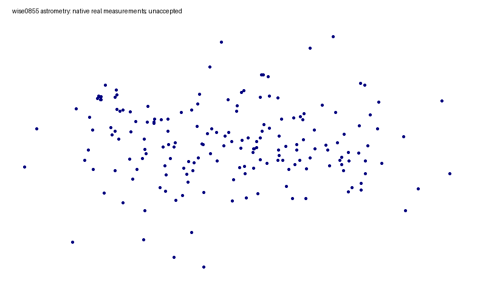

# G3-pm-wise0855 — FAIL (L3)

# Native target acceptance
Complete measurements and rejected frames:
```json
{
  "name": "WISEA J085510.74-071442.5",
  "points": [
    {
      "visit": "V1",
      "mjd": 60800.702186907,
      "xi": 3.6557109684403635,
      "eta": -0.9851263240457647,
      "s_xi": 3.681945980643726,
      "s_eta": 8.348488331977368,
      "band": 3,
      "frame_id": "level2_2025W19_1B_0116_2D3_spx_l2b-v20-2025-241.fits",
      "cov_xi_eta": 16.72826533636564,
      "fit_included": false
    },
    {
      "visit": "V1",
      "mjd": 60801.107262601,
      "xi": 5.234611180814096,
      "eta": 1.6398622044326852,
      "s_xi": 2.1962848675722446,
      "s_eta": 1.6975402647384934,
      "band": 2,
      "frame_id": "level2_2025W19_1B_0181_1D2_spx_l2b-v20-2025-241.fits",
      "cov_xi_eta": -0.10529610147632147,
      "fit_included": false
    },
    {
      "visit": "V1",
      "mjd": 60801.107262601,
      "xi": 3.9470131000603526,
      "eta": -0.11552778296188027,
      "s_xi": 0.6384480612293261,
      "s_eta": 0.6305034181393113,
      "band": 5,
      "frame_id": "level2_2025W19_1B_0181_1D5_spx_l2b-v20-2025-241.fits",
      "cov_xi_eta": -0.04890562582399777,
      "fit_included": false
    },
    {
      "visit": "V1",
      "mjd": 60801.108754847,
      "xi": 4.44584973893199,
      "eta": 1.8879898802692576,
      "s_xi": 2.1460591851853836,
      "s_eta": 1.2812124139390348,
      "band": 2,
      "frame_id": "level2_2025W19_1B_0181_2D2_spx_l2b-v20-2025-241.fits",
      "cov_xi_eta": -0.6925949561119659,
      "fit_included": false
    },
    {
      "visit": "V1",
      "mjd": 60801.110247104,
      "xi": 3.0156456640781624,
      "eta": 0.10012217345751231,
      "s_xi": 0.9386657464518962,
      "s_eta": 0.7723102003088936,
      "band": 5,
      "frame_id": "level2_2025W19_1B_0181_3D5_spx_l2b-v20-2025-241.fits",
      "cov_xi_eta": -0.07131289051752007,
      "fit_included": false
    },
    {
      "visit": "V1",
      "mjd": 60801.111739349,
      "xi": 3.103354079413153,
      "eta": -1.0623182938752946,
      "s_xi": 0.5238513610809857,
      "s_eta": 0.7321741796111371,
      "band": 5,
      "frame_id": "level2_2025W19_1B_0181_4D5_spx_l2b-v20-2025-241.fits",
      "cov_xi_eta": 0.0685511616515883,
      "fit_included": false
    },
    {
      "visit": "V1",
      "mjd": 60801.446306085,
      "xi": 1.1882509022241197,
      "eta": -2.605003845762389,
      "s_xi": 6.032838932851912,
      "s_eta": 2.684595474500094,
      "band": 2,
      "frame_id": "level2_2025W19_1B_0231_1D2_spx_l2b-v20-2025-241.fits",
      "cov_xi_eta": -9.724640396879984,
      "fit_included": false
    },
    {
      "visit": "V1",
      "mjd": 60801.446306085,
      "xi": 3.3722398271446563,
      "eta": 2.8879526728602123,
      "s_xi": 2.628826752272453,
      "s_eta": 1.3085148435605665,
      "band": 5,
      "frame_id": "level2_2025W19_1B_0231_1D5_spx_l2b-v20-2025-241.fits",
      "cov_xi_eta": -1.7810398961110132,
      "fit_included": false
    },
    {
      "visit": "V1",
      "mjd": 60801.44779833,
      "xi": 2.938578130169128,
      "eta": 0.45412430242236357,
      "s_xi": 1.4629456563650354,
      "s_eta": 1.4094723779022216,
      "band": 5,
      "frame_id": "level2_2025W19_1B_0231_2D5_spx_l2b-v20-2025-241.fits",
      "cov_xi_eta": -0.2947427668641081,
      "fit_included": false
    },
    {
      "visit": "V1",
      "mjd": 60801.449290587,
      "xi": 2.0603777924249838,
      "eta": -3.501141850900764,
      "s_xi": 3.0794203870629,
      "s_eta": 4.792455790530619,
      "band": 2,
      "frame_id": "level2_2025W19_1B_0231_3D2_spx_l2b-v20-2025-241.fits",
      "cov_xi_eta": 1.7807266291764787,
      "fit_included": false
    },
    {
      "visit": "V1",
      "mjd": 60801.449290576,
      "xi": 2.0897351765656884,
      "eta": -1.3040707421336752,
      "s_xi": 1.3603977625225012,
      "s_eta": 2.034935061377417,
      "band": 5,
      "frame_id": "level2_2025W19_1B_0231_3D5_spx_l2b-v20-2025-241.fits",
      "cov_xi_eta": 1.2016520947631624,
      "fit_included": false
    },
    {
      "visit": "V1",
      "mjd": 60801.450782821,
      "xi": 6.419997235872984,
      "eta": 1.0862396540473895,
      "s_xi": 0.6167730145373637,
      "s_eta": 0.7896687307362821,
      "band": 5,
      "frame_id": "level2_2025W19_1B_0231_4D5_spx_l2b-v20-2025-241.fits",
      "cov_xi_eta": 0.06310833579677455,
      "fit_included": false
    },
    {
      "visit": "V1",
      "mjd": 60801.519319893,
      "xi": 1.9530406233421322,
      "eta": 0.8430003733672032,
      "s_xi": 10.364844899388231,
      "s_eta": 8.918781536079992,
      "band": 4,
      "frame_id": "level2_2025W19_1B_0241_4D4_spx_l2b-v20-2025-241.fits",
      "cov_xi_eta": -4.084666151173918,
      "fit_included": false
    },
    {
      "visit": "V2",
      "mjd": 60979.723343354,
      "xi": 2.2308480498437557,
      "eta": -0.5199389795963046,
      "s_xi": 2.983439178035389,
      "s_eta": 6.046739996120111,
      "band": 1,
      "frame_id": "level2_2025W44_2B_0305_1D1_spx_l2b-v20-2025-307.fits",
      "cov_xi_eta": 11.252635180905743,
      "fit_included": false
    },
    {
      "visit": "V2",
      "mjd": 60979.723343354,
      "xi": -0.27140570770638844,
      "eta": -1.2744391575938245,
      "s_xi": 9.42497691121825,
      "s_eta": 4.540527660687881,
      "band": 4,
      "frame_id": "level2_2025W44_2B_0305_1D4_spx_l2b-v20-2025-307.fits",
      "cov_xi_eta": -15.665683071937588,
      "fit_included": false
    },
    {
      "visit": "V2",
      "mjd": 60979.724835611,
      "xi": 0.11030796115849568,
      "eta": 1.4550338088830659,
      "s_xi": 1.4292048045573882,
      "s_eta": 1.111829988236915,
      "band": 1,
      "frame_id": "level2_2025W44_2B_0305_2D1_spx_l2b-v20-2025-307.fits",
      "cov_xi_eta": -0.46625650522790707,
      "fit_included": false
    },
    {
      "visit": "V2",
      "mjd": 60979.724835611,
      "xi": 1.6363088111030355,
      "eta": 0.06748111560393119,
      "s_xi": 12.1528712743377,
      "s_eta": 23.07771658954353,
      "band": 4,
      "frame_id": "level2_2025W44_2B_0305_2D4_spx_l2b-v20-2025-307.fits",
      "cov_xi_eta": 124.02463154643534,
      "fit_included": false
    },
    {
      "visit": "V2",
      "mjd": 60979.726327879,
      "xi": -7.080075402438163,
      "eta": 3.8248133011517305,
      "s_xi": 1.5970881578032206,
      "s_eta": 2.30284576830242,
      "band": 1,
      "frame_id": "level2_2025W44_2B_0305_3D1_spx_l2b-v20-2025-307.fits",
      "cov_xi_eta": -3.676013217581113,
      "fit_included": false
    },
    {
      "visit": "V2",
      "mjd": 60979.726327879,
      "xi": -5.785239855215353,
      "eta": 2.895999755069292,
      "s_xi": 4.214096245332948,
      "s_eta": 2.541999976254879,
      "band": 4,
      "frame_id": "level2_2025W44_2B_0305_3D4_spx_l2b-v20-2025-307.fits",
      "cov_xi_eta": -10.012602723587609,
      "fit_included": false
    },
    {
      "visit": "V2",
      "mjd": 60979.727820136,
      "xi": -4.105533976152861,
      "eta": 2.3959995590388194,
      "s_xi": 1.3123750254533948,
      "s_eta": 1.247027124153093,
      "band": 1,
      "frame_id": "level2_2025W44_2B_0305_4D1_spx_l2b-v20-2025-307.fits",
      "cov_xi_eta": -0.29051452014297785,
      "fit_included": false
    },
    {
      "visit": "V2",
      "mjd": 60979.727820136,
      "xi": 0.06958992083182082,
      "eta": 5.64393459429114,
      "s_xi": 7.330511572130386,
      "s_eta": 3.082552907440559,
      "band": 4,
      "frame_id": "level2_2025W44_2B_0305_4D4_spx_l2b-v20-2025-307.fits",
      "cov_xi_eta": -7.887538417581628,
      "fit_included": false
    },
    {
      "visit": "V2",
      "mjd": 60979.786089141,
      "xi": 4.495161133369423,
      "eta": 5.045020195509068,
      "s_xi": 1.5214593810488193,
      "s_eta": 0.9379232239121376,
      "band": 1,
      "frame_id": "level2_2025W44_2B_0321_1D1_spx_l2b-v20-2025-307.fits",
      "cov_xi_eta": -0.056901407351743975,
      "fit_included": false
    },
    {
      "visit": "V2",
      "mjd": 60979.786089152,
      "xi": -5.763995797518125,
      "eta": 1.433774756278326,
      "s_xi": 3.6024101812799048,
      "s_eta": 3.157950608885592,
      "band": 4,
      "frame_id": "level2_2025W44_2B_0321_1D4_spx_l2b-v20-2025-307.fits",
      "cov_xi_eta": -9.073118171790618,
      "fit_included": false
    },
    {
      "visit": "V2",
      "mjd": 60979.787581398,
      "xi": -5.657821314332198,
      "eta": -2.0819001171007807,
      "s_xi": 3.0148447022467786,
      "s_eta": 7.34540504809094,
      "band": 1,
      "frame_id": "level2_2025W44_2B_0321_2D1_spx_l2b-v20-2025-307.fits",
      "cov_xi_eta": 15.769048488069174,
      "fit_included": false
    },
    {
      "visit": "V2",
      "mjd": 60979.787581398,
      "xi": 1.0124425604463656,
      "eta": -0.6764668932612784,
      "s_xi": 1.658876628139805,
      "s_eta": 2.0087742303517104,
      "band": 4,
      "frame_id": "level2_2025W44_2B_0321_2D4_spx_l2b-v20-2025-307.fits",
      "cov_xi_eta": 0.9293444071560398,
      "fit_included": false
    },
    {
      "visit": "V2",
      "mjd": 60979.789304592,
      "xi": -5.178557901662778,
      "eta": -6.556426426744831,
      "s_xi": 4.990167596487135,
      "s_eta": 2.279209531588627,
      "band": 1,
      "frame_id": "level2_2025W44_2B_0322_1D1_spx_l2b-v20-2025-307.fits",
      "cov_xi_eta": -4.784827549435308,
      "fit_included": false
    },
    {
      "visit": "V2",
      "mjd": 60979.790796861,
      "xi": -1.6031699998971713,
      "eta": 0.40801939809521376,
      "s_xi": 0.9306220590740493,
      "s_eta": 1.4409596292019065,
      "band": 1,
      "frame_id": "level2_2025W44_2B_0322_2D1_spx_l2b-v20-2025-307.fits",
      "cov_xi_eta": 0.5808563857299797,
      "fit_included": false
    },
    {
      "visit": "V2",
      "mjd": 60979.790796861,
      "xi": 4.517818559467864,
      "eta": -2.864490859240675,
      "s_xi": 7.911435732709379,
      "s_eta": 10.954364977695592,
      "band": 4,
      "frame_id": "level2_2025W44_2B_0322_2D4_spx_l2b-v20-2025-307.fits",
      "cov_xi_eta": 32.504582842726585,
      "fit_included": false
    },
    {
      "visit": "V2",
      "mjd": 60979.792289106,
      "xi": 4.8096830542304465,
      "eta": 0.39872562712777104,
      "s_xi": 0.9132238804049357,
      "s_eta": 1.8722647686207865,
      "band": 1,
      "frame_id": "level2_2025W44_2B_0322_3D1_spx_l2b-v20-2025-307.fits",
      "cov_xi_eta": 1.0383409558558985,
      "fit_included": false
    },
    {
      "visit": "V2",
      "mjd": 60979.792289106,
      "xi": 4.410449964048409,
      "eta": -0.1338247605881729,
      "s_xi": 3.9550815117778693,
      "s_eta": 1.7356563563300684,
      "band": 4,
      "frame_id": "level2_2025W44_2B_0322_3D4_spx_l2b-v20-2025-307.fits",
      "cov_xi_eta": -3.382109541754592,
      "fit_included": false
    },
    {
      "visit": "V2",
      "mjd": 60979.793781363,
      "xi": 4.117635696209735,
      "eta": -2.677127021837279,
      "s_xi": 1.6892771953860473,
      "s_eta": 1.1652003463644474,
      "band": 1,
      "frame_id": "level2_2025W44_2B_0322_4D1_spx_l2b-v20-2025-307.fits",
      "cov_xi_eta": -0.3459821879427713,
      "fit_included": false
    },
    {
      "visit": "V2",
      "mjd": 60979.857397601,
      "xi": -6.9362479619317625,
      "eta": -3.1062516226730237,
      "s_xi": 2.3780924676817254,
      "s_eta": 1.2592205270876695,
      "band": 1,
      "frame_id": "level2_2025W44_2B_0339_1D1_spx_l2b-v20-2025-307.fits",
      "cov_xi_eta": -0.6833086879153504,
      "fit_included": false
    },
    {
      "visit": "V2",
      "mjd": 60979.857397601,
      "xi": -7.229814528760899,
      "eta": 3.9079174309079456,
      "s_xi": 14.074882386839908,
      "s_eta": 2.762949878936716,
      "band": 4,
      "frame_id": "level2_2025W44_2B_0339_1D4_spx_l2b-v20-2025-307.fits",
      "cov_xi_eta": -38.87160841857882,
      "fit_included": false
    },
    {
      "visit": "V2",
      "mjd": 60979.858889858,
      "xi": 1.9669327894621382,
      "eta": 2.775733403255777,
      "s_xi": 2.0648626727069703,
      "s_eta": 1.5199283478017829,
      "band": 1,
      "frame_id": "level2_2025W44_2B_0339_2D1_spx_l2b-v20-2025-307.fits",
      "cov_xi_eta": 0.2346185025334594,
      "fit_included": false
    },
    {
      "visit": "V2",
      "mjd": 60979.858889858,
      "xi": -2.207894739902036,
      "eta": -0.17382307148466386,
      "s_xi": 3.3235663123786456,
      "s_eta": 2.2410431488272815,
      "band": 4,
      "frame_id": "level2_2025W44_2B_0339_2D4_spx_l2b-v20-2025-307.fits",
      "cov_xi_eta": -2.8965597375713616,
      "fit_included": false
    },
    {
      "visit": "V2",
      "mjd": 60982.442853747,
      "xi": -4.454488176420751,
      "eta": -2.6818443647018437,
      "s_xi": 1.888016302086231,
      "s_eta": 2.522329398685469,
      "band": 1,
      "frame_id": "level2_2025W45_1A_0095_4D1_spx_l2b-v20-2025-311.fits",
      "cov_xi_eta": -1.468024797810177,
      "fit_included": false
    },
    {
      "visit": "V2",
      "mjd": 60982.442853747,
      "xi": 3.7580463138704467,
      "eta": 1.2642325570167632,
      "s_xi": 1.7850584154352434,
      "s_eta": 3.0103643489200707,
      "band": 4,
      "frame_id": "level2_2025W45_1A_0095_4D4_spx_l2b-v20-2025-311.fits",
      "cov_xi_eta": 2.049617625823924,
      "fit_included": false
    },
    {
      "visit": "V2",
      "mjd": 60982.507251652,
      "xi": 2.443784690916108,
      "eta": 0.16183188195407222,
      "s_xi": 1.5366010257993212,
      "s_eta": 1.3386834825423788,
      "band": 1,
      "frame_id": "level2_2025W45_1A_0110_1D1_spx_l2b-v20-2025-311.fits",
      "cov_xi_eta": -0.1112362396124226,
      "fit_included": false
    },
    {
      "visit": "V2",
      "mjd": 60982.507251652,
      "xi": 3.457568242369755,
      "eta": 0.6380374767813375,
      "s_xi": 7.7967579406822125,
      "s_eta": 5.035101440149372,
      "band": 4,
      "frame_id": "level2_2025W45_1A_0110_1D4_spx_l2b-v20-2025-311.fits",
      "cov_xi_eta": -0.8994364401588472,
      "fit_included": false
    },
    {
      "visit": "V2",
      "mjd": 60982.508743909,
      "xi": -2.8101808753322883,
      "eta": 1.8471515253379756,
      "s_xi": 2.0640469881836006,
      "s_eta": 1.4383952086101564,
      "band": 1,
      "frame_id": "level2_2025W45_1A_0110_2D1_spx_l2b-v20-2025-311.fits",
      "cov_xi_eta": -1.095479400506926,
      "fit_included": false
    },
    {
      "visit": "V2",
      "mjd": 60982.508743909,
      "xi": 8.455862561902949,
      "eta": -1.6495344385705641,
      "s_xi": 1.281193303623048,
      "s_eta": 1.478349342197734,
      "band": 4,
      "frame_id": "level2_2025W45_1A_0110_2D4_spx_l2b-v20-2025-311.fits",
      "cov_xi_eta": 0.4174495791349816,
      "fit_included": false
    },
    {
      "visit": "V2",
      "mjd": 60982.510236178,
      "xi": 0.8703224661755268,
      "eta": 1.0951949893331316,
      "s_xi": 4.278935540173181,
      "s_eta": 3.279768679046019,
      "band": 1,
      "frame_id": "level2_2025W45_1A_0110_3D1_spx_l2b-v20-2025-311.fits",
      "cov_xi_eta": -1.097326088710568,
      "fit_included": false
    },
    {
      "visit": "V2",
      "mjd": 60982.510236178,
      "xi": 0.014713145013277973,
      "eta": 4.000833512057179,
      "s_xi": 8.586561680678336,
      "s_eta": 5.197147103738223,
      "band": 4,
      "frame_id": "level2_2025W45_1A_0110_3D4_spx_l2b-v20-2025-311.fits",
      "cov_xi_eta": -8.463584598237867,
      "fit_included": false
    },
    {
      "visit": "V2",
      "mjd": 60982.511728423,
      "xi": 8.119885706076287,
      "eta": 3.718571952153851,
      "s_xi": 3.7297345848424817,
      "s_eta": 1.9187446018316259,
      "band": 1,
      "frame_id": "level2_2025W45_1A_0110_4D1_spx_l2b-v20-2025-311.fits",
      "cov_xi_eta": -2.9295957667260115,
      "fit_included": false
    },
    {
      "visit": "V2",
      "mjd": 60982.511728435,
      "xi": -2.753631544769388,
      "eta": -0.49947155623876033,
      "s_xi": 2.0542805883784543,
      "s_eta": 3.411203842440036,
      "band": 4,
      "frame_id": "level2_2025W45_1A_0110_4D4_spx_l2b-v20-2025-311.fits",
      "cov_xi_eta": 1.2720008282244142,
      "fit_included": false
    },
    {
      "visit": "V2",
      "mjd": 60982.709114661,
      "xi": 4.524739172115907,
      "eta": -2.396991926770684,
      "s_xi": 4.883579979867713,
      "s_eta": 4.082040484661531,
      "band": 1,
      "frame_id": "level2_2025W45_1A_0153_1D1_spx_l2b-v20-2025-311.fits",
      "cov_xi_eta": -0.41195074378904817,
      "fit_included": false
    },
    {
      "visit": "V2",
      "mjd": 60982.709114673,
      "xi": -6.577328041734289,
      "eta": 1.206987207019319,
      "s_xi": 2.198849230523532,
      "s_eta": 5.079958491992491,
      "band": 4,
      "frame_id": "level2_2025W45_1A_0153_1D4_spx_l2b-v20-2025-311.fits",
      "cov_xi_eta": -4.071345919842018,
      "fit_included": false
    },
    {
      "visit": "V2",
      "mjd": 60986.241655321,
      "xi": -3.826585999822234,
      "eta": 0.31014525014595895,
      "s_xi": 6.098666025606445,
      "s_eta": 3.4022268990154854,
      "band": 2,
      "frame_id": "level2_2025W45_2A_0164_1D2_spx_l2b-v20-2025-314.fits",
      "cov_xi_eta": -17.516218891830064,
      "fit_included": false
    },
    {
      "visit": "V2",
      "mjd": 60986.241655321,
      "xi": 0.8190285711882468,
      "eta": 0.10356254844731555,
      "s_xi": 3.471554457044874,
      "s_eta": 1.7580414437559302,
      "band": 5,
      "frame_id": "level2_2025W45_2A_0164_1D5_spx_l2b-v20-2025-314.fits",
      "cov_xi_eta": -3.9179386520508093,
      "fit_included": false
    },
    {
      "visit": "V2",
      "mjd": 60986.243147578,
      "xi": -4.180677409293024,
      "eta": -1.7657053508892726,
      "s_xi": 3.136141167982118,
      "s_eta": 4.526599907772783,
      "band": 2,
      "frame_id": "level2_2025W45_2A_0164_2D2_spx_l2b-v20-2025-314.fits",
      "cov_xi_eta": -0.3075674489609781,
      "fit_included": false
    },
    {
      "visit": "V2",
      "mjd": 60986.244639835,
      "xi": -4.73223722712471,
      "eta": 2.071865022346867,
      "s_xi": 2.7629715022377246,
      "s_eta": 2.6009201046441164,
      "band": 2,
      "frame_id": "level2_2025W45_2A_0164_3D2_spx_l2b-v20-2025-314.fits",
      "cov_xi_eta": -2.21356891408101,
      "fit_included": false
    },
    {
      "visit": "V2",
      "mjd": 60986.244639835,
      "xi": -3.404242407124457,
      "eta": -1.2709434467653546,
      "s_xi": 1.3830827793326317,
      "s_eta": 1.5784533176032527,
      "band": 5,
      "frame_id": "level2_2025W45_2A_0164_3D5_spx_l2b-v20-2025-314.fits",
      "cov_xi_eta": -0.6056522082230399,
      "fit_included": false
    },
    {
      "visit": "V2",
      "mjd": 60986.24613208,
      "xi": -3.9997495545137354,
      "eta": -0.5651444565604947,
      "s_xi": 3.5417650099113414,
      "s_eta": 2.034834603569997,
      "band": 2,
      "frame_id": "level2_2025W45_2A_0164_4D2_spx_l2b-v20-2025-314.fits",
      "cov_xi_eta": -4.351035885919353,
      "fit_included": false
    },
    {
      "visit": "V2",
      "mjd": 60986.246132092,
      "xi": 0.14113433423248875,
      "eta": 5.655128436795767,
      "s_xi": 2.731018763327058,
      "s_eta": 4.035192211477198,
      "band": 5,
      "frame_id": "level2_2025W45_2A_0164_4D5_spx_l2b-v20-2025-314.fits",
      "cov_xi_eta": 3.4177985178474,
      "fit_included": false
    },
    {
      "visit": "V2",
      "mjd": 60986.377414997,
      "xi": -5.11927743839319,
      "eta": -4.406820194932075,
      "s_xi": 3.26350872027208,
      "s_eta": 1.5017044830396722,
      "band": 2,
      "frame_id": "level2_2025W45_2A_0192_1D2_spx_l2b-v20-2025-314.fits",
      "cov_xi_eta": -3.306427222595143,
      "fit_included": false
    },
    {
      "visit": "V2",
      "mjd": 60986.378907266,
      "xi": -4.205956596196738,
      "eta": -2.977170300386747,
      "s_xi": 10.22608943776963,
      "s_eta": 3.148293740522884,
      "band": 2,
      "frame_id": "level2_2025W45_2A_0192_2D2_spx_l2b-v20-2025-314.fits",
      "cov_xi_eta": -28.408009475510806,
      "fit_included": false
    },
    {
      "visit": "V2",
      "mjd": 60986.378907266,
      "xi": -1.1863465680849596,
      "eta": -2.120640768519151,
      "s_xi": 4.5262139073579135,
      "s_eta": 3.883083365133132,
      "band": 5,
      "frame_id": "level2_2025W45_2A_0192_2D5_spx_l2b-v20-2025-314.fits",
      "cov_xi_eta": -5.675525899769182,
      "fit_included": false
    },
    {
      "visit": "V2",
      "mjd": 60986.783468215,
      "xi": -4.689488041176402,
      "eta": 2.3574915584326166,
      "s_xi": 2.6720442259707156,
      "s_eta": 1.3917952594928207,
      "band": 2,
      "frame_id": "level2_2025W45_2A_0278_1D2_spx_l2b-v20-2025-314.fits",
      "cov_xi_eta": -3.429952424026072,
      "fit_included": false
    },
    {
      "visit": "V2",
      "mjd": 60986.783468215,
      "xi": -1.9068107302630801,
      "eta": -0.7069483172054307,
      "s_xi": 2.4074588923806832,
      "s_eta": 1.7404809606364435,
      "band": 5,
      "frame_id": "level2_2025W45_2A_0278_1D5_spx_l2b-v20-2025-314.fits",
      "cov_xi_eta": 2.8633870725105353,
      "fit_included": false
    },
    {
      "visit": "V2",
      "mjd": 60986.784960483,
      "xi": -3.4940135810336033,
      "eta": 2.8602794542868324,
      "s_xi": 2.2270578298769084,
      "s_eta": 1.182850943870281,
      "band": 2,
      "frame_id": "level2_2025W45_2A_0278_2D2_spx_l2b-v20-2025-314.fits",
      "cov_xi_eta": -1.1482884809927396,
      "fit_included": false
    },
    {
      "visit": "V2",
      "mjd": 60986.784960483,
      "xi": 0.8571136720823977,
      "eta": -0.30442538057083035,
      "s_xi": 1.457028327779634,
      "s_eta": 1.3761557742644728,
      "band": 5,
      "frame_id": "level2_2025W45_2A_0278_2D5_spx_l2b-v20-2025-314.fits",
      "cov_xi_eta": -0.28853581406553747,
      "fit_included": false
    },
    {
      "visit": "V2",
      "mjd": 60986.78645274,
      "xi": 1.4438110869824023,
      "eta": -3.5206767379227126,
      "s_xi": 1.3386011040224435,
      "s_eta": 1.120990917954997,
      "band": 2,
      "frame_id": "level2_2025W45_2A_0278_3D2_spx_l2b-v20-2025-314.fits",
      "cov_xi_eta": -0.25007435713651394,
      "fit_included": false
    },
    {
      "visit": "V2",
      "mjd": 60986.78645274,
      "xi": -0.264592775371141,
      "eta": 0.18923415802641771,
      "s_xi": 2.3646986658818268,
      "s_eta": 1.2554787249135158,
      "band": 5,
      "frame_id": "level2_2025W45_2A_0278_3D5_spx_l2b-v20-2025-314.fits",
      "cov_xi_eta": -2.110294227870394,
      "fit_included": false
    },
    {
      "visit": "V2",
      "mjd": 60986.787944986,
      "xi": 0.9624290258507313,
      "eta": 2.3743649511943077,
      "s_xi": 3.6084412491047297,
      "s_eta": 6.295046834129455,
      "band": 2,
      "frame_id": "level2_2025W45_2A_0278_4D2_spx_l2b-v20-2025-314.fits",
      "cov_xi_eta": 11.871511126139355,
      "fit_included": false
    },
    {
      "visit": "V2",
      "mjd": 60986.787944997,
      "xi": 0.3070848864962901,
      "eta": -0.8903947715616806,
      "s_xi": 1.6598218816028438,
      "s_eta": 1.2336163587176538,
      "band": 5,
      "frame_id": "level2_2025W45_2A_0278_4D5_spx_l2b-v20-2025-314.fits",
      "cov_xi_eta": -0.9406751375081189,
      "fit_included": false
    },
    {
      "visit": "V2",
      "mjd": 60986.854350333,
      "xi": 1.770451542020337,
      "eta": -0.6581918631570804,
      "s_xi": 3.5728956913564067,
      "s_eta": 2.462585561690785,
      "band": 2,
      "frame_id": "level2_2025W45_2A_0292_1D2_spx_l2b-v20-2025-314.fits",
      "cov_xi_eta": -3.3435354066891634,
      "fit_included": false
    },
    {
      "visit": "V2",
      "mjd": 60986.854350333,
      "xi": -0.2975077111926391,
      "eta": -0.10302350560281003,
      "s_xi": 1.0522473849872702,
      "s_eta": 0.8333863671330977,
      "band": 5,
      "frame_id": "level2_2025W45_2A_0292_1D5_spx_l2b-v20-2025-314.fits",
      "cov_xi_eta": -0.24073050485392844,
      "fit_included": false
    },
    {
      "visit": "V2",
      "mjd": 60986.855842601,
      "xi": -1.3782291994758509,
      "eta": 1.3679516698297687,
      "s_xi": 0.7504365618088327,
      "s_eta": 0.7080579098807723,
      "band": 5,
      "frame_id": "level2_2025W45_2A_0292_2D5_spx_l2b-v20-2025-314.fits",
      "cov_xi_eta": -0.16024637068559214,
      "fit_included": false
    },
    {
      "visit": "V2",
      "mjd": 60986.857334847,
      "xi": 3.2755629124527026,
      "eta": 8.504659185033947,
      "s_xi": 13.442278147084986,
      "s_eta": 6.270005466477819,
      "band": 2,
      "frame_id": "level2_2025W45_2A_0292_3D2_spx_l2b-v20-2025-314.fits",
      "cov_xi_eta": -40.10452924712505,
      "fit_included": false
    },
    {
      "visit": "V2",
      "mjd": 60986.857334847,
      "xi": -0.2853613476235177,
      "eta": 0.180907230171751,
      "s_xi": 1.25682831399879,
      "s_eta": 1.5646985817338979,
      "band": 5,
      "frame_id": "level2_2025W45_2A_0292_3D5_spx_l2b-v20-2025-314.fits",
      "cov_xi_eta": 0.582904931297768,
      "fit_included": false
    },
    {
      "visit": "V2",
      "mjd": 60986.921910402,
      "xi": -3.0309308158725563,
      "eta": 3.0573530726897666,
      "s_xi": 2.0887287773822485,
      "s_eta": 2.8495675623340424,
      "band": 2,
      "frame_id": "level2_2025W45_2A_0308_1D2_spx_l2b-v20-2025-314.fits",
      "cov_xi_eta": 2.660216382282427,
      "fit_included": false
    },
    {
      "visit": "V2",
      "mjd": 60986.923402648,
      "xi": 4.714243444527579,
      "eta": -1.647036227402393,
      "s_xi": 3.022263454068036,
      "s_eta": 6.264397493384309,
      "band": 2,
      "frame_id": "level2_2025W45_2A_0308_2D2_spx_l2b-v20-2025-314.fits",
      "cov_xi_eta": 9.436202419182695,
      "fit_included": false
    },
    {
      "visit": "V2",
      "mjd": 60986.923402648,
      "xi": 1.2851356390796282,
      "eta": -1.3665359118400502,
      "s_xi": 1.10709922804306,
      "s_eta": 1.0463630549368554,
      "band": 5,
      "frame_id": "level2_2025W45_2A_0308_2D5_spx_l2b-v20-2025-314.fits",
      "cov_xi_eta": -0.24869520549995294,
      "fit_included": false
    },
    {
      "visit": "V2",
      "mjd": 60986.924894905,
      "xi": 1.5603977261153483,
      "eta": -1.0081860661857198,
      "s_xi": 2.535697158688824,
      "s_eta": 2.1305872849019702,
      "band": 2,
      "frame_id": "level2_2025W45_2A_0308_3D2_spx_l2b-v20-2025-314.fits",
      "cov_xi_eta": -0.4100565737856927,
      "fit_included": false
    },
    {
      "visit": "V2",
      "mjd": 60986.926387161,
      "xi": 3.5645014310700924,
      "eta": -0.6597046883207957,
      "s_xi": 8.090082380728587,
      "s_eta": 11.234848271542786,
      "band": 2,
      "frame_id": "level2_2025W45_2A_0308_4D2_spx_l2b-v20-2025-314.fits",
      "cov_xi_eta": 10.381672153436242,
      "fit_included": false
    },
    {
      "visit": "V2",
      "mjd": 60986.926387161,
      "xi": 0.024519049092782408,
      "eta": -0.6436946354049433,
      "s_xi": 0.9588849567358805,
      "s_eta": 0.854766086032803,
      "band": 5,
      "frame_id": "level2_2025W45_2A_0308_4D5_spx_l2b-v20-2025-314.fits",
      "cov_xi_eta": -0.13698824283352162,
      "fit_included": false
    },
    {
      "visit": "V2",
      "mjd": 60987.189468145,
      "xi": -0.5335711469371641,
      "eta": 0.9804256143258612,
      "s_xi": 0.9845992341054471,
      "s_eta": 0.6468306761813251,
      "band": 5,
      "frame_id": "level2_2025W45_2A_0367_1D5_spx_l2b-v20-2025-314.fits",
      "cov_xi_eta": -0.2692483176147455,
      "fit_included": false
    },
    {
      "visit": "V2",
      "mjd": 60989.297473655,
      "xi": -2.6817161006046626,
      "eta": 4.212788538107599,
      "s_xi": 1.1840646833026878,
      "s_eta": 0.8742316120628053,
      "band": 3,
      "frame_id": "level2_2025W46_1A_0075_4D3_spx_l2b-v20-2025-318.fits",
      "cov_xi_eta": 0.016370898270469756,
      "fit_included": false
    },
    {
      "visit": "V2",
      "mjd": 60989.299214604,
      "xi": -6.39515598808096,
      "eta": 4.532126153015997,
      "s_xi": 1.0745325892938145,
      "s_eta": 1.033498950372764,
      "band": 3,
      "frame_id": "level2_2025W46_1A_0076_1D3_spx_l2b-v20-2025-318.fits",
      "cov_xi_eta": 0.9374774500766317,
      "fit_included": false
    },
    {
      "visit": "V2",
      "mjd": 60989.299214604,
      "xi": -0.7933014088579133,
      "eta": 0.8156986954777568,
      "s_xi": 1.0065998891932162,
      "s_eta": 0.9543829607324942,
      "band": 6,
      "frame_id": "level2_2025W46_1A_0076_1D6_spx_l2b-v20-2025-318.fits",
      "cov_xi_eta": -0.19049408902154594,
      "fit_included": true
    },
    {
      "visit": "V2",
      "mjd": 60989.300706861,
      "xi": -6.241213107016663,
      "eta": 2.9497962424714075,
      "s_xi": 7.848549009289841,
      "s_eta": 8.667240464255144,
      "band": 3,
      "frame_id": "level2_2025W46_1A_0076_2D3_spx_l2b-v20-2025-318.fits",
      "cov_xi_eta": -64.88332964952815,
      "fit_included": false
    },
    {
      "visit": "V2",
      "mjd": 60989.300706861,
      "xi": -0.6988608394868272,
      "eta": -1.1105879777903767,
      "s_xi": 1.0205576157794614,
      "s_eta": 0.8013614191951625,
      "band": 6,
      "frame_id": "level2_2025W46_1A_0076_2D6_spx_l2b-v20-2025-318.fits",
      "cov_xi_eta": -0.3067410871826059,
      "fit_included": true
    },
    {
      "visit": "V2",
      "mjd": 60989.302199117,
      "xi": 0.021650996711388384,
      "eta": 1.005099486189991,
      "s_xi": 1.310207482499627,
      "s_eta": 1.3123360885120756,
      "band": 3,
      "frame_id": "level2_2025W46_1A_0076_3D3_spx_l2b-v20-2025-318.fits",
      "cov_xi_eta": -0.840735731418822,
      "fit_included": false
    },
    {
      "visit": "V2",
      "mjd": 60989.3654423,
      "xi": 3.7250429678679478,
      "eta": -1.4369971801904304,
      "s_xi": 3.273649242532449,
      "s_eta": 2.8685732004191014,
      "band": 3,
      "frame_id": "level2_2025W46_1A_0090_1D3_spx_l2b-v20-2025-318.fits",
      "cov_xi_eta": -0.878197436811912,
      "fit_included": false
    },
    {
      "visit": "V2",
      "mjd": 60989.366934557,
      "xi": 4.702894207110106,
      "eta": -0.7141471596491231,
      "s_xi": 6.217129283535377,
      "s_eta": 11.247193257476283,
      "band": 3,
      "frame_id": "level2_2025W46_1A_0090_2D3_spx_l2b-v20-2025-318.fits",
      "cov_xi_eta": -66.88893886918954,
      "fit_included": false
    },
    {
      "visit": "V2",
      "mjd": 60989.368426814,
      "xi": 1.7963501524281826,
      "eta": 2.557852426912646,
      "s_xi": 5.721734790557058,
      "s_eta": 3.3069697337307975,
      "band": 3,
      "frame_id": "level2_2025W46_1A_0090_3D3_spx_l2b-v20-2025-318.fits",
      "cov_xi_eta": -8.718374806898543,
      "fit_included": false
    },
    {
      "visit": "V2",
      "mjd": 60989.438651617,
      "xi": 3.967717099007411,
      "eta": -0.7256156067176176,
      "s_xi": 4.600233426889432,
      "s_eta": 4.609494094153342,
      "band": 2,
      "frame_id": "level2_2025W46_1A_0108_1D2_spx_l2b-v20-2025-318.fits",
      "cov_xi_eta": -0.38549099222205746,
      "fit_included": false
    },
    {
      "visit": "V2",
      "mjd": 60989.438651617,
      "xi": 1.516109268862201,
      "eta": 2.4532828169497494,
      "s_xi": 2.1994512880240777,
      "s_eta": 2.497599647566957,
      "band": 5,
      "frame_id": "level2_2025W46_1A_0108_1D5_spx_l2b-v20-2025-318.fits",
      "cov_xi_eta": 0.29034605861431856,
      "fit_included": false
    },
    {
      "visit": "V2",
      "mjd": 60989.977657659,
      "xi": 7.074260824156688,
      "eta": -2.806040598338137,
      "s_xi": 2.8666834559330394,
      "s_eta": 3.0478948898980183,
      "band": 3,
      "frame_id": "level2_2025W46_1A_0238_1D3_spx_l2b-v20-2025-318.fits",
      "cov_xi_eta": 0.34988070162761326,
      "fit_included": false
    },
    {
      "visit": "V2",
      "mjd": 60989.979149905,
      "xi": 0.7923490252260497,
      "eta": -0.6786376379076036,
      "s_xi": 10.38565431647003,
      "s_eta": 4.214108725597274,
      "band": 3,
      "frame_id": "level2_2025W46_1A_0238_2D3_spx_l2b-v20-2025-318.fits",
      "cov_xi_eta": -19.816239194832253,
      "fit_included": false
    },
    {
      "visit": "V2",
      "mjd": 60993.505774916,
      "xi": -6.300701764439767,
      "eta": 0.8880487738204325,
      "s_xi": 1.7235625087291813,
      "s_eta": 1.4606682079789353,
      "band": 3,
      "frame_id": "level2_2025W46_2A_0214_1D3_spx_l2b-v20-2025-321.fits",
      "cov_xi_eta": -1.9143648294591094,
      "fit_included": false
    },
    {
      "visit": "V2",
      "mjd": 60993.507267173,
      "xi": 6.50129441846849,
      "eta": -4.398260257883228,
      "s_xi": 2.1680911069625357,
      "s_eta": 5.776835265468458,
      "band": 3,
      "frame_id": "level2_2025W46_2A_0214_2D3_spx_l2b-v20-2025-321.fits",
      "cov_xi_eta": 7.2037163308541725,
      "fit_included": false
    },
    {
      "visit": "V2",
      "mjd": 60993.508759418,
      "xi": 1.6301664236308842,
      "eta": 0.4737705995467094,
      "s_xi": 11.4861832684682,
      "s_eta": 4.204522367775716,
      "band": 3,
      "frame_id": "level2_2025W46_2A_0214_3D3_spx_l2b-v20-2025-321.fits",
      "cov_xi_eta": -27.995865548448478,
      "fit_included": false
    },
    {
      "visit": "V2",
      "mjd": 60993.508759418,
      "xi": -2.518461109502215,
      "eta": 0.4855213514076939,
      "s_xi": 1.4656095954254762,
      "s_eta": 1.4916849286439327,
      "band": 6,
      "frame_id": "level2_2025W46_2A_0214_3D6_spx_l2b-v20-2025-321.fits",
      "cov_xi_eta": -0.899746179673123,
      "fit_included": true
    },
    {
      "visit": "V2",
      "mjd": 60993.510251698,
      "xi": -5.233899115314435,
      "eta": -0.5543527875984754,
      "s_xi": 1.3275682593650886,
      "s_eta": 0.8956781981830805,
      "band": 3,
      "frame_id": "level2_2025W46_2A_0214_4D3_spx_l2b-v20-2025-321.fits",
      "cov_xi_eta": -0.22670674328899715,
      "fit_included": false
    },
    {
      "visit": "V2",
      "mjd": 60993.574916062,
      "xi": -0.7083388136412545,
      "eta": 4.502352489280443,
      "s_xi": 29.82812605866622,
      "s_eta": 10.905482107572,
      "band": 3,
      "frame_id": "level2_2025W46_2A_0226_1D3_spx_l2b-v20-2025-321.fits",
      "cov_xi_eta": -285.4303833693727,
      "fit_included": false
    },
    {
      "visit": "V2",
      "mjd": 60993.576408319,
      "xi": -0.13491845153804766,
      "eta": 0.2716115796975108,
      "s_xi": 5.493252596239679,
      "s_eta": 6.777319551239583,
      "band": 3,
      "frame_id": "level2_2025W46_2A_0226_2D3_spx_l2b-v20-2025-321.fits",
      "cov_xi_eta": -7.666783254349364,
      "fit_included": false
    },
    {
      "visit": "V2",
      "mjd": 60993.577900564,
      "xi": -7.165380273143556,
      "eta": 4.028384978855641,
      "s_xi": 14.48471423915897,
      "s_eta": 1.5153247262936183,
      "band": 3,
      "frame_id": "level2_2025W46_2A_0226_3D3_spx_l2b-v20-2025-321.fits",
      "cov_xi_eta": -21.937820507159465,
      "fit_included": false
    },
    {
      "visit": "V2",
      "mjd": 60993.579392821,
      "xi": -2.942664350902679,
      "eta": -0.8630236195793715,
      "s_xi": 4.942524889548149,
      "s_eta": 9.664530860661731,
      "band": 3,
      "frame_id": "level2_2025W46_2A_0226_4D3_spx_l2b-v20-2025-321.fits",
      "cov_xi_eta": 6.072350143737264,
      "fit_included": false
    },
    {
      "visit": "V2",
      "mjd": 60993.913551317,
      "xi": -1.426440046380764,
      "eta": 3.8331480385346355,
      "s_xi": 7.7079028804317,
      "s_eta": 3.577311659495732,
      "band": 3,
      "frame_id": "level2_2025W46_2A_0289_1D3_spx_l2b-v20-2025-321.fits",
      "cov_xi_eta": -20.332225134063002,
      "fit_included": false
    },
    {
      "visit": "V3",
      "mjd": 61020.80435546,
      "xi": 3.9573317607462983,
      "eta": -3.0043392479687108,
      "s_xi": 1.7563389469323696,
      "s_eta": 3.059594432421825,
      "band": 2,
      "frame_id": "level2_2025W50_2A_0086_1D2_spx_l2b-v20-2025-349.fits",
      "cov_xi_eta": 2.5706900485106936,
      "fit_included": false
    },
    {
      "visit": "V3",
      "mjd": 61020.80435546,
      "xi": 1.1458613408905987,
      "eta": 0.35506730752753163,
      "s_xi": 2.188230982452778,
      "s_eta": 1.9967555586074017,
      "band": 5,
      "frame_id": "level2_2025W50_2A_0086_1D5_spx_l2b-v20-2025-349.fits",
      "cov_xi_eta": -0.15731206718674712,
      "fit_included": false
    },
    {
      "visit": "V3",
      "mjd": 61021.076105749,
      "xi": 5.422829846469085,
      "eta": -0.9198433050422103,
      "s_xi": 5.908353358080473,
      "s_eta": 3.6372610345374317,
      "band": 2,
      "frame_id": "level2_2025W50_2A_0164_1D2_spx_l2b-v20-2025-349.fits",
      "cov_xi_eta": -10.15752979483566,
      "fit_included": false
    },
    {
      "visit": "V3",
      "mjd": 61021.076105738,
      "xi": -2.160836619632677,
      "eta": 1.6657435965393754,
      "s_xi": 1.5980604733207626,
      "s_eta": 1.4176992729515907,
      "band": 5,
      "frame_id": "level2_2025W50_2A_0164_1D5_spx_l2b-v20-2025-349.fits",
      "cov_xi_eta": -0.966082637236151,
      "fit_included": false
    },
    {
      "visit": "V3",
      "mjd": 61021.283493666,
      "xi": 0.36107853670697265,
      "eta": 5.515028344249258,
      "s_xi": 2.8528235067995946,
      "s_eta": 1.7951016710922236,
      "band": 3,
      "frame_id": "level2_2025W50_2A_0232_1D3_spx_l2b-v20-2025-349.fits",
      "cov_xi_eta": -1.1845943125218272,
      "fit_included": false
    },
    {
      "visit": "V3",
      "mjd": 61021.283493666,
      "xi": -0.912732636020973,
      "eta": -1.2106097668316351,
      "s_xi": 0.9693035956519801,
      "s_eta": 1.2895489991721043,
      "band": 6,
      "frame_id": "level2_2025W50_2A_0232_1D6_spx_l2b-v20-2025-349.fits",
      "cov_xi_eta": 0.03904416839772359,
      "fit_included": false
    },
    {
      "visit": "V3",
      "mjd": 61021.352084106,
      "xi": 0.4334325487575529,
      "eta": 1.6908095787491386,
      "s_xi": 22.12428682664596,
      "s_eta": 17.519457923429556,
      "band": 3,
      "frame_id": "level2_2025W50_2A_0254_1D3_spx_l2b-v20-2025-349.fits",
      "cov_xi_eta": -51.37884397315167,
      "fit_included": false
    },
    {
      "visit": "V3",
      "mjd": 61021.824187428,
      "xi": -2.3489566343755475,
      "eta": 1.2759893249096,
      "s_xi": 0.908593380727907,
      "s_eta": 0.7529986032217239,
      "band": 5,
      "frame_id": "level2_2025W50_2A_0374_1D5_spx_l2b-v20-2025-349.fits",
      "cov_xi_eta": -0.11956833977071046,
      "fit_included": false
    },
    {
      "visit": "V3",
      "mjd": 61021.892866687,
      "xi": -2.9800391889331483,
      "eta": -1.440505920120432,
      "s_xi": 2.4549093434268334,
      "s_eta": 5.252132136210428,
      "band": 2,
      "frame_id": "level2_2025W50_2A_0391_1D2_spx_l2b-v20-2025-349.fits",
      "cov_xi_eta": 9.442079613016977,
      "fit_included": false
    },
    {
      "visit": "V3",
      "mjd": 61021.892866687,
      "xi": -1.9449455803035167,
      "eta": 1.379076775307058,
      "s_xi": 0.9051286773663445,
      "s_eta": 0.7750392600386118,
      "band": 5,
      "frame_id": "level2_2025W50_2A_0391_1D5_spx_l2b-v20-2025-349.fits",
      "cov_xi_eta": -0.3075005693172903,
      "fit_included": false
    },
    {
      "visit": "V3",
      "mjd": 61022.029798828,
      "xi": 0.4248142742659782,
      "eta": 4.083589212434403,
      "s_xi": 2.9147726101239906,
      "s_eta": 3.168312756874737,
      "band": 3,
      "frame_id": "level2_2025W50_2A_0428_1D3_spx_l2b-v20-2025-349.fits",
      "cov_xi_eta": 2.7679655855857983,
      "fit_included": false
    },
    {
      "visit": "V3",
      "mjd": 61022.23175068,
      "xi": -0.8530030063608951,
      "eta": 0.21263229551207774,
      "s_xi": 0.9001373011355318,
      "s_eta": 0.9407772281927418,
      "band": 5,
      "frame_id": "level2_2025W50_2A_0479_1D5_spx_l2b-v20-2025-349.fits",
      "cov_xi_eta": -0.0801617925971256,
      "fit_included": false
    },
    {
      "visit": "V3",
      "mjd": 61022.368771664,
      "xi": 3.6438710596049173,
      "eta": -0.4704953360557673,
      "s_xi": 2.9196457535965235,
      "s_eta": 6.4091363708838305,
      "band": 2,
      "frame_id": "level2_2025W50_2A_0512_1D2_spx_l2b-v20-2025-349.fits",
      "cov_xi_eta": 11.481857815269915,
      "fit_included": false
    },
    {
      "visit": "V4",
      "mjd": 61151.198599395,
      "xi": -0.1028969977864253,
      "eta": -3.137562749519168,
      "s_xi": 7.520222085608653,
      "s_eta": 7.681059113771565,
      "band": 3,
      "frame_id": "level2_2026W17_1B_0227_2D3_spx_l2b-v24-2026-115.fits",
      "cov_xi_eta": -0.38911115472382296,
      "fit_included": false
    },
    {
      "visit": "V4",
      "mjd": 61151.200091652,
      "xi": -4.391481575351535,
      "eta": 2.341586394474162,
      "s_xi": 11.188896657392668,
      "s_eta": 8.152207488645603,
      "band": 3,
      "frame_id": "level2_2026W17_1B_0227_3D3_spx_l2b-v24-2026-115.fits",
      "cov_xi_eta": -39.07695279326324,
      "fit_included": false
    },
    {
      "visit": "V4",
      "mjd": 61151.201583909,
      "xi": -1.0282828652475273,
      "eta": 2.956286268130737,
      "s_xi": 3.1393304549837016,
      "s_eta": 2.4566338444822406,
      "band": 3,
      "frame_id": "level2_2026W17_1B_0227_4D3_spx_l2b-v24-2026-115.fits",
      "cov_xi_eta": -2.176479303189715,
      "fit_included": false
    },
    {
      "visit": "V4",
      "mjd": 61152.757969777,
      "xi": -6.112972925345594,
      "eta": 3.03427032216645,
      "s_xi": 1.664804656086539,
      "s_eta": 1.2917605209901308,
      "band": 3,
      "frame_id": "level2_2026W17_1B_0507_1D3_spx_l2b-v24-2026-115.fits",
      "cov_xi_eta": -1.9797864075779679,
      "fit_included": false
    },
    {
      "visit": "V4",
      "mjd": 61152.757969777,
      "xi": -4.733433948048826,
      "eta": 2.170501014800113,
      "s_xi": 0.9806252240169228,
      "s_eta": 0.8848150639371324,
      "band": 6,
      "frame_id": "level2_2026W17_1B_0507_1D6_spx_l2b-v24-2026-115.fits",
      "cov_xi_eta": -0.35827107702994837,
      "fit_included": true
    },
    {
      "visit": "V4",
      "mjd": 61152.759462023,
      "xi": -2.4960727404934713,
      "eta": -3.074499854815214,
      "s_xi": 1.447448622717884,
      "s_eta": 4.256440096897885,
      "band": 3,
      "frame_id": "level2_2026W17_1B_0507_2D3_spx_l2b-v24-2026-115.fits",
      "cov_xi_eta": 1.808846979297818,
      "fit_included": false
    },
    {
      "visit": "V4",
      "mjd": 61152.76095428,
      "xi": -2.763504871468364,
      "eta": 3.5184346002255973,
      "s_xi": 3.169124620359905,
      "s_eta": 2.8056276036055317,
      "band": 3,
      "frame_id": "level2_2026W17_1B_0507_3D3_spx_l2b-v24-2026-115.fits",
      "cov_xi_eta": -4.304841835243325,
      "fit_included": false
    },
    {
      "visit": "V4",
      "mjd": 61153.437123226,
      "xi": -0.6041847185820758,
      "eta": -3.4423489088915864,
      "s_xi": 1.5841139843405234,
      "s_eta": 2.051969127545322,
      "band": 3,
      "frame_id": "level2_2026W17_1B_0634_1D3_spx_l2b-v24-2026-115.fits",
      "cov_xi_eta": 0.17330367497216448,
      "fit_included": false
    },
    {
      "visit": "V4",
      "mjd": 61153.438615495,
      "xi": -5.807396943264458,
      "eta": -0.5730998909043326,
      "s_xi": 1.6060399192616175,
      "s_eta": 2.7237408287558313,
      "band": 3,
      "frame_id": "level2_2026W17_1B_0634_2D3_spx_l2b-v24-2026-115.fits",
      "cov_xi_eta": 1.5133030664950953,
      "fit_included": false
    },
    {
      "visit": "V4",
      "mjd": 61153.44010774,
      "xi": -3.2508352949541615,
      "eta": -1.7128920864876078,
      "s_xi": 1.766692952431574,
      "s_eta": 2.7665657873322744,
      "band": 3,
      "frame_id": "level2_2026W17_1B_0634_3D3_spx_l2b-v24-2026-115.fits",
      "cov_xi_eta": 1.2980316594118473,
      "fit_included": false
    },
    {
      "visit": "V4",
      "mjd": 61156.086177138,
      "xi": -0.82302519654991,
      "eta": 4.365933030140121,
      "s_xi": 21.08346442321335,
      "s_eta": 6.901358362579178,
      "band": 3,
      "frame_id": "level2_2026W17_2A_0591_1D3_spx_l2b-v24-2026-118.fits",
      "cov_xi_eta": -78.48890995227588,
      "fit_included": false
    },
    {
      "visit": "V4",
      "mjd": 61156.153381895,
      "xi": -3.0433215233992956,
      "eta": -6.0427133843095096,
      "s_xi": 1.8902403791662494,
      "s_eta": 1.7148921630997156,
      "band": 3,
      "frame_id": "level2_2026W17_2A_0609_1D3_spx_l2b-v24-2026-118.fits",
      "cov_xi_eta": -0.09957953759891448,
      "fit_included": false
    },
    {
      "visit": "V4",
      "mjd": 61156.493846861,
      "xi": 4.664628573136495,
      "eta": 4.875718679979357,
      "s_xi": 3.6412991142717566,
      "s_eta": 2.2410411092753755,
      "band": 3,
      "frame_id": "level2_2026W17_2A_0692_1D3_spx_l2b-v24-2026-118.fits",
      "cov_xi_eta": -5.027615503534752,
      "fit_included": false
    },
    {
      "visit": "V4",
      "mjd": 61156.495339106,
      "xi": -6.450307256612621,
      "eta": 3.9710870438121533,
      "s_xi": 1.9406396842471083,
      "s_eta": 0.3862240817232965,
      "band": 3,
      "frame_id": "level2_2026W17_2A_0692_2D3_spx_l2b-v24-2026-118.fits",
      "cov_xi_eta": -0.43305183029636724,
      "fit_included": false
    },
    {
      "visit": "V4",
      "mjd": 61160.771483435,
      "xi": -5.083862378675383,
      "eta": -0.20128843394523338,
      "s_xi": 4.7707497924514435,
      "s_eta": 2.147313563749056,
      "band": 3,
      "frame_id": "level2_2026W18_2A_0065_1D3_spx_l2b-v24-2026-125.fits",
      "cov_xi_eta": -7.2207325173308785,
      "fit_included": false
    },
    {
      "visit": "V4",
      "mjd": 61161.58753355,
      "xi": 0.8066116352557389,
      "eta": 3.9550033735098853,
      "s_xi": 3.2551284662393734,
      "s_eta": 4.709598619280016,
      "band": 2,
      "frame_id": "level2_2026W18_2A_0247_1D2_spx_l2b-v24-2026-125.fits",
      "cov_xi_eta": 6.970806683397607,
      "fit_included": false
    },
    {
      "visit": "V4",
      "mjd": 61161.58753355,
      "xi": -3.1705390777245,
      "eta": -0.7656182639403655,
      "s_xi": 2.4758083521800036,
      "s_eta": 1.6931080112661034,
      "band": 5,
      "frame_id": "level2_2026W18_2A_0247_1D5_spx_l2b-v24-2026-125.fits",
      "cov_xi_eta": -1.0105975143445294,
      "fit_included": false
    },
    {
      "visit": "V4",
      "mjd": 61161.589025807,
      "xi": -0.6602358808155845,
      "eta": -1.6657020129272468,
      "s_xi": 3.0562284985223056,
      "s_eta": 2.278489111396768,
      "band": 2,
      "frame_id": "level2_2026W18_2A_0247_2D2_spx_l2b-v24-2026-125.fits",
      "cov_xi_eta": -0.8784601959505643,
      "fit_included": false
    },
    {
      "visit": "V4",
      "mjd": 61161.590518064,
      "xi": -7.584177668280269,
      "eta": 2.519111121401674,
      "s_xi": 0.7489393428699256,
      "s_eta": 1.588656716884409,
      "band": 2,
      "frame_id": "level2_2026W18_2A_0247_3D2_spx_l2b-v24-2026-125.fits",
      "cov_xi_eta": 0.08924565260612592,
      "fit_included": false
    },
    {
      "visit": "V4",
      "mjd": 61161.590518064,
      "xi": -2.5697752184598777,
      "eta": 0.5401534446773988,
      "s_xi": 4.312562483118433,
      "s_eta": 2.763359665807495,
      "band": 5,
      "frame_id": "level2_2026W18_2A_0247_3D5_spx_l2b-v24-2026-125.fits",
      "cov_xi_eta": -6.134464924083299,
      "fit_included": false
    },
    {
      "visit": "V4",
      "mjd": 61161.592010321,
      "xi": -2.2348734002833606,
      "eta": 6.248369176324737,
      "s_xi": 7.534804505167041,
      "s_eta": 6.482186889840639,
      "band": 2,
      "frame_id": "level2_2026W18_2A_0247_4D2_spx_l2b-v24-2026-125.fits",
      "cov_xi_eta": 12.32017574582248,
      "fit_included": false
    },
    {
      "visit": "V4",
      "mjd": 61161.592010321,
      "xi": -0.15408066497356254,
      "eta": 0.7013788205110483,
      "s_xi": 7.987718939296536,
      "s_eta": 5.46654967948781,
      "band": 5,
      "frame_id": "level2_2026W18_2A_0247_4D5_spx_l2b-v24-2026-125.fits",
      "cov_xi_eta": -16.166500002260722,
      "fit_included": false
    },
    {
      "visit": "V4",
      "mjd": 61161.655839742,
      "xi": -7.182827399136219,
      "eta": 4.0991046051506315,
      "s_xi": 2.424491306023586,
      "s_eta": 0.6733057385934411,
      "band": 1,
      "frame_id": "level2_2026W18_2A_0264_1D1_spx_l2b-v24-2026-125.fits",
      "cov_xi_eta": 1.6239680173926354,
      "fit_included": false
    },
    {
      "visit": "V4",
      "mjd": 61161.655839731,
      "xi": -3.198244836355521,
      "eta": -2.3091730258662766,
      "s_xi": 1.8671472286018378,
      "s_eta": 1.8332557183125175,
      "band": 4,
      "frame_id": "level2_2026W18_2A_0264_1D4_spx_l2b-v24-2026-125.fits",
      "cov_xi_eta": -0.8008878600944843,
      "fit_included": false
    },
    {
      "visit": "V4",
      "mjd": 61162.334637937,
      "xi": -5.468669114593319,
      "eta": -1.3472327616004263,
      "s_xi": 1.5821335964738714,
      "s_eta": 1.856870784698226,
      "band": 4,
      "frame_id": "level2_2026W18_2A_0424_2D4_spx_l2b-v24-2026-125.fits",
      "cov_xi_eta": -0.48814135262168123,
      "fit_included": false
    },
    {
      "visit": "V4",
      "mjd": 61162.336130194,
      "xi": -2.4943178655995335,
      "eta": -8.559729441493783,
      "s_xi": 5.642820161659235,
      "s_eta": 2.5247432818079494,
      "band": 1,
      "frame_id": "level2_2026W18_2A_0424_3D1_spx_l2b-v24-2026-125.fits",
      "cov_xi_eta": -7.784020708463176,
      "fit_included": false
    },
    {
      "visit": "V4",
      "mjd": 61162.337622451,
      "xi": -7.421642531174863,
      "eta": -1.3638638319089058,
      "s_xi": 1.3789488029064965,
      "s_eta": 1.3814240044503423,
      "band": 1,
      "frame_id": "level2_2026W18_2A_0424_4D1_spx_l2b-v24-2026-125.fits",
      "cov_xi_eta": -0.5915089547715878,
      "fit_included": false
    },
    {
      "visit": "V4",
      "mjd": 61162.337622451,
      "xi": -1.2605586973765819,
      "eta": 0.7171146740897995,
      "s_xi": 7.743610054958797,
      "s_eta": 8.234142938269649,
      "band": 4,
      "frame_id": "level2_2026W18_2A_0424_4D4_spx_l2b-v24-2026-125.fits",
      "cov_xi_eta": 21.472004751288228,
      "fit_included": false
    },
    {
      "visit": "V4",
      "mjd": 61162.402197983,
      "xi": -5.026680742755031,
      "eta": 2.157504067207144,
      "s_xi": 3.3847743684052785,
      "s_eta": 2.234929183374926,
      "band": 2,
      "frame_id": "level2_2026W18_2A_0441_1D2_spx_l2b-v24-2026-125.fits",
      "cov_xi_eta": -6.76616258062432,
      "fit_included": false
    },
    {
      "visit": "V4",
      "mjd": 61162.402197983,
      "xi": -6.632452889192124,
      "eta": 1.752159500485603,
      "s_xi": 1.1000036846612222,
      "s_eta": 1.8812558738514438,
      "band": 5,
      "frame_id": "level2_2026W18_2A_0441_1D5_spx_l2b-v24-2026-125.fits",
      "cov_xi_eta": -1.5843156450319362,
      "fit_included": false
    },
    {
      "visit": "V4",
      "mjd": 61162.403690252,
      "xi": -7.0719570272908845,
      "eta": 4.0560673556285485,
      "s_xi": 6.80210979073862,
      "s_eta": 1.8008669431556326,
      "band": 2,
      "frame_id": "level2_2026W18_2A_0441_2D2_spx_l2b-v24-2026-125.fits",
      "cov_xi_eta": -12.245445748293642,
      "fit_included": false
    },
    {
      "visit": "V4",
      "mjd": 61162.674321282,
      "xi": -6.889413451181399,
      "eta": 4.8788197502339195,
      "s_xi": 5.230923355215073,
      "s_eta": 19.89107980390501,
      "band": 2,
      "frame_id": "level2_2026W18_2A_0519_1D2_spx_l2b-v24-2026-125.fits",
      "cov_xi_eta": 102.79763004048112,
      "fit_included": false
    },
    {
      "visit": "V4",
      "mjd": 61162.674321282,
      "xi": -4.325374920587344,
      "eta": 0.2906200322475753,
      "s_xi": 0.9369039476401204,
      "s_eta": 1.4435998320854073,
      "band": 5,
      "frame_id": "level2_2026W18_2A_0519_1D5_spx_l2b-v24-2026-125.fits",
      "cov_xi_eta": -0.3418206528926827,
      "fit_included": false
    },
    {
      "visit": "V4",
      "mjd": 61162.675813539,
      "xi": -7.646707030704025,
      "eta": 0.06733862274029773,
      "s_xi": 6.9901361904394514,
      "s_eta": 27.286616756765707,
      "band": 2,
      "frame_id": "level2_2026W18_2A_0519_2D2_spx_l2b-v24-2026-125.fits",
      "cov_xi_eta": 164.95550028348887,
      "fit_included": false
    },
    {
      "visit": "V4",
      "mjd": 61162.675813539,
      "xi": -5.156528880236933,
      "eta": 0.9141492239046047,
      "s_xi": 1.2406937667309947,
      "s_eta": 1.40884529154091,
      "band": 5,
      "frame_id": "level2_2026W18_2A_0519_2D5_spx_l2b-v24-2026-125.fits",
      "cov_xi_eta": -1.052503252401422,
      "fit_included": false
    },
    {
      "visit": "V4",
      "mjd": 61163.21638281,
      "xi": -1.2213385472359322,
      "eta": -3.668346790951632,
      "s_xi": 2.0218029481784034,
      "s_eta": 1.2589245961095035,
      "band": 2,
      "frame_id": "level2_2026W18_2A_0663_1D2_spx_l2b-v24-2026-125.fits",
      "cov_xi_eta": -0.9679232896703734,
      "fit_included": false
    },
    {
      "visit": "V4",
      "mjd": 61163.216382821,
      "xi": -6.372860617572892,
      "eta": 3.0861675441941516,
      "s_xi": 0.7725655050434147,
      "s_eta": 0.6443972119686772,
      "band": 5,
      "frame_id": "level2_2026W18_2A_0663_1D5_spx_l2b-v24-2026-125.fits",
      "cov_xi_eta": -0.4259604226228556,
      "fit_included": false
    },
    {
      "visit": "V4",
      "mjd": 61163.217875078,
      "xi": -1.565191066570685,
      "eta": 1.114195460880899,
      "s_xi": 12.954700223436456,
      "s_eta": 4.594816696316795,
      "band": 2,
      "frame_id": "level2_2026W18_2A_0663_2D2_spx_l2b-v24-2026-125.fits",
      "cov_xi_eta": -55.577434421017045,
      "fit_included": false
    },
    {
      "visit": "V4",
      "mjd": 61163.283996166,
      "xi": -6.102303171020843,
      "eta": -3.8368268769746017,
      "s_xi": 4.1336981009180676,
      "s_eta": 3.801827991883687,
      "band": 1,
      "frame_id": "level2_2026W18_2A_0684_1D1_spx_l2b-v24-2026-125.fits",
      "cov_xi_eta": -2.66191215834556,
      "fit_included": false
    },
    {
      "visit": "V4",
      "mjd": 61163.283996155,
      "xi": 0.16931315217191037,
      "eta": 1.9776368630050751,
      "s_xi": 3.154093045280645,
      "s_eta": 2.7159976007395197,
      "band": 4,
      "frame_id": "level2_2026W18_2A_0684_1D4_spx_l2b-v24-2026-125.fits",
      "cov_xi_eta": -1.0849817693608403,
      "fit_included": false
    },
    {
      "visit": "V4",
      "mjd": 61163.285488411,
      "xi": -6.375881198923496,
      "eta": 4.177928171877033,
      "s_xi": 1.6191985394002744,
      "s_eta": 0.3122787107566595,
      "band": 1,
      "frame_id": "level2_2026W18_2A_0684_2D1_spx_l2b-v24-2026-125.fits",
      "cov_xi_eta": 0.29314769903751736,
      "fit_included": false
    },
    {
      "visit": "V4",
      "mjd": 61163.285488411,
      "xi": -8.179121174655057,
      "eta": 3.126897701332537,
      "s_xi": 3.3854740357309994,
      "s_eta": 2.253043640926642,
      "band": 4,
      "frame_id": "level2_2026W18_2A_0684_2D4_spx_l2b-v24-2026-125.fits",
      "cov_xi_eta": 7.087650862029454,
      "fit_included": false
    },
    {
      "visit": "V4",
      "mjd": 61163.286980668,
      "xi": -5.005633308892166,
      "eta": 3.3295395633688454,
      "s_xi": 18.358824442626094,
      "s_eta": 5.681907261907796,
      "band": 1,
      "frame_id": "level2_2026W18_2A_0684_3D1_spx_l2b-v24-2026-125.fits",
      "cov_xi_eta": -84.06590919436408,
      "fit_included": false
    },
    {
      "visit": "V4",
      "mjd": 61163.286980668,
      "xi": 2.7826181495058444,
      "eta": 3.3862385619518682,
      "s_xi": 7.757138745870917,
      "s_eta": 4.244996940959028,
      "band": 4,
      "frame_id": "level2_2026W18_2A_0684_3D4_spx_l2b-v24-2026-125.fits",
      "cov_xi_eta": -12.310372963832362,
      "fit_included": false
    },
    {
      "visit": "V4",
      "mjd": 61163.288472914,
      "xi": -1.0133413984060835,
      "eta": 3.354464310035818,
      "s_xi": 5.347302441433183,
      "s_eta": 7.8720125375233625,
      "band": 1,
      "frame_id": "level2_2026W18_2A_0684_4D1_spx_l2b-v24-2026-125.fits",
      "cov_xi_eta": 18.023573579915887,
      "fit_included": false
    },
    {
      "visit": "V4",
      "mjd": 61164.570764013,
      "xi": -4.228184432425316,
      "eta": -1.0702565701056879,
      "s_xi": 3.085246493266733,
      "s_eta": 7.817118462089026,
      "band": 1,
      "frame_id": "level2_2026W19_1A_0201_1D1_spx_l2b-v24-2026-131.fits",
      "cov_xi_eta": 13.585229424926348,
      "fit_included": false
    },
    {
      "visit": "V4",
      "mjd": 61164.570764013,
      "xi": 5.299557176415944,
      "eta": 3.6479624583797436,
      "s_xi": 3.855229763530576,
      "s_eta": 1.6734719422712772,
      "band": 4,
      "frame_id": "level2_2026W19_1A_0201_1D4_spx_l2b-v24-2026-131.fits",
      "cov_xi_eta": -4.145623066072413,
      "fit_included": false
    },
    {
      "visit": "V4",
      "mjd": 61164.639656444,
      "xi": -4.096525556585365,
      "eta": 1.456434841303468,
      "s_xi": 1.0588846020516294,
      "s_eta": 1.2695722011913197,
      "band": 1,
      "frame_id": "level2_2026W19_1A_0227_1D1_spx_l2b-v24-2026-131.fits",
      "cov_xi_eta": 0.06978523633200731,
      "fit_included": false
    },
    {
      "visit": "V4",
      "mjd": 61164.639656444,
      "xi": -10.504553366101408,
      "eta": -1.1819591194489825,
      "s_xi": 3.8837869231917628,
      "s_eta": 5.867341520409159,
      "band": 4,
      "frame_id": "level2_2026W19_1A_0227_1D4_spx_l2b-v24-2026-131.fits",
      "cov_xi_eta": 18.79623419902654,
      "fit_included": false
    },
    {
      "visit": "V4",
      "mjd": 61164.641148689,
      "xi": -7.115411371279799,
      "eta": 3.795633065446072,
      "s_xi": 0.3004742496097988,
      "s_eta": 0.46687689488867506,
      "band": 1,
      "frame_id": "level2_2026W19_1A_0227_2D1_spx_l2b-v24-2026-131.fits",
      "cov_xi_eta": -0.12320099625265983,
      "fit_included": false
    },
    {
      "visit": "V4",
      "mjd": 61165.320870749,
      "xi": 4.921046214216265,
      "eta": 2.711336916363209,
      "s_xi": 2.211031962458377,
      "s_eta": 3.4843341131557763,
      "band": 1,
      "frame_id": "level2_2026W19_1A_0493_1D1_spx_l2b-v24-2026-131.fits",
      "cov_xi_eta": 3.401297135402902,
      "fit_included": false
    },
    {
      "visit": "V4",
      "mjd": 61165.320870749,
      "xi": -6.466238526097832,
      "eta": 1.4890392221163378,
      "s_xi": 0.993291298105615,
      "s_eta": 2.5708672268930197,
      "band": 4,
      "frame_id": "level2_2026W19_1A_0493_1D4_spx_l2b-v24-2026-131.fits",
      "cov_xi_eta": -0.5451225692412306,
      "fit_included": false
    },
    {
      "visit": "V4",
      "mjd": 61165.589316733,
      "xi": -3.4531668869797976,
      "eta": -3.2964425667091493,
      "s_xi": 2.0244268540506276,
      "s_eta": 1.8309306089523467,
      "band": 1,
      "frame_id": "level2_2026W19_1A_0594_1D1_spx_l2b-v24-2026-131.fits",
      "cov_xi_eta": -1.0863382864629398,
      "fit_included": false
    },
    {
      "visit": "V4",
      "mjd": 61165.589316733,
      "xi": 1.9272634986764396,
      "eta": 2.3359067049334397,
      "s_xi": 4.8741053992456544,
      "s_eta": 2.7122035655132084,
      "band": 4,
      "frame_id": "level2_2026W19_1A_0594_1D4_spx_l2b-v24-2026-131.fits",
      "cov_xi_eta": -4.719574386925258,
      "fit_included": false
    },
    {
      "visit": "V4",
      "mjd": 61165.590808979,
      "xi": -3.750145724357859,
      "eta": -3.655059290559014,
      "s_xi": 2.2374790518903125,
      "s_eta": 1.956370912068571,
      "band": 1,
      "frame_id": "level2_2026W19_1A_0594_2D1_spx_l2b-v24-2026-131.fits",
      "cov_xi_eta": -0.7381176956610961,
      "fit_included": false
    },
    {
      "visit": "V4",
      "mjd": 61165.590808979,
      "xi": -1.7205765478182118,
      "eta": 8.0592913909806,
      "s_xi": 3.6959936023878326,
      "s_eta": 7.960034866703273,
      "band": 4,
      "frame_id": "level2_2026W19_1A_0594_2D4_spx_l2b-v24-2026-131.fits",
      "cov_xi_eta": 25.30978585952813,
      "fit_included": false
    },
    {
      "visit": "V4",
      "mjd": 61169.194888736,
      "xi": -3.8296858390872868,
      "eta": -7.855256999441602,
      "s_xi": 2.9215494466482843,
      "s_eta": 5.795402403437425,
      "band": 3,
      "frame_id": "level2_2026W19_2A_0651_1D3_spx_l2b-v24-2026-131.fits",
      "cov_xi_eta": 6.853351162139557,
      "fit_included": false
    },
    {
      "visit": "V4",
      "mjd": 61169.528318874,
      "xi": -8.350674928552007,
      "eta": -6.745975670760072,
      "s_xi": 8.899017669230254,
      "s_eta": 5.818926563929335,
      "band": 3,
      "frame_id": "level2_2026W19_2A_0782_1D3_spx_l2b-v24-2026-131.fits",
      "cov_xi_eta": 5.265779938075419,
      "fit_included": false
    },
    {
      "visit": "V4",
      "mjd": 61169.933874661,
      "xi": 2.4288371287127486,
      "eta": 1.5501398989915711,
      "s_xi": 3.997254440382682,
      "s_eta": 8.070766337338766,
      "band": 3,
      "frame_id": "level2_2026W19_2A_0952_1D3_spx_l2b-v24-2026-131.fits",
      "cov_xi_eta": 17.145897899622074,
      "fit_included": false
    },
    {
      "visit": "V4",
      "mjd": 61171.097016444,
      "xi": 2.2353340867391043,
      "eta": 7.618134842507173,
      "s_xi": 4.136001167179117,
      "s_eta": 1.9893565725570728,
      "band": 3,
      "frame_id": "level2_2026W20_1A_0033_1D3_spx_l2b-v24-2026-135.fits",
      "cov_xi_eta": -5.427157001041125,
      "fit_included": false
    },
    {
      "visit": "V4",
      "mjd": 61171.567858446,
      "xi": -7.808335242761846,
      "eta": -0.6981190428042532,
      "s_xi": 2.331104709244457,
      "s_eta": 1.5734824572494683,
      "band": 2,
      "frame_id": "level2_2026W20_1A_0214_1D2_spx_l2b-v24-2026-135.fits",
      "cov_xi_eta": -1.3502004688476323,
      "fit_included": false
    },
    {
      "visit": "V4",
      "mjd": 61171.567858446,
      "xi": -4.084500837496575,
      "eta": 0.4902813531589809,
      "s_xi": 1.733797096518343,
      "s_eta": 2.6806032106037905,
      "band": 5,
      "frame_id": "level2_2026W20_1A_0214_1D5_spx_l2b-v24-2026-135.fits",
      "cov_xi_eta": -1.5759457681361293,
      "fit_included": false
    },
    {
      "visit": "V4",
      "mjd": 61172.175970113,
      "xi": -7.453457075536955,
      "eta": 1.5728720338821034,
      "s_xi": 1.7104104988053452,
      "s_eta": 4.823346429261752,
      "band": 2,
      "frame_id": "level2_2026W20_1A_0455_1D2_spx_l2b-v24-2026-135.fits",
      "cov_xi_eta": 5.303785847398707,
      "fit_included": false
    },
    {
      "visit": "V4",
      "mjd": 61172.175970113,
      "xi": -3.7642429783913522,
      "eta": 0.6429829575793887,
      "s_xi": 1.1476495882571454,
      "s_eta": 0.9787904603681117,
      "band": 5,
      "frame_id": "level2_2026W20_1A_0455_1D5_spx_l2b-v24-2026-135.fits",
      "cov_xi_eta": -0.6713077342392549,
      "fit_included": false
    },
    {
      "visit": "V4",
      "mjd": 61173.064732196,
      "xi": -6.461324801116753,
      "eta": -1.4592757114076715,
      "s_xi": 2.8968057751566887,
      "s_eta": 2.245564276169937,
      "band": 2,
      "frame_id": "level2_2026W20_1A_0728_1D2_spx_l2b-v24-2026-135.fits",
      "cov_xi_eta": -4.151409750671829,
      "fit_included": false
    },
    {
      "visit": "V4",
      "mjd": 61173.064732208,
      "xi": -5.535524018304802,
      "eta": 2.2125736808713516,
      "s_xi": 0.7625901810125858,
      "s_eta": 1.2739458732875766,
      "band": 5,
      "frame_id": "level2_2026W20_1A_0728_1D5_spx_l2b-v24-2026-135.fits",
      "cov_xi_eta": -0.4991502812097605,
      "fit_included": false
    },
    {
      "visit": "V4",
      "mjd": 61173.676840981,
      "xi": -5.135490226815598,
      "eta": 0.1282888149087647,
      "s_xi": 0.8880152281324732,
      "s_eta": 0.8257403224802823,
      "band": 5,
      "frame_id": "level2_2026W20_1A_0939_1D5_spx_l2b-v24-2026-135.fits",
      "cov_xi_eta": -0.45449752645610025,
      "fit_included": false
    },
    {
      "visit": "V4",
      "mjd": 61174.287883944,
      "xi": -9.959297025452413,
      "eta": 1.656424966881858,
      "s_xi": 1.172714634990863,
      "s_eta": 1.4617981091384173,
      "band": 2,
      "frame_id": "level2_2026W20_1A_1166_1D2_spx_l2b-v24-2026-135.fits",
      "cov_xi_eta": 0.9425967698075483,
      "fit_included": false
    }
  ],
  "fit": {
    "pmra": -6.244349219661987,
    "pmdec": 4.941276067284588,
    "e_pmra": 2.6306095471353292,
    "e_pmdec": 2.352878600152714,
    "mu": 7.962920717313008,
    "e_mu": 2.949521938494382,
    "pa_deg": 308.355259969656,
    "plx_fixed": 439.0,
    "chi2": 3.5337751786492944,
    "dof": 4,
    "delta_chi2": 7.29217202904969
  },
  "catalogue": {
    "source": "SIMBAD J2000 (linear)",
    "pmra": -8.1237,
    "pmdec": 0.6732,
    "mu": 8.151545861368872,
    "pa_deg": 274.7371995341568
  },
  "validity": "unvalidated",
  "skipped": [
    [
      "level2_2025W19_1B_0116_1D3_spx_l2b-v20-2025-241.fits",
      "target native centroid unconstrained"
    ],
    [
      "level2_2025W19_1B_0116_1D6_spx_l2b-v20-2025-241.fits",
      "fewer than five isolated unsaturated registration stars"
    ],
    [
      "level2_2025W19_1B_0116_2D6_spx_l2b-v20-2025-241.fits",
      "fewer than five isolated unsaturated registration stars"
    ],
    [
      "level2_2025W19_1B_0138_1D3_spx_l2b-v20-2025-241.fits",
      "unconstrained free-position blend fit"
    ],
    [
      "level2_2025W19_1B_0138_1D6_spx_l2b-v20-2025-241.fits",
      "fewer than five isolated unsaturated registration stars"
    ],
    [
      "level2_2025W19_1B_0181_2D5_spx_l2b-v20-2025-241.fits",
      "fewer than five isolated unsaturated registration stars"
    ],
    [
      "level2_2025W19_1B_0181_3D2_spx_l2b-v20-2025-241.fits",
      "target native centroid unconstrained"
    ],
    [
      "level2_2025W19_1B_0181_4D2_spx_l2b-v20-2025-241.fits",
      "target native centroid unconstrained"
    ],
    [
      "level2_2025W19_1B_0231_2D2_spx_l2b-v20-2025-241.fits",
      "target native centroid unconstrained"
    ],
    [
      "level2_2025W19_1B_0231_4D2_spx_l2b-v20-2025-241.fits",
      "target native centroid unconstrained"
    ],
    [
      "level2_2025W19_1B_0241_1D1_spx_l2b-v20-2025-242.fits",
      "target native centroid unconstrained"
    ],
    [
      "level2_2025W19_1B_0241_1D4_spx_l2b-v20-2025-241.fits",
      "target native centroid unconstrained"
    ],
    [
      "level2_2025W19_1B_0241_2D1_spx_l2b-v20-2025-242.fits",
      "target native centroid unconstrained"
    ],
    [
      "level2_2025W19_1B_0241_2D4_spx_l2b-v20-2025-241.fits",
      "target native centroid unconstrained"
    ],
    [
      "level2_2025W19_1B_0241_3D1_spx_l2b-v20-2025-242.fits",
      "target native centroid unconstrained"
    ],
    [
      "level2_2025W19_1B_0241_3D4_spx_l2b-v20-2025-241.fits",
      "target native centroid unconstrained"
    ],
    [
      "level2_2025W19_1B_0241_4D1_spx_l2b-v20-2025-242.fits",
      "target native centroid unconstrained"
    ],
    [
      "level2_2025W44_2B_0322_1D4_spx_l2b-v20-2025-307.fits",
      "target native centroid unconstrained"
    ],
    [
      "level2_2025W44_2B_0322_4D4_spx_l2b-v20-2025-307.fits",
      "target native centroid unconstrained"
    ],
    [
      "level2_2025W45_2A_0164_2D5_spx_l2b-v20-2025-314.fits",
      "target native centroid unconstrained"
    ],
    [
      "level2_2025W45_2A_0192_1D5_spx_l2b-v20-2025-314.fits",
      "fewer than five isolated unsaturated registration stars"
    ],
    [
      "level2_2025W45_2A_0292_2D2_spx_l2b-v20-2025-314.fits",
      "unconstrained free-position blend fit"
    ],
    [
      "level2_2025W45_2A_0308_1D5_spx_l2b-v20-2025-314.fits",
      "fewer than five isolated unsaturated registration stars"
    ],
    [
      "level2_2025W45_2A_0308_3D5_spx_l2b-v20-2025-314.fits",
      "fewer than five isolated unsaturated registration stars"
    ],
    [
      "level2_2025W45_2A_0367_1D2_spx_l2b-v20-2025-314.fits",
      "unconstrained free-position blend fit"
    ],
    [
      "level2_2025W46_1A_0075_4D6_spx_l2b-v20-2025-318.fits",
      "fewer than five isolated unsaturated registration stars"
    ],
    [
      "level2_2025W46_1A_0076_3D6_spx_l2b-v20-2025-318.fits",
      "fewer than five isolated unsaturated registration stars"
    ],
    [
      "level2_2025W46_1A_0090_2D6_spx_l2b-v20-2025-318.fits",
      "fewer than five isolated unsaturated registration stars"
    ],
    [
      "level2_2025W46_1A_0090_3D6_spx_l2b-v20-2025-318.fits",
      "fewer than five isolated unsaturated registration stars"
    ],
    [
      "level2_2025W46_1A_0238_1D6_spx_l2b-v20-2025-318.fits",
      "fewer than five isolated unsaturated registration stars"
    ],
    [
      "level2_2025W46_1A_0238_2D6_spx_l2b-v20-2025-318.fits",
      "fewer than five isolated unsaturated registration stars"
    ],
    [
      "level2_2025W46_2A_0214_2D6_spx_l2b-v20-2025-321.fits",
      "fewer than five isolated unsaturated registration stars"
    ],
    [
      "level2_2025W46_2A_0214_4D6_spx_l2b-v20-2025-321.fits",
      "fewer than five isolated unsaturated registration stars"
    ],
    [
      "level2_2025W46_2A_0226_1D6_spx_l2b-v20-2025-321.fits",
      "fewer than five isolated unsaturated registration stars"
    ],
    [
      "level2_2025W46_2A_0226_2D6_spx_l2b-v20-2025-321.fits",
      "fewer than five isolated unsaturated registration stars"
    ],
    [
      "level2_2025W46_2A_0226_3D6_spx_l2b-v20-2025-321.fits",
      "fewer than five isolated unsaturated registration stars"
    ],
    [
      "level2_2025W46_2A_0226_4D6_spx_l2b-v20-2025-321.fits",
      "fewer than five isolated unsaturated registration stars"
    ],
    [
      "level2_2025W46_2A_0289_1D6_spx_l2b-v20-2025-321.fits",
      "fewer than five isolated unsaturated registration stars"
    ],
    [
      "level2_2025W50_2A_0254_1D6_spx_l2b-v20-2025-349.fits",
      "fewer than five isolated unsaturated registration stars"
    ],
    [
      "level2_2025W50_2A_0374_1D2_spx_l2b-v20-2025-349.fits",
      "unconstrained free-position blend fit"
    ],
    [
      "level2_2025W50_2A_0428_1D6_spx_l2b-v20-2025-349.fits",
      "fewer than five isolated unsaturated registration stars"
    ],
    [
      "level2_2025W50_2A_0479_1D2_spx_l2b-v20-2025-349.fits",
      "unconstrained free-position blend fit"
    ],
    [
      "level2_2025W50_2A_0512_1D5_spx_l2b-v20-2025-349.fits",
      "fewer than five isolated unsaturated registration stars"
    ],
    [
      "level2_2026W17_1B_0227_2D6_spx_l2b-v24-2026-115.fits",
      "fewer than five isolated unsaturated registration stars"
    ],
    [
      "level2_2026W17_1B_0227_3D6_spx_l2b-v24-2026-115.fits",
      "fewer than five isolated unsaturated registration stars"
    ],
    [
      "level2_2026W17_1B_0227_4D6_spx_l2b-v24-2026-115.fits",
      "fewer than five isolated unsaturated registration stars"
    ],
    [
      "level2_2026W17_1B_0507_2D6_spx_l2b-v24-2026-115.fits",
      "fewer than five isolated unsaturated registration stars"
    ],
    [
      "level2_2026W17_1B_0507_3D6_spx_l2b-v24-2026-115.fits",
      "fewer than five isolated unsaturated registration stars"
    ],
    [
      "level2_2026W17_1B_0634_1D6_spx_l2b-v24-2026-115.fits",
      "fewer than five isolated unsaturated registration stars"
    ],
    [
      "level2_2026W17_1B_0634_2D6_spx_l2b-v24-2026-115.fits",
      "fewer than five isolated unsaturated registration stars"
    ],
    [
      "level2_2026W17_1B_0634_3D6_spx_l2b-v24-2026-115.fits",
      "fewer than five isolated unsaturated registration stars"
    ],
    [
      "level2_2026W17_1B_0634_4D3_spx_l2b-v24-2026-115.fits",
      "unconstrained free-position blend fit"
    ],
    [
      "level2_2026W17_1B_0634_4D6_spx_l2b-v24-2026-115.fits",
      "fewer than five isolated unsaturated registration stars"
    ],
    [
      "level2_2026W17_2A_0591_1D6_spx_l2b-v24-2026-118.fits",
      "fewer than five isolated unsaturated registration stars"
    ],
    [
      "level2_2026W17_2A_0609_1D6_spx_l2b-v24-2026-118.fits",
      "fewer than five isolated unsaturated registration stars"
    ],
    [
      "level2_2026W17_2A_0609_2D3_spx_l2b-v24-2026-118.fits",
      "unconstrained free-position blend fit"
    ],
    [
      "level2_2026W17_2A_0609_2D6_spx_l2b-v24-2026-118.fits",
      "fewer than five isolated unsaturated registration stars"
    ],
    [
      "level2_2026W17_2A_0692_1D6_spx_l2b-v24-2026-118.fits",
      "fewer than five isolated unsaturated registration stars"
    ],
    [
      "level2_2026W17_2A_0692_2D6_spx_l2b-v24-2026-118.fits",
      "fewer than five isolated unsaturated registration stars"
    ],
    [
      "level2_2026W18_2A_0065_1D6_spx_l2b-v24-2026-125.fits",
      "fewer than five isolated unsaturated registration stars"
    ],
    [
      "level2_2026W18_2A_0247_2D5_spx_l2b-v24-2026-125.fits",
      "unconstrained free-position blend fit"
    ],
    [
      "level2_2026W18_2A_0424_2D1_spx_l2b-v24-2026-125.fits",
      "unconstrained free-position blend fit"
    ],
    [
      "level2_2026W18_2A_0424_3D4_spx_l2b-v24-2026-125.fits",
      "unconstrained free-position blend fit"
    ],
    [
      "level2_2026W18_2A_0441_2D5_spx_l2b-v24-2026-125.fits",
      "unconstrained free-position blend fit"
    ],
    [
      "level2_2026W18_2A_0663_2D5_spx_l2b-v24-2026-125.fits",
      "fewer than five isolated unsaturated registration stars"
    ],
    [
      "level2_2026W18_2A_0684_4D4_spx_l2b-v24-2026-125.fits",
      "unconstrained free-position blend fit"
    ],
    [
      "level2_2026W19_1A_0227_2D4_spx_l2b-v24-2026-131.fits",
      "unconstrained free-position blend fit"
    ],
    [
      "level2_2026W19_2A_0568_1D3_spx_l2b-v24-2026-131.fits",
      "unconstrained free-position blend fit"
    ],
    [
      "level2_2026W19_2A_0568_1D6_spx_l2b-v24-2026-131.fits",
      "fewer than five isolated unsaturated registration stars"
    ],
    [
      "level2_2026W19_2A_0651_1D6_spx_l2b-v24-2026-131.fits",
      "fewer than five isolated unsaturated registration stars"
    ],
    [
      "level2_2026W19_2A_0782_1D6_spx_l2b-v24-2026-131.fits",
      "fewer than five isolated unsaturated registration stars"
    ],
    [
      "level2_2026W19_2A_0952_1D6_spx_l2b-v24-2026-131.fits",
      "fewer than five isolated unsaturated registration stars"
    ],
    [
      "level2_2026W20_1A_0033_1D6_spx_l2b-v24-2026-135.fits",
      "fewer than five isolated unsaturated registration stars"
    ],
    [
      "level2_2026W20_1A_0939_1D2_spx_l2b-v24-2026-135.fits",
      "unconstrained free-position blend fit"
    ],
    [
      "level2_2026W20_1A_1166_1D5_spx_l2b-v24-2026-135.fits",
      "fewer than five isolated unsaturated registration stars"
    ]
  ],
  "registration": [
    {
      "frame": "level2_2025W19_1B_0116_2D3_spx_l2b-v20-2025-241.fits",
      "before": [
        0.3572869353618404,
        0.3335821108654154
      ],
      "after": [
        0.3571871243662125,
        0.26559328289032863
      ]
    },
    {
      "frame": "level2_2025W19_1B_0181_1D2_spx_l2b-v20-2025-241.fits",
      "before": [
        0.27924749117519887,
        0.231140128604601
      ],
      "after": [
        0.2791506540383358,
        0.23148664411733685
      ]
    },
    {
      "frame": "level2_2025W19_1B_0181_1D5_spx_l2b-v20-2025-241.fits",
      "before": [
        0.10355374734380329,
        0.1838205670477586
      ],
      "after": [
        0.10888992613077406,
        0.17093586362079785
      ]
    },
    {
      "frame": "level2_2025W19_1B_0181_2D2_spx_l2b-v20-2025-241.fits",
      "before": [
        0.2106297865236586,
        0.21084603751483738
      ],
      "after": [
        0.20549769410294197,
        0.2096047472829602
      ]
    },
    {
      "frame": "level2_2025W19_1B_0181_3D5_spx_l2b-v20-2025-241.fits",
      "before": [
        0.23608352557777382,
        0.1445840476876332
      ],
      "after": [
        0.14448326036126458,
        0.1447308418994818
      ]
    },
    {
      "frame": "level2_2025W19_1B_0181_4D5_spx_l2b-v20-2025-241.fits",
      "before": [
        0.11612180872667136,
        0.20702689780806946
      ],
      "after": [
        0.06771654994230059,
        0.21208079143776018
      ]
    },
    {
      "frame": "level2_2025W19_1B_0231_1D2_spx_l2b-v20-2025-241.fits",
      "before": [
        0.296802424137377,
        0.1872331308970186
      ],
      "after": [
        0.29763957997167695,
        0.18332768805098226
      ]
    },
    {
      "frame": "level2_2025W19_1B_0231_1D5_spx_l2b-v20-2025-241.fits",
      "before": [
        0.19981529398962364,
        0.14203402315175406
      ],
      "after": [
        0.11828107777011229,
        0.1440461369110722
      ]
    },
    {
      "frame": "level2_2025W19_1B_0231_2D5_spx_l2b-v20-2025-241.fits",
      "before": [
        0.4938862443031258,
        0.22031761144205178
      ],
      "after": [
        0.4977845429005215,
        0.18780993496215773
      ]
    },
    {
      "frame": "level2_2025W19_1B_0231_3D2_spx_l2b-v20-2025-241.fits",
      "before": [
        0.2860169219776265,
        0.22256572430787983
      ],
      "after": [
        0.2838124786413411,
        0.223430457259597
      ]
    },
    {
      "frame": "level2_2025W19_1B_0231_3D5_spx_l2b-v20-2025-241.fits",
      "before": [
        0.23941002116243004,
        0.2549125991818073
      ],
      "after": [
        0.22795221444119376,
        0.2522474909020457
      ]
    },
    {
      "frame": "level2_2025W19_1B_0231_4D5_spx_l2b-v20-2025-241.fits",
      "before": [
        0.23772220413556264,
        0.09006852046809899
      ],
      "after": [
        0.18982115047791695,
        0.03901206039577419
      ]
    },
    {
      "frame": "level2_2025W19_1B_0241_4D4_spx_l2b-v20-2025-241.fits",
      "before": [
        0.3532746699867095,
        0.16292779517443304
      ],
      "after": [
        0.3078212091146737,
        0.16141250126157308
      ]
    },
    {
      "frame": "level2_2025W44_2B_0305_1D1_spx_l2b-v20-2025-307.fits",
      "before": [
        0.3010074410205124,
        0.21231101585479054
      ],
      "after": [
        0.29071980428439975,
        0.20918875235138618
      ]
    },
    {
      "frame": "level2_2025W44_2B_0305_1D4_spx_l2b-v20-2025-307.fits",
      "before": [
        0.31108741445084953,
        0.23785151823301165
      ],
      "after": [
        0.30828601110944054,
        0.23837584320942257
      ]
    },
    {
      "frame": "level2_2025W44_2B_0305_2D1_spx_l2b-v20-2025-307.fits",
      "before": [
        0.2600430996469456,
        0.2613109535492423
      ],
      "after": [
        0.26016220192348855,
        0.25998274118881826
      ]
    },
    {
      "frame": "level2_2025W44_2B_0305_2D4_spx_l2b-v20-2025-307.fits",
      "before": [
        0.38598201757945466,
        0.3438437109310185
      ],
      "after": [
        0.3892063570222686,
        0.3189420003625125
      ]
    },
    {
      "frame": "level2_2025W44_2B_0305_3D1_spx_l2b-v20-2025-307.fits",
      "before": [
        0.27306955641654984,
        0.22917920224016694
      ],
      "after": [
        0.25380792975615335,
        0.18495429882558687
      ]
    },
    {
      "frame": "level2_2025W44_2B_0305_3D4_spx_l2b-v20-2025-307.fits",
      "before": [
        0.32132778364203285,
        0.19539060604275704
      ],
      "after": [
        0.3063210126326926,
        0.1848378185851672
      ]
    },
    {
      "frame": "level2_2025W44_2B_0305_4D1_spx_l2b-v20-2025-307.fits",
      "before": [
        0.2229657126479716,
        0.21711633016818505
      ],
      "after": [
        0.22322740908071934,
        0.21089026693218857
      ]
    },
    {
      "frame": "level2_2025W44_2B_0305_4D4_spx_l2b-v20-2025-307.fits",
      "before": [
        0.3817901304901401,
        0.3215630962900206
      ],
      "after": [
        0.38061280252345026,
        0.2963659984836778
      ]
    },
    {
      "frame": "level2_2025W44_2B_0321_1D1_spx_l2b-v20-2025-307.fits",
      "before": [
        0.2764182307641403,
        0.18797329285577136
      ],
      "after": [
        0.2764063017586532,
        0.1877021667613046
      ]
    },
    {
      "frame": "level2_2025W44_2B_0321_1D4_spx_l2b-v20-2025-307.fits",
      "before": [
        0.3637555568609513,
        0.28543725825105704
      ],
      "after": [
        0.32638283104473464,
        0.28995024869868047
      ]
    },
    {
      "frame": "level2_2025W44_2B_0321_2D1_spx_l2b-v20-2025-307.fits",
      "before": [
        0.29897668598610705,
        0.20541426762696383
      ],
      "after": [
        0.2848111847168611,
        0.20186320546654307
      ]
    },
    {
      "frame": "level2_2025W44_2B_0321_2D4_spx_l2b-v20-2025-307.fits",
      "before": [
        0.32400033496981673,
        0.3250310047412475
      ],
      "after": [
        0.32401499621274,
        0.268485847768041
      ]
    },
    {
      "frame": "level2_2025W44_2B_0322_1D1_spx_l2b-v20-2025-307.fits",
      "before": [
        0.288378022073099,
        0.23451020601589617
      ],
      "after": [
        0.27960619569387696,
        0.2336238442043579
      ]
    },
    {
      "frame": "level2_2025W44_2B_0322_2D1_spx_l2b-v20-2025-307.fits",
      "before": [
        0.2808451283780624,
        0.2246263874665474
      ],
      "after": [
        0.28436196620407106,
        0.2213771592334507
      ]
    },
    {
      "frame": "level2_2025W44_2B_0322_2D4_spx_l2b-v20-2025-307.fits",
      "before": [
        0.35387793744953183,
        0.3867432500614527
      ],
      "after": [
        0.35111092476232914,
        0.2619860354171529
      ]
    },
    {
      "frame": "level2_2025W44_2B_0322_3D1_spx_l2b-v20-2025-307.fits",
      "before": [
        0.20695292465643533,
        0.21045863766377834
      ],
      "after": [
        0.2091236331646835,
        0.20456840656087966
      ]
    },
    {
      "frame": "level2_2025W44_2B_0322_3D4_spx_l2b-v20-2025-307.fits",
      "before": [
        0.40403390231625536,
        0.3497827732816463
      ],
      "after": [
        0.3636945323430818,
        0.31782036447568957
      ]
    },
    {
      "frame": "level2_2025W44_2B_0322_4D1_spx_l2b-v20-2025-307.fits",
      "before": [
        0.3324994315424343,
        0.2696389883686396
      ],
      "after": [
        0.3080615585047898,
        0.2716555767158587
      ]
    },
    {
      "frame": "level2_2025W44_2B_0339_1D1_spx_l2b-v20-2025-307.fits",
      "before": [
        0.320294372587488,
        0.2604554333093737
      ],
      "after": [
        0.31757993126528594,
        0.2030798478234648
      ]
    },
    {
      "frame": "level2_2025W44_2B_0339_1D4_spx_l2b-v20-2025-307.fits",
      "before": [
        0.3617100988903936,
        0.23057905376120835
      ],
      "after": [
        0.3291332419290513,
        0.23331874425370203
      ]
    },
    {
      "frame": "level2_2025W44_2B_0339_2D1_spx_l2b-v20-2025-307.fits",
      "before": [
        0.3482567250112386,
        0.29511846850640866
      ],
      "after": [
        0.27770134958053694,
        0.26546575989274807
      ]
    },
    {
      "frame": "level2_2025W44_2B_0339_2D4_spx_l2b-v20-2025-307.fits",
      "before": [
        0.21567698470284055,
        0.3277337982866343
      ],
      "after": [
        0.21914344929133456,
        0.24577957103096018
      ]
    },
    {
      "frame": "level2_2025W45_1A_0095_4D1_spx_l2b-v20-2025-311.fits",
      "before": [
        0.34546747358321717,
        0.31512293090511084
      ],
      "after": [
        0.3319717944338034,
        0.29127336205101245
      ]
    },
    {
      "frame": "level2_2025W45_1A_0095_4D4_spx_l2b-v20-2025-311.fits",
      "before": [
        0.30533605666641916,
        0.3134335937576144
      ],
      "after": [
        0.29878288809701264,
        0.3017773175812396
      ]
    },
    {
      "frame": "level2_2025W45_1A_0110_1D1_spx_l2b-v20-2025-311.fits",
      "before": [
        0.21579600903289012,
        0.28732661210694055
      ],
      "after": [
        0.21491513685012967,
        0.2859616065969678
      ]
    },
    {
      "frame": "level2_2025W45_1A_0110_1D4_spx_l2b-v20-2025-311.fits",
      "before": [
        0.36002652097559695,
        0.3594126609814432
      ],
      "after": [
        0.3046870215034001,
        0.2978197178865104
      ]
    },
    {
      "frame": "level2_2025W45_1A_0110_2D1_spx_l2b-v20-2025-311.fits",
      "before": [
        0.2648938419450346,
        0.2039696247006509
      ],
      "after": [
        0.26488208315758816,
        0.20258812885036726
      ]
    },
    {
      "frame": "level2_2025W45_1A_0110_2D4_spx_l2b-v20-2025-311.fits",
      "before": [
        0.27996298559564575,
        0.30223261993095074
      ],
      "after": [
        0.28097017901593085,
        0.2687825036899963
      ]
    },
    {
      "frame": "level2_2025W45_1A_0110_3D1_spx_l2b-v20-2025-311.fits",
      "before": [
        0.31036092136058946,
        0.17520526039213014
      ],
      "after": [
        0.32025357393400444,
        0.17541023843689404
      ]
    },
    {
      "frame": "level2_2025W45_1A_0110_3D4_spx_l2b-v20-2025-311.fits",
      "before": [
        0.3887584066524906,
        0.3099747063051736
      ],
      "after": [
        0.38933950789469085,
        0.30980039601229903
      ]
    },
    {
      "frame": "level2_2025W45_1A_0110_4D1_spx_l2b-v20-2025-311.fits",
      "before": [
        0.2735378971764502,
        0.2480484576084507
      ],
      "after": [
        0.2718539331201382,
        0.24269455843962023
      ]
    },
    {
      "frame": "level2_2025W45_1A_0110_4D4_spx_l2b-v20-2025-311.fits",
      "before": [
        0.4273734945855229,
        0.34214607193666463
      ],
      "after": [
        0.422537303610295,
        0.34188781083693126
      ]
    },
    {
      "frame": "level2_2025W45_1A_0153_1D1_spx_l2b-v20-2025-311.fits",
      "before": [
        0.30588683146243967,
        0.19523774383105905
      ],
      "after": [
        0.30030583274408484,
        0.19533576441980405
      ]
    },
    {
      "frame": "level2_2025W45_1A_0153_1D4_spx_l2b-v20-2025-311.fits",
      "before": [
        0.2739015354144256,
        0.348309380034205
      ],
      "after": [
        0.2773021195391565,
        0.24923536754119852
      ]
    },
    {
      "frame": "level2_2025W45_2A_0164_1D2_spx_l2b-v20-2025-314.fits",
      "before": [
        0.33301848313913235,
        0.2956426612050327
      ],
      "after": [
        0.33503809613665153,
        0.2939679741978628
      ]
    },
    {
      "frame": "level2_2025W45_2A_0164_1D5_spx_l2b-v20-2025-314.fits",
      "before": [
        0.2337975759509022,
        0.19181864301125376
      ],
      "after": [
        0.23712151296348274,
        0.19042577501534932
      ]
    },
    {
      "frame": "level2_2025W45_2A_0164_2D2_spx_l2b-v20-2025-314.fits",
      "before": [
        0.21401607513245718,
        0.22208960918618842
      ],
      "after": [
        0.2080280260333561,
        0.21657982704358678
      ]
    },
    {
      "frame": "level2_2025W45_2A_0164_3D2_spx_l2b-v20-2025-314.fits",
      "before": [
        0.1847025187055195,
        0.2902049023251293
      ],
      "after": [
        0.18520123894507498,
        0.2923157605229745
      ]
    },
    {
      "frame": "level2_2025W45_2A_0164_3D5_spx_l2b-v20-2025-314.fits",
      "before": [
        0.24112847970554216,
        0.27038158044666255
      ],
      "after": [
        0.1973027548369381,
        0.2753519647059271
      ]
    },
    {
      "frame": "level2_2025W45_2A_0164_4D2_spx_l2b-v20-2025-314.fits",
      "before": [
        0.24063157965582335,
        0.21594382120251462
      ],
      "after": [
        0.24065334879168923,
        0.21340970235740442
      ]
    },
    {
      "frame": "level2_2025W45_2A_0164_4D5_spx_l2b-v20-2025-314.fits",
      "before": [
        0.18883017580517414,
        0.252672040713582
      ],
      "after": [
        0.207948174867589,
        0.2713854107587597
      ]
    },
    {
      "frame": "level2_2025W45_2A_0192_1D2_spx_l2b-v20-2025-314.fits",
      "before": [
        0.2934376228505261,
        0.2366817997390662
      ],
      "after": [
        0.2871237445006823,
        0.22669819430993263
      ]
    },
    {
      "frame": "level2_2025W45_2A_0192_2D2_spx_l2b-v20-2025-314.fits",
      "before": [
        0.2073626738939091,
        0.2435294172831554
      ],
      "after": [
        0.20119153010845478,
        0.19412055135968226
      ]
    },
    {
      "frame": "level2_2025W45_2A_0192_2D5_spx_l2b-v20-2025-314.fits",
      "before": [
        0.3050786271446452,
        0.22475862492912246
      ],
      "after": [
        0.29881241680711534,
        0.2260390658950389
      ]
    },
    {
      "frame": "level2_2025W45_2A_0278_1D2_spx_l2b-v20-2025-314.fits",
      "before": [
        0.2865929443089913,
        0.25182305894268353
      ],
      "after": [
        0.2775874562661802,
        0.18884663718055875
      ]
    },
    {
      "frame": "level2_2025W45_2A_0278_1D5_spx_l2b-v20-2025-314.fits",
      "before": [
        0.19202642011099694,
        0.3925796860079412
      ],
      "after": [
        0.18589418413955502,
        0.39217433104613986
      ]
    },
    {
      "frame": "level2_2025W45_2A_0278_2D2_spx_l2b-v20-2025-314.fits",
      "before": [
        0.29430950586091476,
        0.19772651683718484
      ],
      "after": [
        0.2944257805514395,
        0.19415753563452087
      ]
    },
    {
      "frame": "level2_2025W45_2A_0278_2D5_spx_l2b-v20-2025-314.fits",
      "before": [
        0.18587997526102717,
        0.2661614118260676
      ],
      "after": [
        0.16087391146726226,
        0.2661724716996914
      ]
    },
    {
      "frame": "level2_2025W45_2A_0278_3D2_spx_l2b-v20-2025-314.fits",
      "before": [
        0.19305739696359772,
        0.2516180653303985
      ],
      "after": [
        0.19268104393244603,
        0.23529575052496604
      ]
    },
    {
      "frame": "level2_2025W45_2A_0278_3D5_spx_l2b-v20-2025-314.fits",
      "before": [
        0.2566461200540272,
        0.3838944023116553
      ],
      "after": [
        0.2273669726344013,
        0.34242508711645986
      ]
    },
    {
      "frame": "level2_2025W45_2A_0278_4D2_spx_l2b-v20-2025-314.fits",
      "before": [
        0.3081421493492944,
        0.3051284562792545
      ],
      "after": [
        0.28295715752997125,
        0.27795163739654366
      ]
    },
    {
      "frame": "level2_2025W45_2A_0278_4D5_spx_l2b-v20-2025-314.fits",
      "before": [
        0.327151950080278,
        0.4273845226675578
      ],
      "after": [
        0.3390130407290795,
        0.4427521487217576
      ]
    },
    {
      "frame": "level2_2025W45_2A_0292_1D2_spx_l2b-v20-2025-314.fits",
      "before": [
        0.32018732125585514,
        0.29512994303361545
      ],
      "after": [
        0.3036006577025634,
        0.2954270632284774
      ]
    },
    {
      "frame": "level2_2025W45_2A_0292_1D5_spx_l2b-v20-2025-314.fits",
      "before": [
        0.2115279729318628,
        0.23072889635139396
      ],
      "after": [
        0.21169759740829763,
        0.20077361627760193
      ]
    },
    {
      "frame": "level2_2025W45_2A_0292_2D5_spx_l2b-v20-2025-314.fits",
      "before": [
        0.3699464401055515,
        0.2375606812067889
      ],
      "after": [
        0.3389999521320312,
        0.20863176560402255
      ]
    },
    {
      "frame": "level2_2025W45_2A_0292_3D2_spx_l2b-v20-2025-314.fits",
      "before": [
        0.27166391080571073,
        0.28711534111586373
      ],
      "after": [
        0.26642003349252413,
        0.23519343132138967
      ]
    },
    {
      "frame": "level2_2025W45_2A_0292_3D5_spx_l2b-v20-2025-314.fits",
      "before": [
        0.18195587575393835,
        0.417886422605214
      ],
      "after": [
        0.1521472790929022,
        0.4175654997504875
      ]
    },
    {
      "frame": "level2_2025W45_2A_0308_1D2_spx_l2b-v20-2025-314.fits",
      "before": [
        0.3013073126279422,
        0.2677001234312487
      ],
      "after": [
        0.2905554550341597,
        0.2558038464459766
      ]
    },
    {
      "frame": "level2_2025W45_2A_0308_2D2_spx_l2b-v20-2025-314.fits",
      "before": [
        0.2864873466125892,
        0.2329310447001221
      ],
      "after": [
        0.27720970317482985,
        0.2309184683474138
      ]
    },
    {
      "frame": "level2_2025W45_2A_0308_2D5_spx_l2b-v20-2025-314.fits",
      "before": [
        0.3896212068804974,
        0.07655092740655539
      ],
      "after": [
        0.3295031242016715,
        0.07589949623231505
      ]
    },
    {
      "frame": "level2_2025W45_2A_0308_3D2_spx_l2b-v20-2025-314.fits",
      "before": [
        0.28801076096728756,
        0.1792195722676923
      ],
      "after": [
        0.28676367408912334,
        0.16423483700752373
      ]
    },
    {
      "frame": "level2_2025W45_2A_0308_4D2_spx_l2b-v20-2025-314.fits",
      "before": [
        0.22162314342510128,
        0.2164205035353725
      ],
      "after": [
        0.21245696048812712,
        0.2100357182933458
      ]
    },
    {
      "frame": "level2_2025W45_2A_0308_4D5_spx_l2b-v20-2025-314.fits",
      "before": [
        0.15160478602632288,
        0.31926070736793966
      ],
      "after": [
        0.10694857535315508,
        0.2365070252284598
      ]
    },
    {
      "frame": "level2_2025W45_2A_0367_1D5_spx_l2b-v20-2025-314.fits",
      "before": [
        0.2105820393312378,
        0.3131207509082675
      ],
      "after": [
        0.20516012020718324,
        0.29934724133471874
      ]
    },
    {
      "frame": "level2_2025W46_1A_0075_4D3_spx_l2b-v20-2025-318.fits",
      "before": [
        0.24438088948527012,
        0.22667611076941105
      ],
      "after": [
        0.24437212705032998,
        0.23071528661152974
      ]
    },
    {
      "frame": "level2_2025W46_1A_0076_1D3_spx_l2b-v20-2025-318.fits",
      "before": [
        0.22360875826186757,
        0.20762077838403625
      ],
      "after": [
        0.20391117488484103,
        0.2072501888044343
      ]
    },
    {
      "frame": "level2_2025W46_1A_0076_1D6_spx_l2b-v20-2025-318.fits",
      "before": [
        0.27799534846216833,
        0.2838577050850915
      ],
      "after": [
        0.2922828533225711,
        0.11370752744815289
      ]
    },
    {
      "frame": "level2_2025W46_1A_0076_2D3_spx_l2b-v20-2025-318.fits",
      "before": [
        0.2173992979059597,
        0.26288243095990177
      ],
      "after": [
        0.2085420440283669,
        0.25675361466116825
      ]
    },
    {
      "frame": "level2_2025W46_1A_0076_2D6_spx_l2b-v20-2025-318.fits",
      "before": [
        0.23332842851245908,
        0.320101113373219
      ],
      "after": [
        0.10411177065616263,
        0.2219777225685292
      ]
    },
    {
      "frame": "level2_2025W46_1A_0076_3D3_spx_l2b-v20-2025-318.fits",
      "before": [
        0.33839090692036566,
        0.22517661466091912
      ],
      "after": [
        0.3384575311414242,
        0.2226118111776409
      ]
    },
    {
      "frame": "level2_2025W46_1A_0090_1D3_spx_l2b-v20-2025-318.fits",
      "before": [
        0.2627133055017478,
        0.22628676258878952
      ],
      "after": [
        0.2681996463923034,
        0.22584499915833928
      ]
    },
    {
      "frame": "level2_2025W46_1A_0090_2D3_spx_l2b-v20-2025-318.fits",
      "before": [
        0.21398690563439676,
        0.1825498266534336
      ],
      "after": [
        0.2109114730959387,
        0.1852415935557533
      ]
    },
    {
      "frame": "level2_2025W46_1A_0090_3D3_spx_l2b-v20-2025-318.fits",
      "before": [
        0.23462214715501548,
        0.2335084322970665
      ],
      "after": [
        0.21530758509124356,
        0.2348230722479768
      ]
    },
    {
      "frame": "level2_2025W46_1A_0108_1D2_spx_l2b-v20-2025-318.fits",
      "before": [
        0.24005882272907825,
        0.279091580751418
      ],
      "after": [
        0.23982211168685158,
        0.250901959667277
      ]
    },
    {
      "frame": "level2_2025W46_1A_0108_1D5_spx_l2b-v20-2025-318.fits",
      "before": [
        0.16187847690275098,
        0.23870250301840462
      ],
      "after": [
        0.1748585725145779,
        0.24632365193626427
      ]
    },
    {
      "frame": "level2_2025W46_1A_0238_1D3_spx_l2b-v20-2025-318.fits",
      "before": [
        0.16312651752317026,
        0.23709358963636662
      ],
      "after": [
        0.1596139328729062,
        0.23645934150935102
      ]
    },
    {
      "frame": "level2_2025W46_1A_0238_2D3_spx_l2b-v20-2025-318.fits",
      "before": [
        0.2639943897198781,
        0.2577261518711045
      ],
      "after": [
        0.2634422071686019,
        0.2231202068206484
      ]
    },
    {
      "frame": "level2_2025W46_2A_0214_1D3_spx_l2b-v20-2025-321.fits",
      "before": [
        0.19905627008520216,
        0.2155998931205342
      ],
      "after": [
        0.2091300057609921,
        0.20263700836649623
      ]
    },
    {
      "frame": "level2_2025W46_2A_0214_2D3_spx_l2b-v20-2025-321.fits",
      "before": [
        0.1449142443764155,
        0.23201691070232017
      ],
      "after": [
        0.14588739454424293,
        0.2316618596599871
      ]
    },
    {
      "frame": "level2_2025W46_2A_0214_3D3_spx_l2b-v20-2025-321.fits",
      "before": [
        0.2089656405103472,
        0.2541412657851874
      ],
      "after": [
        0.2091416134527396,
        0.24395494689999933
      ]
    },
    {
      "frame": "level2_2025W46_2A_0214_3D6_spx_l2b-v20-2025-321.fits",
      "before": [
        0.7007064399718874,
        0.5675063597433305
      ],
      "after": [
        0.6213928171819031,
        0.3771939256443846
      ]
    },
    {
      "frame": "level2_2025W46_2A_0214_4D3_spx_l2b-v20-2025-321.fits",
      "before": [
        0.2250568018467071,
        0.2847241307165808
      ],
      "after": [
        0.2058877889428691,
        0.2803898277661045
      ]
    },
    {
      "frame": "level2_2025W46_2A_0226_1D3_spx_l2b-v20-2025-321.fits",
      "before": [
        0.33527445107096204,
        0.43729266153677915
      ],
      "after": [
        0.3136225705879936,
        0.4331796541787873
      ]
    },
    {
      "frame": "level2_2025W46_2A_0226_2D3_spx_l2b-v20-2025-321.fits",
      "before": [
        0.3154286327812554,
        0.3052270128926311
      ],
      "after": [
        0.3137316130917496,
        0.28047347733769534
      ]
    },
    {
      "frame": "level2_2025W46_2A_0226_3D3_spx_l2b-v20-2025-321.fits",
      "before": [
        0.21508568446577137,
        0.18944715817270172
      ],
      "after": [
        0.21240124460513637,
        0.1821753874577299
      ]
    },
    {
      "frame": "level2_2025W46_2A_0226_4D3_spx_l2b-v20-2025-321.fits",
      "before": [
        0.2389734202012235,
        0.2803856319789244
      ],
      "after": [
        0.21834755454419855,
        0.271140552206881
      ]
    },
    {
      "frame": "level2_2025W46_2A_0289_1D3_spx_l2b-v20-2025-321.fits",
      "before": [
        0.2941866277821268,
        0.3050261653010985
      ],
      "after": [
        0.29270364624445444,
        0.2777808288684256
      ]
    },
    {
      "frame": "level2_2025W50_2A_0086_1D2_spx_l2b-v20-2025-349.fits",
      "before": [
        0.3158515544323208,
        0.18786908710198372
      ],
      "after": [
        0.3048263746141226,
        0.18814481659158755
      ]
    },
    {
      "frame": "level2_2025W50_2A_0086_1D5_spx_l2b-v20-2025-349.fits",
      "before": [
        0.36571716652230274,
        0.45257756834499124
      ],
      "after": [
        0.3323999941717089,
        0.4536499700561229
      ]
    },
    {
      "frame": "level2_2025W50_2A_0164_1D2_spx_l2b-v20-2025-349.fits",
      "before": [
        0.27463793796189756,
        0.18466215402596703
      ],
      "after": [
        0.2602851650221548,
        0.18500310931119904
      ]
    },
    {
      "frame": "level2_2025W50_2A_0164_1D5_spx_l2b-v20-2025-349.fits",
      "before": [
        0.2541226071657833,
        0.23568372484768946
      ],
      "after": [
        0.25285451519285124,
        0.23461269611706398
      ]
    },
    {
      "frame": "level2_2025W50_2A_0232_1D3_spx_l2b-v20-2025-349.fits",
      "before": [
        0.2164395989353102,
        0.2188702532525894
      ],
      "after": [
        0.2162574971502811,
        0.2104671538828337
      ]
    },
    {
      "frame": "level2_2025W50_2A_0232_1D6_spx_l2b-v20-2025-349.fits",
      "before": [
        0.15103537814221343,
        0.33625777965161624
      ],
      "after": [
        0.1515410364353912,
        0.3263343612564245
      ]
    },
    {
      "frame": "level2_2025W50_2A_0254_1D3_spx_l2b-v20-2025-349.fits",
      "before": [
        0.27959355752595905,
        0.274170168061107
      ],
      "after": [
        0.2847516561502262,
        0.2534879535715748
      ]
    },
    {
      "frame": "level2_2025W50_2A_0374_1D5_spx_l2b-v20-2025-349.fits",
      "before": [
        0.3246560251510418,
        0.2818333278217163
      ],
      "after": [
        0.3003046467895009,
        0.2884860418800307
      ]
    },
    {
      "frame": "level2_2025W50_2A_0391_1D2_spx_l2b-v20-2025-349.fits",
      "before": [
        0.3030011221491429,
        0.24143845911112966
      ],
      "after": [
        0.2966126340430863,
        0.23715455577293176
      ]
    },
    {
      "frame": "level2_2025W50_2A_0391_1D5_spx_l2b-v20-2025-349.fits",
      "before": [
        0.23507837367342743,
        0.32283696974728693
      ],
      "after": [
        0.22713573743160806,
        0.32334877272479967
      ]
    },
    {
      "frame": "level2_2025W50_2A_0428_1D3_spx_l2b-v20-2025-349.fits",
      "before": [
        0.24708022731650275,
        0.2814933884112043
      ],
      "after": [
        0.2423754020202656,
        0.2624035430703583
      ]
    },
    {
      "frame": "level2_2025W50_2A_0479_1D5_spx_l2b-v20-2025-349.fits",
      "before": [
        0.23612317306333583,
        0.13257496844416491
      ],
      "after": [
        0.23141539593928453,
        0.1286949706850249
      ]
    },
    {
      "frame": "level2_2025W50_2A_0512_1D2_spx_l2b-v20-2025-349.fits",
      "before": [
        0.30783640812812313,
        0.28813543455263396
      ],
      "after": [
        0.29789353364047155,
        0.2259439838959001
      ]
    },
    {
      "frame": "level2_2026W17_1B_0227_2D3_spx_l2b-v24-2026-115.fits",
      "before": [
        0.21959652470919055,
        0.2585178322725701
      ],
      "after": [
        0.2186390227145728,
        0.23811928074915584
      ]
    },
    {
      "frame": "level2_2026W17_1B_0227_3D3_spx_l2b-v24-2026-115.fits",
      "before": [
        0.20045915402399272,
        0.2195975680464907
      ],
      "after": [
        0.19990085922585937,
        0.21797732445127688
      ]
    },
    {
      "frame": "level2_2026W17_1B_0227_4D3_spx_l2b-v24-2026-115.fits",
      "before": [
        0.24633733115390094,
        0.27117894955631255
      ],
      "after": [
        0.24591243606788,
        0.2735171159630408
      ]
    },
    {
      "frame": "level2_2026W17_1B_0507_1D3_spx_l2b-v24-2026-115.fits",
      "before": [
        0.20718330622571524,
        0.2833076747471399
      ],
      "after": [
        0.2061115178380828,
        0.28412821261496063
      ]
    },
    {
      "frame": "level2_2026W17_1B_0507_1D6_spx_l2b-v24-2026-115.fits",
      "before": [
        0.22292784360186232,
        0.1574609663849437
      ],
      "after": [
        0.17834576338956268,
        0.11425691965904441
      ]
    },
    {
      "frame": "level2_2026W17_1B_0507_2D3_spx_l2b-v24-2026-115.fits",
      "before": [
        0.31637442245512876,
        0.2584008208895411
      ],
      "after": [
        0.2748892931561658,
        0.25557845537670865
      ]
    },
    {
      "frame": "level2_2026W17_1B_0507_3D3_spx_l2b-v24-2026-115.fits",
      "before": [
        0.22846209581627047,
        0.26802718506374157
      ],
      "after": [
        0.2112593057070428,
        0.2573965830624032
      ]
    },
    {
      "frame": "level2_2026W17_1B_0634_1D3_spx_l2b-v24-2026-115.fits",
      "before": [
        0.1871179266109466,
        0.23719984962163945
      ],
      "after": [
        0.1808329540665051,
        0.23723490528360205
      ]
    },
    {
      "frame": "level2_2026W17_1B_0634_2D3_spx_l2b-v24-2026-115.fits",
      "before": [
        0.23410490207028217,
        0.25316287841012397
      ],
      "after": [
        0.2346163747772827,
        0.25662161201526246
      ]
    },
    {
      "frame": "level2_2026W17_1B_0634_3D3_spx_l2b-v24-2026-115.fits",
      "before": [
        0.25296040053785224,
        0.2654559308547684
      ],
      "after": [
        0.225104921315582,
        0.26427337972798515
      ]
    },
    {
      "frame": "level2_2026W17_2A_0591_1D3_spx_l2b-v24-2026-118.fits",
      "before": [
        0.17296981789501503,
        0.22000924735003438
      ],
      "after": [
        0.17192612390975198,
        0.2205357948480721
      ]
    },
    {
      "frame": "level2_2026W17_2A_0609_1D3_spx_l2b-v24-2026-118.fits",
      "before": [
        0.22964092820883342,
        0.2882011126515244
      ],
      "after": [
        0.18958609874288396,
        0.2876076723406064
      ]
    },
    {
      "frame": "level2_2026W17_2A_0692_1D3_spx_l2b-v24-2026-118.fits",
      "before": [
        0.23133414392796786,
        0.2948238830809404
      ],
      "after": [
        0.23001068380903308,
        0.29032969295486316
      ]
    },
    {
      "frame": "level2_2026W17_2A_0692_2D3_spx_l2b-v24-2026-118.fits",
      "before": [
        0.2442656721653875,
        0.27477023654953414
      ],
      "after": [
        0.24231242985983162,
        0.263654033686848
      ]
    },
    {
      "frame": "level2_2026W18_2A_0065_1D3_spx_l2b-v24-2026-125.fits",
      "before": [
        0.20671729617080595,
        0.23975669179037273
      ],
      "after": [
        0.20408886536614107,
        0.23960362367270174
      ]
    },
    {
      "frame": "level2_2026W18_2A_0247_1D2_spx_l2b-v24-2026-125.fits",
      "before": [
        0.3162672019715734,
        0.18122311808014951
      ],
      "after": [
        0.21043913250447527,
        0.1816424381800757
      ]
    },
    {
      "frame": "level2_2026W18_2A_0247_1D5_spx_l2b-v24-2026-125.fits",
      "before": [
        0.192157452643687,
        0.17830831876625935
      ],
      "after": [
        0.16073854063169898,
        0.16213522375115308
      ]
    },
    {
      "frame": "level2_2026W18_2A_0247_2D2_spx_l2b-v24-2026-125.fits",
      "before": [
        0.24238758200238397,
        0.23365289363952785
      ],
      "after": [
        0.23070661229997608,
        0.21172008011718577
      ]
    },
    {
      "frame": "level2_2026W18_2A_0247_3D2_spx_l2b-v24-2026-125.fits",
      "before": [
        0.24616073721423665,
        0.21441271317201488
      ],
      "after": [
        0.23718546458787101,
        0.21146539232437536
      ]
    },
    {
      "frame": "level2_2026W18_2A_0247_3D5_spx_l2b-v24-2026-125.fits",
      "before": [
        0.2882711806494737,
        0.2259279289538447
      ],
      "after": [
        0.3019916047808761,
        0.21740603801884545
      ]
    },
    {
      "frame": "level2_2026W18_2A_0247_4D2_spx_l2b-v24-2026-125.fits",
      "before": [
        0.2469291265262917,
        0.18924000305654393
      ],
      "after": [
        0.2484179185793332,
        0.19020386747553475
      ]
    },
    {
      "frame": "level2_2026W18_2A_0247_4D5_spx_l2b-v24-2026-125.fits",
      "before": [
        0.24903894542424188,
        0.2791501698855534
      ],
      "after": [
        0.22541758141642776,
        0.29130102966448906
      ]
    },
    {
      "frame": "level2_2026W18_2A_0264_1D1_spx_l2b-v24-2026-125.fits",
      "before": [
        0.34440968760730467,
        0.3063680905086643
      ],
      "after": [
        0.33552244755061034,
        0.257849784368019
      ]
    },
    {
      "frame": "level2_2026W18_2A_0264_1D4_spx_l2b-v24-2026-125.fits",
      "before": [
        0.3670994303109333,
        0.24951005733915613
      ],
      "after": [
        0.3362990457446903,
        0.2146832285299786
      ]
    },
    {
      "frame": "level2_2026W18_2A_0424_2D4_spx_l2b-v24-2026-125.fits",
      "before": [
        0.30981822247857616,
        0.7059606618916416
      ],
      "after": [
        0.2689466675042987,
        0.5719188986245198
      ]
    },
    {
      "frame": "level2_2026W18_2A_0424_3D1_spx_l2b-v24-2026-125.fits",
      "before": [
        0.24077115249246234,
        0.14653931375194867
      ],
      "after": [
        0.2259911532085288,
        0.14025558529011092
      ]
    },
    {
      "frame": "level2_2026W18_2A_0424_4D1_spx_l2b-v24-2026-125.fits",
      "before": [
        0.3411411148354466,
        0.1702734350369873
      ],
      "after": [
        0.33217513532166615,
        0.16563924977557767
      ]
    },
    {
      "frame": "level2_2026W18_2A_0424_4D4_spx_l2b-v24-2026-125.fits",
      "before": [
        0.23817276104139629,
        0.21056547399231912
      ],
      "after": [
        0.2295604914816403,
        0.15657663315289388
      ]
    },
    {
      "frame": "level2_2026W18_2A_0441_1D2_spx_l2b-v24-2026-125.fits",
      "before": [
        0.2413561387502409,
        0.19473989827045068
      ],
      "after": [
        0.23685907863064207,
        0.14848680817294863
      ]
    },
    {
      "frame": "level2_2026W18_2A_0441_1D5_spx_l2b-v24-2026-125.fits",
      "before": [
        0.2297164610837567,
        0.23896426452902073
      ],
      "after": [
        0.22721162060454092,
        0.23688619923932136
      ]
    },
    {
      "frame": "level2_2026W18_2A_0441_2D2_spx_l2b-v24-2026-125.fits",
      "before": [
        0.2641208537674785,
        0.24547839059944818
      ],
      "after": [
        0.23817515774373046,
        0.21916344659997203
      ]
    },
    {
      "frame": "level2_2026W18_2A_0519_1D2_spx_l2b-v24-2026-125.fits",
      "before": [
        0.22632161999458555,
        0.3143902031315143
      ],
      "after": [
        0.2220179364533611,
        0.20740291422080748
      ]
    },
    {
      "frame": "level2_2026W18_2A_0519_1D5_spx_l2b-v24-2026-125.fits",
      "before": [
        0.19692792327143824,
        0.33720908853112497
      ],
      "after": [
        0.20344120464143056,
        0.3366678593743935
      ]
    },
    {
      "frame": "level2_2026W18_2A_0519_2D2_spx_l2b-v24-2026-125.fits",
      "before": [
        0.23532326742711893,
        0.22255655999669177
      ],
      "after": [
        0.2369149257292288,
        0.222232486860602
      ]
    },
    {
      "frame": "level2_2026W18_2A_0519_2D5_spx_l2b-v24-2026-125.fits",
      "before": [
        0.2263142508733587,
        0.09399344855095404
      ],
      "after": [
        0.21682656161986913,
        0.050261724177392594
      ]
    },
    {
      "frame": "level2_2026W18_2A_0663_1D2_spx_l2b-v24-2026-125.fits",
      "before": [
        0.2718667323807059,
        0.17763498086135932
      ],
      "after": [
        0.2698311568983313,
        0.1580446645526005
      ]
    },
    {
      "frame": "level2_2026W18_2A_0663_1D5_spx_l2b-v24-2026-125.fits",
      "before": [
        0.6356158045116901,
        0.3653082135040535
      ],
      "after": [
        0.6133053644385644,
        0.37850923536015374
      ]
    },
    {
      "frame": "level2_2026W18_2A_0663_2D2_spx_l2b-v24-2026-125.fits",
      "before": [
        0.23105903953829018,
        0.19735407655357892
      ],
      "after": [
        0.22161250151203443,
        0.19299449760301127
      ]
    },
    {
      "frame": "level2_2026W18_2A_0684_1D1_spx_l2b-v24-2026-125.fits",
      "before": [
        0.3053612420277863,
        0.23180317012553148
      ],
      "after": [
        0.3056979164760839,
        0.2252465918935513
      ]
    },
    {
      "frame": "level2_2026W18_2A_0684_1D4_spx_l2b-v24-2026-125.fits",
      "before": [
        0.31857249369476176,
        0.22706742396192267
      ],
      "after": [
        0.3040671645642331,
        0.20539374801581384
      ]
    },
    {
      "frame": "level2_2026W18_2A_0684_2D1_spx_l2b-v24-2026-125.fits",
      "before": [
        0.34995841945961126,
        0.2621897655760346
      ],
      "after": [
        0.29465371831625276,
        0.26256512532894705
      ]
    },
    {
      "frame": "level2_2026W18_2A_0684_2D4_spx_l2b-v24-2026-125.fits",
      "before": [
        0.2309577329886077,
        0.298625041794838
      ],
      "after": [
        0.2310143625790189,
        0.2714248153742229
      ]
    },
    {
      "frame": "level2_2026W18_2A_0684_3D1_spx_l2b-v24-2026-125.fits",
      "before": [
        0.23011733487005137,
        0.25116613754202577
      ],
      "after": [
        0.22912985827953614,
        0.25832685185405413
      ]
    },
    {
      "frame": "level2_2026W18_2A_0684_3D4_spx_l2b-v24-2026-125.fits",
      "before": [
        0.3882873300881499,
        0.3804843096485968
      ],
      "after": [
        0.38989116306201166,
        0.31065222028389305
      ]
    },
    {
      "frame": "level2_2026W18_2A_0684_4D1_spx_l2b-v24-2026-125.fits",
      "before": [
        0.2542619102730156,
        0.21538403109014428
      ],
      "after": [
        0.25584694080729825,
        0.20929877966925742
      ]
    },
    {
      "frame": "level2_2026W19_1A_0201_1D1_spx_l2b-v24-2026-131.fits",
      "before": [
        0.3025240023563951,
        0.2342230422676202
      ],
      "after": [
        0.2712582505684579,
        0.2139159967291819
      ]
    },
    {
      "frame": "level2_2026W19_1A_0201_1D4_spx_l2b-v24-2026-131.fits",
      "before": [
        0.33156483916954965,
        0.25796367885762433
      ],
      "after": [
        0.3244885789762291,
        0.26021131836840644
      ]
    },
    {
      "frame": "level2_2026W19_1A_0227_1D1_spx_l2b-v24-2026-131.fits",
      "before": [
        0.26310431544621715,
        0.2470671541028658
      ],
      "after": [
        0.26158659038224813,
        0.216056722235032
      ]
    },
    {
      "frame": "level2_2026W19_1A_0227_1D4_spx_l2b-v24-2026-131.fits",
      "before": [
        0.37177551696209427,
        0.53762789246311
      ],
      "after": [
        0.35869211708325516,
        0.5031818988947862
      ]
    },
    {
      "frame": "level2_2026W19_1A_0227_2D1_spx_l2b-v24-2026-131.fits",
      "before": [
        0.26353603588262825,
        0.17693009049941055
      ],
      "after": [
        0.2635374558350274,
        0.17097646312443787
      ]
    },
    {
      "frame": "level2_2026W19_1A_0493_1D1_spx_l2b-v24-2026-131.fits",
      "before": [
        0.26003190965315354,
        0.2042938280887835
      ],
      "after": [
        0.2599783402812741,
        0.17567459791094492
      ]
    },
    {
      "frame": "level2_2026W19_1A_0493_1D4_spx_l2b-v24-2026-131.fits",
      "before": [
        0.2843799085755945,
        0.29901461549736685
      ],
      "after": [
        0.2675141491623386,
        0.2754412840762211
      ]
    },
    {
      "frame": "level2_2026W19_1A_0594_1D1_spx_l2b-v24-2026-131.fits",
      "before": [
        0.2768034195640691,
        0.2230426812901476
      ],
      "after": [
        0.27850291918386094,
        0.21898319373390437
      ]
    },
    {
      "frame": "level2_2026W19_1A_0594_1D4_spx_l2b-v24-2026-131.fits",
      "before": [
        0.2983470901393405,
        0.26711424298484887
      ],
      "after": [
        0.2653789890197057,
        0.2506531560482687
      ]
    },
    {
      "frame": "level2_2026W19_1A_0594_2D1_spx_l2b-v24-2026-131.fits",
      "before": [
        0.24397676284932165,
        0.24904290939175194
      ],
      "after": [
        0.24194984722693885,
        0.19043350254894445
      ]
    },
    {
      "frame": "level2_2026W19_1A_0594_2D4_spx_l2b-v24-2026-131.fits",
      "before": [
        0.3177683292413986,
        0.2485493481020515
      ],
      "after": [
        0.2590005952731074,
        0.2542459469918948
      ]
    },
    {
      "frame": "level2_2026W19_2A_0651_1D3_spx_l2b-v24-2026-131.fits",
      "before": [
        0.26709768845286896,
        0.26130267240559985
      ],
      "after": [
        0.26668595082282015,
        0.2606948012922271
      ]
    },
    {
      "frame": "level2_2026W19_2A_0782_1D3_spx_l2b-v24-2026-131.fits",
      "before": [
        0.2760081060104464,
        0.21550125733943531
      ],
      "after": [
        0.27140813404905695,
        0.2168136919677456
      ]
    },
    {
      "frame": "level2_2026W19_2A_0952_1D3_spx_l2b-v24-2026-131.fits",
      "before": [
        0.24598261545724276,
        0.24321364867402515
      ],
      "after": [
        0.2380420587520866,
        0.24376431720835154
      ]
    },
    {
      "frame": "level2_2026W20_1A_0033_1D3_spx_l2b-v24-2026-135.fits",
      "before": [
        0.2063104230923989,
        0.3066423429224479
      ],
      "after": [
        0.20448602188535817,
        0.30604542699219106
      ]
    },
    {
      "frame": "level2_2026W20_1A_0214_1D2_spx_l2b-v24-2026-135.fits",
      "before": [
        0.2116757869555165,
        0.2798317214746683
      ],
      "after": [
        0.2119087585531921,
        0.20571656898880905
      ]
    },
    {
      "frame": "level2_2026W20_1A_0214_1D5_spx_l2b-v24-2026-135.fits",
      "before": [
        0.1519665069885982,
        0.1932048123551608
      ],
      "after": [
        0.15659959209137447,
        0.1703710678364322
      ]
    },
    {
      "frame": "level2_2026W20_1A_0455_1D2_spx_l2b-v24-2026-135.fits",
      "before": [
        0.33336438207931507,
        0.24423577157197374
      ],
      "after": [
        0.33477952586164283,
        0.2411140484902179
      ]
    },
    {
      "frame": "level2_2026W20_1A_0455_1D5_spx_l2b-v24-2026-135.fits",
      "before": [
        0.18008736033636835,
        0.39733510908954667
      ],
      "after": [
        0.16635489611331214,
        0.3923608245333173
      ]
    },
    {
      "frame": "level2_2026W20_1A_0728_1D2_spx_l2b-v24-2026-135.fits",
      "before": [
        0.3534551161217463,
        0.24518498408655204
      ],
      "after": [
        0.3410916157660295,
        0.23914125109847847
      ]
    },
    {
      "frame": "level2_2026W20_1A_0728_1D5_spx_l2b-v24-2026-135.fits",
      "before": [
        0.3551826599775926,
        0.4230846189316556
      ],
      "after": [
        0.35484412897927525,
        0.34066910456696436
      ]
    },
    {
      "frame": "level2_2026W20_1A_0939_1D5_spx_l2b-v24-2026-135.fits",
      "before": [
        0.11683270069506377,
        0.26358588549984996
      ],
      "after": [
        0.07690857634497142,
        0.21372732628852348
      ]
    },
    {
      "frame": "level2_2026W20_1A_1166_1D2_spx_l2b-v24-2026-135.fits",
      "before": [
        0.294102752543249,
        0.22536804583011724
      ],
      "after": [
        0.26712478230983033,
        0.21217893749213673
      ]
    }
  ],
  "tangent_origin": [
    133.76017495970984,
    -7.242245262123162
  ],
  "pin": "325c57328320",
  "native_frames": [
    "level2_2025W19_1B_0116_1D3_spx_l2b-v20-2025-241.fits",
    "level2_2025W19_1B_0116_1D6_spx_l2b-v20-2025-241.fits",
    "level2_2025W19_1B_0116_2D3_spx_l2b-v20-2025-241.fits",
    "level2_2025W19_1B_0116_2D6_spx_l2b-v20-2025-241.fits",
    "level2_2025W19_1B_0138_1D3_spx_l2b-v20-2025-241.fits",
    "level2_2025W19_1B_0138_1D6_spx_l2b-v20-2025-241.fits",
    "level2_2025W19_1B_0181_1D2_spx_l2b-v20-2025-241.fits",
    "level2_2025W19_1B_0181_1D5_spx_l2b-v20-2025-241.fits",
    "level2_2025W19_1B_0181_2D2_spx_l2b-v20-2025-241.fits",
    "level2_2025W19_1B_0181_2D5_spx_l2b-v20-2025-241.fits",
    "level2_2025W19_1B_0181_3D2_spx_l2b-v20-2025-241.fits",
    "level2_2025W19_1B_0181_3D5_spx_l2b-v20-2025-241.fits",
    "level2_2025W19_1B_0181_4D2_spx_l2b-v20-2025-241.fits",
    "level2_2025W19_1B_0181_4D5_spx_l2b-v20-2025-241.fits",
    "level2_2025W19_1B_0231_1D2_spx_l2b-v20-2025-241.fits",
    "level2_2025W19_1B_0231_1D5_spx_l2b-v20-2025-241.fits",
    "level2_2025W19_1B_0231_2D2_spx_l2b-v20-2025-241.fits",
    "level2_2025W19_1B_0231_2D5_spx_l2b-v20-2025-241.fits",
    "level2_2025W19_1B_0231_3D2_spx_l2b-v20-2025-241.fits",
    "level2_2025W19_1B_0231_3D5_spx_l2b-v20-2025-241.fits",
    "level2_2025W19_1B_0231_4D2_spx_l2b-v20-2025-241.fits",
    "level2_2025W19_1B_0231_4D5_spx_l2b-v20-2025-241.fits",
    "level2_2025W19_1B_0241_1D1_spx_l2b-v20-2025-242.fits",
    "level2_2025W19_1B_0241_1D4_spx_l2b-v20-2025-241.fits",
    "level2_2025W19_1B_0241_2D1_spx_l2b-v20-2025-242.fits",
    "level2_2025W19_1B_0241_2D4_spx_l2b-v20-2025-241.fits",
    "level2_2025W19_1B_0241_3D1_spx_l2b-v20-2025-242.fits",
    "level2_2025W19_1B_0241_3D4_spx_l2b-v20-2025-241.fits",
    "level2_2025W19_1B_0241_4D1_spx_l2b-v20-2025-242.fits",
    "level2_2025W19_1B_0241_4D4_spx_l2b-v20-2025-241.fits",
    "level2_2025W44_2B_0305_1D1_spx_l2b-v20-2025-307.fits",
    "level2_2025W44_2B_0305_1D4_spx_l2b-v20-2025-307.fits",
    "level2_2025W44_2B_0305_2D1_spx_l2b-v20-2025-307.fits",
    "level2_2025W44_2B_0305_2D4_spx_l2b-v20-2025-307.fits",
    "level2_2025W44_2B_0305_3D1_spx_l2b-v20-2025-307.fits",
    "level2_2025W44_2B_0305_3D4_spx_l2b-v20-2025-307.fits",
    "level2_2025W44_2B_0305_4D1_spx_l2b-v20-2025-307.fits",
    "level2_2025W44_2B_0305_4D4_spx_l2b-v20-2025-307.fits",
    "level2_2025W44_2B_0321_1D1_spx_l2b-v20-2025-307.fits",
    "level2_2025W44_2B_0321_1D4_spx_l2b-v20-2025-307.fits",
    "level2_2025W44_2B_0321_2D1_spx_l2b-v20-2025-307.fits",
    "level2_2025W44_2B_0321_2D4_spx_l2b-v20-2025-307.fits",
    "level2_2025W44_2B_0322_1D1_spx_l2b-v20-2025-307.fits",
    "level2_2025W44_2B_0322_1D4_spx_l2b-v20-2025-307.fits",
    "level2_2025W44_2B_0322_2D1_spx_l2b-v20-2025-307.fits",
    "level2_2025W44_2B_0322_2D4_spx_l2b-v20-2025-307.fits",
    "level2_2025W44_2B_0322_3D1_spx_l2b-v20-2025-307.fits",
    "level2_2025W44_2B_0322_3D4_spx_l2b-v20-2025-307.fits",
    "level2_2025W44_2B_0322_4D1_spx_l2b-v20-2025-307.fits",
    "level2_2025W44_2B_0322_4D4_spx_l2b-v20-2025-307.fits",
    "level2_2025W44_2B_0339_1D1_spx_l2b-v20-2025-307.fits",
    "level2_2025W44_2B_0339_1D4_spx_l2b-v20-2025-307.fits",
    "level2_2025W44_2B_0339_2D1_spx_l2b-v20-2025-307.fits",
    "level2_2025W44_2B_0339_2D4_spx_l2b-v20-2025-307.fits",
    "level2_2025W45_1A_0095_4D1_spx_l2b-v20-2025-311.fits",
    "level2_2025W45_1A_0095_4D4_spx_l2b-v20-2025-311.fits",
    "level2_2025W45_1A_0110_1D1_spx_l2b-v20-2025-311.fits",
    "level2_2025W45_1A_0110_1D4_spx_l2b-v20-2025-311.fits",
    "level2_2025W45_1A_0110_2D1_spx_l2b-v20-2025-311.fits",
    "level2_2025W45_1A_0110_2D4_spx_l2b-v20-2025-311.fits",
    "level2_2025W45_1A_0110_3D1_spx_l2b-v20-2025-311.fits",
    "level2_2025W45_1A_0110_3D4_spx_l2b-v20-2025-311.fits",
    "level2_2025W45_1A_0110_4D1_spx_l2b-v20-2025-311.fits",
    "level2_2025W45_1A_0110_4D4_spx_l2b-v20-2025-311.fits",
    "level2_2025W45_1A_0153_1D1_spx_l2b-v20-2025-311.fits",
    "level2_2025W45_1A_0153_1D4_spx_l2b-v20-2025-311.fits",
    "level2_2025W45_2A_0164_1D2_spx_l2b-v20-2025-314.fits",
    "level2_2025W45_2A_0164_1D5_spx_l2b-v20-2025-314.fits",
    "level2_2025W45_2A_0164_2D2_spx_l2b-v20-2025-314.fits",
    "level2_2025W45_2A_0164_2D5_spx_l2b-v20-2025-314.fits",
    "level2_2025W45_2A_0164_3D2_spx_l2b-v20-2025-314.fits",
    "level2_2025W45_2A_0164_3D5_spx_l2b-v20-2025-314.fits",
    "level2_2025W45_2A_0164_4D2_spx_l2b-v20-2025-314.fits",
    "level2_2025W45_2A_0164_4D5_spx_l2b-v20-2025-314.fits",
    "level2_2025W45_2A_0192_1D2_spx_l2b-v20-2025-314.fits",
    "level2_2025W45_2A_0192_1D5_spx_l2b-v20-2025-314.fits",
    "level2_2025W45_2A_0192_2D2_spx_l2b-v20-2025-314.fits",
    "level2_2025W45_2A_0192_2D5_spx_l2b-v20-2025-314.fits",
    "level2_2025W45_2A_0278_1D2_spx_l2b-v20-2025-314.fits",
    "level2_2025W45_2A_0278_1D5_spx_l2b-v20-2025-314.fits",
    "level2_2025W45_2A_0278_2D2_spx_l2b-v20-2025-314.fits",
    "level2_2025W45_2A_0278_2D5_spx_l2b-v20-2025-314.fits",
    "level2_2025W45_2A_0278_3D2_spx_l2b-v20-2025-314.fits",
    "level2_2025W45_2A_0278_3D5_spx_l2b-v20-2025-314.fits",
    "level2_2025W45_2A_0278_4D2_spx_l2b-v20-2025-314.fits",
    "level2_2025W45_2A_0278_4D5_spx_l2b-v20-2025-314.fits",
    "level2_2025W45_2A_0292_1D2_spx_l2b-v20-2025-314.fits",
    "level2_2025W45_2A_0292_1D5_spx_l2b-v20-2025-314.fits",
    "level2_2025W45_2A_0292_2D2_spx_l2b-v20-2025-314.fits",
    "level2_2025W45_2A_0292_2D5_spx_l2b-v20-2025-314.fits",
    "level2_2025W45_2A_0292_3D2_spx_l2b-v20-2025-314.fits",
    "level2_2025W45_2A_0292_3D5_spx_l2b-v20-2025-314.fits",
    "level2_2025W45_2A_0308_1D2_spx_l2b-v20-2025-314.fits",
    "level2_2025W45_2A_0308_1D5_spx_l2b-v20-2025-314.fits",
    "level2_2025W45_2A_0308_2D2_spx_l2b-v20-2025-314.fits",
    "level2_2025W45_2A_0308_2D5_spx_l2b-v20-2025-314.fits",
    "level2_2025W45_2A_0308_3D2_spx_l2b-v20-2025-314.fits",
    "level2_2025W45_2A_0308_3D5_spx_l2b-v20-2025-314.fits",
    "level2_2025W45_2A_0308_4D2_spx_l2b-v20-2025-314.fits",
    "level2_2025W45_2A_0308_4D5_spx_l2b-v20-2025-314.fits",
    "level2_2025W45_2A_0367_1D2_spx_l2b-v20-2025-314.fits",
    "level2_2025W45_2A_0367_1D5_spx_l2b-v20-2025-314.fits",
    "level2_2025W46_1A_0075_4D3_spx_l2b-v20-2025-318.fits",
    "level2_2025W46_1A_0075_4D6_spx_l2b-v20-2025-318.fits",
    "level2_2025W46_1A_0076_1D3_spx_l2b-v20-2025-318.fits",
    "level2_2025W46_1A_0076_1D6_spx_l2b-v20-2025-318.fits",
    "level2_2025W46_1A_0076_2D3_spx_l2b-v20-2025-318.fits",
    "level2_2025W46_1A_0076_2D6_spx_l2b-v20-2025-318.fits",
    "level2_2025W46_1A_0076_3D3_spx_l2b-v20-2025-318.fits",
    "level2_2025W46_1A_0076_3D6_spx_l2b-v20-2025-318.fits",
    "level2_2025W46_1A_0090_1D3_spx_l2b-v20-2025-318.fits",
    "level2_2025W46_1A_0090_2D3_spx_l2b-v20-2025-318.fits",
    "level2_2025W46_1A_0090_2D6_spx_l2b-v20-2025-318.fits",
    "level2_2025W46_1A_0090_3D3_spx_l2b-v20-2025-318.fits",
    "level2_2025W46_1A_0090_3D6_spx_l2b-v20-2025-318.fits",
    "level2_2025W46_1A_0108_1D2_spx_l2b-v20-2025-318.fits",
    "level2_2025W46_1A_0108_1D5_spx_l2b-v20-2025-318.fits",
    "level2_2025W46_1A_0238_1D3_spx_l2b-v20-2025-318.fits",
    "level2_2025W46_1A_0238_1D6_spx_l2b-v20-2025-318.fits",
    "level2_2025W46_1A_0238_2D3_spx_l2b-v20-2025-318.fits",
    "level2_2025W46_1A_0238_2D6_spx_l2b-v20-2025-318.fits",
    "level2_2025W46_2A_0214_1D3_spx_l2b-v20-2025-321.fits",
    "level2_2025W46_2A_0214_2D3_spx_l2b-v20-2025-321.fits",
    "level2_2025W46_2A_0214_2D6_spx_l2b-v20-2025-321.fits",
    "level2_2025W46_2A_0214_3D3_spx_l2b-v20-2025-321.fits",
    "level2_2025W46_2A_0214_3D6_spx_l2b-v20-2025-321.fits",
    "level2_2025W46_2A_0214_4D3_spx_l2b-v20-2025-321.fits",
    "level2_2025W46_2A_0214_4D6_spx_l2b-v20-2025-321.fits",
    "level2_2025W46_2A_0226_1D3_spx_l2b-v20-2025-321.fits",
    "level2_2025W46_2A_0226_1D6_spx_l2b-v20-2025-321.fits",
    "level2_2025W46_2A_0226_2D3_spx_l2b-v20-2025-321.fits",
    "level2_2025W46_2A_0226_2D6_spx_l2b-v20-2025-321.fits",
    "level2_2025W46_2A_0226_3D3_spx_l2b-v20-2025-321.fits",
    "level2_2025W46_2A_0226_3D6_spx_l2b-v20-2025-321.fits",
    "level2_2025W46_2A_0226_4D3_spx_l2b-v20-2025-321.fits",
    "level2_2025W46_2A_0226_4D6_spx_l2b-v20-2025-321.fits",
    "level2_2025W46_2A_0289_1D3_spx_l2b-v20-2025-321.fits",
    "level2_2025W46_2A_0289_1D6_spx_l2b-v20-2025-321.fits",
    "level2_2025W50_2A_0086_1D2_spx_l2b-v20-2025-349.fits",
    "level2_2025W50_2A_0086_1D5_spx_l2b-v20-2025-349.fits",
    "level2_2025W50_2A_0164_1D2_spx_l2b-v20-2025-349.fits",
    "level2_2025W50_2A_0164_1D5_spx_l2b-v20-2025-349.fits",
    "level2_2025W50_2A_0232_1D3_spx_l2b-v20-2025-349.fits",
    "level2_2025W50_2A_0232_1D6_spx_l2b-v20-2025-349.fits",
    "level2_2025W50_2A_0254_1D3_spx_l2b-v20-2025-349.fits",
    "level2_2025W50_2A_0254_1D6_spx_l2b-v20-2025-349.fits",
    "level2_2025W50_2A_0374_1D2_spx_l2b-v20-2025-349.fits",
    "level2_2025W50_2A_0374_1D5_spx_l2b-v20-2025-349.fits",
    "level2_2025W50_2A_0391_1D2_spx_l2b-v20-2025-349.fits",
    "level2_2025W50_2A_0391_1D5_spx_l2b-v20-2025-349.fits",
    "level2_2025W50_2A_0428_1D3_spx_l2b-v20-2025-349.fits",
    "level2_2025W50_2A_0428_1D6_spx_l2b-v20-2025-349.fits",
    "level2_2025W50_2A_0479_1D2_spx_l2b-v20-2025-349.fits",
    "level2_2025W50_2A_0479_1D5_spx_l2b-v20-2025-349.fits",
    "level2_2025W50_2A_0512_1D2_spx_l2b-v20-2025-349.fits",
    "level2_2025W50_2A_0512_1D5_spx_l2b-v20-2025-349.fits",
    "level2_2026W17_1B_0227_2D3_spx_l2b-v24-2026-115.fits",
    "level2_2026W17_1B_0227_2D6_spx_l2b-v24-2026-115.fits",
    "level2_2026W17_1B_0227_3D3_spx_l2b-v24-2026-115.fits",
    "level2_2026W17_1B_0227_3D6_spx_l2b-v24-2026-115.fits",
    "level2_2026W17_1B_0227_4D3_spx_l2b-v24-2026-115.fits",
    "level2_2026W17_1B_0227_4D6_spx_l2b-v24-2026-115.fits",
    "level2_2026W17_1B_0507_1D3_spx_l2b-v24-2026-115.fits",
    "level2_2026W17_1B_0507_1D6_spx_l2b-v24-2026-115.fits",
    "level2_2026W17_1B_0507_2D3_spx_l2b-v24-2026-115.fits",
    "level2_2026W17_1B_0507_2D6_spx_l2b-v24-2026-115.fits",
    "level2_2026W17_1B_0507_3D3_spx_l2b-v24-2026-115.fits",
    "level2_2026W17_1B_0507_3D6_spx_l2b-v24-2026-115.fits",
    "level2_2026W17_1B_0634_1D3_spx_l2b-v24-2026-115.fits",
    "level2_2026W17_1B_0634_1D6_spx_l2b-v24-2026-115.fits",
    "level2_2026W17_1B_0634_2D3_spx_l2b-v24-2026-115.fits",
    "level2_2026W17_1B_0634_2D6_spx_l2b-v24-2026-115.fits",
    "level2_2026W17_1B_0634_3D3_spx_l2b-v24-2026-115.fits",
    "level2_2026W17_1B_0634_3D6_spx_l2b-v24-2026-115.fits",
    "level2_2026W17_1B_0634_4D3_spx_l2b-v24-2026-115.fits",
    "level2_2026W17_1B_0634_4D6_spx_l2b-v24-2026-115.fits",
    "level2_2026W17_2A_0591_1D3_spx_l2b-v24-2026-118.fits",
    "level2_2026W17_2A_0591_1D6_spx_l2b-v24-2026-118.fits",
    "level2_2026W17_2A_0609_1D3_spx_l2b-v24-2026-118.fits",
    "level2_2026W17_2A_0609_1D6_spx_l2b-v24-2026-118.fits",
    "level2_2026W17_2A_0609_2D3_spx_l2b-v24-2026-118.fits",
    "level2_2026W17_2A_0609_2D6_spx_l2b-v24-2026-118.fits",
    "level2_2026W17_2A_0692_1D3_spx_l2b-v24-2026-118.fits",
    "level2_2026W17_2A_0692_1D6_spx_l2b-v24-2026-118.fits",
    "level2_2026W17_2A_0692_2D3_spx_l2b-v24-2026-118.fits",
    "level2_2026W17_2A_0692_2D6_spx_l2b-v24-2026-118.fits",
    "level2_2026W18_2A_0065_1D3_spx_l2b-v24-2026-125.fits",
    "level2_2026W18_2A_0065_1D6_spx_l2b-v24-2026-125.fits",
    "level2_2026W18_2A_0247_1D2_spx_l2b-v24-2026-125.fits",
    "level2_2026W18_2A_0247_1D5_spx_l2b-v24-2026-125.fits",
    "level2_2026W18_2A_0247_2D2_spx_l2b-v24-2026-125.fits",
    "level2_2026W18_2A_0247_2D5_spx_l2b-v24-2026-125.fits",
    "level2_2026W18_2A_0247_3D2_spx_l2b-v24-2026-125.fits",
    "level2_2026W18_2A_0247_3D5_spx_l2b-v24-2026-125.fits",
    "level2_2026W18_2A_0247_4D2_spx_l2b-v24-2026-125.fits",
    "level2_2026W18_2A_0247_4D5_spx_l2b-v24-2026-125.fits",
    "level2_2026W18_2A_0264_1D1_spx_l2b-v24-2026-125.fits",
    "level2_2026W18_2A_0264_1D4_spx_l2b-v24-2026-125.fits",
    "level2_2026W18_2A_0424_2D1_spx_l2b-v24-2026-125.fits",
    "level2_2026W18_2A_0424_2D4_spx_l2b-v24-2026-125.fits",
    "level2_2026W18_2A_0424_3D1_spx_l2b-v24-2026-125.fits",
    "level2_2026W18_2A_0424_3D4_spx_l2b-v24-2026-125.fits",
    "level2_2026W18_2A_0424_4D1_spx_l2b-v24-2026-125.fits",
    "level2_2026W18_2A_0424_4D4_spx_l2b-v24-2026-125.fits",
    "level2_2026W18_2A_0441_1D2_spx_l2b-v24-2026-125.fits",
    "level2_2026W18_2A_0441_1D5_spx_l2b-v24-2026-125.fits",
    "level2_2026W18_2A_0441_2D2_spx_l2b-v24-2026-125.fits",
    "level2_2026W18_2A_0441_2D5_spx_l2b-v24-2026-125.fits",
    "level2_2026W18_2A_0519_1D2_spx_l2b-v24-2026-125.fits",
    "level2_2026W18_2A_0519_1D5_spx_l2b-v24-2026-125.fits",
    "level2_2026W18_2A_0519_2D2_spx_l2b-v24-2026-125.fits",
    "level2_2026W18_2A_0519_2D5_spx_l2b-v24-2026-125.fits",
    "level2_2026W18_2A_0663_1D2_spx_l2b-v24-2026-125.fits",
    "level2_2026W18_2A_0663_1D5_spx_l2b-v24-2026-125.fits",
    "level2_2026W18_2A_0663_2D2_spx_l2b-v24-2026-125.fits",
    "level2_2026W18_2A_0663_2D5_spx_l2b-v24-2026-125.fits",
    "level2_2026W18_2A_0684_1D1_spx_l2b-v24-2026-125.fits",
    "level2_2026W18_2A_0684_1D4_spx_l2b-v24-2026-125.fits",
    "level2_2026W18_2A_0684_2D1_spx_l2b-v24-2026-125.fits",
    "level2_2026W18_2A_0684_2D4_spx_l2b-v24-2026-125.fits",
    "level2_2026W18_2A_0684_3D1_spx_l2b-v24-2026-125.fits",
    "level2_2026W18_2A_0684_3D4_spx_l2b-v24-2026-125.fits",
    "level2_2026W18_2A_0684_4D1_spx_l2b-v24-2026-125.fits",
    "level2_2026W18_2A_0684_4D4_spx_l2b-v24-2026-125.fits",
    "level2_2026W19_1A_0201_1D1_spx_l2b-v24-2026-131.fits",
    "level2_2026W19_1A_0201_1D4_spx_l2b-v24-2026-131.fits",
    "level2_2026W19_1A_0227_1D1_spx_l2b-v24-2026-131.fits",
    "level2_2026W19_1A_0227_1D4_spx_l2b-v24-2026-131.fits",
    "level2_2026W19_1A_0227_2D1_spx_l2b-v24-2026-131.fits",
    "level2_2026W19_1A_0227_2D4_spx_l2b-v24-2026-131.fits",
    "level2_2026W19_1A_0493_1D1_spx_l2b-v24-2026-131.fits",
    "level2_2026W19_1A_0493_1D4_spx_l2b-v24-2026-131.fits",
    "level2_2026W19_1A_0594_1D1_spx_l2b-v24-2026-131.fits",
    "level2_2026W19_1A_0594_1D4_spx_l2b-v24-2026-131.fits",
    "level2_2026W19_1A_0594_2D1_spx_l2b-v24-2026-131.fits",
    "level2_2026W19_1A_0594_2D4_spx_l2b-v24-2026-131.fits",
    "level2_2026W19_2A_0568_1D3_spx_l2b-v24-2026-131.fits",
    "level2_2026W19_2A_0568_1D6_spx_l2b-v24-2026-131.fits",
    "level2_2026W19_2A_0651_1D3_spx_l2b-v24-2026-131.fits",
    "level2_2026W19_2A_0651_1D6_spx_l2b-v24-2026-131.fits",
    "level2_2026W19_2A_0782_1D3_spx_l2b-v24-2026-131.fits",
    "level2_2026W19_2A_0782_1D6_spx_l2b-v24-2026-131.fits",
    "level2_2026W19_2A_0952_1D3_spx_l2b-v24-2026-131.fits",
    "level2_2026W19_2A_0952_1D6_spx_l2b-v24-2026-131.fits",
    "level2_2026W20_1A_0033_1D3_spx_l2b-v24-2026-135.fits",
    "level2_2026W20_1A_0033_1D6_spx_l2b-v24-2026-135.fits",
    "level2_2026W20_1A_0214_1D2_spx_l2b-v24-2026-135.fits",
    "level2_2026W20_1A_0214_1D5_spx_l2b-v24-2026-135.fits",
    "level2_2026W20_1A_0455_1D2_spx_l2b-v24-2026-135.fits",
    "level2_2026W20_1A_0455_1D5_spx_l2b-v24-2026-135.fits",
    "level2_2026W20_1A_0728_1D2_spx_l2b-v24-2026-135.fits",
    "level2_2026W20_1A_0728_1D5_spx_l2b-v24-2026-135.fits",
    "level2_2026W20_1A_0939_1D2_spx_l2b-v24-2026-135.fits",
    "level2_2026W20_1A_0939_1D5_spx_l2b-v24-2026-135.fits",
    "level2_2026W20_1A_1166_1D2_spx_l2b-v24-2026-135.fits",
    "level2_2026W20_1A_1166_1D5_spx_l2b-v24-2026-135.fits"
  ]
}
```
A passing numerical sample is still subject to foundations, external comparison and I review.

## Metrics

| metric | value | threshold | pass |
|---|---|---|---|
| displacement_px | 0.6499161601065688 | 0.78 +/-0.3 | True |
| pa_deg | 301.81219372597604 | 277 +/-20 | False |

## Caveats

- recorded on a dirty working tree: code_digest identifies the exact code

## Figures



git d6d2e45 (dirty) · contracts {'spherex.types': '0.1.0', 'http-api': '0.1.0'} · calibration 94e18b883fdc9b28 · author M · reviewer pending
