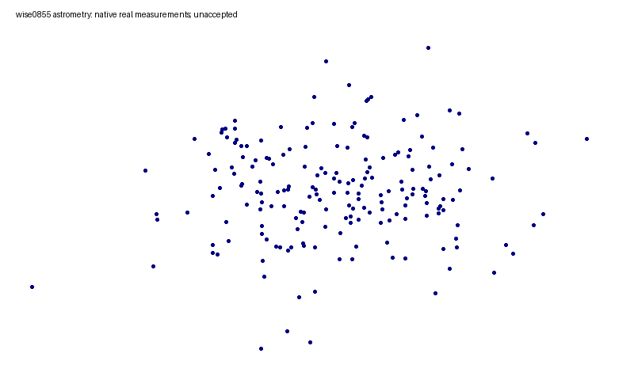

# G3-pm-wise0855 — FAIL (L3)

# Native target acceptance
Complete measurements and rejected frames:
```json
{
  "name": "WISEA J085510.74-071442.5",
  "points": [
    {
      "visit": "V1",
      "mjd": 60800.70069465,
      "xi": 2.467360073929157,
      "eta": 0.47138359110214395,
      "s_xi": 1.2586105236522305,
      "s_eta": 1.7162084129512833,
      "band": 3,
      "frame_id": "level2_2025W19_1B_0116_1D3_spx_l2b-v20-2025-241.fits",
      "cov_xi_eta": 0.15477784865942681,
      "fit_included": false
    },
    {
      "visit": "V1",
      "mjd": 60800.702186907,
      "xi": 3.715252649201884,
      "eta": -0.9271892052127833,
      "s_xi": 3.67875012962059,
      "s_eta": 8.186025005632265,
      "band": 3,
      "frame_id": "level2_2025W19_1B_0116_2D3_spx_l2b-v20-2025-241.fits",
      "cov_xi_eta": 15.994794391796592,
      "fit_included": false
    },
    {
      "visit": "V1",
      "mjd": 60801.107262601,
      "xi": 5.227708927783692,
      "eta": 1.6395375451762995,
      "s_xi": 2.2070414220067636,
      "s_eta": 1.6971229642171626,
      "band": 2,
      "frame_id": "level2_2025W19_1B_0181_1D2_spx_l2b-v20-2025-241.fits",
      "cov_xi_eta": -0.1238335246061136,
      "fit_included": false
    },
    {
      "visit": "V1",
      "mjd": 60801.107262601,
      "xi": 3.946773326958597,
      "eta": -0.11494111375956079,
      "s_xi": 0.6382816060103625,
      "s_eta": 0.6304407505521972,
      "band": 5,
      "frame_id": "level2_2025W19_1B_0181_1D5_spx_l2b-v20-2025-241.fits",
      "cov_xi_eta": -0.048875864887956824,
      "fit_included": false
    },
    {
      "visit": "V1",
      "mjd": 60801.108754847,
      "xi": 4.393073402125338,
      "eta": 1.8978857815018952,
      "s_xi": 2.0506614448991765,
      "s_eta": 1.2474138878431773,
      "band": 2,
      "frame_id": "level2_2025W19_1B_0181_2D2_spx_l2b-v20-2025-241.fits",
      "cov_xi_eta": -0.6063162314902562,
      "fit_included": false
    },
    {
      "visit": "V1",
      "mjd": 60801.110247104,
      "xi": -0.5448370052273197,
      "eta": -0.6749490884592533,
      "s_xi": 3.709172665274899,
      "s_eta": 2.5165963378281955,
      "band": 2,
      "frame_id": "level2_2025W19_1B_0181_3D2_spx_l2b-v20-2025-241.fits",
      "cov_xi_eta": -2.9886360319381917,
      "fit_included": false
    },
    {
      "visit": "V1",
      "mjd": 60801.110247104,
      "xi": 3.061598294335984,
      "eta": 0.08532801764404688,
      "s_xi": 0.9297628425433823,
      "s_eta": 0.7730480950536606,
      "band": 5,
      "frame_id": "level2_2025W19_1B_0181_3D5_spx_l2b-v20-2025-241.fits",
      "cov_xi_eta": -0.06154618662221894,
      "fit_included": false
    },
    {
      "visit": "V1",
      "mjd": 60801.111739349,
      "xi": 11.110886438583517,
      "eta": 3.3976540938753628,
      "s_xi": 3.732410880104501,
      "s_eta": 1.9326872753512638,
      "band": 2,
      "frame_id": "level2_2025W19_1B_0181_4D2_spx_l2b-v20-2025-241.fits",
      "cov_xi_eta": -3.410638343227794,
      "fit_included": false
    },
    {
      "visit": "V1",
      "mjd": 60801.111739349,
      "xi": 3.1110520147651832,
      "eta": -1.0689629368934228,
      "s_xi": 0.5255528625024327,
      "s_eta": 0.7328089126366599,
      "band": 5,
      "frame_id": "level2_2025W19_1B_0181_4D5_spx_l2b-v20-2025-241.fits",
      "cov_xi_eta": 0.06792965604906058,
      "fit_included": false
    },
    {
      "visit": "V1",
      "mjd": 60801.446306085,
      "xi": 1.1542630599839692,
      "eta": -2.6364164073016334,
      "s_xi": 6.080991810184923,
      "s_eta": 2.651455126516247,
      "band": 2,
      "frame_id": "level2_2025W19_1B_0231_1D2_spx_l2b-v20-2025-241.fits",
      "cov_xi_eta": -9.938605568556236,
      "fit_included": false
    },
    {
      "visit": "V1",
      "mjd": 60801.446306085,
      "xi": 3.43524525630952,
      "eta": 2.8821851285804936,
      "s_xi": 2.574755291341514,
      "s_eta": 1.3050680494920213,
      "band": 5,
      "frame_id": "level2_2025W19_1B_0231_1D5_spx_l2b-v20-2025-241.fits",
      "cov_xi_eta": -1.6857916664610801,
      "fit_included": false
    },
    {
      "visit": "V1",
      "mjd": 60801.44779833,
      "xi": 2.6520773599166687,
      "eta": 4.742375353564968,
      "s_xi": 1.4948717855501923,
      "s_eta": 2.9779956826157474,
      "band": 2,
      "frame_id": "level2_2025W19_1B_0231_2D2_spx_l2b-v20-2025-241.fits",
      "cov_xi_eta": 1.9605938580435793,
      "fit_included": false
    },
    {
      "visit": "V1",
      "mjd": 60801.44779833,
      "xi": 2.949456343996571,
      "eta": 0.45643204441616964,
      "s_xi": 1.4619125649354425,
      "s_eta": 1.4098305712342627,
      "band": 5,
      "frame_id": "level2_2025W19_1B_0231_2D5_spx_l2b-v20-2025-241.fits",
      "cov_xi_eta": -0.2919317758790609,
      "fit_included": false
    },
    {
      "visit": "V1",
      "mjd": 60801.449290587,
      "xi": 2.0433002610530346,
      "eta": -3.5917710591458114,
      "s_xi": 3.1209797561602612,
      "s_eta": 4.990789445968668,
      "band": 2,
      "frame_id": "level2_2025W19_1B_0231_3D2_spx_l2b-v20-2025-241.fits",
      "cov_xi_eta": 2.31680486898439,
      "fit_included": false
    },
    {
      "visit": "V1",
      "mjd": 60801.449290576,
      "xi": 2.068061923805251,
      "eta": -1.2725886380043507,
      "s_xi": 1.3459420583350976,
      "s_eta": 2.0122102745965895,
      "band": 5,
      "frame_id": "level2_2025W19_1B_0231_3D5_spx_l2b-v20-2025-241.fits",
      "cov_xi_eta": 1.1861088693105768,
      "fit_included": false
    },
    {
      "visit": "V1",
      "mjd": 60801.450782833,
      "xi": 8.568217776268837,
      "eta": 3.1349541618346777,
      "s_xi": 2.589628442735711,
      "s_eta": 2.1984284021995313,
      "band": 2,
      "frame_id": "level2_2025W19_1B_0231_4D2_spx_l2b-v20-2025-241.fits",
      "cov_xi_eta": -0.873852970298658,
      "fit_included": false
    },
    {
      "visit": "V1",
      "mjd": 60801.450782821,
      "xi": 6.42424253073527,
      "eta": 1.0828416413436897,
      "s_xi": 0.6175447531243862,
      "s_eta": 0.7902551393597151,
      "band": 5,
      "frame_id": "level2_2025W19_1B_0231_4D5_spx_l2b-v20-2025-241.fits",
      "cov_xi_eta": 0.062311831428587344,
      "fit_included": false
    },
    {
      "visit": "V1",
      "mjd": 60801.514843134,
      "xi": -7.576812873450723,
      "eta": -3.237379127146877,
      "s_xi": 14.337832529354646,
      "s_eta": 32.760617856418556,
      "band": 1,
      "frame_id": "level2_2025W19_1B_0241_1D1_spx_l2b-v20-2025-242.fits",
      "cov_xi_eta": 375.64424633124645,
      "fit_included": false
    },
    {
      "visit": "V1",
      "mjd": 60801.514843134,
      "xi": 0.8124001603644149,
      "eta": -1.4943103345085746,
      "s_xi": 10.795832260028916,
      "s_eta": 11.77119149264708,
      "band": 4,
      "frame_id": "level2_2025W19_1B_0241_1D4_spx_l2b-v20-2025-241.fits",
      "cov_xi_eta": 19.7018156374546,
      "fit_included": false
    },
    {
      "visit": "V1",
      "mjd": 60801.516335379,
      "xi": 3.135531458516994,
      "eta": -0.3542028221539377,
      "s_xi": 3.8434427616220623,
      "s_eta": 2.1581258970312818,
      "band": 1,
      "frame_id": "level2_2025W19_1B_0241_2D1_spx_l2b-v20-2025-242.fits",
      "cov_xi_eta": -3.8932480064837995,
      "fit_included": false
    },
    {
      "visit": "V1",
      "mjd": 60801.517827636,
      "xi": 3.2638038077505116,
      "eta": 1.7694204015724702,
      "s_xi": 8.896973435593097,
      "s_eta": 11.866670447239164,
      "band": 1,
      "frame_id": "level2_2025W19_1B_0241_3D1_spx_l2b-v20-2025-242.fits",
      "cov_xi_eta": 27.41770021705629,
      "fit_included": false
    },
    {
      "visit": "V1",
      "mjd": 60801.517827636,
      "xi": 3.565267117298828,
      "eta": -5.601462968482088,
      "s_xi": 6.672658964846301,
      "s_eta": 4.598442637727652,
      "band": 4,
      "frame_id": "level2_2025W19_1B_0241_3D4_spx_l2b-v20-2025-241.fits",
      "cov_xi_eta": -7.2801819176239055,
      "fit_included": false
    },
    {
      "visit": "V1",
      "mjd": 60801.519319893,
      "xi": 1.9849849143239902,
      "eta": 4.476751105263762,
      "s_xi": 2.17508138643031,
      "s_eta": 1.997297735275008,
      "band": 1,
      "frame_id": "level2_2025W19_1B_0241_4D1_spx_l2b-v20-2025-242.fits",
      "cov_xi_eta": -0.41516495870448916,
      "fit_included": false
    },
    {
      "visit": "V1",
      "mjd": 60801.519319893,
      "xi": 1.859181664150034,
      "eta": 0.9115982819218672,
      "s_xi": 9.684903124223476,
      "s_eta": 8.63828740454348,
      "band": 4,
      "frame_id": "level2_2025W19_1B_0241_4D4_spx_l2b-v20-2025-241.fits",
      "cov_xi_eta": -3.0619521288559395,
      "fit_included": false
    },
    {
      "visit": "V2",
      "mjd": 60979.723343354,
      "xi": 2.0484786929486316,
      "eta": -0.492220874050053,
      "s_xi": 2.8458165697041466,
      "s_eta": 5.604291967694726,
      "band": 1,
      "frame_id": "level2_2025W44_2B_0305_1D1_spx_l2b-v20-2025-307.fits",
      "cov_xi_eta": 10.174380599619251,
      "fit_included": false
    },
    {
      "visit": "V2",
      "mjd": 60979.723343354,
      "xi": -0.2807268407199195,
      "eta": -1.3194913981599807,
      "s_xi": 9.544267870644143,
      "s_eta": 4.649391933946009,
      "band": 4,
      "frame_id": "level2_2025W44_2B_0305_1D4_spx_l2b-v20-2025-307.fits",
      "cov_xi_eta": -15.70853136774625,
      "fit_included": false
    },
    {
      "visit": "V2",
      "mjd": 60979.724835611,
      "xi": 0.13859688764074063,
      "eta": 1.4545846917332825,
      "s_xi": 1.4350680267114573,
      "s_eta": 1.1189074340733716,
      "band": 1,
      "frame_id": "level2_2025W44_2B_0305_2D1_spx_l2b-v20-2025-307.fits",
      "cov_xi_eta": -0.4632483663446836,
      "fit_included": false
    },
    {
      "visit": "V2",
      "mjd": 60979.724835611,
      "xi": 2.1457031711524506,
      "eta": -0.052556843028075284,
      "s_xi": 16.8718181671833,
      "s_eta": 27.070484778273634,
      "band": 4,
      "frame_id": "level2_2025W44_2B_0305_2D4_spx_l2b-v20-2025-307.fits",
      "cov_xi_eta": 188.39256675501622,
      "fit_included": false
    },
    {
      "visit": "V2",
      "mjd": 60979.726327879,
      "xi": -6.841645485757971,
      "eta": 3.4475288707777736,
      "s_xi": 1.8312519287007376,
      "s_eta": 2.61707262127218,
      "band": 1,
      "frame_id": "level2_2025W44_2B_0305_3D1_spx_l2b-v20-2025-307.fits",
      "cov_xi_eta": -4.756583862866237,
      "fit_included": false
    },
    {
      "visit": "V2",
      "mjd": 60979.726327879,
      "xi": -5.881948875795816,
      "eta": 2.9761781844496635,
      "s_xi": 3.3463373487992,
      "s_eta": 2.009189158661256,
      "band": 4,
      "frame_id": "level2_2025W44_2B_0305_3D4_spx_l2b-v20-2025-307.fits",
      "cov_xi_eta": -6.224983827841166,
      "fit_included": false
    },
    {
      "visit": "V2",
      "mjd": 60979.727820136,
      "xi": -4.042807007353323,
      "eta": 2.4418020510331955,
      "s_xi": 1.331336403233913,
      "s_eta": 1.3592061695469242,
      "band": 1,
      "frame_id": "level2_2025W44_2B_0305_4D1_spx_l2b-v20-2025-307.fits",
      "cov_xi_eta": -0.2205806846839331,
      "fit_included": false
    },
    {
      "visit": "V2",
      "mjd": 60979.727820136,
      "xi": -0.7557918893463738,
      "eta": 6.482481236530691,
      "s_xi": 5.969283176320707,
      "s_eta": 3.5538432039524896,
      "band": 4,
      "frame_id": "level2_2025W44_2B_0305_4D4_spx_l2b-v20-2025-307.fits",
      "cov_xi_eta": -0.5709625755102405,
      "fit_included": false
    },
    {
      "visit": "V2",
      "mjd": 60979.786089141,
      "xi": 4.272242522927572,
      "eta": 5.033187739090414,
      "s_xi": 1.389229820843802,
      "s_eta": 0.93272343544368,
      "band": 1,
      "frame_id": "level2_2025W44_2B_0321_1D1_spx_l2b-v20-2025-307.fits",
      "cov_xi_eta": 0.01740445361569694,
      "fit_included": false
    },
    {
      "visit": "V2",
      "mjd": 60979.786089152,
      "xi": -5.585393611506252,
      "eta": 1.7601953097928202,
      "s_xi": 3.3002714748073547,
      "s_eta": 2.235539329495429,
      "band": 4,
      "frame_id": "level2_2025W44_2B_0321_1D4_spx_l2b-v20-2025-307.fits",
      "cov_xi_eta": -6.035462356707262,
      "fit_included": false
    },
    {
      "visit": "V2",
      "mjd": 60979.787581398,
      "xi": 0.9201116189305086,
      "eta": -0.7049065976812353,
      "s_xi": 1.658178378711431,
      "s_eta": 1.9138536221954934,
      "band": 4,
      "frame_id": "level2_2025W44_2B_0321_2D4_spx_l2b-v20-2025-307.fits",
      "cov_xi_eta": 0.8234671219102663,
      "fit_included": false
    },
    {
      "visit": "V2",
      "mjd": 60979.789304592,
      "xi": -4.399129699024977,
      "eta": -2.864441743456688,
      "s_xi": 5.033644565873295,
      "s_eta": 3.7189402217211724,
      "band": 1,
      "frame_id": "level2_2025W44_2B_0322_1D1_spx_l2b-v20-2025-307.fits",
      "cov_xi_eta": 0.23866922133562674,
      "fit_included": false
    },
    {
      "visit": "V2",
      "mjd": 60979.789304592,
      "xi": 0.36203120668548633,
      "eta": 5.82705521439163,
      "s_xi": 1.441765276225855,
      "s_eta": 2.5397943275280386,
      "band": 4,
      "frame_id": "level2_2025W44_2B_0322_1D4_spx_l2b-v20-2025-307.fits",
      "cov_xi_eta": 0.3416889024573277,
      "fit_included": false
    },
    {
      "visit": "V2",
      "mjd": 60979.790796861,
      "xi": -1.488175437850011,
      "eta": 0.2611077665704599,
      "s_xi": 0.983598384651015,
      "s_eta": 1.4459771065486253,
      "band": 1,
      "frame_id": "level2_2025W44_2B_0322_2D1_spx_l2b-v20-2025-307.fits",
      "cov_xi_eta": 0.5661987761919067,
      "fit_included": false
    },
    {
      "visit": "V2",
      "mjd": 60979.790796861,
      "xi": 4.645141099883712,
      "eta": -2.912604906263495,
      "s_xi": 8.954186310469574,
      "s_eta": 12.013992378937685,
      "band": 4,
      "frame_id": "level2_2025W44_2B_0322_2D4_spx_l2b-v20-2025-307.fits",
      "cov_xi_eta": 36.344299447591986,
      "fit_included": false
    },
    {
      "visit": "V2",
      "mjd": 60979.792289106,
      "xi": 4.8086124502127685,
      "eta": 0.4063250585675348,
      "s_xi": 0.9131720927733739,
      "s_eta": 1.8681623651351928,
      "band": 1,
      "frame_id": "level2_2025W44_2B_0322_3D1_spx_l2b-v20-2025-307.fits",
      "cov_xi_eta": 1.032032923170069,
      "fit_included": false
    },
    {
      "visit": "V2",
      "mjd": 60979.792289106,
      "xi": 4.4277097734090685,
      "eta": -0.14330826027064064,
      "s_xi": 4.023261809836976,
      "s_eta": 1.7653928279655526,
      "band": 4,
      "frame_id": "level2_2025W44_2B_0322_3D4_spx_l2b-v20-2025-307.fits",
      "cov_xi_eta": -3.510980888444098,
      "fit_included": false
    },
    {
      "visit": "V2",
      "mjd": 60979.793781374,
      "xi": -1.9312889523310828,
      "eta": -1.7377228279177457,
      "s_xi": 4.387610430339521,
      "s_eta": 8.689899500700617,
      "band": 4,
      "frame_id": "level2_2025W44_2B_0322_4D4_spx_l2b-v20-2025-307.fits",
      "cov_xi_eta": 18.350601588852005,
      "fit_included": false
    },
    {
      "visit": "V2",
      "mjd": 60979.857397601,
      "xi": -6.781305156317729,
      "eta": -2.565266917912638,
      "s_xi": 1.834289613148831,
      "s_eta": 0.9455741970179744,
      "band": 1,
      "frame_id": "level2_2025W44_2B_0339_1D1_spx_l2b-v20-2025-307.fits",
      "cov_xi_eta": -0.49902786128910664,
      "fit_included": false
    },
    {
      "visit": "V2",
      "mjd": 60979.857397601,
      "xi": 3.084928223502009,
      "eta": 0.3625909884302574,
      "s_xi": 10.939506783408627,
      "s_eta": 18.302438433639637,
      "band": 4,
      "frame_id": "level2_2025W44_2B_0339_1D4_spx_l2b-v20-2025-307.fits",
      "cov_xi_eta": 69.40534521737622,
      "fit_included": false
    },
    {
      "visit": "V2",
      "mjd": 60979.858889858,
      "xi": 2.314822426792899,
      "eta": 2.741806201760374,
      "s_xi": 2.2077085315341862,
      "s_eta": 1.7376818103584035,
      "band": 1,
      "frame_id": "level2_2025W44_2B_0339_2D1_spx_l2b-v20-2025-307.fits",
      "cov_xi_eta": 0.42074417121862795,
      "fit_included": false
    },
    {
      "visit": "V2",
      "mjd": 60979.858889858,
      "xi": -2.2290113154410993,
      "eta": -0.15297545778003369,
      "s_xi": 3.2157564903008646,
      "s_eta": 2.153422706991775,
      "band": 4,
      "frame_id": "level2_2025W44_2B_0339_2D4_spx_l2b-v20-2025-307.fits",
      "cov_xi_eta": -2.7160789021580034,
      "fit_included": false
    },
    {
      "visit": "V2",
      "mjd": 60982.442853747,
      "xi": -4.220250821732345,
      "eta": -2.9377972482233132,
      "s_xi": 1.9507123558922734,
      "s_eta": 2.5911472353168445,
      "band": 1,
      "frame_id": "level2_2025W45_1A_0095_4D1_spx_l2b-v20-2025-311.fits",
      "cov_xi_eta": -1.0201688207174135,
      "fit_included": false
    },
    {
      "visit": "V2",
      "mjd": 60982.442853747,
      "xi": 3.781712978773181,
      "eta": 1.2743865758373785,
      "s_xi": 1.7952574425277137,
      "s_eta": 3.039886761264987,
      "band": 4,
      "frame_id": "level2_2025W45_1A_0095_4D4_spx_l2b-v20-2025-311.fits",
      "cov_xi_eta": 2.089814009508383,
      "fit_included": false
    },
    {
      "visit": "V2",
      "mjd": 60982.507251652,
      "xi": 2.4261980968844994,
      "eta": 0.154641077360825,
      "s_xi": 1.535903588706242,
      "s_eta": 1.3463112427937094,
      "band": 1,
      "frame_id": "level2_2025W45_1A_0110_1D1_spx_l2b-v20-2025-311.fits",
      "cov_xi_eta": -0.10636058652215258,
      "fit_included": false
    },
    {
      "visit": "V2",
      "mjd": 60982.507251652,
      "xi": 3.3332932899948653,
      "eta": 1.0072039719249704,
      "s_xi": 6.5123975374523555,
      "s_eta": 3.8808826523754543,
      "band": 4,
      "frame_id": "level2_2025W45_1A_0110_1D4_spx_l2b-v20-2025-311.fits",
      "cov_xi_eta": -2.216518905814409,
      "fit_included": false
    },
    {
      "visit": "V2",
      "mjd": 60982.508743909,
      "xi": -2.969505516882089,
      "eta": 1.778104095063136,
      "s_xi": 1.9981354604154402,
      "s_eta": 1.4198774884191525,
      "band": 1,
      "frame_id": "level2_2025W45_1A_0110_2D1_spx_l2b-v20-2025-311.fits",
      "cov_xi_eta": -1.0514830268771294,
      "fit_included": false
    },
    {
      "visit": "V2",
      "mjd": 60982.508743909,
      "xi": 8.466806848426613,
      "eta": -1.6502431145368541,
      "s_xi": 1.2823306155689385,
      "s_eta": 1.4767090867047485,
      "band": 4,
      "frame_id": "level2_2025W45_1A_0110_2D4_spx_l2b-v20-2025-311.fits",
      "cov_xi_eta": 0.41766422029626216,
      "fit_included": false
    },
    {
      "visit": "V2",
      "mjd": 60982.510236178,
      "xi": 0.4144811841778516,
      "eta": 1.1022567341705731,
      "s_xi": 4.033947899949411,
      "s_eta": 2.727504705872747,
      "band": 1,
      "frame_id": "level2_2025W45_1A_0110_3D1_spx_l2b-v20-2025-311.fits",
      "cov_xi_eta": -1.632622835637379,
      "fit_included": false
    },
    {
      "visit": "V2",
      "mjd": 60982.510236178,
      "xi": -0.5975092484054538,
      "eta": 4.0714724083376295,
      "s_xi": 5.8281581263729025,
      "s_eta": 4.0605409204093,
      "band": 4,
      "frame_id": "level2_2025W45_1A_0110_3D4_spx_l2b-v20-2025-311.fits",
      "cov_xi_eta": 1.057480701882198,
      "fit_included": false
    },
    {
      "visit": "V2",
      "mjd": 60982.511728423,
      "xi": 8.16240124209556,
      "eta": 3.711631434552046,
      "s_xi": 3.740690568999956,
      "s_eta": 1.9137790746804162,
      "band": 1,
      "frame_id": "level2_2025W45_1A_0110_4D1_spx_l2b-v20-2025-311.fits",
      "cov_xi_eta": -2.975597199645716,
      "fit_included": false
    },
    {
      "visit": "V2",
      "mjd": 60982.511728435,
      "xi": -2.751103187241841,
      "eta": 0.006862159718915406,
      "s_xi": 1.9727255264443608,
      "s_eta": 2.9026508282084307,
      "band": 4,
      "frame_id": "level2_2025W45_1A_0110_4D4_spx_l2b-v20-2025-311.fits",
      "cov_xi_eta": 0.2147875460155884,
      "fit_included": false
    },
    {
      "visit": "V2",
      "mjd": 60982.709114661,
      "xi": 4.580114545484761,
      "eta": -2.428300385596386,
      "s_xi": 4.902072364980333,
      "s_eta": 4.119731397128926,
      "band": 1,
      "frame_id": "level2_2025W45_1A_0153_1D1_spx_l2b-v20-2025-311.fits",
      "cov_xi_eta": -0.26162421700137695,
      "fit_included": false
    },
    {
      "visit": "V2",
      "mjd": 60982.709114673,
      "xi": -6.131795159406117,
      "eta": 0.6841629655639007,
      "s_xi": 3.601057840281609,
      "s_eta": 6.463851320881726,
      "band": 4,
      "frame_id": "level2_2025W45_1A_0153_1D4_spx_l2b-v20-2025-311.fits",
      "cov_xi_eta": -7.73336645439076,
      "fit_included": false
    },
    {
      "visit": "V2",
      "mjd": 60986.241655321,
      "xi": -3.7906198092305985,
      "eta": 0.40940906410987926,
      "s_xi": 6.071965018716386,
      "s_eta": 3.3565376810889904,
      "band": 2,
      "frame_id": "level2_2025W45_2A_0164_1D2_spx_l2b-v20-2025-314.fits",
      "cov_xi_eta": -17.486644398370718,
      "fit_included": false
    },
    {
      "visit": "V2",
      "mjd": 60986.241655321,
      "xi": 0.8318063058066215,
      "eta": 0.11206579630624686,
      "s_xi": 3.4342026307202325,
      "s_eta": 1.7446519261848425,
      "band": 5,
      "frame_id": "level2_2025W45_2A_0164_1D5_spx_l2b-v20-2025-314.fits",
      "cov_xi_eta": -3.824031580405418,
      "fit_included": false
    },
    {
      "visit": "V2",
      "mjd": 60986.243147578,
      "xi": -4.888595820269815,
      "eta": -2.4566052997205214,
      "s_xi": 4.85878650281604,
      "s_eta": 8.640054065601937,
      "band": 2,
      "frame_id": "level2_2025W45_2A_0164_2D2_spx_l2b-v20-2025-314.fits",
      "cov_xi_eta": 12.308658929252568,
      "fit_included": false
    },
    {
      "visit": "V2",
      "mjd": 60986.243147578,
      "xi": -4.144479947084783,
      "eta": 4.081042256645858,
      "s_xi": 2.0552787733718385,
      "s_eta": 1.5001762588623986,
      "band": 5,
      "frame_id": "level2_2025W45_2A_0164_2D5_spx_l2b-v20-2025-314.fits",
      "cov_xi_eta": -0.16380676650668877,
      "fit_included": false
    },
    {
      "visit": "V2",
      "mjd": 60986.244639835,
      "xi": -4.560958127141878,
      "eta": 1.9148000980332653,
      "s_xi": 3.410304531715185,
      "s_eta": 2.9479856464753142,
      "band": 2,
      "frame_id": "level2_2025W45_2A_0164_3D2_spx_l2b-v20-2025-314.fits",
      "cov_xi_eta": -3.858065819595297,
      "fit_included": false
    },
    {
      "visit": "V2",
      "mjd": 60986.244639835,
      "xi": -3.4091334506178814,
      "eta": -1.2226858701553667,
      "s_xi": 1.367229316529815,
      "s_eta": 1.5143697229258923,
      "band": 5,
      "frame_id": "level2_2025W45_2A_0164_3D5_spx_l2b-v20-2025-314.fits",
      "cov_xi_eta": -0.5669214313776765,
      "fit_included": false
    },
    {
      "visit": "V2",
      "mjd": 60986.24613208,
      "xi": -4.020769123114658,
      "eta": -0.5487303938759779,
      "s_xi": 3.500778843808941,
      "s_eta": 1.9935688594269307,
      "band": 2,
      "frame_id": "level2_2025W45_2A_0164_4D2_spx_l2b-v20-2025-314.fits",
      "cov_xi_eta": -4.248198024427106,
      "fit_included": false
    },
    {
      "visit": "V2",
      "mjd": 60986.246132092,
      "xi": 0.12862530577656564,
      "eta": 5.592477088451399,
      "s_xi": 2.7154868565609362,
      "s_eta": 3.917909720346729,
      "band": 5,
      "frame_id": "level2_2025W45_2A_0164_4D5_spx_l2b-v20-2025-314.fits",
      "cov_xi_eta": 3.047354363883262,
      "fit_included": false
    },
    {
      "visit": "V2",
      "mjd": 60986.377414997,
      "xi": -4.984854272167071,
      "eta": -4.642539200639371,
      "s_xi": 4.5467775658853435,
      "s_eta": 1.9646015432296766,
      "band": 2,
      "frame_id": "level2_2025W45_2A_0192_1D2_spx_l2b-v20-2025-314.fits",
      "cov_xi_eta": -5.729874833396934,
      "fit_included": false
    },
    {
      "visit": "V2",
      "mjd": 60986.378907266,
      "xi": -3.801390511416316,
      "eta": -3.0956309975583345,
      "s_xi": 15.031268827910697,
      "s_eta": 5.148883014422572,
      "band": 2,
      "frame_id": "level2_2025W45_2A_0192_2D2_spx_l2b-v20-2025-314.fits",
      "cov_xi_eta": -74.06111824661629,
      "fit_included": false
    },
    {
      "visit": "V2",
      "mjd": 60986.378907266,
      "xi": -1.186672823379297,
      "eta": -2.0772908888948605,
      "s_xi": 4.535654176368235,
      "s_eta": 3.835881148687177,
      "band": 5,
      "frame_id": "level2_2025W45_2A_0192_2D5_spx_l2b-v20-2025-314.fits",
      "cov_xi_eta": -5.7956521500669425,
      "fit_included": false
    },
    {
      "visit": "V2",
      "mjd": 60986.783468215,
      "xi": -2.9974811699841144,
      "eta": -2.834390752383545,
      "s_xi": 1.4691182386700323,
      "s_eta": 1.5759704802082688,
      "band": 2,
      "frame_id": "level2_2025W45_2A_0278_1D2_spx_l2b-v20-2025-314.fits",
      "cov_xi_eta": 0.25692561808262215,
      "fit_included": false
    },
    {
      "visit": "V2",
      "mjd": 60986.783468215,
      "xi": -1.9169398146257672,
      "eta": -0.695698283658192,
      "s_xi": 2.3958076770523995,
      "s_eta": 1.742230203670736,
      "band": 5,
      "frame_id": "level2_2025W45_2A_0278_1D5_spx_l2b-v20-2025-314.fits",
      "cov_xi_eta": 2.875087081873311,
      "fit_included": false
    },
    {
      "visit": "V2",
      "mjd": 60986.784960483,
      "xi": -3.7150672922803887,
      "eta": 2.7745640542983687,
      "s_xi": 2.2613906270339643,
      "s_eta": 1.2275536346735982,
      "band": 2,
      "frame_id": "level2_2025W45_2A_0278_2D2_spx_l2b-v20-2025-314.fits",
      "cov_xi_eta": -1.2938087613475957,
      "fit_included": false
    },
    {
      "visit": "V2",
      "mjd": 60986.784960483,
      "xi": 0.869051162467627,
      "eta": -0.31970838640861465,
      "s_xi": 1.4607095743360519,
      "s_eta": 1.3835696153438282,
      "band": 5,
      "frame_id": "level2_2025W45_2A_0278_2D5_spx_l2b-v20-2025-314.fits",
      "cov_xi_eta": -0.2959575694919536,
      "fit_included": false
    },
    {
      "visit": "V2",
      "mjd": 60986.78645274,
      "xi": 1.4293344525504492,
      "eta": -3.5082167187713,
      "s_xi": 1.3206989199355743,
      "s_eta": 1.1010613340502347,
      "band": 2,
      "frame_id": "level2_2025W45_2A_0278_3D2_spx_l2b-v20-2025-314.fits",
      "cov_xi_eta": -0.24602639166463797,
      "fit_included": false
    },
    {
      "visit": "V2",
      "mjd": 60986.78645274,
      "xi": -0.26427157126581546,
      "eta": 0.18494658496261482,
      "s_xi": 2.3215161920655287,
      "s_eta": 1.2410325962830375,
      "band": 5,
      "frame_id": "level2_2025W45_2A_0278_3D5_spx_l2b-v20-2025-314.fits",
      "cov_xi_eta": -2.0286981968635085,
      "fit_included": false
    },
    {
      "visit": "V2",
      "mjd": 60986.787944986,
      "xi": 0.935790156051338,
      "eta": 2.2871519239324565,
      "s_xi": 3.8104771322626316,
      "s_eta": 6.801617996868831,
      "band": 2,
      "frame_id": "level2_2025W45_2A_0278_4D2_spx_l2b-v20-2025-314.fits",
      "cov_xi_eta": 14.308730988333203,
      "fit_included": false
    },
    {
      "visit": "V2",
      "mjd": 60986.787944997,
      "xi": 0.2743172613420117,
      "eta": -0.917850724271868,
      "s_xi": 1.630368655161206,
      "s_eta": 1.2395960177369252,
      "band": 5,
      "frame_id": "level2_2025W45_2A_0278_4D5_spx_l2b-v20-2025-314.fits",
      "cov_xi_eta": -0.896207534723011,
      "fit_included": false
    },
    {
      "visit": "V2",
      "mjd": 60986.854350333,
      "xi": 8.942029000987892,
      "eta": -1.0152817093215005,
      "s_xi": 0.6540992385059359,
      "s_eta": 1.072433446154527,
      "band": 2,
      "frame_id": "level2_2025W45_2A_0292_1D2_spx_l2b-v20-2025-314.fits",
      "cov_xi_eta": 0.08776548975326778,
      "fit_included": false
    },
    {
      "visit": "V2",
      "mjd": 60986.854350333,
      "xi": -0.2921024648285293,
      "eta": -0.1036410132648544,
      "s_xi": 1.0613011751741992,
      "s_eta": 0.8356861658322281,
      "band": 5,
      "frame_id": "level2_2025W45_2A_0292_1D5_spx_l2b-v20-2025-314.fits",
      "cov_xi_eta": -0.24811641825933034,
      "fit_included": false
    },
    {
      "visit": "V2",
      "mjd": 60986.85584259,
      "xi": -8.816177074166657,
      "eta": -0.9181552594636501,
      "s_xi": 1.2427261143040524,
      "s_eta": 1.443673346664497,
      "band": 2,
      "frame_id": "level2_2025W45_2A_0292_2D2_spx_l2b-v20-2025-314.fits",
      "cov_xi_eta": -0.24414215778503673,
      "fit_included": false
    },
    {
      "visit": "V2",
      "mjd": 60986.855842601,
      "xi": -1.3861724001136704,
      "eta": 1.3847280909943434,
      "s_xi": 0.74849292350898,
      "s_eta": 0.6996066262494185,
      "band": 5,
      "frame_id": "level2_2025W45_2A_0292_2D5_spx_l2b-v20-2025-314.fits",
      "cov_xi_eta": -0.15815231205802555,
      "fit_included": false
    },
    {
      "visit": "V2",
      "mjd": 60986.857334847,
      "xi": 3.224297857380184,
      "eta": 8.688272986697696,
      "s_xi": 12.26288931413994,
      "s_eta": 5.413628108981191,
      "band": 2,
      "frame_id": "level2_2025W45_2A_0292_3D2_spx_l2b-v20-2025-314.fits",
      "cov_xi_eta": -35.73474817041956,
      "fit_included": false
    },
    {
      "visit": "V2",
      "mjd": 60986.857334847,
      "xi": -0.29333254121364416,
      "eta": 0.19416719991070125,
      "s_xi": 1.2520939315367752,
      "s_eta": 1.5572377217605577,
      "band": 5,
      "frame_id": "level2_2025W45_2A_0292_3D5_spx_l2b-v20-2025-314.fits",
      "cov_xi_eta": 0.5799967745992941,
      "fit_included": false
    },
    {
      "visit": "V2",
      "mjd": 60986.921910402,
      "xi": -2.9410733314291297,
      "eta": 2.9002967993209015,
      "s_xi": 2.161204455600616,
      "s_eta": 3.0144253079481906,
      "band": 2,
      "frame_id": "level2_2025W45_2A_0308_1D2_spx_l2b-v20-2025-314.fits",
      "cov_xi_eta": 2.8773783622514535,
      "fit_included": false
    },
    {
      "visit": "V2",
      "mjd": 60986.923402648,
      "xi": 4.671237649353262,
      "eta": -1.6332163841841798,
      "s_xi": 2.948951952165318,
      "s_eta": 6.192688177415938,
      "band": 2,
      "frame_id": "level2_2025W45_2A_0308_2D2_spx_l2b-v20-2025-314.fits",
      "cov_xi_eta": 9.21599299486561,
      "fit_included": false
    },
    {
      "visit": "V2",
      "mjd": 60986.923402648,
      "xi": 1.2727376441786582,
      "eta": -1.3553628891967178,
      "s_xi": 1.1016155626448005,
      "s_eta": 1.039095360516619,
      "band": 5,
      "frame_id": "level2_2025W45_2A_0308_2D5_spx_l2b-v20-2025-314.fits",
      "cov_xi_eta": -0.2475534850319773,
      "fit_included": false
    },
    {
      "visit": "V2",
      "mjd": 60986.924894905,
      "xi": 1.6340309574913447,
      "eta": -0.9823846866946991,
      "s_xi": 2.516822151561247,
      "s_eta": 2.110507434508845,
      "band": 2,
      "frame_id": "level2_2025W45_2A_0308_3D2_spx_l2b-v20-2025-314.fits",
      "cov_xi_eta": -0.4609123138272168,
      "fit_included": false
    },
    {
      "visit": "V2",
      "mjd": 60986.926387161,
      "xi": 3.7391777861390425,
      "eta": -0.6571884980293389,
      "s_xi": 9.108389996464782,
      "s_eta": 12.32081271365001,
      "band": 2,
      "frame_id": "level2_2025W45_2A_0308_4D2_spx_l2b-v20-2025-314.fits",
      "cov_xi_eta": 11.948870603681613,
      "fit_included": false
    },
    {
      "visit": "V2",
      "mjd": 60986.926387161,
      "xi": -0.0032089403941068934,
      "eta": -0.6280731786750644,
      "s_xi": 0.9494764212605112,
      "s_eta": 0.8408900065716761,
      "band": 5,
      "frame_id": "level2_2025W45_2A_0308_4D5_spx_l2b-v20-2025-314.fits",
      "cov_xi_eta": -0.12846622575018715,
      "fit_included": false
    },
    {
      "visit": "V2",
      "mjd": 60987.189468145,
      "xi": -0.5376431426604829,
      "eta": 0.9842281139693801,
      "s_xi": 0.9861018377194762,
      "s_eta": 0.6453437944886584,
      "band": 5,
      "frame_id": "level2_2025W45_2A_0367_1D5_spx_l2b-v20-2025-314.fits",
      "cov_xi_eta": -0.2692952398346014,
      "fit_included": false
    },
    {
      "visit": "V2",
      "mjd": 60989.297473655,
      "xi": -2.5854503216767872,
      "eta": 4.305415474444203,
      "s_xi": 1.2060219415192655,
      "s_eta": 0.8838167875226751,
      "band": 3,
      "frame_id": "level2_2025W46_1A_0075_4D3_spx_l2b-v20-2025-318.fits",
      "cov_xi_eta": 0.03984928642990238,
      "fit_included": false
    },
    {
      "visit": "V2",
      "mjd": 60989.299214604,
      "xi": -6.465053390269092,
      "eta": 4.43446926546794,
      "s_xi": 0.9911984016650711,
      "s_eta": 0.9282647078968729,
      "band": 3,
      "frame_id": "level2_2025W46_1A_0076_1D3_spx_l2b-v20-2025-318.fits",
      "cov_xi_eta": 0.8162216144544691,
      "fit_included": false
    },
    {
      "visit": "V2",
      "mjd": 60989.299214604,
      "xi": -0.7883256095565815,
      "eta": 0.8022930640025507,
      "s_xi": 0.9943646000072942,
      "s_eta": 0.9510787665153603,
      "band": 6,
      "frame_id": "level2_2025W46_1A_0076_1D6_spx_l2b-v20-2025-318.fits",
      "cov_xi_eta": -0.18638019445336354,
      "fit_included": true
    },
    {
      "visit": "V2",
      "mjd": 60989.300706861,
      "xi": -6.38494315348343,
      "eta": 3.3189570730776325,
      "s_xi": 10.512145764605076,
      "s_eta": 7.85077468721628,
      "band": 3,
      "frame_id": "level2_2025W46_1A_0076_2D3_spx_l2b-v20-2025-318.fits",
      "cov_xi_eta": -81.23689321664598,
      "fit_included": false
    },
    {
      "visit": "V2",
      "mjd": 60989.300706861,
      "xi": -0.6654184641631868,
      "eta": -1.124290574992777,
      "s_xi": 0.9894913171223717,
      "s_eta": 0.791393692686991,
      "band": 6,
      "frame_id": "level2_2025W46_1A_0076_2D6_spx_l2b-v20-2025-318.fits",
      "cov_xi_eta": -0.27420421707585024,
      "fit_included": true
    },
    {
      "visit": "V2",
      "mjd": 60989.302199117,
      "xi": 0.03893536176609835,
      "eta": 1.0538084981388445,
      "s_xi": 1.3173446387586811,
      "s_eta": 1.323744020838048,
      "band": 3,
      "frame_id": "level2_2025W46_1A_0076_3D3_spx_l2b-v20-2025-318.fits",
      "cov_xi_eta": -0.8334038930882759,
      "fit_included": false
    },
    {
      "visit": "V2",
      "mjd": 60989.3654423,
      "xi": 7.427948352184944,
      "eta": -3.291229861938615,
      "s_xi": 3.8942583601306535,
      "s_eta": 3.339362812123745,
      "band": 3,
      "frame_id": "level2_2025W46_1A_0090_1D3_spx_l2b-v20-2025-318.fits",
      "cov_xi_eta": -2.5299546431954263,
      "fit_included": false
    },
    {
      "visit": "V2",
      "mjd": 60989.368426814,
      "xi": 1.7218778840249354,
      "eta": 2.6041294117805935,
      "s_xi": 5.966068244424375,
      "s_eta": 3.269403633196317,
      "band": 3,
      "frame_id": "level2_2025W46_1A_0090_3D3_spx_l2b-v20-2025-318.fits",
      "cov_xi_eta": -9.71732331388758,
      "fit_included": false
    },
    {
      "visit": "V2",
      "mjd": 60989.438651617,
      "xi": 3.9758957212370145,
      "eta": -0.7722938894459823,
      "s_xi": 4.564602677609248,
      "s_eta": 4.77708828301343,
      "band": 2,
      "frame_id": "level2_2025W46_1A_0108_1D2_spx_l2b-v20-2025-318.fits",
      "cov_xi_eta": 0.13820955929028042,
      "fit_included": false
    },
    {
      "visit": "V2",
      "mjd": 60989.438651617,
      "xi": 1.54473195454497,
      "eta": 2.4509979938305393,
      "s_xi": 2.214045490639504,
      "s_eta": 2.5149835927116926,
      "band": 5,
      "frame_id": "level2_2025W46_1A_0108_1D5_spx_l2b-v20-2025-318.fits",
      "cov_xi_eta": 0.2973408993757009,
      "fit_included": false
    },
    {
      "visit": "V2",
      "mjd": 60989.977657659,
      "xi": 7.07368413197683,
      "eta": -2.8047381323305185,
      "s_xi": 2.8608371975034577,
      "s_eta": 3.0415924295363888,
      "band": 3,
      "frame_id": "level2_2025W46_1A_0238_1D3_spx_l2b-v20-2025-318.fits",
      "cov_xi_eta": 0.35221353241396086,
      "fit_included": false
    },
    {
      "visit": "V2",
      "mjd": 60989.979149905,
      "xi": -0.7445286516170266,
      "eta": -0.4871514246375122,
      "s_xi": 3.1528707484538625,
      "s_eta": 3.530268505722267,
      "band": 3,
      "frame_id": "level2_2025W46_1A_0238_2D3_spx_l2b-v20-2025-318.fits",
      "cov_xi_eta": -1.3831977482841076,
      "fit_included": false
    },
    {
      "visit": "V2",
      "mjd": 60993.505774916,
      "xi": -6.117686660239068,
      "eta": 0.7719306963632576,
      "s_xi": 1.8989828212774122,
      "s_eta": 1.3971570425170816,
      "band": 3,
      "frame_id": "level2_2025W46_2A_0214_1D3_spx_l2b-v20-2025-321.fits",
      "cov_xi_eta": -1.9163466923181038,
      "fit_included": false
    },
    {
      "visit": "V2",
      "mjd": 60993.507267173,
      "xi": 6.500574268284735,
      "eta": -4.401757120763482,
      "s_xi": 2.1651844638772904,
      "s_eta": 5.761176098848197,
      "band": 3,
      "frame_id": "level2_2025W46_2A_0214_2D3_spx_l2b-v20-2025-321.fits",
      "cov_xi_eta": 7.16475960013884,
      "fit_included": false
    },
    {
      "visit": "V2",
      "mjd": 60993.508759418,
      "xi": 1.8833854147738807,
      "eta": 0.43938238716262,
      "s_xi": 14.58466614884539,
      "s_eta": 4.2821152075694,
      "band": 3,
      "frame_id": "level2_2025W46_2A_0214_3D3_spx_l2b-v20-2025-321.fits",
      "cov_xi_eta": -34.67058234429396,
      "fit_included": false
    },
    {
      "visit": "V2",
      "mjd": 60993.508759418,
      "xi": -2.406606105631429,
      "eta": 0.42324118961755897,
      "s_xi": 1.4198104353132566,
      "s_eta": 1.5111674619764208,
      "band": 6,
      "frame_id": "level2_2025W46_2A_0214_3D6_spx_l2b-v20-2025-321.fits",
      "cov_xi_eta": -0.7510474885156331,
      "fit_included": true
    },
    {
      "visit": "V2",
      "mjd": 60993.510251698,
      "xi": -5.202805849374804,
      "eta": -0.7201196115023112,
      "s_xi": 1.3696169878548872,
      "s_eta": 0.954771690968113,
      "band": 3,
      "frame_id": "level2_2025W46_2A_0214_4D3_spx_l2b-v20-2025-321.fits",
      "cov_xi_eta": -0.32653268971090926,
      "fit_included": false
    },
    {
      "visit": "V2",
      "mjd": 60993.574916062,
      "xi": -2.461917271640206,
      "eta": -5.517012642051765,
      "s_xi": 2.1569249075323977,
      "s_eta": 3.9390856129494227,
      "band": 3,
      "frame_id": "level2_2025W46_2A_0226_1D3_spx_l2b-v20-2025-321.fits",
      "cov_xi_eta": 2.1705049421790634,
      "fit_included": false
    },
    {
      "visit": "V2",
      "mjd": 60993.576408319,
      "xi": -2.364981036990233,
      "eta": 0.15753537091108877,
      "s_xi": 1.9071331526584572,
      "s_eta": 2.2242018842592666,
      "band": 3,
      "frame_id": "level2_2025W46_2A_0226_2D3_spx_l2b-v20-2025-321.fits",
      "cov_xi_eta": -0.3861224755704699,
      "fit_included": false
    },
    {
      "visit": "V2",
      "mjd": 60993.579392821,
      "xi": -2.99818909452716,
      "eta": -0.9155461527153137,
      "s_xi": 5.3998767522183355,
      "s_eta": 9.934355687224397,
      "band": 3,
      "frame_id": "level2_2025W46_2A_0226_4D3_spx_l2b-v20-2025-321.fits",
      "cov_xi_eta": 6.666139054737909,
      "fit_included": false
    },
    {
      "visit": "V2",
      "mjd": 60993.913551317,
      "xi": -1.5199441930564015,
      "eta": 4.248782681108612,
      "s_xi": 10.49876345836678,
      "s_eta": 4.505625718519907,
      "band": 3,
      "frame_id": "level2_2025W46_2A_0289_1D3_spx_l2b-v20-2025-321.fits",
      "cov_xi_eta": -36.367183799660594,
      "fit_included": false
    },
    {
      "visit": "V3",
      "mjd": 61020.80435546,
      "xi": 3.9798500644259147,
      "eta": -3.035610817625119,
      "s_xi": 1.7576418981380837,
      "s_eta": 3.0263773624691983,
      "band": 2,
      "frame_id": "level2_2025W50_2A_0086_1D2_spx_l2b-v20-2025-349.fits",
      "cov_xi_eta": 2.4470153726645734,
      "fit_included": false
    },
    {
      "visit": "V3",
      "mjd": 61020.80435546,
      "xi": 1.2097559234179862,
      "eta": 0.3267197292214093,
      "s_xi": 2.200295636350999,
      "s_eta": 2.052762172169319,
      "band": 5,
      "frame_id": "level2_2025W50_2A_0086_1D5_spx_l2b-v20-2025-349.fits",
      "cov_xi_eta": -0.14244235447772033,
      "fit_included": false
    },
    {
      "visit": "V3",
      "mjd": 61021.076105749,
      "xi": 4.287507053109211,
      "eta": -4.151460602206166,
      "s_xi": 6.240668733071793,
      "s_eta": 4.9193535916825155,
      "band": 2,
      "frame_id": "level2_2025W50_2A_0164_1D2_spx_l2b-v20-2025-349.fits",
      "cov_xi_eta": -13.992809863091539,
      "fit_included": false
    },
    {
      "visit": "V3",
      "mjd": 61021.076105738,
      "xi": -2.1577519324060224,
      "eta": 1.6676095286512305,
      "s_xi": 1.5813448959300054,
      "s_eta": 1.4038185924520892,
      "band": 5,
      "frame_id": "level2_2025W50_2A_0164_1D5_spx_l2b-v20-2025-349.fits",
      "cov_xi_eta": -0.9118597336821918,
      "fit_included": false
    },
    {
      "visit": "V3",
      "mjd": 61021.283493666,
      "xi": 0.21127245460273353,
      "eta": 5.6774792899181135,
      "s_xi": 2.4660399464655134,
      "s_eta": 1.6298650618165955,
      "band": 3,
      "frame_id": "level2_2025W50_2A_0232_1D3_spx_l2b-v20-2025-349.fits",
      "cov_xi_eta": -0.7390328897611013,
      "fit_included": false
    },
    {
      "visit": "V3",
      "mjd": 61021.283493666,
      "xi": -0.914085287536432,
      "eta": -1.222496709820244,
      "s_xi": 0.9671313014896452,
      "s_eta": 1.2868992954192056,
      "band": 6,
      "frame_id": "level2_2025W50_2A_0232_1D6_spx_l2b-v20-2025-349.fits",
      "cov_xi_eta": 0.03618050522355775,
      "fit_included": false
    },
    {
      "visit": "V3",
      "mjd": 61021.352084106,
      "xi": 0.2733560028787304,
      "eta": 1.7378939981284354,
      "s_xi": 23.34959885287144,
      "s_eta": 16.87148490168818,
      "band": 3,
      "frame_id": "level2_2025W50_2A_0254_1D3_spx_l2b-v20-2025-349.fits",
      "cov_xi_eta": -62.663783357580385,
      "fit_included": false
    },
    {
      "visit": "V3",
      "mjd": 61021.824187428,
      "xi": -2.3370060753534454,
      "eta": 1.2604701125350635,
      "s_xi": 0.9211995349963358,
      "s_eta": 0.767903373935184,
      "band": 5,
      "frame_id": "level2_2025W50_2A_0374_1D5_spx_l2b-v20-2025-349.fits",
      "cov_xi_eta": -0.14048292460662884,
      "fit_included": false
    },
    {
      "visit": "V3",
      "mjd": 61021.892866687,
      "xi": -3.0964522724040657,
      "eta": -1.4617510260138569,
      "s_xi": 2.421998463792046,
      "s_eta": 4.980450773155375,
      "band": 2,
      "frame_id": "level2_2025W50_2A_0391_1D2_spx_l2b-v20-2025-349.fits",
      "cov_xi_eta": 8.749615506888428,
      "fit_included": false
    },
    {
      "visit": "V3",
      "mjd": 61021.892866687,
      "xi": -1.9423184979719015,
      "eta": 1.3776660024110154,
      "s_xi": 0.9020119548517633,
      "s_eta": 0.7736920867044915,
      "band": 5,
      "frame_id": "level2_2025W50_2A_0391_1D5_spx_l2b-v20-2025-349.fits",
      "cov_xi_eta": -0.3033040466055652,
      "fit_included": false
    },
    {
      "visit": "V3",
      "mjd": 61022.029798828,
      "xi": -0.00834960171672603,
      "eta": 3.543880534112792,
      "s_xi": 2.6011327272258886,
      "s_eta": 2.1937258300059064,
      "band": 3,
      "frame_id": "level2_2025W50_2A_0428_1D3_spx_l2b-v20-2025-349.fits",
      "cov_xi_eta": 1.247640617332761,
      "fit_included": false
    },
    {
      "visit": "V3",
      "mjd": 61022.23175068,
      "xi": -0.8490530502000371,
      "eta": 0.24244784457806778,
      "s_xi": 0.8970115998490689,
      "s_eta": 0.9232275432032319,
      "band": 5,
      "frame_id": "level2_2025W50_2A_0479_1D5_spx_l2b-v20-2025-349.fits",
      "cov_xi_eta": -0.08050954884324199,
      "fit_included": false
    },
    {
      "visit": "V3",
      "mjd": 61022.368771664,
      "xi": 3.79517490468017,
      "eta": -0.5136899109833895,
      "s_xi": 3.1962957290205964,
      "s_eta": 6.649070568960495,
      "band": 2,
      "frame_id": "level2_2025W50_2A_0512_1D2_spx_l2b-v20-2025-349.fits",
      "cov_xi_eta": 12.80911354894681,
      "fit_included": false
    },
    {
      "visit": "V4",
      "mjd": 61151.198599395,
      "xi": -0.41298182302134356,
      "eta": -2.89279765397624,
      "s_xi": 7.707977559216226,
      "s_eta": 7.5809237678318215,
      "band": 3,
      "frame_id": "level2_2026W17_1B_0227_2D3_spx_l2b-v24-2026-115.fits",
      "cov_xi_eta": -3.6659003176516713,
      "fit_included": false
    },
    {
      "visit": "V4",
      "mjd": 61151.200091652,
      "xi": -4.859468857263104,
      "eta": 2.2687115229514125,
      "s_xi": 8.18922729460997,
      "s_eta": 6.469237029389632,
      "band": 3,
      "frame_id": "level2_2026W17_1B_0227_3D3_spx_l2b-v24-2026-115.fits",
      "cov_xi_eta": -30.079364160455516,
      "fit_included": false
    },
    {
      "visit": "V4",
      "mjd": 61151.201583909,
      "xi": -1.3493726986884076,
      "eta": 2.9770445033223405,
      "s_xi": 2.7423394091649604,
      "s_eta": 2.279582138263861,
      "band": 3,
      "frame_id": "level2_2026W17_1B_0227_4D3_spx_l2b-v24-2026-115.fits",
      "cov_xi_eta": -1.6497419526423012,
      "fit_included": false
    },
    {
      "visit": "V4",
      "mjd": 61152.757969777,
      "xi": -6.138049319065205,
      "eta": 2.968358640002879,
      "s_xi": 1.627133150055794,
      "s_eta": 1.3207859594000333,
      "band": 3,
      "frame_id": "level2_2026W17_1B_0507_1D3_spx_l2b-v24-2026-115.fits",
      "cov_xi_eta": -1.9842420674762717,
      "fit_included": false
    },
    {
      "visit": "V4",
      "mjd": 61152.757969777,
      "xi": -4.76223170011612,
      "eta": 2.207114880997902,
      "s_xi": 0.9894535513348415,
      "s_eta": 0.8778783272942274,
      "band": 6,
      "frame_id": "level2_2026W17_1B_0507_1D6_spx_l2b-v24-2026-115.fits",
      "cov_xi_eta": -0.39043479140850856,
      "fit_included": true
    },
    {
      "visit": "V4",
      "mjd": 61152.759462023,
      "xi": -2.449378607986929,
      "eta": -2.9092358424724516,
      "s_xi": 1.4009014433815496,
      "s_eta": 4.689402880243318,
      "band": 3,
      "frame_id": "level2_2026W17_1B_0507_2D3_spx_l2b-v24-2026-115.fits",
      "cov_xi_eta": 1.4464477883910596,
      "fit_included": false
    },
    {
      "visit": "V4",
      "mjd": 61153.437123226,
      "xi": -0.5810985316219088,
      "eta": -3.633862707887666,
      "s_xi": 1.6434380174929715,
      "s_eta": 2.2299547084070896,
      "band": 3,
      "frame_id": "level2_2026W17_1B_0634_1D3_spx_l2b-v24-2026-115.fits",
      "cov_xi_eta": 0.38215310662074475,
      "fit_included": false
    },
    {
      "visit": "V4",
      "mjd": 61153.438615495,
      "xi": -5.866519999540037,
      "eta": -0.45483309599452565,
      "s_xi": 1.5438814594080965,
      "s_eta": 2.734648773919177,
      "band": 3,
      "frame_id": "level2_2026W17_1B_0634_2D3_spx_l2b-v24-2026-115.fits",
      "cov_xi_eta": 1.5331023729492936,
      "fit_included": false
    },
    {
      "visit": "V4",
      "mjd": 61153.44010774,
      "xi": -3.338281142038764,
      "eta": -1.8657368713357971,
      "s_xi": 1.7215563515406065,
      "s_eta": 3.148917740062191,
      "band": 3,
      "frame_id": "level2_2026W17_1B_0634_3D3_spx_l2b-v24-2026-115.fits",
      "cov_xi_eta": 1.7998946309955675,
      "fit_included": false
    },
    {
      "visit": "V4",
      "mjd": 61153.441599986,
      "xi": -7.211659761544003,
      "eta": 0.5151368823947953,
      "s_xi": 2.3998837719848227,
      "s_eta": 4.421451288567769,
      "band": 3,
      "frame_id": "level2_2026W17_1B_0634_4D3_spx_l2b-v24-2026-115.fits",
      "cov_xi_eta": 0.04968551986186359,
      "fit_included": false
    },
    {
      "visit": "V4",
      "mjd": 61156.086177138,
      "xi": -0.4916075731193517,
      "eta": 4.307199695620155,
      "s_xi": 20.74686211023288,
      "s_eta": 7.866735350266996,
      "band": 3,
      "frame_id": "level2_2026W17_2A_0591_1D3_spx_l2b-v24-2026-118.fits",
      "cov_xi_eta": -97.02072941423704,
      "fit_included": false
    },
    {
      "visit": "V4",
      "mjd": 61156.153381895,
      "xi": -3.2351538841744025,
      "eta": -5.82770445203656,
      "s_xi": 4.183759182202881,
      "s_eta": 3.5046670496570225,
      "band": 3,
      "frame_id": "level2_2026W17_2A_0609_1D3_spx_l2b-v24-2026-118.fits",
      "cov_xi_eta": -1.2018061041402819,
      "fit_included": false
    },
    {
      "visit": "V4",
      "mjd": 61156.154891907,
      "xi": -10.346403506869548,
      "eta": -1.3245312774344085,
      "s_xi": 2.708965031891535,
      "s_eta": 2.8625557674929403,
      "band": 3,
      "frame_id": "level2_2026W17_2A_0609_2D3_spx_l2b-v24-2026-118.fits",
      "cov_xi_eta": 2.0669763033261725,
      "fit_included": false
    },
    {
      "visit": "V4",
      "mjd": 61156.493846861,
      "xi": 4.767885370557511,
      "eta": 4.848687846328909,
      "s_xi": 3.997912789022654,
      "s_eta": 2.3266470456631487,
      "band": 3,
      "frame_id": "level2_2026W17_2A_0692_1D3_spx_l2b-v24-2026-118.fits",
      "cov_xi_eta": -6.030351677930724,
      "fit_included": false
    },
    {
      "visit": "V4",
      "mjd": 61156.495339106,
      "xi": -6.477449310555739,
      "eta": 3.956471586098955,
      "s_xi": 1.94801201579112,
      "s_eta": 0.34187678419901774,
      "band": 3,
      "frame_id": "level2_2026W17_2A_0692_2D3_spx_l2b-v24-2026-118.fits",
      "cov_xi_eta": -0.1959078007777276,
      "fit_included": false
    },
    {
      "visit": "V4",
      "mjd": 61160.771483435,
      "xi": -5.100853375253853,
      "eta": -0.3134722809471487,
      "s_xi": 5.170247042448913,
      "s_eta": 2.2894727650328637,
      "band": 3,
      "frame_id": "level2_2026W18_2A_0065_1D3_spx_l2b-v24-2026-125.fits",
      "cov_xi_eta": -8.351567718900004,
      "fit_included": false
    },
    {
      "visit": "V4",
      "mjd": 61161.58753355,
      "xi": 0.15654061415430182,
      "eta": 3.4661274117932193,
      "s_xi": 2.8781490147369713,
      "s_eta": 2.1203047573780056,
      "band": 2,
      "frame_id": "level2_2026W18_2A_0247_1D2_spx_l2b-v24-2026-125.fits",
      "cov_xi_eta": 0.5069215887031268,
      "fit_included": false
    },
    {
      "visit": "V4",
      "mjd": 61161.58753355,
      "xi": -3.1678756052876853,
      "eta": -0.8465310079742676,
      "s_xi": 2.4803300075315837,
      "s_eta": 1.7410529867450657,
      "band": 5,
      "frame_id": "level2_2026W18_2A_0247_1D5_spx_l2b-v24-2026-125.fits",
      "cov_xi_eta": -1.0185364801228372,
      "fit_included": false
    },
    {
      "visit": "V4",
      "mjd": 61161.589025807,
      "xi": -0.6825190816948312,
      "eta": -1.4821313793260014,
      "s_xi": 2.985952842011398,
      "s_eta": 2.3370638375974653,
      "band": 2,
      "frame_id": "level2_2026W18_2A_0247_2D2_spx_l2b-v24-2026-125.fits",
      "cov_xi_eta": -0.5304396950894245,
      "fit_included": false
    },
    {
      "visit": "V4",
      "mjd": 61161.590518064,
      "xi": -7.781905662113515,
      "eta": 2.4887061468135134,
      "s_xi": 0.8974386797399971,
      "s_eta": 1.5214769156311951,
      "band": 2,
      "frame_id": "level2_2026W18_2A_0247_3D2_spx_l2b-v24-2026-125.fits",
      "cov_xi_eta": 0.6800523628887644,
      "fit_included": false
    },
    {
      "visit": "V4",
      "mjd": 61161.590518064,
      "xi": -2.566556000182196,
      "eta": 0.547972981473413,
      "s_xi": 4.237703089908681,
      "s_eta": 2.701708587869332,
      "band": 5,
      "frame_id": "level2_2026W18_2A_0247_3D5_spx_l2b-v24-2026-125.fits",
      "cov_xi_eta": -5.836135419946503,
      "fit_included": false
    },
    {
      "visit": "V4",
      "mjd": 61161.592010321,
      "xi": -2.488687135191712,
      "eta": 5.819040299548959,
      "s_xi": 6.930066171370842,
      "s_eta": 4.372546684709729,
      "band": 2,
      "frame_id": "level2_2026W18_2A_0247_4D2_spx_l2b-v24-2026-125.fits",
      "cov_xi_eta": 4.705097558523154,
      "fit_included": false
    },
    {
      "visit": "V4",
      "mjd": 61161.592010321,
      "xi": -0.13092358146487962,
      "eta": 0.6496736644820984,
      "s_xi": 8.139770206395466,
      "s_eta": 5.626889581954622,
      "band": 5,
      "frame_id": "level2_2026W18_2A_0247_4D5_spx_l2b-v24-2026-125.fits",
      "cov_xi_eta": -17.5298840057145,
      "fit_included": false
    },
    {
      "visit": "V4",
      "mjd": 61161.655839742,
      "xi": -6.9182387729290635,
      "eta": 3.9618508594556987,
      "s_xi": 3.070992692302867,
      "s_eta": 0.24361067804670153,
      "band": 1,
      "frame_id": "level2_2026W18_2A_0264_1D1_spx_l2b-v24-2026-125.fits",
      "cov_xi_eta": 0.6474704281046011,
      "fit_included": false
    },
    {
      "visit": "V4",
      "mjd": 61161.655839731,
      "xi": -3.063283646685264,
      "eta": -2.674377601433144,
      "s_xi": 1.9373715874884474,
      "s_eta": 2.065941555451993,
      "band": 4,
      "frame_id": "level2_2026W18_2A_0264_1D4_spx_l2b-v24-2026-125.fits",
      "cov_xi_eta": -0.590187395172352,
      "fit_included": false
    },
    {
      "visit": "V4",
      "mjd": 61162.334637937,
      "xi": -16.620196220142013,
      "eta": -5.216112541583506,
      "s_xi": 2.0710489919438633,
      "s_eta": 3.090209440966024,
      "band": 1,
      "frame_id": "level2_2026W18_2A_0424_2D1_spx_l2b-v24-2026-125.fits",
      "cov_xi_eta": 2.499678055027156,
      "fit_included": false
    },
    {
      "visit": "V4",
      "mjd": 61162.334637937,
      "xi": -5.09387667848559,
      "eta": -2.14034285540702,
      "s_xi": 1.8638494808004111,
      "s_eta": 2.5080091156997795,
      "band": 4,
      "frame_id": "level2_2026W18_2A_0424_2D4_spx_l2b-v24-2026-125.fits",
      "cov_xi_eta": -0.8929363493503281,
      "fit_included": false
    },
    {
      "visit": "V4",
      "mjd": 61162.336130194,
      "xi": -2.6882875113664637,
      "eta": -8.457295590267405,
      "s_xi": 5.096753393469041,
      "s_eta": 2.425564176054096,
      "band": 1,
      "frame_id": "level2_2026W18_2A_0424_3D1_spx_l2b-v24-2026-125.fits",
      "cov_xi_eta": -6.350037655453686,
      "fit_included": false
    },
    {
      "visit": "V4",
      "mjd": 61162.337622451,
      "xi": -6.910685821251514,
      "eta": -1.4469294024463024,
      "s_xi": 1.5679694689758115,
      "s_eta": 1.2981754792683662,
      "band": 1,
      "frame_id": "level2_2026W18_2A_0424_4D1_spx_l2b-v24-2026-125.fits",
      "cov_xi_eta": -0.7134059421713698,
      "fit_included": false
    },
    {
      "visit": "V4",
      "mjd": 61162.337622451,
      "xi": -1.248723577222754,
      "eta": 0.896950440622807,
      "s_xi": 7.610457834998645,
      "s_eta": 8.362171844452577,
      "band": 4,
      "frame_id": "level2_2026W18_2A_0424_4D4_spx_l2b-v24-2026-125.fits",
      "cov_xi_eta": 18.36297152295078,
      "fit_included": false
    },
    {
      "visit": "V4",
      "mjd": 61162.402197983,
      "xi": -6.053383969070176,
      "eta": 2.3406919917161852,
      "s_xi": 1.6412532834273417,
      "s_eta": 1.7076321896807538,
      "band": 2,
      "frame_id": "level2_2026W18_2A_0441_1D2_spx_l2b-v24-2026-125.fits",
      "cov_xi_eta": -2.553835113732691,
      "fit_included": false
    },
    {
      "visit": "V4",
      "mjd": 61162.402197983,
      "xi": -6.606180090797314,
      "eta": 1.7235312621913519,
      "s_xi": 1.068212083163278,
      "s_eta": 1.848894393053558,
      "band": 5,
      "frame_id": "level2_2026W18_2A_0441_1D5_spx_l2b-v24-2026-125.fits",
      "cov_xi_eta": -1.4723474128300902,
      "fit_included": false
    },
    {
      "visit": "V4",
      "mjd": 61162.403690252,
      "xi": -7.086917531074583,
      "eta": 3.941991429224463,
      "s_xi": 5.090887105344462,
      "s_eta": 0.25928333493971767,
      "band": 5,
      "frame_id": "level2_2026W18_2A_0441_2D5_spx_l2b-v24-2026-125.fits",
      "cov_xi_eta": 0.0020856936982442177,
      "fit_included": false
    },
    {
      "visit": "V4",
      "mjd": 61162.674321282,
      "xi": -0.8167700561241711,
      "eta": 2.870196153529623,
      "s_xi": 9.809877522537766,
      "s_eta": 3.6610261181630035,
      "band": 2,
      "frame_id": "level2_2026W18_2A_0519_1D2_spx_l2b-v24-2026-125.fits",
      "cov_xi_eta": -30.16882180514701,
      "fit_included": false
    },
    {
      "visit": "V4",
      "mjd": 61162.674321282,
      "xi": -4.329452712390669,
      "eta": 0.2946832324554417,
      "s_xi": 0.9317398836951968,
      "s_eta": 1.4232792721370906,
      "band": 5,
      "frame_id": "level2_2026W18_2A_0519_1D5_spx_l2b-v24-2026-125.fits",
      "cov_xi_eta": -0.32902129544016395,
      "fit_included": false
    },
    {
      "visit": "V4",
      "mjd": 61162.675813539,
      "xi": -7.567829734720581,
      "eta": 0.04183603123228973,
      "s_xi": 7.366589036320824,
      "s_eta": 28.57592831009099,
      "band": 2,
      "frame_id": "level2_2026W18_2A_0519_2D2_spx_l2b-v24-2026-125.fits",
      "cov_xi_eta": 181.06803962795678,
      "fit_included": false
    },
    {
      "visit": "V4",
      "mjd": 61162.675813539,
      "xi": -5.176109237727785,
      "eta": 0.8942100955555317,
      "s_xi": 1.2000799555655366,
      "s_eta": 1.4024174119833102,
      "band": 5,
      "frame_id": "level2_2026W18_2A_0519_2D5_spx_l2b-v24-2026-125.fits",
      "cov_xi_eta": -0.9774858765027415,
      "fit_included": false
    },
    {
      "visit": "V4",
      "mjd": 61163.21638281,
      "xi": -1.2446204805943033,
      "eta": -3.6076997727869915,
      "s_xi": 2.00689962742312,
      "s_eta": 1.2335526853785062,
      "band": 2,
      "frame_id": "level2_2026W18_2A_0663_1D2_spx_l2b-v24-2026-125.fits",
      "cov_xi_eta": -0.9760370710128033,
      "fit_included": false
    },
    {
      "visit": "V4",
      "mjd": 61163.216382821,
      "xi": -6.46237853468084,
      "eta": 3.1504613753449617,
      "s_xi": 0.7524600862703993,
      "s_eta": 0.6501114212982892,
      "band": 5,
      "frame_id": "level2_2026W18_2A_0663_1D5_spx_l2b-v24-2026-125.fits",
      "cov_xi_eta": -0.42839883612580265,
      "fit_included": false
    },
    {
      "visit": "V4",
      "mjd": 61163.217875078,
      "xi": -1.5029368648436197,
      "eta": 1.0608950964367005,
      "s_xi": 13.600697971386284,
      "s_eta": 4.750890096465811,
      "band": 2,
      "frame_id": "level2_2026W18_2A_0663_2D2_spx_l2b-v24-2026-125.fits",
      "cov_xi_eta": -60.18590769285929,
      "fit_included": false
    },
    {
      "visit": "V4",
      "mjd": 61163.283996155,
      "xi": 0.08929646951807524,
      "eta": 2.1741467553860763,
      "s_xi": 2.915126730405918,
      "s_eta": 2.494974799519929,
      "band": 4,
      "frame_id": "level2_2026W18_2A_0684_1D4_spx_l2b-v24-2026-125.fits",
      "cov_xi_eta": -0.9597189431642049,
      "fit_included": false
    },
    {
      "visit": "V4",
      "mjd": 61163.285488411,
      "xi": -5.083892786667026,
      "eta": -3.6943678972037746,
      "s_xi": 3.2346427094066152,
      "s_eta": 5.786991810372168,
      "band": 1,
      "frame_id": "level2_2026W18_2A_0684_2D1_spx_l2b-v24-2026-125.fits",
      "cov_xi_eta": 9.163635702522326,
      "fit_included": false
    },
    {
      "visit": "V4",
      "mjd": 61163.285488411,
      "xi": -8.485401167767634,
      "eta": 3.383932582291859,
      "s_xi": 3.798007895978812,
      "s_eta": 1.7053408198788857,
      "band": 4,
      "frame_id": "level2_2026W18_2A_0684_2D4_spx_l2b-v24-2026-125.fits",
      "cov_xi_eta": 5.33494940949754,
      "fit_included": false
    },
    {
      "visit": "V4",
      "mjd": 61163.286980668,
      "xi": -5.136858952294639,
      "eta": 3.2814839883595655,
      "s_xi": 19.678451336723242,
      "s_eta": 6.2856040913042035,
      "band": 1,
      "frame_id": "level2_2026W18_2A_0684_3D1_spx_l2b-v24-2026-125.fits",
      "cov_xi_eta": -104.92022375228858,
      "fit_included": false
    },
    {
      "visit": "V4",
      "mjd": 61163.286980668,
      "xi": 2.8815880047147973,
      "eta": 3.5089755115445977,
      "s_xi": 8.006988770224677,
      "s_eta": 4.484455997689907,
      "band": 4,
      "frame_id": "level2_2026W18_2A_0684_3D4_spx_l2b-v24-2026-125.fits",
      "cov_xi_eta": -12.278356562320546,
      "fit_included": false
    },
    {
      "visit": "V4",
      "mjd": 61164.570764013,
      "xi": -4.646884710074125,
      "eta": -0.5230593496507956,
      "s_xi": 2.164146541543068,
      "s_eta": 6.036921199704796,
      "band": 1,
      "frame_id": "level2_2026W19_1A_0201_1D1_spx_l2b-v24-2026-131.fits",
      "cov_xi_eta": 8.146922666352173,
      "fit_included": false
    },
    {
      "visit": "V4",
      "mjd": 61164.639656444,
      "xi": -2.8345380197463417,
      "eta": 3.998588876738489,
      "s_xi": 1.1964333786594192,
      "s_eta": 0.7697578718762754,
      "band": 1,
      "frame_id": "level2_2026W19_1A_0227_1D1_spx_l2b-v24-2026-131.fits",
      "cov_xi_eta": -0.04923998053688775,
      "fit_included": false
    },
    {
      "visit": "V4",
      "mjd": 61164.639656444,
      "xi": -10.383519967809063,
      "eta": -0.9968134241276778,
      "s_xi": 4.1731241802871715,
      "s_eta": 5.996189473109038,
      "band": 4,
      "frame_id": "level2_2026W19_1A_0227_1D4_spx_l2b-v24-2026-131.fits",
      "cov_xi_eta": 21.353145878317655,
      "fit_included": false
    },
    {
      "visit": "V4",
      "mjd": 61164.641148689,
      "xi": -7.130734581285416,
      "eta": 3.762416252850861,
      "s_xi": 0.2105161942032422,
      "s_eta": 0.36653548625525467,
      "band": 1,
      "frame_id": "level2_2026W19_1A_0227_2D1_spx_l2b-v24-2026-131.fits",
      "cov_xi_eta": -0.06426266542923417,
      "fit_included": false
    },
    {
      "visit": "V4",
      "mjd": 61164.641148689,
      "xi": -5.362793847831892,
      "eta": 0.3095632321756405,
      "s_xi": 7.850546953562577,
      "s_eta": 15.472859214674767,
      "band": 4,
      "frame_id": "level2_2026W19_1A_0227_2D4_spx_l2b-v24-2026-131.fits",
      "cov_xi_eta": 9.220033956500227,
      "fit_included": false
    },
    {
      "visit": "V4",
      "mjd": 61165.320870749,
      "xi": 4.924363726011468,
      "eta": 2.7838246470115875,
      "s_xi": 2.2007691480322484,
      "s_eta": 3.368575019969702,
      "band": 1,
      "frame_id": "level2_2026W19_1A_0493_1D1_spx_l2b-v24-2026-131.fits",
      "cov_xi_eta": 3.0148128610401335,
      "fit_included": false
    },
    {
      "visit": "V4",
      "mjd": 61165.320870749,
      "xi": -6.49479599622556,
      "eta": 1.3704526013924816,
      "s_xi": 1.1437791870041094,
      "s_eta": 3.0298022334447965,
      "band": 4,
      "frame_id": "level2_2026W19_1A_0493_1D4_spx_l2b-v24-2026-131.fits",
      "cov_xi_eta": -0.2399858590865412,
      "fit_included": false
    },
    {
      "visit": "V4",
      "mjd": 61165.589316733,
      "xi": -3.632888770015952,
      "eta": -2.93743382012978,
      "s_xi": 1.8077507107279351,
      "s_eta": 1.6543703251191788,
      "band": 1,
      "frame_id": "level2_2026W19_1A_0594_1D1_spx_l2b-v24-2026-131.fits",
      "cov_xi_eta": -1.0197539189822582,
      "fit_included": false
    },
    {
      "visit": "V4",
      "mjd": 61165.589316733,
      "xi": 2.2278208089509195,
      "eta": 2.3856607234787766,
      "s_xi": 5.785175096483623,
      "s_eta": 3.0076264415939753,
      "band": 4,
      "frame_id": "level2_2026W19_1A_0594_1D4_spx_l2b-v24-2026-131.fits",
      "cov_xi_eta": -7.529992229378234,
      "fit_included": false
    },
    {
      "visit": "V4",
      "mjd": 61165.590808979,
      "xi": -5.169235761553381,
      "eta": -8.789761887414913,
      "s_xi": 1.5104454462110768,
      "s_eta": 1.0609715925085554,
      "band": 1,
      "frame_id": "level2_2026W19_1A_0594_2D1_spx_l2b-v24-2026-131.fits",
      "cov_xi_eta": -0.5032704667932644,
      "fit_included": false
    },
    {
      "visit": "V4",
      "mjd": 61165.590808979,
      "xi": -1.8865177136784343,
      "eta": 7.904626899378387,
      "s_xi": 3.704434641420037,
      "s_eta": 8.446217807384695,
      "band": 4,
      "frame_id": "level2_2026W19_1A_0594_2D4_spx_l2b-v24-2026-131.fits",
      "cov_xi_eta": 27.536753410359065,
      "fit_included": false
    },
    {
      "visit": "V4",
      "mjd": 61169.194888736,
      "xi": -3.8334508450061735,
      "eta": -7.818119023598919,
      "s_xi": 2.929494232522774,
      "s_eta": 5.909014554659635,
      "band": 3,
      "frame_id": "level2_2026W19_2A_0651_1D3_spx_l2b-v24-2026-131.fits",
      "cov_xi_eta": 7.150395576258355,
      "fit_included": false
    },
    {
      "visit": "V4",
      "mjd": 61169.528318874,
      "xi": -7.5575517891835,
      "eta": -2.7698760684039176,
      "s_xi": 7.229947903512131,
      "s_eta": 4.262395663544893,
      "band": 3,
      "frame_id": "level2_2026W19_2A_0782_1D3_spx_l2b-v24-2026-131.fits",
      "cov_xi_eta": -12.489620483832995,
      "fit_included": false
    },
    {
      "visit": "V4",
      "mjd": 61169.933874661,
      "xi": 2.4197000151833534,
      "eta": 1.57030300196609,
      "s_xi": 3.9364033595793857,
      "s_eta": 7.876077794116069,
      "band": 3,
      "frame_id": "level2_2026W19_2A_0952_1D3_spx_l2b-v24-2026-131.fits",
      "cov_xi_eta": 16.09848688740562,
      "fit_included": false
    },
    {
      "visit": "V4",
      "mjd": 61171.097016444,
      "xi": -10.54911929483763,
      "eta": -4.028894285108135,
      "s_xi": 3.3256238823230992,
      "s_eta": 8.07094184720703,
      "band": 3,
      "frame_id": "level2_2026W20_1A_0033_1D3_spx_l2b-v24-2026-135.fits",
      "cov_xi_eta": 20.329840125019157,
      "fit_included": false
    },
    {
      "visit": "V4",
      "mjd": 61171.567858446,
      "xi": -7.310713367534568,
      "eta": -3.337358558202499,
      "s_xi": 3.3938694674898686,
      "s_eta": 6.311692854957686,
      "band": 2,
      "frame_id": "level2_2026W20_1A_0214_1D2_spx_l2b-v24-2026-135.fits",
      "cov_xi_eta": 3.798915848372155,
      "fit_included": false
    },
    {
      "visit": "V4",
      "mjd": 61171.567858446,
      "xi": -3.9885985661071994,
      "eta": 0.3866068252451298,
      "s_xi": 1.831970183677513,
      "s_eta": 2.89231703607728,
      "band": 5,
      "frame_id": "level2_2026W20_1A_0214_1D5_spx_l2b-v24-2026-135.fits",
      "cov_xi_eta": -1.7939292712129162,
      "fit_included": false
    },
    {
      "visit": "V4",
      "mjd": 61172.175970113,
      "xi": -7.457653192890163,
      "eta": 1.566811654181418,
      "s_xi": 1.7610681882099086,
      "s_eta": 4.933056450588262,
      "band": 2,
      "frame_id": "level2_2026W20_1A_0455_1D2_spx_l2b-v24-2026-135.fits",
      "cov_xi_eta": 5.582389073592298,
      "fit_included": false
    },
    {
      "visit": "V4",
      "mjd": 61172.175970113,
      "xi": -3.7699520860543534,
      "eta": 0.6373804326757946,
      "s_xi": 1.143029734078906,
      "s_eta": 0.9868444044360782,
      "band": 5,
      "frame_id": "level2_2026W20_1A_0455_1D5_spx_l2b-v24-2026-135.fits",
      "cov_xi_eta": -0.6707054999994293,
      "fit_included": false
    },
    {
      "visit": "V4",
      "mjd": 61173.064732196,
      "xi": -5.119085287900881,
      "eta": -1.6781315216829873,
      "s_xi": 4.37312088242935,
      "s_eta": 2.3320865319346704,
      "band": 2,
      "frame_id": "level2_2026W20_1A_0728_1D2_spx_l2b-v24-2026-135.fits",
      "cov_xi_eta": -7.678943007976445,
      "fit_included": false
    },
    {
      "visit": "V4",
      "mjd": 61173.064732208,
      "xi": -5.4396455597944815,
      "eta": 2.1416396140332035,
      "s_xi": 0.8920710982265235,
      "s_eta": 1.2772390221628847,
      "band": 5,
      "frame_id": "level2_2026W20_1A_0728_1D5_spx_l2b-v24-2026-135.fits",
      "cov_xi_eta": -0.6431148999838148,
      "fit_included": false
    },
    {
      "visit": "V4",
      "mjd": 61173.676840981,
      "xi": -5.160017450473334,
      "eta": 0.18821429707996606,
      "s_xi": 0.8490876699440899,
      "s_eta": 0.7799146927818648,
      "band": 5,
      "frame_id": "level2_2026W20_1A_0939_1D5_spx_l2b-v24-2026-135.fits",
      "cov_xi_eta": -0.4021886132046024,
      "fit_included": false
    },
    {
      "visit": "V4",
      "mjd": 61174.287883944,
      "xi": -10.951358824712646,
      "eta": 1.5161114215393878,
      "s_xi": 2.069395192032077,
      "s_eta": 1.5879599352040876,
      "band": 2,
      "frame_id": "level2_2026W20_1A_1166_1D2_spx_l2b-v24-2026-135.fits",
      "cov_xi_eta": 0.7337879083295213,
      "fit_included": false
    }
  ],
  "fit": {
    "pmra": -6.4045686291756185,
    "pmdec": 5.060353186437628,
    "e_pmra": 2.630540717353042,
    "e_pmdec": 2.336770239133839,
    "mu": 8.16245512681754,
    "e_mu": 2.9623454276023056,
    "pa_deg": 308.3128333651013,
    "plx_fixed": 439.0,
    "chi2": 3.503518175372841,
    "dof": 4,
    "delta_chi2": 7.596638933800994
  },
  "catalogue": {
    "source": "SIMBAD J2000 (linear)",
    "pmra": -8.1237,
    "pmdec": 0.6732,
    "mu": 8.151545861368872,
    "pa_deg": 274.7371995341568
  },
  "validity": "unvalidated",
  "skipped": [
    [
      "level2_2025W19_1B_0116_1D6_spx_l2b-v20-2025-241.fits",
      "fewer than five isolated unsaturated registration stars"
    ],
    [
      "level2_2025W19_1B_0116_2D6_spx_l2b-v20-2025-241.fits",
      "fewer than five isolated unsaturated registration stars"
    ],
    [
      "level2_2025W19_1B_0138_1D3_spx_l2b-v20-2025-241.fits",
      "unconstrained free-position blend fit"
    ],
    [
      "level2_2025W19_1B_0138_1D6_spx_l2b-v20-2025-241.fits",
      "fewer than five isolated unsaturated registration stars"
    ],
    [
      "level2_2025W19_1B_0181_2D5_spx_l2b-v20-2025-241.fits",
      "fewer than five isolated unsaturated registration stars"
    ],
    [
      "level2_2025W19_1B_0241_2D4_spx_l2b-v20-2025-241.fits",
      "unconstrained free-position blend fit"
    ],
    [
      "level2_2025W44_2B_0321_2D1_spx_l2b-v20-2025-307.fits",
      "unconstrained free-position blend fit"
    ],
    [
      "level2_2025W44_2B_0322_4D1_spx_l2b-v20-2025-307.fits",
      "unconstrained free-position blend fit"
    ],
    [
      "level2_2025W45_2A_0192_1D5_spx_l2b-v20-2025-314.fits",
      "fewer than five isolated unsaturated registration stars"
    ],
    [
      "level2_2025W45_2A_0308_1D5_spx_l2b-v20-2025-314.fits",
      "fewer than five isolated unsaturated registration stars"
    ],
    [
      "level2_2025W45_2A_0308_3D5_spx_l2b-v20-2025-314.fits",
      "fewer than five isolated unsaturated registration stars"
    ],
    [
      "level2_2025W45_2A_0367_1D2_spx_l2b-v20-2025-314.fits",
      "unconstrained free-position blend fit"
    ],
    [
      "level2_2025W46_1A_0075_4D6_spx_l2b-v20-2025-318.fits",
      "fewer than five isolated unsaturated registration stars"
    ],
    [
      "level2_2025W46_1A_0076_3D6_spx_l2b-v20-2025-318.fits",
      "fewer than five isolated unsaturated registration stars"
    ],
    [
      "level2_2025W46_1A_0090_2D3_spx_l2b-v20-2025-318.fits",
      "unconstrained free-position blend fit"
    ],
    [
      "level2_2025W46_1A_0090_2D6_spx_l2b-v20-2025-318.fits",
      "fewer than five isolated unsaturated registration stars"
    ],
    [
      "level2_2025W46_1A_0090_3D6_spx_l2b-v20-2025-318.fits",
      "fewer than five isolated unsaturated registration stars"
    ],
    [
      "level2_2025W46_1A_0238_1D6_spx_l2b-v20-2025-318.fits",
      "fewer than five isolated unsaturated registration stars"
    ],
    [
      "level2_2025W46_1A_0238_2D6_spx_l2b-v20-2025-318.fits",
      "fewer than five isolated unsaturated registration stars"
    ],
    [
      "level2_2025W46_2A_0214_2D6_spx_l2b-v20-2025-321.fits",
      "fewer than five isolated unsaturated registration stars"
    ],
    [
      "level2_2025W46_2A_0214_4D6_spx_l2b-v20-2025-321.fits",
      "fewer than five isolated unsaturated registration stars"
    ],
    [
      "level2_2025W46_2A_0226_1D6_spx_l2b-v20-2025-321.fits",
      "fewer than five isolated unsaturated registration stars"
    ],
    [
      "level2_2025W46_2A_0226_2D6_spx_l2b-v20-2025-321.fits",
      "fewer than five isolated unsaturated registration stars"
    ],
    [
      "level2_2025W46_2A_0226_3D3_spx_l2b-v20-2025-321.fits",
      "unconstrained free-position blend fit"
    ],
    [
      "level2_2025W46_2A_0226_3D6_spx_l2b-v20-2025-321.fits",
      "fewer than five isolated unsaturated registration stars"
    ],
    [
      "level2_2025W46_2A_0226_4D6_spx_l2b-v20-2025-321.fits",
      "fewer than five isolated unsaturated registration stars"
    ],
    [
      "level2_2025W46_2A_0289_1D6_spx_l2b-v20-2025-321.fits",
      "fewer than five isolated unsaturated registration stars"
    ],
    [
      "level2_2025W50_2A_0254_1D6_spx_l2b-v20-2025-349.fits",
      "fewer than five isolated unsaturated registration stars"
    ],
    [
      "level2_2025W50_2A_0374_1D2_spx_l2b-v20-2025-349.fits",
      "unconstrained free-position blend fit"
    ],
    [
      "level2_2025W50_2A_0428_1D6_spx_l2b-v20-2025-349.fits",
      "fewer than five isolated unsaturated registration stars"
    ],
    [
      "level2_2025W50_2A_0479_1D2_spx_l2b-v20-2025-349.fits",
      "unconstrained free-position blend fit"
    ],
    [
      "level2_2025W50_2A_0512_1D5_spx_l2b-v20-2025-349.fits",
      "fewer than five isolated unsaturated registration stars"
    ],
    [
      "level2_2026W17_1B_0227_2D6_spx_l2b-v24-2026-115.fits",
      "fewer than five isolated unsaturated registration stars"
    ],
    [
      "level2_2026W17_1B_0227_3D6_spx_l2b-v24-2026-115.fits",
      "fewer than five isolated unsaturated registration stars"
    ],
    [
      "level2_2026W17_1B_0227_4D6_spx_l2b-v24-2026-115.fits",
      "fewer than five isolated unsaturated registration stars"
    ],
    [
      "level2_2026W17_1B_0507_2D6_spx_l2b-v24-2026-115.fits",
      "fewer than five isolated unsaturated registration stars"
    ],
    [
      "level2_2026W17_1B_0507_3D3_spx_l2b-v24-2026-115.fits",
      "unconstrained free-position blend fit"
    ],
    [
      "level2_2026W17_1B_0507_3D6_spx_l2b-v24-2026-115.fits",
      "fewer than five isolated unsaturated registration stars"
    ],
    [
      "level2_2026W17_1B_0634_1D6_spx_l2b-v24-2026-115.fits",
      "fewer than five isolated unsaturated registration stars"
    ],
    [
      "level2_2026W17_1B_0634_2D6_spx_l2b-v24-2026-115.fits",
      "fewer than five isolated unsaturated registration stars"
    ],
    [
      "level2_2026W17_1B_0634_3D6_spx_l2b-v24-2026-115.fits",
      "fewer than five isolated unsaturated registration stars"
    ],
    [
      "level2_2026W17_1B_0634_4D6_spx_l2b-v24-2026-115.fits",
      "fewer than five isolated unsaturated registration stars"
    ],
    [
      "level2_2026W17_2A_0591_1D6_spx_l2b-v24-2026-118.fits",
      "fewer than five isolated unsaturated registration stars"
    ],
    [
      "level2_2026W17_2A_0609_1D6_spx_l2b-v24-2026-118.fits",
      "fewer than five isolated unsaturated registration stars"
    ],
    [
      "level2_2026W17_2A_0609_2D6_spx_l2b-v24-2026-118.fits",
      "fewer than five isolated unsaturated registration stars"
    ],
    [
      "level2_2026W17_2A_0692_1D6_spx_l2b-v24-2026-118.fits",
      "fewer than five isolated unsaturated registration stars"
    ],
    [
      "level2_2026W17_2A_0692_2D6_spx_l2b-v24-2026-118.fits",
      "fewer than five isolated unsaturated registration stars"
    ],
    [
      "level2_2026W18_2A_0065_1D6_spx_l2b-v24-2026-125.fits",
      "fewer than five isolated unsaturated registration stars"
    ],
    [
      "level2_2026W18_2A_0247_2D5_spx_l2b-v24-2026-125.fits",
      "unconstrained free-position blend fit"
    ],
    [
      "level2_2026W18_2A_0424_3D4_spx_l2b-v24-2026-125.fits",
      "unconstrained free-position blend fit"
    ],
    [
      "level2_2026W18_2A_0441_2D2_spx_l2b-v24-2026-125.fits",
      "unconstrained free-position blend fit"
    ],
    [
      "level2_2026W18_2A_0663_2D5_spx_l2b-v24-2026-125.fits",
      "fewer than five isolated unsaturated registration stars"
    ],
    [
      "level2_2026W18_2A_0684_1D1_spx_l2b-v24-2026-125.fits",
      "unconstrained free-position blend fit"
    ],
    [
      "level2_2026W18_2A_0684_4D1_spx_l2b-v24-2026-125.fits",
      "unconstrained free-position blend fit"
    ],
    [
      "level2_2026W18_2A_0684_4D4_spx_l2b-v24-2026-125.fits",
      "unconstrained free-position blend fit"
    ],
    [
      "level2_2026W19_1A_0201_1D4_spx_l2b-v24-2026-131.fits",
      "unconstrained free-position blend fit"
    ],
    [
      "level2_2026W19_2A_0568_1D3_spx_l2b-v24-2026-131.fits",
      "unconstrained free-position blend fit"
    ],
    [
      "level2_2026W19_2A_0568_1D6_spx_l2b-v24-2026-131.fits",
      "fewer than five isolated unsaturated registration stars"
    ],
    [
      "level2_2026W19_2A_0651_1D6_spx_l2b-v24-2026-131.fits",
      "fewer than five isolated unsaturated registration stars"
    ],
    [
      "level2_2026W19_2A_0782_1D6_spx_l2b-v24-2026-131.fits",
      "fewer than five isolated unsaturated registration stars"
    ],
    [
      "level2_2026W19_2A_0952_1D6_spx_l2b-v24-2026-131.fits",
      "fewer than five isolated unsaturated registration stars"
    ],
    [
      "level2_2026W20_1A_0033_1D6_spx_l2b-v24-2026-135.fits",
      "fewer than five isolated unsaturated registration stars"
    ],
    [
      "level2_2026W20_1A_0939_1D2_spx_l2b-v24-2026-135.fits",
      "unconstrained free-position blend fit"
    ],
    [
      "level2_2026W20_1A_1166_1D5_spx_l2b-v24-2026-135.fits",
      "fewer than five isolated unsaturated registration stars"
    ]
  ],
  "registration": [
    {
      "frame": "level2_2025W19_1B_0116_1D3_spx_l2b-v20-2025-241.fits",
      "before": [
        0.2623681668482799,
        0.2255524013898823
      ],
      "after": [
        0.2492508383393657,
        0.2154711803756428
      ]
    },
    {
      "frame": "level2_2025W19_1B_0116_2D3_spx_l2b-v20-2025-241.fits",
      "before": [
        0.3572869353618404,
        0.3335821108654154
      ],
      "after": [
        0.3571871243662125,
        0.26559328289032863
      ]
    },
    {
      "frame": "level2_2025W19_1B_0181_1D2_spx_l2b-v20-2025-241.fits",
      "before": [
        0.27924749117519887,
        0.231140128604601
      ],
      "after": [
        0.2791506540383358,
        0.23148664411733685
      ]
    },
    {
      "frame": "level2_2025W19_1B_0181_1D5_spx_l2b-v20-2025-241.fits",
      "before": [
        0.10355374734380329,
        0.1838205670477586
      ],
      "after": [
        0.10888992613077406,
        0.17093586362079785
      ]
    },
    {
      "frame": "level2_2025W19_1B_0181_2D2_spx_l2b-v20-2025-241.fits",
      "before": [
        0.2106297865236586,
        0.21084603751483738
      ],
      "after": [
        0.20549769410294197,
        0.2096047472829602
      ]
    },
    {
      "frame": "level2_2025W19_1B_0181_3D2_spx_l2b-v20-2025-241.fits",
      "before": [
        0.21931855728724,
        0.25665527075953487
      ],
      "after": [
        0.211197044986046,
        0.22059547298026694
      ]
    },
    {
      "frame": "level2_2025W19_1B_0181_3D5_spx_l2b-v20-2025-241.fits",
      "before": [
        0.23608352557777382,
        0.1445840476876332
      ],
      "after": [
        0.14448326036126458,
        0.1447308418994818
      ]
    },
    {
      "frame": "level2_2025W19_1B_0181_4D2_spx_l2b-v20-2025-241.fits",
      "before": [
        0.30692662704734297,
        0.21866532220358675
      ],
      "after": [
        0.24462048025768954,
        0.21945899657322257
      ]
    },
    {
      "frame": "level2_2025W19_1B_0181_4D5_spx_l2b-v20-2025-241.fits",
      "before": [
        0.11612180872667136,
        0.20702689780806946
      ],
      "after": [
        0.06771654994230059,
        0.21208079143776018
      ]
    },
    {
      "frame": "level2_2025W19_1B_0231_1D2_spx_l2b-v20-2025-241.fits",
      "before": [
        0.296802424137377,
        0.1872331308970186
      ],
      "after": [
        0.29763957997167695,
        0.18332768805098226
      ]
    },
    {
      "frame": "level2_2025W19_1B_0231_1D5_spx_l2b-v20-2025-241.fits",
      "before": [
        0.19981529398962364,
        0.14203402315175406
      ],
      "after": [
        0.11828107777011229,
        0.1440461369110722
      ]
    },
    {
      "frame": "level2_2025W19_1B_0231_2D2_spx_l2b-v20-2025-241.fits",
      "before": [
        0.28700857960925186,
        0.2024561548411767
      ],
      "after": [
        0.2870492316777728,
        0.2005343327538003
      ]
    },
    {
      "frame": "level2_2025W19_1B_0231_2D5_spx_l2b-v20-2025-241.fits",
      "before": [
        0.4938862443031258,
        0.22031761144205178
      ],
      "after": [
        0.4977845429005215,
        0.18780993496215773
      ]
    },
    {
      "frame": "level2_2025W19_1B_0231_3D2_spx_l2b-v20-2025-241.fits",
      "before": [
        0.2860169219776265,
        0.22256572430787983
      ],
      "after": [
        0.2838124786413411,
        0.223430457259597
      ]
    },
    {
      "frame": "level2_2025W19_1B_0231_3D5_spx_l2b-v20-2025-241.fits",
      "before": [
        0.23941002116243004,
        0.2549125991818073
      ],
      "after": [
        0.22795221444119376,
        0.2522474909020457
      ]
    },
    {
      "frame": "level2_2025W19_1B_0231_4D2_spx_l2b-v20-2025-241.fits",
      "before": [
        0.2993239932701528,
        0.2035945374653778
      ],
      "after": [
        0.2985363579746255,
        0.18388345792692307
      ]
    },
    {
      "frame": "level2_2025W19_1B_0231_4D5_spx_l2b-v20-2025-241.fits",
      "before": [
        0.23772220413556264,
        0.09006852046809899
      ],
      "after": [
        0.18982115047791695,
        0.03901206039577419
      ]
    },
    {
      "frame": "level2_2025W19_1B_0241_1D1_spx_l2b-v20-2025-242.fits",
      "before": [
        0.26000189232675025,
        0.23429159185603926
      ],
      "after": [
        0.2583830600277217,
        0.215276490014739
      ]
    },
    {
      "frame": "level2_2025W19_1B_0241_1D4_spx_l2b-v20-2025-241.fits",
      "before": [
        0.45068266632928483,
        0.31645116479185464
      ],
      "after": [
        0.37427556518791644,
        0.3124823897806647
      ]
    },
    {
      "frame": "level2_2025W19_1B_0241_2D1_spx_l2b-v20-2025-242.fits",
      "before": [
        0.27995912360516484,
        0.19881100713444955
      ],
      "after": [
        0.2781498926187186,
        0.19277762340409665
      ]
    },
    {
      "frame": "level2_2025W19_1B_0241_3D1_spx_l2b-v20-2025-242.fits",
      "before": [
        0.25098773195789115,
        0.21551545793390842
      ],
      "after": [
        0.2424888191373239,
        0.21553096902012728
      ]
    },
    {
      "frame": "level2_2025W19_1B_0241_3D4_spx_l2b-v20-2025-241.fits",
      "before": [
        0.3710001347215193,
        0.2660693880509247
      ],
      "after": [
        0.364481856766183,
        0.2547325864844949
      ]
    },
    {
      "frame": "level2_2025W19_1B_0241_4D1_spx_l2b-v20-2025-242.fits",
      "before": [
        0.31976459485871395,
        0.22867305947933636
      ],
      "after": [
        0.2760952919614063,
        0.22366410021887823
      ]
    },
    {
      "frame": "level2_2025W19_1B_0241_4D4_spx_l2b-v20-2025-241.fits",
      "before": [
        0.3532746699867095,
        0.16292779517443304
      ],
      "after": [
        0.3078212091146737,
        0.16141250126157308
      ]
    },
    {
      "frame": "level2_2025W44_2B_0305_1D1_spx_l2b-v20-2025-307.fits",
      "before": [
        0.3010074410205124,
        0.21231101585479054
      ],
      "after": [
        0.29071980428439975,
        0.20918875235138618
      ]
    },
    {
      "frame": "level2_2025W44_2B_0305_1D4_spx_l2b-v20-2025-307.fits",
      "before": [
        0.31108741445084953,
        0.23785151823301165
      ],
      "after": [
        0.30828601110944054,
        0.23837584320942257
      ]
    },
    {
      "frame": "level2_2025W44_2B_0305_2D1_spx_l2b-v20-2025-307.fits",
      "before": [
        0.2600430996469456,
        0.2613109535492423
      ],
      "after": [
        0.26016220192348855,
        0.25998274118881826
      ]
    },
    {
      "frame": "level2_2025W44_2B_0305_2D4_spx_l2b-v20-2025-307.fits",
      "before": [
        0.38598201757945466,
        0.3438437109310185
      ],
      "after": [
        0.3892063570222686,
        0.3189420003625125
      ]
    },
    {
      "frame": "level2_2025W44_2B_0305_3D1_spx_l2b-v20-2025-307.fits",
      "before": [
        0.27306955641654984,
        0.22917920224016694
      ],
      "after": [
        0.25380792975615335,
        0.18495429882558687
      ]
    },
    {
      "frame": "level2_2025W44_2B_0305_3D4_spx_l2b-v20-2025-307.fits",
      "before": [
        0.32132778364203285,
        0.19539060604275704
      ],
      "after": [
        0.3063210126326926,
        0.1848378185851672
      ]
    },
    {
      "frame": "level2_2025W44_2B_0305_4D1_spx_l2b-v20-2025-307.fits",
      "before": [
        0.2229657126479716,
        0.21711633016818505
      ],
      "after": [
        0.22322740908071934,
        0.21089026693218857
      ]
    },
    {
      "frame": "level2_2025W44_2B_0305_4D4_spx_l2b-v20-2025-307.fits",
      "before": [
        0.3817901304901401,
        0.3215630962900206
      ],
      "after": [
        0.38061280252345026,
        0.2963659984836778
      ]
    },
    {
      "frame": "level2_2025W44_2B_0321_1D1_spx_l2b-v20-2025-307.fits",
      "before": [
        0.2764182307641403,
        0.18797329285577136
      ],
      "after": [
        0.2764063017586532,
        0.1877021667613046
      ]
    },
    {
      "frame": "level2_2025W44_2B_0321_1D4_spx_l2b-v20-2025-307.fits",
      "before": [
        0.3637555568609513,
        0.28543725825105704
      ],
      "after": [
        0.32638283104473464,
        0.28995024869868047
      ]
    },
    {
      "frame": "level2_2025W44_2B_0321_2D4_spx_l2b-v20-2025-307.fits",
      "before": [
        0.32400033496981673,
        0.3250310047412475
      ],
      "after": [
        0.32401499621274,
        0.268485847768041
      ]
    },
    {
      "frame": "level2_2025W44_2B_0322_1D1_spx_l2b-v20-2025-307.fits",
      "before": [
        0.288378022073099,
        0.23451020601589617
      ],
      "after": [
        0.27960619569387696,
        0.2336238442043579
      ]
    },
    {
      "frame": "level2_2025W44_2B_0322_1D4_spx_l2b-v20-2025-307.fits",
      "before": [
        0.4688282627467228,
        0.4085334125690656
      ],
      "after": [
        0.3451940479616417,
        0.3397790952351923
      ]
    },
    {
      "frame": "level2_2025W44_2B_0322_2D1_spx_l2b-v20-2025-307.fits",
      "before": [
        0.2808451283780624,
        0.2246263874665474
      ],
      "after": [
        0.28436196620407106,
        0.2213771592334507
      ]
    },
    {
      "frame": "level2_2025W44_2B_0322_2D4_spx_l2b-v20-2025-307.fits",
      "before": [
        0.35387793744953183,
        0.3867432500614527
      ],
      "after": [
        0.35111092476232914,
        0.2619860354171529
      ]
    },
    {
      "frame": "level2_2025W44_2B_0322_3D1_spx_l2b-v20-2025-307.fits",
      "before": [
        0.20695292465643533,
        0.21045863766377834
      ],
      "after": [
        0.2091236331646835,
        0.20456840656087966
      ]
    },
    {
      "frame": "level2_2025W44_2B_0322_3D4_spx_l2b-v20-2025-307.fits",
      "before": [
        0.40403390231625536,
        0.3497827732816463
      ],
      "after": [
        0.3636945323430818,
        0.31782036447568957
      ]
    },
    {
      "frame": "level2_2025W44_2B_0322_4D4_spx_l2b-v20-2025-307.fits",
      "before": [
        0.3461185613655519,
        0.3426325202770271
      ],
      "after": [
        0.3492013464366795,
        0.3278096965145713
      ]
    },
    {
      "frame": "level2_2025W44_2B_0339_1D1_spx_l2b-v20-2025-307.fits",
      "before": [
        0.320294372587488,
        0.2604554333093737
      ],
      "after": [
        0.31757993126528594,
        0.2030798478234648
      ]
    },
    {
      "frame": "level2_2025W44_2B_0339_1D4_spx_l2b-v20-2025-307.fits",
      "before": [
        0.3617100988903936,
        0.23057905376120835
      ],
      "after": [
        0.3291332419290513,
        0.23331874425370203
      ]
    },
    {
      "frame": "level2_2025W44_2B_0339_2D1_spx_l2b-v20-2025-307.fits",
      "before": [
        0.3482567250112386,
        0.29511846850640866
      ],
      "after": [
        0.27770134958053694,
        0.26546575989274807
      ]
    },
    {
      "frame": "level2_2025W44_2B_0339_2D4_spx_l2b-v20-2025-307.fits",
      "before": [
        0.21567698470284055,
        0.3277337982866343
      ],
      "after": [
        0.21914344929133456,
        0.24577957103096018
      ]
    },
    {
      "frame": "level2_2025W45_1A_0095_4D1_spx_l2b-v20-2025-311.fits",
      "before": [
        0.34546747358321717,
        0.31512293090511084
      ],
      "after": [
        0.3319717944338034,
        0.29127336205101245
      ]
    },
    {
      "frame": "level2_2025W45_1A_0095_4D4_spx_l2b-v20-2025-311.fits",
      "before": [
        0.30533605666641916,
        0.3134335937576144
      ],
      "after": [
        0.29878288809701264,
        0.3017773175812396
      ]
    },
    {
      "frame": "level2_2025W45_1A_0110_1D1_spx_l2b-v20-2025-311.fits",
      "before": [
        0.21579600903289012,
        0.28732661210694055
      ],
      "after": [
        0.21491513685012967,
        0.2859616065969678
      ]
    },
    {
      "frame": "level2_2025W45_1A_0110_1D4_spx_l2b-v20-2025-311.fits",
      "before": [
        0.36002652097559695,
        0.3594126609814432
      ],
      "after": [
        0.3046870215034001,
        0.2978197178865104
      ]
    },
    {
      "frame": "level2_2025W45_1A_0110_2D1_spx_l2b-v20-2025-311.fits",
      "before": [
        0.2648938419450346,
        0.2039696247006509
      ],
      "after": [
        0.26488208315758816,
        0.20258812885036726
      ]
    },
    {
      "frame": "level2_2025W45_1A_0110_2D4_spx_l2b-v20-2025-311.fits",
      "before": [
        0.27996298559564575,
        0.30223261993095074
      ],
      "after": [
        0.28097017901593085,
        0.2687825036899963
      ]
    },
    {
      "frame": "level2_2025W45_1A_0110_3D1_spx_l2b-v20-2025-311.fits",
      "before": [
        0.31036092136058946,
        0.17520526039213014
      ],
      "after": [
        0.32025357393400444,
        0.17541023843689404
      ]
    },
    {
      "frame": "level2_2025W45_1A_0110_3D4_spx_l2b-v20-2025-311.fits",
      "before": [
        0.3887584066524906,
        0.3099747063051736
      ],
      "after": [
        0.38933950789469085,
        0.30980039601229903
      ]
    },
    {
      "frame": "level2_2025W45_1A_0110_4D1_spx_l2b-v20-2025-311.fits",
      "before": [
        0.2735378971764502,
        0.2480484576084507
      ],
      "after": [
        0.2718539331201382,
        0.24269455843962023
      ]
    },
    {
      "frame": "level2_2025W45_1A_0110_4D4_spx_l2b-v20-2025-311.fits",
      "before": [
        0.4273734945855229,
        0.34214607193666463
      ],
      "after": [
        0.422537303610295,
        0.34188781083693126
      ]
    },
    {
      "frame": "level2_2025W45_1A_0153_1D1_spx_l2b-v20-2025-311.fits",
      "before": [
        0.30588683146243967,
        0.19523774383105905
      ],
      "after": [
        0.30030583274408484,
        0.19533576441980405
      ]
    },
    {
      "frame": "level2_2025W45_1A_0153_1D4_spx_l2b-v20-2025-311.fits",
      "before": [
        0.2739015354144256,
        0.348309380034205
      ],
      "after": [
        0.2773021195391565,
        0.24923536754119852
      ]
    },
    {
      "frame": "level2_2025W45_2A_0164_1D2_spx_l2b-v20-2025-314.fits",
      "before": [
        0.33301848313913235,
        0.2956426612050327
      ],
      "after": [
        0.33503809613665153,
        0.2939679741978628
      ]
    },
    {
      "frame": "level2_2025W45_2A_0164_1D5_spx_l2b-v20-2025-314.fits",
      "before": [
        0.2337975759509022,
        0.19181864301125376
      ],
      "after": [
        0.23712151296348274,
        0.19042577501534932
      ]
    },
    {
      "frame": "level2_2025W45_2A_0164_2D2_spx_l2b-v20-2025-314.fits",
      "before": [
        0.21401607513245718,
        0.22208960918618842
      ],
      "after": [
        0.2080280260333561,
        0.21657982704358678
      ]
    },
    {
      "frame": "level2_2025W45_2A_0164_2D5_spx_l2b-v20-2025-314.fits",
      "before": [
        0.21602479877327843,
        0.36645966615492326
      ],
      "after": [
        0.22481071043265588,
        0.3660036331484024
      ]
    },
    {
      "frame": "level2_2025W45_2A_0164_3D2_spx_l2b-v20-2025-314.fits",
      "before": [
        0.1847025187055195,
        0.2902049023251293
      ],
      "after": [
        0.18520123894507498,
        0.2923157605229745
      ]
    },
    {
      "frame": "level2_2025W45_2A_0164_3D5_spx_l2b-v20-2025-314.fits",
      "before": [
        0.24112847970554216,
        0.27038158044666255
      ],
      "after": [
        0.1973027548369381,
        0.2753519647059271
      ]
    },
    {
      "frame": "level2_2025W45_2A_0164_4D2_spx_l2b-v20-2025-314.fits",
      "before": [
        0.24063157965582335,
        0.21594382120251462
      ],
      "after": [
        0.24065334879168923,
        0.21340970235740442
      ]
    },
    {
      "frame": "level2_2025W45_2A_0164_4D5_spx_l2b-v20-2025-314.fits",
      "before": [
        0.18883017580517414,
        0.252672040713582
      ],
      "after": [
        0.207948174867589,
        0.2713854107587597
      ]
    },
    {
      "frame": "level2_2025W45_2A_0192_1D2_spx_l2b-v20-2025-314.fits",
      "before": [
        0.2934376228505261,
        0.2366817997390662
      ],
      "after": [
        0.2871237445006823,
        0.22669819430993263
      ]
    },
    {
      "frame": "level2_2025W45_2A_0192_2D2_spx_l2b-v20-2025-314.fits",
      "before": [
        0.2073626738939091,
        0.2435294172831554
      ],
      "after": [
        0.20119153010845478,
        0.19412055135968226
      ]
    },
    {
      "frame": "level2_2025W45_2A_0192_2D5_spx_l2b-v20-2025-314.fits",
      "before": [
        0.3050786271446452,
        0.22475862492912246
      ],
      "after": [
        0.29881241680711534,
        0.2260390658950389
      ]
    },
    {
      "frame": "level2_2025W45_2A_0278_1D2_spx_l2b-v20-2025-314.fits",
      "before": [
        0.2865929443089913,
        0.25182305894268353
      ],
      "after": [
        0.2775874562661802,
        0.18884663718055875
      ]
    },
    {
      "frame": "level2_2025W45_2A_0278_1D5_spx_l2b-v20-2025-314.fits",
      "before": [
        0.19202642011099694,
        0.3925796860079412
      ],
      "after": [
        0.18589418413955502,
        0.39217433104613986
      ]
    },
    {
      "frame": "level2_2025W45_2A_0278_2D2_spx_l2b-v20-2025-314.fits",
      "before": [
        0.29430950586091476,
        0.19772651683718484
      ],
      "after": [
        0.2944257805514395,
        0.19415753563452087
      ]
    },
    {
      "frame": "level2_2025W45_2A_0278_2D5_spx_l2b-v20-2025-314.fits",
      "before": [
        0.18587997526102717,
        0.2661614118260676
      ],
      "after": [
        0.16087391146726226,
        0.2661724716996914
      ]
    },
    {
      "frame": "level2_2025W45_2A_0278_3D2_spx_l2b-v20-2025-314.fits",
      "before": [
        0.19305739696359772,
        0.2516180653303985
      ],
      "after": [
        0.19268104393244603,
        0.23529575052496604
      ]
    },
    {
      "frame": "level2_2025W45_2A_0278_3D5_spx_l2b-v20-2025-314.fits",
      "before": [
        0.2566461200540272,
        0.3838944023116553
      ],
      "after": [
        0.2273669726344013,
        0.34242508711645986
      ]
    },
    {
      "frame": "level2_2025W45_2A_0278_4D2_spx_l2b-v20-2025-314.fits",
      "before": [
        0.3081421493492944,
        0.3051284562792545
      ],
      "after": [
        0.28295715752997125,
        0.27795163739654366
      ]
    },
    {
      "frame": "level2_2025W45_2A_0278_4D5_spx_l2b-v20-2025-314.fits",
      "before": [
        0.327151950080278,
        0.4273845226675578
      ],
      "after": [
        0.3390130407290795,
        0.4427521487217576
      ]
    },
    {
      "frame": "level2_2025W45_2A_0292_1D2_spx_l2b-v20-2025-314.fits",
      "before": [
        0.32018732125585514,
        0.29512994303361545
      ],
      "after": [
        0.3036006577025634,
        0.2954270632284774
      ]
    },
    {
      "frame": "level2_2025W45_2A_0292_1D5_spx_l2b-v20-2025-314.fits",
      "before": [
        0.2115279729318628,
        0.23072889635139396
      ],
      "after": [
        0.21169759740829763,
        0.20077361627760193
      ]
    },
    {
      "frame": "level2_2025W45_2A_0292_2D2_spx_l2b-v20-2025-314.fits",
      "before": [
        0.25921891857248486,
        0.24372771089673698
      ],
      "after": [
        0.2556973451465228,
        0.22713422124228497
      ]
    },
    {
      "frame": "level2_2025W45_2A_0292_2D5_spx_l2b-v20-2025-314.fits",
      "before": [
        0.3699464401055515,
        0.2375606812067889
      ],
      "after": [
        0.3389999521320312,
        0.20863176560402255
      ]
    },
    {
      "frame": "level2_2025W45_2A_0292_3D2_spx_l2b-v20-2025-314.fits",
      "before": [
        0.27166391080571073,
        0.28711534111586373
      ],
      "after": [
        0.26642003349252413,
        0.23519343132138967
      ]
    },
    {
      "frame": "level2_2025W45_2A_0292_3D5_spx_l2b-v20-2025-314.fits",
      "before": [
        0.18195587575393835,
        0.417886422605214
      ],
      "after": [
        0.1521472790929022,
        0.4175654997504875
      ]
    },
    {
      "frame": "level2_2025W45_2A_0308_1D2_spx_l2b-v20-2025-314.fits",
      "before": [
        0.3013073126279422,
        0.2677001234312487
      ],
      "after": [
        0.2905554550341597,
        0.2558038464459766
      ]
    },
    {
      "frame": "level2_2025W45_2A_0308_2D2_spx_l2b-v20-2025-314.fits",
      "before": [
        0.2864873466125892,
        0.2329310447001221
      ],
      "after": [
        0.27720970317482985,
        0.2309184683474138
      ]
    },
    {
      "frame": "level2_2025W45_2A_0308_2D5_spx_l2b-v20-2025-314.fits",
      "before": [
        0.3896212068804974,
        0.07655092740655539
      ],
      "after": [
        0.3295031242016715,
        0.07589949623231505
      ]
    },
    {
      "frame": "level2_2025W45_2A_0308_3D2_spx_l2b-v20-2025-314.fits",
      "before": [
        0.28801076096728756,
        0.1792195722676923
      ],
      "after": [
        0.28676367408912334,
        0.16423483700752373
      ]
    },
    {
      "frame": "level2_2025W45_2A_0308_4D2_spx_l2b-v20-2025-314.fits",
      "before": [
        0.22162314342510128,
        0.2164205035353725
      ],
      "after": [
        0.21245696048812712,
        0.2100357182933458
      ]
    },
    {
      "frame": "level2_2025W45_2A_0308_4D5_spx_l2b-v20-2025-314.fits",
      "before": [
        0.15160478602632288,
        0.31926070736793966
      ],
      "after": [
        0.10694857535315508,
        0.2365070252284598
      ]
    },
    {
      "frame": "level2_2025W45_2A_0367_1D5_spx_l2b-v20-2025-314.fits",
      "before": [
        0.2105820393312378,
        0.3131207509082675
      ],
      "after": [
        0.20516012020718324,
        0.29934724133471874
      ]
    },
    {
      "frame": "level2_2025W46_1A_0075_4D3_spx_l2b-v20-2025-318.fits",
      "before": [
        0.24438088948527012,
        0.22667611076941105
      ],
      "after": [
        0.24437212705032998,
        0.23071528661152974
      ]
    },
    {
      "frame": "level2_2025W46_1A_0076_1D3_spx_l2b-v20-2025-318.fits",
      "before": [
        0.22360875826186757,
        0.20762077838403625
      ],
      "after": [
        0.20391117488484103,
        0.2072501888044343
      ]
    },
    {
      "frame": "level2_2025W46_1A_0076_1D6_spx_l2b-v20-2025-318.fits",
      "before": [
        0.27799534846216833,
        0.2838577050850915
      ],
      "after": [
        0.2922828533225711,
        0.11370752744815289
      ]
    },
    {
      "frame": "level2_2025W46_1A_0076_2D3_spx_l2b-v20-2025-318.fits",
      "before": [
        0.2173992979059597,
        0.26288243095990177
      ],
      "after": [
        0.2085420440283669,
        0.25675361466116825
      ]
    },
    {
      "frame": "level2_2025W46_1A_0076_2D6_spx_l2b-v20-2025-318.fits",
      "before": [
        0.23332842851245908,
        0.320101113373219
      ],
      "after": [
        0.10411177065616263,
        0.2219777225685292
      ]
    },
    {
      "frame": "level2_2025W46_1A_0076_3D3_spx_l2b-v20-2025-318.fits",
      "before": [
        0.33839090692036566,
        0.22517661466091912
      ],
      "after": [
        0.3384575311414242,
        0.2226118111776409
      ]
    },
    {
      "frame": "level2_2025W46_1A_0090_1D3_spx_l2b-v20-2025-318.fits",
      "before": [
        0.2627133055017478,
        0.22628676258878952
      ],
      "after": [
        0.2681996463923034,
        0.22584499915833928
      ]
    },
    {
      "frame": "level2_2025W46_1A_0090_3D3_spx_l2b-v20-2025-318.fits",
      "before": [
        0.23462214715501548,
        0.2335084322970665
      ],
      "after": [
        0.21530758509124356,
        0.2348230722479768
      ]
    },
    {
      "frame": "level2_2025W46_1A_0108_1D2_spx_l2b-v20-2025-318.fits",
      "before": [
        0.24005882272907825,
        0.279091580751418
      ],
      "after": [
        0.23982211168685158,
        0.250901959667277
      ]
    },
    {
      "frame": "level2_2025W46_1A_0108_1D5_spx_l2b-v20-2025-318.fits",
      "before": [
        0.16187847690275098,
        0.23870250301840462
      ],
      "after": [
        0.1748585725145779,
        0.24632365193626427
      ]
    },
    {
      "frame": "level2_2025W46_1A_0238_1D3_spx_l2b-v20-2025-318.fits",
      "before": [
        0.16312651752317026,
        0.23709358963636662
      ],
      "after": [
        0.1596139328729062,
        0.23645934150935102
      ]
    },
    {
      "frame": "level2_2025W46_1A_0238_2D3_spx_l2b-v20-2025-318.fits",
      "before": [
        0.2639943897198781,
        0.2577261518711045
      ],
      "after": [
        0.2634422071686019,
        0.2231202068206484
      ]
    },
    {
      "frame": "level2_2025W46_2A_0214_1D3_spx_l2b-v20-2025-321.fits",
      "before": [
        0.19905627008520216,
        0.2155998931205342
      ],
      "after": [
        0.2091300057609921,
        0.20263700836649623
      ]
    },
    {
      "frame": "level2_2025W46_2A_0214_2D3_spx_l2b-v20-2025-321.fits",
      "before": [
        0.1449142443764155,
        0.23201691070232017
      ],
      "after": [
        0.14588739454424293,
        0.2316618596599871
      ]
    },
    {
      "frame": "level2_2025W46_2A_0214_3D3_spx_l2b-v20-2025-321.fits",
      "before": [
        0.2089656405103472,
        0.2541412657851874
      ],
      "after": [
        0.2091416134527396,
        0.24395494689999933
      ]
    },
    {
      "frame": "level2_2025W46_2A_0214_3D6_spx_l2b-v20-2025-321.fits",
      "before": [
        0.7007064399718874,
        0.5675063597433305
      ],
      "after": [
        0.6213928171819031,
        0.3771939256443846
      ]
    },
    {
      "frame": "level2_2025W46_2A_0214_4D3_spx_l2b-v20-2025-321.fits",
      "before": [
        0.2250568018467071,
        0.2847241307165808
      ],
      "after": [
        0.2058877889428691,
        0.2803898277661045
      ]
    },
    {
      "frame": "level2_2025W46_2A_0226_1D3_spx_l2b-v20-2025-321.fits",
      "before": [
        0.33527445107096204,
        0.43729266153677915
      ],
      "after": [
        0.3136225705879936,
        0.4331796541787873
      ]
    },
    {
      "frame": "level2_2025W46_2A_0226_2D3_spx_l2b-v20-2025-321.fits",
      "before": [
        0.3154286327812554,
        0.3052270128926311
      ],
      "after": [
        0.3137316130917496,
        0.28047347733769534
      ]
    },
    {
      "frame": "level2_2025W46_2A_0226_4D3_spx_l2b-v20-2025-321.fits",
      "before": [
        0.2389734202012235,
        0.2803856319789244
      ],
      "after": [
        0.21834755454419855,
        0.271140552206881
      ]
    },
    {
      "frame": "level2_2025W46_2A_0289_1D3_spx_l2b-v20-2025-321.fits",
      "before": [
        0.2941866277821268,
        0.3050261653010985
      ],
      "after": [
        0.29270364624445444,
        0.2777808288684256
      ]
    },
    {
      "frame": "level2_2025W50_2A_0086_1D2_spx_l2b-v20-2025-349.fits",
      "before": [
        0.3158515544323208,
        0.18786908710198372
      ],
      "after": [
        0.3048263746141226,
        0.18814481659158755
      ]
    },
    {
      "frame": "level2_2025W50_2A_0086_1D5_spx_l2b-v20-2025-349.fits",
      "before": [
        0.36571716652230274,
        0.45257756834499124
      ],
      "after": [
        0.3323999941717089,
        0.4536499700561229
      ]
    },
    {
      "frame": "level2_2025W50_2A_0164_1D2_spx_l2b-v20-2025-349.fits",
      "before": [
        0.27463793796189756,
        0.18466215402596703
      ],
      "after": [
        0.2602851650221548,
        0.18500310931119904
      ]
    },
    {
      "frame": "level2_2025W50_2A_0164_1D5_spx_l2b-v20-2025-349.fits",
      "before": [
        0.2541226071657833,
        0.23568372484768946
      ],
      "after": [
        0.25285451519285124,
        0.23461269611706398
      ]
    },
    {
      "frame": "level2_2025W50_2A_0232_1D3_spx_l2b-v20-2025-349.fits",
      "before": [
        0.2164395989353102,
        0.2188702532525894
      ],
      "after": [
        0.2162574971502811,
        0.2104671538828337
      ]
    },
    {
      "frame": "level2_2025W50_2A_0232_1D6_spx_l2b-v20-2025-349.fits",
      "before": [
        0.15103537814221343,
        0.33625777965161624
      ],
      "after": [
        0.1515410364353912,
        0.3263343612564245
      ]
    },
    {
      "frame": "level2_2025W50_2A_0254_1D3_spx_l2b-v20-2025-349.fits",
      "before": [
        0.27959355752595905,
        0.274170168061107
      ],
      "after": [
        0.2847516561502262,
        0.2534879535715748
      ]
    },
    {
      "frame": "level2_2025W50_2A_0374_1D5_spx_l2b-v20-2025-349.fits",
      "before": [
        0.3246560251510418,
        0.2818333278217163
      ],
      "after": [
        0.3003046467895009,
        0.2884860418800307
      ]
    },
    {
      "frame": "level2_2025W50_2A_0391_1D2_spx_l2b-v20-2025-349.fits",
      "before": [
        0.3030011221491429,
        0.24143845911112966
      ],
      "after": [
        0.2966126340430863,
        0.23715455577293176
      ]
    },
    {
      "frame": "level2_2025W50_2A_0391_1D5_spx_l2b-v20-2025-349.fits",
      "before": [
        0.23507837367342743,
        0.32283696974728693
      ],
      "after": [
        0.22713573743160806,
        0.32334877272479967
      ]
    },
    {
      "frame": "level2_2025W50_2A_0428_1D3_spx_l2b-v20-2025-349.fits",
      "before": [
        0.24708022731650275,
        0.2814933884112043
      ],
      "after": [
        0.2423754020202656,
        0.2624035430703583
      ]
    },
    {
      "frame": "level2_2025W50_2A_0479_1D5_spx_l2b-v20-2025-349.fits",
      "before": [
        0.23612317306333583,
        0.13257496844416491
      ],
      "after": [
        0.23141539593928453,
        0.1286949706850249
      ]
    },
    {
      "frame": "level2_2025W50_2A_0512_1D2_spx_l2b-v20-2025-349.fits",
      "before": [
        0.30783640812812313,
        0.28813543455263396
      ],
      "after": [
        0.29789353364047155,
        0.2259439838959001
      ]
    },
    {
      "frame": "level2_2026W17_1B_0227_2D3_spx_l2b-v24-2026-115.fits",
      "before": [
        0.21959652470919055,
        0.2585178322725701
      ],
      "after": [
        0.2186390227145728,
        0.23811928074915584
      ]
    },
    {
      "frame": "level2_2026W17_1B_0227_3D3_spx_l2b-v24-2026-115.fits",
      "before": [
        0.20045915402399272,
        0.2195975680464907
      ],
      "after": [
        0.19990085922585937,
        0.21797732445127688
      ]
    },
    {
      "frame": "level2_2026W17_1B_0227_4D3_spx_l2b-v24-2026-115.fits",
      "before": [
        0.24633733115390094,
        0.27117894955631255
      ],
      "after": [
        0.24591243606788,
        0.2735171159630408
      ]
    },
    {
      "frame": "level2_2026W17_1B_0507_1D3_spx_l2b-v24-2026-115.fits",
      "before": [
        0.20718330622571524,
        0.2833076747471399
      ],
      "after": [
        0.2061115178380828,
        0.28412821261496063
      ]
    },
    {
      "frame": "level2_2026W17_1B_0507_1D6_spx_l2b-v24-2026-115.fits",
      "before": [
        0.22292784360186232,
        0.1574609663849437
      ],
      "after": [
        0.17834576338956268,
        0.11425691965904441
      ]
    },
    {
      "frame": "level2_2026W17_1B_0507_2D3_spx_l2b-v24-2026-115.fits",
      "before": [
        0.31637442245512876,
        0.2584008208895411
      ],
      "after": [
        0.2748892931561658,
        0.25557845537670865
      ]
    },
    {
      "frame": "level2_2026W17_1B_0634_1D3_spx_l2b-v24-2026-115.fits",
      "before": [
        0.1871179266109466,
        0.23719984962163945
      ],
      "after": [
        0.1808329540665051,
        0.23723490528360205
      ]
    },
    {
      "frame": "level2_2026W17_1B_0634_2D3_spx_l2b-v24-2026-115.fits",
      "before": [
        0.23410490207028217,
        0.25316287841012397
      ],
      "after": [
        0.2346163747772827,
        0.25662161201526246
      ]
    },
    {
      "frame": "level2_2026W17_1B_0634_3D3_spx_l2b-v24-2026-115.fits",
      "before": [
        0.25296040053785224,
        0.2654559308547684
      ],
      "after": [
        0.225104921315582,
        0.26427337972798515
      ]
    },
    {
      "frame": "level2_2026W17_1B_0634_4D3_spx_l2b-v24-2026-115.fits",
      "before": [
        0.22582540588379582,
        0.2643645261057764
      ],
      "after": [
        0.22627698304297184,
        0.24693073575904384
      ]
    },
    {
      "frame": "level2_2026W17_2A_0591_1D3_spx_l2b-v24-2026-118.fits",
      "before": [
        0.17296981789501503,
        0.22000924735003438
      ],
      "after": [
        0.17192612390975198,
        0.2205357948480721
      ]
    },
    {
      "frame": "level2_2026W17_2A_0609_1D3_spx_l2b-v24-2026-118.fits",
      "before": [
        0.22964092820883342,
        0.2882011126515244
      ],
      "after": [
        0.18958609874288396,
        0.2876076723406064
      ]
    },
    {
      "frame": "level2_2026W17_2A_0609_2D3_spx_l2b-v24-2026-118.fits",
      "before": [
        0.23857390286309893,
        0.26258652923491543
      ],
      "after": [
        0.222759283057332,
        0.2586508978586085
      ]
    },
    {
      "frame": "level2_2026W17_2A_0692_1D3_spx_l2b-v24-2026-118.fits",
      "before": [
        0.23133414392796786,
        0.2948238830809404
      ],
      "after": [
        0.23001068380903308,
        0.29032969295486316
      ]
    },
    {
      "frame": "level2_2026W17_2A_0692_2D3_spx_l2b-v24-2026-118.fits",
      "before": [
        0.2442656721653875,
        0.27477023654953414
      ],
      "after": [
        0.24231242985983162,
        0.263654033686848
      ]
    },
    {
      "frame": "level2_2026W18_2A_0065_1D3_spx_l2b-v24-2026-125.fits",
      "before": [
        0.20671729617080595,
        0.23975669179037273
      ],
      "after": [
        0.20408886536614107,
        0.23960362367270174
      ]
    },
    {
      "frame": "level2_2026W18_2A_0247_1D2_spx_l2b-v24-2026-125.fits",
      "before": [
        0.3162672019715734,
        0.18122311808014951
      ],
      "after": [
        0.21043913250447527,
        0.1816424381800757
      ]
    },
    {
      "frame": "level2_2026W18_2A_0247_1D5_spx_l2b-v24-2026-125.fits",
      "before": [
        0.192157452643687,
        0.17830831876625935
      ],
      "after": [
        0.16073854063169898,
        0.16213522375115308
      ]
    },
    {
      "frame": "level2_2026W18_2A_0247_2D2_spx_l2b-v24-2026-125.fits",
      "before": [
        0.24238758200238397,
        0.23365289363952785
      ],
      "after": [
        0.23070661229997608,
        0.21172008011718577
      ]
    },
    {
      "frame": "level2_2026W18_2A_0247_3D2_spx_l2b-v24-2026-125.fits",
      "before": [
        0.24616073721423665,
        0.21441271317201488
      ],
      "after": [
        0.23718546458787101,
        0.21146539232437536
      ]
    },
    {
      "frame": "level2_2026W18_2A_0247_3D5_spx_l2b-v24-2026-125.fits",
      "before": [
        0.2882711806494737,
        0.2259279289538447
      ],
      "after": [
        0.3019916047808761,
        0.21740603801884545
      ]
    },
    {
      "frame": "level2_2026W18_2A_0247_4D2_spx_l2b-v24-2026-125.fits",
      "before": [
        0.2469291265262917,
        0.18924000305654393
      ],
      "after": [
        0.2484179185793332,
        0.19020386747553475
      ]
    },
    {
      "frame": "level2_2026W18_2A_0247_4D5_spx_l2b-v24-2026-125.fits",
      "before": [
        0.24903894542424188,
        0.2791501698855534
      ],
      "after": [
        0.22541758141642776,
        0.29130102966448906
      ]
    },
    {
      "frame": "level2_2026W18_2A_0264_1D1_spx_l2b-v24-2026-125.fits",
      "before": [
        0.34440968760730467,
        0.3063680905086643
      ],
      "after": [
        0.33552244755061034,
        0.257849784368019
      ]
    },
    {
      "frame": "level2_2026W18_2A_0264_1D4_spx_l2b-v24-2026-125.fits",
      "before": [
        0.3670994303109333,
        0.24951005733915613
      ],
      "after": [
        0.3362990457446903,
        0.2146832285299786
      ]
    },
    {
      "frame": "level2_2026W18_2A_0424_2D1_spx_l2b-v24-2026-125.fits",
      "before": [
        0.3248189465673912,
        0.17653017031567825
      ],
      "after": [
        0.3241741211185293,
        0.17456305911113235
      ]
    },
    {
      "frame": "level2_2026W18_2A_0424_2D4_spx_l2b-v24-2026-125.fits",
      "before": [
        0.30981822247857616,
        0.7059606618916416
      ],
      "after": [
        0.2689466675042987,
        0.5719188986245198
      ]
    },
    {
      "frame": "level2_2026W18_2A_0424_3D1_spx_l2b-v24-2026-125.fits",
      "before": [
        0.24077115249246234,
        0.14653931375194867
      ],
      "after": [
        0.2259911532085288,
        0.14025558529011092
      ]
    },
    {
      "frame": "level2_2026W18_2A_0424_4D1_spx_l2b-v24-2026-125.fits",
      "before": [
        0.3411411148354466,
        0.1702734350369873
      ],
      "after": [
        0.33217513532166615,
        0.16563924977557767
      ]
    },
    {
      "frame": "level2_2026W18_2A_0424_4D4_spx_l2b-v24-2026-125.fits",
      "before": [
        0.23817276104139629,
        0.21056547399231912
      ],
      "after": [
        0.2295604914816403,
        0.15657663315289388
      ]
    },
    {
      "frame": "level2_2026W18_2A_0441_1D2_spx_l2b-v24-2026-125.fits",
      "before": [
        0.2413561387502409,
        0.19473989827045068
      ],
      "after": [
        0.23685907863064207,
        0.14848680817294863
      ]
    },
    {
      "frame": "level2_2026W18_2A_0441_1D5_spx_l2b-v24-2026-125.fits",
      "before": [
        0.2297164610837567,
        0.23896426452902073
      ],
      "after": [
        0.22721162060454092,
        0.23688619923932136
      ]
    },
    {
      "frame": "level2_2026W18_2A_0441_2D5_spx_l2b-v24-2026-125.fits",
      "before": [
        0.3962317720459526,
        0.36162013613164884
      ],
      "after": [
        0.4369753641950147,
        0.36994256039842177
      ]
    },
    {
      "frame": "level2_2026W18_2A_0519_1D2_spx_l2b-v24-2026-125.fits",
      "before": [
        0.22632161999458555,
        0.3143902031315143
      ],
      "after": [
        0.2220179364533611,
        0.20740291422080748
      ]
    },
    {
      "frame": "level2_2026W18_2A_0519_1D5_spx_l2b-v24-2026-125.fits",
      "before": [
        0.19692792327143824,
        0.33720908853112497
      ],
      "after": [
        0.20344120464143056,
        0.3366678593743935
      ]
    },
    {
      "frame": "level2_2026W18_2A_0519_2D2_spx_l2b-v24-2026-125.fits",
      "before": [
        0.23532326742711893,
        0.22255655999669177
      ],
      "after": [
        0.2369149257292288,
        0.222232486860602
      ]
    },
    {
      "frame": "level2_2026W18_2A_0519_2D5_spx_l2b-v24-2026-125.fits",
      "before": [
        0.2263142508733587,
        0.09399344855095404
      ],
      "after": [
        0.21682656161986913,
        0.050261724177392594
      ]
    },
    {
      "frame": "level2_2026W18_2A_0663_1D2_spx_l2b-v24-2026-125.fits",
      "before": [
        0.2718667323807059,
        0.17763498086135932
      ],
      "after": [
        0.2698311568983313,
        0.1580446645526005
      ]
    },
    {
      "frame": "level2_2026W18_2A_0663_1D5_spx_l2b-v24-2026-125.fits",
      "before": [
        0.6356158045116901,
        0.3653082135040535
      ],
      "after": [
        0.6133053644385644,
        0.37850923536015374
      ]
    },
    {
      "frame": "level2_2026W18_2A_0663_2D2_spx_l2b-v24-2026-125.fits",
      "before": [
        0.23105903953829018,
        0.19735407655357892
      ],
      "after": [
        0.22161250151203443,
        0.19299449760301127
      ]
    },
    {
      "frame": "level2_2026W18_2A_0684_1D4_spx_l2b-v24-2026-125.fits",
      "before": [
        0.31857249369476176,
        0.22706742396192267
      ],
      "after": [
        0.3040671645642331,
        0.20539374801581384
      ]
    },
    {
      "frame": "level2_2026W18_2A_0684_2D1_spx_l2b-v24-2026-125.fits",
      "before": [
        0.34995841945961126,
        0.2621897655760346
      ],
      "after": [
        0.29465371831625276,
        0.26256512532894705
      ]
    },
    {
      "frame": "level2_2026W18_2A_0684_2D4_spx_l2b-v24-2026-125.fits",
      "before": [
        0.2309577329886077,
        0.298625041794838
      ],
      "after": [
        0.2310143625790189,
        0.2714248153742229
      ]
    },
    {
      "frame": "level2_2026W18_2A_0684_3D1_spx_l2b-v24-2026-125.fits",
      "before": [
        0.23011733487005137,
        0.25116613754202577
      ],
      "after": [
        0.22912985827953614,
        0.25832685185405413
      ]
    },
    {
      "frame": "level2_2026W18_2A_0684_3D4_spx_l2b-v24-2026-125.fits",
      "before": [
        0.3882873300881499,
        0.3804843096485968
      ],
      "after": [
        0.38989116306201166,
        0.31065222028389305
      ]
    },
    {
      "frame": "level2_2026W19_1A_0201_1D1_spx_l2b-v24-2026-131.fits",
      "before": [
        0.3025240023563951,
        0.2342230422676202
      ],
      "after": [
        0.2712582505684579,
        0.2139159967291819
      ]
    },
    {
      "frame": "level2_2026W19_1A_0227_1D1_spx_l2b-v24-2026-131.fits",
      "before": [
        0.26310431544621715,
        0.2470671541028658
      ],
      "after": [
        0.26158659038224813,
        0.216056722235032
      ]
    },
    {
      "frame": "level2_2026W19_1A_0227_1D4_spx_l2b-v24-2026-131.fits",
      "before": [
        0.37177551696209427,
        0.53762789246311
      ],
      "after": [
        0.35869211708325516,
        0.5031818988947862
      ]
    },
    {
      "frame": "level2_2026W19_1A_0227_2D1_spx_l2b-v24-2026-131.fits",
      "before": [
        0.26353603588262825,
        0.17693009049941055
      ],
      "after": [
        0.2635374558350274,
        0.17097646312443787
      ]
    },
    {
      "frame": "level2_2026W19_1A_0227_2D4_spx_l2b-v24-2026-131.fits",
      "before": [
        0.3592750748981088,
        0.3646712268549891
      ],
      "after": [
        0.3205602288155287,
        0.2895320122856303
      ]
    },
    {
      "frame": "level2_2026W19_1A_0493_1D1_spx_l2b-v24-2026-131.fits",
      "before": [
        0.26003190965315354,
        0.2042938280887835
      ],
      "after": [
        0.2599783402812741,
        0.17567459791094492
      ]
    },
    {
      "frame": "level2_2026W19_1A_0493_1D4_spx_l2b-v24-2026-131.fits",
      "before": [
        0.2843799085755945,
        0.29901461549736685
      ],
      "after": [
        0.2675141491623386,
        0.2754412840762211
      ]
    },
    {
      "frame": "level2_2026W19_1A_0594_1D1_spx_l2b-v24-2026-131.fits",
      "before": [
        0.2768034195640691,
        0.2230426812901476
      ],
      "after": [
        0.27850291918386094,
        0.21898319373390437
      ]
    },
    {
      "frame": "level2_2026W19_1A_0594_1D4_spx_l2b-v24-2026-131.fits",
      "before": [
        0.2983470901393405,
        0.26711424298484887
      ],
      "after": [
        0.2653789890197057,
        0.2506531560482687
      ]
    },
    {
      "frame": "level2_2026W19_1A_0594_2D1_spx_l2b-v24-2026-131.fits",
      "before": [
        0.24397676284932165,
        0.24904290939175194
      ],
      "after": [
        0.24194984722693885,
        0.19043350254894445
      ]
    },
    {
      "frame": "level2_2026W19_1A_0594_2D4_spx_l2b-v24-2026-131.fits",
      "before": [
        0.3177683292413986,
        0.2485493481020515
      ],
      "after": [
        0.2590005952731074,
        0.2542459469918948
      ]
    },
    {
      "frame": "level2_2026W19_2A_0651_1D3_spx_l2b-v24-2026-131.fits",
      "before": [
        0.26709768845286896,
        0.26130267240559985
      ],
      "after": [
        0.26668595082282015,
        0.2606948012922271
      ]
    },
    {
      "frame": "level2_2026W19_2A_0782_1D3_spx_l2b-v24-2026-131.fits",
      "before": [
        0.2760081060104464,
        0.21550125733943531
      ],
      "after": [
        0.27140813404905695,
        0.2168136919677456
      ]
    },
    {
      "frame": "level2_2026W19_2A_0952_1D3_spx_l2b-v24-2026-131.fits",
      "before": [
        0.24598261545724276,
        0.24321364867402515
      ],
      "after": [
        0.2380420587520866,
        0.24376431720835154
      ]
    },
    {
      "frame": "level2_2026W20_1A_0033_1D3_spx_l2b-v24-2026-135.fits",
      "before": [
        0.2063104230923989,
        0.3066423429224479
      ],
      "after": [
        0.20448602188535817,
        0.30604542699219106
      ]
    },
    {
      "frame": "level2_2026W20_1A_0214_1D2_spx_l2b-v24-2026-135.fits",
      "before": [
        0.2116757869555165,
        0.2798317214746683
      ],
      "after": [
        0.2119087585531921,
        0.20571656898880905
      ]
    },
    {
      "frame": "level2_2026W20_1A_0214_1D5_spx_l2b-v24-2026-135.fits",
      "before": [
        0.1519665069885982,
        0.1932048123551608
      ],
      "after": [
        0.15659959209137447,
        0.1703710678364322
      ]
    },
    {
      "frame": "level2_2026W20_1A_0455_1D2_spx_l2b-v24-2026-135.fits",
      "before": [
        0.33336438207931507,
        0.24423577157197374
      ],
      "after": [
        0.33477952586164283,
        0.2411140484902179
      ]
    },
    {
      "frame": "level2_2026W20_1A_0455_1D5_spx_l2b-v24-2026-135.fits",
      "before": [
        0.18008736033636835,
        0.39733510908954667
      ],
      "after": [
        0.16635489611331214,
        0.3923608245333173
      ]
    },
    {
      "frame": "level2_2026W20_1A_0728_1D2_spx_l2b-v24-2026-135.fits",
      "before": [
        0.3534551161217463,
        0.24518498408655204
      ],
      "after": [
        0.3410916157660295,
        0.23914125109847847
      ]
    },
    {
      "frame": "level2_2026W20_1A_0728_1D5_spx_l2b-v24-2026-135.fits",
      "before": [
        0.3551826599775926,
        0.4230846189316556
      ],
      "after": [
        0.35484412897927525,
        0.34066910456696436
      ]
    },
    {
      "frame": "level2_2026W20_1A_0939_1D5_spx_l2b-v24-2026-135.fits",
      "before": [
        0.11683270069506377,
        0.26358588549984996
      ],
      "after": [
        0.07690857634497142,
        0.21372732628852348
      ]
    },
    {
      "frame": "level2_2026W20_1A_1166_1D2_spx_l2b-v24-2026-135.fits",
      "before": [
        0.294102752543249,
        0.22536804583011724
      ],
      "after": [
        0.26712478230983033,
        0.21217893749213673
      ]
    }
  ],
  "tangent_origin": [
    133.76017495970984,
    -7.242245262123162
  ],
  "pin": "325c57328320",
  "native_frames": [
    "level2_2025W19_1B_0116_1D3_spx_l2b-v20-2025-241.fits",
    "level2_2025W19_1B_0116_1D6_spx_l2b-v20-2025-241.fits",
    "level2_2025W19_1B_0116_2D3_spx_l2b-v20-2025-241.fits",
    "level2_2025W19_1B_0116_2D6_spx_l2b-v20-2025-241.fits",
    "level2_2025W19_1B_0138_1D3_spx_l2b-v20-2025-241.fits",
    "level2_2025W19_1B_0138_1D6_spx_l2b-v20-2025-241.fits",
    "level2_2025W19_1B_0181_1D2_spx_l2b-v20-2025-241.fits",
    "level2_2025W19_1B_0181_1D5_spx_l2b-v20-2025-241.fits",
    "level2_2025W19_1B_0181_2D2_spx_l2b-v20-2025-241.fits",
    "level2_2025W19_1B_0181_2D5_spx_l2b-v20-2025-241.fits",
    "level2_2025W19_1B_0181_3D2_spx_l2b-v20-2025-241.fits",
    "level2_2025W19_1B_0181_3D5_spx_l2b-v20-2025-241.fits",
    "level2_2025W19_1B_0181_4D2_spx_l2b-v20-2025-241.fits",
    "level2_2025W19_1B_0181_4D5_spx_l2b-v20-2025-241.fits",
    "level2_2025W19_1B_0231_1D2_spx_l2b-v20-2025-241.fits",
    "level2_2025W19_1B_0231_1D5_spx_l2b-v20-2025-241.fits",
    "level2_2025W19_1B_0231_2D2_spx_l2b-v20-2025-241.fits",
    "level2_2025W19_1B_0231_2D5_spx_l2b-v20-2025-241.fits",
    "level2_2025W19_1B_0231_3D2_spx_l2b-v20-2025-241.fits",
    "level2_2025W19_1B_0231_3D5_spx_l2b-v20-2025-241.fits",
    "level2_2025W19_1B_0231_4D2_spx_l2b-v20-2025-241.fits",
    "level2_2025W19_1B_0231_4D5_spx_l2b-v20-2025-241.fits",
    "level2_2025W19_1B_0241_1D1_spx_l2b-v20-2025-242.fits",
    "level2_2025W19_1B_0241_1D4_spx_l2b-v20-2025-241.fits",
    "level2_2025W19_1B_0241_2D1_spx_l2b-v20-2025-242.fits",
    "level2_2025W19_1B_0241_2D4_spx_l2b-v20-2025-241.fits",
    "level2_2025W19_1B_0241_3D1_spx_l2b-v20-2025-242.fits",
    "level2_2025W19_1B_0241_3D4_spx_l2b-v20-2025-241.fits",
    "level2_2025W19_1B_0241_4D1_spx_l2b-v20-2025-242.fits",
    "level2_2025W19_1B_0241_4D4_spx_l2b-v20-2025-241.fits",
    "level2_2025W44_2B_0305_1D1_spx_l2b-v20-2025-307.fits",
    "level2_2025W44_2B_0305_1D4_spx_l2b-v20-2025-307.fits",
    "level2_2025W44_2B_0305_2D1_spx_l2b-v20-2025-307.fits",
    "level2_2025W44_2B_0305_2D4_spx_l2b-v20-2025-307.fits",
    "level2_2025W44_2B_0305_3D1_spx_l2b-v20-2025-307.fits",
    "level2_2025W44_2B_0305_3D4_spx_l2b-v20-2025-307.fits",
    "level2_2025W44_2B_0305_4D1_spx_l2b-v20-2025-307.fits",
    "level2_2025W44_2B_0305_4D4_spx_l2b-v20-2025-307.fits",
    "level2_2025W44_2B_0321_1D1_spx_l2b-v20-2025-307.fits",
    "level2_2025W44_2B_0321_1D4_spx_l2b-v20-2025-307.fits",
    "level2_2025W44_2B_0321_2D1_spx_l2b-v20-2025-307.fits",
    "level2_2025W44_2B_0321_2D4_spx_l2b-v20-2025-307.fits",
    "level2_2025W44_2B_0322_1D1_spx_l2b-v20-2025-307.fits",
    "level2_2025W44_2B_0322_1D4_spx_l2b-v20-2025-307.fits",
    "level2_2025W44_2B_0322_2D1_spx_l2b-v20-2025-307.fits",
    "level2_2025W44_2B_0322_2D4_spx_l2b-v20-2025-307.fits",
    "level2_2025W44_2B_0322_3D1_spx_l2b-v20-2025-307.fits",
    "level2_2025W44_2B_0322_3D4_spx_l2b-v20-2025-307.fits",
    "level2_2025W44_2B_0322_4D1_spx_l2b-v20-2025-307.fits",
    "level2_2025W44_2B_0322_4D4_spx_l2b-v20-2025-307.fits",
    "level2_2025W44_2B_0339_1D1_spx_l2b-v20-2025-307.fits",
    "level2_2025W44_2B_0339_1D4_spx_l2b-v20-2025-307.fits",
    "level2_2025W44_2B_0339_2D1_spx_l2b-v20-2025-307.fits",
    "level2_2025W44_2B_0339_2D4_spx_l2b-v20-2025-307.fits",
    "level2_2025W45_1A_0095_4D1_spx_l2b-v20-2025-311.fits",
    "level2_2025W45_1A_0095_4D4_spx_l2b-v20-2025-311.fits",
    "level2_2025W45_1A_0110_1D1_spx_l2b-v20-2025-311.fits",
    "level2_2025W45_1A_0110_1D4_spx_l2b-v20-2025-311.fits",
    "level2_2025W45_1A_0110_2D1_spx_l2b-v20-2025-311.fits",
    "level2_2025W45_1A_0110_2D4_spx_l2b-v20-2025-311.fits",
    "level2_2025W45_1A_0110_3D1_spx_l2b-v20-2025-311.fits",
    "level2_2025W45_1A_0110_3D4_spx_l2b-v20-2025-311.fits",
    "level2_2025W45_1A_0110_4D1_spx_l2b-v20-2025-311.fits",
    "level2_2025W45_1A_0110_4D4_spx_l2b-v20-2025-311.fits",
    "level2_2025W45_1A_0153_1D1_spx_l2b-v20-2025-311.fits",
    "level2_2025W45_1A_0153_1D4_spx_l2b-v20-2025-311.fits",
    "level2_2025W45_2A_0164_1D2_spx_l2b-v20-2025-314.fits",
    "level2_2025W45_2A_0164_1D5_spx_l2b-v20-2025-314.fits",
    "level2_2025W45_2A_0164_2D2_spx_l2b-v20-2025-314.fits",
    "level2_2025W45_2A_0164_2D5_spx_l2b-v20-2025-314.fits",
    "level2_2025W45_2A_0164_3D2_spx_l2b-v20-2025-314.fits",
    "level2_2025W45_2A_0164_3D5_spx_l2b-v20-2025-314.fits",
    "level2_2025W45_2A_0164_4D2_spx_l2b-v20-2025-314.fits",
    "level2_2025W45_2A_0164_4D5_spx_l2b-v20-2025-314.fits",
    "level2_2025W45_2A_0192_1D2_spx_l2b-v20-2025-314.fits",
    "level2_2025W45_2A_0192_1D5_spx_l2b-v20-2025-314.fits",
    "level2_2025W45_2A_0192_2D2_spx_l2b-v20-2025-314.fits",
    "level2_2025W45_2A_0192_2D5_spx_l2b-v20-2025-314.fits",
    "level2_2025W45_2A_0278_1D2_spx_l2b-v20-2025-314.fits",
    "level2_2025W45_2A_0278_1D5_spx_l2b-v20-2025-314.fits",
    "level2_2025W45_2A_0278_2D2_spx_l2b-v20-2025-314.fits",
    "level2_2025W45_2A_0278_2D5_spx_l2b-v20-2025-314.fits",
    "level2_2025W45_2A_0278_3D2_spx_l2b-v20-2025-314.fits",
    "level2_2025W45_2A_0278_3D5_spx_l2b-v20-2025-314.fits",
    "level2_2025W45_2A_0278_4D2_spx_l2b-v20-2025-314.fits",
    "level2_2025W45_2A_0278_4D5_spx_l2b-v20-2025-314.fits",
    "level2_2025W45_2A_0292_1D2_spx_l2b-v20-2025-314.fits",
    "level2_2025W45_2A_0292_1D5_spx_l2b-v20-2025-314.fits",
    "level2_2025W45_2A_0292_2D2_spx_l2b-v20-2025-314.fits",
    "level2_2025W45_2A_0292_2D5_spx_l2b-v20-2025-314.fits",
    "level2_2025W45_2A_0292_3D2_spx_l2b-v20-2025-314.fits",
    "level2_2025W45_2A_0292_3D5_spx_l2b-v20-2025-314.fits",
    "level2_2025W45_2A_0308_1D2_spx_l2b-v20-2025-314.fits",
    "level2_2025W45_2A_0308_1D5_spx_l2b-v20-2025-314.fits",
    "level2_2025W45_2A_0308_2D2_spx_l2b-v20-2025-314.fits",
    "level2_2025W45_2A_0308_2D5_spx_l2b-v20-2025-314.fits",
    "level2_2025W45_2A_0308_3D2_spx_l2b-v20-2025-314.fits",
    "level2_2025W45_2A_0308_3D5_spx_l2b-v20-2025-314.fits",
    "level2_2025W45_2A_0308_4D2_spx_l2b-v20-2025-314.fits",
    "level2_2025W45_2A_0308_4D5_spx_l2b-v20-2025-314.fits",
    "level2_2025W45_2A_0367_1D2_spx_l2b-v20-2025-314.fits",
    "level2_2025W45_2A_0367_1D5_spx_l2b-v20-2025-314.fits",
    "level2_2025W46_1A_0075_4D3_spx_l2b-v20-2025-318.fits",
    "level2_2025W46_1A_0075_4D6_spx_l2b-v20-2025-318.fits",
    "level2_2025W46_1A_0076_1D3_spx_l2b-v20-2025-318.fits",
    "level2_2025W46_1A_0076_1D6_spx_l2b-v20-2025-318.fits",
    "level2_2025W46_1A_0076_2D3_spx_l2b-v20-2025-318.fits",
    "level2_2025W46_1A_0076_2D6_spx_l2b-v20-2025-318.fits",
    "level2_2025W46_1A_0076_3D3_spx_l2b-v20-2025-318.fits",
    "level2_2025W46_1A_0076_3D6_spx_l2b-v20-2025-318.fits",
    "level2_2025W46_1A_0090_1D3_spx_l2b-v20-2025-318.fits",
    "level2_2025W46_1A_0090_2D3_spx_l2b-v20-2025-318.fits",
    "level2_2025W46_1A_0090_2D6_spx_l2b-v20-2025-318.fits",
    "level2_2025W46_1A_0090_3D3_spx_l2b-v20-2025-318.fits",
    "level2_2025W46_1A_0090_3D6_spx_l2b-v20-2025-318.fits",
    "level2_2025W46_1A_0108_1D2_spx_l2b-v20-2025-318.fits",
    "level2_2025W46_1A_0108_1D5_spx_l2b-v20-2025-318.fits",
    "level2_2025W46_1A_0238_1D3_spx_l2b-v20-2025-318.fits",
    "level2_2025W46_1A_0238_1D6_spx_l2b-v20-2025-318.fits",
    "level2_2025W46_1A_0238_2D3_spx_l2b-v20-2025-318.fits",
    "level2_2025W46_1A_0238_2D6_spx_l2b-v20-2025-318.fits",
    "level2_2025W46_2A_0214_1D3_spx_l2b-v20-2025-321.fits",
    "level2_2025W46_2A_0214_2D3_spx_l2b-v20-2025-321.fits",
    "level2_2025W46_2A_0214_2D6_spx_l2b-v20-2025-321.fits",
    "level2_2025W46_2A_0214_3D3_spx_l2b-v20-2025-321.fits",
    "level2_2025W46_2A_0214_3D6_spx_l2b-v20-2025-321.fits",
    "level2_2025W46_2A_0214_4D3_spx_l2b-v20-2025-321.fits",
    "level2_2025W46_2A_0214_4D6_spx_l2b-v20-2025-321.fits",
    "level2_2025W46_2A_0226_1D3_spx_l2b-v20-2025-321.fits",
    "level2_2025W46_2A_0226_1D6_spx_l2b-v20-2025-321.fits",
    "level2_2025W46_2A_0226_2D3_spx_l2b-v20-2025-321.fits",
    "level2_2025W46_2A_0226_2D6_spx_l2b-v20-2025-321.fits",
    "level2_2025W46_2A_0226_3D3_spx_l2b-v20-2025-321.fits",
    "level2_2025W46_2A_0226_3D6_spx_l2b-v20-2025-321.fits",
    "level2_2025W46_2A_0226_4D3_spx_l2b-v20-2025-321.fits",
    "level2_2025W46_2A_0226_4D6_spx_l2b-v20-2025-321.fits",
    "level2_2025W46_2A_0289_1D3_spx_l2b-v20-2025-321.fits",
    "level2_2025W46_2A_0289_1D6_spx_l2b-v20-2025-321.fits",
    "level2_2025W50_2A_0086_1D2_spx_l2b-v20-2025-349.fits",
    "level2_2025W50_2A_0086_1D5_spx_l2b-v20-2025-349.fits",
    "level2_2025W50_2A_0164_1D2_spx_l2b-v20-2025-349.fits",
    "level2_2025W50_2A_0164_1D5_spx_l2b-v20-2025-349.fits",
    "level2_2025W50_2A_0232_1D3_spx_l2b-v20-2025-349.fits",
    "level2_2025W50_2A_0232_1D6_spx_l2b-v20-2025-349.fits",
    "level2_2025W50_2A_0254_1D3_spx_l2b-v20-2025-349.fits",
    "level2_2025W50_2A_0254_1D6_spx_l2b-v20-2025-349.fits",
    "level2_2025W50_2A_0374_1D2_spx_l2b-v20-2025-349.fits",
    "level2_2025W50_2A_0374_1D5_spx_l2b-v20-2025-349.fits",
    "level2_2025W50_2A_0391_1D2_spx_l2b-v20-2025-349.fits",
    "level2_2025W50_2A_0391_1D5_spx_l2b-v20-2025-349.fits",
    "level2_2025W50_2A_0428_1D3_spx_l2b-v20-2025-349.fits",
    "level2_2025W50_2A_0428_1D6_spx_l2b-v20-2025-349.fits",
    "level2_2025W50_2A_0479_1D2_spx_l2b-v20-2025-349.fits",
    "level2_2025W50_2A_0479_1D5_spx_l2b-v20-2025-349.fits",
    "level2_2025W50_2A_0512_1D2_spx_l2b-v20-2025-349.fits",
    "level2_2025W50_2A_0512_1D5_spx_l2b-v20-2025-349.fits",
    "level2_2026W17_1B_0227_2D3_spx_l2b-v24-2026-115.fits",
    "level2_2026W17_1B_0227_2D6_spx_l2b-v24-2026-115.fits",
    "level2_2026W17_1B_0227_3D3_spx_l2b-v24-2026-115.fits",
    "level2_2026W17_1B_0227_3D6_spx_l2b-v24-2026-115.fits",
    "level2_2026W17_1B_0227_4D3_spx_l2b-v24-2026-115.fits",
    "level2_2026W17_1B_0227_4D6_spx_l2b-v24-2026-115.fits",
    "level2_2026W17_1B_0507_1D3_spx_l2b-v24-2026-115.fits",
    "level2_2026W17_1B_0507_1D6_spx_l2b-v24-2026-115.fits",
    "level2_2026W17_1B_0507_2D3_spx_l2b-v24-2026-115.fits",
    "level2_2026W17_1B_0507_2D6_spx_l2b-v24-2026-115.fits",
    "level2_2026W17_1B_0507_3D3_spx_l2b-v24-2026-115.fits",
    "level2_2026W17_1B_0507_3D6_spx_l2b-v24-2026-115.fits",
    "level2_2026W17_1B_0634_1D3_spx_l2b-v24-2026-115.fits",
    "level2_2026W17_1B_0634_1D6_spx_l2b-v24-2026-115.fits",
    "level2_2026W17_1B_0634_2D3_spx_l2b-v24-2026-115.fits",
    "level2_2026W17_1B_0634_2D6_spx_l2b-v24-2026-115.fits",
    "level2_2026W17_1B_0634_3D3_spx_l2b-v24-2026-115.fits",
    "level2_2026W17_1B_0634_3D6_spx_l2b-v24-2026-115.fits",
    "level2_2026W17_1B_0634_4D3_spx_l2b-v24-2026-115.fits",
    "level2_2026W17_1B_0634_4D6_spx_l2b-v24-2026-115.fits",
    "level2_2026W17_2A_0591_1D3_spx_l2b-v24-2026-118.fits",
    "level2_2026W17_2A_0591_1D6_spx_l2b-v24-2026-118.fits",
    "level2_2026W17_2A_0609_1D3_spx_l2b-v24-2026-118.fits",
    "level2_2026W17_2A_0609_1D6_spx_l2b-v24-2026-118.fits",
    "level2_2026W17_2A_0609_2D3_spx_l2b-v24-2026-118.fits",
    "level2_2026W17_2A_0609_2D6_spx_l2b-v24-2026-118.fits",
    "level2_2026W17_2A_0692_1D3_spx_l2b-v24-2026-118.fits",
    "level2_2026W17_2A_0692_1D6_spx_l2b-v24-2026-118.fits",
    "level2_2026W17_2A_0692_2D3_spx_l2b-v24-2026-118.fits",
    "level2_2026W17_2A_0692_2D6_spx_l2b-v24-2026-118.fits",
    "level2_2026W18_2A_0065_1D3_spx_l2b-v24-2026-125.fits",
    "level2_2026W18_2A_0065_1D6_spx_l2b-v24-2026-125.fits",
    "level2_2026W18_2A_0247_1D2_spx_l2b-v24-2026-125.fits",
    "level2_2026W18_2A_0247_1D5_spx_l2b-v24-2026-125.fits",
    "level2_2026W18_2A_0247_2D2_spx_l2b-v24-2026-125.fits",
    "level2_2026W18_2A_0247_2D5_spx_l2b-v24-2026-125.fits",
    "level2_2026W18_2A_0247_3D2_spx_l2b-v24-2026-125.fits",
    "level2_2026W18_2A_0247_3D5_spx_l2b-v24-2026-125.fits",
    "level2_2026W18_2A_0247_4D2_spx_l2b-v24-2026-125.fits",
    "level2_2026W18_2A_0247_4D5_spx_l2b-v24-2026-125.fits",
    "level2_2026W18_2A_0264_1D1_spx_l2b-v24-2026-125.fits",
    "level2_2026W18_2A_0264_1D4_spx_l2b-v24-2026-125.fits",
    "level2_2026W18_2A_0424_2D1_spx_l2b-v24-2026-125.fits",
    "level2_2026W18_2A_0424_2D4_spx_l2b-v24-2026-125.fits",
    "level2_2026W18_2A_0424_3D1_spx_l2b-v24-2026-125.fits",
    "level2_2026W18_2A_0424_3D4_spx_l2b-v24-2026-125.fits",
    "level2_2026W18_2A_0424_4D1_spx_l2b-v24-2026-125.fits",
    "level2_2026W18_2A_0424_4D4_spx_l2b-v24-2026-125.fits",
    "level2_2026W18_2A_0441_1D2_spx_l2b-v24-2026-125.fits",
    "level2_2026W18_2A_0441_1D5_spx_l2b-v24-2026-125.fits",
    "level2_2026W18_2A_0441_2D2_spx_l2b-v24-2026-125.fits",
    "level2_2026W18_2A_0441_2D5_spx_l2b-v24-2026-125.fits",
    "level2_2026W18_2A_0519_1D2_spx_l2b-v24-2026-125.fits",
    "level2_2026W18_2A_0519_1D5_spx_l2b-v24-2026-125.fits",
    "level2_2026W18_2A_0519_2D2_spx_l2b-v24-2026-125.fits",
    "level2_2026W18_2A_0519_2D5_spx_l2b-v24-2026-125.fits",
    "level2_2026W18_2A_0663_1D2_spx_l2b-v24-2026-125.fits",
    "level2_2026W18_2A_0663_1D5_spx_l2b-v24-2026-125.fits",
    "level2_2026W18_2A_0663_2D2_spx_l2b-v24-2026-125.fits",
    "level2_2026W18_2A_0663_2D5_spx_l2b-v24-2026-125.fits",
    "level2_2026W18_2A_0684_1D1_spx_l2b-v24-2026-125.fits",
    "level2_2026W18_2A_0684_1D4_spx_l2b-v24-2026-125.fits",
    "level2_2026W18_2A_0684_2D1_spx_l2b-v24-2026-125.fits",
    "level2_2026W18_2A_0684_2D4_spx_l2b-v24-2026-125.fits",
    "level2_2026W18_2A_0684_3D1_spx_l2b-v24-2026-125.fits",
    "level2_2026W18_2A_0684_3D4_spx_l2b-v24-2026-125.fits",
    "level2_2026W18_2A_0684_4D1_spx_l2b-v24-2026-125.fits",
    "level2_2026W18_2A_0684_4D4_spx_l2b-v24-2026-125.fits",
    "level2_2026W19_1A_0201_1D1_spx_l2b-v24-2026-131.fits",
    "level2_2026W19_1A_0201_1D4_spx_l2b-v24-2026-131.fits",
    "level2_2026W19_1A_0227_1D1_spx_l2b-v24-2026-131.fits",
    "level2_2026W19_1A_0227_1D4_spx_l2b-v24-2026-131.fits",
    "level2_2026W19_1A_0227_2D1_spx_l2b-v24-2026-131.fits",
    "level2_2026W19_1A_0227_2D4_spx_l2b-v24-2026-131.fits",
    "level2_2026W19_1A_0493_1D1_spx_l2b-v24-2026-131.fits",
    "level2_2026W19_1A_0493_1D4_spx_l2b-v24-2026-131.fits",
    "level2_2026W19_1A_0594_1D1_spx_l2b-v24-2026-131.fits",
    "level2_2026W19_1A_0594_1D4_spx_l2b-v24-2026-131.fits",
    "level2_2026W19_1A_0594_2D1_spx_l2b-v24-2026-131.fits",
    "level2_2026W19_1A_0594_2D4_spx_l2b-v24-2026-131.fits",
    "level2_2026W19_2A_0568_1D3_spx_l2b-v24-2026-131.fits",
    "level2_2026W19_2A_0568_1D6_spx_l2b-v24-2026-131.fits",
    "level2_2026W19_2A_0651_1D3_spx_l2b-v24-2026-131.fits",
    "level2_2026W19_2A_0651_1D6_spx_l2b-v24-2026-131.fits",
    "level2_2026W19_2A_0782_1D3_spx_l2b-v24-2026-131.fits",
    "level2_2026W19_2A_0782_1D6_spx_l2b-v24-2026-131.fits",
    "level2_2026W19_2A_0952_1D3_spx_l2b-v24-2026-131.fits",
    "level2_2026W19_2A_0952_1D6_spx_l2b-v24-2026-131.fits",
    "level2_2026W20_1A_0033_1D3_spx_l2b-v24-2026-135.fits",
    "level2_2026W20_1A_0033_1D6_spx_l2b-v24-2026-135.fits",
    "level2_2026W20_1A_0214_1D2_spx_l2b-v24-2026-135.fits",
    "level2_2026W20_1A_0214_1D5_spx_l2b-v24-2026-135.fits",
    "level2_2026W20_1A_0455_1D2_spx_l2b-v24-2026-135.fits",
    "level2_2026W20_1A_0455_1D5_spx_l2b-v24-2026-135.fits",
    "level2_2026W20_1A_0728_1D2_spx_l2b-v24-2026-135.fits",
    "level2_2026W20_1A_0728_1D5_spx_l2b-v24-2026-135.fits",
    "level2_2026W20_1A_0939_1D2_spx_l2b-v24-2026-135.fits",
    "level2_2026W20_1A_0939_1D5_spx_l2b-v24-2026-135.fits",
    "level2_2026W20_1A_1166_1D2_spx_l2b-v24-2026-135.fits",
    "level2_2026W20_1A_1166_1D5_spx_l2b-v24-2026-135.fits"
  ]
}
```
A passing numerical sample is still subject to foundations, external comparison and I review.

## Metrics

| metric | value | threshold | pass |
|---|---|---|---|
| displacement_px | 0.6665132680879573 | 0.78 +/-0.3 | True |
| pa_deg | 302.01974680830546 | 277 +/-20 | False |

## Caveats

- Sources changed during execution: scripts/verify/m_acceptance.py. Executed snapshot retained; rerun before acceptance.
- recorded on a dirty working tree: code_digest identifies the exact code

## Figures



git d6d2e45 (dirty) · contracts {'spherex.types': '0.1.0', 'http-api': '0.1.0'} · calibration 94e18b883fdc9b28 · author M · reviewer pending
