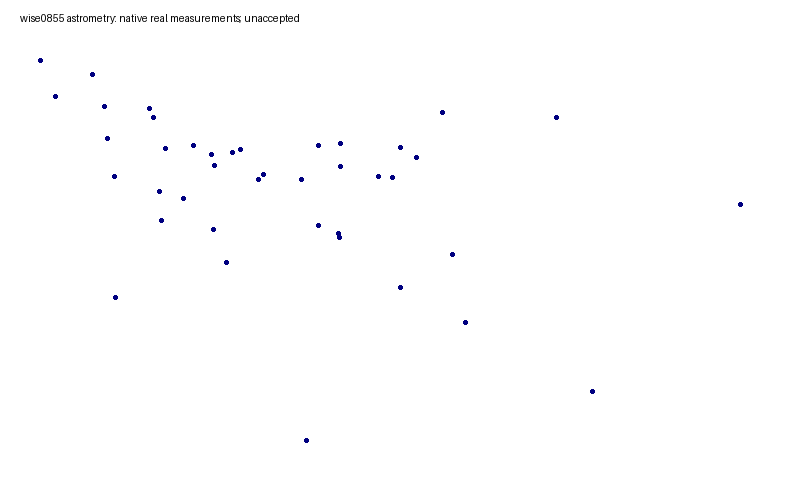

# G3-pm-wise0855 — PASS (L3)

# Native target acceptance
Complete measurements and rejected frames:
```json
{
  "name": "WISEA J085510.74-071442.5",
  "points": [
    {
      "visit": "V1",
      "mjd": 60800.70069465,
      "xi": 1.3026034776948066,
      "eta": 2.3925288644331775,
      "s_xi": 3.088190195427686,
      "s_eta": 2.1951724797484857,
      "band": 6,
      "frame_id": "level2_2025W19_1B_0116_1D6_spx_l2b-v20-2025-241.fits",
      "cov_xi_eta": -1.0289320706887637,
      "fit_included": false
    },
    {
      "visit": "V1",
      "mjd": 60800.702186907,
      "xi": 7.576537146716114,
      "eta": -0.3088987699772122,
      "s_xi": 2.4210160084733237,
      "s_eta": 2.379757493761492,
      "band": 6,
      "frame_id": "level2_2025W19_1B_0116_2D6_spx_l2b-v20-2025-241.fits",
      "cov_xi_eta": 0.4493496692567244,
      "fit_included": false
    },
    {
      "visit": "V1",
      "mjd": 60800.835104036,
      "xi": 0.2565601088264904,
      "eta": 0.4794140908186293,
      "s_xi": 1.1550405931882417,
      "s_eta": 1.3706157959342364,
      "band": 6,
      "frame_id": "level2_2025W19_1B_0138_1D6_spx_l2b-v20-2025-241.fits",
      "cov_xi_eta": -0.036666742763648355,
      "fit_included": false
    },
    {
      "visit": "V2",
      "mjd": 60989.297473643,
      "xi": -0.8407201255613227,
      "eta": 1.4928758400356152,
      "s_xi": 0.8959021663593877,
      "s_eta": 0.9179779742157607,
      "band": 6,
      "frame_id": "level2_2025W46_1A_0075_4D6_spx_l2b-v20-2025-318.fits",
      "cov_xi_eta": -0.11944673114048808,
      "fit_included": true
    },
    {
      "visit": "V2",
      "mjd": 60989.299214604,
      "xi": -0.8407285613694044,
      "eta": 0.8139173891129653,
      "s_xi": 0.9745714642231179,
      "s_eta": 0.9333132409612941,
      "band": 6,
      "frame_id": "level2_2025W46_1A_0076_1D6_spx_l2b-v20-2025-318.fits",
      "cov_xi_eta": -0.1876432881035722,
      "fit_included": true
    },
    {
      "visit": "V2",
      "mjd": 60989.300706861,
      "xi": -0.8680031218209069,
      "eta": -1.2706253026135976,
      "s_xi": 0.9791771237620336,
      "s_eta": 0.7786117428177188,
      "band": 6,
      "frame_id": "level2_2025W46_1A_0076_2D6_spx_l2b-v20-2025-318.fits",
      "cov_xi_eta": -0.299668854358587,
      "fit_included": true
    },
    {
      "visit": "V2",
      "mjd": 60989.302199117,
      "xi": 0.7615554125600179,
      "eta": 1.0792188868618153,
      "s_xi": 1.475111371718958,
      "s_eta": 1.2756536460665475,
      "band": 6,
      "frame_id": "level2_2025W46_1A_0076_3D6_spx_l2b-v20-2025-318.fits",
      "cov_xi_eta": -0.742860862299293,
      "fit_included": true
    },
    {
      "visit": "V2",
      "mjd": 60989.366934557,
      "xi": -1.303819905600894,
      "eta": -0.9340292532705763,
      "s_xi": 0.978766029053713,
      "s_eta": 0.890054177451252,
      "band": 6,
      "frame_id": "level2_2025W46_1A_0090_2D6_spx_l2b-v20-2025-318.fits",
      "cov_xi_eta": -0.11843726965092322,
      "fit_included": true
    },
    {
      "visit": "V2",
      "mjd": 60989.368426814,
      "xi": -1.6581892900973623,
      "eta": 0.41147580018422375,
      "s_xi": 1.1575582399836088,
      "s_eta": 1.3416918003357443,
      "band": 6,
      "frame_id": "level2_2025W46_1A_0090_3D6_spx_l2b-v20-2025-318.fits",
      "cov_xi_eta": 0.09660256398789281,
      "fit_included": true
    },
    {
      "visit": "V2",
      "mjd": 60989.977657659,
      "xi": -0.033242403933752114,
      "eta": 0.5105861504697773,
      "s_xi": 0.8780294604907761,
      "s_eta": 0.8097486269370273,
      "band": 6,
      "frame_id": "level2_2025W46_1A_0238_1D6_spx_l2b-v20-2025-318.fits",
      "cov_xi_eta": -0.07666507217356143,
      "fit_included": true
    },
    {
      "visit": "V2",
      "mjd": 60989.979149916,
      "xi": 0.41557939199567373,
      "eta": 1.3574156687386618,
      "s_xi": 1.5420074236523427,
      "s_eta": 1.65533436237333,
      "band": 6,
      "frame_id": "level2_2025W46_1A_0238_2D6_spx_l2b-v20-2025-318.fits",
      "cov_xi_eta": 0.40768744461433387,
      "fit_included": true
    },
    {
      "visit": "V2",
      "mjd": 60993.507267173,
      "xi": -1.2942895087808735,
      "eta": 1.4151866349540472,
      "s_xi": 1.811561963415958,
      "s_eta": 1.3459408160584299,
      "band": 6,
      "frame_id": "level2_2025W46_2A_0214_2D6_spx_l2b-v20-2025-321.fits",
      "cov_xi_eta": -1.074372495572331,
      "fit_included": true
    },
    {
      "visit": "V2",
      "mjd": 60993.508759418,
      "xi": -2.4498654900659216,
      "eta": 0.5745854396633574,
      "s_xi": 1.4101420068027146,
      "s_eta": 1.4758222432947357,
      "band": 6,
      "frame_id": "level2_2025W46_2A_0214_3D6_spx_l2b-v20-2025-321.fits",
      "cov_xi_eta": -0.7765312555666642,
      "fit_included": true
    },
    {
      "visit": "V2",
      "mjd": 60993.510251698,
      "xi": -2.9534686131838113,
      "eta": 1.3012642552518108,
      "s_xi": 4.510237988378288,
      "s_eta": 3.243096524612337,
      "band": 6,
      "frame_id": "level2_2025W46_2A_0214_4D6_spx_l2b-v20-2025-321.fits",
      "cov_xi_eta": -11.845361864657061,
      "fit_included": true
    },
    {
      "visit": "V2",
      "mjd": 60993.574916062,
      "xi": 1.794573906260321,
      "eta": -3.7656520367386586,
      "s_xi": 1.636479197653708,
      "s_eta": 1.720701650076037,
      "band": 6,
      "frame_id": "level2_2025W46_2A_0226_1D6_spx_l2b-v20-2025-321.fits",
      "cov_xi_eta": 0.05442808931237158,
      "fit_included": true
    },
    {
      "visit": "V2",
      "mjd": 60993.576408319,
      "xi": 0.4350077507574561,
      "eta": -2.7428529294810997,
      "s_xi": 1.9161075442708875,
      "s_eta": 1.808354346243092,
      "band": 6,
      "frame_id": "level2_2025W46_2A_0226_2D6_spx_l2b-v20-2025-321.fits",
      "cov_xi_eta": -1.1036628837943234,
      "fit_included": true
    },
    {
      "visit": "V2",
      "mjd": 60993.577900564,
      "xi": 4.478046149032572,
      "eta": -5.789857420013521,
      "s_xi": 2.211200550847221,
      "s_eta": 1.5612249175910395,
      "band": 6,
      "frame_id": "level2_2025W46_2A_0226_3D6_spx_l2b-v20-2025-321.fits",
      "cov_xi_eta": -0.6185626782745896,
      "fit_included": true
    },
    {
      "visit": "V2",
      "mjd": 60993.579392833,
      "xi": 3.7134819690385865,
      "eta": 2.252781268740605,
      "s_xi": 2.611670075039009,
      "s_eta": 3.1619184303300085,
      "band": 6,
      "frame_id": "level2_2025W46_2A_0226_4D6_spx_l2b-v20-2025-321.fits",
      "cov_xi_eta": -0.5535680749838973,
      "fit_included": true
    },
    {
      "visit": "V2",
      "mjd": 60993.913551328,
      "xi": -1.559963715899444,
      "eta": -7.2187875528935965,
      "s_xi": 1.4802765399914444,
      "s_eta": 1.0566948361066197,
      "band": 6,
      "frame_id": "level2_2025W46_2A_0289_1D6_spx_l2b-v20-2025-321.fits",
      "cov_xi_eta": -0.2260223016981528,
      "fit_included": true
    },
    {
      "visit": "V3",
      "mjd": 61021.283493666,
      "xi": -0.8704534158347077,
      "eta": -1.1687119259108896,
      "s_xi": 0.9608407676774844,
      "s_eta": 1.2940768581567856,
      "band": 6,
      "frame_id": "level2_2025W50_2A_0232_1D6_spx_l2b-v20-2025-349.fits",
      "cov_xi_eta": 0.04999337666300365,
      "fit_included": false
    },
    {
      "visit": "V3",
      "mjd": 61021.352084106,
      "xi": -2.569393571721943,
      "eta": 0.4132158220130375,
      "s_xi": 1.1235300073107806,
      "s_eta": 1.0625438340766922,
      "band": 6,
      "frame_id": "level2_2025W50_2A_0254_1D6_spx_l2b-v20-2025-349.fits",
      "cov_xi_eta": -0.7321457204050975,
      "fit_included": false
    },
    {
      "visit": "V3",
      "mjd": 61022.029798828,
      "xi": 1.5198107941040115,
      "eta": -1.7711147305993518,
      "s_xi": 1.3054359546721532,
      "s_eta": 1.417312300597438,
      "band": 6,
      "frame_id": "level2_2025W50_2A_0428_1D6_spx_l2b-v20-2025-349.fits",
      "cov_xi_eta": 0.35893869580973753,
      "fit_included": false
    },
    {
      "visit": "V4",
      "mjd": 61151.198599395,
      "xi": -5.575506245142057,
      "eta": -3.0337790500123716,
      "s_xi": 1.1926008181880214,
      "s_eta": 1.147783334052485,
      "band": 6,
      "frame_id": "level2_2026W17_1B_0227_2D6_spx_l2b-v24-2026-115.fits",
      "cov_xi_eta": -0.29967797537346225,
      "fit_included": true
    },
    {
      "visit": "V4",
      "mjd": 61151.200091652,
      "xi": -5.809264697476747,
      "eta": 2.570420090921978,
      "s_xi": 0.9637524187828119,
      "s_eta": 1.068167247881365,
      "band": 6,
      "frame_id": "level2_2026W17_1B_0227_3D6_spx_l2b-v24-2026-115.fits",
      "cov_xi_eta": -0.7540483731881573,
      "fit_included": true
    },
    {
      "visit": "V4",
      "mjd": 61151.201583909,
      "xi": -4.513913432005277,
      "eta": 1.3311348932004783,
      "s_xi": 1.2145819215480176,
      "s_eta": 1.6903736345249731,
      "band": 6,
      "frame_id": "level2_2026W17_1B_0227_4D6_spx_l2b-v24-2026-115.fits",
      "cov_xi_eta": -0.4703065228307042,
      "fit_included": true
    },
    {
      "visit": "V4",
      "mjd": 61152.757969777,
      "xi": -4.779561933113724,
      "eta": 2.2559236569880197,
      "s_xi": 0.9791629031016972,
      "s_eta": 0.8528584141217629,
      "band": 6,
      "frame_id": "level2_2026W17_1B_0507_1D6_spx_l2b-v24-2026-115.fits",
      "cov_xi_eta": -0.3934426315184656,
      "fit_included": true
    },
    {
      "visit": "V4",
      "mjd": 61152.759462023,
      "xi": -3.940934009040349,
      "eta": 1.4147702965929823,
      "s_xi": 2.2768554810876136,
      "s_eta": 1.9038237318175828,
      "band": 6,
      "frame_id": "level2_2026W17_1B_0507_2D6_spx_l2b-v24-2026-115.fits",
      "cov_xi_eta": -3.3900458757153746,
      "fit_included": true
    },
    {
      "visit": "V4",
      "mjd": 61152.76095428,
      "xi": -5.595822813305216,
      "eta": 0.5256038028706169,
      "s_xi": 1.20262204275312,
      "s_eta": 1.7418623683611087,
      "band": 6,
      "frame_id": "level2_2026W17_1B_0507_3D6_spx_l2b-v24-2026-115.fits",
      "cov_xi_eta": -0.7649305891647377,
      "fit_included": true
    },
    {
      "visit": "V4",
      "mjd": 61153.437123226,
      "xi": -4.152446659667179,
      "eta": -0.12785733839411875,
      "s_xi": 1.1613961323153577,
      "s_eta": 1.0973830128193363,
      "band": 6,
      "frame_id": "level2_2026W17_1B_0634_1D6_spx_l2b-v24-2026-115.fits",
      "cov_xi_eta": -0.4404570182281795,
      "fit_included": true
    },
    {
      "visit": "V4",
      "mjd": 61153.438615495,
      "xi": -7.1675468597651575,
      "eta": 3.932924185349107,
      "s_xi": 0.8567444370877558,
      "s_eta": 0.6137671067104212,
      "band": 6,
      "frame_id": "level2_2026W17_1B_0634_2D6_spx_l2b-v24-2026-115.fits",
      "cov_xi_eta": -0.5239474782353798,
      "fit_included": true
    },
    {
      "visit": "V4",
      "mjd": 61153.44010774,
      "xi": -4.658397828418738,
      "eta": 0.06932455843622622,
      "s_xi": 3.596571885359773,
      "s_eta": 1.2122049446517966,
      "band": 6,
      "frame_id": "level2_2026W17_1B_0634_3D6_spx_l2b-v24-2026-115.fits",
      "cov_xi_eta": -2.967856909765775,
      "fit_included": true
    },
    {
      "visit": "V4",
      "mjd": 61153.441599997,
      "xi": -5.739561203899863,
      "eta": 1.6414079651262983,
      "s_xi": 0.8187390695455006,
      "s_eta": 1.4049478976787904,
      "band": 6,
      "frame_id": "level2_2026W17_1B_0634_4D6_spx_l2b-v24-2026-115.fits",
      "cov_xi_eta": -0.7977711272280902,
      "fit_included": true
    },
    {
      "visit": "V4",
      "mjd": 61156.086177138,
      "xi": -3.5643494817360284,
      "eta": 1.1695225909907567,
      "s_xi": 2.7635644738736036,
      "s_eta": 2.140910618969546,
      "band": 6,
      "frame_id": "level2_2026W17_2A_0591_1D6_spx_l2b-v24-2026-118.fits",
      "cov_xi_eta": -4.878125600148979,
      "fit_included": true
    },
    {
      "visit": "V4",
      "mjd": 61156.153381895,
      "xi": -3.2408214725292495,
      "eta": -1.9960958886322242,
      "s_xi": 0.9967619140316448,
      "s_eta": 1.6918834507529563,
      "band": 6,
      "frame_id": "level2_2026W17_2A_0609_1D6_spx_l2b-v24-2026-118.fits",
      "cov_xi_eta": 0.2209291515536272,
      "fit_included": true
    },
    {
      "visit": "V4",
      "mjd": 61156.154891907,
      "xi": -4.869293047617312,
      "eta": 2.5095588319844815,
      "s_xi": 3.4403903600989323,
      "s_eta": 2.954719831499403,
      "band": 6,
      "frame_id": "level2_2026W17_2A_0609_2D6_spx_l2b-v24-2026-118.fits",
      "cov_xi_eta": -7.483674470607566,
      "fit_included": true
    },
    {
      "visit": "V4",
      "mjd": 61156.493846861,
      "xi": -6.0568927479842785,
      "eta": 3.510605027933536,
      "s_xi": 1.380362773060748,
      "s_eta": 0.5247290676083571,
      "band": 6,
      "frame_id": "level2_2026W17_2A_0692_1D6_spx_l2b-v24-2026-118.fits",
      "cov_xi_eta": -0.685442481766074,
      "fit_included": true
    },
    {
      "visit": "V4",
      "mjd": 61156.495339106,
      "xi": -3.5170113105049343,
      "eta": -1.0474516814324817,
      "s_xi": 1.2259720379577823,
      "s_eta": 2.4052528302874006,
      "band": 6,
      "frame_id": "level2_2026W17_2A_0692_2D6_spx_l2b-v24-2026-118.fits",
      "cov_xi_eta": 0.6287087023033682,
      "fit_included": true
    },
    {
      "visit": "V4",
      "mjd": 61160.771483435,
      "xi": -3.4848213696205255,
      "eta": 0.8273088891622026,
      "s_xi": 3.189694441907727,
      "s_eta": 3.6762220676379194,
      "band": 6,
      "frame_id": "level2_2026W18_2A_0065_1D6_spx_l2b-v24-2026-125.fits",
      "cov_xi_eta": -2.385443628514458,
      "fit_included": true
    },
    {
      "visit": "V4",
      "mjd": 61169.194888736,
      "xi": -3.1028015353877896,
      "eta": 1.223589604118019,
      "s_xi": 1.4525908700115937,
      "s_eta": 1.6431293101596909,
      "band": 6,
      "frame_id": "level2_2026W19_2A_0651_1D6_spx_l2b-v24-2026-131.fits",
      "cov_xi_eta": -0.8592875632701609,
      "fit_included": true
    },
    {
      "visit": "V4",
      "mjd": 61169.933874661,
      "xi": -6.847014052744162,
      "eta": 2.861136337714683,
      "s_xi": 0.7350991989590381,
      "s_eta": 1.7531141514880886,
      "band": 6,
      "frame_id": "level2_2026W19_2A_0952_1D6_spx_l2b-v24-2026-131.fits",
      "cov_xi_eta": -1.1057398422038374,
      "fit_included": true
    },
    {
      "visit": "V4",
      "mjd": 61171.097016444,
      "xi": -4.608602169850508,
      "eta": -0.7894021208587739,
      "s_xi": 1.9319732818823419,
      "s_eta": 2.2728920689456147,
      "band": 6,
      "frame_id": "level2_2026W20_1A_0033_1D6_spx_l2b-v24-2026-135.fits",
      "cov_xi_eta": -1.802690962189542,
      "fit_included": true
    }
  ],
  "fit": {
    "pmra": -9.357377836802863,
    "pmdec": 7.167946577473133,
    "e_pmra": 1.4257581580213365,
    "e_pmdec": 1.2392867809506296,
    "mu": 11.787280352914248,
    "e_mu": 1.58436860017371,
    "pa_deg": 307.45286787097626,
    "plx_fixed": 439.0,
    "chi2": 190.50414595676045,
    "dof": 66,
    "delta_chi2": 159.99091965144856
  },
  "catalogue": {
    "source": "SIMBAD J2000 (linear)",
    "pmra": -8.1237,
    "pmdec": 0.6732,
    "mu": 8.151545861368872,
    "pa_deg": 274.7371995341568
  },
  "validity": "unvalidated",
  "skipped": [
    [
      "level2_2026W19_2A_0568_1D6_spx_l2b-v24-2026-131.fits",
      "unconstrained free-position blend fit"
    ],
    [
      "level2_2026W19_2A_0782_1D6_spx_l2b-v24-2026-131.fits",
      "unconstrained free-position blend fit"
    ]
  ],
  "registration": [
    {
      "frame": "level2_2025W19_1B_0116_1D6_spx_l2b-v20-2025-241.fits",
      "before": [
        0.18098443425108166,
        0.2109306250017679
      ],
      "after": [
        0.17863145346269008,
        0.21052074429628356
      ]
    },
    {
      "frame": "level2_2025W19_1B_0116_2D6_spx_l2b-v20-2025-241.fits",
      "before": [
        0.2623662068889381,
        0.25002911065365496
      ],
      "after": [
        0.24892030960759884,
        0.2567503091998941
      ]
    },
    {
      "frame": "level2_2025W19_1B_0138_1D6_spx_l2b-v20-2025-241.fits",
      "before": [
        0.26731173401593694,
        0.23933793374180157
      ],
      "after": [
        0.22357925828162442,
        0.23793227427653424
      ]
    },
    {
      "frame": "level2_2025W46_1A_0075_4D6_spx_l2b-v20-2025-318.fits",
      "before": [
        0.25764081134744005,
        0.27003351558970146
      ],
      "after": [
        0.24519402560447146,
        0.26529177302929996
      ]
    },
    {
      "frame": "level2_2025W46_1A_0076_1D6_spx_l2b-v20-2025-318.fits",
      "before": [
        0.2814486225945319,
        0.25809105633018414
      ],
      "after": [
        0.25970296331710546,
        0.24270644991262752
      ]
    },
    {
      "frame": "level2_2025W46_1A_0076_2D6_spx_l2b-v20-2025-318.fits",
      "before": [
        0.27189758465919645,
        0.35066934467787303
      ],
      "after": [
        0.25674586506056357,
        0.22302440140967447
      ]
    },
    {
      "frame": "level2_2025W46_1A_0076_3D6_spx_l2b-v20-2025-318.fits",
      "before": [
        0.24475965441815037,
        0.23731615920182694
      ],
      "after": [
        0.23172774635433646,
        0.22062987776202375
      ]
    },
    {
      "frame": "level2_2025W46_1A_0090_2D6_spx_l2b-v20-2025-318.fits",
      "before": [
        0.2725023743824468,
        0.2697154025955438
      ],
      "after": [
        0.26791108085931586,
        0.2565471550080001
      ]
    },
    {
      "frame": "level2_2025W46_1A_0090_3D6_spx_l2b-v20-2025-318.fits",
      "before": [
        0.3030894733176432,
        0.35071963146120083
      ],
      "after": [
        0.2747157279727665,
        0.3025352627833984
      ]
    },
    {
      "frame": "level2_2025W46_1A_0238_1D6_spx_l2b-v20-2025-318.fits",
      "before": [
        0.19990459218287424,
        0.19720531993432638
      ],
      "after": [
        0.19496504464414569,
        0.19530840533885024
      ]
    },
    {
      "frame": "level2_2025W46_1A_0238_2D6_spx_l2b-v20-2025-318.fits",
      "before": [
        0.36147354402277687,
        1.0000157213594918
      ],
      "after": [
        0.33529552379459926,
        0.3701076565456148
      ]
    },
    {
      "frame": "level2_2025W46_2A_0214_2D6_spx_l2b-v20-2025-321.fits",
      "before": [
        0.19386423431068955,
        0.27642339175315844
      ],
      "after": [
        0.19367954245340288,
        0.2583754539703097
      ]
    },
    {
      "frame": "level2_2025W46_2A_0214_3D6_spx_l2b-v20-2025-321.fits",
      "before": [
        0.2761967433126871,
        0.3205206685441135
      ],
      "after": [
        0.26735325821068917,
        0.25869625440165167
      ]
    },
    {
      "frame": "level2_2025W46_2A_0214_4D6_spx_l2b-v20-2025-321.fits",
      "before": [
        0.2598651690373486,
        0.22651320512962933
      ],
      "after": [
        0.25848063697340234,
        0.22528053896340147
      ]
    },
    {
      "frame": "level2_2025W46_2A_0226_1D6_spx_l2b-v20-2025-321.fits",
      "before": [
        0.29077069017477886,
        0.2357554705476418
      ],
      "after": [
        0.270934136823061,
        0.23986431600066824
      ]
    },
    {
      "frame": "level2_2025W46_2A_0226_2D6_spx_l2b-v20-2025-321.fits",
      "before": [
        0.24001599414029218,
        0.2579004634996949
      ],
      "after": [
        0.24346863695400364,
        0.2577552748779825
      ]
    },
    {
      "frame": "level2_2025W46_2A_0226_3D6_spx_l2b-v20-2025-321.fits",
      "before": [
        0.24398474227649636,
        0.25624883807123217
      ],
      "after": [
        0.2383997524879194,
        0.25014845388075685
      ]
    },
    {
      "frame": "level2_2025W46_2A_0226_4D6_spx_l2b-v20-2025-321.fits",
      "before": [
        0.2731569444494531,
        0.26757671164691116
      ],
      "after": [
        0.2730866735737232,
        0.2539333328059556
      ]
    },
    {
      "frame": "level2_2025W46_2A_0289_1D6_spx_l2b-v20-2025-321.fits",
      "before": [
        0.3265364882388959,
        0.25138971040407204
      ],
      "after": [
        0.25258813819603265,
        0.24611100274991793
      ]
    },
    {
      "frame": "level2_2025W50_2A_0232_1D6_spx_l2b-v20-2025-349.fits",
      "before": [
        0.2423551797023646,
        0.33018967852903036
      ],
      "after": [
        0.2372294604091377,
        0.29764434352158387
      ]
    },
    {
      "frame": "level2_2025W50_2A_0254_1D6_spx_l2b-v20-2025-349.fits",
      "before": [
        0.283831612957993,
        0.29910445734542
      ],
      "after": [
        0.27382197974579464,
        0.2975991467935625
      ]
    },
    {
      "frame": "level2_2025W50_2A_0428_1D6_spx_l2b-v20-2025-349.fits",
      "before": [
        0.2757422967675085,
        0.27646390665721365
      ],
      "after": [
        0.26957330884097697,
        0.26925107332292836
      ]
    },
    {
      "frame": "level2_2026W17_1B_0227_2D6_spx_l2b-v24-2026-115.fits",
      "before": [
        0.3220444309440591,
        0.23773288904937792
      ],
      "after": [
        0.2708810278965935,
        0.2308802746672702
      ]
    },
    {
      "frame": "level2_2026W17_1B_0227_3D6_spx_l2b-v24-2026-115.fits",
      "before": [
        1.1261070304054241,
        0.7728440847106794
      ],
      "after": [
        0.2420966533311761,
        0.3432135262615708
      ]
    },
    {
      "frame": "level2_2026W17_1B_0227_4D6_spx_l2b-v24-2026-115.fits",
      "before": [
        0.29389260210810964,
        0.25830752243267363
      ],
      "after": [
        0.2925508053386675,
        0.2543943847952892
      ]
    },
    {
      "frame": "level2_2026W17_1B_0507_1D6_spx_l2b-v24-2026-115.fits",
      "before": [
        0.31304584859593665,
        0.2508854751284415
      ],
      "after": [
        0.2873126386718689,
        0.22339811467220455
      ]
    },
    {
      "frame": "level2_2026W17_1B_0507_2D6_spx_l2b-v24-2026-115.fits",
      "before": [
        0.2564013001236115,
        0.35711036335474994
      ],
      "after": [
        0.2366000817159763,
        0.35775106407828383
      ]
    },
    {
      "frame": "level2_2026W17_1B_0507_3D6_spx_l2b-v24-2026-115.fits",
      "before": [
        0.268934362943471,
        0.2957740054606245
      ],
      "after": [
        0.22266164995131668,
        0.28350803185818074
      ]
    },
    {
      "frame": "level2_2026W17_1B_0634_1D6_spx_l2b-v24-2026-115.fits",
      "before": [
        0.350280033205352,
        0.30189680213446746
      ],
      "after": [
        0.3149831628783351,
        0.2681125461869065
      ]
    },
    {
      "frame": "level2_2026W17_1B_0634_2D6_spx_l2b-v24-2026-115.fits",
      "before": [
        0.25322613433492064,
        0.3133675387817288
      ],
      "after": [
        0.23791107187572985,
        0.2529685070327815
      ]
    },
    {
      "frame": "level2_2026W17_1B_0634_3D6_spx_l2b-v24-2026-115.fits",
      "before": [
        0.35684507902161444,
        0.3347840980600006
      ],
      "after": [
        0.26083328814057016,
        0.3258668217044713
      ]
    },
    {
      "frame": "level2_2026W17_1B_0634_4D6_spx_l2b-v24-2026-115.fits",
      "before": [
        0.3020021833128295,
        0.31801786415736516
      ],
      "after": [
        0.2613553795279824,
        0.31511626802363313
      ]
    },
    {
      "frame": "level2_2026W17_2A_0591_1D6_spx_l2b-v24-2026-118.fits",
      "before": [
        0.24717152597580552,
        0.2735053636949364
      ],
      "after": [
        0.24712757812818617,
        0.24676538557238903
      ]
    },
    {
      "frame": "level2_2026W17_2A_0609_1D6_spx_l2b-v24-2026-118.fits",
      "before": [
        0.27793773263493143,
        0.2153223128323621
      ],
      "after": [
        0.19873151069282832,
        0.1986191518277506
      ]
    },
    {
      "frame": "level2_2026W17_2A_0609_2D6_spx_l2b-v24-2026-118.fits",
      "before": [
        0.2397826620460987,
        0.2982851214627395
      ],
      "after": [
        0.24971705170154682,
        0.29134948615803175
      ]
    },
    {
      "frame": "level2_2026W17_2A_0692_1D6_spx_l2b-v24-2026-118.fits",
      "before": [
        0.28228190619880866,
        0.19670060345019397
      ],
      "after": [
        0.28213777738463447,
        0.19177599263958967
      ]
    },
    {
      "frame": "level2_2026W17_2A_0692_2D6_spx_l2b-v24-2026-118.fits",
      "before": [
        0.24525232271418132,
        0.244265200166055
      ],
      "after": [
        0.23967705742636794,
        0.22888814713037256
      ]
    },
    {
      "frame": "level2_2026W18_2A_0065_1D6_spx_l2b-v24-2026-125.fits",
      "before": [
        0.38692340070173237,
        0.21666330286706553
      ],
      "after": [
        0.2911838277461615,
        0.2146054968680052
      ]
    },
    {
      "frame": "level2_2026W19_2A_0651_1D6_spx_l2b-v24-2026-131.fits",
      "before": [
        0.24814516445100906,
        0.22991683337578778
      ],
      "after": [
        0.21531001723031515,
        0.2310706911996498
      ]
    },
    {
      "frame": "level2_2026W19_2A_0952_1D6_spx_l2b-v24-2026-131.fits",
      "before": [
        0.3305280476834693,
        0.2635736360511373
      ],
      "after": [
        0.3274011576223059,
        0.2681500888668589
      ]
    },
    {
      "frame": "level2_2026W20_1A_0033_1D6_spx_l2b-v24-2026-135.fits",
      "before": [
        0.21237396581860418,
        0.25418379369942184
      ],
      "after": [
        0.19331686377594512,
        0.2544656766241667
      ]
    }
  ],
  "tangent_origin": [
    133.76017495970984,
    -7.242245262123162
  ],
  "pin": "325c57328320",
  "native_frames": [
    "level2_2025W19_1B_0116_1D6_spx_l2b-v20-2025-241.fits",
    "level2_2025W19_1B_0116_2D6_spx_l2b-v20-2025-241.fits",
    "level2_2025W19_1B_0138_1D6_spx_l2b-v20-2025-241.fits",
    "level2_2025W46_1A_0075_4D6_spx_l2b-v20-2025-318.fits",
    "level2_2025W46_1A_0076_1D6_spx_l2b-v20-2025-318.fits",
    "level2_2025W46_1A_0076_2D6_spx_l2b-v20-2025-318.fits",
    "level2_2025W46_1A_0076_3D6_spx_l2b-v20-2025-318.fits",
    "level2_2025W46_1A_0090_2D6_spx_l2b-v20-2025-318.fits",
    "level2_2025W46_1A_0090_3D6_spx_l2b-v20-2025-318.fits",
    "level2_2025W46_1A_0238_1D6_spx_l2b-v20-2025-318.fits",
    "level2_2025W46_1A_0238_2D6_spx_l2b-v20-2025-318.fits",
    "level2_2025W46_2A_0214_2D6_spx_l2b-v20-2025-321.fits",
    "level2_2025W46_2A_0214_3D6_spx_l2b-v20-2025-321.fits",
    "level2_2025W46_2A_0214_4D6_spx_l2b-v20-2025-321.fits",
    "level2_2025W46_2A_0226_1D6_spx_l2b-v20-2025-321.fits",
    "level2_2025W46_2A_0226_2D6_spx_l2b-v20-2025-321.fits",
    "level2_2025W46_2A_0226_3D6_spx_l2b-v20-2025-321.fits",
    "level2_2025W46_2A_0226_4D6_spx_l2b-v20-2025-321.fits",
    "level2_2025W46_2A_0289_1D6_spx_l2b-v20-2025-321.fits",
    "level2_2025W50_2A_0232_1D6_spx_l2b-v20-2025-349.fits",
    "level2_2025W50_2A_0254_1D6_spx_l2b-v20-2025-349.fits",
    "level2_2025W50_2A_0428_1D6_spx_l2b-v20-2025-349.fits",
    "level2_2026W17_1B_0227_2D6_spx_l2b-v24-2026-115.fits",
    "level2_2026W17_1B_0227_3D6_spx_l2b-v24-2026-115.fits",
    "level2_2026W17_1B_0227_4D6_spx_l2b-v24-2026-115.fits",
    "level2_2026W17_1B_0507_1D6_spx_l2b-v24-2026-115.fits",
    "level2_2026W17_1B_0507_2D6_spx_l2b-v24-2026-115.fits",
    "level2_2026W17_1B_0507_3D6_spx_l2b-v24-2026-115.fits",
    "level2_2026W17_1B_0634_1D6_spx_l2b-v24-2026-115.fits",
    "level2_2026W17_1B_0634_2D6_spx_l2b-v24-2026-115.fits",
    "level2_2026W17_1B_0634_3D6_spx_l2b-v24-2026-115.fits",
    "level2_2026W17_1B_0634_4D6_spx_l2b-v24-2026-115.fits",
    "level2_2026W17_2A_0591_1D6_spx_l2b-v24-2026-118.fits",
    "level2_2026W17_2A_0609_1D6_spx_l2b-v24-2026-118.fits",
    "level2_2026W17_2A_0609_2D6_spx_l2b-v24-2026-118.fits",
    "level2_2026W17_2A_0692_1D6_spx_l2b-v24-2026-118.fits",
    "level2_2026W17_2A_0692_2D6_spx_l2b-v24-2026-118.fits",
    "level2_2026W18_2A_0065_1D6_spx_l2b-v24-2026-125.fits",
    "level2_2026W19_2A_0568_1D6_spx_l2b-v24-2026-131.fits",
    "level2_2026W19_2A_0651_1D6_spx_l2b-v24-2026-131.fits",
    "level2_2026W19_2A_0782_1D6_spx_l2b-v24-2026-131.fits",
    "level2_2026W19_2A_0952_1D6_spx_l2b-v24-2026-131.fits",
    "level2_2026W20_1A_0033_1D6_spx_l2b-v24-2026-135.fits"
  ]
}
```
A passing numerical sample is still subject to foundations, external comparison and I review.

## Metrics

| metric | value | threshold | pass |
|---|---|---|---|
| displacement_px | 0.804311531894654 | 0.78 +/-0.3 | True |
| pa_deg | 289.4740016618537 | 277 +/-20 | True |

## Caveats

- recorded on a dirty working tree: code_digest identifies the exact code

## Figures



git d6d2e45 (dirty) · contracts {'spherex.types': '0.1.0', 'http-api': '0.1.0'} · calibration 94e18b883fdc9b28 · author M · reviewer pending
