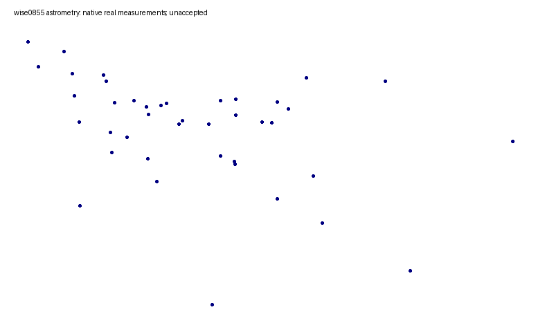

# G3-pm-wise0855 — FAIL (L3)

# Native target acceptance
Complete measurements and rejected frames:
```json
{
  "name": "WISEA J085510.74-071442.5",
  "points": [
    {
      "visit": "V1",
      "mjd": 60800.70069465,
      "xi": 1.3026034776948066,
      "eta": 2.3925288644331775,
      "s_xi": 3.088190195427686,
      "s_eta": 2.1951724797484857,
      "band": 6,
      "frame_id": "level2_2025W19_1B_0116_1D6_spx_l2b-v20-2025-241.fits",
      "native_xy": [
        338.73782515893896,
        148.569413908602
      ],
      "flux_snr": 1.4681433258065535,
      "rchi2": 1.0501128052443696,
      "cov_xi_eta": -1.0289320706887637,
      "fit_included": false
    },
    {
      "visit": "V1",
      "mjd": 60800.702186907,
      "xi": 7.576537146716114,
      "eta": -0.3088987699772122,
      "s_xi": 2.4210160084733237,
      "s_eta": 2.379757493761492,
      "band": 6,
      "frame_id": "level2_2025W19_1B_0116_2D6_spx_l2b-v20-2025-241.fits",
      "native_xy": [
        339.2098297055737,
        33.179684515462164
      ],
      "flux_snr": 1.9929394412423815,
      "rchi2": 0.8571780078003854,
      "cov_xi_eta": 0.4493496692567244,
      "fit_included": false
    },
    {
      "visit": "V1",
      "mjd": 60800.835104036,
      "xi": 0.2565601088264904,
      "eta": 0.4794140908186293,
      "s_xi": 1.1550405931882417,
      "s_eta": 1.3706157959342364,
      "band": 6,
      "frame_id": "level2_2025W19_1B_0138_1D6_spx_l2b-v20-2025-241.fits",
      "native_xy": [
        337.6820954141987,
        338.1778849992024
      ],
      "flux_snr": 3.483625653030488,
      "rchi2": 0.8347939263586719,
      "cov_xi_eta": -0.036666742763648355,
      "fit_included": false
    },
    {
      "visit": "V2",
      "mjd": 60989.297473643,
      "xi": -0.8407201255613227,
      "eta": 1.4928758400356152,
      "s_xi": 0.8959021663593877,
      "s_eta": 0.9179779742157607,
      "band": 6,
      "frame_id": "level2_2025W46_1A_0075_4D6_spx_l2b-v20-2025-318.fits",
      "native_xy": [
        336.6945069770083,
        337.7485460031117
      ],
      "flux_snr": 4.851181254080029,
      "rchi2": 1.1764698381592333,
      "cov_xi_eta": -0.11944673114048808,
      "fit_included": true
    },
    {
      "visit": "V2",
      "mjd": 60989.299214604,
      "xi": -0.8407285613694044,
      "eta": 0.8139173891129653,
      "s_xi": 0.9745714642231179,
      "s_eta": 0.9333132409612941,
      "band": 6,
      "frame_id": "level2_2025W46_1A_0076_1D6_spx_l2b-v20-2025-318.fits",
      "native_xy": [
        335.79926178103244,
        337.6735900378448
      ],
      "flux_snr": 5.228190528063782,
      "rchi2": 0.7464913673125309,
      "cov_xi_eta": -0.1876432881035722,
      "fit_included": true
    },
    {
      "visit": "V2",
      "mjd": 60989.300706861,
      "xi": -0.8680031218209069,
      "eta": -1.2706253026135976,
      "s_xi": 0.9791771237620336,
      "s_eta": 0.7786117428177188,
      "band": 6,
      "frame_id": "level2_2025W46_1A_0076_2D6_spx_l2b-v20-2025-318.fits",
      "native_xy": [
        337.02516551011945,
        337.7871067381612
      ],
      "flux_snr": 5.713162342978751,
      "rchi2": 0.9944169592169942,
      "cov_xi_eta": -0.299668854358587,
      "fit_included": true
    },
    {
      "visit": "V2",
      "mjd": 60989.302199117,
      "xi": 0.7615554125600179,
      "eta": 1.0792188868618153,
      "s_xi": 1.475111371718958,
      "s_eta": 1.2756536460665475,
      "band": 6,
      "frame_id": "level2_2025W46_1A_0076_3D6_spx_l2b-v20-2025-318.fits",
      "native_xy": [
        336.2199799188931,
        337.6630022615223
      ],
      "flux_snr": 2.9134822396170343,
      "rchi2": 1.1708365624413262,
      "cov_xi_eta": -0.742860862299293,
      "fit_included": true
    },
    {
      "visit": "V2",
      "mjd": 60989.366934557,
      "xi": -1.303819905600894,
      "eta": -0.9340292532705763,
      "s_xi": 0.978766029053713,
      "s_eta": 0.890054177451252,
      "band": 6,
      "frame_id": "level2_2025W46_1A_0090_2D6_spx_l2b-v20-2025-318.fits",
      "native_xy": [
        335.9204515411748,
        337.73170234107596
      ],
      "flux_snr": 5.375899006586527,
      "rchi2": 1.2700754113713255,
      "cov_xi_eta": -0.11843726965092322,
      "fit_included": true
    },
    {
      "visit": "V2",
      "mjd": 60989.368426814,
      "xi": -1.6581892900973623,
      "eta": 0.41147580018422375,
      "s_xi": 1.1575582399836088,
      "s_eta": 1.3416918003357443,
      "band": 6,
      "frame_id": "level2_2025W46_1A_0090_3D6_spx_l2b-v20-2025-318.fits",
      "native_xy": [
        335.36282643917497,
        337.1432004276924
      ],
      "flux_snr": 3.531548101139838,
      "rchi2": 1.3250519092795057,
      "cov_xi_eta": 0.09660256398789281,
      "fit_included": true
    },
    {
      "visit": "V2",
      "mjd": 60989.977657659,
      "xi": -0.033242403933752114,
      "eta": 0.5105861504697773,
      "s_xi": 0.8780294604907761,
      "s_eta": 0.8097486269370273,
      "band": 6,
      "frame_id": "level2_2025W46_1A_0238_1D6_spx_l2b-v20-2025-318.fits",
      "native_xy": [
        337.2544611161914,
        338.30791930745863
      ],
      "flux_snr": 5.065211955896039,
      "rchi2": 1.1813042651210768,
      "cov_xi_eta": -0.07666507217356143,
      "fit_included": true
    },
    {
      "visit": "V2",
      "mjd": 60989.979149916,
      "xi": 0.41557939199567373,
      "eta": 1.3574156687386618,
      "s_xi": 1.5420074236523427,
      "s_eta": 1.65533436237333,
      "band": 6,
      "frame_id": "level2_2025W46_1A_0238_2D6_spx_l2b-v20-2025-318.fits",
      "native_xy": [
        336.7009175990265,
        337.68272061098446
      ],
      "flux_snr": 2.635920696707317,
      "rchi2": 0.9821523633495931,
      "cov_xi_eta": 0.40768744461433387,
      "fit_included": true
    },
    {
      "visit": "V2",
      "mjd": 60993.507267173,
      "xi": -1.2942895087808735,
      "eta": 1.4151866349540472,
      "s_xi": 1.811561963415958,
      "s_eta": 1.3459408160584299,
      "band": 6,
      "frame_id": "level2_2025W46_2A_0214_2D6_spx_l2b-v20-2025-321.fits",
      "native_xy": [
        336.85282275788603,
        337.42537680538385
      ],
      "flux_snr": 2.6310490373839954,
      "rchi2": 2.07957564067161,
      "cov_xi_eta": -1.074372495572331,
      "fit_included": true
    },
    {
      "visit": "V2",
      "mjd": 60993.508759418,
      "xi": -2.4498654900659216,
      "eta": 0.5745854396633574,
      "s_xi": 1.4101420068027146,
      "s_eta": 1.4758222432947357,
      "band": 6,
      "frame_id": "level2_2025W46_2A_0214_3D6_spx_l2b-v20-2025-321.fits",
      "native_xy": [
        336.4871485577967,
        337.3900219892051
      ],
      "flux_snr": 2.576689663105229,
      "rchi2": 1.0608305589712501,
      "cov_xi_eta": -0.7765312555666642,
      "fit_included": true
    },
    {
      "visit": "V2",
      "mjd": 60993.510251698,
      "xi": -2.9534686131838113,
      "eta": 1.3012642552518108,
      "s_xi": 4.510237988378288,
      "s_eta": 3.243096524612337,
      "band": 6,
      "frame_id": "level2_2025W46_2A_0214_4D6_spx_l2b-v20-2025-321.fits",
      "native_xy": [
        337.0696800783592,
        337.57259150916974
      ],
      "flux_snr": 1.2304025718767395,
      "rchi2": 1.399539243062901,
      "cov_xi_eta": -11.845361864657061,
      "fit_included": true
    },
    {
      "visit": "V2",
      "mjd": 60993.574916062,
      "xi": 1.794573906260321,
      "eta": -3.7656520367386586,
      "s_xi": 1.636479197653708,
      "s_eta": 1.720701650076037,
      "band": 6,
      "frame_id": "level2_2025W46_2A_0226_1D6_spx_l2b-v20-2025-321.fits",
      "native_xy": [
        336.39105733846867,
        336.85812987805997
      ],
      "flux_snr": 2.489315480468985,
      "rchi2": 1.1070387522130556,
      "cov_xi_eta": 0.05442808931237158,
      "fit_included": true
    },
    {
      "visit": "V2",
      "mjd": 60993.576408319,
      "xi": 0.4350077507574561,
      "eta": -2.7428529294810997,
      "s_xi": 1.9161075442708875,
      "s_eta": 1.808354346243092,
      "band": 6,
      "frame_id": "level2_2025W46_2A_0226_2D6_spx_l2b-v20-2025-321.fits",
      "native_xy": [
        336.1055457591548,
        336.88345340689807
      ],
      "flux_snr": 2.441423690599216,
      "rchi2": 1.0812379312662785,
      "cov_xi_eta": -1.1036628837943234,
      "fit_included": true
    },
    {
      "visit": "V2",
      "mjd": 60993.577900564,
      "xi": 4.478046149032572,
      "eta": -5.789857420013521,
      "s_xi": 2.211200550847221,
      "s_eta": 1.5612249175910395,
      "band": 6,
      "frame_id": "level2_2025W46_2A_0226_3D6_spx_l2b-v20-2025-321.fits",
      "native_xy": [
        335.7268448443063,
        310.62460635339113
      ],
      "flux_snr": 2.2944080464958194,
      "rchi2": 1.0505754552000084,
      "cov_xi_eta": -0.6185626782745896,
      "fit_included": true
    },
    {
      "visit": "V2",
      "mjd": 60993.579392833,
      "xi": 3.7134819690385865,
      "eta": 2.252781268740605,
      "s_xi": 2.611670075039009,
      "s_eta": 3.1619184303300085,
      "band": 6,
      "frame_id": "level2_2025W46_2A_0226_4D6_spx_l2b-v20-2025-321.fits",
      "native_xy": [
        335.6462411162635,
        196.75936164920378
      ],
      "flux_snr": 1.605154853706254,
      "rchi2": 1.127231482433031,
      "cov_xi_eta": -0.5535680749838973,
      "fit_included": true
    },
    {
      "visit": "V2",
      "mjd": 60993.913551328,
      "xi": -1.559963715899444,
      "eta": -7.2187875528935965,
      "s_xi": 1.4802765399914444,
      "s_eta": 1.0566948361066197,
      "band": 6,
      "frame_id": "level2_2025W46_2A_0289_1D6_spx_l2b-v20-2025-321.fits",
      "native_xy": [
        335.8224280165721,
        80.72523670783026
      ],
      "flux_snr": 3.491075509545683,
      "rchi2": 1.0571014981514126,
      "cov_xi_eta": -0.2260223016981528,
      "fit_included": true
    },
    {
      "visit": "V3",
      "mjd": 61021.283493666,
      "xi": -0.8704534158347077,
      "eta": -1.1687119259108896,
      "s_xi": 0.9608407676774844,
      "s_eta": 1.2940768581567856,
      "band": 6,
      "frame_id": "level2_2025W50_2A_0232_1D6_spx_l2b-v20-2025-349.fits",
      "native_xy": [
        335.6901526840407,
        336.9662776800099
      ],
      "flux_snr": 4.730198997123153,
      "rchi2": 1.0995983177433128,
      "cov_xi_eta": 0.04999337666300365,
      "fit_included": false
    },
    {
      "visit": "V3",
      "mjd": 61021.352084106,
      "xi": -2.569393571721943,
      "eta": 0.4132158220130375,
      "s_xi": 1.1235300073107806,
      "s_eta": 1.0625438340766922,
      "band": 6,
      "frame_id": "level2_2025W50_2A_0254_1D6_spx_l2b-v20-2025-349.fits",
      "native_xy": [
        336.531321125534,
        337.6934175568982
      ],
      "flux_snr": 2.5542487131414546,
      "rchi2": 1.3563007492778636,
      "cov_xi_eta": -0.7321457204050975,
      "fit_included": false
    },
    {
      "visit": "V3",
      "mjd": 61022.029798828,
      "xi": 1.5198107941040115,
      "eta": -1.7711147305993518,
      "s_xi": 1.3054359546721532,
      "s_eta": 1.417312300597438,
      "band": 6,
      "frame_id": "level2_2025W50_2A_0428_1D6_spx_l2b-v20-2025-349.fits",
      "native_xy": [
        335.90731721181686,
        336.9461006319797
      ],
      "flux_snr": 4.456045249959001,
      "rchi2": 1.5530919899530575,
      "cov_xi_eta": 0.35893869580973753,
      "fit_included": false
    },
    {
      "visit": "V4",
      "mjd": 61151.198599395,
      "xi": -5.575506245142057,
      "eta": -3.0337790500123716,
      "s_xi": 1.1926008181880214,
      "s_eta": 1.147783334052485,
      "band": 6,
      "frame_id": "level2_2026W17_1B_0227_2D6_spx_l2b-v24-2026-115.fits",
      "native_xy": [
        337.6938776752784,
        338.5020202469485
      ],
      "flux_snr": 3.670322552367586,
      "rchi2": 0.9664857332189428,
      "cov_xi_eta": -0.29967797537346225,
      "fit_included": true
    },
    {
      "visit": "V4",
      "mjd": 61151.200091652,
      "xi": -5.809264697476747,
      "eta": 2.570420090921978,
      "s_xi": 0.9637524187828119,
      "s_eta": 1.068167247881365,
      "band": 6,
      "frame_id": "level2_2026W17_1B_0227_3D6_spx_l2b-v24-2026-115.fits",
      "native_xy": [
        337.13646723006485,
        336.8387619441907
      ],
      "flux_snr": 1.3951982327037753,
      "rchi2": 1.0501054250615103,
      "cov_xi_eta": -0.7540483731881573,
      "fit_included": true
    },
    {
      "visit": "V4",
      "mjd": 61151.201583909,
      "xi": -4.513913432005277,
      "eta": 1.3311348932004783,
      "s_xi": 1.2145819215480176,
      "s_eta": 1.6903736345249731,
      "band": 6,
      "frame_id": "level2_2026W17_1B_0227_4D6_spx_l2b-v24-2026-115.fits",
      "native_xy": [
        337.14463639567134,
        337.9903782286956
      ],
      "flux_snr": 2.4602810323902924,
      "rchi2": 1.1052921318752922,
      "cov_xi_eta": -0.4703065228307042,
      "fit_included": true
    },
    {
      "visit": "V4",
      "mjd": 61152.757969777,
      "xi": -4.779561933113724,
      "eta": 2.2559236569880197,
      "s_xi": 0.9791629031016972,
      "s_eta": 0.8528584141217629,
      "band": 6,
      "frame_id": "level2_2026W17_1B_0507_1D6_spx_l2b-v24-2026-115.fits",
      "native_xy": [
        337.0340260670785,
        336.9650092727093
      ],
      "flux_snr": 3.4592636544095376,
      "rchi2": 1.0061442352908672,
      "cov_xi_eta": -0.3934426315184656,
      "fit_included": true
    },
    {
      "visit": "V4",
      "mjd": 61152.759462023,
      "xi": -3.940934009040349,
      "eta": 1.4147702965929823,
      "s_xi": 2.2768554810876136,
      "s_eta": 1.9038237318175828,
      "band": 6,
      "frame_id": "level2_2026W17_1B_0507_2D6_spx_l2b-v24-2026-115.fits",
      "native_xy": [
        337.74367623437433,
        338.00514204447563
      ],
      "flux_snr": 1.4817972082062218,
      "rchi2": 1.2324728186188123,
      "cov_xi_eta": -3.3900458757153746,
      "fit_included": true
    },
    {
      "visit": "V4",
      "mjd": 61152.76095428,
      "xi": -5.595822813305216,
      "eta": 0.5256038028706169,
      "s_xi": 1.20262204275312,
      "s_eta": 1.7418623683611087,
      "band": 6,
      "frame_id": "level2_2026W17_1B_0507_3D6_spx_l2b-v24-2026-115.fits",
      "native_xy": [
        337.14318828478423,
        337.13347084018153
      ],
      "flux_snr": 2.180255926512925,
      "rchi2": 0.930184366547189,
      "cov_xi_eta": -0.7649305891647377,
      "fit_included": true
    },
    {
      "visit": "V4",
      "mjd": 61153.437123226,
      "xi": -4.152446659667179,
      "eta": -0.12785733839411875,
      "s_xi": 1.1613961323153577,
      "s_eta": 1.0973830128193363,
      "band": 6,
      "frame_id": "level2_2026W17_1B_0634_1D6_spx_l2b-v24-2026-115.fits",
      "native_xy": [
        337.0231412565271,
        338.1279365867781
      ],
      "flux_snr": 4.473510930240409,
      "rchi2": 1.2273562874998472,
      "cov_xi_eta": -0.4404570182281795,
      "fit_included": true
    },
    {
      "visit": "V4",
      "mjd": 61153.438615495,
      "xi": -7.1675468597651575,
      "eta": 3.932924185349107,
      "s_xi": 0.8567444370877558,
      "s_eta": 0.6137671067104212,
      "band": 6,
      "frame_id": "level2_2026W17_1B_0634_2D6_spx_l2b-v24-2026-115.fits",
      "native_xy": [
        336.92367413492167,
        337.4330768860217
      ],
      "flux_snr": 0.014206301341121724,
      "rchi2": 1.1439906752185307,
      "cov_xi_eta": -0.5239474782353798,
      "fit_included": true
    },
    {
      "visit": "V4",
      "mjd": 61153.44010774,
      "xi": -4.658397828418738,
      "eta": 0.06932455843622622,
      "s_xi": 3.596571885359773,
      "s_eta": 1.2122049446517966,
      "band": 6,
      "frame_id": "level2_2026W17_1B_0634_3D6_spx_l2b-v24-2026-115.fits",
      "native_xy": [
        335.1042555590529,
        338.62334492529465
      ],
      "flux_snr": 2.778824994838214,
      "rchi2": 1.2044646472004819,
      "cov_xi_eta": -2.967856909765775,
      "fit_included": true
    },
    {
      "visit": "V4",
      "mjd": 61153.441599997,
      "xi": -5.739561203899863,
      "eta": 1.6414079651262983,
      "s_xi": 0.8187390695455006,
      "s_eta": 1.4049478976787904,
      "band": 6,
      "frame_id": "level2_2026W17_1B_0634_4D6_spx_l2b-v24-2026-115.fits",
      "native_xy": [
        337.4782825962943,
        338.062272011975
      ],
      "flux_snr": 1.612130503384759,
      "rchi2": 0.9255469069524785,
      "cov_xi_eta": -0.7977711272280902,
      "fit_included": true
    },
    {
      "visit": "V4",
      "mjd": 61156.086177138,
      "xi": -3.5643494817360284,
      "eta": 1.1695225909907567,
      "s_xi": 2.7635644738736036,
      "s_eta": 2.140910618969546,
      "band": 6,
      "frame_id": "level2_2026W17_2A_0591_1D6_spx_l2b-v24-2026-118.fits",
      "native_xy": [
        337.639468869122,
        338.4777444082672
      ],
      "flux_snr": 1.5761357851858822,
      "rchi2": 1.134523546700003,
      "cov_xi_eta": -4.878125600148979,
      "fit_included": true
    },
    {
      "visit": "V4",
      "mjd": 61156.153381895,
      "xi": -3.2408214725292495,
      "eta": -1.9960958886322242,
      "s_xi": 0.9967619140316448,
      "s_eta": 1.6918834507529563,
      "band": 6,
      "frame_id": "level2_2026W17_2A_0609_1D6_spx_l2b-v24-2026-118.fits",
      "native_xy": [
        337.4947839767179,
        339.02235061067233
      ],
      "flux_snr": 3.8032425174944575,
      "rchi2": 1.1528582165818666,
      "cov_xi_eta": 0.2209291515536272,
      "fit_included": true
    },
    {
      "visit": "V4",
      "mjd": 61156.154891907,
      "xi": -4.869293047617312,
      "eta": 2.5095588319844815,
      "s_xi": 3.4403903600989323,
      "s_eta": 2.954719831499403,
      "band": 6,
      "frame_id": "level2_2026W17_2A_0609_2D6_spx_l2b-v24-2026-118.fits",
      "native_xy": [
        338.4315038846926,
        336.987831357889
      ],
      "flux_snr": 0.46301073886308824,
      "rchi2": 0.8447179831437589,
      "cov_xi_eta": -7.483674470607566,
      "fit_included": true
    },
    {
      "visit": "V4",
      "mjd": 61156.493846861,
      "xi": -6.0568927479842785,
      "eta": 3.510605027933536,
      "s_xi": 1.380362773060748,
      "s_eta": 0.5247290676083571,
      "band": 6,
      "frame_id": "level2_2026W17_2A_0692_1D6_spx_l2b-v24-2026-118.fits",
      "native_xy": [
        336.9655534235949,
        337.49356636867344
      ],
      "flux_snr": 0.9798476872757557,
      "rchi2": 1.1467160890720227,
      "cov_xi_eta": -0.685442481766074,
      "fit_included": true
    },
    {
      "visit": "V4",
      "mjd": 61156.495339106,
      "xi": -3.5170113105049343,
      "eta": -1.0474516814324817,
      "s_xi": 1.2259720379577823,
      "s_eta": 2.4052528302874006,
      "band": 6,
      "frame_id": "level2_2026W17_2A_0692_2D6_spx_l2b-v24-2026-118.fits",
      "native_xy": [
        338.33188642828037,
        264.8786749196427
      ],
      "flux_snr": 2.1507477483576865,
      "rchi2": 1.2886534212301957,
      "cov_xi_eta": 0.6287087023033682,
      "fit_included": true
    },
    {
      "visit": "V4",
      "mjd": 61160.771483435,
      "xi": -3.4848213696205255,
      "eta": 0.8273088891622026,
      "s_xi": 3.189694441907727,
      "s_eta": 3.6762220676379194,
      "band": 6,
      "frame_id": "level2_2026W18_2A_0065_1D6_spx_l2b-v24-2026-125.fits",
      "native_xy": [
        337.45176269641183,
        337.0786592000068
      ],
      "flux_snr": 0.9822577649980864,
      "rchi2": 1.6899540393136394,
      "cov_xi_eta": -2.385443628514458,
      "fit_included": true
    },
    {
      "visit": "V4",
      "mjd": 61169.194888736,
      "xi": -3.1028015353877896,
      "eta": 1.223589604118019,
      "s_xi": 1.4525908700115937,
      "s_eta": 1.6431293101596909,
      "band": 6,
      "frame_id": "level2_2026W19_2A_0651_1D6_spx_l2b-v24-2026-131.fits",
      "native_xy": [
        338.29179439468635,
        337.7527854293385
      ],
      "flux_snr": 1.8935789144796857,
      "rchi2": 1.2809616833147477,
      "cov_xi_eta": -0.8592875632701609,
      "fit_included": true
    },
    {
      "visit": "V4",
      "mjd": 61169.933874661,
      "xi": -6.847014052744162,
      "eta": 2.861136337714683,
      "s_xi": 0.7350991989590381,
      "s_eta": 1.7531141514880886,
      "band": 6,
      "frame_id": "level2_2026W19_2A_0952_1D6_spx_l2b-v24-2026-131.fits",
      "native_xy": [
        336.4409040424425,
        264.65619818231403
      ],
      "flux_snr": 0.6377890900854529,
      "rchi2": 1.174377813169454,
      "cov_xi_eta": -1.1057398422038374,
      "fit_included": true
    },
    {
      "visit": "V4",
      "mjd": 61171.097016444,
      "xi": -4.608602169850508,
      "eta": -0.7894021208587739,
      "s_xi": 1.9319732818823419,
      "s_eta": 2.2728920689456147,
      "band": 6,
      "frame_id": "level2_2026W20_1A_0033_1D6_spx_l2b-v24-2026-135.fits",
      "native_xy": [
        337.6355148804345,
        149.60732047468528
      ],
      "flux_snr": 1.5471357169911613,
      "rchi2": 1.128890346152987,
      "cov_xi_eta": -1.802690962189542,
      "fit_included": true
    }
  ],
  "fit": {
    "pmra": -9.357377836802863,
    "pmdec": 7.167946577473133,
    "e_pmra": 1.4257581580213365,
    "e_pmdec": 1.2392867809506296,
    "mu": 11.787280352914248,
    "e_mu": 1.58436860017371,
    "pa_deg": 307.45286787097626,
    "plx_fixed": 439.0,
    "chi2": 190.50414595676045,
    "dof": 66,
    "delta_chi2": 159.99091965144856
  },
  "catalogue": {
    "source": "SIMBAD J2000 (linear)",
    "pmra": -8.1237,
    "pmdec": 0.6732,
    "mu": 8.151545861368872,
    "pa_deg": 274.7371995341568
  },
  "validity": "unvalidated",
  "skipped": [
    [
      "level2_2026W19_2A_0568_1D6_spx_l2b-v24-2026-131.fits",
      "unconstrained free-position blend fit"
    ],
    [
      "level2_2026W19_2A_0782_1D6_spx_l2b-v24-2026-131.fits",
      "unconstrained free-position blend fit"
    ]
  ],
  "registration": [
    {
      "frame": "level2_2025W19_1B_0116_1D6_spx_l2b-v20-2025-241.fits",
      "before": [
        0.18098443425108166,
        0.2109306250017679
      ],
      "after": [
        0.17863145346269008,
        0.21052074429628356
      ],
      "offset_arcsec": [
        0.03509528358738266,
        0.00787561508346253
      ],
      "error_arcsec": [
        0.04545033746813091,
        0.051152383665415115
      ],
      "reference_source_ids": [
        5756844562921405568,
        5756847998895249408,
        5756849094111431424,
        5756860226666760704,
        5756861674071053312,
        5756861914589220736,
        5756862120747649024,
        5756863357698237056,
        5756864938246197376,
        5756866377059926784,
        5756866548858521984,
        5756866587513637376,
        5756940976347230592,
        5756942763053632640,
        5756945443113219072,
        5756952143262091648,
        5756956330854206592,
        5756959015209770112,
        5756959290087677312,
        5756959491950135168,
        5756960522742285696,
        5756961003778621824,
        5756961076794790528,
        5756962107586225536,
        5756962382464133248,
        5756962485543347328,
        5756964547127643008,
        5757151120507204864,
        5757151322369525248,
        5757151803405862784
      ]
    },
    {
      "frame": "level2_2025W19_1B_0116_2D6_spx_l2b-v20-2025-241.fits",
      "before": [
        0.2623662068889381,
        0.25002911065365496
      ],
      "after": [
        0.24892030960759884,
        0.2567503091998941
      ],
      "offset_arcsec": [
        0.043396588143803864,
        0.057824804966119664
      ],
      "error_arcsec": [
        0.08240724211649574,
        0.0766486671304466
      ],
      "reference_source_ids": [
        5756844562921405568,
        5756849094111431424,
        5756860226666760704,
        5756861674071053312,
        5756861914589220736,
        5756862120747649024,
        5756863357698237056,
        5756864938246197376,
        5756866278275997056,
        5756866377059926784,
        5756866548858521984,
        5756866587513637376,
        5756940976347230592,
        5756942763053632640,
        5756945443113219072,
        5756956330854206592,
        5756960522742285696
      ]
    },
    {
      "frame": "level2_2025W19_1B_0138_1D6_spx_l2b-v20-2025-241.fits",
      "before": [
        0.26731173401593694,
        0.23933793374180157
      ],
      "after": [
        0.22357925828162442,
        0.23793227427653424
      ],
      "offset_arcsec": [
        -0.13825362701381655,
        0.05765274211639414
      ],
      "error_arcsec": [
        0.046614827901599994,
        0.04181775217194269
      ],
      "reference_source_ids": [
        5756844562921405568,
        5756847998895249408,
        5756849094111431424,
        5756860226666760704,
        5756861674071053312,
        5756861914589220736,
        5756862120747649024,
        5756863357698237056,
        5756864938246197376,
        5756866377059926784,
        5756866548858521984,
        5756866587513637376,
        5756940976347230592,
        5756942763053632640,
        5756945443113219072,
        5756946091652170624,
        5756952143262091648,
        5756956163351495040,
        5756956330854206592,
        5756958671612389632,
        5756959015209770112,
        5756959187008560128,
        5756959290087677312,
        5756959491950135168,
        5756960522742285696,
        5756961003778621824,
        5756961076794790528,
        5756962107586225536,
        5756962382464133248,
        5756962485543347328,
        5756964547127643008,
        5757151120507204864,
        5757151803405862784,
        5757157339619838592
      ]
    },
    {
      "frame": "level2_2025W46_1A_0075_4D6_spx_l2b-v20-2025-318.fits",
      "before": [
        0.25764081134744005,
        0.27003351558970146
      ],
      "after": [
        0.24519402560447146,
        0.26529177302929996
      ],
      "offset_arcsec": [
        -0.0415245728776602,
        0.06548005267591345
      ],
      "error_arcsec": [
        0.06123330141904994,
        0.058845633745936085
      ],
      "reference_source_ids": [
        5756844562921405568,
        5756845662433055360,
        5756847998895249408,
        5756849094111431424,
        5756860226666760704,
        5756861674071053312,
        5756861914589220736,
        5756862120747649024,
        5756863357698237056,
        5756864663368295808,
        5756864938246197376,
        5756866278275997056,
        5756866548858521984,
        5756866587513637376,
        5756938536805817856,
        5756940976347230592,
        5756941835340702080,
        5756942655678337920,
        5756942763053632640,
        5756945443113219072,
        5756956163351495040,
        5756956330854206592,
        5756957675180073600,
        5756959491950135168,
        5756960454022809088,
        5756960522742285696,
        5756961003778621824,
        5756961076794790528,
        5757054019886622720,
        5757149333800818688,
        5757149780477421056
      ]
    },
    {
      "frame": "level2_2025W46_1A_0076_1D6_spx_l2b-v20-2025-318.fits",
      "before": [
        0.2814486225945319,
        0.25809105633018414
      ],
      "after": [
        0.25970296331710546,
        0.24270644991262752
      ],
      "offset_arcsec": [
        -0.12800088552471364,
        0.1901244921944466
      ],
      "error_arcsec": [
        0.041324178243751584,
        0.035846586183253204
      ],
      "reference_source_ids": [
        5756844562921405568,
        5756847998895249408,
        5756849094111431424,
        5756860226666760704,
        5756861674071053312,
        5756861914589220736,
        5756862120747649024,
        5756863357698237056,
        5756864663368295808,
        5756864938246197376,
        5756866278275997056,
        5756866377059926784,
        5756866548858521984,
        5756866587513637376,
        5756941835340702080,
        5756942655678337920,
        5756942763053632640,
        5756945443113219072,
        5756946091652170624,
        5756952143262091648,
        5756956163351495040,
        5756956330854206592,
        5756957675180073600,
        5756958671612389632,
        5756959015209770112,
        5756959290087677312,
        5756959491950135168,
        5756960355239574528,
        5756960454022809088,
        5756960522742285696,
        5756961003778621824,
        5756961076794790528,
        5756962107586225536,
        5756962382464133248,
        5756962485543346944,
        5756962485543347328,
        5756963035299165312,
        5756964547127643008,
        5756965298746201728,
        5756968601576773376,
        5757149333800818688,
        5757151120507204864,
        5757151322369525248,
        5757151803405862784,
        5757157339619838592
      ]
    },
    {
      "frame": "level2_2025W46_1A_0076_2D6_spx_l2b-v20-2025-318.fits",
      "before": [
        0.27189758465919645,
        0.35066934467787303
      ],
      "after": [
        0.25674586506056357,
        0.22302440140967447
      ],
      "offset_arcsec": [
        -0.10075760939581359,
        0.3206171668365345
      ],
      "error_arcsec": [
        0.04166807717535954,
        0.04466054324075929
      ],
      "reference_source_ids": [
        5756844562921405568,
        5756847998895249408,
        5756849094111431424,
        5756860226666760704,
        5756861674071053312,
        5756861914589220736,
        5756862120747649024,
        5756864663368295808,
        5756864938246197376,
        5756866278275997056,
        5756866377059926784,
        5756866548858521984,
        5756866587513637376,
        5756940976347230592,
        5756941835340702080,
        5756942144578346240,
        5756942655678337920,
        5756942763053632640,
        5756945443113219072,
        5756946091652170624,
        5756952143262091648,
        5756956163351495040,
        5756956330854206592,
        5756958671612389632,
        5756959015209770112,
        5756959187008560128,
        5756959290087677312,
        5756959491950135168,
        5756960355239574528,
        5756960454022809088,
        5756960522742285696,
        5756961003778621824,
        5756961076794790528,
        5756962107586225536,
        5756962485543346944,
        5756962485543347328,
        5756963035299165312,
        5756964547127643008,
        5756965298746201728,
        5756968601576773376,
        5757151322369525248,
        5757151803405862784,
        5757157339619838592
      ]
    },
    {
      "frame": "level2_2025W46_1A_0076_3D6_spx_l2b-v20-2025-318.fits",
      "before": [
        0.24475965441815037,
        0.23731615920182694
      ],
      "after": [
        0.23172774635433646,
        0.22062987776202375
      ],
      "offset_arcsec": [
        -0.08334995146225183,
        0.14153396299740711
      ],
      "error_arcsec": [
        0.035761422948964464,
        0.038124363411229344
      ],
      "reference_source_ids": [
        5756844562921405568,
        5756847998895249408,
        5756860226666760704,
        5756861674071053312,
        5756861914589220736,
        5756862120747649024,
        5756863357698237056,
        5756864938246197376,
        5756866377059926784,
        5756866548858521984,
        5756866587513637376,
        5756866724952592128,
        5756940976347230592,
        5756941835340702080,
        5756942655678337920,
        5756942763053632640,
        5756945443113219072,
        5756946091652170624,
        5756952143262091648,
        5756956163351495040,
        5756956330854206592,
        5756957675180073600,
        5756959015209770112,
        5756959187008560128,
        5756959290087677312,
        5756959491950135168,
        5756960454022809088,
        5756960522742285696,
        5756961003778621824,
        5756961076794790528,
        5756962107586225536,
        5756962382464133248,
        5756962485543347328,
        5756963035299165312,
        5756964547127643008,
        5756968601576773376,
        5757149333800818688,
        5757149780477421056,
        5757151120507204864,
        5757151322369525248,
        5757151803405862784,
        5757157339619838592
      ]
    },
    {
      "frame": "level2_2025W46_1A_0090_2D6_spx_l2b-v20-2025-318.fits",
      "before": [
        0.2725023743824468,
        0.2697154025955438
      ],
      "after": [
        0.26791108085931586,
        0.2565471550080001
      ],
      "offset_arcsec": [
        -0.020167798571809496,
        0.12659380762857003
      ],
      "error_arcsec": [
        0.052404624250304545,
        0.04865981567465944
      ],
      "reference_source_ids": [
        5756844562921405568,
        5756849094111431424,
        5756861674071053312,
        5756861914589220736,
        5756864663368295808,
        5756866377059926784,
        5756866548858521984,
        5756940976347230592,
        5756942763053632640,
        5756945443113219072,
        5756946091652170624,
        5756952143262091648,
        5756956163351495040,
        5756957675180073600,
        5756958671612389632,
        5756959015209770112,
        5756959187008560128,
        5756959290087677312,
        5756959491950135168,
        5756960522742285696,
        5756961003778621824,
        5756961076794790528,
        5756962107586225536,
        5756962382464133248,
        5756962485543347328,
        5756963035299165312,
        5756964547127643008,
        5756968601576773376,
        5757149780477421056,
        5757151120507204864,
        5757151322369525248,
        5757151803405862784,
        5757157339619838592
      ]
    },
    {
      "frame": "level2_2025W46_1A_0090_3D6_spx_l2b-v20-2025-318.fits",
      "before": [
        0.3030894733176432,
        0.35071963146120083
      ],
      "after": [
        0.2747157279727665,
        0.3025352627833984
      ],
      "offset_arcsec": [
        -0.1788246556035334,
        0.17131253940668617
      ],
      "error_arcsec": [
        0.042767723059081726,
        0.04534628535194666
      ],
      "reference_source_ids": [
        5756844562921405568,
        5756847998895249408,
        5756849094111431424,
        5756860226666760704,
        5756861674071053312,
        5756861914589220736,
        5756862120747649024,
        5756863357698237056,
        5756864663368295808,
        5756864938246197376,
        5756866278275997056,
        5756866377059926784,
        5756866548858521984,
        5756866587513637376,
        5756940976347230592,
        5756941835340702080,
        5756942144578346240,
        5756942655678337920,
        5756942763053632640,
        5756945443113219072,
        5756946091652170624,
        5756952143262091648,
        5756956163351495040,
        5756956330854206592,
        5756957675180073600,
        5756958671612389632,
        5756959015209770112,
        5756959187008560128,
        5756959290087677312,
        5756959491950135168,
        5756960454022809088,
        5756960522742285696,
        5756961003778621824,
        5756961076794790528,
        5756962107586225536,
        5756962382464133248,
        5756962485543346944,
        5756962485543347328,
        5756963035299165312,
        5756964547127643008,
        5756968601576773376,
        5757151120507204864,
        5757151322369525248,
        5757151803405862784,
        5757157339619838592
      ]
    },
    {
      "frame": "level2_2025W46_1A_0238_1D6_spx_l2b-v20-2025-318.fits",
      "before": [
        0.19990459218287424,
        0.19720531993432638
      ],
      "after": [
        0.19496504464414569,
        0.19530840533885024
      ],
      "offset_arcsec": [
        0.07694057920110037,
        0.021405004835620845
      ],
      "error_arcsec": [
        0.031906646559605095,
        0.03846148660084722
      ],
      "reference_source_ids": [
        5756844562921405568,
        5756847998895249408,
        5756849094111431424,
        5756860226666760704,
        5756861674071053312,
        5756861914589220736,
        5756862120747649024,
        5756864938246197376,
        5756866278275997056,
        5756866377059926784,
        5756866548858521984,
        5756866587513637376,
        5756940976347230592,
        5756941835340702080,
        5756942144578346240,
        5756942763053632640,
        5756945443113219072,
        5756946091652170624,
        5756952143262091648,
        5756956330854206592,
        5756958671612389632,
        5756959015209770112,
        5756959187008560128,
        5756959290087677312,
        5756959491950135168,
        5756960454022809088,
        5756960522742285696,
        5756961003778621824,
        5756961076794790528,
        5756962107586225536,
        5756962382464133248,
        5756962485543347328,
        5756963035299165312,
        5756964547127643008,
        5757151120507204864,
        5757151803405862784,
        5757157339619838592
      ]
    },
    {
      "frame": "level2_2025W46_1A_0238_2D6_spx_l2b-v20-2025-318.fits",
      "before": [
        0.36147354402277687,
        1.0000157213594918
      ],
      "after": [
        0.33529552379459926,
        0.3701076565456148
      ],
      "offset_arcsec": [
        0.1792202327130417,
        -0.9574506828107479
      ],
      "error_arcsec": [
        0.06633879932422587,
        0.07184243398844814
      ],
      "reference_source_ids": [
        5756844562921405568,
        5756847998895249408,
        5756849094111431424,
        5756860226666760704,
        5756861674071053312,
        5756861914589220736,
        5756862120747649024,
        5756863357698237056,
        5756864938246197376,
        5756866278275997056,
        5756866377059926784,
        5756866548858521984,
        5756940976347230592,
        5756941835340702080,
        5756942655678337920,
        5756942763053632640,
        5756945443113219072,
        5756946091652170624,
        5756952143262091648,
        5756956163351495040,
        5756956330854206592,
        5756957675180073600,
        5756958671612389632,
        5756959015209770112,
        5756959187008560128,
        5756959290087677312,
        5756959491950135168,
        5756960454022809088,
        5756960522742285696,
        5756961003778621824,
        5756961076794790528,
        5756962107586225536,
        5756962382464133248,
        5756962485543346944,
        5756962485543347328,
        5756963035299165312,
        5756964547127643008,
        5756968601576773376,
        5757151120507204864,
        5757151322369525248,
        5757151803405862784,
        5757157339619838592
      ]
    },
    {
      "frame": "level2_2025W46_2A_0214_2D6_spx_l2b-v20-2025-321.fits",
      "before": [
        0.19386423431068955,
        0.27642339175315844
      ],
      "after": [
        0.19367954245340288,
        0.2583754539703097
      ],
      "offset_arcsec": [
        -0.0049046305176909345,
        0.06305011468693057
      ],
      "error_arcsec": [
        0.0388483485674043,
        0.04239242620750711
      ],
      "reference_source_ids": [
        5756844562921405568,
        5756847998895249408,
        5756849094111431424,
        5756860226666760704,
        5756861674071053312,
        5756861914589220736,
        5756862120747649024,
        5756863357698237056,
        5756864938246197376,
        5756866278275997056,
        5756866377059926784,
        5756866548858521984,
        5756866587513637376,
        5756941835340702080,
        5756942655678337920,
        5756945443113219072,
        5756946091652170624,
        5756952143262091648,
        5756956330854206592,
        5756957675180073600,
        5756958671612389632,
        5756959187008560128,
        5756959290087677312,
        5756960454022809088,
        5756960522742285696,
        5756961003778621824,
        5756961076794790528,
        5756962107586225536,
        5756962382464133248,
        5756962485543347328,
        5756963035299165312,
        5756964547127643008,
        5756968601576773376,
        5757151120507204864,
        5757151322369525248,
        5757151803405862784,
        5757157339619838592
      ]
    },
    {
      "frame": "level2_2025W46_2A_0214_3D6_spx_l2b-v20-2025-321.fits",
      "before": [
        0.2761967433126871,
        0.3205206685441135
      ],
      "after": [
        0.26735325821068917,
        0.25869625440165167
      ],
      "offset_arcsec": [
        -0.11863634419911223,
        0.204789276336922
      ],
      "error_arcsec": [
        0.04214531092946179,
        0.04129491937465405
      ],
      "reference_source_ids": [
        5756844562921405568,
        5756849094111431424,
        5756860226666760704,
        5756861674071053312,
        5756861914589220736,
        5756862120747649024,
        5756863357698237056,
        5756864938246197376,
        5756865213124105472,
        5756866278275997056,
        5756866377059926784,
        5756866548858521984,
        5756866587513637376,
        5756940976347230592,
        5756942763053632640,
        5756945443113219072,
        5756946091652170624,
        5756952143262091648,
        5756956163351495040,
        5756956330854206592,
        5756957675180073600,
        5756959015209770112,
        5756959187008560128,
        5756959290087677312,
        5756960454022809088,
        5756960522742285696,
        5756961003778621824,
        5756961076794790528,
        5756962107586225536,
        5756962382464133248,
        5756962485543346944,
        5756962485543347328,
        5756963035299165312,
        5756964547127643008,
        5756968601576773376,
        5757151120507204864,
        5757151322369525248,
        5757151803405862784,
        5757157339619838592
      ]
    },
    {
      "frame": "level2_2025W46_2A_0214_4D6_spx_l2b-v20-2025-321.fits",
      "before": [
        0.2598651690373486,
        0.22651320512962933
      ],
      "after": [
        0.25848063697340234,
        0.22528053896340147
      ],
      "offset_arcsec": [
        -0.05336871452980849,
        0.031007004251038216
      ],
      "error_arcsec": [
        0.058776097122663344,
        0.04066887420837913
      ],
      "reference_source_ids": [
        5756844562921405568,
        5756849094111431424,
        5756860226666760704,
        5756861674071053312,
        5756861914589220736,
        5756862120747649024,
        5756863357698237056,
        5756864663368295808,
        5756864938246197376,
        5756866278275997056,
        5756866377059926784,
        5756866587513637376,
        5756940976347230592,
        5756942763053632640,
        5756945443113219072,
        5756946091652170624,
        5756952143262091648,
        5756956163351495040,
        5756956330854206592,
        5756957675180073600,
        5756958671612389632,
        5756959015209770112,
        5756959290087677312,
        5756959491950135168,
        5756960522742285696,
        5756961003778621824,
        5756961076794790528,
        5756962107586225536,
        5756962382464133248,
        5756962485543347328,
        5756963035299165312,
        5756964547127643008,
        5756968601576773376,
        5757151120507204864,
        5757151322369525248,
        5757151803405862784,
        5757157339619838592
      ]
    },
    {
      "frame": "level2_2025W46_2A_0226_1D6_spx_l2b-v20-2025-321.fits",
      "before": [
        0.29077069017477886,
        0.2357554705476418
      ],
      "after": [
        0.270934136823061,
        0.23986431600066824
      ],
      "offset_arcsec": [
        -0.1046694372503503,
        -0.08866829198241694
      ],
      "error_arcsec": [
        0.052123206714890076,
        0.04480893290917504
      ],
      "reference_source_ids": [
        5756847998895249408,
        5756849094111431424,
        5756860226666760704,
        5756861674071053312,
        5756861914589220736,
        5756862120747649024,
        5756863357698237056,
        5756864938246197376,
        5756866278275997056,
        5756866377059926784,
        5756866548858521984,
        5756866587513637376,
        5756940976347230592,
        5756941835340702080,
        5756942763053632640,
        5756946091652170624,
        5756952143262091648,
        5756956163351495040,
        5756957675180073600,
        5756958671612389632,
        5756959015209770112,
        5756959290087677312,
        5756959491950135168,
        5756960522742285696,
        5756961003778621824,
        5756961076794790528,
        5756962107586225536,
        5756962382464133248,
        5756962485543346944,
        5756962485543347328,
        5756964547127643008,
        5756968601576773376,
        5757151120507204864,
        5757151322369525248,
        5757151803405862784,
        5757157339619838592
      ]
    },
    {
      "frame": "level2_2025W46_2A_0226_2D6_spx_l2b-v20-2025-321.fits",
      "before": [
        0.24001599414029218,
        0.2579004634996949
      ],
      "after": [
        0.24346863695400364,
        0.2577552748779825
      ],
      "offset_arcsec": [
        0.03348642647289892,
        -0.012154563822136925
      ],
      "error_arcsec": [
        0.04714776171861745,
        0.042169084881070205
      ],
      "reference_source_ids": [
        5756844562921405568,
        5756847998895249408,
        5756849094111431424,
        5756860226666760704,
        5756861674071053312,
        5756861914589220736,
        5756862120747649024,
        5756866278275997056,
        5756866377059926784,
        5756866548858521984,
        5756866587513637376,
        5756940976347230592,
        5756942763053632640,
        5756945443113219072,
        5756946091652170624,
        5756952143262091648,
        5756956163351495040,
        5756956330854206592,
        5756957675180073600,
        5756958671612389632,
        5756959015209770112,
        5756959187008560128,
        5756959290087677312,
        5756960454022809088,
        5756960522742285696,
        5756961003778621824,
        5756961076794790528,
        5756962107586225536,
        5756962382464133248,
        5756962485543346944,
        5756962485543347328,
        5756963035299165312,
        5756964547127643008,
        5756968601576773376,
        5757151120507204864,
        5757151322369525248,
        5757151803405862784,
        5757157339619838592
      ]
    },
    {
      "frame": "level2_2025W46_2A_0226_3D6_spx_l2b-v20-2025-321.fits",
      "before": [
        0.24398474227649636,
        0.25624883807123217
      ],
      "after": [
        0.2383997524879194,
        0.25014845388075685
      ],
      "offset_arcsec": [
        -0.03790000895617653,
        -0.031095267957268746
      ],
      "error_arcsec": [
        0.049408706352810354,
        0.04195982008633613
      ],
      "reference_source_ids": [
        5756844562921405568,
        5756847998895249408,
        5756849094111431424,
        5756860226666760704,
        5756861674071053312,
        5756861914589220736,
        5756862120747649024,
        5756864938246197376,
        5756866278275997056,
        5756866377059926784,
        5756866548858521984,
        5756866587513637376,
        5756940976347230592,
        5756942655678337920,
        5756942763053632640,
        5756946091652170624,
        5756952143262091648,
        5756956330854206592,
        5756958671612389632,
        5756959015209770112,
        5756959290087677312,
        5756960522742285696,
        5756961003778621824,
        5756961076794790528,
        5756962107586225536,
        5756962382464133248,
        5756962485543346944,
        5756962485543347328,
        5756963035299165312,
        5756964547127643008,
        5756968601576773376,
        5757151120507204864,
        5757151322369525248,
        5757151803405862784,
        5757157339619838592
      ]
    },
    {
      "frame": "level2_2025W46_2A_0226_4D6_spx_l2b-v20-2025-321.fits",
      "before": [
        0.2731569444494531,
        0.26757671164691116
      ],
      "after": [
        0.2730866735737232,
        0.2539333328059556
      ],
      "offset_arcsec": [
        0.011869745825963555,
        0.08722618290533639
      ],
      "error_arcsec": [
        0.06145497725269208,
        0.04494117927596132
      ],
      "reference_source_ids": [
        5756847998895249408,
        5756849094111431424,
        5756860226666760704,
        5756861674071053312,
        5756861914589220736,
        5756862120747649024,
        5756863357698237056,
        5756864938246197376,
        5756866377059926784,
        5756866548858521984,
        5756866587513637376,
        5756940976347230592,
        5756942763053632640,
        5756945443113219072,
        5756952143262091648,
        5756956330854206592,
        5756957675180073600,
        5756958671612389632,
        5756959015209770112,
        5756959187008560128,
        5756959290087677312,
        5756960454022809088,
        5756960522742285696,
        5756961003778621824,
        5756961076794790528,
        5756962107586225536,
        5756962382464133248,
        5756962485543347328,
        5756964547127643008,
        5756968601576773376,
        5757151120507204864,
        5757151322369525248,
        5757151803405862784,
        5757157339619838592
      ]
    },
    {
      "frame": "level2_2025W46_2A_0289_1D6_spx_l2b-v20-2025-321.fits",
      "before": [
        0.3265364882388959,
        0.25138971040407204
      ],
      "after": [
        0.25258813819603265,
        0.24611100274991793
      ],
      "offset_arcsec": [
        0.19025952648431763,
        0.02385387555183797
      ],
      "error_arcsec": [
        0.04594915008994497,
        0.047292104221118784
      ],
      "reference_source_ids": [
        5756849094111431424,
        5756861674071053312,
        5756861914589220736,
        5756862120747649024,
        5756864938246197376,
        5756866278275997056,
        5756866377059926784,
        5756866548858521984,
        5756866587513637376,
        5756942763053632640,
        5756945443113219072,
        5756946091652170624,
        5756952143262091648,
        5756959015209770112,
        5756959187008560128,
        5756959290087677312,
        5756960454022809088,
        5756961003778621824,
        5756961076794790528,
        5756962107586225536,
        5756962382464133248,
        5756962485543346944,
        5756962485543347328,
        5756963035299165312,
        5756964547127643008,
        5756968601576773376,
        5757151120507204864,
        5757151803405862784,
        5757157339619838592
      ]
    },
    {
      "frame": "level2_2025W50_2A_0232_1D6_spx_l2b-v20-2025-349.fits",
      "before": [
        0.2423551797023646,
        0.33018967852903036
      ],
      "after": [
        0.2372294604091377,
        0.29764434352158387
      ],
      "offset_arcsec": [
        -0.04421766471593454,
        0.10188696936441778
      ],
      "error_arcsec": [
        0.03813527317830369,
        0.05021768817036546
      ],
      "reference_source_ids": [
        5756844562921405568,
        5756847998895249408,
        5756848033254987136,
        5756849094111431424,
        5756860226666760704,
        5756861674071053312,
        5756861914589220736,
        5756862120747649024,
        5756863357698237056,
        5756864938246197376,
        5756866278275997056,
        5756866377059926784,
        5756866548858521984,
        5756866587513637376,
        5756940976347230592,
        5756941835340702080,
        5756942763053632640,
        5756945443113219072,
        5756946091652170624,
        5756952143262091648,
        5756956163351495040,
        5756956330854206592,
        5756957675180073600,
        5756958671612389632,
        5756959015209770112,
        5756959187008560128,
        5756959290087677312,
        5756959491950135168,
        5756960355239574528,
        5756960454022809088,
        5756960522742285696,
        5756961003778621824,
        5756961076794790528,
        5756962107586225536,
        5756962382464133248,
        5756962485543346944,
        5756962485543347328,
        5756963035299165312,
        5756964547127643008,
        5756968601576773376,
        5757151120507204864,
        5757151803405862784,
        5757157339619838592
      ]
    },
    {
      "frame": "level2_2025W50_2A_0254_1D6_spx_l2b-v20-2025-349.fits",
      "before": [
        0.283831612957993,
        0.29910445734542
      ],
      "after": [
        0.27382197974579464,
        0.2975991467935625
      ],
      "offset_arcsec": [
        0.07576882241890556,
        0.025905192693475097
      ],
      "error_arcsec": [
        0.0399346441407269,
        0.0573877665056365
      ],
      "reference_source_ids": [
        5756844562921405568,
        5756849094111431424,
        5756861914589220736,
        5756863357698237056,
        5756864663368295808,
        5756866278275997056,
        5756866587513637376,
        5756940976347230592,
        5756941835340702080,
        5756942763053632640,
        5756945443113219072,
        5756946091652170624,
        5756952143262091648,
        5756956163351495040,
        5756956330854206592,
        5756958671612389632,
        5756959015209770112,
        5756959187008560128,
        5756959290087677312,
        5756959491950135168,
        5756960522742285696,
        5756961003778621824,
        5756961076794790528,
        5756962107586225536,
        5756962382464133248,
        5756962485543346944,
        5756962485543347328,
        5756964547127643008,
        5756968601576773376,
        5757151322369525248,
        5757151803405862784,
        5757157339619838592
      ]
    },
    {
      "frame": "level2_2025W50_2A_0428_1D6_spx_l2b-v20-2025-349.fits",
      "before": [
        0.2757422967675085,
        0.27646390665721365
      ],
      "after": [
        0.26957330884097697,
        0.26925107332292836
      ],
      "offset_arcsec": [
        -0.05031084154698469,
        0.1053933887776458
      ],
      "error_arcsec": [
        0.0419953891618064,
        0.04615147483500714
      ],
      "reference_source_ids": [
        5756844562921405568,
        5756847998895249408,
        5756849094111431424,
        5756860226666760704,
        5756861914589220736,
        5756862120747649024,
        5756863357698237056,
        5756864663368295808,
        5756864938246197376,
        5756866377059926784,
        5756866548858521984,
        5756866587513637376,
        5756940976347230592,
        5756941835340702080,
        5756942655678337920,
        5756942763053632640,
        5756945443113219072,
        5756952143262091648,
        5756956163351495040,
        5756956330854206592,
        5756957675180073600,
        5756958671612389632,
        5756959015209770112,
        5756959187008560128,
        5756959290087677312,
        5756959491950135168,
        5756960454022809088,
        5756960522742285696,
        5756961003778621824,
        5756961076794790528,
        5756962107586225536,
        5756962485543346944,
        5756962485543347328,
        5756964547127643008,
        5756968601576773376,
        5757151120507204864,
        5757151322369525248,
        5757151803405862784,
        5757157339619838592
      ]
    },
    {
      "frame": "level2_2026W17_1B_0227_2D6_spx_l2b-v24-2026-115.fits",
      "before": [
        0.3220444309440591,
        0.23773288904937792
      ],
      "after": [
        0.2708810278965935,
        0.2308802746672702
      ],
      "offset_arcsec": [
        0.17949751370713785,
        0.05040736280631511
      ],
      "error_arcsec": [
        0.050285129394666235,
        0.0449664089151121
      ],
      "reference_source_ids": [
        5756866278275997056,
        5756866377059926784,
        5756866548858521984,
        5756866587513637376,
        5756940976347230592,
        5756942655678337920,
        5756942763053632640,
        5756945271314522112,
        5756945443113219072,
        5756946091652170624,
        5756952143262091648,
        5756957675180073600,
        5756958431094222592,
        5756958671612389632,
        5756959015209770112,
        5756959187008560128,
        5756959491950135168,
        5756960355239574528,
        5756960454022809088,
        5756960522742285696,
        5756961003778621824,
        5756961076794790528,
        5756962107586225536,
        5756962382464133248,
        5756962485543347328,
        5756963035299165312,
        5756964547127643008,
        5756965298746201728,
        5756968601576773376,
        5757054019886622720,
        5757151120507204864,
        5757151322369525248,
        5757151803405862784,
        5757157339619838592
      ]
    },
    {
      "frame": "level2_2026W17_1B_0227_3D6_spx_l2b-v24-2026-115.fits",
      "before": [
        1.1261070304054241,
        0.7728440847106794
      ],
      "after": [
        0.2420966533311761,
        0.3432135262615708
      ],
      "offset_arcsec": [
        1.0809685528569348,
        0.6929406714082217
      ],
      "error_arcsec": [
        0.0382142729285691,
        0.04906435709941301
      ],
      "reference_source_ids": [
        5756844562921405568,
        5756847998895249408,
        5756849094111431424,
        5756861674071053312,
        5756861914589220736,
        5756862120747649024,
        5756864663368295808,
        5756864938246197376,
        5756865213124105472,
        5756866278275997056,
        5756866377059926784,
        5756866548858521984,
        5756866587513637376,
        5756938536805817856,
        5756940976347230592,
        5756941835340702080,
        5756942110218608640,
        5756942655678337920,
        5756942763053632640,
        5756945443113219072,
        5756946091652170624,
        5756952143262091648,
        5756956330854206592,
        5756957675180073600,
        5756958671612389632,
        5756959015209770112,
        5756959187008560128,
        5756959290087677312,
        5756960355239574528,
        5756960454022809088,
        5756960522742285696,
        5756961003778621824,
        5756961076794790528,
        5756962107586225536,
        5756962382464133248,
        5756962485543346944,
        5756962485543347328,
        5756963035299165312,
        5756964547127643008,
        5756965298746201728,
        5756968601576773376,
        5757054019886622720,
        5757149333800818688,
        5757150295873491456,
        5757151120507204864,
        5757151322369525248,
        5757151803405862784,
        5757157339619838592
      ]
    },
    {
      "frame": "level2_2026W17_1B_0227_4D6_spx_l2b-v24-2026-115.fits",
      "before": [
        0.29389260210810964,
        0.25830752243267363
      ],
      "after": [
        0.2925508053386675,
        0.2543943847952892
      ],
      "offset_arcsec": [
        -0.03271714607975046,
        -0.025590692913394286
      ],
      "error_arcsec": [
        0.04486703569461208,
        0.041332356154366943
      ],
      "reference_source_ids": [
        5756847998895249408,
        5756848033254987136,
        5756849094111431424,
        5756860226666760704,
        5756861674071053312,
        5756861914589220736,
        5756862120747649024,
        5756863357698237056,
        5756864938246197376,
        5756866278275997056,
        5756866377059926784,
        5756866587513637376,
        5756866724952592128,
        5756940976347230592,
        5756941835340702080,
        5756942655678337920,
        5756942763053632640,
        5756945443113219072,
        5756946091652170624,
        5756952143262091648,
        5756956163351495040,
        5756956330854206592,
        5756957675180073600,
        5756958671612389632,
        5756959015209770112,
        5756959187008560128,
        5756959290087677312,
        5756959491950135168,
        5756960454022809088,
        5756960522742285696,
        5756961003778621824,
        5756961076794790528,
        5756962107586225536,
        5756962382464133248,
        5756962485543346944,
        5756963035299165312,
        5756964547127643008,
        5756965298746201728,
        5756968601576773376,
        5757054019886622720,
        5757150295873491456,
        5757151120507204864,
        5757151322369525248,
        5757151803405862784,
        5757157339619838592
      ]
    },
    {
      "frame": "level2_2026W17_1B_0507_1D6_spx_l2b-v24-2026-115.fits",
      "before": [
        0.31304584859593665,
        0.2508854751284415
      ],
      "after": [
        0.2873126386718689,
        0.22339811467220455
      ],
      "offset_arcsec": [
        0.10776996411642144,
        -0.1160805603695901
      ],
      "error_arcsec": [
        0.06576127372827617,
        0.046947627361368004
      ],
      "reference_source_ids": [
        5756844562921405568,
        5756849094111431424,
        5756860226666760704,
        5756861674071053312,
        5756861914589220736,
        5756862120747649024,
        5756863357698237056,
        5756864938246197376,
        5756866278275997056,
        5756866377059926784,
        5756866548858521984,
        5756866587513637376,
        5756938536805817856,
        5756940976347230592,
        5756942655678337920,
        5756945443113219072,
        5756946091652170624,
        5756952143262091648,
        5756956163351495040,
        5756956330854206592,
        5756957675180073600,
        5756958671612389632,
        5756959187008560128,
        5756959491950135168,
        5756960355239574528,
        5756960522742285696,
        5756961076794790528,
        5756962107586225536,
        5756962382464133248,
        5756962485543346944,
        5756962485543347328,
        5756963035299165312,
        5756964547127643008,
        5756968601576773376,
        5757054019886622720,
        5757149333800818688,
        5757151120507204864,
        5757151322369525248,
        5757151803405862784,
        5757157339619838592
      ]
    },
    {
      "frame": "level2_2026W17_1B_0507_2D6_spx_l2b-v24-2026-115.fits",
      "before": [
        0.2564013001236115,
        0.35711036335474994
      ],
      "after": [
        0.2366000817159763,
        0.35775106407828383
      ],
      "offset_arcsec": [
        0.07645012013159311,
        -0.010162211244545267
      ],
      "error_arcsec": [
        0.04126446689389703,
        0.06259412137354012
      ],
      "reference_source_ids": [
        5756844562921405568,
        5756847998895249408,
        5756849094111431424,
        5756860226666760704,
        5756861674071053312,
        5756861914589220736,
        5756863357698237056,
        5756864663368295808,
        5756864938246197376,
        5756866278275997056,
        5756866377059926784,
        5756866548858521984,
        5756866587513637376,
        5756938536805817856,
        5756940976347230592,
        5756941835340702080,
        5756942655678337920,
        5756942763053632640,
        5756945443113219072,
        5756946091652170624,
        5756952143262091648,
        5756956163351495040,
        5756956330854206592,
        5756957675180073600,
        5756958671612389632,
        5756959015209770112,
        5756959187008560128,
        5756959290087677312,
        5756959491950135168,
        5756960454022809088,
        5756960522742285696,
        5756961003778621824,
        5756961076794790528,
        5756962107586225536,
        5756962382464133248,
        5756962485543346944,
        5756962485543347328,
        5756963035299165312,
        5756964547127643008,
        5756965298746201728,
        5756968601576773376,
        5757054019886622720,
        5757149333800818688,
        5757150295873491456,
        5757151120507204864,
        5757151322369525248,
        5757151803405862784
      ]
    },
    {
      "frame": "level2_2026W17_1B_0507_3D6_spx_l2b-v24-2026-115.fits",
      "before": [
        0.268934362943471,
        0.2957740054606245
      ],
      "after": [
        0.22266164995131668,
        0.28350803185818074
      ],
      "offset_arcsec": [
        0.14522811725901746,
        -0.10954709256015982
      ],
      "error_arcsec": [
        0.04195031667816878,
        0.04380435019331935
      ],
      "reference_source_ids": [
        5756844562921405568,
        5756845662433055360,
        5756847998895249408,
        5756849094111431424,
        5756860226666760704,
        5756861674071053312,
        5756861914589220736,
        5756862120747649024,
        5756863357698237056,
        5756864938246197376,
        5756865213124105472,
        5756866278275997056,
        5756866377059926784,
        5756866548858521984,
        5756866587513637376,
        5756940976347230592,
        5756941835340702080,
        5756942655678337920,
        5756945443113219072,
        5756946091652170624,
        5756952143262091648,
        5756956163351495040,
        5756956330854206592,
        5756957675180073600,
        5756958671612389632,
        5756959015209770112,
        5756959187008560128,
        5756959290087677312,
        5756959491950135168,
        5756960454022809088,
        5756960522742285696,
        5756961003778621824,
        5756962107586225536,
        5756962382464133248,
        5756962485543347328,
        5756963035299165312,
        5756964547127643008,
        5756968601576773376,
        5757149333800818688,
        5757149780477421056,
        5757151120507204864,
        5757151803405862784,
        5757157339619838592
      ]
    },
    {
      "frame": "level2_2026W17_1B_0634_1D6_spx_l2b-v24-2026-115.fits",
      "before": [
        0.350280033205352,
        0.30189680213446746
      ],
      "after": [
        0.3149831628783351,
        0.2681125461869065
      ],
      "offset_arcsec": [
        0.14745750158861184,
        -0.10042071283794246
      ],
      "error_arcsec": [
        0.04542911967088476,
        0.04347022455116499
      ],
      "reference_source_ids": [
        5756844562921405568,
        5756847998895249408,
        5756849094111431424,
        5756860226666760704,
        5756861674071053312,
        5756861914589220736,
        5756862120747649024,
        5756864663368295808,
        5756864938246197376,
        5756866278275997056,
        5756866377059926784,
        5756866548858521984,
        5756866587513637376,
        5756866724952592128,
        5756940976347230592,
        5756941835340702080,
        5756942655678337920,
        5756942763053632640,
        5756945443113219072,
        5756946091652170624,
        5756952143262091648,
        5756956330854206592,
        5756957675180073600,
        5756958671612389632,
        5756959015209770112,
        5756959290087677312,
        5756959491950135168,
        5756960454022809088,
        5756961003778621824,
        5756961076794790528,
        5756962107586225536,
        5756962382464133248,
        5756962485543346944,
        5756962485543347328,
        5756963035299165312,
        5756964547127643008,
        5756968601576773376,
        5757149333800818688,
        5757151120507204864,
        5757151322369525248,
        5757151803405862784,
        5757157339619838592
      ]
    },
    {
      "frame": "level2_2026W17_1B_0634_2D6_spx_l2b-v24-2026-115.fits",
      "before": [
        0.25322613433492064,
        0.3133675387817288
      ],
      "after": [
        0.23791107187572985,
        0.2529685070327815
      ],
      "offset_arcsec": [
        0.13549301050232995,
        -0.17798287671574634
      ],
      "error_arcsec": [
        0.03892413386175269,
        0.043841686908448654
      ],
      "reference_source_ids": [
        5756844562921405568,
        5756847998895249408,
        5756860226666760704,
        5756861674071053312,
        5756864663368295808,
        5756864938246197376,
        5756866278275997056,
        5756866548858521984,
        5756940976347230592,
        5756942655678337920,
        5756942763053632640,
        5756945443113219072,
        5756946091652170624,
        5756952143262091648,
        5756956163351495040,
        5756956330854206592,
        5756957675180073600,
        5756959015209770112,
        5756959187008560128,
        5756959290087677312,
        5756959491950135168,
        5756960355239574528,
        5756960454022809088,
        5756960522742285696,
        5756961003778621824,
        5756961076794790528,
        5756962107586225536,
        5756962382464133248,
        5756962485543346944,
        5756962485543347328,
        5756963035299165312,
        5756964547127643008,
        5756968601576773376,
        5757149333800818688,
        5757151120507204864,
        5757151322369525248,
        5757151803405862784
      ]
    },
    {
      "frame": "level2_2026W17_1B_0634_3D6_spx_l2b-v24-2026-115.fits",
      "before": [
        0.35684507902161444,
        0.3347840980600006
      ],
      "after": [
        0.26083328814057016,
        0.3258668217044713
      ],
      "offset_arcsec": [
        0.18758002812255586,
        -0.04535399887475579
      ],
      "error_arcsec": [
        0.04712223194257507,
        0.06229373531871985
      ],
      "reference_source_ids": [
        5756847998895249408,
        5756860226666760704,
        5756861674071053312,
        5756862120747649024,
        5756863357698237056,
        5756864663368295808,
        5756866278275997056,
        5756866377059926784,
        5756866548858521984,
        5756866587513637376,
        5756940976347230592,
        5756941835340702080,
        5756942655678337920,
        5756942763053632640,
        5756945443113219072,
        5756952143262091648,
        5756956163351495040,
        5756956330854206592,
        5756957675180073600,
        5756958671612389632,
        5756959015209770112,
        5756959187008560128,
        5756959290087677312,
        5756959491950135168,
        5756960454022809088,
        5756960522742285696,
        5756961003778621824,
        5756961076794790528,
        5756962485543346944,
        5756963035299165312,
        5756964547127643008,
        5756968601576773376,
        5757151120507204864,
        5757151803405862784
      ]
    },
    {
      "frame": "level2_2026W17_1B_0634_4D6_spx_l2b-v24-2026-115.fits",
      "before": [
        0.3020021833128295,
        0.31801786415736516
      ],
      "after": [
        0.2613553795279824,
        0.31511626802363313
      ],
      "offset_arcsec": [
        0.11137505739841773,
        -0.07688457401464303
      ],
      "error_arcsec": [
        0.047644704960303964,
        0.049838551929979054
      ],
      "reference_source_ids": [
        5756844562921405568,
        5756847998895249408,
        5756849094111431424,
        5756860226666760704,
        5756861674071053312,
        5756861914589220736,
        5756862120747649024,
        5756863357698237056,
        5756864938246197376,
        5756866377059926784,
        5756866548858521984,
        5756940976347230592,
        5756942655678337920,
        5756942763053632640,
        5756945443113219072,
        5756946091652170624,
        5756952143262091648,
        5756956330854206592,
        5756957675180073600,
        5756958671612389632,
        5756959187008560128,
        5756959290087677312,
        5756959491950135168,
        5756960454022809088,
        5756960522742285696,
        5756961003778621824,
        5756962107586225536,
        5756962382464133248,
        5756962485543346944,
        5756962485543347328,
        5756963035299165312,
        5756964547127643008,
        5756968601576773376,
        5757151120507204864,
        5757151322369525248,
        5757151803405862784,
        5757157339619838592
      ]
    },
    {
      "frame": "level2_2026W17_2A_0591_1D6_spx_l2b-v24-2026-118.fits",
      "before": [
        0.24717152597580552,
        0.2735053636949364
      ],
      "after": [
        0.24712757812818617,
        0.24676538557238903
      ],
      "offset_arcsec": [
        0.006791339564780903,
        -0.11213883198181993
      ],
      "error_arcsec": [
        0.047498336002395475,
        0.04457855966048289
      ],
      "reference_source_ids": [
        5756844562921405568,
        5756847998895249408,
        5756849094111431424,
        5756860226666760704,
        5756860711998380288,
        5756861674071053312,
        5756861914589220736,
        5756862120747649024,
        5756863357698237056,
        5756864938246197376,
        5756866278275997056,
        5756866377059926784,
        5756866548858521984,
        5756866587513637376,
        5756940976347230592,
        5756942763053632640,
        5756945443113219072,
        5756946091652170624,
        5756952143262091648,
        5756956163351495040,
        5756956330854206592,
        5756957675180073600,
        5756958671612389632,
        5756959187008560128,
        5756959290087677312,
        5756960454022809088,
        5756960522742285696,
        5756961003778621824,
        5756961076794790528,
        5756962107586225536,
        5756962382464133248,
        5756962485543347328,
        5756963035299165312,
        5756964547127643008,
        5757151120507204864,
        5757151322369525248,
        5757151803405862784,
        5757157339619838592
      ]
    },
    {
      "frame": "level2_2026W17_2A_0609_1D6_spx_l2b-v24-2026-118.fits",
      "before": [
        0.27793773263493143,
        0.2153223128323621
      ],
      "after": [
        0.19873151069282832,
        0.1986191518277506
      ],
      "offset_arcsec": [
        0.21836127831636484,
        0.04737264293225944
      ],
      "error_arcsec": [
        0.03115382903396749,
        0.035718499517038656
      ],
      "reference_source_ids": [
        5756844562921405568,
        5756847998895249408,
        5756849094111431424,
        5756860226666760704,
        5756861674071053312,
        5756861914589220736,
        5756862120747649024,
        5756864938246197376,
        5756866377059926784,
        5756866548858521984,
        5756866587513637376,
        5756940976347230592,
        5756942763053632640,
        5756945443113219072,
        5756946091652170624,
        5756952143262091648,
        5756956163351495040,
        5756956330854206592,
        5756959015209770112,
        5756959187008560128,
        5756959290087677312,
        5756959491950135168,
        5756960454022809088,
        5756960522742285696,
        5756961003778621824,
        5756961076794790528,
        5756962107586225536,
        5756962382464133248,
        5756962485543346944,
        5756962485543347328,
        5756964547127643008,
        5756968601576773376,
        5757151120507204864,
        5757151322369525248,
        5757151803405862784,
        5757157339619838592
      ]
    },
    {
      "frame": "level2_2026W17_2A_0609_2D6_spx_l2b-v24-2026-118.fits",
      "before": [
        0.2397826620460987,
        0.2982851214627395
      ],
      "after": [
        0.24971705170154682,
        0.29134948615803175
      ],
      "offset_arcsec": [
        -0.06833312093043387,
        -0.09576868937420337
      ],
      "error_arcsec": [
        0.04147426361120585,
        0.061857568498179055
      ],
      "reference_source_ids": [
        5756844562921405568,
        5756847998895249408,
        5756849094111431424,
        5756860226666760704,
        5756861674071053312,
        5756861914589220736,
        5756862120747649024,
        5756864938246197376,
        5756866278275997056,
        5756866377059926784,
        5756866548858521984,
        5756866587513637376,
        5756940976347230592,
        5756942655678337920,
        5756942763053632640,
        5756945443113219072,
        5756946091652170624,
        5756952143262091648,
        5756956163351495040,
        5756956330854206592,
        5756958671612389632,
        5756959015209770112,
        5756959187008560128,
        5756959290087677312,
        5756959491950135168,
        5756960454022809088,
        5756960522742285696,
        5756961003778621824,
        5756961076794790528,
        5756962107586225536,
        5756962382464133248,
        5756962485543347328,
        5756963035299165312,
        5756964547127643008,
        5757149780477421056,
        5757151120507204864,
        5757151322369525248,
        5757157339619838592
      ]
    },
    {
      "frame": "level2_2026W17_2A_0692_1D6_spx_l2b-v24-2026-118.fits",
      "before": [
        0.28228190619880866,
        0.19670060345019397
      ],
      "after": [
        0.28213777738463447,
        0.19177599263958967
      ],
      "offset_arcsec": [
        0.07272890279636643,
        0.03336793400208614
      ],
      "error_arcsec": [
        0.052098307538900365,
        0.0368314139052168
      ],
      "reference_source_ids": [
        5756844562921405568,
        5756849094111431424,
        5756860226666760704,
        5756861674071053312,
        5756861914589220736,
        5756862120747649024,
        5756863357698237056,
        5756864938246197376,
        5756866278275997056,
        5756866377059926784,
        5756866548858521984,
        5756866587513637376,
        5756938536805817856,
        5756940976347230592,
        5756942763053632640,
        5756946091652170624,
        5756956330854206592,
        5756957675180073600,
        5756959015209770112,
        5756959187008560128,
        5756959290087677312,
        5756960522742285696,
        5756961003778621824,
        5756961076794790528,
        5756962107586225536,
        5756962382464133248,
        5756962485543347328,
        5756963035299165312,
        5756964547127643008,
        5756968601576773376,
        5757151120507204864,
        5757151322369525248,
        5757151803405862784,
        5757157339619838592
      ]
    },
    {
      "frame": "level2_2026W17_2A_0692_2D6_spx_l2b-v24-2026-118.fits",
      "before": [
        0.24525232271418132,
        0.244265200166055
      ],
      "after": [
        0.23967705742636794,
        0.22888814713037256
      ],
      "offset_arcsec": [
        0.053325258368205106,
        -0.08119264176558397
      ],
      "error_arcsec": [
        0.047267598613703145,
        0.04979550266821398
      ],
      "reference_source_ids": [
        5756844562921405568,
        5756847998895249408,
        5756849094111431424,
        5756860226666760704,
        5756861674071053312,
        5756861914589220736,
        5756862120747649024,
        5756863357698237056,
        5756864938246197376,
        5756866278275997056,
        5756866377059926784,
        5756866548858521984,
        5756866587513637376,
        5756940976347230592,
        5756941835340702080,
        5756942763053632640,
        5756945443113219072,
        5756956330854206592,
        5756957675180073600,
        5756959015209770112,
        5756959187008560128,
        5756959290087677312,
        5756960522742285696,
        5756961003778621824,
        5756961076794790528,
        5756962107586225536,
        5756962382464133248,
        5756962485543346944,
        5756962485543347328,
        5756963035299165312,
        5756964547127643008,
        5757151120507204864,
        5757151803405862784,
        5757157339619838592
      ]
    },
    {
      "frame": "level2_2026W18_2A_0065_1D6_spx_l2b-v24-2026-125.fits",
      "before": [
        0.38692340070173237,
        0.21666330286706553
      ],
      "after": [
        0.2911838277461615,
        0.2146054968680052
      ],
      "offset_arcsec": [
        0.28334103867943045,
        0.03617700427971814
      ],
      "error_arcsec": [
        0.05425547221465722,
        0.04405097922739111
      ],
      "reference_source_ids": [
        5756844562921405568,
        5756847998895249408,
        5756849094111431424,
        5756860226666760704,
        5756861674071053312,
        5756861914589220736,
        5756862120747649024,
        5756863357698237056,
        5756864938246197376,
        5756866278275997056,
        5756866377059926784,
        5756866548858521984,
        5756866587513637376,
        5756940976347230592,
        5756942763053632640,
        5756945443113219072,
        5756946091652170624,
        5756952143262091648,
        5756956330854206592,
        5756958671612389632,
        5756959015209770112,
        5756959187008560128,
        5756959290087677312,
        5756959491950135168,
        5756960454022809088,
        5756960522742285696,
        5756961003778621824,
        5756961076794790528,
        5756962382464133248,
        5756962485543346944,
        5756962485543347328,
        5756963035299165312,
        5756964547127643008,
        5756968601576773376,
        5757151120507204864,
        5757151322369525248,
        5757151803405862784,
        5757157339619838592
      ]
    },
    {
      "frame": "level2_2026W19_2A_0651_1D6_spx_l2b-v24-2026-131.fits",
      "before": [
        0.24814516445100906,
        0.22991683337578778
      ],
      "after": [
        0.21531001723031515,
        0.2310706911996498
      ],
      "offset_arcsec": [
        0.14645823579721015,
        -0.010485880282293346
      ],
      "error_arcsec": [
        0.04565603606722978,
        0.044055861824050246
      ],
      "reference_source_ids": [
        5756844562921405568,
        5756847998895249408,
        5756849094111431424,
        5756860226666760704,
        5756861674071053312,
        5756861914589220736,
        5756862120747649024,
        5756863357698237056,
        5756864938246197376,
        5756866377059926784,
        5756866548858521984,
        5756866587513637376,
        5756940976347230592,
        5756942763053632640,
        5756945443113219072,
        5756946091652170624,
        5756952143262091648,
        5756956330854206592,
        5756959187008560128,
        5756959290087677312,
        5756960454022809088,
        5756960522742285696,
        5756961003778621824,
        5756961076794790528,
        5756962107586225536,
        5756962382464133248,
        5756962485543346944,
        5756962485543347328,
        5756964547127643008,
        5757151120507204864,
        5757151803405862784,
        5757157339619838592
      ]
    },
    {
      "frame": "level2_2026W19_2A_0952_1D6_spx_l2b-v24-2026-131.fits",
      "before": [
        0.3305280476834693,
        0.2635736360511373
      ],
      "after": [
        0.3274011576223059,
        0.2681500888668589
      ],
      "offset_arcsec": [
        -0.05648407675603289,
        0.015017985255413134
      ],
      "error_arcsec": [
        0.05490395698272839,
        0.051203969017655594
      ],
      "reference_source_ids": [
        5756844562921405568,
        5756847998895249408,
        5756849094111431424,
        5756860226666760704,
        5756861674071053312,
        5756861914589220736,
        5756862120747649024,
        5756863357698237056,
        5756866278275997056,
        5756866377059926784,
        5756866548858521984,
        5756866587513637376,
        5756942763053632640,
        5756945443113219072,
        5756946091652170624,
        5756952143262091648,
        5756956163351495040,
        5756956330854206592,
        5756957675180073600,
        5756958671612389632,
        5756959015209770112,
        5756959187008560128,
        5756959290087677312,
        5756959491950135168,
        5756960454022809088,
        5756960522742285696,
        5756961003778621824,
        5756961076794790528,
        5756962107586225536,
        5756962485543346944,
        5756962485543347328,
        5756964547127643008,
        5757151120507204864,
        5757151803405862784,
        5757157339619838592
      ]
    },
    {
      "frame": "level2_2026W20_1A_0033_1D6_spx_l2b-v24-2026-135.fits",
      "before": [
        0.21237396581860418,
        0.25418379369942184
      ],
      "after": [
        0.19331686377594512,
        0.2544656766241667
      ],
      "offset_arcsec": [
        0.07759513317335948,
        -0.015571928365838913
      ],
      "error_arcsec": [
        0.034353192241097036,
        0.06513665374870012
      ],
      "reference_source_ids": [
        5756849094111431424,
        5756860226666760704,
        5756860711998380288,
        5756861674071053312,
        5756861914589220736,
        5756862120747649024,
        5756863357698237056,
        5756864938246197376,
        5756866377059926784,
        5756866548858521984,
        5756866587513637376,
        5756942763053632640,
        5756945443113219072,
        5756946091652170624,
        5756952143262091648,
        5756956330854206592,
        5756959015209770112,
        5756959290087677312,
        5756960454022809088,
        5756960522742285696,
        5756961003778621824,
        5756961076794790528,
        5756962107586225536,
        5756962382464133248,
        5756964547127643008,
        5757151120507204864,
        5757151322369525248,
        5757151803405862784
      ]
    }
  ],
  "tangent_origin": [
    133.76017495970984,
    -7.242245262123162
  ],
  "pin": "325c57328320",
  "native_frames": [
    "level2_2025W19_1B_0116_1D6_spx_l2b-v20-2025-241.fits",
    "level2_2025W19_1B_0116_2D6_spx_l2b-v20-2025-241.fits",
    "level2_2025W19_1B_0138_1D6_spx_l2b-v20-2025-241.fits",
    "level2_2025W46_1A_0075_4D6_spx_l2b-v20-2025-318.fits",
    "level2_2025W46_1A_0076_1D6_spx_l2b-v20-2025-318.fits",
    "level2_2025W46_1A_0076_2D6_spx_l2b-v20-2025-318.fits",
    "level2_2025W46_1A_0076_3D6_spx_l2b-v20-2025-318.fits",
    "level2_2025W46_1A_0090_2D6_spx_l2b-v20-2025-318.fits",
    "level2_2025W46_1A_0090_3D6_spx_l2b-v20-2025-318.fits",
    "level2_2025W46_1A_0238_1D6_spx_l2b-v20-2025-318.fits",
    "level2_2025W46_1A_0238_2D6_spx_l2b-v20-2025-318.fits",
    "level2_2025W46_2A_0214_2D6_spx_l2b-v20-2025-321.fits",
    "level2_2025W46_2A_0214_3D6_spx_l2b-v20-2025-321.fits",
    "level2_2025W46_2A_0214_4D6_spx_l2b-v20-2025-321.fits",
    "level2_2025W46_2A_0226_1D6_spx_l2b-v20-2025-321.fits",
    "level2_2025W46_2A_0226_2D6_spx_l2b-v20-2025-321.fits",
    "level2_2025W46_2A_0226_3D6_spx_l2b-v20-2025-321.fits",
    "level2_2025W46_2A_0226_4D6_spx_l2b-v20-2025-321.fits",
    "level2_2025W46_2A_0289_1D6_spx_l2b-v20-2025-321.fits",
    "level2_2025W50_2A_0232_1D6_spx_l2b-v20-2025-349.fits",
    "level2_2025W50_2A_0254_1D6_spx_l2b-v20-2025-349.fits",
    "level2_2025W50_2A_0428_1D6_spx_l2b-v20-2025-349.fits",
    "level2_2026W17_1B_0227_2D6_spx_l2b-v24-2026-115.fits",
    "level2_2026W17_1B_0227_3D6_spx_l2b-v24-2026-115.fits",
    "level2_2026W17_1B_0227_4D6_spx_l2b-v24-2026-115.fits",
    "level2_2026W17_1B_0507_1D6_spx_l2b-v24-2026-115.fits",
    "level2_2026W17_1B_0507_2D6_spx_l2b-v24-2026-115.fits",
    "level2_2026W17_1B_0507_3D6_spx_l2b-v24-2026-115.fits",
    "level2_2026W17_1B_0634_1D6_spx_l2b-v24-2026-115.fits",
    "level2_2026W17_1B_0634_2D6_spx_l2b-v24-2026-115.fits",
    "level2_2026W17_1B_0634_3D6_spx_l2b-v24-2026-115.fits",
    "level2_2026W17_1B_0634_4D6_spx_l2b-v24-2026-115.fits",
    "level2_2026W17_2A_0591_1D6_spx_l2b-v24-2026-118.fits",
    "level2_2026W17_2A_0609_1D6_spx_l2b-v24-2026-118.fits",
    "level2_2026W17_2A_0609_2D6_spx_l2b-v24-2026-118.fits",
    "level2_2026W17_2A_0692_1D6_spx_l2b-v24-2026-118.fits",
    "level2_2026W17_2A_0692_2D6_spx_l2b-v24-2026-118.fits",
    "level2_2026W18_2A_0065_1D6_spx_l2b-v24-2026-125.fits",
    "level2_2026W19_2A_0568_1D6_spx_l2b-v24-2026-131.fits",
    "level2_2026W19_2A_0651_1D6_spx_l2b-v24-2026-131.fits",
    "level2_2026W19_2A_0782_1D6_spx_l2b-v24-2026-131.fits",
    "level2_2026W19_2A_0952_1D6_spx_l2b-v24-2026-131.fits",
    "level2_2026W20_1A_0033_1D6_spx_l2b-v24-2026-135.fits"
  ]
}
```
A passing numerical sample is still subject to foundations, external comparison and I review.

## Metrics

| metric | value | threshold | pass |
|---|---|---|---|
| displacement_px | 1.0029909520656253 | 0.78 +/-0.3 | True |
| pa_deg | 304.5333858339147 | 277 +/-20 | False |

## Caveats

- recorded on a dirty working tree: code_digest identifies the exact code

## Figures



git d6d2e45 (dirty) · contracts {'spherex.types': '0.1.0', 'http-api': '0.1.0'} · calibration 94e18b883fdc9b28 · author M · reviewer pending
