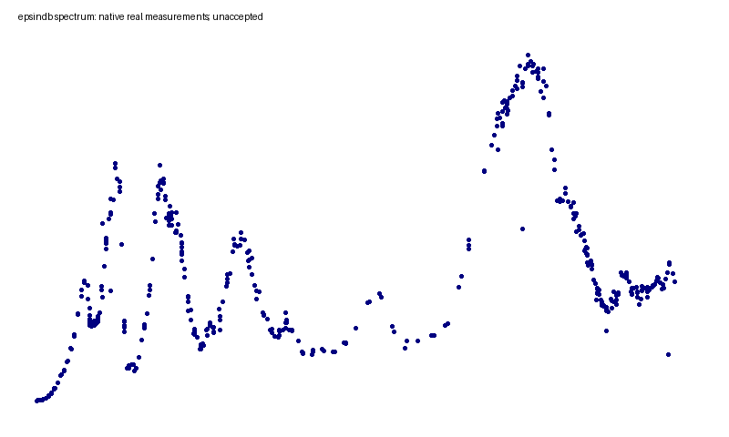

# G4b-epsind — PASS (L3)

# Native target acceptance
Complete measurements and rejected frames:
```json
{
  "ra": 331.09612832801395,
  "dec": -56.80056553300604,
  "rows": [
    {
      "lam": 1.561318278312683,
      "dlam": 0.03811173513531685,
      "flux": 37806.28354914071,
      "err": 1677.8934958757584,
      "mjd": 60789.85618796,
      "visit": "V1",
      "detector": 2,
      "flags": [
        "SOURCE"
      ],
      "rchi2": 36.66022890841798,
      "contaminated": false,
      "release": "qr2",
      "quality": {
        "lam": 1.561318278312683,
        "dlam": 0.03811173513531685,
        "flux_uJy": 37806.28354914071,
        "err_uJy": 1677.8934958757584,
        "stat_err_uJy": 1236.5043531196923,
        "cal_err_uJy": 1134.1885064742212,
        "mjd": 60789.85618796,
        "detector": 2,
        "obsid": "2025W17_4B_0017_1",
        "rchi2": 36.66022890841798,
        "flags_near": [
          "SOURCE"
        ],
        "wing_fit": false,
        "contaminated": false,
        "photometric_scale": "qr2",
        "blend_fit": false,
        "omega_arcsec2": 37.50920486450195,
        "zone": 65
      },
      "frame_id": "level2_2025W17_4B_0017_1D2_spx_l2b-v20-2025-240.fits"
    },
    {
      "lam": 4.34086275100708,
      "dlam": 0.03698882833123207,
      "flux": 32076.116616696836,
      "err": 1562.8297485555936,
      "mjd": 60789.856187972,
      "visit": "V1",
      "detector": 5,
      "flags": [
        "SOURCE"
      ],
      "rchi2": 12.494984842019567,
      "contaminated": false,
      "release": "qr2",
      "quality": {
        "lam": 4.34086275100708,
        "dlam": 0.03698882833123207,
        "flux_uJy": 32076.116616696836,
        "err_uJy": 1562.8297485555936,
        "stat_err_uJy": 1231.441144140961,
        "cal_err_uJy": 962.283498500905,
        "mjd": 60789.856187972,
        "detector": 5,
        "obsid": "2025W17_4B_0017_1",
        "rchi2": 12.494984842019567,
        "flags_near": [
          "SOURCE"
        ],
        "wing_fit": false,
        "contaminated": false,
        "photometric_scale": "qr2",
        "blend_fit": false,
        "omega_arcsec2": 37.58549880981445,
        "zone": 65
      },
      "frame_id": "level2_2025W17_4B_0017_1D5_spx_l2b-v20-2025-240.fits"
    },
    {
      "lam": 1.5989296436309814,
      "dlam": 0.038715485483407974,
      "flux": 39239.26783883377,
      "err": 1528.2064664654522,
      "mjd": 60789.857680217,
      "visit": "V1",
      "detector": 2,
      "flags": [
        "SOURCE"
      ],
      "rchi2": 21.446621082309573,
      "contaminated": false,
      "release": "qr2",
      "quality": {
        "lam": 1.5989296436309814,
        "dlam": 0.038715485483407974,
        "flux_uJy": 39239.26783883377,
        "err_uJy": 1528.2064664654522,
        "stat_err_uJy": 974.508531348937,
        "cal_err_uJy": 1177.1780351650132,
        "mjd": 60789.857680217,
        "detector": 2,
        "obsid": "2025W17_4B_0017_2",
        "rchi2": 21.446621082309573,
        "flags_near": [
          "SOURCE"
        ],
        "wing_fit": false,
        "contaminated": false,
        "photometric_scale": "qr2",
        "blend_fit": false,
        "omega_arcsec2": 37.480098724365234,
        "zone": 23
      },
      "frame_id": "level2_2025W17_4B_0017_2D2_spx_l2b-v20-2025-240.fits"
    },
    {
      "lam": 4.377627849578857,
      "dlam": 0.03760560601949692,
      "flux": 30215.298121021995,
      "err": 1360.8335908440454,
      "mjd": 60789.857680217,
      "visit": "V1",
      "detector": 5,
      "flags": [
        "SOURCE"
      ],
      "rchi2": 8.738526105114047,
      "contaminated": false,
      "release": "qr2",
      "quality": {
        "lam": 4.377627849578857,
        "dlam": 0.03760560601949692,
        "flux_uJy": 30215.298121021995,
        "err_uJy": 1360.8335908440454,
        "stat_err_uJy": 1014.9878055826518,
        "cal_err_uJy": 906.4589436306599,
        "mjd": 60789.857680217,
        "detector": 5,
        "obsid": "2025W17_4B_0017_2",
        "rchi2": 8.738526105114047,
        "flags_near": [
          "SOURCE"
        ],
        "wing_fit": false,
        "contaminated": false,
        "photometric_scale": "qr2",
        "blend_fit": false,
        "omega_arcsec2": 37.55654525756836,
        "zone": 23
      },
      "frame_id": "level2_2025W17_4B_0017_2D5_spx_l2b-v20-2025-240.fits"
    },
    {
      "lam": 1.1064611673355103,
      "dlam": 0.025892306119203568,
      "flux": 13741.275873015298,
      "err": 567.8913581022335,
      "mjd": 60789.924263134,
      "visit": "V1",
      "detector": 2,
      "flags": [
        "SOURCE"
      ],
      "rchi2": 8.272901319384172,
      "contaminated": false,
      "release": "qr2",
      "quality": {
        "lam": 1.1064611673355103,
        "dlam": 0.025892306119203568,
        "flux_uJy": 13741.275873015298,
        "err_uJy": 567.8913581022335,
        "stat_err_uJy": 390.58955215253525,
        "cal_err_uJy": 412.2382761904589,
        "mjd": 60789.924263134,
        "detector": 2,
        "obsid": "2025W17_4B_0027_3",
        "rchi2": 8.272901319384172,
        "flags_near": [
          "SOURCE"
        ],
        "wing_fit": false,
        "contaminated": false,
        "photometric_scale": "qr2",
        "blend_fit": false,
        "omega_arcsec2": 37.98097610473633,
        "zone": 432
      },
      "frame_id": "level2_2025W17_4B_0027_3D2_spx_l2b-v20-2025-240.fits"
    },
    {
      "lam": 3.828920364379883,
      "dlam": 0.03481025993824005,
      "flux": 48461.746322372914,
      "err": 1824.377329859226,
      "mjd": 60789.924263145,
      "visit": "V1",
      "detector": 5,
      "flags": [
        "SOURCE"
      ],
      "rchi2": 7.313382716388446,
      "contaminated": false,
      "release": "qr2",
      "quality": {
        "lam": 3.828920364379883,
        "dlam": 0.03481025993824005,
        "flux_uJy": 48461.746322372914,
        "err_uJy": 1824.377329859226,
        "stat_err_uJy": 1102.1188097259098,
        "cal_err_uJy": 1453.8523896711874,
        "mjd": 60789.924263145,
        "detector": 5,
        "obsid": "2025W17_4B_0027_3",
        "rchi2": 7.313382716388446,
        "flags_near": [
          "SOURCE"
        ],
        "wing_fit": false,
        "contaminated": false,
        "photometric_scale": "qr2",
        "blend_fit": false,
        "omega_arcsec2": 38.053062438964844,
        "zone": 412
      },
      "frame_id": "level2_2025W17_4B_0027_3D5_spx_l2b-v20-2025-240.fits"
    },
    {
      "lam": 1.1322802305221558,
      "dlam": 0.026893386617302895,
      "flux": 13660.72833983281,
      "err": 607.7213200238199,
      "mjd": 60789.925755391,
      "visit": "V1",
      "detector": 2,
      "flags": [
        "SOURCE"
      ],
      "rchi2": 10.915416627388261,
      "contaminated": false,
      "release": "qr2",
      "quality": {
        "lam": 1.1322802305221558,
        "dlam": 0.026893386617302895,
        "flux_uJy": 13660.72833983281,
        "err_uJy": 607.7213200238199,
        "stat_err_uJy": 448.74408510224833,
        "cal_err_uJy": 409.82185019498434,
        "mjd": 60789.925755391,
        "detector": 2,
        "obsid": "2025W17_4B_0027_4",
        "rchi2": 10.915416627388261,
        "flags_near": [
          "SOURCE"
        ],
        "wing_fit": false,
        "contaminated": false,
        "photometric_scale": "qr2",
        "blend_fit": false,
        "omega_arcsec2": 37.942012786865234,
        "zone": 390
      },
      "frame_id": "level2_2025W17_4B_0027_4D2_spx_l2b-v20-2025-240.fits"
    },
    {
      "lam": 3.8617606163024902,
      "dlam": 0.03562555089592934,
      "flux": 48584.02986485545,
      "err": 2060.4178973144917,
      "mjd": 60789.925755391,
      "visit": "V1",
      "detector": 5,
      "flags": [
        "SOURCE"
      ],
      "rchi2": 12.837079859863346,
      "contaminated": false,
      "release": "qr2",
      "quality": {
        "lam": 3.8617606163024902,
        "dlam": 0.03562555089592934,
        "flux_uJy": 48584.02986485545,
        "err_uJy": 2060.4178973144917,
        "stat_err_uJy": 1456.3498032600623,
        "cal_err_uJy": 1457.5208959456636,
        "mjd": 60789.925755391,
        "detector": 5,
        "obsid": "2025W17_4B_0027_4",
        "rchi2": 12.837079859863346,
        "flags_near": [
          "SOURCE"
        ],
        "wing_fit": false,
        "contaminated": false,
        "photometric_scale": "qr2",
        "blend_fit": false,
        "omega_arcsec2": 38.01460266113281,
        "zone": 391
      },
      "frame_id": "level2_2025W17_4B_0027_4D5_spx_l2b-v20-2025-240.fits"
    },
    {
      "lam": 2.412463665008545,
      "dlam": 0.045089151710271835,
      "flux": 13691.935721285003,
      "err": 493.88061916844987,
      "mjd": 60790.261636745,
      "visit": "V1",
      "detector": 4,
      "flags": [
        "DICHROIC",
        "SOURCE",
        "TRANSIENT"
      ],
      "rchi2": 0.9723887294735812,
      "contaminated": true,
      "release": "qr2",
      "quality": {
        "lam": 2.412463665008545,
        "dlam": 0.045089151710271835,
        "flux_uJy": 13691.935721285003,
        "err_uJy": 493.88061916844987,
        "stat_err_uJy": 274.21865832578055,
        "cal_err_uJy": 410.75807163855006,
        "mjd": 60790.261636745,
        "detector": 4,
        "obsid": "2025W17_4B_0077_2",
        "rchi2": 0.9723887294735812,
        "flags_near": [
          "DICHROIC",
          "SOURCE",
          "TRANSIENT"
        ],
        "wing_fit": false,
        "contaminated": true,
        "photometric_scale": "qr2",
        "blend_fit": false,
        "omega_arcsec2": 38.15243911743164,
        "zone": 437
      },
      "frame_id": "level2_2025W17_4B_0077_2D4_spx_l2b-v20-2025-240.fits"
    },
    {
      "lam": 0.7557471394538879,
      "dlam": 0.01745433360338211,
      "flux": -23.573641149587733,
      "err": 40.806885148586225,
      "mjd": 60790.26312899,
      "visit": "V1",
      "detector": 1,
      "flags": [
        "SOURCE",
        "TRANSIENT"
      ],
      "rchi2": 1.1982148074410133,
      "contaminated": true,
      "release": "qr2",
      "quality": {
        "lam": 0.7557471394538879,
        "dlam": 0.01745433360338211,
        "flux_uJy": -23.573641149587733,
        "err_uJy": 40.806885148586225,
        "stat_err_uJy": 40.8007564957877,
        "cal_err_uJy": 0.707209234487632,
        "mjd": 60790.26312899,
        "detector": 1,
        "obsid": "2025W17_4B_0077_3",
        "rchi2": 1.1982148074410133,
        "flags_near": [
          "SOURCE",
          "TRANSIENT"
        ],
        "wing_fit": false,
        "contaminated": true,
        "photometric_scale": "qr2",
        "blend_fit": false,
        "omega_arcsec2": 38.05698776245117,
        "zone": 416
      },
      "frame_id": "level2_2025W17_4B_0077_3D1_spx_l2b-v20-2025-241.fits"
    },
    {
      "lam": 2.4575462341308594,
      "dlam": 0.0688043013215065,
      "flux": 12279.462981113495,
      "err": 540.5494551425381,
      "mjd": 60790.26312899,
      "visit": "V1",
      "detector": 4,
      "flags": [
        "SOURCE"
      ],
      "rchi2": 10.887793455337441,
      "contaminated": false,
      "release": "qr2",
      "quality": {
        "lam": 2.4575462341308594,
        "dlam": 0.0688043013215065,
        "flux_uJy": 12279.462981113495,
        "err_uJy": 540.5494551425381,
        "stat_err_uJy": 395.58440750465866,
        "cal_err_uJy": 368.3838894334048,
        "mjd": 60790.26312899,
        "detector": 4,
        "obsid": "2025W17_4B_0077_3",
        "rchi2": 10.887793455337441,
        "flags_near": [
          "SOURCE"
        ],
        "wing_fit": false,
        "contaminated": false,
        "photometric_scale": "qr2",
        "blend_fit": false,
        "omega_arcsec2": 38.114925384521484,
        "zone": 416
      },
      "frame_id": "level2_2025W17_4B_0077_3D4_spx_l2b-v20-2025-240.fits"
    },
    {
      "lam": 1.6371301412582397,
      "dlam": 0.03912847489118576,
      "flux": 32647.89931039531,
      "err": 1362.1542496643806,
      "mjd": 60791.075216803,
      "visit": "V1",
      "detector": 2,
      "flags": [
        "SOURCE",
        "TRANSIENT"
      ],
      "rchi2": 25.075244650752595,
      "contaminated": true,
      "release": "qr2",
      "quality": {
        "lam": 1.6371301412582397,
        "dlam": 0.03912847489118576,
        "flux_uJy": 32647.89931039531,
        "err_uJy": 1362.1542496643806,
        "stat_err_uJy": 946.6611872445136,
        "cal_err_uJy": 979.4369793118593,
        "mjd": 60791.075216803,
        "detector": 2,
        "obsid": "2025W17_4B_0202_1",
        "rchi2": 25.075244650752595,
        "flags_near": [
          "SOURCE",
          "TRANSIENT"
        ],
        "wing_fit": false,
        "contaminated": true,
        "photometric_scale": "qr2",
        "blend_fit": false,
        "omega_arcsec2": 37.45211410522461,
        "zone": 2
      },
      "frame_id": "level2_2025W17_4B_0202_1D2_spx_l2b-v20-2025-240.fits"
    },
    {
      "lam": 4.4149885177612305,
      "dlam": 0.03784358873963356,
      "flux": 26421.370644491275,
      "err": 1222.184520409616,
      "mjd": 60791.075216803,
      "visit": "V1",
      "detector": 5,
      "flags": [
        "SOURCE"
      ],
      "rchi2": 8.36943313341033,
      "contaminated": false,
      "release": "qr2",
      "quality": {
        "lam": 4.4149885177612305,
        "dlam": 0.03784358873963356,
        "flux_uJy": 26421.370644491275,
        "err_uJy": 1222.184520409616,
        "stat_err_uJy": 930.2983703461251,
        "cal_err_uJy": 792.6411193347383,
        "mjd": 60791.075216803,
        "detector": 5,
        "obsid": "2025W17_4B_0202_1",
        "rchi2": 8.36943313341033,
        "flags_near": [
          "SOURCE"
        ],
        "wing_fit": false,
        "contaminated": false,
        "photometric_scale": "qr2",
        "blend_fit": false,
        "omega_arcsec2": 37.52841567993164,
        "zone": 2
      },
      "frame_id": "level2_2025W17_4B_0202_1D5_spx_l2b-v20-2025-240.fits"
    },
    {
      "lam": 1.159326195716858,
      "dlam": 0.027776183560490608,
      "flux": 14859.3621886159,
      "err": 649.0299104874132,
      "mjd": 60791.21127833,
      "visit": "V1",
      "detector": 2,
      "flags": [
        "SOURCE",
        "SUR_ERROR",
        "TRANSIENT"
      ],
      "rchi2": 10.82646579923999,
      "contaminated": true,
      "release": "qr2",
      "quality": {
        "lam": 1.159326195716858,
        "dlam": 0.027776183560490608,
        "flux_uJy": 14859.3621886159,
        "err_uJy": 649.0299104874132,
        "stat_err_uJy": 471.71945531224225,
        "cal_err_uJy": 445.78086565847696,
        "mjd": 60791.21127833,
        "detector": 2,
        "obsid": "2025W17_4B_0222_1",
        "rchi2": 10.82646579923999,
        "flags_near": [
          "SOURCE",
          "SUR_ERROR",
          "TRANSIENT"
        ],
        "wing_fit": true,
        "contaminated": true,
        "photometric_scale": "qr2",
        "blend_fit": false,
        "omega_arcsec2": 37.904014587402344,
        "zone": 369
      },
      "frame_id": "level2_2025W17_4B_0222_1D2_spx_l2b-v20-2025-240.fits"
    },
    {
      "lam": 1.1871730089187622,
      "dlam": 0.02847614511847496,
      "flux": 19578.77216157768,
      "err": 949.3891625890772,
      "mjd": 60791.212770587,
      "visit": "V1",
      "detector": 2,
      "flags": [
        "SOURCE"
      ],
      "rchi2": 21.424878990419288,
      "contaminated": false,
      "release": "qr2",
      "quality": {
        "lam": 1.1871730089187622,
        "dlam": 0.02847614511847496,
        "flux_uJy": 19578.77216157768,
        "err_uJy": 949.3891625890772,
        "stat_err_uJy": 745.8849070882967,
        "cal_err_uJy": 587.3631648473304,
        "mjd": 60791.212770587,
        "detector": 2,
        "obsid": "2025W17_4B_0222_2",
        "rchi2": 21.424878990419288,
        "flags_near": [
          "SOURCE"
        ],
        "wing_fit": false,
        "contaminated": false,
        "photometric_scale": "qr2",
        "blend_fit": false,
        "omega_arcsec2": 37.86640930175781,
        "zone": 348
      },
      "frame_id": "level2_2025W17_4B_0222_2D2_spx_l2b-v20-2025-240.fits"
    },
    {
      "lam": 1.2156929969787598,
      "dlam": 0.02890745922923088,
      "flux": 28692.727782620997,
      "err": 1388.114009620566,
      "mjd": 60791.214262844,
      "visit": "V1",
      "detector": 2,
      "flags": [
        "SOURCE"
      ],
      "rchi2": 31.71167467108234,
      "contaminated": false,
      "release": "qr2",
      "quality": {
        "lam": 1.2156929969787598,
        "dlam": 0.02890745922923088,
        "flux_uJy": 28692.727782620997,
        "err_uJy": 1388.114009620566,
        "stat_err_uJy": 1088.9973089305838,
        "cal_err_uJy": 860.7818334786299,
        "mjd": 60791.214262844,
        "detector": 2,
        "obsid": "2025W17_4B_0222_3",
        "rchi2": 31.71167467108234,
        "flags_near": [
          "SOURCE"
        ],
        "wing_fit": false,
        "contaminated": false,
        "photometric_scale": "qr2",
        "blend_fit": false,
        "omega_arcsec2": 37.82947540283203,
        "zone": 327
      },
      "frame_id": "level2_2025W17_4B_0222_3D2_spx_l2b-v20-2025-240.fits"
    },
    {
      "lam": 3.9632790088653564,
      "dlam": 0.036281462758779526,
      "flux": 56612.83752840668,
      "err": 2226.4959267378613,
      "mjd": 60791.214262833,
      "visit": "V1",
      "detector": 5,
      "flags": [
        "SOURCE",
        "SUR_ERROR",
        "TRANSIENT"
      ],
      "rchi2": 10.324282736792112,
      "contaminated": true,
      "release": "qr2",
      "quality": {
        "lam": 3.9632790088653564,
        "dlam": 0.036281462758779526,
        "flux_uJy": 56612.83752840668,
        "err_uJy": 2226.4959267378613,
        "stat_err_uJy": 1439.712497710669,
        "cal_err_uJy": 1698.3851258522002,
        "mjd": 60791.214262833,
        "detector": 5,
        "obsid": "2025W17_4B_0222_3",
        "rchi2": 10.324282736792112,
        "flags_near": [
          "SOURCE",
          "SUR_ERROR",
          "TRANSIENT"
        ],
        "wing_fit": true,
        "contaminated": true,
        "photometric_scale": "qr2",
        "blend_fit": false,
        "omega_arcsec2": 37.90255355834961,
        "zone": 327
      },
      "frame_id": "level2_2025W17_4B_0222_3D5_spx_l2b-v20-2025-240.fits"
    },
    {
      "lam": 1.2449756860733032,
      "dlam": 0.02965291030704975,
      "flux": 35595.67002593871,
      "err": 1510.037090411722,
      "mjd": 60791.215755078,
      "visit": "V1",
      "detector": 2,
      "flags": [
        "SOURCE"
      ],
      "rchi2": 25.2262565734303,
      "contaminated": false,
      "release": "qr2",
      "quality": {
        "lam": 1.2449756860733032,
        "dlam": 0.02965291030704975,
        "flux_uJy": 35595.67002593871,
        "err_uJy": 1510.037090411722,
        "stat_err_uJy": 1067.644820285819,
        "cal_err_uJy": 1067.8701007781613,
        "mjd": 60791.215755078,
        "detector": 2,
        "obsid": "2025W17_4B_0222_4",
        "rchi2": 25.2262565734303,
        "flags_near": [
          "SOURCE"
        ],
        "wing_fit": false,
        "contaminated": false,
        "photometric_scale": "qr2",
        "blend_fit": false,
        "omega_arcsec2": 37.792911529541016,
        "zone": 306
      },
      "frame_id": "level2_2025W17_4B_0222_4D2_spx_l2b-v20-2025-240.fits"
    },
    {
      "lam": 3.9980411529541016,
      "dlam": 0.03644523024559021,
      "flux": 56280.73331962769,
      "err": 2678.581794386853,
      "mjd": 60791.21575509,
      "visit": "V1",
      "detector": 5,
      "flags": [
        "COLD",
        "PERSIST",
        "SOURCE",
        "SUR_ERROR",
        "TRANSIENT"
      ],
      "rchi2": 12.397763305820991,
      "contaminated": true,
      "release": "qr2",
      "quality": {
        "lam": 3.9980411529541016,
        "dlam": 0.03644523024559021,
        "flux_uJy": 56280.73331962769,
        "err_uJy": 2678.581794386853,
        "stat_err_uJy": 2079.43059045623,
        "cal_err_uJy": 1688.4219995888307,
        "mjd": 60791.21575509,
        "detector": 5,
        "obsid": "2025W17_4B_0222_4",
        "rchi2": 12.397763305820991,
        "flags_near": [
          "COLD",
          "PERSIST",
          "SOURCE",
          "SUR_ERROR",
          "TRANSIENT"
        ],
        "wing_fit": false,
        "contaminated": true,
        "photometric_scale": "qr2",
        "blend_fit": false,
        "omega_arcsec2": 37.866485595703125,
        "zone": 306
      },
      "frame_id": "level2_2025W17_4B_0222_4D5_spx_l2b-v20-2025-240.fits"
    },
    {
      "lam": 1.575190544128418,
      "dlam": 0.038321807980537415,
      "flux": 38489.58544025506,
      "err": 1791.138911596428,
      "mjd": 60791.8226048,
      "visit": "V1",
      "detector": 2,
      "flags": [
        "SOURCE"
      ],
      "rchi2": 43.21941131228532,
      "contaminated": false,
      "release": "qr2",
      "quality": {
        "lam": 1.575190544128418,
        "dlam": 0.038321807980537415,
        "flux_uJy": 38489.58544025506,
        "err_uJy": 1791.138911596428,
        "stat_err_uJy": 1369.2608341760208,
        "cal_err_uJy": 1154.6875632076517,
        "mjd": 60791.8226048,
        "detector": 2,
        "obsid": "2025W17_4B_0315_1",
        "rchi2": 43.21941131228532,
        "flags_near": [
          "SOURCE"
        ],
        "wing_fit": false,
        "contaminated": false,
        "photometric_scale": "qr2",
        "blend_fit": false,
        "omega_arcsec2": 37.507347106933594,
        "zone": 62
      },
      "frame_id": "level2_2025W17_4B_0315_1D2_spx_l2b-v20-2025-240.fits"
    },
    {
      "lam": 4.354493141174316,
      "dlam": 0.037526629865169525,
      "flux": 32523.867833247667,
      "err": 1566.9973526114711,
      "mjd": 60791.822604789,
      "visit": "V1",
      "detector": 5,
      "flags": [
        "SOURCE"
      ],
      "rchi2": 12.277920335741241,
      "contaminated": false,
      "release": "qr2",
      "quality": {
        "lam": 4.354493141174316,
        "dlam": 0.037526629865169525,
        "flux_uJy": 32523.867833247667,
        "err_uJy": 1566.9973526114711,
        "stat_err_uJy": 1226.1561573226525,
        "cal_err_uJy": 975.7160349974299,
        "mjd": 60791.822604789,
        "detector": 5,
        "obsid": "2025W17_4B_0315_1",
        "rchi2": 12.277920335741241,
        "flags_near": [
          "SOURCE"
        ],
        "wing_fit": false,
        "contaminated": false,
        "photometric_scale": "qr2",
        "blend_fit": false,
        "omega_arcsec2": 37.58482360839844,
        "zone": 62
      },
      "frame_id": "level2_2025W17_4B_0315_1D5_spx_l2b-v20-2025-240.fits"
    },
    {
      "lam": 1.612982153892517,
      "dlam": 0.039383627474308014,
      "flux": 36111.874351410595,
      "err": 1652.3279362282299,
      "mjd": 60791.824097034,
      "visit": "V1",
      "detector": 2,
      "flags": [
        "SOURCE",
        "TRANSIENT"
      ],
      "rchi2": 39.91945877754145,
      "contaminated": true,
      "release": "qr2",
      "quality": {
        "lam": 1.612982153892517,
        "dlam": 0.039383627474308014,
        "flux_uJy": 36111.874351410595,
        "err_uJy": 1652.3279362282299,
        "stat_err_uJy": 1247.608466861852,
        "cal_err_uJy": 1083.356230542318,
        "mjd": 60791.824097034,
        "detector": 2,
        "obsid": "2025W17_4B_0315_2",
        "rchi2": 39.91945877754145,
        "flags_near": [
          "SOURCE",
          "TRANSIENT"
        ],
        "wing_fit": false,
        "contaminated": true,
        "photometric_scale": "qr2",
        "blend_fit": false,
        "omega_arcsec2": 37.4784049987793,
        "zone": 41
      },
      "frame_id": "level2_2025W17_4B_0315_2D2_spx_l2b-v20-2025-240.fits"
    },
    {
      "lam": 4.391298770904541,
      "dlam": 0.03732043132185936,
      "flux": 29360.180731721382,
      "err": 1352.9697577959764,
      "mjd": 60791.824097034,
      "visit": "V1",
      "detector": 5,
      "flags": [
        "SOURCE",
        "SUR_ERROR",
        "TRANSIENT"
      ],
      "rchi2": 8.976043387115459,
      "contaminated": true,
      "release": "qr2",
      "quality": {
        "lam": 4.391298770904541,
        "dlam": 0.03732043132185936,
        "flux_uJy": 29360.180731721382,
        "err_uJy": 1352.9697577959764,
        "stat_err_uJy": 1026.9902502804466,
        "cal_err_uJy": 880.8054219516414,
        "mjd": 60791.824097034,
        "detector": 5,
        "obsid": "2025W17_4B_0315_2",
        "rchi2": 8.976043387115459,
        "flags_near": [
          "SOURCE",
          "SUR_ERROR",
          "TRANSIENT"
        ],
        "wing_fit": false,
        "contaminated": true,
        "photometric_scale": "qr2",
        "blend_fit": false,
        "omega_arcsec2": 37.556392669677734,
        "zone": 41
      },
      "frame_id": "level2_2025W17_4B_0315_2D5_spx_l2b-v20-2025-240.fits"
    },
    {
      "lam": 1.6516579389572144,
      "dlam": 0.039245251566171646,
      "flux": 32159.89199236604,
      "err": 1274.705844453661,
      "mjd": 60791.825589314,
      "visit": "V1",
      "detector": 2,
      "flags": [
        "SOURCE"
      ],
      "rchi2": 20.09406104413883,
      "contaminated": false,
      "release": "qr2",
      "quality": {
        "lam": 1.6516579389572144,
        "dlam": 0.039245251566171646,
        "flux_uJy": 32159.89199236604,
        "err_uJy": 1274.705844453661,
        "stat_err_uJy": 833.0919530398411,
        "cal_err_uJy": 964.7967597709811,
        "mjd": 60791.825589314,
        "detector": 2,
        "obsid": "2025W17_4B_0315_3",
        "rchi2": 20.09406104413883,
        "flags_near": [
          "SOURCE"
        ],
        "wing_fit": false,
        "contaminated": false,
        "photometric_scale": "qr2",
        "blend_fit": false,
        "omega_arcsec2": 37.45018005371094,
        "zone": 20
      },
      "frame_id": "level2_2025W17_4B_0315_3D2_spx_l2b-v20-2025-240.fits"
    },
    {
      "lam": 4.42922306060791,
      "dlam": 0.03755028173327446,
      "flux": 25727.214936702236,
      "err": 1218.902517333351,
      "mjd": 60791.825589314,
      "visit": "V1",
      "detector": 5,
      "flags": [
        "SOURCE"
      ],
      "rchi2": 8.606684763712822,
      "contaminated": false,
      "release": "qr2",
      "quality": {
        "lam": 4.42922306060791,
        "dlam": 0.03755028173327446,
        "flux_uJy": 25727.214936702236,
        "err_uJy": 1218.902517333351,
        "stat_err_uJy": 943.410153221934,
        "cal_err_uJy": 771.8164481010671,
        "mjd": 60791.825589314,
        "detector": 5,
        "obsid": "2025W17_4B_0315_3",
        "rchi2": 8.606684763712822,
        "flags_near": [
          "SOURCE"
        ],
        "wing_fit": false,
        "contaminated": false,
        "photometric_scale": "qr2",
        "blend_fit": false,
        "omega_arcsec2": 37.52885818481445,
        "zone": 20
      },
      "frame_id": "level2_2025W17_4B_0315_3D5_spx_l2b-v20-2025-240.fits"
    },
    {
      "lam": 1.274185061454773,
      "dlam": 0.030825966969132423,
      "flux": 41883.924182243536,
      "err": 1742.4410027492117,
      "mjd": 60792.705183851,
      "visit": "V1",
      "detector": 2,
      "flags": [
        "SOURCE"
      ],
      "rchi2": 26.182014745318668,
      "contaminated": false,
      "release": "qr2",
      "quality": {
        "lam": 1.274185061454773,
        "dlam": 0.030825966969132423,
        "flux_uJy": 41883.924182243536,
        "err_uJy": 1742.4410027492117,
        "stat_err_uJy": 1207.1718409771438,
        "cal_err_uJy": 1256.517725467306,
        "mjd": 60792.705183851,
        "detector": 2,
        "obsid": "2025W17_4B_0447_1",
        "rchi2": 26.182014745318668,
        "flags_near": [
          "SOURCE"
        ],
        "wing_fit": false,
        "contaminated": false,
        "photometric_scale": "qr2",
        "blend_fit": false,
        "omega_arcsec2": 37.75762176513672,
        "zone": 264
      },
      "frame_id": "level2_2025W17_4B_0447_1D2_spx_l2b-v20-2025-240.fits"
    },
    {
      "lam": 4.032571792602539,
      "dlam": 0.036512814462184906,
      "flux": 59481.526538627266,
      "err": 2594.5247007952275,
      "mjd": 60792.705183851,
      "visit": "V1",
      "detector": 5,
      "flags": [
        "SOURCE"
      ],
      "rchi2": 17.22649689997289,
      "contaminated": false,
      "release": "qr2",
      "quality": {
        "lam": 4.032571792602539,
        "dlam": 0.036512814462184906,
        "flux_uJy": 59481.526538627266,
        "err_uJy": 2594.5247007952275,
        "stat_err_uJy": 1883.4308120044357,
        "cal_err_uJy": 1784.445796158818,
        "mjd": 60792.705183851,
        "detector": 5,
        "obsid": "2025W17_4B_0447_1",
        "rchi2": 17.22649689997289,
        "flags_near": [
          "SOURCE"
        ],
        "wing_fit": false,
        "contaminated": false,
        "photometric_scale": "qr2",
        "blend_fit": false,
        "omega_arcsec2": 37.831363677978516,
        "zone": 264
      },
      "frame_id": "level2_2025W17_4B_0447_1D5_spx_l2b-v20-2025-240.fits"
    },
    {
      "lam": 1.3047349452972412,
      "dlam": 0.031460512429475784,
      "flux": 36885.182918179045,
      "err": 1822.5374817141833,
      "mjd": 60792.706676097,
      "visit": "V1",
      "detector": 2,
      "flags": [
        "SOURCE"
      ],
      "rchi2": 48.77394470875441,
      "contaminated": false,
      "release": "qr2",
      "quality": {
        "lam": 1.3047349452972412,
        "dlam": 0.031460512429475784,
        "flux_uJy": 36885.182918179045,
        "err_uJy": 1822.5374817141833,
        "stat_err_uJy": 1448.1636044440222,
        "cal_err_uJy": 1106.5554875453713,
        "mjd": 60792.706676097,
        "detector": 2,
        "obsid": "2025W17_4B_0447_2",
        "rchi2": 48.77394470875441,
        "flags_near": [
          "SOURCE"
        ],
        "wing_fit": false,
        "contaminated": false,
        "photometric_scale": "qr2",
        "blend_fit": false,
        "omega_arcsec2": 37.72276306152344,
        "zone": 243
      },
      "frame_id": "level2_2025W17_4B_0447_2D2_spx_l2b-v20-2025-240.fits"
    },
    {
      "lam": 4.067987442016602,
      "dlam": 0.03651747480034828,
      "flux": 58023.69755654507,
      "err": 2530.3845027217367,
      "mjd": 60792.706676097,
      "visit": "V1",
      "detector": 5,
      "flags": [
        "SOURCE"
      ],
      "rchi2": 16.464252556477728,
      "contaminated": false,
      "release": "qr2",
      "quality": {
        "lam": 4.067987442016602,
        "dlam": 0.03651747480034828,
        "flux_uJy": 58023.69755654507,
        "err_uJy": 2530.3845027217367,
        "stat_err_uJy": 1836.510604732316,
        "cal_err_uJy": 1740.710926696352,
        "mjd": 60792.706676097,
        "detector": 5,
        "obsid": "2025W17_4B_0447_2",
        "rchi2": 16.464252556477728,
        "flags_near": [
          "SOURCE"
        ],
        "wing_fit": false,
        "contaminated": false,
        "photometric_scale": "qr2",
        "blend_fit": false,
        "omega_arcsec2": 37.79638671875,
        "zone": 243
      },
      "frame_id": "level2_2025W17_4B_0447_2D5_spx_l2b-v20-2025-240.fits"
    },
    {
      "lam": 1.335677146911621,
      "dlam": 0.031951311975717545,
      "flux": 14076.879566217016,
      "err": 625.6181329531395,
      "mjd": 60792.708168365,
      "visit": "V1",
      "detector": 2,
      "flags": [
        "SOURCE"
      ],
      "rchi2": 11.784112849263987,
      "contaminated": false,
      "release": "qr2",
      "quality": {
        "lam": 1.335677146911621,
        "dlam": 0.031951311975717545,
        "flux_uJy": 14076.879566217016,
        "err_uJy": 625.6181329531395,
        "stat_err_uJy": 461.57920641009355,
        "cal_err_uJy": 422.30638698651046,
        "mjd": 60792.708168365,
        "detector": 2,
        "obsid": "2025W17_4B_0447_3",
        "rchi2": 11.784112849263987,
        "flags_near": [
          "SOURCE"
        ],
        "wing_fit": false,
        "contaminated": false,
        "photometric_scale": "qr2",
        "blend_fit": false,
        "omega_arcsec2": 37.688297271728516,
        "zone": 222
      },
      "frame_id": "level2_2025W17_4B_0447_3D2_spx_l2b-v20-2025-240.fits"
    },
    {
      "lam": 4.103470802307129,
      "dlam": 0.0367574505507946,
      "flux": 58632.55931225171,
      "err": 2430.1063871317738,
      "mjd": 60792.708168365,
      "visit": "V1",
      "detector": 5,
      "flags": [
        "SOURCE"
      ],
      "rchi2": 13.590603283878513,
      "contaminated": false,
      "release": "qr2",
      "quality": {
        "lam": 4.103470802307129,
        "dlam": 0.0367574505507946,
        "flux_uJy": 58632.55931225171,
        "err_uJy": 2430.1063871317738,
        "stat_err_uJy": 1676.7282852103374,
        "cal_err_uJy": 1758.9767793675512,
        "mjd": 60792.708168365,
        "detector": 5,
        "obsid": "2025W17_4B_0447_3",
        "rchi2": 13.590603283878513,
        "flags_near": [
          "SOURCE"
        ],
        "wing_fit": false,
        "contaminated": false,
        "photometric_scale": "qr2",
        "blend_fit": false,
        "omega_arcsec2": 37.76240921020508,
        "zone": 222
      },
      "frame_id": "level2_2025W17_4B_0447_3D5_spx_l2b-v20-2025-240.fits"
    },
    {
      "lam": 1.367141604423523,
      "dlam": 0.03266292065382004,
      "flux": 6184.200362952971,
      "err": 247.09110017423092,
      "mjd": 60792.709660611,
      "visit": "V1",
      "detector": 2,
      "flags": [
        "SOURCE"
      ],
      "rchi2": 3.2592014310315283,
      "contaminated": false,
      "release": "qr2",
      "quality": {
        "lam": 1.367141604423523,
        "dlam": 0.03266292065382004,
        "flux_uJy": 6184.200362952971,
        "err_uJy": 247.09110017423092,
        "stat_err_uJy": 163.1996049905726,
        "cal_err_uJy": 185.52601088858913,
        "mjd": 60792.709660611,
        "detector": 2,
        "obsid": "2025W17_4B_0447_4",
        "rchi2": 3.2592014310315283,
        "flags_near": [
          "SOURCE"
        ],
        "wing_fit": false,
        "contaminated": false,
        "photometric_scale": "qr2",
        "blend_fit": false,
        "omega_arcsec2": 37.654823303222656,
        "zone": 201
      },
      "frame_id": "level2_2025W17_4B_0447_4D2_spx_l2b-v20-2025-240.fits"
    },
    {
      "lam": 4.138876438140869,
      "dlam": 0.03667984530329704,
      "flux": 56468.652105733985,
      "err": 2386.1841907255725,
      "mjd": 60792.709660611,
      "visit": "V1",
      "detector": 5,
      "flags": [
        "SOURCE"
      ],
      "rchi2": 14.145800880346949,
      "contaminated": false,
      "release": "qr2",
      "quality": {
        "lam": 4.138876438140869,
        "dlam": 0.03667984530329704,
        "flux_uJy": 56468.652105733985,
        "err_uJy": 2386.1841907255725,
        "stat_err_uJy": 1680.487187839908,
        "cal_err_uJy": 1694.0595631720196,
        "mjd": 60792.709660611,
        "detector": 5,
        "obsid": "2025W17_4B_0447_4",
        "rchi2": 14.145800880346949,
        "flags_near": [
          "SOURCE"
        ],
        "wing_fit": false,
        "contaminated": false,
        "photometric_scale": "qr2",
        "blend_fit": false,
        "omega_arcsec2": 37.72914123535156,
        "zone": 201
      },
      "frame_id": "level2_2025W17_4B_0447_4D5_spx_l2b-v20-2025-240.fits"
    },
    {
      "lam": 1.0661733150482178,
      "dlam": 0.028092538937926292,
      "flux": 20866.404745692384,
      "err": 1223.115107735449,
      "mjd": 60792.841849372,
      "visit": "V1",
      "detector": 1,
      "flags": [
        "SOURCE"
      ],
      "rchi2": 32.560188354539264,
      "contaminated": false,
      "release": "qr2",
      "quality": {
        "lam": 1.0661733150482178,
        "dlam": 0.028092538937926292,
        "flux_uJy": 20866.404745692384,
        "err_uJy": 1223.115107735449,
        "stat_err_uJy": 1050.7827579765244,
        "cal_err_uJy": 625.9921423707715,
        "mjd": 60792.841849372,
        "detector": 1,
        "obsid": "2025W17_4B_0468_1",
        "rchi2": 32.560188354539264,
        "flags_near": [
          "SOURCE"
        ],
        "wing_fit": false,
        "contaminated": false,
        "photometric_scale": "qr2",
        "blend_fit": false,
        "omega_arcsec2": 37.66674041748047,
        "zone": 49
      },
      "frame_id": "level2_2025W17_4B_0468_1D1_spx_l2b-v20-2025-241.fits"
    },
    {
      "lam": 3.6408751010894775,
      "dlam": 0.10131846368312836,
      "flux": 27373.815277805494,
      "err": 1069.8899937505366,
      "mjd": 60792.841849372,
      "visit": "V1",
      "detector": 4,
      "flags": [
        "SOURCE"
      ],
      "rchi2": 18.97192095949934,
      "contaminated": false,
      "release": "qr2",
      "quality": {
        "lam": 3.6408751010894775,
        "dlam": 0.10131846368312836,
        "flux_uJy": 27373.815277805494,
        "err_uJy": 1069.8899937505366,
        "stat_err_uJy": 685.7633791261003,
        "cal_err_uJy": 821.2144583341648,
        "mjd": 60792.841849372,
        "detector": 4,
        "obsid": "2025W17_4B_0468_1",
        "rchi2": 18.97192095949934,
        "flags_near": [
          "SOURCE"
        ],
        "wing_fit": false,
        "contaminated": false,
        "photometric_scale": "qr2",
        "blend_fit": false,
        "omega_arcsec2": 37.729270935058594,
        "zone": 49
      },
      "frame_id": "level2_2025W17_4B_0468_1D4_spx_l2b-v20-2025-240.fits"
    },
    {
      "lam": 1.091888427734375,
      "dlam": 0.02969464659690857,
      "flux": 20321.450339165218,
      "err": 1075.8758360284126,
      "mjd": 60792.843341641,
      "visit": "V1",
      "detector": 1,
      "flags": [
        "SOURCE",
        "SUR_ERROR",
        "TRANSIENT"
      ],
      "rchi2": 19.82912239617071,
      "contaminated": true,
      "release": "qr2",
      "quality": {
        "lam": 1.091888427734375,
        "dlam": 0.02969464659690857,
        "flux_uJy": 20321.450339165218,
        "err_uJy": 1075.8758360284126,
        "stat_err_uJy": 886.4782033707278,
        "cal_err_uJy": 609.6435101749565,
        "mjd": 60792.843341641,
        "detector": 1,
        "obsid": "2025W17_4B_0468_2",
        "rchi2": 19.82912239617071,
        "flags_near": [
          "SOURCE",
          "SUR_ERROR",
          "TRANSIENT"
        ],
        "wing_fit": false,
        "contaminated": true,
        "photometric_scale": "qr2",
        "blend_fit": false,
        "omega_arcsec2": 37.63607406616211,
        "zone": 28
      },
      "frame_id": "level2_2025W17_4B_0468_2D1_spx_l2b-v20-2025-241.fits"
    },
    {
      "lam": 3.740898847579956,
      "dlam": 0.09609126299619675,
      "flux": 40653.28205630137,
      "err": 1553.95085740272,
      "mjd": 60792.843341641,
      "visit": "V1",
      "detector": 4,
      "flags": [
        "SOURCE",
        "SUR_ERROR",
        "TRANSIENT"
      ],
      "rchi2": 25.82879636190801,
      "contaminated": true,
      "release": "qr2",
      "quality": {
        "lam": 3.740898847579956,
        "dlam": 0.09609126299619675,
        "flux_uJy": 40653.28205630137,
        "err_uJy": 1553.95085740272,
        "stat_err_uJy": 962.9864274580268,
        "cal_err_uJy": 1219.598461689041,
        "mjd": 60792.843341641,
        "detector": 4,
        "obsid": "2025W17_4B_0468_2",
        "rchi2": 25.82879636190801,
        "flags_near": [
          "SOURCE",
          "SUR_ERROR",
          "TRANSIENT"
        ],
        "wing_fit": false,
        "contaminated": true,
        "photometric_scale": "qr2",
        "blend_fit": false,
        "omega_arcsec2": 37.697025299072266,
        "zone": 7
      },
      "frame_id": "level2_2025W17_4B_0468_2D4_spx_l2b-v20-2025-240.fits"
    },
    {
      "lam": 1.6463817358016968,
      "dlam": 0.038887716829776764,
      "flux": 32621.540543792617,
      "err": 1725.0831072779044,
      "mjd": 60794.065478909,
      "visit": "V1",
      "detector": 3,
      "flags": [
        "SOURCE"
      ],
      "rchi2": 47.68314490424796,
      "contaminated": false,
      "release": "qr2",
      "quality": {
        "lam": 1.6463817358016968,
        "dlam": 0.038887716829776764,
        "flux_uJy": 32621.540543792617,
        "err_uJy": 1725.0831072779044,
        "stat_err_uJy": 1420.6207482330797,
        "cal_err_uJy": 978.6462163137785,
        "mjd": 60794.065478909,
        "detector": 3,
        "obsid": "2025W18_1B_0081_2",
        "rchi2": 47.68314490424796,
        "flags_near": [
          "SOURCE"
        ],
        "wing_fit": false,
        "contaminated": false,
        "photometric_scale": "qr2",
        "blend_fit": false,
        "omega_arcsec2": 38.12183380126953,
        "zone": 433
      },
      "frame_id": "level2_2025W18_1B_0081_2D3_spx_l2b-v20-2025-240.fits"
    },
    {
      "lam": 4.430695533752441,
      "dlam": 0.033833764493465424,
      "flux": 25713.160845851344,
      "err": 1000.6883880379727,
      "mjd": 60794.065478921,
      "visit": "V1",
      "detector": 6,
      "flags": [
        "SOURCE"
      ],
      "rchi2": 2.8695784179012245,
      "contaminated": false,
      "release": "qr2",
      "quality": {
        "lam": 4.430695533752441,
        "dlam": 0.033833764493465424,
        "flux_uJy": 25713.160845851344,
        "err_uJy": 1000.6883880379727,
        "stat_err_uJy": 637.4380545102997,
        "cal_err_uJy": 771.3948253755403,
        "mjd": 60794.065478921,
        "detector": 6,
        "obsid": "2025W18_1B_0081_2",
        "rchi2": 2.8695784179012245,
        "flags_near": [
          "SOURCE"
        ],
        "wing_fit": false,
        "contaminated": false,
        "photometric_scale": "qr2",
        "blend_fit": false,
        "omega_arcsec2": 38.20815658569336,
        "zone": 407
      },
      "frame_id": "level2_2025W18_1B_0081_2D6_spx_l2b-v20-2025-240.fits"
    },
    {
      "lam": 1.6841760873794556,
      "dlam": 0.04066786915063858,
      "flux": 33278.55557411059,
      "err": 1227.183203035407,
      "mjd": 60794.066971178,
      "visit": "V1",
      "detector": 3,
      "flags": [
        "SOURCE"
      ],
      "rchi2": 12.170969688897197,
      "contaminated": false,
      "release": "qr2",
      "quality": {
        "lam": 1.6841760873794556,
        "dlam": 0.04066786915063858,
        "flux_uJy": 33278.55557411059,
        "err_uJy": 1227.183203035407,
        "stat_err_uJy": 713.626357993446,
        "cal_err_uJy": 998.3566672233178,
        "mjd": 60794.066971178,
        "detector": 3,
        "obsid": "2025W18_1B_0081_3",
        "rchi2": 12.170969688897197,
        "flags_near": [
          "SOURCE"
        ],
        "wing_fit": false,
        "contaminated": false,
        "photometric_scale": "qr2",
        "blend_fit": false,
        "omega_arcsec2": 38.082298278808594,
        "zone": 400
      },
      "frame_id": "level2_2025W18_1B_0081_3D3_spx_l2b-v20-2025-240.fits"
    },
    {
      "lam": 4.462342262268066,
      "dlam": 0.03559228777885437,
      "flux": 24057.39783186193,
      "err": 1061.928328393513,
      "mjd": 60794.066971178,
      "visit": "V1",
      "detector": 6,
      "flags": [
        "SOURCE",
        "SUR_ERROR",
        "TRANSIENT"
      ],
      "rchi2": 4.674742677189923,
      "contaminated": true,
      "release": "qr2",
      "quality": {
        "lam": 4.462342262268066,
        "dlam": 0.03559228777885437,
        "flux_uJy": 24057.39783186193,
        "err_uJy": 1061.928328393513,
        "stat_err_uJy": 778.9796038717659,
        "cal_err_uJy": 721.7219349558579,
        "mjd": 60794.066971178,
        "detector": 6,
        "obsid": "2025W18_1B_0081_3",
        "rchi2": 4.674742677189923,
        "flags_near": [
          "SOURCE",
          "SUR_ERROR",
          "TRANSIENT"
        ],
        "wing_fit": false,
        "contaminated": true,
        "photometric_scale": "qr2",
        "blend_fit": false,
        "omega_arcsec2": 38.16667175292969,
        "zone": 386
      },
      "frame_id": "level2_2025W18_1B_0081_3D6_spx_l2b-v20-2025-240.fits"
    },
    {
      "lam": 1.7234323024749756,
      "dlam": 0.04151839390397072,
      "flux": 24609.480343492996,
      "err": 1077.578887597002,
      "mjd": 60794.068463423,
      "visit": "V1",
      "detector": 3,
      "flags": [
        "SOURCE"
      ],
      "rchi2": 20.142366191947723,
      "contaminated": false,
      "release": "qr2",
      "quality": {
        "lam": 1.7234323024749756,
        "dlam": 0.04151839390397072,
        "flux_uJy": 24609.480343492996,
        "err_uJy": 1077.578887597002,
        "stat_err_uJy": 784.9282696499731,
        "cal_err_uJy": 738.2844103047898,
        "mjd": 60794.068463423,
        "detector": 3,
        "obsid": "2025W18_1B_0081_4",
        "rchi2": 20.142366191947723,
        "flags_near": [
          "SOURCE"
        ],
        "wing_fit": false,
        "contaminated": false,
        "photometric_scale": "qr2",
        "blend_fit": false,
        "omega_arcsec2": 38.04299545288086,
        "zone": 378
      },
      "frame_id": "level2_2025W18_1B_0081_4D3_spx_l2b-v20-2025-240.fits"
    },
    {
      "lam": 4.494725227355957,
      "dlam": 0.035083334892988205,
      "flux": 19650.481107609463,
      "err": 940.4958573247214,
      "mjd": 60794.068463423,
      "visit": "V1",
      "detector": 6,
      "flags": [
        "SOURCE"
      ],
      "rchi2": 5.066970067428016,
      "contaminated": false,
      "release": "qr2",
      "quality": {
        "lam": 4.494725227355957,
        "dlam": 0.035083334892988205,
        "flux_uJy": 19650.481107609463,
        "err_uJy": 940.4958573247214,
        "stat_err_uJy": 732.8063800626315,
        "cal_err_uJy": 589.5144332282839,
        "mjd": 60794.068463423,
        "detector": 6,
        "obsid": "2025W18_1B_0081_4",
        "rchi2": 5.066970067428016,
        "flags_near": [
          "SOURCE"
        ],
        "wing_fit": false,
        "contaminated": false,
        "photometric_scale": "qr2",
        "blend_fit": false,
        "omega_arcsec2": 38.12532424926758,
        "zone": 365
      },
      "frame_id": "level2_2025W18_1B_0081_4D6_spx_l2b-v20-2025-240.fits"
    },
    {
      "lam": 1.7632005214691162,
      "dlam": 0.04277048259973526,
      "flux": 18181.150506513983,
      "err": 706.6245096487155,
      "mjd": 60794.132257254,
      "visit": "V1",
      "detector": 3,
      "flags": [
        "SOURCE"
      ],
      "rchi2": 9.417276468156704,
      "contaminated": false,
      "release": "qr2",
      "quality": {
        "lam": 1.7632005214691162,
        "dlam": 0.04277048259973526,
        "flux_uJy": 18181.150506513983,
        "err_uJy": 706.6245096487155,
        "stat_err_uJy": 449.2431271258643,
        "cal_err_uJy": 545.4345151954194,
        "mjd": 60794.132257254,
        "detector": 3,
        "obsid": "2025W18_1B_0091_1",
        "rchi2": 9.417276468156704,
        "flags_near": [
          "SOURCE"
        ],
        "wing_fit": false,
        "contaminated": false,
        "photometric_scale": "qr2",
        "blend_fit": false,
        "omega_arcsec2": 38.004207611083984,
        "zone": 356
      },
      "frame_id": "level2_2025W18_1B_0091_1D3_spx_l2b-v20-2025-240.fits"
    },
    {
      "lam": 4.52676248550415,
      "dlam": 0.035859618335962296,
      "flux": 16718.94236527826,
      "err": 835.3838285703883,
      "mjd": 60794.132257254,
      "visit": "V1",
      "detector": 6,
      "flags": [
        "SOURCE"
      ],
      "rchi2": 4.951595269774959,
      "contaminated": false,
      "release": "qr2",
      "quality": {
        "lam": 4.52676248550415,
        "dlam": 0.035859618335962296,
        "flux_uJy": 16718.94236527826,
        "err_uJy": 835.3838285703883,
        "stat_err_uJy": 668.053448913164,
        "cal_err_uJy": 501.5682709583478,
        "mjd": 60794.132257254,
        "detector": 6,
        "obsid": "2025W18_1B_0091_1",
        "rchi2": 4.951595269774959,
        "flags_near": [
          "SOURCE"
        ],
        "wing_fit": false,
        "contaminated": false,
        "photometric_scale": "qr2",
        "blend_fit": false,
        "omega_arcsec2": 38.08518981933594,
        "zone": 344
      },
      "frame_id": "level2_2025W18_1B_0091_1D6_spx_l2b-v20-2025-240.fits"
    },
    {
      "lam": 1.8043959140777588,
      "dlam": 0.04423483461141586,
      "flux": 12529.307062383854,
      "err": 507.83503454066897,
      "mjd": 60794.133749511,
      "visit": "V1",
      "detector": 3,
      "flags": [
        "SOURCE"
      ],
      "rchi2": 7.177282651944014,
      "contaminated": false,
      "release": "qr2",
      "quality": {
        "lam": 1.8043959140777588,
        "dlam": 0.04423483461141586,
        "flux_uJy": 12529.307062383854,
        "err_uJy": 507.83503454066897,
        "stat_err_uJy": 341.4838801316553,
        "cal_err_uJy": 375.8792118715156,
        "mjd": 60794.133749511,
        "detector": 3,
        "obsid": "2025W18_1B_0091_2",
        "rchi2": 7.177282651944014,
        "flags_near": [
          "SOURCE"
        ],
        "wing_fit": false,
        "contaminated": false,
        "photometric_scale": "qr2",
        "blend_fit": false,
        "omega_arcsec2": 37.96621322631836,
        "zone": 323
      },
      "frame_id": "level2_2025W18_1B_0091_2D3_spx_l2b-v20-2025-240.fits"
    },
    {
      "lam": 4.560091495513916,
      "dlam": 0.03537116199731827,
      "flux": 16452.21352479987,
      "err": 655.1346376225316,
      "mjd": 60794.133749511,
      "visit": "V1",
      "detector": 6,
      "flags": [
        "SOURCE",
        "SUR_ERROR",
        "TRANSIENT"
      ],
      "rchi2": 2.1383975488796128,
      "contaminated": true,
      "release": "qr2",
      "quality": {
        "lam": 4.560091495513916,
        "dlam": 0.03537116199731827,
        "flux_uJy": 16452.21352479987,
        "err_uJy": 655.1346376225316,
        "stat_err_uJy": 430.8057526702247,
        "cal_err_uJy": 493.5664057439961,
        "mjd": 60794.133749511,
        "detector": 6,
        "obsid": "2025W18_1B_0091_2",
        "rchi2": 2.1383975488796128,
        "flags_near": [
          "SOURCE",
          "SUR_ERROR",
          "TRANSIENT"
        ],
        "wing_fit": true,
        "contaminated": true,
        "photometric_scale": "qr2",
        "blend_fit": false,
        "omega_arcsec2": 38.045631408691406,
        "zone": 323
      },
      "frame_id": "level2_2025W18_1B_0091_2D6_spx_l2b-v20-2025-240.fits"
    },
    {
      "lam": 1.8469325304031372,
      "dlam": 0.04583507031202316,
      "flux": 9114.670957557573,
      "err": 443.18638199165616,
      "mjd": 60794.135241756,
      "visit": "V1",
      "detector": 3,
      "flags": [
        "SOURCE"
      ],
      "rchi2": 11.300934097826023,
      "contaminated": false,
      "release": "qr2",
      "quality": {
        "lam": 1.8469325304031372,
        "dlam": 0.04583507031202316,
        "flux_uJy": 9114.670957557573,
        "err_uJy": 443.18638199165616,
        "stat_err_uJy": 348.7759527042612,
        "cal_err_uJy": 273.4401287267272,
        "mjd": 60794.135241756,
        "detector": 3,
        "obsid": "2025W18_1B_0091_3",
        "rchi2": 11.300934097826023,
        "flags_near": [
          "SOURCE"
        ],
        "wing_fit": false,
        "contaminated": false,
        "photometric_scale": "qr2",
        "blend_fit": false,
        "omega_arcsec2": 37.92867660522461,
        "zone": 301
      },
      "frame_id": "level2_2025W18_1B_0091_3D3_spx_l2b-v20-2025-240.fits"
    },
    {
      "lam": 4.59353494644165,
      "dlam": 0.03710373863577843,
      "flux": 17537.632267605266,
      "err": 766.8235747371451,
      "mjd": 60794.135241756,
      "visit": "V1",
      "detector": 6,
      "flags": [
        "SOURCE"
      ],
      "rchi2": 3.5198016203011493,
      "contaminated": false,
      "release": "qr2",
      "quality": {
        "lam": 4.59353494644165,
        "dlam": 0.03710373863577843,
        "flux_uJy": 17537.632267605266,
        "err_uJy": 766.8235747371451,
        "stat_err_uJy": 557.8590357557002,
        "cal_err_uJy": 526.1289680281579,
        "mjd": 60794.135241756,
        "detector": 6,
        "obsid": "2025W18_1B_0091_3",
        "rchi2": 3.5198016203011493,
        "flags_near": [
          "SOURCE"
        ],
        "wing_fit": false,
        "contaminated": false,
        "photometric_scale": "qr2",
        "blend_fit": false,
        "omega_arcsec2": 38.00690460205078,
        "zone": 302
      },
      "frame_id": "level2_2025W18_1B_0091_3D6_spx_l2b-v20-2025-240.fits"
    },
    {
      "lam": 1.8901621103286743,
      "dlam": 0.045661378651857376,
      "flux": 11454.692842136532,
      "err": 654.8486562415956,
      "mjd": 60794.136734002,
      "visit": "V1",
      "detector": 3,
      "flags": [
        "SOURCE"
      ],
      "rchi2": 21.917330298154884,
      "contaminated": false,
      "release": "qr2",
      "quality": {
        "lam": 1.8901621103286743,
        "dlam": 0.045661378651857376,
        "flux_uJy": 11454.692842136532,
        "err_uJy": 654.8486562415956,
        "stat_err_uJy": 557.438582522325,
        "cal_err_uJy": 343.64078526409594,
        "mjd": 60794.136734002,
        "detector": 3,
        "obsid": "2025W18_1B_0091_4",
        "rchi2": 21.917330298154884,
        "flags_near": [
          "SOURCE"
        ],
        "wing_fit": false,
        "contaminated": false,
        "photometric_scale": "qr2",
        "blend_fit": false,
        "omega_arcsec2": 37.89173889160156,
        "zone": 279
      },
      "frame_id": "level2_2025W18_1B_0091_4D3_spx_l2b-v20-2025-240.fits"
    },
    {
      "lam": 4.627281665802002,
      "dlam": 0.03690597787499428,
      "flux": 16896.99334816931,
      "err": 773.7110624552737,
      "mjd": 60794.136734013,
      "visit": "V1",
      "detector": 6,
      "flags": [
        "SOURCE"
      ],
      "rchi2": 3.9211753949531443,
      "contaminated": false,
      "release": "qr2",
      "quality": {
        "lam": 4.627281665802002,
        "dlam": 0.03690597787499428,
        "flux_uJy": 16896.99334816931,
        "err_uJy": 773.7110624552737,
        "stat_err_uJy": 584.5265283786513,
        "cal_err_uJy": 506.9098004450793,
        "mjd": 60794.136734013,
        "detector": 6,
        "obsid": "2025W18_1B_0091_4",
        "rchi2": 3.9211753949531443,
        "flags_near": [
          "SOURCE"
        ],
        "wing_fit": false,
        "contaminated": false,
        "photometric_scale": "qr2",
        "blend_fit": false,
        "omega_arcsec2": 37.9690055847168,
        "zone": 260
      },
      "frame_id": "level2_2025W18_1B_0091_4D6_spx_l2b-v20-2025-240.fits"
    },
    {
      "lam": 1.933747410774231,
      "dlam": 0.04744693636894226,
      "flux": 12165.855578202623,
      "err": 514.1565165945525,
      "mjd": 60794.679274708,
      "visit": "V1",
      "detector": 3,
      "flags": [
        "SOURCE"
      ],
      "rchi2": 9.210928018490673,
      "contaminated": false,
      "release": "qr2",
      "quality": {
        "lam": 1.933747410774231,
        "dlam": 0.04744693636894226,
        "flux_uJy": 12165.855578202623,
        "err_uJy": 514.1565165945525,
        "stat_err_uJy": 362.14594544455264,
        "cal_err_uJy": 364.9756673460787,
        "mjd": 60794.679274708,
        "detector": 3,
        "obsid": "2025W18_1B_0175_1",
        "rchi2": 9.210928018490673,
        "flags_near": [
          "SOURCE"
        ],
        "wing_fit": false,
        "contaminated": false,
        "photometric_scale": "qr2",
        "blend_fit": false,
        "omega_arcsec2": 37.85517120361328,
        "zone": 257
      },
      "frame_id": "level2_2025W18_1B_0175_1D3_spx_l2b-v20-2025-240.fits"
    },
    {
      "lam": 4.660914897918701,
      "dlam": 0.03747263923287392,
      "flux": 22325.239751008947,
      "err": 991.890464529597,
      "mjd": 60794.679274708,
      "visit": "V1",
      "detector": 6,
      "flags": [
        "SOURCE"
      ],
      "rchi2": 4.827982226656277,
      "contaminated": false,
      "release": "qr2",
      "quality": {
        "lam": 4.660914897918701,
        "dlam": 0.03747263923287392,
        "flux_uJy": 22325.239751008947,
        "err_uJy": 991.890464529597,
        "stat_err_uJy": 731.6228513918306,
        "cal_err_uJy": 669.7571925302684,
        "mjd": 60794.679274708,
        "detector": 6,
        "obsid": "2025W18_1B_0175_1",
        "rchi2": 4.827982226656277,
        "flags_near": [
          "SOURCE"
        ],
        "wing_fit": false,
        "contaminated": false,
        "photometric_scale": "qr2",
        "blend_fit": false,
        "omega_arcsec2": 37.93170166015625,
        "zone": 239
      },
      "frame_id": "level2_2025W18_1B_0175_1D6_spx_l2b-v20-2025-240.fits"
    },
    {
      "lam": 1.9782600402832031,
      "dlam": 0.04841703549027443,
      "flux": 14778.277641225213,
      "err": 568.3047996740944,
      "mjd": 60794.680766953,
      "visit": "V1",
      "detector": 3,
      "flags": [
        "SOURCE",
        "SUR_ERROR",
        "TRANSIENT"
      ],
      "rchi2": 7.12409451884672,
      "contaminated": true,
      "release": "qr2",
      "quality": {
        "lam": 1.9782600402832031,
        "dlam": 0.04841703549027443,
        "flux_uJy": 14778.277641225213,
        "err_uJy": 568.3047996740944,
        "stat_err_uJy": 355.5455024263268,
        "cal_err_uJy": 443.3483292367564,
        "mjd": 60794.680766953,
        "detector": 3,
        "obsid": "2025W18_1B_0175_2",
        "rchi2": 7.12409451884672,
        "flags_near": [
          "SOURCE",
          "SUR_ERROR",
          "TRANSIENT"
        ],
        "wing_fit": false,
        "contaminated": true,
        "photometric_scale": "qr2",
        "blend_fit": false,
        "omega_arcsec2": 37.81957244873047,
        "zone": 224
      },
      "frame_id": "level2_2025W18_1B_0175_2D3_spx_l2b-v20-2025-240.fits"
    },
    {
      "lam": 4.694662094116211,
      "dlam": 0.03587795048952103,
      "flux": 22591.798609825673,
      "err": 1032.5753586670508,
      "mjd": 60794.680766953,
      "visit": "V1",
      "detector": 6,
      "flags": [
        "SOURCE"
      ],
      "rchi2": 4.9702368841858275,
      "contaminated": false,
      "release": "qr2",
      "quality": {
        "lam": 4.694662094116211,
        "dlam": 0.03587795048952103,
        "flux_uJy": 22591.798609825673,
        "err_uJy": 1032.5753586670508,
        "stat_err_uJy": 779.0131214184772,
        "cal_err_uJy": 677.7539582947702,
        "mjd": 60794.680766953,
        "detector": 6,
        "obsid": "2025W18_1B_0175_2",
        "rchi2": 4.9702368841858275,
        "flags_near": [
          "SOURCE"
        ],
        "wing_fit": false,
        "contaminated": false,
        "photometric_scale": "qr2",
        "blend_fit": false,
        "omega_arcsec2": 37.8956184387207,
        "zone": 218
      },
      "frame_id": "level2_2025W18_1B_0175_2D6_spx_l2b-v20-2025-240.fits"
    },
    {
      "lam": 2.0236051082611084,
      "dlam": 0.04986879974603653,
      "flux": 20738.40526374955,
      "err": 790.8325123507582,
      "mjd": 60795.083355599,
      "visit": "V1",
      "detector": 3,
      "flags": [
        "SOURCE"
      ],
      "rchi2": 10.72315645088281,
      "contaminated": false,
      "release": "qr2",
      "quality": {
        "lam": 2.0236051082611084,
        "dlam": 0.04986879974603653,
        "flux_uJy": 20738.40526374955,
        "err_uJy": 790.8325123507582,
        "stat_err_uJy": 488.2035999415086,
        "cal_err_uJy": 622.1521579124865,
        "mjd": 60795.083355599,
        "detector": 3,
        "obsid": "2025W18_1B_0238_1",
        "rchi2": 10.72315645088281,
        "flags_near": [
          "SOURCE"
        ],
        "wing_fit": false,
        "contaminated": false,
        "photometric_scale": "qr2",
        "blend_fit": false,
        "omega_arcsec2": 37.78447723388672,
        "zone": 202
      },
      "frame_id": "level2_2025W18_1B_0238_1D3_spx_l2b-v20-2025-240.fits"
    },
    {
      "lam": 4.730002403259277,
      "dlam": 0.03659697622060776,
      "flux": 18747.54299295975,
      "err": 872.3727243260425,
      "mjd": 60795.083355599,
      "visit": "V1",
      "detector": 6,
      "flags": [
        "SOURCE"
      ],
      "rchi2": 3.9476888563774892,
      "contaminated": false,
      "release": "qr2",
      "quality": {
        "lam": 4.730002403259277,
        "dlam": 0.03659697622060776,
        "flux_uJy": 18747.54299295975,
        "err_uJy": 872.3727243260425,
        "stat_err_uJy": 666.866432430404,
        "cal_err_uJy": 562.4262897887925,
        "mjd": 60795.083355599,
        "detector": 6,
        "obsid": "2025W18_1B_0238_1",
        "rchi2": 3.9476888563774892,
        "flags_near": [
          "SOURCE"
        ],
        "wing_fit": false,
        "contaminated": false,
        "photometric_scale": "qr2",
        "blend_fit": false,
        "omega_arcsec2": 37.86014175415039,
        "zone": 197
      },
      "frame_id": "level2_2025W18_1B_0238_1D6_spx_l2b-v20-2025-240.fits"
    },
    {
      "lam": 2.0709989070892334,
      "dlam": 0.052009016275405884,
      "flux": 27407.640491260827,
      "err": 1114.1359983514135,
      "mjd": 60795.084847844,
      "visit": "V1",
      "detector": 3,
      "flags": [
        "SOURCE"
      ],
      "rchi2": 18.851193033126002,
      "contaminated": false,
      "release": "qr2",
      "quality": {
        "lam": 2.0709989070892334,
        "dlam": 0.052009016275405884,
        "flux_uJy": 27407.640491260827,
        "err_uJy": 1114.1359983514135,
        "stat_err_uJy": 751.82321143612,
        "cal_err_uJy": 822.2292147378248,
        "mjd": 60795.084847844,
        "detector": 3,
        "obsid": "2025W18_1B_0238_2",
        "rchi2": 18.851193033126002,
        "flags_near": [
          "SOURCE"
        ],
        "wing_fit": false,
        "contaminated": false,
        "photometric_scale": "qr2",
        "blend_fit": false,
        "omega_arcsec2": 37.749794006347656,
        "zone": 180
      },
      "frame_id": "level2_2025W18_1B_0238_2D3_spx_l2b-v20-2025-240.fits"
    },
    {
      "lam": 4.764007568359375,
      "dlam": 0.036313850432634354,
      "flux": 19090.888280034298,
      "err": 1095.6049110374695,
      "mjd": 60795.084847844,
      "visit": "V1",
      "detector": 6,
      "flags": [
        "SOURCE",
        "TRANSIENT"
      ],
      "rchi2": 4.117663974170087,
      "contaminated": true,
      "release": "qr2",
      "quality": {
        "lam": 4.764007568359375,
        "dlam": 0.036313850432634354,
        "flux_uJy": 19090.888280034298,
        "err_uJy": 1095.6049110374695,
        "stat_err_uJy": 933.9883871337724,
        "cal_err_uJy": 572.7266484010289,
        "mjd": 60795.084847844,
        "detector": 6,
        "obsid": "2025W18_1B_0238_2",
        "rchi2": 4.117663974170087,
        "flags_near": [
          "SOURCE",
          "TRANSIENT"
        ],
        "wing_fit": false,
        "contaminated": true,
        "photometric_scale": "qr2",
        "blend_fit": false,
        "omega_arcsec2": 37.825439453125,
        "zone": 176
      },
      "frame_id": "level2_2025W18_1B_0238_2D6_spx_l2b-v20-2025-240.fits"
    },
    {
      "lam": 2.119239091873169,
      "dlam": 0.053719036281108856,
      "flux": 28578.24111501555,
      "err": 1055.902288428671,
      "mjd": 60795.08634009,
      "visit": "V1",
      "detector": 3,
      "flags": [
        "SOURCE"
      ],
      "rchi2": 12.574975373078566,
      "contaminated": false,
      "release": "qr2",
      "quality": {
        "lam": 2.119239091873169,
        "dlam": 0.053719036281108856,
        "flux_uJy": 28578.24111501555,
        "err_uJy": 1055.902288428671,
        "stat_err_uJy": 616.3484112121452,
        "cal_err_uJy": 857.3472334504664,
        "mjd": 60795.08634009,
        "detector": 3,
        "obsid": "2025W18_1B_0238_3",
        "rchi2": 12.574975373078566,
        "flags_near": [
          "SOURCE"
        ],
        "wing_fit": false,
        "contaminated": false,
        "photometric_scale": "qr2",
        "blend_fit": false,
        "omega_arcsec2": 37.71588897705078,
        "zone": 147
      },
      "frame_id": "level2_2025W18_1B_0238_3D3_spx_l2b-v20-2025-240.fits"
    },
    {
      "lam": 4.798548698425293,
      "dlam": 0.03541890159249306,
      "flux": 20238.877187387694,
      "err": 867.9873863947735,
      "mjd": 60795.086340101,
      "visit": "V1",
      "detector": 6,
      "flags": [
        "SOURCE",
        "SUR_ERROR",
        "TRANSIENT"
      ],
      "rchi2": 3.1379312988407353,
      "contaminated": true,
      "release": "qr2",
      "quality": {
        "lam": 4.798548698425293,
        "dlam": 0.03541890159249306,
        "flux_uJy": 20238.877187387694,
        "err_uJy": 867.9873863947735,
        "stat_err_uJy": 620.2831354429072,
        "cal_err_uJy": 607.1663156216308,
        "mjd": 60795.086340101,
        "detector": 6,
        "obsid": "2025W18_1B_0238_3",
        "rchi2": 3.1379312988407353,
        "flags_near": [
          "SOURCE",
          "SUR_ERROR",
          "TRANSIENT"
        ],
        "wing_fit": false,
        "contaminated": true,
        "photometric_scale": "qr2",
        "blend_fit": false,
        "omega_arcsec2": 37.791751861572266,
        "zone": 134
      },
      "frame_id": "level2_2025W18_1B_0238_3D6_spx_l2b-v20-2025-240.fits"
    },
    {
      "lam": 2.168788194656372,
      "dlam": 0.05437169224023819,
      "flux": 23565.070704277423,
      "err": 1018.688362785917,
      "mjd": 60795.087832358,
      "visit": "V1",
      "detector": 3,
      "flags": [
        "SOURCE"
      ],
      "rchi2": 20.4192222935925,
      "contaminated": false,
      "release": "qr2",
      "quality": {
        "lam": 2.168788194656372,
        "dlam": 0.05437169224023819,
        "flux_uJy": 23565.070704277423,
        "err_uJy": 1018.688362785917,
        "stat_err_uJy": 733.4471207303342,
        "cal_err_uJy": 706.9521211283227,
        "mjd": 60795.087832358,
        "detector": 3,
        "obsid": "2025W18_1B_0238_4",
        "rchi2": 20.4192222935925,
        "flags_near": [
          "SOURCE"
        ],
        "wing_fit": false,
        "contaminated": false,
        "photometric_scale": "qr2",
        "blend_fit": false,
        "omega_arcsec2": 37.68260192871094,
        "zone": 125
      },
      "frame_id": "level2_2025W18_1B_0238_4D3_spx_l2b-v20-2025-240.fits"
    },
    {
      "lam": 4.832333564758301,
      "dlam": 0.036662958562374115,
      "flux": 18292.10178534897,
      "err": 797.9224429290466,
      "mjd": 60795.087832358,
      "visit": "V1",
      "detector": 6,
      "flags": [
        "NONFUNC",
        "SOURCE"
      ],
      "rchi2": 2.473765908306973,
      "contaminated": true,
      "release": "qr2",
      "quality": {
        "lam": 4.832333564758301,
        "dlam": 0.036662958562374115,
        "flux_uJy": 18292.10178534897,
        "err_uJy": 797.9224429290466,
        "stat_err_uJy": 579.2575730854517,
        "cal_err_uJy": 548.7630535604691,
        "mjd": 60795.087832358,
        "detector": 6,
        "obsid": "2025W18_1B_0238_4",
        "rchi2": 2.473765908306973,
        "flags_near": [
          "NONFUNC",
          "SOURCE"
        ],
        "wing_fit": true,
        "contaminated": true,
        "photometric_scale": "qr2",
        "blend_fit": false,
        "omega_arcsec2": 37.758914947509766,
        "zone": 113
      },
      "frame_id": "level2_2025W18_1B_0238_4D6_spx_l2b-v20-2025-240.fits"
    },
    {
      "lam": 2.375293731689453,
      "dlam": 0.0589284710586071,
      "flux": 12240.327931203254,
      "err": 514.8478093232296,
      "mjd": 60795.902176317,
      "visit": "V1",
      "detector": 3,
      "flags": [
        "SOURCE"
      ],
      "rchi2": 8.002631377041858,
      "contaminated": false,
      "release": "qr2",
      "quality": {
        "lam": 2.375293731689453,
        "dlam": 0.0589284710586071,
        "flux_uJy": 12240.327931203254,
        "err_uJy": 514.8478093232296,
        "stat_err_uJy": 360.86729096424574,
        "cal_err_uJy": 367.2098379360976,
        "mjd": 60795.902176317,
        "detector": 3,
        "obsid": "2025W18_1B_0363_1",
        "rchi2": 8.002631377041858,
        "flags_near": [
          "SOURCE"
        ],
        "wing_fit": false,
        "contaminated": false,
        "photometric_scale": "qr2",
        "blend_fit": false,
        "omega_arcsec2": 37.66487503051758,
        "zone": 29
      },
      "frame_id": "level2_2025W18_1B_0363_1D3_spx_l2b-v20-2025-240.fits"
    },
    {
      "lam": 4.975864887237549,
      "dlam": 0.03644964098930359,
      "flux": 24066.948770725732,
      "err": 1137.9858034370798,
      "mjd": 60795.902176317,
      "visit": "V1",
      "detector": 6,
      "flags": [
        "SOURCE"
      ],
      "rchi2": 4.353667133385969,
      "contaminated": false,
      "release": "qr2",
      "quality": {
        "lam": 4.975864887237549,
        "dlam": 0.03644964098930359,
        "flux_uJy": 24066.948770725732,
        "err_uJy": 1137.9858034370798,
        "stat_err_uJy": 879.6109753776796,
        "cal_err_uJy": 722.0084631217719,
        "mjd": 60795.902176317,
        "detector": 6,
        "obsid": "2025W18_1B_0363_1",
        "rchi2": 4.353667133385969,
        "flags_near": [
          "SOURCE"
        ],
        "wing_fit": false,
        "contaminated": false,
        "photometric_scale": "qr2",
        "blend_fit": false,
        "omega_arcsec2": 37.72538375854492,
        "zone": 35
      },
      "frame_id": "level2_2025W18_1B_0363_1D6_spx_l2b-v20-2025-240.fits"
    },
    {
      "lam": 2.421830177307129,
      "dlam": 0.04229505732655525,
      "flux": 14076.737160131413,
      "err": 484.10038310834733,
      "mjd": 60795.903668597,
      "visit": "V1",
      "detector": 3,
      "flags": [
        "DICHROIC",
        "SOURCE"
      ],
      "rchi2": 1.016015248273647,
      "contaminated": true,
      "release": "qr2",
      "quality": {
        "lam": 2.421830177307129,
        "dlam": 0.04229505732655525,
        "flux_uJy": 14076.737160131413,
        "err_uJy": 484.10038310834733,
        "stat_err_uJy": 236.67299118777046,
        "cal_err_uJy": 422.3021148039424,
        "mjd": 60795.903668597,
        "detector": 3,
        "obsid": "2025W18_1B_0363_2",
        "rchi2": 1.016015248273647,
        "flags_near": [
          "DICHROIC",
          "SOURCE"
        ],
        "wing_fit": false,
        "contaminated": true,
        "photometric_scale": "qr2",
        "blend_fit": false,
        "omega_arcsec2": 37.63453674316406,
        "zone": 7
      },
      "frame_id": "level2_2025W18_1B_0363_2D3_spx_l2b-v20-2025-240.fits"
    },
    {
      "lam": 1.6463817358016968,
      "dlam": 0.038887716829776764,
      "flux": 32086.62879753083,
      "err": 1379.1024410838227,
      "mjd": 60796.581027231,
      "visit": "V1",
      "detector": 3,
      "flags": [
        "SOURCE"
      ],
      "rchi2": 24.27103760883646,
      "contaminated": false,
      "release": "qr2",
      "quality": {
        "lam": 1.6463817358016968,
        "dlam": 0.038887716829776764,
        "flux_uJy": 32086.62879753083,
        "err_uJy": 1379.1024410838227,
        "stat_err_uJy": 987.5864368104078,
        "cal_err_uJy": 962.5988639259249,
        "mjd": 60796.581027231,
        "detector": 3,
        "obsid": "2025W18_2B_0011_2",
        "rchi2": 24.27103760883646,
        "flags_near": [
          "SOURCE"
        ],
        "wing_fit": false,
        "contaminated": false,
        "photometric_scale": "qr2",
        "blend_fit": false,
        "omega_arcsec2": 38.12183380126953,
        "zone": 433
      },
      "frame_id": "level2_2025W18_2B_0011_2D3_spx_l2b-v20-2025-241.fits"
    },
    {
      "lam": 4.430695533752441,
      "dlam": 0.033833764493465424,
      "flux": 24364.70805225278,
      "err": 1079.3215207962544,
      "mjd": 60796.581027231,
      "visit": "V1",
      "detector": 6,
      "flags": [
        "SOURCE"
      ],
      "rchi2": 4.750539220966132,
      "contaminated": false,
      "release": "qr2",
      "quality": {
        "lam": 4.430695533752441,
        "dlam": 0.033833764493465424,
        "flux_uJy": 24364.70805225278,
        "err_uJy": 1079.3215207962544,
        "stat_err_uJy": 794.1409488432007,
        "cal_err_uJy": 730.9412415675833,
        "mjd": 60796.581027231,
        "detector": 6,
        "obsid": "2025W18_2B_0011_2",
        "rchi2": 4.750539220966132,
        "flags_near": [
          "SOURCE"
        ],
        "wing_fit": false,
        "contaminated": false,
        "photometric_scale": "qr2",
        "blend_fit": false,
        "omega_arcsec2": 38.20815658569336,
        "zone": 407
      },
      "frame_id": "level2_2025W18_2B_0011_2D6_spx_l2b-v20-2025-241.fits"
    },
    {
      "lam": 1.6845380067825317,
      "dlam": 0.040671080350875854,
      "flux": 29920.68407995927,
      "err": 1342.6507675203832,
      "mjd": 60796.582519488,
      "visit": "V1",
      "detector": 3,
      "flags": [
        "SOURCE"
      ],
      "rchi2": 28.653352148668336,
      "contaminated": false,
      "release": "qr2",
      "quality": {
        "lam": 1.6845380067825317,
        "dlam": 0.040671080350875854,
        "flux_uJy": 29920.68407995927,
        "err_uJy": 1342.6507675203832,
        "stat_err_uJy": 998.4931052799609,
        "cal_err_uJy": 897.620522398778,
        "mjd": 60796.582519488,
        "detector": 3,
        "obsid": "2025W18_2B_0011_3",
        "rchi2": 28.653352148668336,
        "flags_near": [
          "SOURCE"
        ],
        "wing_fit": false,
        "contaminated": false,
        "photometric_scale": "qr2",
        "blend_fit": false,
        "omega_arcsec2": 38.08195495605469,
        "zone": 400
      },
      "frame_id": "level2_2025W18_2B_0011_3D3_spx_l2b-v20-2025-241.fits"
    },
    {
      "lam": 4.462379455566406,
      "dlam": 0.03536194935441017,
      "flux": 23930.36338517427,
      "err": 1052.5646326082658,
      "mjd": 60796.582519488,
      "visit": "V1",
      "detector": 6,
      "flags": [
        "COLD",
        "SOURCE",
        "SUR_ERROR",
        "TRANSIENT"
      ],
      "rchi2": 4.612758508336239,
      "contaminated": true,
      "release": "qr2",
      "quality": {
        "lam": 4.462379455566406,
        "dlam": 0.03536194935441017,
        "flux_uJy": 23930.36338517427,
        "err_uJy": 1052.5646326082658,
        "stat_err_uJy": 769.7377756391674,
        "cal_err_uJy": 717.9109015552281,
        "mjd": 60796.582519488,
        "detector": 6,
        "obsid": "2025W18_2B_0011_3",
        "rchi2": 4.612758508336239,
        "flags_near": [
          "COLD",
          "SOURCE",
          "SUR_ERROR",
          "TRANSIENT"
        ],
        "wing_fit": false,
        "contaminated": true,
        "photometric_scale": "qr2",
        "blend_fit": false,
        "omega_arcsec2": 38.1665153503418,
        "zone": 386
      },
      "frame_id": "level2_2025W18_2B_0011_3D6_spx_l2b-v20-2025-241.fits"
    },
    {
      "lam": 1.7234323024749756,
      "dlam": 0.04151839390397072,
      "flux": 25757.228385228256,
      "err": 1354.617206675628,
      "mjd": 60796.584011745,
      "visit": "V1",
      "detector": 3,
      "flags": [
        "SOURCE"
      ],
      "rchi2": 39.80517216626106,
      "contaminated": false,
      "release": "qr2",
      "quality": {
        "lam": 1.7234323024749756,
        "dlam": 0.04151839390397072,
        "flux_uJy": 25757.228385228256,
        "err_uJy": 1354.617206675628,
        "stat_err_uJy": 1112.6079470962597,
        "cal_err_uJy": 772.7168515568477,
        "mjd": 60796.584011745,
        "detector": 3,
        "obsid": "2025W18_2B_0011_4",
        "rchi2": 39.80517216626106,
        "flags_near": [
          "SOURCE"
        ],
        "wing_fit": false,
        "contaminated": false,
        "photometric_scale": "qr2",
        "blend_fit": false,
        "omega_arcsec2": 38.04299545288086,
        "zone": 378
      },
      "frame_id": "level2_2025W18_2B_0011_4D3_spx_l2b-v20-2025-241.fits"
    },
    {
      "lam": 4.494725227355957,
      "dlam": 0.035083334892988205,
      "flux": 19847.279441132298,
      "err": 879.3291652646936,
      "mjd": 60796.584011745,
      "visit": "V1",
      "detector": 6,
      "flags": [
        "SOURCE"
      ],
      "rchi2": 4.05402825569798,
      "contaminated": false,
      "release": "qr2",
      "quality": {
        "lam": 4.494725227355957,
        "dlam": 0.035083334892988205,
        "flux_uJy": 19847.279441132298,
        "err_uJy": 879.3291652646936,
        "stat_err_uJy": 647.0677938146431,
        "cal_err_uJy": 595.4183832339689,
        "mjd": 60796.584011745,
        "detector": 6,
        "obsid": "2025W18_2B_0011_4",
        "rchi2": 4.05402825569798,
        "flags_near": [
          "SOURCE"
        ],
        "wing_fit": false,
        "contaminated": false,
        "photometric_scale": "qr2",
        "blend_fit": false,
        "omega_arcsec2": 38.12532424926758,
        "zone": 365
      },
      "frame_id": "level2_2025W18_2B_0011_4D6_spx_l2b-v20-2025-241.fits"
    },
    {
      "lam": 2.375293731689453,
      "dlam": 0.0589284710586071,
      "flux": 12470.568677983689,
      "err": 606.9678727004546,
      "mjd": 60796.781344476,
      "visit": "V1",
      "detector": 3,
      "flags": [
        "SOURCE",
        "SUR_ERROR",
        "TRANSIENT"
      ],
      "rchi2": 11.941266780168581,
      "contaminated": true,
      "release": "qr2",
      "quality": {
        "lam": 2.375293731689453,
        "dlam": 0.0589284710586071,
        "flux_uJy": 12470.568677983689,
        "err_uJy": 606.9678727004546,
        "stat_err_uJy": 477.9606925819717,
        "cal_err_uJy": 374.11706033951066,
        "mjd": 60796.781344476,
        "detector": 3,
        "obsid": "2025W18_2B_0042_1",
        "rchi2": 11.941266780168581,
        "flags_near": [
          "SOURCE",
          "SUR_ERROR",
          "TRANSIENT"
        ],
        "wing_fit": true,
        "contaminated": true,
        "photometric_scale": "qr2",
        "blend_fit": false,
        "omega_arcsec2": 37.66487503051758,
        "zone": 29
      },
      "frame_id": "level2_2025W18_2B_0042_1D3_spx_l2b-v20-2025-241.fits"
    },
    {
      "lam": 2.421830177307129,
      "dlam": 0.04229505732655525,
      "flux": 14237.6932595094,
      "err": 540.6695997190976,
      "mjd": 60796.782836722,
      "visit": "V1",
      "detector": 3,
      "flags": [
        "COLD",
        "DICHROIC",
        "SOURCE",
        "SUR_ERROR",
        "TRANSIENT"
      ],
      "rchi2": 1.949679526368367,
      "contaminated": true,
      "release": "qr2",
      "quality": {
        "lam": 2.421830177307129,
        "dlam": 0.04229505732655525,
        "flux_uJy": 14237.6932595094,
        "err_uJy": 540.6695997190976,
        "stat_err_uJy": 331.48589358179004,
        "cal_err_uJy": 427.13079778528197,
        "mjd": 60796.782836722,
        "detector": 3,
        "obsid": "2025W18_2B_0042_2",
        "rchi2": 1.949679526368367,
        "flags_near": [
          "COLD",
          "DICHROIC",
          "SOURCE",
          "SUR_ERROR",
          "TRANSIENT"
        ],
        "wing_fit": true,
        "contaminated": true,
        "photometric_scale": "qr2",
        "blend_fit": false,
        "omega_arcsec2": 37.63453674316406,
        "zone": 7
      },
      "frame_id": "level2_2025W18_2B_0042_2D3_spx_l2b-v20-2025-241.fits"
    },
    {
      "lam": 1.5750757455825806,
      "dlam": 0.038572557270526886,
      "flux": 41585.24913553226,
      "err": 1933.2151146293504,
      "mjd": 60799.703372034,
      "visit": "V1",
      "detector": 2,
      "flags": [
        "SOURCE",
        "SUR_ERROR",
        "TRANSIENT"
      ],
      "rchi2": 46.51030023067829,
      "contaminated": true,
      "release": "qr2",
      "quality": {
        "lam": 1.5750757455825806,
        "dlam": 0.038572557270526886,
        "flux_uJy": 41585.24913553226,
        "err_uJy": 1933.2151146293504,
        "stat_err_uJy": 1476.794172636632,
        "cal_err_uJy": 1247.5574740659679,
        "mjd": 60799.703372034,
        "detector": 2,
        "obsid": "2025W18_2B_0489_1",
        "rchi2": 46.51030023067829,
        "flags_near": [
          "SOURCE",
          "SUR_ERROR",
          "TRANSIENT"
        ],
        "wing_fit": false,
        "contaminated": true,
        "photometric_scale": "qr2",
        "blend_fit": false,
        "omega_arcsec2": 37.50722885131836,
        "zone": 62
      },
      "frame_id": "level2_2025W18_2B_0489_1D2_spx_l2b-v20-2025-241.fits"
    },
    {
      "lam": 1.612936019897461,
      "dlam": 0.039652902632951736,
      "flux": 35535.41860021555,
      "err": 1633.5578565074793,
      "mjd": 60799.704864303,
      "visit": "V1",
      "detector": 2,
      "flags": [
        "SOURCE"
      ],
      "rchi2": 39.96461091133735,
      "contaminated": false,
      "release": "qr2",
      "quality": {
        "lam": 1.612936019897461,
        "dlam": 0.039652902632951736,
        "flux_uJy": 35535.41860021555,
        "err_uJy": 1633.5578565074793,
        "stat_err_uJy": 1237.7487196414384,
        "cal_err_uJy": 1066.0625580064664,
        "mjd": 60799.704864303,
        "detector": 2,
        "obsid": "2025W18_2B_0489_2",
        "rchi2": 39.96461091133735,
        "flags_near": [
          "SOURCE"
        ],
        "wing_fit": false,
        "contaminated": false,
        "photometric_scale": "qr2",
        "blend_fit": false,
        "omega_arcsec2": 37.47834396362305,
        "zone": 41
      },
      "frame_id": "level2_2025W18_2B_0489_2D2_spx_l2b-v20-2025-241.fits"
    },
    {
      "lam": 4.39092493057251,
      "dlam": 0.03727509081363678,
      "flux": 29102.94827530716,
      "err": 1461.0392418892377,
      "mjd": 60799.704864291,
      "visit": "V1",
      "detector": 5,
      "flags": [
        "SOURCE",
        "SUR_ERROR",
        "TRANSIENT"
      ],
      "rchi2": 12.01307877244205,
      "contaminated": true,
      "release": "qr2",
      "quality": {
        "lam": 4.39092493057251,
        "dlam": 0.03727509081363678,
        "flux_uJy": 29102.94827530716,
        "err_uJy": 1461.0392418892377,
        "stat_err_uJy": 1171.4743820743988,
        "cal_err_uJy": 873.0884482592148,
        "mjd": 60799.704864291,
        "detector": 5,
        "obsid": "2025W18_2B_0489_2",
        "rchi2": 12.01307877244205,
        "flags_near": [
          "SOURCE",
          "SUR_ERROR",
          "TRANSIENT"
        ],
        "wing_fit": true,
        "contaminated": true,
        "photometric_scale": "qr2",
        "blend_fit": false,
        "omega_arcsec2": 37.55657196044922,
        "zone": 41
      },
      "frame_id": "level2_2025W18_2B_0489_2D5_spx_l2b-v20-2025-241.fits"
    },
    {
      "lam": 1.6512341499328613,
      "dlam": 0.03994552046060562,
      "flux": 33193.64120345145,
      "err": 1376.065148513459,
      "mjd": 60799.706356536,
      "visit": "V1",
      "detector": 2,
      "flags": [
        "SOURCE"
      ],
      "rchi2": 25.054060291506314,
      "contaminated": false,
      "release": "qr2",
      "quality": {
        "lam": 1.6512341499328613,
        "dlam": 0.03994552046060562,
        "flux_uJy": 33193.64120345145,
        "err_uJy": 1376.065148513459,
        "stat_err_uJy": 949.6942972579361,
        "cal_err_uJy": 995.8092361035435,
        "mjd": 60799.706356536,
        "detector": 2,
        "obsid": "2025W18_2B_0489_3",
        "rchi2": 25.054060291506314,
        "flags_near": [
          "SOURCE"
        ],
        "wing_fit": false,
        "contaminated": false,
        "photometric_scale": "qr2",
        "blend_fit": false,
        "omega_arcsec2": 37.45030212402344,
        "zone": 20
      },
      "frame_id": "level2_2025W18_2B_0489_3D2_spx_l2b-v20-2025-241.fits"
    },
    {
      "lam": 4.429313659667969,
      "dlam": 0.03750619664788246,
      "flux": 26899.48521383497,
      "err": 1102.3121901466368,
      "mjd": 60799.706356536,
      "visit": "V1",
      "detector": 5,
      "flags": [
        "SOURCE"
      ],
      "rchi2": 5.140071398174914,
      "contaminated": false,
      "release": "qr2",
      "quality": {
        "lam": 4.429313659667969,
        "dlam": 0.03750619664788246,
        "flux_uJy": 26899.48521383497,
        "err_uJy": 1102.3121901466368,
        "stat_err_uJy": 750.9115062731971,
        "cal_err_uJy": 806.984556415049,
        "mjd": 60799.706356536,
        "detector": 5,
        "obsid": "2025W18_2B_0489_3",
        "rchi2": 5.140071398174914,
        "flags_near": [
          "SOURCE"
        ],
        "wing_fit": false,
        "contaminated": false,
        "photometric_scale": "qr2",
        "blend_fit": false,
        "omega_arcsec2": 37.52879333496094,
        "zone": 20
      },
      "frame_id": "level2_2025W18_2B_0489_3D5_spx_l2b-v20-2025-241.fits"
    },
    {
      "lam": 2.375697135925293,
      "dlam": 0.05871019884943962,
      "flux": 12316.12874144304,
      "err": 492.11203386238265,
      "mjd": 60801.740528643,
      "visit": "V1",
      "detector": 3,
      "flags": [
        "SOURCE"
      ],
      "rchi2": 6.49603961486545,
      "contaminated": false,
      "release": "qr2",
      "quality": {
        "lam": 2.375697135925293,
        "dlam": 0.05871019884943962,
        "flux_uJy": 12316.12874144304,
        "err_uJy": 492.11203386238265,
        "stat_err_uJy": 325.04758023088175,
        "cal_err_uJy": 369.4838622432912,
        "mjd": 60801.740528643,
        "detector": 3,
        "obsid": "2025W19_1B_0274_1",
        "rchi2": 6.49603961486545,
        "flags_near": [
          "SOURCE"
        ],
        "wing_fit": false,
        "contaminated": false,
        "photometric_scale": "qr2",
        "blend_fit": false,
        "omega_arcsec2": 37.6644172668457,
        "zone": 29
      },
      "frame_id": "level2_2025W19_1B_0274_1D3_spx_l2b-v20-2025-241.fits"
    },
    {
      "lam": 4.9760422706604,
      "dlam": 0.036610063165426254,
      "flux": 24399.575091936145,
      "err": 1081.238774328506,
      "mjd": 60801.740528643,
      "visit": "V1",
      "detector": 6,
      "flags": [
        "SOURCE"
      ],
      "rchi2": 3.5947402229168683,
      "contaminated": false,
      "release": "qr2",
      "quality": {
        "lam": 4.9760422706604,
        "dlam": 0.036610063165426254,
        "flux_uJy": 24399.575091936145,
        "err_uJy": 1081.238774328506,
        "stat_err_uJy": 795.7838581619271,
        "cal_err_uJy": 731.9872527580843,
        "mjd": 60801.740528643,
        "detector": 6,
        "obsid": "2025W19_1B_0274_1",
        "rchi2": 3.5947402229168683,
        "flags_near": [
          "SOURCE"
        ],
        "wing_fit": false,
        "contaminated": false,
        "photometric_scale": "qr2",
        "blend_fit": false,
        "omega_arcsec2": 37.7252311706543,
        "zone": 35
      },
      "frame_id": "level2_2025W19_1B_0274_1D6_spx_l2b-v20-2025-241.fits"
    },
    {
      "lam": 1.6841920614242554,
      "dlam": 0.04070841148495674,
      "flux": 29698.286407236807,
      "err": 1477.1276110462054,
      "mjd": 60802.218902381,
      "visit": "V1",
      "detector": 3,
      "flags": [
        "SOURCE"
      ],
      "rchi2": 39.63086095140835,
      "contaminated": false,
      "release": "qr2",
      "quality": {
        "lam": 1.6841920614242554,
        "dlam": 0.04070841148495674,
        "flux_uJy": 29698.286407236807,
        "err_uJy": 1477.1276110462054,
        "stat_err_uJy": 1178.183595769959,
        "cal_err_uJy": 890.9485922171042,
        "mjd": 60802.218902381,
        "detector": 3,
        "obsid": "2025W19_1B_0344_3",
        "rchi2": 39.63086095140835,
        "flags_near": [
          "SOURCE"
        ],
        "wing_fit": false,
        "contaminated": false,
        "photometric_scale": "qr2",
        "blend_fit": false,
        "omega_arcsec2": 38.0821647644043,
        "zone": 400
      },
      "frame_id": "level2_2025W19_1B_0344_3D3_spx_l2b-v20-2025-241.fits"
    },
    {
      "lam": 4.462368488311768,
      "dlam": 0.03531704097986221,
      "flux": 23236.66386671466,
      "err": 1080.932720660404,
      "mjd": 60802.218902381,
      "visit": "V1",
      "detector": 6,
      "flags": [
        "SOURCE",
        "SUR_ERROR",
        "TRANSIENT"
      ],
      "rchi2": 5.395006054620939,
      "contaminated": true,
      "release": "qr2",
      "quality": {
        "lam": 4.462368488311768,
        "dlam": 0.03531704097986221,
        "flux_uJy": 23236.66386671466,
        "err_uJy": 1080.932720660404,
        "stat_err_uJy": 826.1157628959081,
        "cal_err_uJy": 697.0999160014399,
        "mjd": 60802.218902381,
        "detector": 6,
        "obsid": "2025W19_1B_0344_3",
        "rchi2": 5.395006054620939,
        "flags_near": [
          "SOURCE",
          "SUR_ERROR",
          "TRANSIENT"
        ],
        "wing_fit": false,
        "contaminated": true,
        "photometric_scale": "qr2",
        "blend_fit": false,
        "omega_arcsec2": 38.166358947753906,
        "zone": 386
      },
      "frame_id": "level2_2025W19_1B_0344_3D6_spx_l2b-v20-2025-241.fits"
    },
    {
      "lam": 1.7234517335891724,
      "dlam": 0.041755516082048416,
      "flux": 26346.84836579182,
      "err": 1293.564685825985,
      "mjd": 60802.220394638,
      "visit": "V1",
      "detector": 3,
      "flags": [
        "SOURCE"
      ],
      "rchi2": 30.375318354780497,
      "contaminated": false,
      "release": "qr2",
      "quality": {
        "lam": 1.7234517335891724,
        "dlam": 0.041755516082048416,
        "flux_uJy": 26346.84836579182,
        "err_uJy": 1293.564685825985,
        "stat_err_uJy": 1023.996493884161,
        "cal_err_uJy": 790.4054509737546,
        "mjd": 60802.220394638,
        "detector": 3,
        "obsid": "2025W19_1B_0344_4",
        "rchi2": 30.375318354780497,
        "flags_near": [
          "SOURCE"
        ],
        "wing_fit": false,
        "contaminated": false,
        "photometric_scale": "qr2",
        "blend_fit": false,
        "omega_arcsec2": 38.04286193847656,
        "zone": 378
      },
      "frame_id": "level2_2025W19_1B_0344_4D3_spx_l2b-v20-2025-241.fits"
    },
    {
      "lam": 4.4946417808532715,
      "dlam": 0.03525617718696594,
      "flux": 19023.778122183063,
      "err": 914.7580588949976,
      "mjd": 60802.220394627,
      "visit": "V1",
      "detector": 6,
      "flags": [
        "SOURCE"
      ],
      "rchi2": 5.123426647950489,
      "contaminated": false,
      "release": "qr2",
      "quality": {
        "lam": 4.4946417808532715,
        "dlam": 0.03525617718696594,
        "flux_uJy": 19023.778122183063,
        "err_uJy": 914.7580588949976,
        "stat_err_uJy": 714.8906109856933,
        "cal_err_uJy": 570.7133436654918,
        "mjd": 60802.220394627,
        "detector": 6,
        "obsid": "2025W19_1B_0344_4",
        "rchi2": 5.123426647950489,
        "flags_near": [
          "SOURCE"
        ],
        "wing_fit": false,
        "contaminated": false,
        "photometric_scale": "qr2",
        "blend_fit": false,
        "omega_arcsec2": 38.12516784667969,
        "zone": 365
      },
      "frame_id": "level2_2025W19_1B_0344_4D6_spx_l2b-v20-2025-241.fits"
    },
    {
      "lam": 1.7632569074630737,
      "dlam": 0.04279416427016258,
      "flux": 15752.886490719524,
      "err": 727.6049710112893,
      "mjd": 60815.131868492,
      "visit": "V1",
      "detector": 3,
      "flags": [
        "SOURCE"
      ],
      "rchi2": 17.84834329167284,
      "contaminated": false,
      "release": "qr2",
      "quality": {
        "lam": 1.7632569074630737,
        "dlam": 0.04279416427016258,
        "flux_uJy": 15752.886490719524,
        "err_uJy": 727.6049710112893,
        "stat_err_uJy": 553.2367525117929,
        "cal_err_uJy": 472.5865947215857,
        "mjd": 60815.131868492,
        "detector": 3,
        "obsid": "2025W21_1B_0227_1",
        "rchi2": 17.84834329167284,
        "flags_near": [
          "SOURCE"
        ],
        "wing_fit": false,
        "contaminated": false,
        "photometric_scale": "qr2",
        "blend_fit": false,
        "omega_arcsec2": 38.00379943847656,
        "zone": 356
      },
      "frame_id": "level2_2025W21_1B_0227_1D3_spx_l2b-v20-2025-248.fits"
    },
    {
      "lam": 4.527110576629639,
      "dlam": 0.03588012605905533,
      "flux": 16935.612451516936,
      "err": 737.1057180948093,
      "mjd": 60815.131868492,
      "visit": "V1",
      "detector": 6,
      "flags": [
        "SOURCE"
      ],
      "rchi2": 3.254392292278132,
      "contaminated": false,
      "release": "qr2",
      "quality": {
        "lam": 4.527110576629639,
        "dlam": 0.03588012605905533,
        "flux_uJy": 16935.612451516936,
        "err_uJy": 737.1057180948093,
        "stat_err_uJy": 534.0331145639627,
        "cal_err_uJy": 508.06837354550805,
        "mjd": 60815.131868492,
        "detector": 6,
        "obsid": "2025W21_1B_0227_1",
        "rchi2": 3.254392292278132,
        "flags_near": [
          "SOURCE"
        ],
        "wing_fit": false,
        "contaminated": false,
        "photometric_scale": "qr2",
        "blend_fit": false,
        "omega_arcsec2": 38.084388732910156,
        "zone": 344
      },
      "frame_id": "level2_2025W21_1B_0227_1D6_spx_l2b-v20-2025-248.fits"
    },
    {
      "lam": 1.1065647602081299,
      "dlam": 0.02490239031612873,
      "flux": 14967.803800631526,
      "err": 618.376797135609,
      "mjd": 60832.652078469,
      "visit": "V1",
      "detector": 2,
      "flags": [
        "SOURCE"
      ],
      "rchi2": 8.974816329520046,
      "contaminated": false,
      "release": "qr2",
      "quality": {
        "lam": 1.1065647602081299,
        "dlam": 0.02490239031612873,
        "flux_uJy": 14967.803800631526,
        "err_uJy": 618.376797135609,
        "stat_err_uJy": 425.15670955885724,
        "cal_err_uJy": 449.03411401894573,
        "mjd": 60832.652078469,
        "detector": 2,
        "obsid": "2025W23_2B_0241_2",
        "rchi2": 8.974816329520046,
        "flags_near": [
          "SOURCE"
        ],
        "wing_fit": false,
        "contaminated": false,
        "photometric_scale": "qr2",
        "blend_fit": false,
        "omega_arcsec2": 37.98055648803711,
        "zone": 432
      },
      "frame_id": "level2_2025W23_2B_0241_2D2_spx_l2b-v20-2025-251.fits"
    },
    {
      "lam": 1.132516622543335,
      "dlam": 0.02652905508875847,
      "flux": 13192.436230377114,
      "err": 613.985112847277,
      "mjd": 60832.653570715,
      "visit": "V1",
      "detector": 2,
      "flags": [
        "SOURCE"
      ],
      "rchi2": 12.773423282984854,
      "contaminated": false,
      "release": "qr2",
      "quality": {
        "lam": 1.132516622543335,
        "dlam": 0.02652905508875847,
        "flux_uJy": 13192.436230377114,
        "err_uJy": 613.985112847277,
        "stat_err_uJy": 469.40534985742704,
        "cal_err_uJy": 395.7730869113134,
        "mjd": 60832.653570715,
        "detector": 2,
        "obsid": "2025W23_2B_0241_3",
        "rchi2": 12.773423282984854,
        "flags_near": [
          "SOURCE"
        ],
        "wing_fit": false,
        "contaminated": false,
        "photometric_scale": "qr2",
        "blend_fit": false,
        "omega_arcsec2": 37.94160079956055,
        "zone": 390
      },
      "frame_id": "level2_2025W23_2B_0241_3D2_spx_l2b-v20-2025-251.fits"
    },
    {
      "lam": 1.1598261594772339,
      "dlam": 0.028242388740181923,
      "flux": 13837.108554321427,
      "err": 693.9627480908575,
      "mjd": 60832.655062983,
      "visit": "V1",
      "detector": 2,
      "flags": [
        "SOURCE"
      ],
      "rchi2": 17.16041109515808,
      "contaminated": false,
      "release": "qr2",
      "quality": {
        "lam": 1.1598261594772339,
        "dlam": 0.028242388740181923,
        "flux_uJy": 13837.108554321427,
        "err_uJy": 693.9627480908575,
        "stat_err_uJy": 556.1162467579484,
        "cal_err_uJy": 415.11325662964276,
        "mjd": 60832.655062983,
        "detector": 2,
        "obsid": "2025W23_2B_0241_4",
        "rchi2": 17.16041109515808,
        "flags_near": [
          "SOURCE"
        ],
        "wing_fit": false,
        "contaminated": false,
        "photometric_scale": "qr2",
        "blend_fit": false,
        "omega_arcsec2": 37.903316497802734,
        "zone": 369
      },
      "frame_id": "level2_2025W23_2B_0241_4D2_spx_l2b-v20-2025-251.fits"
    },
    {
      "lam": 3.895824670791626,
      "dlam": 0.035801369696855545,
      "flux": 52890.10615538102,
      "err": 2078.2025942905134,
      "mjd": 60832.655062983,
      "visit": "V1",
      "detector": 5,
      "flags": [
        "SOURCE"
      ],
      "rchi2": 10.136903964086844,
      "contaminated": false,
      "release": "qr2",
      "quality": {
        "lam": 3.895824670791626,
        "dlam": 0.035801369696855545,
        "flux_uJy": 52890.10615538102,
        "err_uJy": 2078.2025942905134,
        "stat_err_uJy": 1342.1248178545445,
        "cal_err_uJy": 1586.7031846614307,
        "mjd": 60832.655062983,
        "detector": 5,
        "obsid": "2025W23_2B_0241_4",
        "rchi2": 10.136903964086844,
        "flags_near": [
          "SOURCE"
        ],
        "wing_fit": false,
        "contaminated": false,
        "photometric_scale": "qr2",
        "blend_fit": false,
        "omega_arcsec2": 37.97606658935547,
        "zone": 369
      },
      "frame_id": "level2_2025W23_2B_0241_4D5_spx_l2b-v20-2025-252.fits"
    },
    {
      "lam": 1.1874085664749146,
      "dlam": 0.028839610517024994,
      "flux": 20142.19114157826,
      "err": 932.2509968598279,
      "mjd": 60832.721539314,
      "visit": "V1",
      "detector": 2,
      "flags": [
        "SOURCE",
        "SUR_ERROR",
        "TRANSIENT"
      ],
      "rchi2": 17.948680537770443,
      "contaminated": true,
      "release": "qr2",
      "quality": {
        "lam": 1.1874085664749146,
        "dlam": 0.028839610517024994,
        "flux_uJy": 20142.19114157826,
        "err_uJy": 932.2509968598279,
        "stat_err_uJy": 709.8977697955224,
        "cal_err_uJy": 604.2657342473477,
        "mjd": 60832.721539314,
        "detector": 2,
        "obsid": "2025W23_2B_0258_1",
        "rchi2": 17.948680537770443,
        "flags_near": [
          "SOURCE",
          "SUR_ERROR",
          "TRANSIENT"
        ],
        "wing_fit": false,
        "contaminated": true,
        "photometric_scale": "qr2",
        "blend_fit": false,
        "omega_arcsec2": 37.865997314453125,
        "zone": 348
      },
      "frame_id": "level2_2025W23_2B_0258_1D2_spx_l2b-v20-2025-251.fits"
    },
    {
      "lam": 1.2157834768295288,
      "dlam": 0.028748679906129837,
      "flux": 26734.168577171567,
      "err": 1253.2999404650182,
      "mjd": 60832.723031571,
      "visit": "V1",
      "detector": 2,
      "flags": [
        "SOURCE"
      ],
      "rchi2": 26.50940694354203,
      "contaminated": false,
      "release": "qr2",
      "quality": {
        "lam": 1.2157834768295288,
        "dlam": 0.028748679906129837,
        "flux_uJy": 26734.168577171567,
        "err_uJy": 1253.2999404650182,
        "stat_err_uJy": 963.0766055762404,
        "cal_err_uJy": 802.025057315147,
        "mjd": 60832.723031571,
        "detector": 2,
        "obsid": "2025W23_2B_0258_2",
        "rchi2": 26.50940694354203,
        "flags_near": [
          "SOURCE"
        ],
        "wing_fit": false,
        "contaminated": false,
        "photometric_scale": "qr2",
        "blend_fit": false,
        "omega_arcsec2": 37.829078674316406,
        "zone": 327
      },
      "frame_id": "level2_2025W23_2B_0258_2D2_spx_l2b-v20-2025-251.fits"
    },
    {
      "lam": 3.963592767715454,
      "dlam": 0.03647356107831001,
      "flux": 55175.77719406719,
      "err": 2202.4127537908976,
      "mjd": 60832.72303156,
      "visit": "V1",
      "detector": 5,
      "flags": [
        "SOURCE"
      ],
      "rchi2": 11.53736678197266,
      "contaminated": false,
      "release": "qr2",
      "quality": {
        "lam": 3.963592767715454,
        "dlam": 0.03647356107831001,
        "flux_uJy": 55175.77719406719,
        "err_uJy": 2202.4127537908976,
        "stat_err_uJy": 1452.822146027653,
        "cal_err_uJy": 1655.2733158220155,
        "mjd": 60832.72303156,
        "detector": 5,
        "obsid": "2025W23_2B_0258_2",
        "rchi2": 11.53736678197266,
        "flags_near": [
          "SOURCE"
        ],
        "wing_fit": false,
        "contaminated": false,
        "photometric_scale": "qr2",
        "blend_fit": false,
        "omega_arcsec2": 37.902164459228516,
        "zone": 327
      },
      "frame_id": "level2_2025W23_2B_0258_2D5_spx_l2b-v20-2025-252.fits"
    },
    {
      "lam": 1.245008945465088,
      "dlam": 0.02983676642179489,
      "flux": 32845.80072090246,
      "err": 1498.2759727321904,
      "mjd": 60832.724523817,
      "visit": "V1",
      "detector": 2,
      "flags": [
        "SOURCE"
      ],
      "rchi2": 30.336180048927407,
      "contaminated": false,
      "release": "qr2",
      "quality": {
        "lam": 1.245008945465088,
        "dlam": 0.02983676642179489,
        "flux_uJy": 32845.80072090246,
        "err_uJy": 1498.2759727321904,
        "stat_err_uJy": 1128.6580208234373,
        "cal_err_uJy": 985.3740216270737,
        "mjd": 60832.724523817,
        "detector": 2,
        "obsid": "2025W23_2B_0258_3",
        "rchi2": 30.336180048927407,
        "flags_near": [
          "SOURCE"
        ],
        "wing_fit": false,
        "contaminated": false,
        "photometric_scale": "qr2",
        "blend_fit": false,
        "omega_arcsec2": 37.79253387451172,
        "zone": 306
      },
      "frame_id": "level2_2025W23_2B_0258_3D2_spx_l2b-v20-2025-251.fits"
    },
    {
      "lam": 3.998398542404175,
      "dlam": 0.03645839914679527,
      "flux": 55506.17148610157,
      "err": 2581.642449258775,
      "mjd": 60832.724523805,
      "visit": "V1",
      "detector": 5,
      "flags": [
        "SOURCE"
      ],
      "rchi2": 20.896541123699812,
      "contaminated": false,
      "release": "qr2",
      "quality": {
        "lam": 3.998398542404175,
        "dlam": 0.03645839914679527,
        "flux_uJy": 55506.17148610157,
        "err_uJy": 2581.642449258775,
        "stat_err_uJy": 1972.8244144055957,
        "cal_err_uJy": 1665.185144583047,
        "mjd": 60832.724523805,
        "detector": 5,
        "obsid": "2025W23_2B_0258_3",
        "rchi2": 20.896541123699812,
        "flags_near": [
          "SOURCE"
        ],
        "wing_fit": false,
        "contaminated": false,
        "photometric_scale": "qr2",
        "blend_fit": false,
        "omega_arcsec2": 37.8661003112793,
        "zone": 306
      },
      "frame_id": "level2_2025W23_2B_0258_3D5_spx_l2b-v20-2025-252.fits"
    },
    {
      "lam": 1.2747900485992432,
      "dlam": 0.030722228810191154,
      "flux": 41067.488176206585,
      "err": 1850.3101709458886,
      "mjd": 60832.72601605,
      "visit": "V1",
      "detector": 2,
      "flags": [
        "SOURCE"
      ],
      "rchi2": 37.478902788682824,
      "contaminated": false,
      "release": "qr2",
      "quality": {
        "lam": 1.2747900485992432,
        "dlam": 0.030722228810191154,
        "flux_uJy": 41067.488176206585,
        "err_uJy": 1850.3101709458886,
        "stat_err_uJy": 1380.4937530149211,
        "cal_err_uJy": 1232.0246452861975,
        "mjd": 60832.72601605,
        "detector": 2,
        "obsid": "2025W23_2B_0258_4",
        "rchi2": 37.478902788682824,
        "flags_near": [
          "SOURCE"
        ],
        "wing_fit": false,
        "contaminated": false,
        "photometric_scale": "qr2",
        "blend_fit": false,
        "omega_arcsec2": 37.75698471069336,
        "zone": 264
      },
      "frame_id": "level2_2025W23_2B_0258_4D2_spx_l2b-v20-2025-251.fits"
    },
    {
      "lam": 4.033086776733398,
      "dlam": 0.03646847978234291,
      "flux": 61157.28811094665,
      "err": 2312.494473661463,
      "mjd": 60832.726016062,
      "visit": "V1",
      "detector": 5,
      "flags": [
        "SOURCE"
      ],
      "rchi2": 9.373902261826158,
      "contaminated": false,
      "release": "qr2",
      "quality": {
        "lam": 4.033086776733398,
        "dlam": 0.03646847978234291,
        "flux_uJy": 61157.28811094665,
        "err_uJy": 2312.494473661463,
        "stat_err_uJy": 1407.6356739362654,
        "cal_err_uJy": 1834.7186433283994,
        "mjd": 60832.726016062,
        "detector": 5,
        "obsid": "2025W23_2B_0258_4",
        "rchi2": 9.373902261826158,
        "flags_near": [
          "SOURCE"
        ],
        "wing_fit": false,
        "contaminated": false,
        "photometric_scale": "qr2",
        "blend_fit": false,
        "omega_arcsec2": 37.83073043823242,
        "zone": 264
      },
      "frame_id": "level2_2025W23_2B_0258_4D5_spx_l2b-v20-2025-252.fits"
    },
    {
      "lam": 1.5619525909423828,
      "dlam": 0.038485120981931686,
      "flux": 35621.21207658798,
      "err": 1634.9584571655896,
      "mjd": 60832.855380229,
      "visit": "V1",
      "detector": 2,
      "flags": [
        "SOURCE"
      ],
      "rchi2": 39.13480723750451,
      "contaminated": false,
      "release": "qr2",
      "quality": {
        "lam": 1.5619525909423828,
        "dlam": 0.038485120981931686,
        "flux_uJy": 35621.21207658798,
        "err_uJy": 1634.9584571655896,
        "stat_err_uJy": 1237.3784715407623,
        "cal_err_uJy": 1068.6363622976394,
        "mjd": 60832.855380229,
        "detector": 2,
        "obsid": "2025W23_2B_0285_1",
        "rchi2": 39.13480723750451,
        "flags_near": [
          "SOURCE"
        ],
        "wing_fit": false,
        "contaminated": false,
        "photometric_scale": "qr2",
        "blend_fit": false,
        "omega_arcsec2": 37.50890350341797,
        "zone": 65
      },
      "frame_id": "level2_2025W23_2B_0285_1D2_spx_l2b-v20-2025-251.fits"
    },
    {
      "lam": 4.341427326202393,
      "dlam": 0.03730141744017601,
      "flux": 33037.64280123441,
      "err": 1493.4672005805144,
      "mjd": 60832.855380229,
      "visit": "V1",
      "detector": 5,
      "flags": [
        "SOURCE"
      ],
      "rchi2": 9.892088813954162,
      "contaminated": false,
      "release": "qr2",
      "quality": {
        "lam": 4.341427326202393,
        "dlam": 0.03730141744017601,
        "flux_uJy": 33037.64280123441,
        "err_uJy": 1493.4672005805144,
        "stat_err_uJy": 1117.1871022948835,
        "cal_err_uJy": 991.1292840370323,
        "mjd": 60832.855380229,
        "detector": 5,
        "obsid": "2025W23_2B_0285_1",
        "rchi2": 9.892088813954162,
        "flags_near": [
          "SOURCE"
        ],
        "wing_fit": false,
        "contaminated": false,
        "photometric_scale": "qr2",
        "blend_fit": false,
        "omega_arcsec2": 37.58551025390625,
        "zone": 65
      },
      "frame_id": "level2_2025W23_2B_0285_1D5_spx_l2b-v20-2025-252.fits"
    },
    {
      "lam": 1.599544644355774,
      "dlam": 0.03844151273369789,
      "flux": 38598.49545153664,
      "err": 1505.9662003040485,
      "mjd": 60832.856872474,
      "visit": "V1",
      "detector": 2,
      "flags": [
        "SOURCE"
      ],
      "rchi2": 22.12101699469179,
      "contaminated": false,
      "release": "qr2",
      "quality": {
        "lam": 1.599544644355774,
        "dlam": 0.03844151273369789,
        "flux_uJy": 38598.49545153664,
        "err_uJy": 1505.9662003040485,
        "stat_err_uJy": 962.8471999482307,
        "cal_err_uJy": 1157.9548635460992,
        "mjd": 60832.856872474,
        "detector": 2,
        "obsid": "2025W23_2B_0285_2",
        "rchi2": 22.12101699469179,
        "flags_near": [
          "SOURCE"
        ],
        "wing_fit": false,
        "contaminated": false,
        "photometric_scale": "qr2",
        "blend_fit": false,
        "omega_arcsec2": 37.4801139831543,
        "zone": 23
      },
      "frame_id": "level2_2025W23_2B_0285_2D2_spx_l2b-v20-2025-251.fits"
    },
    {
      "lam": 4.378152370452881,
      "dlam": 0.03761540725827217,
      "flux": 30734.02617900386,
      "err": 1502.5228482429509,
      "mjd": 60832.856872486,
      "visit": "V1",
      "detector": 5,
      "flags": [
        "SOURCE",
        "TRANSIENT"
      ],
      "rchi2": 11.950048888358712,
      "contaminated": true,
      "release": "qr2",
      "quality": {
        "lam": 4.378152370452881,
        "dlam": 0.03761540725827217,
        "flux_uJy": 30734.02617900386,
        "err_uJy": 1502.5228482429509,
        "stat_err_uJy": 1186.3610668079027,
        "cal_err_uJy": 922.0207853701157,
        "mjd": 60832.856872486,
        "detector": 5,
        "obsid": "2025W23_2B_0285_2",
        "rchi2": 11.950048888358712,
        "flags_near": [
          "SOURCE",
          "TRANSIENT"
        ],
        "wing_fit": false,
        "contaminated": true,
        "photometric_scale": "qr2",
        "blend_fit": false,
        "omega_arcsec2": 37.55656433105469,
        "zone": 23
      },
      "frame_id": "level2_2025W23_2B_0285_2D5_spx_l2b-v20-2025-252.fits"
    },
    {
      "lam": 1.637769341468811,
      "dlam": 0.03916196897625923,
      "flux": 31684.281431099185,
      "err": 1454.5982416906388,
      "mjd": 60832.858364731,
      "visit": "V1",
      "detector": 2,
      "flags": [
        "SOURCE"
      ],
      "rchi2": 35.997705860583956,
      "contaminated": false,
      "release": "qr2",
      "quality": {
        "lam": 1.637769341468811,
        "dlam": 0.03916196897625923,
        "flux_uJy": 31684.281431099185,
        "err_uJy": 1454.5982416906388,
        "stat_err_uJy": 1101.0684465122554,
        "cal_err_uJy": 950.5284429329755,
        "mjd": 60832.858364731,
        "detector": 2,
        "obsid": "2025W23_2B_0285_3",
        "rchi2": 35.997705860583956,
        "flags_near": [
          "SOURCE"
        ],
        "wing_fit": false,
        "contaminated": false,
        "photometric_scale": "qr2",
        "blend_fit": false,
        "omega_arcsec2": 37.45178985595703,
        "zone": 2
      },
      "frame_id": "level2_2025W23_2B_0285_3D2_spx_l2b-v20-2025-251.fits"
    },
    {
      "lam": 4.41552734375,
      "dlam": 0.037675343453884125,
      "flux": 26757.45034183794,
      "err": 1286.512222511683,
      "mjd": 60832.858364731,
      "visit": "V1",
      "detector": 5,
      "flags": [
        "SOURCE"
      ],
      "rchi2": 9.71483061017266,
      "contaminated": false,
      "release": "qr2",
      "quality": {
        "lam": 4.41552734375,
        "dlam": 0.037675343453884125,
        "flux_uJy": 26757.45034183794,
        "err_uJy": 1286.512222511683,
        "stat_err_uJy": 1005.3599677506655,
        "cal_err_uJy": 802.7235102551382,
        "mjd": 60832.858364731,
        "detector": 5,
        "obsid": "2025W23_2B_0285_3",
        "rchi2": 9.71483061017266,
        "flags_near": [
          "SOURCE"
        ],
        "wing_fit": false,
        "contaminated": false,
        "photometric_scale": "qr2",
        "blend_fit": false,
        "omega_arcsec2": 37.52814483642578,
        "zone": 1
      },
      "frame_id": "level2_2025W23_2B_0285_3D5_spx_l2b-v20-2025-252.fits"
    },
    {
      "lam": 1.433763027191162,
      "dlam": 0.03508315235376358,
      "flux": 7527.070963522099,
      "err": 303.35362462315015,
      "mjd": 60833.536434025,
      "visit": "V1",
      "detector": 2,
      "flags": [
        "SOURCE"
      ],
      "rchi2": 4.2731903638304995,
      "contaminated": false,
      "release": "qr2",
      "quality": {
        "lam": 1.433763027191162,
        "dlam": 0.03508315235376358,
        "flux_uJy": 7527.070963522099,
        "err_uJy": 303.35362462315015,
        "stat_err_uJy": 202.56432067640966,
        "cal_err_uJy": 225.81212890566297,
        "mjd": 60833.536434025,
        "detector": 2,
        "obsid": "2025W23_2B_0441_2",
        "rchi2": 4.2731903638304995,
        "flags_near": [
          "SOURCE"
        ],
        "wing_fit": false,
        "contaminated": false,
        "photometric_scale": "qr2",
        "blend_fit": false,
        "omega_arcsec2": 37.5893440246582,
        "zone": 159
      },
      "frame_id": "level2_2025W23_2B_0441_2D2_spx_l2b-v20-2025-251.fits"
    },
    {
      "lam": 4.2108941078186035,
      "dlam": 0.03680041432380676,
      "flux": 42505.45626249277,
      "err": 1731.9987783390734,
      "mjd": 60833.536434025,
      "visit": "V1",
      "detector": 5,
      "flags": [
        "SOURCE"
      ],
      "rchi2": 8.804420561107223,
      "contaminated": false,
      "release": "qr2",
      "quality": {
        "lam": 4.2108941078186035,
        "dlam": 0.03680041432380676,
        "flux_uJy": 42505.45626249277,
        "err_uJy": 1731.9987783390734,
        "stat_err_uJy": 1172.0824788783532,
        "cal_err_uJy": 1275.1636878747831,
        "mjd": 60833.536434025,
        "detector": 5,
        "obsid": "2025W23_2B_0441_2",
        "rchi2": 8.804420561107223,
        "flags_near": [
          "SOURCE"
        ],
        "wing_fit": false,
        "contaminated": false,
        "photometric_scale": "qr2",
        "blend_fit": false,
        "omega_arcsec2": 37.66432189941406,
        "zone": 138
      },
      "frame_id": "level2_2025W23_2B_0441_2D5_spx_l2b-v20-2025-252.fits"
    },
    {
      "lam": 1.4684557914733887,
      "dlam": 0.03625646233558655,
      "flux": 13043.289112527691,
      "err": 501.9631059850904,
      "mjd": 60833.53792627,
      "visit": "V1",
      "detector": 2,
      "flags": [
        "SOURCE"
      ],
      "rchi2": 6.444629405376509,
      "contaminated": false,
      "release": "qr2",
      "quality": {
        "lam": 1.4684557914733887,
        "dlam": 0.03625646233558655,
        "flux_uJy": 13043.289112527691,
        "err_uJy": 501.9631059850904,
        "stat_err_uJy": 314.4078688336442,
        "cal_err_uJy": 391.29867337583073,
        "mjd": 60833.53792627,
        "detector": 2,
        "obsid": "2025W23_2B_0441_3",
        "rchi2": 6.444629405376509,
        "flags_near": [
          "SOURCE"
        ],
        "wing_fit": false,
        "contaminated": false,
        "photometric_scale": "qr2",
        "blend_fit": false,
        "omega_arcsec2": 37.5579948425293,
        "zone": 117
      },
      "frame_id": "level2_2025W23_2B_0441_3D2_spx_l2b-v20-2025-251.fits"
    },
    {
      "lam": 4.24752140045166,
      "dlam": 0.037212107330560684,
      "flux": 35170.734272931775,
      "err": 1740.0749836415114,
      "mjd": 60833.53792627,
      "visit": "V1",
      "detector": 5,
      "flags": [
        "SOURCE"
      ],
      "rchi2": 14.600752000000243,
      "contaminated": false,
      "release": "qr2",
      "quality": {
        "lam": 4.24752140045166,
        "dlam": 0.037212107330560684,
        "flux_uJy": 35170.734272931775,
        "err_uJy": 1740.0749836415114,
        "stat_err_uJy": 1383.682931284312,
        "cal_err_uJy": 1055.1220281879532,
        "mjd": 60833.53792627,
        "detector": 5,
        "obsid": "2025W23_2B_0441_3",
        "rchi2": 14.600752000000243,
        "flags_near": [
          "SOURCE"
        ],
        "wing_fit": false,
        "contaminated": false,
        "photometric_scale": "qr2",
        "blend_fit": false,
        "omega_arcsec2": 37.63291549682617,
        "zone": 117
      },
      "frame_id": "level2_2025W23_2B_0441_3D5_spx_l2b-v20-2025-252.fits"
    },
    {
      "lam": 1.503998041152954,
      "dlam": 0.03688649460673332,
      "flux": 18580.50528886316,
      "err": 934.6734567427346,
      "mjd": 60833.539418516,
      "visit": "V1",
      "detector": 2,
      "flags": [
        "SOURCE"
      ],
      "rchi2": 26.01004840824861,
      "contaminated": false,
      "release": "qr2",
      "quality": {
        "lam": 1.503998041152954,
        "dlam": 0.03688649460673332,
        "flux_uJy": 18580.50528886316,
        "err_uJy": 934.6734567427346,
        "stat_err_uJy": 750.2684930269215,
        "cal_err_uJy": 557.4151586658949,
        "mjd": 60833.539418516,
        "detector": 2,
        "obsid": "2025W23_2B_0441_4",
        "rchi2": 26.01004840824861,
        "flags_near": [
          "SOURCE"
        ],
        "wing_fit": false,
        "contaminated": false,
        "photometric_scale": "qr2",
        "blend_fit": false,
        "omega_arcsec2": 37.52735137939453,
        "zone": 96
      },
      "frame_id": "level2_2025W23_2B_0441_4D2_spx_l2b-v20-2025-251.fits"
    },
    {
      "lam": 4.283670425415039,
      "dlam": 0.03709101304411888,
      "flux": 37621.05796876198,
      "err": 1545.4972597366311,
      "mjd": 60833.539418527,
      "visit": "V1",
      "detector": 5,
      "flags": [
        "SOURCE"
      ],
      "rchi2": 8.054421363001312,
      "contaminated": false,
      "release": "qr2",
      "quality": {
        "lam": 4.283670425415039,
        "dlam": 0.03709101304411888,
        "flux_uJy": 37621.05796876198,
        "err_uJy": 1545.4972597366311,
        "stat_err_uJy": 1055.8182501895776,
        "cal_err_uJy": 1128.6317390628594,
        "mjd": 60833.539418527,
        "detector": 5,
        "obsid": "2025W23_2B_0441_4",
        "rchi2": 8.054421363001312,
        "flags_near": [
          "SOURCE"
        ],
        "wing_fit": false,
        "contaminated": false,
        "photometric_scale": "qr2",
        "blend_fit": false,
        "omega_arcsec2": 37.60247802734375,
        "zone": 96
      },
      "frame_id": "level2_2025W23_2B_0441_4D5_spx_l2b-v20-2025-252.fits"
    },
    {
      "lam": 1.8469820022583008,
      "dlam": 0.04573523998260498,
      "flux": 9758.89482413753,
      "err": 378.63246500157567,
      "mjd": 60836.187493319,
      "visit": "V1",
      "detector": 3,
      "flags": [
        "SOURCE"
      ],
      "rchi2": 4.918406820898793,
      "contaminated": false,
      "release": "qr2",
      "quality": {
        "lam": 1.8469820022583008,
        "dlam": 0.04573523998260498,
        "flux_uJy": 9758.89482413753,
        "err_uJy": 378.63246500157567,
        "stat_err_uJy": 240.10439017945714,
        "cal_err_uJy": 292.76684472412586,
        "mjd": 60836.187493319,
        "detector": 3,
        "obsid": "2025W24_1A_0245_2",
        "rchi2": 4.918406820898793,
        "flags_near": [
          "SOURCE"
        ],
        "wing_fit": false,
        "contaminated": false,
        "photometric_scale": "qr2",
        "blend_fit": false,
        "omega_arcsec2": 37.927860260009766,
        "zone": 301
      },
      "frame_id": "level2_2025W24_1A_0245_2D3_spx_l2b-v20-2025-252.fits"
    },
    {
      "lam": 4.593813896179199,
      "dlam": 0.036633290350437164,
      "flux": 16316.523187619041,
      "err": 805.6456528824689,
      "mjd": 60836.187493319,
      "visit": "V1",
      "detector": 6,
      "flags": [
        "SOURCE"
      ],
      "rchi2": 4.92545980378109,
      "contaminated": false,
      "release": "qr2",
      "quality": {
        "lam": 4.593813896179199,
        "dlam": 0.036633290350437164,
        "flux_uJy": 16316.523187619041,
        "err_uJy": 805.6456528824689,
        "stat_err_uJy": 639.8897420411744,
        "cal_err_uJy": 489.4956956285712,
        "mjd": 60836.187493319,
        "detector": 6,
        "obsid": "2025W24_1A_0245_2",
        "rchi2": 4.92545980378109,
        "flags_near": [
          "SOURCE"
        ],
        "wing_fit": false,
        "contaminated": false,
        "photometric_scale": "qr2",
        "blend_fit": false,
        "omega_arcsec2": 38.005699157714844,
        "zone": 302
      },
      "frame_id": "level2_2025W24_1A_0245_2D6_spx_l2b-v20-2025-252.fits"
    },
    {
      "lam": 1.8903062343597412,
      "dlam": 0.045971889048814774,
      "flux": 12589.134560086184,
      "err": 498.20754950987765,
      "mjd": 60836.188985576,
      "visit": "V1",
      "detector": 3,
      "flags": [
        "SOURCE"
      ],
      "rchi2": 7.09421521085274,
      "contaminated": false,
      "release": "qr2",
      "quality": {
        "lam": 1.8903062343597412,
        "dlam": 0.045971889048814774,
        "flux_uJy": 12589.134560086184,
        "err_uJy": 498.20754950987765,
        "stat_err_uJy": 324.9201198969932,
        "cal_err_uJy": 377.67403680258553,
        "mjd": 60836.188985576,
        "detector": 3,
        "obsid": "2025W24_1A_0245_3",
        "rchi2": 7.09421521085274,
        "flags_near": [
          "SOURCE"
        ],
        "wing_fit": false,
        "contaminated": false,
        "photometric_scale": "qr2",
        "blend_fit": false,
        "omega_arcsec2": 37.89092254638672,
        "zone": 279
      },
      "frame_id": "level2_2025W24_1A_0245_3D3_spx_l2b-v20-2025-252.fits"
    },
    {
      "lam": 4.627392292022705,
      "dlam": 0.03660167008638382,
      "flux": 17789.815429960257,
      "err": 742.0177436091408,
      "mjd": 60836.188985576,
      "visit": "V1",
      "detector": 6,
      "flags": [
        "SOURCE"
      ],
      "rchi2": 2.985805664120723,
      "contaminated": false,
      "release": "qr2",
      "quality": {
        "lam": 4.627392292022705,
        "dlam": 0.03660167008638382,
        "flux_uJy": 17789.815429960257,
        "err_uJy": 742.0177436091408,
        "stat_err_uJy": 515.5196912843908,
        "cal_err_uJy": 533.6944628988077,
        "mjd": 60836.188985576,
        "detector": 6,
        "obsid": "2025W24_1A_0245_3",
        "rchi2": 2.985805664120723,
        "flags_near": [
          "SOURCE"
        ],
        "wing_fit": false,
        "contaminated": false,
        "photometric_scale": "qr2",
        "blend_fit": false,
        "omega_arcsec2": 37.9681510925293,
        "zone": 260
      },
      "frame_id": "level2_2025W24_1A_0245_3D6_spx_l2b-v20-2025-252.fits"
    },
    {
      "lam": 1.934120774269104,
      "dlam": 0.04693116992712021,
      "flux": 11997.171273021297,
      "err": 561.1163225894657,
      "mjd": 60836.190477821,
      "visit": "V1",
      "detector": 3,
      "flags": [
        "SOURCE"
      ],
      "rchi2": 13.2563323083535,
      "contaminated": false,
      "release": "qr2",
      "quality": {
        "lam": 1.934120774269104,
        "dlam": 0.04693116992712021,
        "flux_uJy": 11997.171273021297,
        "err_uJy": 561.1163225894657,
        "stat_err_uJy": 430.4795242256461,
        "cal_err_uJy": 359.9151381906389,
        "mjd": 60836.190477821,
        "detector": 3,
        "obsid": "2025W24_1A_0245_4",
        "rchi2": 13.2563323083535,
        "flags_near": [
          "SOURCE"
        ],
        "wing_fit": false,
        "contaminated": false,
        "photometric_scale": "qr2",
        "blend_fit": false,
        "omega_arcsec2": 37.85458755493164,
        "zone": 257
      },
      "frame_id": "level2_2025W24_1A_0245_4D3_spx_l2b-v20-2025-252.fits"
    },
    {
      "lam": 4.66117525100708,
      "dlam": 0.03732633218169212,
      "flux": 22151.21503892098,
      "err": 940.9642779380237,
      "mjd": 60836.190477821,
      "visit": "V1",
      "detector": 6,
      "flags": [
        "SOURCE"
      ],
      "rchi2": 4.0987489267746255,
      "contaminated": false,
      "release": "qr2",
      "quality": {
        "lam": 4.66117525100708,
        "dlam": 0.03732633218169212,
        "flux_uJy": 22151.21503892098,
        "err_uJy": 940.9642779380237,
        "stat_err_uJy": 666.1869688195343,
        "cal_err_uJy": 664.5364511676294,
        "mjd": 60836.190477821,
        "detector": 6,
        "obsid": "2025W24_1A_0245_4",
        "rchi2": 4.0987489267746255,
        "flags_near": [
          "SOURCE"
        ],
        "wing_fit": false,
        "contaminated": false,
        "photometric_scale": "qr2",
        "blend_fit": false,
        "omega_arcsec2": 37.93110656738281,
        "zone": 239
      },
      "frame_id": "level2_2025W24_1A_0245_4D6_spx_l2b-v20-2025-252.fits"
    },
    {
      "lam": 1.6377043724060059,
      "dlam": 0.03864160180091858,
      "flux": 30996.839185933248,
      "err": 1277.2957267663571,
      "mjd": 60946.964777416,
      "visit": "V2",
      "detector": 3,
      "flags": [
        "SOURCE"
      ],
      "rchi2": 20.64573427264594,
      "contaminated": false,
      "release": "qr2",
      "quality": {
        "lam": 1.6377043724060059,
        "dlam": 0.03864160180091858,
        "flux_uJy": 30996.839185933248,
        "err_uJy": 1277.2957267663571,
        "stat_err_uJy": 875.6487526679008,
        "cal_err_uJy": 929.9051755779974,
        "mjd": 60946.964777416,
        "detector": 3,
        "obsid": "2025W39_2A_0693_3",
        "rchi2": 20.64573427264594,
        "flags_near": [
          "SOURCE"
        ],
        "wing_fit": false,
        "contaminated": false,
        "photometric_scale": "qr2",
        "blend_fit": false,
        "omega_arcsec2": 38.20545959472656,
        "zone": 435
      },
      "frame_id": "level2_2025W39_2A_0693_3D3_spx_l2b-v20-2025-273.fits"
    },
    {
      "lam": 4.4235005378723145,
      "dlam": 0.03434545919299126,
      "flux": 26027.43451411242,
      "err": 1244.694359299209,
      "mjd": 60946.964777416,
      "visit": "V2",
      "detector": 6,
      "flags": [
        "SOURCE"
      ],
      "rchi2": 6.948250072604146,
      "contaminated": false,
      "release": "qr2",
      "quality": {
        "lam": 4.4235005378723145,
        "dlam": 0.03434545919299126,
        "flux_uJy": 26027.43451411242,
        "err_uJy": 1244.694359299209,
        "stat_err_uJy": 969.3190575984253,
        "cal_err_uJy": 780.8230354233726,
        "mjd": 60946.964777416,
        "detector": 6,
        "obsid": "2025W39_2A_0693_3",
        "rchi2": 6.948250072604146,
        "flags_near": [
          "SOURCE"
        ],
        "wing_fit": false,
        "contaminated": false,
        "photometric_scale": "qr2",
        "blend_fit": false,
        "omega_arcsec2": 38.300758361816406,
        "zone": 433
      },
      "frame_id": "level2_2025W39_2A_0693_3D6_spx_l2b-v20-2025-274.fits"
    },
    {
      "lam": 1.6753429174423218,
      "dlam": 0.040037672966718674,
      "flux": 29705.373305944715,
      "err": 1486.7893763505958,
      "mjd": 60946.966269661,
      "visit": "V2",
      "detector": 3,
      "flags": [
        "SOURCE"
      ],
      "rchi2": 39.92002182466048,
      "contaminated": false,
      "release": "qr2",
      "quality": {
        "lam": 1.6753429174423218,
        "dlam": 0.040037672966718674,
        "flux_uJy": 29705.373305944715,
        "err_uJy": 1486.7893763505958,
        "stat_err_uJy": 1190.1152745461316,
        "cal_err_uJy": 891.1611991783415,
        "mjd": 60946.966269661,
        "detector": 3,
        "obsid": "2025W39_2A_0693_4",
        "rchi2": 39.92002182466048,
        "flags_near": [
          "SOURCE"
        ],
        "wing_fit": false,
        "contaminated": false,
        "photometric_scale": "qr2",
        "blend_fit": false,
        "omega_arcsec2": 38.16582489013672,
        "zone": 413
      },
      "frame_id": "level2_2025W39_2A_0693_4D3_spx_l2b-v20-2025-273.fits"
    },
    {
      "lam": 4.455067157745361,
      "dlam": 0.03551245853304863,
      "flux": 24648.181504963257,
      "err": 1207.7825418018595,
      "mjd": 60946.966269661,
      "visit": "V2",
      "detector": 6,
      "flags": [
        "SOURCE"
      ],
      "rchi2": 6.96344128802571,
      "contaminated": false,
      "release": "qr2",
      "quality": {
        "lam": 4.455067157745361,
        "dlam": 0.03551245853304863,
        "flux_uJy": 24648.181504963257,
        "err_uJy": 1207.7825418018595,
        "stat_err_uJy": 954.9654977693743,
        "cal_err_uJy": 739.4454451488976,
        "mjd": 60946.966269661,
        "detector": 6,
        "obsid": "2025W39_2A_0693_4",
        "rchi2": 6.96344128802571,
        "flags_near": [
          "SOURCE"
        ],
        "wing_fit": false,
        "contaminated": false,
        "photometric_scale": "qr2",
        "blend_fit": false,
        "omega_arcsec2": 38.25764083862305,
        "zone": 412
      },
      "frame_id": "level2_2025W39_2A_0693_4D6_spx_l2b-v20-2025-274.fits"
    },
    {
      "lam": 1.779821515083313,
      "dlam": 0.04303707182407379,
      "flux": 15916.988914009691,
      "err": 599.5779498384662,
      "mjd": 60947.302613238,
      "visit": "V2",
      "detector": 3,
      "flags": [
        "SOURCE"
      ],
      "rchi2": 6.587434671946335,
      "contaminated": false,
      "release": "qr2",
      "quality": {
        "lam": 1.779821515083313,
        "dlam": 0.04303707182407379,
        "flux_uJy": 15916.988914009691,
        "err_uJy": 599.5779498384662,
        "stat_err_uJy": 362.59927668524335,
        "cal_err_uJy": 477.5096674202907,
        "mjd": 60947.302613238,
        "detector": 3,
        "obsid": "2025W40_1A_0067_1",
        "rchi2": 6.587434671946335,
        "flags_near": [
          "SOURCE"
        ],
        "wing_fit": false,
        "contaminated": false,
        "photometric_scale": "qr2",
        "blend_fit": false,
        "omega_arcsec2": 37.940608978271484,
        "zone": 342
      },
      "frame_id": "level2_2025W40_1A_0067_1D3_spx_l2b-v20-2025-277.fits"
    },
    {
      "lam": 4.540619850158691,
      "dlam": 0.03646152466535568,
      "flux": 16792.00784445725,
      "err": 883.114021770113,
      "mjd": 60947.302613238,
      "visit": "V2",
      "detector": 6,
      "flags": [
        "SOURCE"
      ],
      "rchi2": 5.853164078797424,
      "contaminated": false,
      "release": "qr2",
      "quality": {
        "lam": 4.540619850158691,
        "dlam": 0.03646152466535568,
        "flux_uJy": 16792.00784445725,
        "err_uJy": 883.114021770113,
        "stat_err_uJy": 725.3385421604875,
        "cal_err_uJy": 503.7602353337175,
        "mjd": 60947.302613238,
        "detector": 6,
        "obsid": "2025W40_1A_0067_1",
        "rchi2": 5.853164078797424,
        "flags_near": [
          "SOURCE"
        ],
        "wing_fit": false,
        "contaminated": false,
        "photometric_scale": "qr2",
        "blend_fit": false,
        "omega_arcsec2": 38.01166915893555,
        "zone": 339
      },
      "frame_id": "level2_2025W40_1A_0067_1D6_spx_l2b-v20-2025-277.fits"
    },
    {
      "lam": 1.8215457201004028,
      "dlam": 0.04528455063700676,
      "flux": 11126.20362176609,
      "err": 430.81285781532733,
      "mjd": 60947.304105495,
      "visit": "V2",
      "detector": 3,
      "flags": [
        "SOURCE"
      ],
      "rchi2": 5.650334926493326,
      "contaminated": false,
      "release": "qr2",
      "quality": {
        "lam": 1.8215457201004028,
        "dlam": 0.04528455063700676,
        "flux_uJy": 11126.20362176609,
        "err_uJy": 430.81285781532733,
        "stat_err_uJy": 272.3720839757787,
        "cal_err_uJy": 333.7861086529827,
        "mjd": 60947.304105495,
        "detector": 3,
        "obsid": "2025W40_1A_0067_2",
        "rchi2": 5.650334926493326,
        "flags_near": [
          "SOURCE"
        ],
        "wing_fit": false,
        "contaminated": false,
        "photometric_scale": "qr2",
        "blend_fit": false,
        "omega_arcsec2": 37.902774810791016,
        "zone": 320
      },
      "frame_id": "level2_2025W40_1A_0067_2D3_spx_l2b-v20-2025-277.fits"
    },
    {
      "lam": 4.573478698730469,
      "dlam": 0.03637007623910904,
      "flux": 15607.832175019452,
      "err": 1040.1745315843968,
      "mjd": 60947.304105506,
      "visit": "V2",
      "detector": 6,
      "flags": [
        "SOURCE"
      ],
      "rchi2": 10.505106697170925,
      "contaminated": false,
      "release": "qr2",
      "quality": {
        "lam": 4.573478698730469,
        "dlam": 0.03637007623910904,
        "flux_uJy": 15607.832175019452,
        "err_uJy": 1040.1745315843968,
        "stat_err_uJy": 928.8267187552285,
        "cal_err_uJy": 468.2349652505835,
        "mjd": 60947.304105506,
        "detector": 6,
        "obsid": "2025W40_1A_0067_2",
        "rchi2": 10.505106697170925,
        "flags_near": [
          "SOURCE"
        ],
        "wing_fit": false,
        "contaminated": false,
        "photometric_scale": "qr2",
        "blend_fit": false,
        "omega_arcsec2": 37.973716735839844,
        "zone": 318
      },
      "frame_id": "level2_2025W40_1A_0067_2D6_spx_l2b-v20-2025-277.fits"
    },
    {
      "lam": 1.8643227815628052,
      "dlam": 0.04602186381816864,
      "flux": 9759.480488152136,
      "err": 509.5662538314863,
      "mjd": 60947.305597752,
      "visit": "V2",
      "detector": 3,
      "flags": [
        "SOURCE"
      ],
      "rchi2": 14.052566740911836,
      "contaminated": false,
      "release": "qr2",
      "quality": {
        "lam": 1.8643227815628052,
        "dlam": 0.04602186381816864,
        "flux_uJy": 9759.480488152136,
        "err_uJy": 509.5662538314863,
        "stat_err_uJy": 417.0552164703071,
        "cal_err_uJy": 292.78441464456404,
        "mjd": 60947.305597752,
        "detector": 3,
        "obsid": "2025W40_1A_0067_3",
        "rchi2": 14.052566740911836,
        "flags_near": [
          "SOURCE"
        ],
        "wing_fit": false,
        "contaminated": false,
        "photometric_scale": "qr2",
        "blend_fit": false,
        "omega_arcsec2": 37.865440368652344,
        "zone": 298
      },
      "frame_id": "level2_2025W40_1A_0067_3D3_spx_l2b-v20-2025-277.fits"
    },
    {
      "lam": 4.606532096862793,
      "dlam": 0.03627188131213188,
      "flux": 17472.803649719714,
      "err": 974.4439440979073,
      "mjd": 60947.305597752,
      "visit": "V2",
      "detector": 6,
      "flags": [
        "SOURCE"
      ],
      "rchi2": 7.068934814353785,
      "contaminated": false,
      "release": "qr2",
      "quality": {
        "lam": 4.606532096862793,
        "dlam": 0.03627188131213188,
        "flux_uJy": 17472.803649719714,
        "err_uJy": 974.4439440979073,
        "stat_err_uJy": 821.4450800544081,
        "cal_err_uJy": 524.1841094915914,
        "mjd": 60947.305597752,
        "detector": 6,
        "obsid": "2025W40_1A_0067_3",
        "rchi2": 7.068934814353785,
        "flags_near": [
          "SOURCE"
        ],
        "wing_fit": false,
        "contaminated": false,
        "photometric_scale": "qr2",
        "blend_fit": false,
        "omega_arcsec2": 37.93659210205078,
        "zone": 276
      },
      "frame_id": "level2_2025W40_1A_0067_3D6_spx_l2b-v20-2025-277.fits"
    },
    {
      "lam": 1.907501459121704,
      "dlam": 0.04733544588088989,
      "flux": 13255.210476080847,
      "err": 713.6131643724808,
      "mjd": 60947.307090009,
      "visit": "V2",
      "detector": 3,
      "flags": [
        "SOURCE"
      ],
      "rchi2": 22.78389943007299,
      "contaminated": false,
      "release": "qr2",
      "quality": {
        "lam": 1.907501459121704,
        "dlam": 0.04733544588088989,
        "flux_uJy": 13255.210476080847,
        "err_uJy": 713.6131643724808,
        "stat_err_uJy": 592.5480605630418,
        "cal_err_uJy": 397.6563142824254,
        "mjd": 60947.307090009,
        "detector": 3,
        "obsid": "2025W40_1A_0067_4",
        "rchi2": 22.78389943007299,
        "flags_near": [
          "SOURCE"
        ],
        "wing_fit": false,
        "contaminated": false,
        "photometric_scale": "qr2",
        "blend_fit": false,
        "omega_arcsec2": 37.82870864868164,
        "zone": 265
      },
      "frame_id": "level2_2025W40_1A_0067_4D3_spx_l2b-v20-2025-277.fits"
    },
    {
      "lam": 4.64044713973999,
      "dlam": 0.03614136576652527,
      "flux": 19111.609742753164,
      "err": 960.642944585412,
      "mjd": 60947.307090009,
      "visit": "V2",
      "detector": 6,
      "flags": [
        "SOURCE",
        "SUR_ERROR",
        "TRANSIENT"
      ],
      "rchi2": 6.000532426200411,
      "contaminated": true,
      "release": "qr2",
      "quality": {
        "lam": 4.64044713973999,
        "dlam": 0.03614136576652527,
        "flux_uJy": 19111.609742753164,
        "err_uJy": 960.642944585412,
        "stat_err_uJy": 770.7831100370345,
        "cal_err_uJy": 573.3482922825949,
        "mjd": 60947.307090009,
        "detector": 6,
        "obsid": "2025W40_1A_0067_4",
        "rchi2": 6.000532426200411,
        "flags_near": [
          "SOURCE",
          "SUR_ERROR",
          "TRANSIENT"
        ],
        "wing_fit": false,
        "contaminated": true,
        "photometric_scale": "qr2",
        "blend_fit": false,
        "omega_arcsec2": 37.90018844604492,
        "zone": 255
      },
      "frame_id": "level2_2025W40_1A_0067_4D6_spx_l2b-v20-2025-277.fits"
    },
    {
      "lam": 4.675040245056152,
      "dlam": 0.036976296454668045,
      "flux": 21955.322149751188,
      "err": 1137.9141304469506,
      "mjd": 60947.573137705,
      "visit": "V2",
      "detector": 6,
      "flags": [
        "SOURCE"
      ],
      "rchi2": 7.27736049417557,
      "contaminated": false,
      "release": "qr2",
      "quality": {
        "lam": 4.675040245056152,
        "dlam": 0.036976296454668045,
        "flux_uJy": 21955.322149751188,
        "err_uJy": 1137.9141304469506,
        "stat_err_uJy": 927.9094862331239,
        "cal_err_uJy": 658.6596644925356,
        "mjd": 60947.573137705,
        "detector": 6,
        "obsid": "2025W40_1A_0125_1",
        "rchi2": 7.27736049417557,
        "flags_near": [
          "SOURCE"
        ],
        "wing_fit": false,
        "contaminated": false,
        "photometric_scale": "qr2",
        "blend_fit": false,
        "omega_arcsec2": 37.864601135253906,
        "zone": 234
      },
      "frame_id": "level2_2025W40_1A_0125_1D6_spx_l2b-v20-2025-277.fits"
    },
    {
      "lam": 1.9962546825408936,
      "dlam": 0.049091730266809464,
      "flux": 17447.73182571663,
      "err": 760.877101341743,
      "mjd": 60947.574629962,
      "visit": "V2",
      "detector": 3,
      "flags": [
        "SOURCE"
      ],
      "rchi2": 15.261841345777464,
      "contaminated": false,
      "release": "qr2",
      "quality": {
        "lam": 1.9962546825408936,
        "dlam": 0.049091730266809464,
        "flux_uJy": 17447.73182571663,
        "err_uJy": 760.877101341743,
        "stat_err_uJy": 552.2254540224495,
        "cal_err_uJy": 523.4319547714989,
        "mjd": 60947.574629962,
        "detector": 3,
        "obsid": "2025W40_1A_0125_2",
        "rchi2": 15.261841345777464,
        "flags_near": [
          "SOURCE"
        ],
        "wing_fit": false,
        "contaminated": false,
        "photometric_scale": "qr2",
        "blend_fit": false,
        "omega_arcsec2": 37.757080078125,
        "zone": 221
      },
      "frame_id": "level2_2025W40_1A_0125_2D3_spx_l2b-v20-2025-277.fits"
    },
    {
      "lam": 4.70914363861084,
      "dlam": 0.03728849068284035,
      "flux": 20923.82136685211,
      "err": 1029.745579608799,
      "mjd": 60947.574629962,
      "visit": "V2",
      "detector": 6,
      "flags": [
        "SOURCE"
      ],
      "rchi2": 5.746536063946872,
      "contaminated": false,
      "release": "qr2",
      "quality": {
        "lam": 4.70914363861084,
        "dlam": 0.03728849068284035,
        "flux_uJy": 20923.82136685211,
        "err_uJy": 1029.745579608799,
        "stat_err_uJy": 816.302816478737,
        "cal_err_uJy": 627.7146410055633,
        "mjd": 60947.574629962,
        "detector": 6,
        "obsid": "2025W40_1A_0125_2",
        "rchi2": 5.746536063946872,
        "flags_near": [
          "SOURCE"
        ],
        "wing_fit": false,
        "contaminated": false,
        "photometric_scale": "qr2",
        "blend_fit": false,
        "omega_arcsec2": 37.830108642578125,
        "zone": 213
      },
      "frame_id": "level2_2025W40_1A_0125_2D6_spx_l2b-v20-2025-277.fits"
    },
    {
      "lam": 2.042217254638672,
      "dlam": 0.05101944878697395,
      "flux": 22483.698296698556,
      "err": 1333.2033199978337,
      "mjd": 60947.576122208,
      "visit": "V2",
      "detector": 3,
      "flags": [
        "SOURCE"
      ],
      "rchi2": 54.855100230004446,
      "contaminated": false,
      "release": "qr2",
      "quality": {
        "lam": 2.042217254638672,
        "dlam": 0.05101944878697395,
        "flux_uJy": 22483.698296698556,
        "err_uJy": 1333.2033199978337,
        "stat_err_uJy": 1149.9852487166856,
        "cal_err_uJy": 674.5109489009567,
        "mjd": 60947.576122208,
        "detector": 3,
        "obsid": "2025W40_1A_0125_3",
        "rchi2": 54.855100230004446,
        "flags_near": [
          "SOURCE"
        ],
        "wing_fit": false,
        "contaminated": false,
        "photometric_scale": "qr2",
        "blend_fit": false,
        "omega_arcsec2": 37.72216796875,
        "zone": 199
      },
      "frame_id": "level2_2025W40_1A_0125_3D3_spx_l2b-v20-2025-277.fits"
    },
    {
      "lam": 4.743044376373291,
      "dlam": 0.035587724298238754,
      "flux": 19771.91273533255,
      "err": 873.0286496644303,
      "mjd": 60947.576122208,
      "visit": "V2",
      "detector": 6,
      "flags": [
        "SOURCE"
      ],
      "rchi2": 3.571557949905058,
      "contaminated": false,
      "release": "qr2",
      "quality": {
        "lam": 4.743044376373291,
        "dlam": 0.035587724298238754,
        "flux_uJy": 19771.91273533255,
        "err_uJy": 873.0286496644303,
        "stat_err_uJy": 640.5804736663877,
        "cal_err_uJy": 593.1573820599765,
        "mjd": 60947.576122208,
        "detector": 6,
        "obsid": "2025W40_1A_0125_3",
        "rchi2": 3.571557949905058,
        "flags_near": [
          "SOURCE"
        ],
        "wing_fit": false,
        "contaminated": false,
        "photometric_scale": "qr2",
        "blend_fit": false,
        "omega_arcsec2": 37.796241760253906,
        "zone": 192
      },
      "frame_id": "level2_2025W40_1A_0125_3D6_spx_l2b-v20-2025-277.fits"
    },
    {
      "lam": 2.0895378589630127,
      "dlam": 0.05231302231550217,
      "flux": 27195.487074710687,
      "err": 1473.8440448569092,
      "mjd": 60947.577614476,
      "visit": "V2",
      "detector": 3,
      "flags": [
        "SOURCE"
      ],
      "rchi2": 51.94473544297976,
      "contaminated": false,
      "release": "qr2",
      "quality": {
        "lam": 2.0895378589630127,
        "dlam": 0.05231302231550217,
        "flux_uJy": 27195.487074710687,
        "err_uJy": 1473.8440448569092,
        "stat_err_uJy": 1227.428695710058,
        "cal_err_uJy": 815.8646122413206,
        "mjd": 60947.577614476,
        "detector": 3,
        "obsid": "2025W40_1A_0125_4",
        "rchi2": 51.94473544297976,
        "flags_near": [
          "SOURCE"
        ],
        "wing_fit": false,
        "contaminated": false,
        "photometric_scale": "qr2",
        "blend_fit": false,
        "omega_arcsec2": 37.68777847290039,
        "zone": 166
      },
      "frame_id": "level2_2025W40_1A_0125_4D3_spx_l2b-v20-2025-277.fits"
    },
    {
      "lam": 4.77760648727417,
      "dlam": 0.037312302738428116,
      "flux": 16868.772552369435,
      "err": 1015.6073755256525,
      "mjd": 60947.577614476,
      "visit": "V2",
      "detector": 6,
      "flags": [
        "SOURCE"
      ],
      "rchi2": 7.269367915400083,
      "contaminated": false,
      "release": "qr2",
      "quality": {
        "lam": 4.77760648727417,
        "dlam": 0.037312302738428116,
        "flux_uJy": 16868.772552369435,
        "err_uJy": 1015.6073755256525,
        "stat_err_uJy": 880.5443785187028,
        "cal_err_uJy": 506.06317657108303,
        "mjd": 60947.577614476,
        "detector": 6,
        "obsid": "2025W40_1A_0125_4",
        "rchi2": 7.269367915400083,
        "flags_near": [
          "SOURCE"
        ],
        "wing_fit": false,
        "contaminated": false,
        "photometric_scale": "qr2",
        "blend_fit": false,
        "omega_arcsec2": 37.76333236694336,
        "zone": 150
      },
      "frame_id": "level2_2025W40_1A_0125_4D6_spx_l2b-v20-2025-277.fits"
    },
    {
      "lam": 2.13859486579895,
      "dlam": 0.05347444862127304,
      "flux": 28347.500435683967,
      "err": 1320.1115611056396,
      "mjd": 60948.999946536,
      "visit": "V2",
      "detector": 3,
      "flags": [
        "SOURCE"
      ],
      "rchi2": 31.95223554862431,
      "contaminated": false,
      "release": "qr2",
      "quality": {
        "lam": 2.13859486579895,
        "dlam": 0.05347444862127304,
        "flux_uJy": 28347.500435683967,
        "err_uJy": 1320.1115611056396,
        "stat_err_uJy": 1009.6889773136957,
        "cal_err_uJy": 850.425013070519,
        "mjd": 60948.999946536,
        "detector": 3,
        "obsid": "2025W40_1A_0444_1",
        "rchi2": 31.95223554862431,
        "flags_near": [
          "SOURCE"
        ],
        "wing_fit": false,
        "contaminated": false,
        "photometric_scale": "qr2",
        "blend_fit": false,
        "omega_arcsec2": 37.65372085571289,
        "zone": 144
      },
      "frame_id": "level2_2025W40_1A_0444_1D3_spx_l2b-v20-2025-277.fits"
    },
    {
      "lam": 4.812239170074463,
      "dlam": 0.03586379438638687,
      "flux": 19777.770173408284,
      "err": 982.3214094606379,
      "mjd": 60948.999946536,
      "visit": "V2",
      "detector": 6,
      "flags": [
        "SOURCE"
      ],
      "rchi2": 5.311642401509684,
      "contaminated": false,
      "release": "qr2",
      "quality": {
        "lam": 4.812239170074463,
        "dlam": 0.03586379438638687,
        "flux_uJy": 19777.770173408284,
        "err_uJy": 982.3214094606379,
        "stat_err_uJy": 782.8864398849886,
        "cal_err_uJy": 593.3331052022485,
        "mjd": 60948.999946536,
        "detector": 6,
        "obsid": "2025W40_1A_0444_1",
        "rchi2": 5.311642401509684,
        "flags_near": [
          "SOURCE"
        ],
        "wing_fit": false,
        "contaminated": false,
        "photometric_scale": "qr2",
        "blend_fit": false,
        "omega_arcsec2": 37.73077392578125,
        "zone": 129
      },
      "frame_id": "level2_2025W40_1A_0444_1D6_spx_l2b-v20-2025-277.fits"
    },
    {
      "lam": 2.1887054443359375,
      "dlam": 0.05538718402385712,
      "flux": 22240.638304348133,
      "err": 822.0374609153838,
      "mjd": 60949.001438793,
      "visit": "V2",
      "detector": 3,
      "flags": [
        "SOURCE",
        "TRANSIENT"
      ],
      "rchi2": 9.674059756621999,
      "contaminated": true,
      "release": "qr2",
      "quality": {
        "lam": 2.1887054443359375,
        "dlam": 0.05538718402385712,
        "flux_uJy": 22240.638304348133,
        "err_uJy": 822.0374609153838,
        "stat_err_uJy": 480.1710051448936,
        "cal_err_uJy": 667.219149130444,
        "mjd": 60949.001438793,
        "detector": 3,
        "obsid": "2025W40_1A_0444_2",
        "rchi2": 9.674059756621999,
        "flags_near": [
          "SOURCE",
          "TRANSIENT"
        ],
        "wing_fit": false,
        "contaminated": true,
        "photometric_scale": "qr2",
        "blend_fit": false,
        "omega_arcsec2": 37.62037658691406,
        "zone": 122
      },
      "frame_id": "level2_2025W40_1A_0444_2D3_spx_l2b-v20-2025-277.fits"
    },
    {
      "lam": 2.239326238632202,
      "dlam": 0.05605442449450493,
      "flux": 19151.426956163188,
      "err": 693.7393807956055,
      "mjd": 60949.002931062,
      "visit": "V2",
      "detector": 3,
      "flags": [
        "SOURCE"
      ],
      "rchi2": 6.508462788620066,
      "contaminated": false,
      "release": "qr2",
      "quality": {
        "lam": 2.239326238632202,
        "dlam": 0.05605442449450493,
        "flux_uJy": 19151.426956163188,
        "err_uJy": 693.7393807956055,
        "stat_err_uJy": 388.8121518871826,
        "cal_err_uJy": 574.5428086848956,
        "mjd": 60949.002931062,
        "detector": 3,
        "obsid": "2025W40_1A_0444_3",
        "rchi2": 6.508462788620066,
        "flags_near": [
          "SOURCE"
        ],
        "wing_fit": false,
        "contaminated": false,
        "photometric_scale": "qr2",
        "blend_fit": false,
        "omega_arcsec2": 37.58794021606445,
        "zone": 89
      },
      "frame_id": "level2_2025W40_1A_0444_3D3_spx_l2b-v20-2025-277.fits"
    },
    {
      "lam": 4.882084369659424,
      "dlam": 0.03747916221618652,
      "flux": 20456.448348768463,
      "err": 935.1663576210257,
      "mjd": 60949.00293105,
      "visit": "V2",
      "detector": 6,
      "flags": [
        "SOURCE"
      ],
      "rchi2": 3.889577985825132,
      "contaminated": false,
      "release": "qr2",
      "quality": {
        "lam": 4.882084369659424,
        "dlam": 0.03747916221618652,
        "flux_uJy": 20456.448348768463,
        "err_uJy": 935.1663576210257,
        "stat_err_uJy": 705.6319616378834,
        "cal_err_uJy": 613.6934504630539,
        "mjd": 60949.00293105,
        "detector": 6,
        "obsid": "2025W40_1A_0444_3",
        "rchi2": 3.889577985825132,
        "flags_near": [
          "SOURCE"
        ],
        "wing_fit": false,
        "contaminated": false,
        "photometric_scale": "qr2",
        "blend_fit": false,
        "omega_arcsec2": 37.668968200683594,
        "zone": 87
      },
      "frame_id": "level2_2025W40_1A_0444_3D6_spx_l2b-v20-2025-277.fits"
    },
    {
      "lam": 2.29046893119812,
      "dlam": 0.056813765317201614,
      "flux": 14326.748661705515,
      "err": 547.868540370825,
      "mjd": 60949.004423296,
      "visit": "V2",
      "detector": 3,
      "flags": [
        "SOURCE"
      ],
      "rchi2": 6.8861339518439175,
      "contaminated": false,
      "release": "qr2",
      "quality": {
        "lam": 2.29046893119812,
        "dlam": 0.056813765317201614,
        "flux_uJy": 14326.748661705515,
        "err_uJy": 547.868540370825,
        "stat_err_uJy": 339.74958871784617,
        "cal_err_uJy": 429.80245985116545,
        "mjd": 60949.004423296,
        "detector": 3,
        "obsid": "2025W40_1A_0444_4",
        "rchi2": 6.8861339518439175,
        "flags_near": [
          "SOURCE"
        ],
        "wing_fit": false,
        "contaminated": false,
        "photometric_scale": "qr2",
        "blend_fit": false,
        "omega_arcsec2": 37.556129455566406,
        "zone": 67
      },
      "frame_id": "level2_2025W40_1A_0444_4D3_spx_l2b-v20-2025-277.fits"
    },
    {
      "lam": 4.917150974273682,
      "dlam": 0.03684833273291588,
      "flux": 20868.975972011678,
      "err": 876.573217625616,
      "mjd": 60949.004423296,
      "visit": "V2",
      "detector": 6,
      "flags": [
        "SOURCE"
      ],
      "rchi2": 3.0526935838604983,
      "contaminated": false,
      "release": "qr2",
      "quality": {
        "lam": 4.917150974273682,
        "dlam": 0.03684833273291588,
        "flux_uJy": 20868.975972011678,
        "err_uJy": 876.573217625616,
        "stat_err_uJy": 613.5290242117035,
        "cal_err_uJy": 626.0692791603503,
        "mjd": 60949.004423296,
        "detector": 6,
        "obsid": "2025W40_1A_0444_4",
        "rchi2": 3.0526935838604983,
        "flags_near": [
          "SOURCE"
        ],
        "wing_fit": false,
        "contaminated": false,
        "photometric_scale": "qr2",
        "blend_fit": false,
        "omega_arcsec2": 37.63948059082031,
        "zone": 66
      },
      "frame_id": "level2_2025W40_1A_0444_4D6_spx_l2b-v20-2025-277.fits"
    },
    {
      "lam": 1.713833212852478,
      "dlam": 0.04182429611682892,
      "flux": 29232.824106340264,
      "err": 1225.1077489757586,
      "mjd": 60949.135706189,
      "visit": "V2",
      "detector": 3,
      "flags": [
        "SOURCE"
      ],
      "rchi2": 20.47540830470538,
      "contaminated": false,
      "release": "qr2",
      "quality": {
        "lam": 1.713833212852478,
        "dlam": 0.04182429611682892,
        "flux_uJy": 29232.824106340264,
        "err_uJy": 1225.1077489757586,
        "stat_err_uJy": 855.4453763341319,
        "cal_err_uJy": 876.9847231902079,
        "mjd": 60949.135706189,
        "detector": 3,
        "obsid": "2025W40_1A_0473_1",
        "rchi2": 20.47540830470538,
        "flags_near": [
          "SOURCE"
        ],
        "wing_fit": false,
        "contaminated": false,
        "photometric_scale": "qr2",
        "blend_fit": false,
        "omega_arcsec2": 38.12606430053711,
        "zone": 391
      },
      "frame_id": "level2_2025W40_1A_0473_1D3_spx_l2b-v20-2025-277.fits"
    },
    {
      "lam": 4.486841678619385,
      "dlam": 0.035877909511327744,
      "flux": 20625.235798729223,
      "err": 953.6124760635115,
      "mjd": 60949.135706189,
      "visit": "V2",
      "detector": 6,
      "flags": [
        "SOURCE"
      ],
      "rchi2": 4.777605000774573,
      "contaminated": false,
      "release": "qr2",
      "quality": {
        "lam": 4.486841678619385,
        "dlam": 0.035877909511327744,
        "flux_uJy": 20625.235798729223,
        "err_uJy": 953.6124760635115,
        "stat_err_uJy": 725.6145243351443,
        "cal_err_uJy": 618.7570739618767,
        "mjd": 60949.135706189,
        "detector": 6,
        "obsid": "2025W40_1A_0473_1",
        "rchi2": 4.777605000774573,
        "flags_near": [
          "SOURCE"
        ],
        "wing_fit": false,
        "contaminated": false,
        "photometric_scale": "qr2",
        "blend_fit": false,
        "omega_arcsec2": 38.21459197998047,
        "zone": 370
      },
      "frame_id": "level2_2025W40_1A_0473_1D6_spx_l2b-v20-2025-277.fits"
    },
    {
      "lam": 2.342863082885742,
      "dlam": 0.0582970529794693,
      "flux": 11347.44813945421,
      "err": 419.606225089678,
      "mjd": 60949.204794025,
      "visit": "V2",
      "detector": 3,
      "flags": [
        "SOURCE"
      ],
      "rchi2": 4.8189270775064825,
      "contaminated": false,
      "release": "qr2",
      "quality": {
        "lam": 2.342863082885742,
        "dlam": 0.0582970529794693,
        "flux_uJy": 11347.44813945421,
        "err_uJy": 419.606225089678,
        "stat_err_uJy": 245.31869636080935,
        "cal_err_uJy": 340.4234441836263,
        "mjd": 60949.204794025,
        "detector": 3,
        "obsid": "2025W40_1A_0489_1",
        "rchi2": 4.8189270775064825,
        "flags_near": [
          "SOURCE"
        ],
        "wing_fit": false,
        "contaminated": false,
        "photometric_scale": "qr2",
        "blend_fit": false,
        "omega_arcsec2": 37.52466583251953,
        "zone": 45
      },
      "frame_id": "level2_2025W40_1A_0489_1D3_spx_l2b-v20-2025-277.fits"
    },
    {
      "lam": 4.9533305168151855,
      "dlam": 0.037435002624988556,
      "flux": 21447.435348228504,
      "err": 952.102169471091,
      "mjd": 60949.204794025,
      "visit": "V2",
      "detector": 6,
      "flags": [
        "SOURCE"
      ],
      "rchi2": 3.3925156777660868,
      "contaminated": false,
      "release": "qr2",
      "quality": {
        "lam": 4.9533305168151855,
        "dlam": 0.037435002624988556,
        "flux_uJy": 21447.435348228504,
        "err_uJy": 952.102169471091,
        "stat_err_uJy": 701.7872230218792,
        "cal_err_uJy": 643.4230604468551,
        "mjd": 60949.204794025,
        "detector": 6,
        "obsid": "2025W40_1A_0489_1",
        "rchi2": 3.3925156777660868,
        "flags_near": [
          "SOURCE"
        ],
        "wing_fit": false,
        "contaminated": false,
        "photometric_scale": "qr2",
        "blend_fit": false,
        "omega_arcsec2": 37.610748291015625,
        "zone": 45
      },
      "frame_id": "level2_2025W40_1A_0489_1D6_spx_l2b-v20-2025-277.fits"
    },
    {
      "lam": 2.396559000015259,
      "dlam": 0.06042977049946785,
      "flux": 12354.485355706127,
      "err": 572.266674628438,
      "mjd": 60949.206286282,
      "visit": "V2",
      "detector": 3,
      "flags": [
        "SOURCE"
      ],
      "rchi2": 9.17691812037091,
      "contaminated": false,
      "release": "qr2",
      "quality": {
        "lam": 2.396559000015259,
        "dlam": 0.06042977049946785,
        "flux_uJy": 12354.485355706127,
        "err_uJy": 572.266674628438,
        "stat_err_uJy": 436.02656951884137,
        "cal_err_uJy": 370.6345606711838,
        "mjd": 60949.206286282,
        "detector": 3,
        "obsid": "2025W40_1A_0489_2",
        "rchi2": 9.17691812037091,
        "flags_near": [
          "SOURCE"
        ],
        "wing_fit": false,
        "contaminated": false,
        "photometric_scale": "qr2",
        "blend_fit": false,
        "omega_arcsec2": 37.49410629272461,
        "zone": 12
      },
      "frame_id": "level2_2025W40_1A_0489_2D3_spx_l2b-v20-2025-277.fits"
    },
    {
      "lam": 1.7397218942642212,
      "dlam": 0.04192432016134262,
      "flux": 21720.188198556913,
      "err": 987.9063586699474,
      "mjd": 60949.54314502,
      "visit": "V2",
      "detector": 3,
      "flags": [
        "SOURCE"
      ],
      "rchi2": 17.41664681484945,
      "contaminated": false,
      "release": "qr2",
      "quality": {
        "lam": 1.7397218942642212,
        "dlam": 0.04192432016134262,
        "flux_uJy": 21720.188198556913,
        "err_uJy": 987.9063586699474,
        "stat_err_uJy": 742.5422921678312,
        "cal_err_uJy": 651.6056459567073,
        "mjd": 60949.54314502,
        "detector": 3,
        "obsid": "2025W40_1A_0559_1",
        "rchi2": 17.41664681484945,
        "flags_near": [
          "SOURCE"
        ],
        "wing_fit": false,
        "contaminated": false,
        "photometric_scale": "qr2",
        "blend_fit": false,
        "omega_arcsec2": 37.97913360595703,
        "zone": 375
      },
      "frame_id": "level2_2025W40_1A_0559_1D3_spx_l2b-v20-2025-277.fits"
    },
    {
      "lam": 4.507746696472168,
      "dlam": 0.03496420383453369,
      "flux": 18719.039895319984,
      "err": 1026.3875502927938,
      "mjd": 60949.54314502,
      "visit": "V2",
      "detector": 6,
      "flags": [
        "SOURCE"
      ],
      "rchi2": 7.133655687513982,
      "contaminated": false,
      "release": "qr2",
      "quality": {
        "lam": 4.507746696472168,
        "dlam": 0.03496420383453369,
        "flux_uJy": 18719.039895319984,
        "err_uJy": 1026.3875502927938,
        "stat_err_uJy": 859.1328152583388,
        "cal_err_uJy": 561.5711968595995,
        "mjd": 60949.54314502,
        "detector": 6,
        "obsid": "2025W40_1A_0559_1",
        "rchi2": 7.133655687513982,
        "flags_near": [
          "SOURCE"
        ],
        "wing_fit": false,
        "contaminated": false,
        "photometric_scale": "qr2",
        "blend_fit": false,
        "omega_arcsec2": 38.05010986328125,
        "zone": 360
      },
      "frame_id": "level2_2025W40_1A_0559_1D6_spx_l2b-v20-2025-277.fits"
    },
    {
      "lam": 1.10923433303833,
      "dlam": 0.025793110951781273,
      "flux": 13599.146670952061,
      "err": 791.926117158595,
      "mjd": 60949.746589083,
      "visit": "V2",
      "detector": 2,
      "flags": [
        "PERSIST",
        "SOURCE"
      ],
      "rchi2": 24.63624977840092,
      "contaminated": true,
      "release": "qr2",
      "quality": {
        "lam": 1.10923433303833,
        "dlam": 0.025793110951781273,
        "flux_uJy": 13599.146670952061,
        "err_uJy": 791.926117158595,
        "stat_err_uJy": 678.7516953036869,
        "cal_err_uJy": 407.9744001285618,
        "mjd": 60949.746589083,
        "detector": 2,
        "obsid": "2025W40_1A_0603_1",
        "rchi2": 24.63624977840092,
        "flags_near": [
          "PERSIST",
          "SOURCE"
        ],
        "wing_fit": false,
        "contaminated": true,
        "photometric_scale": "qr2",
        "blend_fit": false,
        "omega_arcsec2": 38.00350570678711,
        "zone": 438
      },
      "frame_id": "level2_2025W40_1A_0603_1D2_spx_l2b-v20-2025-277.fits"
    },
    {
      "lam": 3.8325839042663574,
      "dlam": 0.03522496670484543,
      "flux": 50766.55688517884,
      "err": 1804.0585623227587,
      "mjd": 60949.746589083,
      "visit": "V2",
      "detector": 5,
      "flags": [
        "SOURCE"
      ],
      "rchi2": 5.352304061289607,
      "contaminated": false,
      "release": "qr2",
      "quality": {
        "lam": 3.8325839042663574,
        "dlam": 0.03522496670484543,
        "flux_uJy": 50766.55688517884,
        "err_uJy": 1804.0585623227587,
        "stat_err_uJy": 967.0099938012896,
        "cal_err_uJy": 1522.996706555365,
        "mjd": 60949.746589083,
        "detector": 5,
        "obsid": "2025W40_1A_0603_1",
        "rchi2": 5.352304061289607,
        "flags_near": [
          "SOURCE"
        ],
        "wing_fit": false,
        "contaminated": false,
        "photometric_scale": "qr2",
        "blend_fit": false,
        "omega_arcsec2": 38.07445526123047,
        "zone": 438
      },
      "frame_id": "level2_2025W40_1A_0603_1D5_spx_l2b-v20-2025-277.fits"
    },
    {
      "lam": 1.1625903844833374,
      "dlam": 0.027268124744296074,
      "flux": 14795.85991471799,
      "err": 629.434875094979,
      "mjd": 60949.749573597,
      "visit": "V2",
      "detector": 2,
      "flags": [
        "SOURCE",
        "TRANSIENT"
      ],
      "rchi2": 10.00079006359367,
      "contaminated": true,
      "release": "qr2",
      "quality": {
        "lam": 1.1625903844833374,
        "dlam": 0.027268124744296074,
        "flux_uJy": 14795.85991471799,
        "err_uJy": 629.434875094979,
        "stat_err_uJy": 446.27630278950403,
        "cal_err_uJy": 443.8757974415397,
        "mjd": 60949.749573597,
        "detector": 2,
        "obsid": "2025W40_1A_0603_3",
        "rchi2": 10.00079006359367,
        "flags_near": [
          "SOURCE",
          "TRANSIENT"
        ],
        "wing_fit": false,
        "contaminated": true,
        "photometric_scale": "qr2",
        "blend_fit": false,
        "omega_arcsec2": 37.92629623413086,
        "zone": 375
      },
      "frame_id": "level2_2025W40_1A_0603_3D2_spx_l2b-v20-2025-277.fits"
    },
    {
      "lam": 1.1884901523590088,
      "dlam": 0.028338944539427757,
      "flux": 31264.12457457923,
      "err": 1519.7781051834243,
      "mjd": 60950.018872277,
      "visit": "V2",
      "detector": 2,
      "flags": [
        "SOURCE",
        "SUR_ERROR",
        "TRANSIENT"
      ],
      "rchi2": 7.269849705819161,
      "contaminated": true,
      "release": "qr2",
      "quality": {
        "lam": 1.1884901523590088,
        "dlam": 0.028338944539427757,
        "flux_uJy": 31264.12457457923,
        "err_uJy": 1519.7781051834243,
        "stat_err_uJy": 1195.836340023831,
        "cal_err_uJy": 937.9237372373768,
        "mjd": 60950.018872277,
        "detector": 2,
        "obsid": "2025W40_1A_0661_1",
        "rchi2": 7.269849705819161,
        "flags_near": [
          "SOURCE",
          "SUR_ERROR",
          "TRANSIENT"
        ],
        "wing_fit": true,
        "contaminated": true,
        "photometric_scale": "qr2",
        "blend_fit": false,
        "omega_arcsec2": 37.865333557128906,
        "zone": 343
      },
      "frame_id": "level2_2025W40_1A_0661_1D2_spx_l2b-v20-2025-277.fits"
    },
    {
      "lam": 3.930511236190796,
      "dlam": 0.0362866185605526,
      "flux": 53907.17474007282,
      "err": 2039.601595371402,
      "mjd": 60950.018872277,
      "visit": "V2",
      "detector": 5,
      "flags": [
        "SOURCE"
      ],
      "rchi2": 8.961321704094104,
      "contaminated": false,
      "release": "qr2",
      "quality": {
        "lam": 3.930511236190796,
        "dlam": 0.0362866185605526,
        "flux_uJy": 53907.17474007282,
        "err_uJy": 2039.601595371402,
        "stat_err_uJy": 1242.8151625364483,
        "cal_err_uJy": 1617.2152422021845,
        "mjd": 60950.018872277,
        "detector": 5,
        "obsid": "2025W40_1A_0661_1",
        "rchi2": 8.961321704094104,
        "flags_near": [
          "SOURCE"
        ],
        "wing_fit": false,
        "contaminated": false,
        "photometric_scale": "qr2",
        "blend_fit": false,
        "omega_arcsec2": 37.9401741027832,
        "zone": 343
      },
      "frame_id": "level2_2025W40_1A_0661_1D5_spx_l2b-v20-2025-277.fits"
    },
    {
      "lam": 1.2461439371109009,
      "dlam": 0.02953055128455162,
      "flux": 33252.33600756383,
      "err": 1405.3875651817084,
      "mjd": 60950.021856803,
      "visit": "V2",
      "detector": 2,
      "flags": [
        "SOURCE"
      ],
      "rchi2": 23.304437064453957,
      "contaminated": false,
      "release": "qr2",
      "quality": {
        "lam": 1.2461439371109009,
        "dlam": 0.02953055128455162,
        "flux_uJy": 33252.33600756383,
        "err_uJy": 1405.3875651817084,
        "stat_err_uJy": 989.9334035193668,
        "cal_err_uJy": 997.5700802269148,
        "mjd": 60950.021856803,
        "detector": 2,
        "obsid": "2025W40_1A_0661_3",
        "rchi2": 23.304437064453957,
        "flags_near": [
          "SOURCE"
        ],
        "wing_fit": false,
        "contaminated": false,
        "photometric_scale": "qr2",
        "blend_fit": false,
        "omega_arcsec2": 37.792266845703125,
        "zone": 301
      },
      "frame_id": "level2_2025W40_1A_0661_3D2_spx_l2b-v20-2025-277.fits"
    },
    {
      "lam": 3.9995479583740234,
      "dlam": 0.03648927062749863,
      "flux": 30242.51447744976,
      "err": 3824.196787764125,
      "mjd": 60950.021856803,
      "visit": "V2",
      "detector": 5,
      "flags": [
        "SOURCE"
      ],
      "rchi2": 139.15557040770682,
      "contaminated": false,
      "release": "qr2",
      "quality": {
        "lam": 3.9995479583740234,
        "dlam": 0.03648927062749863,
        "flux_uJy": 30242.51447744976,
        "err_uJy": 3824.196787764125,
        "stat_err_uJy": 3715.01444920724,
        "cal_err_uJy": 907.2754343234927,
        "mjd": 60950.021856803,
        "detector": 5,
        "obsid": "2025W40_1A_0661_3",
        "rchi2": 139.15557040770682,
        "flags_near": [
          "SOURCE"
        ],
        "wing_fit": false,
        "contaminated": false,
        "photometric_scale": "qr2",
        "blend_fit": false,
        "omega_arcsec2": 37.867122650146484,
        "zone": 301
      },
      "frame_id": "level2_2025W40_1A_0661_3D5_spx_l2b-v20-2025-277.fits"
    },
    {
      "lam": 1.2758126258850098,
      "dlam": 0.030994368717074394,
      "flux": 41067.208822432425,
      "err": 1796.8853133072892,
      "mjd": 60950.023349048,
      "visit": "V2",
      "detector": 2,
      "flags": [
        "SOURCE"
      ],
      "rchi2": 33.55298759833565,
      "contaminated": false,
      "release": "qr2",
      "quality": {
        "lam": 1.2758126258850098,
        "dlam": 0.030994368717074394,
        "flux_uJy": 41067.208822432425,
        "err_uJy": 1796.8853133072892,
        "stat_err_uJy": 1308.0262813723166,
        "cal_err_uJy": 1232.0162646729727,
        "mjd": 60950.023349048,
        "detector": 2,
        "obsid": "2025W40_1A_0661_4",
        "rchi2": 33.55298759833565,
        "flags_near": [
          "SOURCE"
        ],
        "wing_fit": false,
        "contaminated": false,
        "photometric_scale": "qr2",
        "blend_fit": false,
        "omega_arcsec2": 37.75677490234375,
        "zone": 259
      },
      "frame_id": "level2_2025W40_1A_0661_4D2_spx_l2b-v20-2025-277.fits"
    },
    {
      "lam": 4.03442907333374,
      "dlam": 0.03674549236893654,
      "flux": 59087.65918909279,
      "err": 2372.1291420839184,
      "mjd": 60950.023349048,
      "visit": "V2",
      "detector": 5,
      "flags": [
        "SOURCE",
        "TRANSIENT"
      ],
      "rchi2": 12.095788462632676,
      "contaminated": true,
      "release": "qr2",
      "quality": {
        "lam": 4.03442907333374,
        "dlam": 0.03674549236893654,
        "flux_uJy": 59087.65918909279,
        "err_uJy": 2372.1291420839184,
        "stat_err_uJy": 1576.318605207096,
        "cal_err_uJy": 1772.6297756727836,
        "mjd": 60950.023349048,
        "detector": 5,
        "obsid": "2025W40_1A_0661_4",
        "rchi2": 12.095788462632676,
        "flags_near": [
          "SOURCE",
          "TRANSIENT"
        ],
        "wing_fit": false,
        "contaminated": true,
        "photometric_scale": "qr2",
        "blend_fit": false,
        "omega_arcsec2": 37.831661224365234,
        "zone": 259
      },
      "frame_id": "level2_2025W40_1A_0661_4D5_spx_l2b-v20-2025-277.fits"
    },
    {
      "lam": 1.3370903730392456,
      "dlam": 0.03198320418596268,
      "flux": 12860.07592119798,
      "err": 568.6629796023205,
      "mjd": 60950.087036351,
      "visit": "V2",
      "detector": 2,
      "flags": [
        "SOURCE",
        "TRANSIENT"
      ],
      "rchi2": 10.966046416223687,
      "contaminated": true,
      "release": "qr2",
      "quality": {
        "lam": 1.3370903730392456,
        "dlam": 0.03198320418596268,
        "flux_uJy": 12860.07592119798,
        "err_uJy": 568.6629796023205,
        "stat_err_uJy": 417.77288918874416,
        "cal_err_uJy": 385.8022776359394,
        "mjd": 60950.087036351,
        "detector": 2,
        "obsid": "2025W40_1A_0675_1",
        "rchi2": 10.966046416223687,
        "flags_near": [
          "SOURCE",
          "TRANSIENT"
        ],
        "wing_fit": false,
        "contaminated": true,
        "photometric_scale": "qr2",
        "blend_fit": false,
        "omega_arcsec2": 37.68795394897461,
        "zone": 217
      },
      "frame_id": "level2_2025W40_1A_0675_1D2_spx_l2b-v20-2025-277.fits"
    },
    {
      "lam": 1.3685163259506226,
      "dlam": 0.03261297568678856,
      "flux": 5985.149594410627,
      "err": 258.1302077136344,
      "mjd": 60950.088528608,
      "visit": "V2",
      "detector": 2,
      "flags": [
        "SOURCE",
        "SUR_ERROR",
        "TRANSIENT"
      ],
      "rchi2": 3.853798287219301,
      "contaminated": true,
      "release": "qr2",
      "quality": {
        "lam": 1.3685163259506226,
        "dlam": 0.03261297568678856,
        "flux_uJy": 5985.149594410627,
        "err_uJy": 258.1302077136344,
        "stat_err_uJy": 185.44915754340244,
        "cal_err_uJy": 179.5544878323188,
        "mjd": 60950.088528608,
        "detector": 2,
        "obsid": "2025W40_1A_0675_2",
        "rchi2": 3.853798287219301,
        "flags_near": [
          "SOURCE",
          "SUR_ERROR",
          "TRANSIENT"
        ],
        "wing_fit": true,
        "contaminated": true,
        "photometric_scale": "qr2",
        "blend_fit": false,
        "omega_arcsec2": 37.654537200927734,
        "zone": 196
      },
      "frame_id": "level2_2025W40_1A_0675_2D2_spx_l2b-v20-2025-277.fits"
    },
    {
      "lam": 4.140564441680908,
      "dlam": 0.036598410457372665,
      "flux": 58707.009769945915,
      "err": 2371.886927189074,
      "mjd": 60950.088528608,
      "visit": "V2",
      "detector": 5,
      "flags": [
        "SOURCE",
        "TRANSIENT"
      ],
      "rchi2": 11.265683045863998,
      "contaminated": true,
      "release": "qr2",
      "quality": {
        "lam": 4.140564441680908,
        "dlam": 0.036598410457372665,
        "flux_uJy": 58707.009769945915,
        "err_uJy": 2371.886927189074,
        "stat_err_uJy": 1588.7057307301293,
        "cal_err_uJy": 1761.2102930983774,
        "mjd": 60950.088528608,
        "detector": 5,
        "obsid": "2025W40_1A_0675_2",
        "rchi2": 11.265683045863998,
        "flags_near": [
          "SOURCE",
          "TRANSIENT"
        ],
        "wing_fit": false,
        "contaminated": true,
        "photometric_scale": "qr2",
        "blend_fit": false,
        "omega_arcsec2": 37.72950744628906,
        "zone": 196
      },
      "frame_id": "level2_2025W40_1A_0675_2D5_spx_l2b-v20-2025-277.fits"
    },
    {
      "lam": 1.401423454284668,
      "dlam": 0.03425624221563339,
      "flux": 5206.013935207435,
      "err": 250.3586022058778,
      "mjd": 60950.090020865,
      "visit": "V2",
      "detector": 2,
      "flags": [
        "SOURCE"
      ],
      "rchi2": 4.986913298537437,
      "contaminated": false,
      "release": "qr2",
      "quality": {
        "lam": 1.401423454284668,
        "dlam": 0.03425624221563339,
        "flux_uJy": 5206.013935207435,
        "err_uJy": 250.3586022058778,
        "stat_err_uJy": 195.67091432878917,
        "cal_err_uJy": 156.18041805622303,
        "mjd": 60950.090020865,
        "detector": 2,
        "obsid": "2025W40_1A_0675_3",
        "rchi2": 4.986913298537437,
        "flags_near": [
          "SOURCE"
        ],
        "wing_fit": false,
        "contaminated": false,
        "photometric_scale": "qr2",
        "blend_fit": false,
        "omega_arcsec2": 37.62155532836914,
        "zone": 175
      },
      "frame_id": "level2_2025W40_1A_0675_3D2_spx_l2b-v20-2025-277.fits"
    },
    {
      "lam": 4.176374912261963,
      "dlam": 0.037070319056510925,
      "flux": 50474.0677953428,
      "err": 2131.415857546029,
      "mjd": 60950.090020865,
      "visit": "V2",
      "detector": 5,
      "flags": [
        "SOURCE"
      ],
      "rchi2": 12.521505835802227,
      "contaminated": false,
      "release": "qr2",
      "quality": {
        "lam": 4.176374912261963,
        "dlam": 0.037070319056510925,
        "flux_uJy": 50474.0677953428,
        "err_uJy": 2131.415857546029,
        "stat_err_uJy": 1500.0217298328378,
        "cal_err_uJy": 1514.222033860284,
        "mjd": 60950.090020865,
        "detector": 5,
        "obsid": "2025W40_1A_0675_3",
        "rchi2": 12.521505835802227,
        "flags_near": [
          "SOURCE"
        ],
        "wing_fit": false,
        "contaminated": false,
        "photometric_scale": "qr2",
        "blend_fit": false,
        "omega_arcsec2": 37.696842193603516,
        "zone": 175
      },
      "frame_id": "level2_2025W40_1A_0675_3D5_spx_l2b-v20-2025-277.fits"
    },
    {
      "lam": 1.435065746307373,
      "dlam": 0.03524861857295036,
      "flux": 7644.677741127781,
      "err": 301.0071899425257,
      "mjd": 60950.091513122,
      "visit": "V2",
      "detector": 2,
      "flags": [
        "SOURCE"
      ],
      "rchi2": 3.968421203297063,
      "contaminated": false,
      "release": "qr2",
      "quality": {
        "lam": 1.435065746307373,
        "dlam": 0.03524861857295036,
        "flux_uJy": 7644.677741127781,
        "err_uJy": 301.0071899425257,
        "stat_err_uJy": 194.9572784175309,
        "cal_err_uJy": 229.3403322338334,
        "mjd": 60950.091513122,
        "detector": 2,
        "obsid": "2025W40_1A_0675_4",
        "rchi2": 3.968421203297063,
        "flags_near": [
          "SOURCE"
        ],
        "wing_fit": false,
        "contaminated": false,
        "photometric_scale": "qr2",
        "blend_fit": false,
        "omega_arcsec2": 37.589569091796875,
        "zone": 133
      },
      "frame_id": "level2_2025W40_1A_0675_4D2_spx_l2b-v20-2025-277.fits"
    },
    {
      "lam": 4.212261199951172,
      "dlam": 0.03678198903799057,
      "flux": 40733.069879894276,
      "err": 1768.7283382323105,
      "mjd": 60950.091513122,
      "visit": "V2",
      "detector": 5,
      "flags": [
        "SOURCE"
      ],
      "rchi2": 10.929013677450316,
      "contaminated": false,
      "release": "qr2",
      "quality": {
        "lam": 4.212261199951172,
        "dlam": 0.03678198903799057,
        "flux_uJy": 40733.069879894276,
        "err_uJy": 1768.7283382323105,
        "stat_err_uJy": 1278.7240714124823,
        "cal_err_uJy": 1221.9920963968282,
        "mjd": 60950.091513122,
        "detector": 5,
        "obsid": "2025W40_1A_0675_4",
        "rchi2": 10.929013677450316,
        "flags_near": [
          "SOURCE"
        ],
        "wing_fit": false,
        "contaminated": false,
        "photometric_scale": "qr2",
        "blend_fit": false,
        "omega_arcsec2": 37.66489791870117,
        "zone": 133
      },
      "frame_id": "level2_2025W40_1A_0675_4D5_spx_l2b-v20-2025-277.fits"
    },
    {
      "lam": 1.5419731140136719,
      "dlam": 0.03790173679590225,
      "flux": 31635.871179413472,
      "err": 1416.1551600541807,
      "mjd": 60950.902233817,
      "visit": "V2",
      "detector": 2,
      "flags": [
        "SOURCE"
      ],
      "rchi2": 32.22268761964807,
      "contaminated": false,
      "release": "qr2",
      "quality": {
        "lam": 1.5419731140136719,
        "dlam": 0.03790173679590225,
        "flux_uJy": 31635.871179413472,
        "err_uJy": 1416.1551600541807,
        "stat_err_uJy": 1051.070847562467,
        "cal_err_uJy": 949.0761353824041,
        "mjd": 60950.902233817,
        "detector": 2,
        "obsid": "2025W40_2B_0093_1",
        "rchi2": 32.22268761964807,
        "flags_near": [
          "SOURCE"
        ],
        "wing_fit": false,
        "contaminated": false,
        "photometric_scale": "qr2",
        "blend_fit": false,
        "omega_arcsec2": 37.497676849365234,
        "zone": 70
      },
      "frame_id": "level2_2025W40_2B_0093_1D2_spx_l2b-v20-2025-280.fits"
    },
    {
      "lam": 4.321671962738037,
      "dlam": 0.03785163164138794,
      "flux": 34376.77239803367,
      "err": 1527.4697759921082,
      "mjd": 60950.902233817,
      "visit": "V2",
      "detector": 5,
      "flags": [
        "SOURCE"
      ],
      "rchi2": 9.732399757057534,
      "contaminated": false,
      "release": "qr2",
      "quality": {
        "lam": 4.321671962738037,
        "dlam": 0.03785163164138794,
        "flux_uJy": 34376.77239803367,
        "err_uJy": 1527.4697759921082,
        "stat_err_uJy": 1126.7553790037093,
        "cal_err_uJy": 1031.30317194101,
        "mjd": 60950.902233817,
        "detector": 5,
        "obsid": "2025W40_2B_0093_1",
        "rchi2": 9.732399757057534,
        "flags_near": [
          "SOURCE"
        ],
        "wing_fit": false,
        "contaminated": false,
        "photometric_scale": "qr2",
        "blend_fit": false,
        "omega_arcsec2": 37.57316589355469,
        "zone": 70
      },
      "frame_id": "level2_2025W40_2B_0093_1D5_spx_l2b-v20-2025-280.fits"
    },
    {
      "lam": 1.3062465190887451,
      "dlam": 0.0306500606238842,
      "flux": 37708.58410021024,
      "err": 1637.5468685717676,
      "mjd": 60950.969829395,
      "visit": "V2",
      "detector": 2,
      "flags": [
        "SOURCE"
      ],
      "rchi2": 29.4767801833334,
      "contaminated": false,
      "release": "qr2",
      "quality": {
        "lam": 1.3062465190887451,
        "dlam": 0.0306500606238842,
        "flux_uJy": 37708.58410021024,
        "err_uJy": 1637.5468685717676,
        "stat_err_uJy": 1183.9831769965467,
        "cal_err_uJy": 1131.257523006307,
        "mjd": 60950.969829395,
        "detector": 2,
        "obsid": "2025W40_2B_0107_1",
        "rchi2": 29.4767801833334,
        "flags_near": [
          "SOURCE"
        ],
        "wing_fit": false,
        "contaminated": false,
        "photometric_scale": "qr2",
        "blend_fit": false,
        "omega_arcsec2": 37.72203826904297,
        "zone": 238
      },
      "frame_id": "level2_2025W40_2B_0107_1D2_spx_l2b-v20-2025-280.fits"
    },
    {
      "lam": 4.069658279418945,
      "dlam": 0.03689821809530258,
      "flux": 59442.4518761431,
      "err": 2504.8746671093295,
      "mjd": 60950.969829395,
      "visit": "V2",
      "detector": 5,
      "flags": [
        "NONFUNC",
        "PERSIST",
        "SOURCE",
        "SUR_ERROR",
        "TRANSIENT"
      ],
      "rchi2": 14.731968726022886,
      "contaminated": true,
      "release": "qr2",
      "quality": {
        "lam": 4.069658279418945,
        "dlam": 0.03689821809530258,
        "flux_uJy": 59442.4518761431,
        "err_uJy": 2504.8746671093295,
        "stat_err_uJy": 1759.0714941079696,
        "cal_err_uJy": 1783.273556284293,
        "mjd": 60950.969829395,
        "detector": 5,
        "obsid": "2025W40_2B_0107_1",
        "rchi2": 14.731968726022886,
        "flags_near": [
          "NONFUNC",
          "PERSIST",
          "SOURCE",
          "SUR_ERROR",
          "TRANSIENT"
        ],
        "wing_fit": false,
        "contaminated": true,
        "photometric_scale": "qr2",
        "blend_fit": false,
        "omega_arcsec2": 37.79694747924805,
        "zone": 238
      },
      "frame_id": "level2_2025W40_2B_0107_1D5_spx_l2b-v20-2025-280.fits"
    },
    {
      "lam": 1.104487419128418,
      "dlam": 0.03015226684510708,
      "flux": 16220.956057512814,
      "err": 650.7072809324029,
      "mjd": 60951.721037532,
      "visit": "V2",
      "detector": 1,
      "flags": [
        "SOURCE"
      ],
      "rchi2": 8.604524878480984,
      "contaminated": false,
      "release": "qr2",
      "quality": {
        "lam": 1.104487419128418,
        "dlam": 0.03015226684510708,
        "flux_uJy": 16220.956057512814,
        "err_uJy": 650.7072809324029,
        "stat_err_uJy": 431.9866798648492,
        "cal_err_uJy": 486.6286817253844,
        "mjd": 60951.721037532,
        "detector": 1,
        "obsid": "2025W40_2B_0289_3",
        "rchi2": 8.604524878480984,
        "flags_near": [
          "SOURCE"
        ],
        "wing_fit": false,
        "contaminated": false,
        "photometric_scale": "qr2",
        "blend_fit": false,
        "omega_arcsec2": 37.55085754394531,
        "zone": 12
      },
      "frame_id": "level2_2025W40_2B_0289_3D1_spx_l2b-v20-2025-280.fits"
    },
    {
      "lam": 3.788996458053589,
      "dlam": 0.10357102751731873,
      "flux": 45092.783535111856,
      "err": 1797.579095938728,
      "mjd": 60951.721037532,
      "visit": "V2",
      "detector": 4,
      "flags": [
        "SOURCE"
      ],
      "rchi2": 35.693622228556244,
      "contaminated": false,
      "release": "qr2",
      "quality": {
        "lam": 3.788996458053589,
        "dlam": 0.10357102751731873,
        "flux_uJy": 45092.783535111856,
        "err_uJy": 1797.579095938728,
        "stat_err_uJy": 1183.7514062952089,
        "cal_err_uJy": 1352.7835060533557,
        "mjd": 60951.721037532,
        "detector": 4,
        "obsid": "2025W40_2B_0289_3",
        "rchi2": 35.693622228556244,
        "flags_near": [
          "SOURCE"
        ],
        "wing_fit": false,
        "contaminated": false,
        "photometric_scale": "qr2",
        "blend_fit": false,
        "omega_arcsec2": 37.615867614746094,
        "zone": 12
      },
      "frame_id": "level2_2025W40_2B_0289_3D4_spx_l2b-v20-2025-280.fits"
    },
    {
      "lam": 1.107917070388794,
      "dlam": 0.026139313355088234,
      "flux": 14195.014312827225,
      "err": 532.1094082852421,
      "mjd": 60951.78493803,
      "visit": "V2",
      "detector": 2,
      "flags": [
        "SOURCE"
      ],
      "rchi2": 5.4927499401936455,
      "contaminated": false,
      "release": "qr2",
      "quality": {
        "lam": 1.107917070388794,
        "dlam": 0.026139313355088234,
        "flux_uJy": 14195.014312827225,
        "err_uJy": 532.1094082852421,
        "stat_err_uJy": 319.0483257728172,
        "cal_err_uJy": 425.8504293848167,
        "mjd": 60951.78493803,
        "detector": 2,
        "obsid": "2025W40_2B_0304_1",
        "rchi2": 5.4927499401936455,
        "flags_near": [
          "SOURCE"
        ],
        "wing_fit": false,
        "contaminated": false,
        "photometric_scale": "qr2",
        "blend_fit": false,
        "omega_arcsec2": 38.0229606628418,
        "zone": 420
      },
      "frame_id": "level2_2025W40_2B_0304_1D2_spx_l2b-v20-2025-280.fits"
    },
    {
      "lam": 0.9583340883255005,
      "dlam": 0.024921812117099762,
      "flux": 6999.0994914682815,
      "err": 324.4937106619338,
      "mjd": 60953.279981976,
      "visit": "V2",
      "detector": 1,
      "flags": [
        "SOURCE"
      ],
      "rchi2": 5.568383942659825,
      "contaminated": false,
      "release": "qr2",
      "quality": {
        "lam": 0.9583340883255005,
        "dlam": 0.024921812117099762,
        "flux_uJy": 6999.0994914682815,
        "err_uJy": 324.4937106619338,
        "stat_err_uJy": 247.4015237156522,
        "cal_err_uJy": 209.97298474404843,
        "mjd": 60953.279981976,
        "detector": 1,
        "obsid": "2025W40_2B_0659_1",
        "rchi2": 5.568383942659825,
        "flags_near": [
          "SOURCE"
        ],
        "wing_fit": false,
        "contaminated": false,
        "photometric_scale": "qr2",
        "blend_fit": false,
        "omega_arcsec2": 37.739044189453125,
        "zone": 159
      },
      "frame_id": "level2_2025W40_2B_0659_1D1_spx_l2b-v20-2025-280.fits"
    },
    {
      "lam": 3.2263879776000977,
      "dlam": 0.09252649545669556,
      "flux": 10547.146255796222,
      "err": 361.57687666924573,
      "mjd": 60953.279981976,
      "visit": "V2",
      "detector": 4,
      "flags": [
        "SOURCE"
      ],
      "rchi2": 2.933797122585802,
      "contaminated": false,
      "release": "qr2",
      "quality": {
        "lam": 3.2263879776000977,
        "dlam": 0.09252649545669556,
        "flux_uJy": 10547.146255796222,
        "err_uJy": 361.57687666924573,
        "stat_err_uJy": 174.9850651194161,
        "cal_err_uJy": 316.41438767388667,
        "mjd": 60953.279981976,
        "detector": 4,
        "obsid": "2025W40_2B_0659_1",
        "rchi2": 2.933797122585802,
        "flags_near": [
          "SOURCE"
        ],
        "wing_fit": false,
        "contaminated": false,
        "photometric_scale": "qr2",
        "blend_fit": false,
        "omega_arcsec2": 37.80854797363281,
        "zone": 159
      },
      "frame_id": "level2_2025W40_2B_0659_1D4_spx_l2b-v20-2025-280.fits"
    },
    {
      "lam": 0.9812052249908447,
      "dlam": 0.02556670643389225,
      "flux": 9006.659436088854,
      "err": 449.1357433494004,
      "mjd": 60953.281474233,
      "visit": "V2",
      "detector": 1,
      "flags": [
        "SOURCE"
      ],
      "rchi2": 9.39787113108925,
      "contaminated": false,
      "release": "qr2",
      "quality": {
        "lam": 0.9812052249908447,
        "dlam": 0.02556670643389225,
        "flux_uJy": 9006.659436088854,
        "err_uJy": 449.1357433494004,
        "stat_err_uJy": 358.76871822400983,
        "cal_err_uJy": 270.1997830826656,
        "mjd": 60953.281474233,
        "detector": 1,
        "obsid": "2025W40_2B_0659_2",
        "rchi2": 9.39787113108925,
        "flags_near": [
          "SOURCE"
        ],
        "wing_fit": false,
        "contaminated": false,
        "photometric_scale": "qr2",
        "blend_fit": false,
        "omega_arcsec2": 37.705745697021484,
        "zone": 138
      },
      "frame_id": "level2_2025W40_2B_0659_2D1_spx_l2b-v20-2025-280.fits"
    },
    {
      "lam": 1.0047229528427124,
      "dlam": 0.027026120573282242,
      "flux": 11608.306849680526,
      "err": 489.31567754165474,
      "mjd": 60953.282966479,
      "visit": "V2",
      "detector": 1,
      "flags": [
        "SOURCE"
      ],
      "rchi2": 7.088240801680737,
      "contaminated": false,
      "release": "qr2",
      "quality": {
        "lam": 1.0047229528427124,
        "dlam": 0.027026120573282242,
        "flux_uJy": 11608.306849680526,
        "err_uJy": 489.31567754165474,
        "stat_err_uJy": 343.7329241771041,
        "cal_err_uJy": 348.24920549041576,
        "mjd": 60953.282966479,
        "detector": 1,
        "obsid": "2025W40_2B_0659_3",
        "rchi2": 7.088240801680737,
        "flags_near": [
          "SOURCE"
        ],
        "wing_fit": false,
        "contaminated": false,
        "photometric_scale": "qr2",
        "blend_fit": false,
        "omega_arcsec2": 37.67340850830078,
        "zone": 117
      },
      "frame_id": "level2_2025W40_2B_0659_3D1_spx_l2b-v20-2025-280.fits"
    },
    {
      "lam": 3.405344247817993,
      "dlam": 0.09491215646266937,
      "flux": 11449.06816186914,
      "err": 435.08051273517106,
      "mjd": 60953.282966479,
      "visit": "V2",
      "detector": 4,
      "flags": [
        "COLD",
        "SOURCE",
        "SUR_ERROR",
        "TRANSIENT"
      ],
      "rchi2": 6.651221843617985,
      "contaminated": true,
      "release": "qr2",
      "quality": {
        "lam": 3.405344247817993,
        "dlam": 0.09491215646266937,
        "flux_uJy": 11449.06816186914,
        "err_uJy": 435.08051273517106,
        "stat_err_uJy": 267.0618036415659,
        "cal_err_uJy": 343.47204485607415,
        "mjd": 60953.282966479,
        "detector": 4,
        "obsid": "2025W40_2B_0659_3",
        "rchi2": 6.651221843617985,
        "flags_near": [
          "COLD",
          "SOURCE",
          "SUR_ERROR",
          "TRANSIENT"
        ],
        "wing_fit": true,
        "contaminated": true,
        "photometric_scale": "qr2",
        "blend_fit": false,
        "omega_arcsec2": 37.7422981262207,
        "zone": 117
      },
      "frame_id": "level2_2025W40_2B_0659_3D4_spx_l2b-v20-2025-280.fits"
    },
    {
      "lam": 2.188093900680542,
      "dlam": 0.05515870451927185,
      "flux": 25218.80739322684,
      "err": 891.4776054202201,
      "mjd": 60954.229606722,
      "visit": "V2",
      "detector": 3,
      "flags": [
        "SOURCE",
        "TRANSIENT"
      ],
      "rchi2": 7.318676162249741,
      "contaminated": true,
      "release": "qr2",
      "quality": {
        "lam": 2.188093900680542,
        "dlam": 0.05515870451927185,
        "flux_uJy": 25218.80739322684,
        "err_uJy": 891.4776054202201,
        "stat_err_uJy": 471.5325007491681,
        "cal_err_uJy": 756.5642217968052,
        "mjd": 60954.229606722,
        "detector": 3,
        "obsid": "2025W41_1A_0052_1",
        "rchi2": 7.318676162249741,
        "flags_near": [
          "SOURCE",
          "TRANSIENT"
        ],
        "wing_fit": false,
        "contaminated": true,
        "photometric_scale": "qr2",
        "blend_fit": false,
        "omega_arcsec2": 37.6204719543457,
        "zone": 122
      },
      "frame_id": "level2_2025W41_1A_0052_1D3_spx_l2b-v20-2025-284.fits"
    },
    {
      "lam": 4.845980167388916,
      "dlam": 0.03637966513633728,
      "flux": 19520.567994040695,
      "err": 839.4394421849838,
      "mjd": 60954.229606733,
      "visit": "V2",
      "detector": 6,
      "flags": [
        "SOURCE",
        "SUR_ERROR",
        "TRANSIENT"
      ],
      "rchi2": 3.217020325198486,
      "contaminated": true,
      "release": "qr2",
      "quality": {
        "lam": 4.845980167388916,
        "dlam": 0.03637966513633728,
        "flux_uJy": 19520.567994040695,
        "err_uJy": 839.4394421849838,
        "stat_err_uJy": 601.4243591399232,
        "cal_err_uJy": 585.6170398212208,
        "mjd": 60954.229606733,
        "detector": 6,
        "obsid": "2025W41_1A_0052_1",
        "rchi2": 3.217020325198486,
        "flags_near": [
          "SOURCE",
          "SUR_ERROR",
          "TRANSIENT"
        ],
        "wing_fit": false,
        "contaminated": true,
        "photometric_scale": "qr2",
        "blend_fit": false,
        "omega_arcsec2": 37.69948196411133,
        "zone": 108
      },
      "frame_id": "level2_2025W41_1A_0052_1D6_spx_l2b-v20-2025-284.fits"
    },
    {
      "lam": 1.1351696252822876,
      "dlam": 0.027407124638557434,
      "flux": 14089.169678151136,
      "err": 593.4901452904726,
      "mjd": 60954.298872219,
      "visit": "V2",
      "detector": 2,
      "flags": [
        "SOURCE"
      ],
      "rchi2": 9.086198302157726,
      "contaminated": false,
      "release": "qr2",
      "quality": {
        "lam": 1.1351696252822876,
        "dlam": 0.027407124638557434,
        "flux_uJy": 14089.169678151136,
        "err_uJy": 593.4901452904726,
        "stat_err_uJy": 416.6249159125582,
        "cal_err_uJy": 422.67509034453406,
        "mjd": 60954.298872219,
        "detector": 2,
        "obsid": "2025W41_1A_0067_1",
        "rchi2": 9.086198302157726,
        "flags_near": [
          "SOURCE"
        ],
        "wing_fit": false,
        "contaminated": false,
        "photometric_scale": "qr2",
        "blend_fit": false,
        "omega_arcsec2": 37.96485900878906,
        "zone": 417
      },
      "frame_id": "level2_2025W41_1A_0067_1D2_spx_l2b-v20-2025-284.fits"
    },
    {
      "lam": 3.8653125762939453,
      "dlam": 0.035673949867486954,
      "flux": 52687.54349492852,
      "err": 1905.2229532713557,
      "mjd": 60954.298872219,
      "visit": "V2",
      "detector": 5,
      "flags": [
        "SOURCE"
      ],
      "rchi2": 6.115295220593779,
      "contaminated": false,
      "release": "qr2",
      "quality": {
        "lam": 3.8653125762939453,
        "dlam": 0.035673949867486954,
        "flux_uJy": 52687.54349492852,
        "err_uJy": 1905.2229532713557,
        "stat_err_uJy": 1063.71753115902,
        "cal_err_uJy": 1580.6263048478554,
        "mjd": 60954.298872219,
        "detector": 5,
        "obsid": "2025W41_1A_0067_1",
        "rchi2": 6.115295220593779,
        "flags_near": [
          "SOURCE"
        ],
        "wing_fit": false,
        "contaminated": false,
        "photometric_scale": "qr2",
        "blend_fit": false,
        "omega_arcsec2": 38.03610610961914,
        "zone": 396
      },
      "frame_id": "level2_2025W41_1A_0067_1D5_spx_l2b-v20-2025-284.fits"
    },
    {
      "lam": 1.162258267402649,
      "dlam": 0.027922602370381355,
      "flux": 14346.88616286567,
      "err": 571.3568057797986,
      "mjd": 60954.300364465,
      "visit": "V2",
      "detector": 2,
      "flags": [
        "SOURCE"
      ],
      "rchi2": 7.216571806352153,
      "contaminated": false,
      "release": "qr2",
      "quality": {
        "lam": 1.162258267402649,
        "dlam": 0.027922602370381355,
        "flux_uJy": 14346.88616286567,
        "err_uJy": 571.3568057797986,
        "stat_err_uJy": 375.76424949386904,
        "cal_err_uJy": 430.4065848859701,
        "mjd": 60954.300364465,
        "detector": 2,
        "obsid": "2025W41_1A_0067_2",
        "rchi2": 7.216571806352153,
        "flags_near": [
          "SOURCE"
        ],
        "wing_fit": false,
        "contaminated": false,
        "photometric_scale": "qr2",
        "blend_fit": false,
        "omega_arcsec2": 37.92658233642578,
        "zone": 375
      },
      "frame_id": "level2_2025W41_1A_0067_2D2_spx_l2b-v20-2025-284.fits"
    },
    {
      "lam": 3.898756742477417,
      "dlam": 0.035690490156412125,
      "flux": 51250.74389289773,
      "err": 2554.817247687958,
      "mjd": 60954.300364465,
      "visit": "V2",
      "detector": 5,
      "flags": [
        "SOURCE",
        "SUR_ERROR",
        "TRANSIENT"
      ],
      "rchi2": 21.6786047886248,
      "contaminated": true,
      "release": "qr2",
      "quality": {
        "lam": 3.898756742477417,
        "dlam": 0.035690490156412125,
        "flux_uJy": 51250.74389289773,
        "err_uJy": 2554.817247687958,
        "stat_err_uJy": 2040.371606954483,
        "cal_err_uJy": 1537.5223167869317,
        "mjd": 60954.300364465,
        "detector": 5,
        "obsid": "2025W41_1A_0067_2",
        "rchi2": 21.6786047886248,
        "flags_near": [
          "SOURCE",
          "SUR_ERROR",
          "TRANSIENT"
        ],
        "wing_fit": true,
        "contaminated": true,
        "photometric_scale": "qr2",
        "blend_fit": false,
        "omega_arcsec2": 37.9981803894043,
        "zone": 375
      },
      "frame_id": "level2_2025W41_1A_0067_2D5_spx_l2b-v20-2025-284.fits"
    },
    {
      "lam": 1.2168071269989014,
      "dlam": 0.029407251626253128,
      "flux": 28428.89804648748,
      "err": 1464.4123040005252,
      "mjd": 60954.366823111,
      "visit": "V2",
      "detector": 2,
      "flags": [
        "SOURCE"
      ],
      "rchi2": 37.40100695769264,
      "contaminated": false,
      "release": "qr2",
      "quality": {
        "lam": 1.2168071269989014,
        "dlam": 0.029407251626253128,
        "flux_uJy": 28428.89804648748,
        "err_uJy": 1464.4123040005252,
        "stat_err_uJy": 1190.4290723870552,
        "cal_err_uJy": 852.8669413946244,
        "mjd": 60954.366823111,
        "detector": 2,
        "obsid": "2025W41_1A_0081_1",
        "rchi2": 37.40100695769264,
        "flags_near": [
          "SOURCE"
        ],
        "wing_fit": false,
        "contaminated": false,
        "photometric_scale": "qr2",
        "blend_fit": false,
        "omega_arcsec2": 37.82879638671875,
        "zone": 322
      },
      "frame_id": "level2_2025W41_1A_0081_1D2_spx_l2b-v20-2025-284.fits"
    },
    {
      "lam": 3.964437961578369,
      "dlam": 0.036272961646318436,
      "flux": 57419.08547640479,
      "err": 2327.4261852026357,
      "mjd": 60954.366823111,
      "visit": "V2",
      "detector": 5,
      "flags": [
        "SOURCE"
      ],
      "rchi2": 12.467288679619232,
      "contaminated": false,
      "release": "qr2",
      "quality": {
        "lam": 3.964437961578369,
        "dlam": 0.036272961646318436,
        "flux_uJy": 57419.08547640479,
        "err_uJy": 2327.4261852026357,
        "stat_err_uJy": 1565.1378240637096,
        "cal_err_uJy": 1722.5725642921436,
        "mjd": 60954.366823111,
        "detector": 5,
        "obsid": "2025W41_1A_0081_1",
        "rchi2": 12.467288679619232,
        "flags_near": [
          "SOURCE"
        ],
        "wing_fit": false,
        "contaminated": false,
        "photometric_scale": "qr2",
        "blend_fit": false,
        "omega_arcsec2": 37.90363693237305,
        "zone": 322
      },
      "frame_id": "level2_2025W41_1A_0081_1D5_spx_l2b-v20-2025-284.fits"
    },
    {
      "lam": 1.3367640972137451,
      "dlam": 0.031725965440273285,
      "flux": 13313.151122314173,
      "err": 509.11455605697023,
      "mjd": 60954.501001675,
      "visit": "V2",
      "detector": 2,
      "flags": [
        "SOURCE"
      ],
      "rchi2": 6.059600729937511,
      "contaminated": false,
      "release": "qr2",
      "quality": {
        "lam": 1.3367640972137451,
        "dlam": 0.031725965440273285,
        "flux_uJy": 13313.151122314173,
        "err_uJy": 509.11455605697023,
        "stat_err_uJy": 315.7239896873031,
        "cal_err_uJy": 399.3945336694252,
        "mjd": 60954.501001675,
        "detector": 2,
        "obsid": "2025W41_1A_0108_1",
        "rchi2": 6.059600729937511,
        "flags_near": [
          "SOURCE"
        ],
        "wing_fit": false,
        "contaminated": false,
        "photometric_scale": "qr2",
        "blend_fit": false,
        "omega_arcsec2": 37.688232421875,
        "zone": 217
      },
      "frame_id": "level2_2025W41_1A_0108_1D2_spx_l2b-v20-2025-284.fits"
    },
    {
      "lam": 4.104636192321777,
      "dlam": 0.03699680417776108,
      "flux": 57992.036374416755,
      "err": 2391.8475616035516,
      "mjd": 60954.501001675,
      "visit": "V2",
      "detector": 5,
      "flags": [
        "SOURCE"
      ],
      "rchi2": 13.118143654929067,
      "contaminated": false,
      "release": "qr2",
      "quality": {
        "lam": 4.104636192321777,
        "dlam": 0.03699680417776108,
        "flux_uJy": 57992.036374416755,
        "err_uJy": 2391.8475616035516,
        "stat_err_uJy": 1641.391514350658,
        "cal_err_uJy": 1739.7610912325026,
        "mjd": 60954.501001675,
        "detector": 5,
        "obsid": "2025W41_1A_0108_1",
        "rchi2": 13.118143654929067,
        "flags_near": [
          "SOURCE"
        ],
        "wing_fit": false,
        "contaminated": false,
        "photometric_scale": "qr2",
        "blend_fit": false,
        "omega_arcsec2": 37.763179779052734,
        "zone": 217
      },
      "frame_id": "level2_2025W41_1A_0108_1D5_spx_l2b-v20-2025-284.fits"
    },
    {
      "lam": 0.7944844961166382,
      "dlam": 0.01962847262620926,
      "flux": 213.95506386717608,
      "err": 45.343607950096256,
      "mjd": 60955.181842948,
      "visit": "V2",
      "detector": 1,
      "flags": [
        "SOURCE"
      ],
      "rchi2": 0.7012055042614486,
      "contaminated": false,
      "release": "qr2",
      "quality": {
        "lam": 0.7944844961166382,
        "dlam": 0.01962847262620926,
        "flux_uJy": 213.95506386717608,
        "err_uJy": 45.343607950096256,
        "stat_err_uJy": 44.88701025366989,
        "cal_err_uJy": 6.418651916015282,
        "mjd": 60955.181842948,
        "detector": 1,
        "obsid": "2025W41_1A_0242_2",
        "rchi2": 0.7012055042614486,
        "flags_near": [
          "SOURCE"
        ],
        "wing_fit": false,
        "contaminated": false,
        "photometric_scale": "qr2",
        "blend_fit": false,
        "omega_arcsec2": 38.02544403076172,
        "zone": 369
      },
      "frame_id": "level2_2025W41_1A_0242_2D1_spx_l2b-v20-2025-284.fits"
    },
    {
      "lam": 2.600116014480591,
      "dlam": 0.07354239374399185,
      "flux": 8814.361659373097,
      "err": 302.1779332455286,
      "mjd": 60955.181842948,
      "visit": "V2",
      "detector": 4,
      "flags": [
        "SOURCE"
      ],
      "rchi2": 2.4113702617029555,
      "contaminated": false,
      "release": "qr2",
      "quality": {
        "lam": 2.600116014480591,
        "dlam": 0.07354239374399185,
        "flux_uJy": 8814.361659373097,
        "err_uJy": 302.1779332455286,
        "stat_err_uJy": 146.24578292906548,
        "cal_err_uJy": 264.4308497811929,
        "mjd": 60955.181842948,
        "detector": 4,
        "obsid": "2025W41_1A_0242_2",
        "rchi2": 2.4113702617029555,
        "flags_near": [
          "SOURCE"
        ],
        "wing_fit": false,
        "contaminated": false,
        "photometric_scale": "qr2",
        "blend_fit": false,
        "omega_arcsec2": 38.09068298339844,
        "zone": 348
      },
      "frame_id": "level2_2025W41_1A_0242_2D4_spx_l2b-v20-2025-284.fits"
    },
    {
      "lam": 0.8133786916732788,
      "dlam": 0.02039518766105175,
      "flux": 357.2625166266099,
      "err": 47.93696575714232,
      "mjd": 60955.183335194,
      "visit": "V2",
      "detector": 1,
      "flags": [
        "SOURCE"
      ],
      "rchi2": 1.0819943345229786,
      "contaminated": false,
      "release": "qr2",
      "quality": {
        "lam": 0.8133786916732788,
        "dlam": 0.02039518766105175,
        "flux_uJy": 357.2625166266099,
        "err_uJy": 47.93696575714232,
        "stat_err_uJy": 46.72343984333446,
        "cal_err_uJy": 10.717875498798296,
        "mjd": 60955.183335194,
        "detector": 1,
        "obsid": "2025W41_1A_0242_3",
        "rchi2": 1.0819943345229786,
        "flags_near": [
          "SOURCE"
        ],
        "wing_fit": false,
        "contaminated": false,
        "photometric_scale": "qr2",
        "blend_fit": false,
        "omega_arcsec2": 37.987220764160156,
        "zone": 327
      },
      "frame_id": "level2_2025W41_1A_0242_3D1_spx_l2b-v20-2025-284.fits"
    },
    {
      "lam": 2.6712396144866943,
      "dlam": 0.07638217508792877,
      "flux": 8697.717235960172,
      "err": 304.63237615411464,
      "mjd": 60955.183335194,
      "visit": "V2",
      "detector": 4,
      "flags": [
        "SOURCE"
      ],
      "rchi2": 2.7868321073159965,
      "contaminated": false,
      "release": "qr2",
      "quality": {
        "lam": 2.6712396144866943,
        "dlam": 0.07638217508792877,
        "flux_uJy": 8697.717235960172,
        "err_uJy": 304.63237615411464,
        "stat_err_uJy": 157.2120478724681,
        "cal_err_uJy": 260.93151707880514,
        "mjd": 60955.183335194,
        "detector": 4,
        "obsid": "2025W41_1A_0242_3",
        "rchi2": 2.7868321073159965,
        "flags_near": [
          "SOURCE"
        ],
        "wing_fit": false,
        "contaminated": false,
        "photometric_scale": "qr2",
        "blend_fit": false,
        "omega_arcsec2": 38.05370330810547,
        "zone": 327
      },
      "frame_id": "level2_2025W41_1A_0242_3D4_spx_l2b-v20-2025-284.fits"
    },
    {
      "lam": 0.8329490423202515,
      "dlam": 0.02050779014825821,
      "flux": 756.7579842640165,
      "err": 65.67663080705192,
      "mjd": 60955.792015286,
      "visit": "V2",
      "detector": 1,
      "flags": [
        "SOURCE"
      ],
      "rchi2": 1.5976949270487,
      "contaminated": false,
      "release": "qr2",
      "quality": {
        "lam": 0.8329490423202515,
        "dlam": 0.02050779014825821,
        "flux_uJy": 756.7579842640165,
        "err_uJy": 65.67663080705192,
        "stat_err_uJy": 61.62795998646392,
        "cal_err_uJy": 22.702739527920492,
        "mjd": 60955.792015286,
        "detector": 1,
        "obsid": "2025W41_1A_0373_1",
        "rchi2": 1.5976949270487,
        "flags_near": [
          "SOURCE"
        ],
        "wing_fit": false,
        "contaminated": false,
        "photometric_scale": "qr2",
        "blend_fit": false,
        "omega_arcsec2": 37.95005416870117,
        "zone": 306
      },
      "frame_id": "level2_2025W41_1A_0373_1D1_spx_l2b-v20-2025-284.fits"
    },
    {
      "lam": 2.7431442737579346,
      "dlam": 0.07812891900539398,
      "flux": 8486.684165883105,
      "err": 360.7844165526327,
      "mjd": 60955.792015298,
      "visit": "V2",
      "detector": 4,
      "flags": [
        "SOURCE"
      ],
      "rchi2": 7.254331522489558,
      "contaminated": false,
      "release": "qr2",
      "quality": {
        "lam": 2.7431442737579346,
        "dlam": 0.07812891900539398,
        "flux_uJy": 8486.684165883105,
        "err_uJy": 360.7844165526327,
        "stat_err_uJy": 255.6246621688089,
        "cal_err_uJy": 254.60052497649315,
        "mjd": 60955.792015298,
        "detector": 4,
        "obsid": "2025W41_1A_0373_1",
        "rchi2": 7.254331522489558,
        "flags_near": [
          "SOURCE"
        ],
        "wing_fit": false,
        "contaminated": false,
        "photometric_scale": "qr2",
        "blend_fit": false,
        "omega_arcsec2": 38.017784118652344,
        "zone": 306
      },
      "frame_id": "level2_2025W41_1A_0373_1D4_spx_l2b-v20-2025-284.fits"
    },
    {
      "lam": 2.973825693130493,
      "dlam": 0.08697450160980225,
      "flux": 17384.421615230036,
      "err": 690.0095540040478,
      "mjd": 60955.998923516,
      "visit": "V2",
      "detector": 4,
      "flags": [
        "SOURCE"
      ],
      "rchi2": 12.317284248402256,
      "contaminated": false,
      "release": "qr2",
      "quality": {
        "lam": 2.973825693130493,
        "dlam": 0.08697450160980225,
        "flux_uJy": 17384.421615230036,
        "err_uJy": 690.0095540040478,
        "stat_err_uJy": 451.79296277210364,
        "cal_err_uJy": 521.532648456901,
        "mjd": 60955.998923516,
        "detector": 4,
        "obsid": "2025W41_1A_0417_1",
        "rchi2": 12.317284248402256,
        "flags_near": [
          "SOURCE"
        ],
        "wing_fit": false,
        "contaminated": false,
        "photometric_scale": "qr2",
        "blend_fit": false,
        "omega_arcsec2": 37.91127014160156,
        "zone": 243
      },
      "frame_id": "level2_2025W41_1A_0417_1D4_spx_l2b-v20-2025-284.fits"
    },
    {
      "lam": 0.9143756628036499,
      "dlam": 0.02314923144876957,
      "flux": 4598.209267867618,
      "err": 193.90830576633044,
      "mjd": 60956.404195067,
      "visit": "V2",
      "detector": 1,
      "flags": [
        "SOURCE"
      ],
      "rchi2": 2.458236387225598,
      "contaminated": false,
      "release": "qr2",
      "quality": {
        "lam": 0.9143756628036499,
        "dlam": 0.02314923144876957,
        "flux_uJy": 4598.209267867618,
        "err_uJy": 193.90830576633044,
        "stat_err_uJy": 136.27639348462162,
        "cal_err_uJy": 137.94627803602853,
        "mjd": 60956.404195067,
        "detector": 1,
        "obsid": "2025W41_1A_0513_1",
        "rchi2": 2.458236387225598,
        "flags_near": [
          "SOURCE"
        ],
        "wing_fit": false,
        "contaminated": false,
        "photometric_scale": "qr2",
        "blend_fit": false,
        "omega_arcsec2": 37.806915283203125,
        "zone": 201
      },
      "frame_id": "level2_2025W41_1A_0513_1D1_spx_l2b-v20-2025-284.fits"
    },
    {
      "lam": 3.055729627609253,
      "dlam": 0.09140756726264954,
      "flux": 18306.90333433456,
      "err": 800.7011693111409,
      "mjd": 60956.404195055,
      "visit": "V2",
      "detector": 4,
      "flags": [
        "SOURCE"
      ],
      "rchi2": 19.781134000499442,
      "contaminated": false,
      "release": "qr2",
      "quality": {
        "lam": 3.055729627609253,
        "dlam": 0.09140756726264954,
        "flux_uJy": 18306.90333433456,
        "err_uJy": 800.7011693111409,
        "stat_err_uJy": 582.6610711321166,
        "cal_err_uJy": 549.2071000300368,
        "mjd": 60956.404195055,
        "detector": 4,
        "obsid": "2025W41_1A_0513_1",
        "rchi2": 19.781134000499442,
        "flags_near": [
          "SOURCE"
        ],
        "wing_fit": false,
        "contaminated": false,
        "photometric_scale": "qr2",
        "blend_fit": false,
        "omega_arcsec2": 37.8765983581543,
        "zone": 201
      },
      "frame_id": "level2_2025W41_1A_0513_1D4_spx_l2b-v20-2025-284.fits"
    },
    {
      "lam": 0.9360171556472778,
      "dlam": 0.024707721546292305,
      "flux": 5262.703055791407,
      "err": 262.93271974678385,
      "mjd": 60956.4056873,
      "visit": "V2",
      "detector": 1,
      "flags": [
        "SOURCE",
        "SUR_ERROR",
        "TRANSIENT"
      ],
      "rchi2": 4.996214182944857,
      "contaminated": true,
      "release": "qr2",
      "quality": {
        "lam": 0.9360171556472778,
        "dlam": 0.024707721546292305,
        "flux_uJy": 5262.703055791407,
        "err_uJy": 262.93271974678385,
        "stat_err_uJy": 210.25502611197714,
        "cal_err_uJy": 157.8810916737422,
        "mjd": 60956.4056873,
        "detector": 1,
        "obsid": "2025W41_1A_0513_2",
        "rchi2": 4.996214182944857,
        "flags_near": [
          "SOURCE",
          "SUR_ERROR",
          "TRANSIENT"
        ],
        "wing_fit": true,
        "contaminated": true,
        "photometric_scale": "qr2",
        "blend_fit": false,
        "omega_arcsec2": 37.7725830078125,
        "zone": 180
      },
      "frame_id": "level2_2025W41_1A_0513_2D1_spx_l2b-v20-2025-284.fits"
    },
    {
      "lam": 3.1410601139068604,
      "dlam": 0.09363967925310135,
      "flux": 12054.0304854094,
      "err": 425.0652097224187,
      "mjd": 60956.4056873,
      "visit": "V2",
      "detector": 4,
      "flags": [
        "SOURCE"
      ],
      "rchi2": 4.30236461172466,
      "contaminated": false,
      "release": "qr2",
      "quality": {
        "lam": 3.1410601139068604,
        "dlam": 0.09363967925310135,
        "flux_uJy": 12054.0304854094,
        "err_uJy": 425.0652097224187,
        "stat_err_uJy": 223.40713208736767,
        "cal_err_uJy": 361.62091456228194,
        "mjd": 60956.4056873,
        "detector": 4,
        "obsid": "2025W41_1A_0513_2",
        "rchi2": 4.30236461172466,
        "flags_near": [
          "SOURCE"
        ],
        "wing_fit": false,
        "contaminated": false,
        "photometric_scale": "qr2",
        "blend_fit": false,
        "omega_arcsec2": 37.84213638305664,
        "zone": 180
      },
      "frame_id": "level2_2025W41_1A_0513_2D4_spx_l2b-v20-2025-284.fits"
    },
    {
      "lam": 1.5791335105895996,
      "dlam": 0.038968123495578766,
      "flux": 37313.138598321435,
      "err": 1358.513952312942,
      "mjd": 60957.829689233,
      "visit": "V2",
      "detector": 2,
      "flags": [
        "PERSIST",
        "SOURCE"
      ],
      "rchi2": 11.200503026704371,
      "contaminated": true,
      "release": "qr2",
      "quality": {
        "lam": 1.5791335105895996,
        "dlam": 0.038968123495578766,
        "flux_uJy": 37313.138598321435,
        "err_uJy": 1358.513952312942,
        "stat_err_uJy": 769.7511791333222,
        "cal_err_uJy": 1119.394157949643,
        "mjd": 60957.829689233,
        "detector": 2,
        "obsid": "2025W41_2B_0083_1",
        "rchi2": 11.200503026704371,
        "flags_near": [
          "PERSIST",
          "SOURCE"
        ],
        "wing_fit": true,
        "contaminated": true,
        "photometric_scale": "qr2",
        "blend_fit": false,
        "omega_arcsec2": 37.46854782104492,
        "zone": 49
      },
      "frame_id": "level2_2025W41_2B_0083_1D2_spx_l2b-v20-2025-286.fits"
    },
    {
      "lam": 4.358626365661621,
      "dlam": 0.037678640335798264,
      "flux": 29748.21003507928,
      "err": 1118.3628472858175,
      "mjd": 60957.829689233,
      "visit": "V2",
      "detector": 5,
      "flags": [
        "PERSIST",
        "SOURCE"
      ],
      "rchi2": 2.965527728349352,
      "contaminated": true,
      "release": "qr2",
      "quality": {
        "lam": 4.358626365661621,
        "dlam": 0.037678640335798264,
        "flux_uJy": 29748.21003507928,
        "err_uJy": 1118.3628472858175,
        "stat_err_uJy": 673.999301132552,
        "cal_err_uJy": 892.4463010523783,
        "mjd": 60957.829689233,
        "detector": 5,
        "obsid": "2025W41_2B_0083_1",
        "rchi2": 2.965527728349352,
        "flags_near": [
          "PERSIST",
          "SOURCE"
        ],
        "wing_fit": true,
        "contaminated": true,
        "photometric_scale": "qr2",
        "blend_fit": false,
        "omega_arcsec2": 37.54408645629883,
        "zone": 49
      },
      "frame_id": "level2_2025W41_2B_0083_1D5_spx_l2b-v20-2025-286.fits"
    },
    {
      "lam": 1.1605488061904907,
      "dlam": 0.02818024344742298,
      "flux": 14558.695838116691,
      "err": 642.830012669488,
      "mjd": 60957.964862636,
      "visit": "V2",
      "detector": 2,
      "flags": [
        "SOURCE",
        "TRANSIENT"
      ],
      "rchi2": 10.94932045649132,
      "contaminated": true,
      "release": "qr2",
      "quality": {
        "lam": 1.1605488061904907,
        "dlam": 0.02818024344742298,
        "flux_uJy": 14558.695838116691,
        "err_uJy": 642.830012669488,
        "stat_err_uJy": 471.6676405399649,
        "cal_err_uJy": 436.76087514350075,
        "mjd": 60957.964862636,
        "detector": 2,
        "obsid": "2025W41_2B_0112_1",
        "rchi2": 10.94932045649132,
        "flags_near": [
          "SOURCE",
          "TRANSIENT"
        ],
        "wing_fit": false,
        "contaminated": true,
        "photometric_scale": "qr2",
        "blend_fit": false,
        "omega_arcsec2": 37.90321731567383,
        "zone": 364
      },
      "frame_id": "level2_2025W41_2B_0112_1D2_spx_l2b-v20-2025-286.fits"
    },
    {
      "lam": 3.896577835083008,
      "dlam": 0.03558524698019028,
      "flux": 52380.396868510325,
      "err": 2229.4632647260296,
      "mjd": 60957.964862636,
      "visit": "V2",
      "detector": 5,
      "flags": [
        "SOURCE"
      ],
      "rchi2": 14.05081038313209,
      "contaminated": false,
      "release": "qr2",
      "quality": {
        "lam": 3.896577835083008,
        "dlam": 0.03558524698019028,
        "flux_uJy": 52380.396868510325,
        "err_uJy": 2229.4632647260296,
        "stat_err_uJy": 1581.5091116621702,
        "cal_err_uJy": 1571.4119060553096,
        "mjd": 60957.964862636,
        "detector": 5,
        "obsid": "2025W41_2B_0112_1",
        "rchi2": 14.05081038313209,
        "flags_near": [
          "SOURCE"
        ],
        "wing_fit": false,
        "contaminated": false,
        "photometric_scale": "qr2",
        "blend_fit": false,
        "omega_arcsec2": 37.97771453857422,
        "zone": 364
      },
      "frame_id": "level2_2025W41_2B_0112_1D5_spx_l2b-v20-2025-286.fits"
    },
    {
      "lam": 1.107848048210144,
      "dlam": 0.02579718455672264,
      "flux": 14284.981811602112,
      "err": 526.8793240641184,
      "mjd": 60958.237661027,
      "visit": "V2",
      "detector": 2,
      "flags": [
        "SOURCE"
      ],
      "rchi2": 4.928961819977154,
      "contaminated": false,
      "release": "qr2",
      "quality": {
        "lam": 1.107848048210144,
        "dlam": 0.02579718455672264,
        "flux_uJy": 14284.981811602112,
        "err_uJy": 526.8793240641184,
        "stat_err_uJy": 306.50805422409286,
        "cal_err_uJy": 428.54945434806336,
        "mjd": 60958.237661027,
        "detector": 2,
        "obsid": "2025W41_2B_0173_1",
        "rchi2": 4.928961819977154,
        "flags_near": [
          "SOURCE"
        ],
        "wing_fit": false,
        "contaminated": false,
        "photometric_scale": "qr2",
        "blend_fit": false,
        "omega_arcsec2": 38.02330017089844,
        "zone": 420
      },
      "frame_id": "level2_2025W41_2B_0173_1D2_spx_l2b-v20-2025-286.fits"
    },
    {
      "lam": 3.8309688568115234,
      "dlam": 0.03522927314043045,
      "flux": 44332.050049982405,
      "err": 1925.3181285788676,
      "mjd": 60958.237661027,
      "visit": "V2",
      "detector": 5,
      "flags": [
        "NONFUNC",
        "PERSIST",
        "SOURCE",
        "SUR_ERROR",
        "TRANSIENT"
      ],
      "rchi2": 13.13696375019332,
      "contaminated": true,
      "release": "qr2",
      "quality": {
        "lam": 3.8309688568115234,
        "dlam": 0.03522927314043045,
        "flux_uJy": 44332.050049982405,
        "err_uJy": 1925.3181285788676,
        "stat_err_uJy": 1392.1394688621187,
        "cal_err_uJy": 1329.9615014994722,
        "mjd": 60958.237661027,
        "detector": 5,
        "obsid": "2025W41_2B_0173_1",
        "rchi2": 13.13696375019332,
        "flags_near": [
          "NONFUNC",
          "PERSIST",
          "SOURCE",
          "SUR_ERROR",
          "TRANSIENT"
        ],
        "wing_fit": false,
        "contaminated": true,
        "photometric_scale": "qr2",
        "blend_fit": false,
        "omega_arcsec2": 38.10270690917969,
        "zone": 420
      },
      "frame_id": "level2_2025W41_2B_0173_1D5_spx_l2b-v20-2025-286.fits"
    },
    {
      "lam": 1.1338781118392944,
      "dlam": 0.027152230963110924,
      "flux": 13450.84276328091,
      "err": 591.7106338637631,
      "mjd": 60958.239153273,
      "visit": "V2",
      "detector": 2,
      "flags": [
        "SOURCE"
      ],
      "rchi2": 10.268387986356432,
      "contaminated": false,
      "release": "qr2",
      "quality": {
        "lam": 1.1338781118392944,
        "dlam": 0.027152230963110924,
        "flux_uJy": 13450.84276328091,
        "err_uJy": 591.7106338637631,
        "stat_err_uJy": 432.7687838663973,
        "cal_err_uJy": 403.5252828984273,
        "mjd": 60958.239153273,
        "detector": 2,
        "obsid": "2025W41_2B_0173_2",
        "rchi2": 10.268387986356432,
        "flags_near": [
          "SOURCE"
        ],
        "wing_fit": false,
        "contaminated": false,
        "photometric_scale": "qr2",
        "blend_fit": false,
        "omega_arcsec2": 37.98435592651367,
        "zone": 399
      },
      "frame_id": "level2_2025W41_2B_0173_2D2_spx_l2b-v20-2025-286.fits"
    },
    {
      "lam": 3.8640129566192627,
      "dlam": 0.03568067029118538,
      "flux": 49045.60305514116,
      "err": 1958.4871499184353,
      "mjd": 60958.239153273,
      "visit": "V2",
      "detector": 5,
      "flags": [
        "SOURCE"
      ],
      "rchi2": 10.010947498207667,
      "contaminated": false,
      "release": "qr2",
      "quality": {
        "lam": 3.8640129566192627,
        "dlam": 0.03568067029118538,
        "flux_uJy": 49045.60305514116,
        "err_uJy": 1958.4871499184353,
        "stat_err_uJy": 1292.5741198312037,
        "cal_err_uJy": 1471.3680916542348,
        "mjd": 60958.239153273,
        "detector": 5,
        "obsid": "2025W41_2B_0173_2",
        "rchi2": 10.010947498207667,
        "flags_near": [
          "SOURCE"
        ],
        "wing_fit": false,
        "contaminated": false,
        "photometric_scale": "qr2",
        "blend_fit": false,
        "omega_arcsec2": 38.06349563598633,
        "zone": 399
      },
      "frame_id": "level2_2025W41_2B_0173_2D5_spx_l2b-v20-2025-286.fits"
    },
    {
      "lam": 1.1610982418060303,
      "dlam": 0.027966435998678207,
      "flux": 14245.701066602507,
      "err": 649.1507082804542,
      "mjd": 60958.24064553,
      "visit": "V2",
      "detector": 2,
      "flags": [
        "SOURCE",
        "SUR_ERROR",
        "TRANSIENT"
      ],
      "rchi2": 12.499175359508106,
      "contaminated": true,
      "release": "qr2",
      "quality": {
        "lam": 1.1610982418060303,
        "dlam": 0.027966435998678207,
        "flux_uJy": 14245.701066602507,
        "err_uJy": 649.1507082804542,
        "stat_err_uJy": 488.62116518824223,
        "cal_err_uJy": 427.3710319980752,
        "mjd": 60958.24064553,
        "detector": 2,
        "obsid": "2025W41_2B_0173_3",
        "rchi2": 12.499175359508106,
        "flags_near": [
          "SOURCE",
          "SUR_ERROR",
          "TRANSIENT"
        ],
        "wing_fit": true,
        "contaminated": true,
        "photometric_scale": "qr2",
        "blend_fit": false,
        "omega_arcsec2": 37.94607925415039,
        "zone": 378
      },
      "frame_id": "level2_2025W41_2B_0173_3D2_spx_l2b-v20-2025-286.fits"
    },
    {
      "lam": 3.8971903324127197,
      "dlam": 0.03575404733419418,
      "flux": 50590.93946578399,
      "err": 2068.1258442040853,
      "mjd": 60958.24064553,
      "visit": "V2",
      "detector": 5,
      "flags": [
        "SOURCE",
        "SUR_ERROR",
        "TRANSIENT"
      ],
      "rchi2": 11.356416973465183,
      "contaminated": true,
      "release": "qr2",
      "quality": {
        "lam": 3.8971903324127197,
        "dlam": 0.03575404733419418,
        "flux_uJy": 50590.93946578399,
        "err_uJy": 2068.1258442040853,
        "stat_err_uJy": 1404.8649995772907,
        "cal_err_uJy": 1517.7281839735197,
        "mjd": 60958.24064553,
        "detector": 5,
        "obsid": "2025W41_2B_0173_3",
        "rchi2": 11.356416973465183,
        "flags_near": [
          "SOURCE",
          "SUR_ERROR",
          "TRANSIENT"
        ],
        "wing_fit": false,
        "contaminated": true,
        "photometric_scale": "qr2",
        "blend_fit": false,
        "omega_arcsec2": 38.02534866333008,
        "zone": 378
      },
      "frame_id": "level2_2025W41_2B_0173_3D5_spx_l2b-v20-2025-286.fits"
    },
    {
      "lam": 1.028749704360962,
      "dlam": 0.02664301171898842,
      "flux": 15201.47159850411,
      "err": 736.4472169376057,
      "mjd": 60958.373811513,
      "visit": "V2",
      "detector": 1,
      "flags": [
        "SOURCE"
      ],
      "rchi2": 15.866379910136688,
      "contaminated": false,
      "release": "qr2",
      "quality": {
        "lam": 1.028749704360962,
        "dlam": 0.02664301171898842,
        "flux_uJy": 15201.47159850411,
        "err_uJy": 736.4472169376057,
        "stat_err_uJy": 578.2544755131865,
        "cal_err_uJy": 456.04414795512326,
        "mjd": 60958.373811513,
        "detector": 1,
        "obsid": "2025W41_2B_0200_1",
        "rchi2": 15.866379910136688,
        "flags_near": [
          "SOURCE"
        ],
        "wing_fit": false,
        "contaminated": false,
        "photometric_scale": "qr2",
        "blend_fit": false,
        "omega_arcsec2": 37.64225769042969,
        "zone": 96
      },
      "frame_id": "level2_2025W41_2B_0200_1D1_spx_l2b-v20-2025-286.fits"
    },
    {
      "lam": 3.496732711791992,
      "dlam": 0.096977598965168,
      "flux": 13601.127971994456,
      "err": 520.3203129565894,
      "mjd": 60958.373811513,
      "visit": "V2",
      "detector": 4,
      "flags": [
        "NONFUNC",
        "PERSIST",
        "SOURCE",
        "SUR_ERROR",
        "TRANSIENT"
      ],
      "rchi2": 8.428034664632825,
      "contaminated": true,
      "release": "qr2",
      "quality": {
        "lam": 3.496732711791992,
        "dlam": 0.096977598965168,
        "flux_uJy": 13601.127971994456,
        "err_uJy": 520.3203129565894,
        "stat_err_uJy": 322.8646994883927,
        "cal_err_uJy": 408.0338391598337,
        "mjd": 60958.373811513,
        "detector": 4,
        "obsid": "2025W41_2B_0200_1",
        "rchi2": 8.428034664632825,
        "flags_near": [
          "NONFUNC",
          "PERSIST",
          "SOURCE",
          "SUR_ERROR",
          "TRANSIENT"
        ],
        "wing_fit": false,
        "contaminated": true,
        "photometric_scale": "qr2",
        "blend_fit": false,
        "omega_arcsec2": 37.710391998291016,
        "zone": 75
      },
      "frame_id": "level2_2025W41_2B_0200_1D4_spx_l2b-v20-2025-286.fits"
    },
    {
      "lam": 1.0531456470489502,
      "dlam": 0.027907710522413254,
      "flux": 19582.757043940353,
      "err": 911.8706902184293,
      "mjd": 60958.37530377,
      "visit": "V2",
      "detector": 1,
      "flags": [
        "SOURCE",
        "SUR_ERROR",
        "TRANSIENT"
      ],
      "rchi2": 18.283541401867332,
      "contaminated": true,
      "release": "qr2",
      "quality": {
        "lam": 1.0531456470489502,
        "dlam": 0.027907710522413254,
        "flux_uJy": 19582.757043940353,
        "err_uJy": 911.8706902184293,
        "stat_err_uJy": 697.403914228791,
        "cal_err_uJy": 587.4827113182106,
        "mjd": 60958.37530377,
        "detector": 1,
        "obsid": "2025W41_2B_0200_2",
        "rchi2": 18.283541401867332,
        "flags_near": [
          "SOURCE",
          "SUR_ERROR",
          "TRANSIENT"
        ],
        "wing_fit": false,
        "contaminated": true,
        "photometric_scale": "qr2",
        "blend_fit": false,
        "omega_arcsec2": 37.61111831665039,
        "zone": 54
      },
      "frame_id": "level2_2025W41_2B_0200_2D1_spx_l2b-v20-2025-286.fits"
    },
    {
      "lam": 3.5908408164978027,
      "dlam": 0.09889443218708038,
      "flux": 21989.05050100227,
      "err": 769.6296318107392,
      "mjd": 60958.37530377,
      "visit": "V2",
      "detector": 4,
      "flags": [
        "SOURCE"
      ],
      "rchi2": 7.900253399025981,
      "contaminated": false,
      "release": "qr2",
      "quality": {
        "lam": 3.5908408164978027,
        "dlam": 0.09889443218708038,
        "flux_uJy": 21989.05050100227,
        "err_uJy": 769.6296318107392,
        "stat_err_uJy": 396.4382201794734,
        "cal_err_uJy": 659.6715150300681,
        "mjd": 60958.37530377,
        "detector": 4,
        "obsid": "2025W41_2B_0200_2",
        "rchi2": 7.900253399025981,
        "flags_near": [
          "SOURCE"
        ],
        "wing_fit": false,
        "contaminated": false,
        "photometric_scale": "qr2",
        "blend_fit": false,
        "omega_arcsec2": 37.67835998535156,
        "zone": 54
      },
      "frame_id": "level2_2025W41_2B_0200_2D4_spx_l2b-v20-2025-286.fits"
    },
    {
      "lam": 0.7671016454696655,
      "dlam": 0.018214019015431404,
      "flux": 54.99910992361451,
      "err": 38.031363987913,
      "mjd": 60958.849911837,
      "visit": "V2",
      "detector": 1,
      "flags": [
        "SOURCE",
        "TRANSIENT"
      ],
      "rchi2": 1.588340240792357,
      "contaminated": true,
      "release": "qr2",
      "quality": {
        "lam": 0.7671016454696655,
        "dlam": 0.018214019015431404,
        "flux_uJy": 54.99910992361451,
        "err_uJy": 38.031363987913,
        "stat_err_uJy": 37.99555546242185,
        "cal_err_uJy": 1.6499732977084354,
        "mjd": 60958.849911837,
        "detector": 1,
        "obsid": "2025W41_2B_0301_1",
        "rchi2": 1.588340240792357,
        "flags_near": [
          "SOURCE",
          "TRANSIENT"
        ],
        "wing_fit": false,
        "contaminated": true,
        "photometric_scale": "qr2",
        "blend_fit": false,
        "omega_arcsec2": 38.19408416748047,
        "zone": 383
      },
      "frame_id": "level2_2025W41_2B_0301_1D1_spx_l2b-v20-2025-286.fits"
    },
    {
      "lam": 2.498060464859009,
      "dlam": 0.07190842926502228,
      "flux": 10434.53481589539,
      "err": 406.37095702840196,
      "mjd": 60958.849911837,
      "visit": "V2",
      "detector": 4,
      "flags": [
        "SOURCE",
        "TRANSIENT"
      ],
      "rchi2": 6.091299575800355,
      "contaminated": true,
      "release": "qr2",
      "quality": {
        "lam": 2.498060464859009,
        "dlam": 0.07190842926502228,
        "flux_uJy": 10434.53481589539,
        "err_uJy": 406.37095702840196,
        "stat_err_uJy": 259.1250462121707,
        "cal_err_uJy": 313.03604447686166,
        "mjd": 60958.849911837,
        "detector": 4,
        "obsid": "2025W41_2B_0301_1",
        "rchi2": 6.091299575800355,
        "flags_near": [
          "SOURCE",
          "TRANSIENT"
        ],
        "wing_fit": false,
        "contaminated": true,
        "photometric_scale": "qr2",
        "blend_fit": false,
        "omega_arcsec2": 38.265159606933594,
        "zone": 383
      },
      "frame_id": "level2_2025W41_2B_0301_1D4_spx_l2b-v20-2025-286.fits"
    },
    {
      "lam": 0.7494519948959351,
      "dlam": 0.017681317403912544,
      "flux": -53.534292464594856,
      "err": 49.971821333465726,
      "mjd": 60959.121146918,
      "visit": "V2",
      "detector": 1,
      "flags": [
        "SOURCE"
      ],
      "rchi2": 1.2303723109083438,
      "contaminated": false,
      "release": "qr2",
      "quality": {
        "lam": 0.7494519948959351,
        "dlam": 0.017681317403912544,
        "flux_uJy": -53.534292464594856,
        "err_uJy": 49.971821333465726,
        "stat_err_uJy": 49.94600683699453,
        "cal_err_uJy": 1.6060287739378456,
        "mjd": 60959.121146918,
        "detector": 1,
        "obsid": "2025W41_2B_0356_2",
        "rchi2": 1.2303723109083438,
        "flags_near": [
          "SOURCE"
        ],
        "wing_fit": false,
        "contaminated": false,
        "photometric_scale": "qr2",
        "blend_fit": false,
        "omega_arcsec2": 38.23360061645508,
        "zone": 425
      },
      "frame_id": "level2_2025W41_2B_0356_2D1_spx_l2b-v20-2025-286.fits"
    },
    {
      "lam": 2.4412410259246826,
      "dlam": 0.05388594791293144,
      "flux": 12385.991632820549,
      "err": 484.03700412643104,
      "mjd": 60959.121146918,
      "visit": "V2",
      "detector": 4,
      "flags": [
        "SOURCE"
      ],
      "rchi2": 5.445959655539843,
      "contaminated": false,
      "release": "qr2",
      "quality": {
        "lam": 2.4412410259246826,
        "dlam": 0.05388594791293144,
        "flux_uJy": 12385.991632820549,
        "err_uJy": 484.03700412643104,
        "stat_err_uJy": 310.1939901226651,
        "cal_err_uJy": 371.57974898461646,
        "mjd": 60959.121146918,
        "detector": 4,
        "obsid": "2025W41_2B_0356_2",
        "rchi2": 5.445959655539843,
        "flags_near": [
          "SOURCE"
        ],
        "wing_fit": false,
        "contaminated": false,
        "photometric_scale": "qr2",
        "blend_fit": false,
        "omega_arcsec2": 38.303829193115234,
        "zone": 404
      },
      "frame_id": "level2_2025W41_2B_0356_2D4_spx_l2b-v20-2025-286.fits"
    },
    {
      "lam": 0.8522078394889832,
      "dlam": 0.021609272807836533,
      "flux": 1306.4821095092898,
      "err": 80.70957245104165,
      "mjd": 60961.432951791,
      "visit": "V2",
      "detector": 1,
      "flags": [
        "SOURCE"
      ],
      "rchi2": 1.3888982001353491,
      "contaminated": false,
      "release": "qr2",
      "quality": {
        "lam": 0.8522078394889832,
        "dlam": 0.021609272807836533,
        "flux_uJy": 1306.4821095092898,
        "err_uJy": 80.70957245104165,
        "stat_err_uJy": 70.55373224010819,
        "cal_err_uJy": 39.194463285278694,
        "mjd": 60961.432951791,
        "detector": 1,
        "obsid": "2025W42_1A_0124_1",
        "rchi2": 1.3888982001353491,
        "flags_near": [
          "SOURCE"
        ],
        "wing_fit": false,
        "contaminated": false,
        "photometric_scale": "qr2",
        "blend_fit": false,
        "omega_arcsec2": 37.91339111328125,
        "zone": 285
      },
      "frame_id": "level2_2025W42_1A_0124_1D1_spx_l2b-v20-2025-292.fits"
    },
    {
      "lam": 2.8177638053894043,
      "dlam": 0.08309246599674225,
      "flux": 9941.42319018852,
      "err": 437.2567078675181,
      "mjd": 60961.432951803,
      "visit": "V2",
      "detector": 4,
      "flags": [
        "SOURCE"
      ],
      "rchi2": 9.901754100537017,
      "contaminated": false,
      "release": "qr2",
      "quality": {
        "lam": 2.8177638053894043,
        "dlam": 0.08309246599674225,
        "flux_uJy": 9941.42319018852,
        "err_uJy": 437.2567078675181,
        "stat_err_uJy": 319.7572876939067,
        "cal_err_uJy": 298.2426957056556,
        "mjd": 60961.432951803,
        "detector": 4,
        "obsid": "2025W42_1A_0124_1",
        "rchi2": 9.901754100537017,
        "flags_near": [
          "SOURCE"
        ],
        "wing_fit": false,
        "contaminated": false,
        "photometric_scale": "qr2",
        "blend_fit": false,
        "omega_arcsec2": 37.981712341308594,
        "zone": 285
      },
      "frame_id": "level2_2025W42_1A_0124_1D4_spx_l2b-v20-2025-292.fits"
    },
    {
      "lam": 0.7760704159736633,
      "dlam": 0.019018471240997314,
      "flux": 14.059759919145117,
      "err": 56.53687361387356,
      "mjd": 60961.771960136,
      "visit": "V2",
      "detector": 1,
      "flags": [
        "SOURCE",
        "TRANSIENT"
      ],
      "rchi2": 1.7634752067544872,
      "contaminated": true,
      "release": "qr2",
      "quality": {
        "lam": 0.7760704159736633,
        "dlam": 0.019018471240997314,
        "flux_uJy": 14.059759919145117,
        "err_uJy": 56.53687361387356,
        "stat_err_uJy": 56.535300201440755,
        "cal_err_uJy": 0.4217927975743535,
        "mjd": 60961.771960136,
        "detector": 1,
        "obsid": "2025W42_1A_0210_1",
        "rchi2": 1.7634752067544872,
        "flags_near": [
          "SOURCE",
          "TRANSIENT"
        ],
        "wing_fit": false,
        "contaminated": true,
        "photometric_scale": "qr2",
        "blend_fit": false,
        "omega_arcsec2": 38.064239501953125,
        "zone": 390
      },
      "frame_id": "level2_2025W42_1A_0210_1D1_spx_l2b-v20-2025-292.fits"
    },
    {
      "lam": 0.872390627861023,
      "dlam": 0.021207548677921295,
      "flux": 2196.2709154460003,
      "err": 94.45128771730042,
      "mjd": 60961.975368689,
      "visit": "V2",
      "detector": 1,
      "flags": [
        "SOURCE"
      ],
      "rchi2": 1.0223167501260684,
      "contaminated": false,
      "release": "qr2",
      "quality": {
        "lam": 0.872390627861023,
        "dlam": 0.021207548677921295,
        "flux_uJy": 2196.2709154460003,
        "err_uJy": 94.45128771730042,
        "stat_err_uJy": 67.67422264663006,
        "cal_err_uJy": 65.88812746338,
        "mjd": 60961.975368689,
        "detector": 1,
        "obsid": "2025W42_1A_0259_1",
        "rchi2": 1.0223167501260684,
        "flags_near": [
          "SOURCE"
        ],
        "wing_fit": false,
        "contaminated": false,
        "photometric_scale": "qr2",
        "blend_fit": false,
        "omega_arcsec2": 37.8775520324707,
        "zone": 264
      },
      "frame_id": "level2_2025W42_1A_0259_1D1_spx_l2b-v20-2025-292.fits"
    },
    {
      "lam": 1.4692742824554443,
      "dlam": 0.03563209995627403,
      "flux": 13454.722857463968,
      "err": 508.36789915655015,
      "mjd": 60964.620390587,
      "visit": "V2",
      "detector": 2,
      "flags": [
        "SOURCE",
        "TRANSIENT"
      ],
      "rchi2": 5.764915665966195,
      "contaminated": true,
      "release": "qr2",
      "quality": {
        "lam": 1.4692742824554443,
        "dlam": 0.03563209995627403,
        "flux_uJy": 13454.722857463968,
        "err_uJy": 508.36789915655015,
        "stat_err_uJy": 309.04904212567516,
        "cal_err_uJy": 403.641685723919,
        "mjd": 60964.620390587,
        "detector": 2,
        "obsid": "2025W42_2A_0033_1",
        "rchi2": 5.764915665966195,
        "flags_near": [
          "SOURCE",
          "TRANSIENT"
        ],
        "wing_fit": false,
        "contaminated": true,
        "photometric_scale": "qr2",
        "blend_fit": false,
        "omega_arcsec2": 37.55863952636719,
        "zone": 112
      },
      "frame_id": "level2_2025W42_2A_0033_1D2_spx_l2b-v20-2025-293.fits"
    },
    {
      "lam": 1.50520920753479,
      "dlam": 0.03695392608642578,
      "flux": 19563.992943684996,
      "err": 916.5758592118602,
      "mjd": 60964.621882833,
      "visit": "V2",
      "detector": 2,
      "flags": [
        "SOURCE",
        "SUR_ERROR",
        "TRANSIENT"
      ],
      "rchi2": 21.337282727833184,
      "contaminated": true,
      "release": "qr2",
      "quality": {
        "lam": 1.50520920753479,
        "dlam": 0.03695392608642578,
        "flux_uJy": 19563.992943684996,
        "err_uJy": 916.5758592118602,
        "stat_err_uJy": 704.0145366251035,
        "cal_err_uJy": 586.9197883105498,
        "mjd": 60964.621882833,
        "detector": 2,
        "obsid": "2025W42_2A_0033_2",
        "rchi2": 21.337282727833184,
        "flags_near": [
          "SOURCE",
          "SUR_ERROR",
          "TRANSIENT"
        ],
        "wing_fit": true,
        "contaminated": true,
        "photometric_scale": "qr2",
        "blend_fit": false,
        "omega_arcsec2": 37.52778244018555,
        "zone": 91
      },
      "frame_id": "level2_2025W42_2A_0033_2D2_spx_l2b-v20-2025-293.fits"
    },
    {
      "lam": 0.7670345306396484,
      "dlam": 0.01807289384305477,
      "flux": 27.26079246718003,
      "err": 41.735233207001436,
      "mjd": 60964.754746814,
      "visit": "V2",
      "detector": 1,
      "flags": [
        "SOURCE"
      ],
      "rchi2": 1.3704471639573206,
      "contaminated": false,
      "release": "qr2",
      "quality": {
        "lam": 0.7670345306396484,
        "dlam": 0.01807289384305477,
        "flux_uJy": 27.26079246718003,
        "err_uJy": 41.735233207001436,
        "stat_err_uJy": 41.72721959485739,
        "cal_err_uJy": 0.8178237740154009,
        "mjd": 60964.754746814,
        "detector": 1,
        "obsid": "2025W42_2A_0059_1",
        "rchi2": 1.3704471639573206,
        "flags_near": [
          "SOURCE"
        ],
        "wing_fit": false,
        "contaminated": false,
        "photometric_scale": "qr2",
        "blend_fit": false,
        "omega_arcsec2": 38.194271087646484,
        "zone": 383
      },
      "frame_id": "level2_2025W42_2A_0059_1D1_spx_l2b-v20-2025-293.fits"
    },
    {
      "lam": 2.4979403018951416,
      "dlam": 0.07187109440565109,
      "flux": 10436.7744722676,
      "err": 361.1903048644533,
      "mjd": 60964.754746803,
      "visit": "V2",
      "detector": 4,
      "flags": [
        "SOURCE"
      ],
      "rchi2": 2.8860736362985113,
      "contaminated": false,
      "release": "qr2",
      "quality": {
        "lam": 2.4979403018951416,
        "dlam": 0.07187109440565109,
        "flux_uJy": 10436.7744722676,
        "err_uJy": 361.1903048644533,
        "stat_err_uJy": 180.06887871477898,
        "cal_err_uJy": 313.103234168028,
        "mjd": 60964.754746803,
        "detector": 4,
        "obsid": "2025W42_2A_0059_1",
        "rchi2": 2.8860736362985113,
        "flags_near": [
          "SOURCE"
        ],
        "wing_fit": false,
        "contaminated": false,
        "photometric_scale": "qr2",
        "blend_fit": false,
        "omega_arcsec2": 38.265357971191406,
        "zone": 383
      },
      "frame_id": "level2_2025W42_2A_0059_1D4_spx_l2b-v20-2025-293.fits"
    },
    {
      "lam": 0.7760218977928162,
      "dlam": 0.01814899407327175,
      "flux": 49.47106582190865,
      "err": 51.34186675716527,
      "mjd": 60968.086525796,
      "visit": "V2",
      "detector": 1,
      "flags": [
        "SOURCE"
      ],
      "rchi2": 1.6794806406425187,
      "contaminated": false,
      "release": "qr2",
      "quality": {
        "lam": 0.7760218977928162,
        "dlam": 0.01814899407327175,
        "flux_uJy": 49.47106582190865,
        "err_uJy": 51.34186675716527,
        "stat_err_uJy": 51.32041147917963,
        "cal_err_uJy": 1.4841319746572594,
        "mjd": 60968.086525796,
        "detector": 1,
        "obsid": "2025W43_1A_0019_1",
        "rchi2": 1.6794806406425187,
        "flags_near": [
          "SOURCE"
        ],
        "wing_fit": false,
        "contaminated": false,
        "photometric_scale": "qr2",
        "blend_fit": false,
        "omega_arcsec2": 38.06472396850586,
        "zone": 390
      },
      "frame_id": "level2_2025W43_1A_0019_1D1_spx_l2b-v20-2025-299.fits"
    },
    {
      "lam": 2.53169322013855,
      "dlam": 0.07351303100585938,
      "flux": 8218.061796333084,
      "err": 355.4348728136993,
      "mjd": 60968.086525796,
      "visit": "V2",
      "detector": 4,
      "flags": [
        "NONFUNC",
        "SOURCE",
        "TRANSIENT"
      ],
      "rchi2": 3.714341537887411,
      "contaminated": true,
      "release": "qr2",
      "quality": {
        "lam": 2.53169322013855,
        "dlam": 0.07351303100585938,
        "flux_uJy": 8218.061796333084,
        "err_uJy": 355.4348728136993,
        "stat_err_uJy": 256.0294184123695,
        "cal_err_uJy": 246.54185388999252,
        "mjd": 60968.086525796,
        "detector": 4,
        "obsid": "2025W43_1A_0019_1",
        "rchi2": 3.714341537887411,
        "flags_near": [
          "NONFUNC",
          "SOURCE",
          "TRANSIENT"
        ],
        "wing_fit": true,
        "contaminated": true,
        "photometric_scale": "qr2",
        "blend_fit": false,
        "omega_arcsec2": 38.12870788574219,
        "zone": 390
      },
      "frame_id": "level2_2025W43_1A_0019_1D4_spx_l2b-v20-2025-299.fits"
    },
    {
      "lam": 1.4692728519439697,
      "dlam": 0.0358288399875164,
      "flux": 12730.689633553602,
      "err": 540.5988904653797,
      "mjd": 60971.614074349,
      "visit": "V2",
      "detector": 2,
      "flags": [
        "SOURCE"
      ],
      "rchi2": 9.297513949092586,
      "contaminated": false,
      "release": "qr2",
      "quality": {
        "lam": 1.4692728519439697,
        "dlam": 0.0358288399875164,
        "flux_uJy": 12730.689633553602,
        "err_uJy": 540.5988904653797,
        "stat_err_uJy": 382.6012907468,
        "cal_err_uJy": 381.92068900660803,
        "mjd": 60971.614074349,
        "detector": 2,
        "obsid": "2025W43_2A_0023_1",
        "rchi2": 9.297513949092586,
        "flags_near": [
          "SOURCE"
        ],
        "wing_fit": false,
        "contaminated": false,
        "photometric_scale": "qr2",
        "blend_fit": false,
        "omega_arcsec2": 37.558658599853516,
        "zone": 112
      },
      "frame_id": "level2_2025W43_2A_0023_1D2_spx_l2b-v20-2025-300.fits"
    },
    {
      "lam": 4.24812126159668,
      "dlam": 0.03705129772424698,
      "flux": 35699.763463610056,
      "err": 1404.6685154096954,
      "mjd": 60971.614074349,
      "visit": "V2",
      "detector": 5,
      "flags": [
        "SOURCE"
      ],
      "rchi2": 6.32258507693303,
      "contaminated": false,
      "release": "qr2",
      "quality": {
        "lam": 4.24812126159668,
        "dlam": 0.03705129772424698,
        "flux_uJy": 35699.763463610056,
        "err_uJy": 1404.6685154096954,
        "stat_err_uJy": 908.8827415906526,
        "cal_err_uJy": 1070.9929039083017,
        "mjd": 60971.614074349,
        "detector": 5,
        "obsid": "2025W43_2A_0023_1",
        "rchi2": 6.32258507693303,
        "flags_near": [
          "SOURCE"
        ],
        "wing_fit": false,
        "contaminated": false,
        "photometric_scale": "qr2",
        "blend_fit": false,
        "omega_arcsec2": 37.6340446472168,
        "zone": 112
      },
      "frame_id": "level2_2025W43_2A_0023_1D5_spx_l2b-v20-2025-300.fits"
    },
    {
      "lam": 1.5052849054336548,
      "dlam": 0.03710054233670235,
      "flux": 20281.101516159953,
      "err": 838.8378170742197,
      "mjd": 60971.615566606,
      "visit": "V2",
      "detector": 2,
      "flags": [
        "SOURCE",
        "TRANSIENT"
      ],
      "rchi2": 14.668044682187917,
      "contaminated": true,
      "release": "qr2",
      "quality": {
        "lam": 1.5052849054336548,
        "dlam": 0.03710054233670235,
        "flux_uJy": 20281.101516159953,
        "err_uJy": 838.8378170742197,
        "stat_err_uJy": 577.4583210206043,
        "cal_err_uJy": 608.4330454847985,
        "mjd": 60971.615566606,
        "detector": 2,
        "obsid": "2025W43_2A_0023_2",
        "rchi2": 14.668044682187917,
        "flags_near": [
          "SOURCE",
          "TRANSIENT"
        ],
        "wing_fit": false,
        "contaminated": true,
        "photometric_scale": "qr2",
        "blend_fit": false,
        "omega_arcsec2": 37.52779769897461,
        "zone": 91
      },
      "frame_id": "level2_2025W43_2A_0023_2D2_spx_l2b-v20-2025-300.fits"
    },
    {
      "lam": 4.284792900085449,
      "dlam": 0.037269365042448044,
      "flux": 36623.35179906908,
      "err": 1434.6035137271444,
      "mjd": 60971.615566606,
      "visit": "V2",
      "detector": 5,
      "flags": [
        "SOURCE"
      ],
      "rchi2": 6.292061125126906,
      "contaminated": false,
      "release": "qr2",
      "quality": {
        "lam": 4.284792900085449,
        "dlam": 0.037269365042448044,
        "flux_uJy": 36623.35179906908,
        "err_uJy": 1434.6035137271444,
        "stat_err_uJy": 922.4664407444479,
        "cal_err_uJy": 1098.7005539720724,
        "mjd": 60971.615566606,
        "detector": 5,
        "obsid": "2025W43_2A_0023_2",
        "rchi2": 6.292061125126906,
        "flags_near": [
          "SOURCE"
        ],
        "wing_fit": false,
        "contaminated": false,
        "photometric_scale": "qr2",
        "blend_fit": false,
        "omega_arcsec2": 37.60322570800781,
        "zone": 91
      },
      "frame_id": "level2_2025W43_2A_0023_2D5_spx_l2b-v20-2025-300.fits"
    },
    {
      "lam": 1.7390239238739014,
      "dlam": 0.04206787794828415,
      "flux": 23282.045651739198,
      "err": 866.1568274884546,
      "mjd": 60980.445239488,
      "visit": "V2",
      "detector": 3,
      "flags": [
        "SOURCE"
      ],
      "rchi2": 9.054512054916762,
      "contaminated": false,
      "release": "qr2",
      "quality": {
        "lam": 1.7390239238739014,
        "dlam": 0.04206787794828415,
        "flux_uJy": 23282.045651739198,
        "err_uJy": 866.1568274884546,
        "stat_err_uJy": 512.2297971107922,
        "cal_err_uJy": 698.4613695521759,
        "mjd": 60980.445239488,
        "detector": 3,
        "obsid": "2025W44_2B_0494_1",
        "rchi2": 9.054512054916762,
        "flags_near": [
          "SOURCE"
        ],
        "wing_fit": false,
        "contaminated": false,
        "photometric_scale": "qr2",
        "blend_fit": false,
        "omega_arcsec2": 37.97917938232422,
        "zone": 375
      },
      "frame_id": "level2_2025W44_2B_0494_1D3_spx_l2b-v20-2025-307.fits"
    },
    {
      "lam": 4.507593631744385,
      "dlam": 0.034986089915037155,
      "flux": 19458.53194550116,
      "err": 915.6088811429403,
      "mjd": 60980.445239499,
      "visit": "V2",
      "detector": 6,
      "flags": [
        "SOURCE"
      ],
      "rchi2": 4.622122814034926,
      "contaminated": false,
      "release": "qr2",
      "quality": {
        "lam": 4.507593631744385,
        "dlam": 0.034986089915037155,
        "flux_uJy": 19458.53194550116,
        "err_uJy": 915.6088811429403,
        "stat_err_uJy": 705.3854296065002,
        "cal_err_uJy": 583.7559583650348,
        "mjd": 60980.445239499,
        "detector": 6,
        "obsid": "2025W44_2B_0494_1",
        "rchi2": 4.622122814034926,
        "flags_near": [
          "SOURCE"
        ],
        "wing_fit": false,
        "contaminated": false,
        "photometric_scale": "qr2",
        "blend_fit": false,
        "omega_arcsec2": 38.04994201660156,
        "zone": 360
      },
      "frame_id": "level2_2025W44_2B_0494_1D6_spx_l2b-v20-2025-307.fits"
    },
    {
      "lam": 1.7797517776489258,
      "dlam": 0.0434907041490078,
      "flux": 14155.611875142213,
      "err": 557.4273440701367,
      "mjd": 60982.00771928,
      "visit": "V2",
      "detector": 3,
      "flags": [
        "SOURCE"
      ],
      "rchi2": 8.072731333665107,
      "contaminated": false,
      "release": "qr2",
      "quality": {
        "lam": 1.7797517776489258,
        "dlam": 0.0434907041490078,
        "flux_uJy": 14155.611875142213,
        "err_uJy": 557.4273440701367,
        "stat_err_uJy": 361.08452073356176,
        "cal_err_uJy": 424.66835625426637,
        "mjd": 60982.00771928,
        "detector": 3,
        "obsid": "2025W45_1A_0003_1",
        "rchi2": 8.072731333665107,
        "flags_near": [
          "SOURCE"
        ],
        "wing_fit": false,
        "contaminated": false,
        "photometric_scale": "qr2",
        "blend_fit": false,
        "omega_arcsec2": 37.9405517578125,
        "zone": 342
      },
      "frame_id": "level2_2025W45_1A_0003_1D3_spx_l2b-v20-2025-311.fits"
    },
    {
      "lam": 4.54056453704834,
      "dlam": 0.03651933744549751,
      "flux": 16634.01475223139,
      "err": 832.948184672065,
      "mjd": 60982.007719291,
      "visit": "V2",
      "detector": 6,
      "flags": [
        "SOURCE"
      ],
      "rchi2": 5.058802055635497,
      "contaminated": false,
      "release": "qr2",
      "quality": {
        "lam": 4.54056453704834,
        "dlam": 0.03651933744549751,
        "flux_uJy": 16634.01475223139,
        "err_uJy": 832.948184672065,
        "stat_err_uJy": 666.9192426739405,
        "cal_err_uJy": 499.02044256694165,
        "mjd": 60982.007719291,
        "detector": 6,
        "obsid": "2025W45_1A_0003_1",
        "rchi2": 5.058802055635497,
        "flags_near": [
          "SOURCE"
        ],
        "wing_fit": false,
        "contaminated": false,
        "photometric_scale": "qr2",
        "blend_fit": false,
        "omega_arcsec2": 38.011051177978516,
        "zone": 339
      },
      "frame_id": "level2_2025W45_1A_0003_1D6_spx_l2b-v20-2025-311.fits"
    },
    {
      "lam": 1.8636770248413086,
      "dlam": 0.04622933641076088,
      "flux": 9982.191386098422,
      "err": 410.77885781484315,
      "mjd": 60983.165051814,
      "visit": "V2",
      "detector": 3,
      "flags": [
        "SOURCE"
      ],
      "rchi2": 6.4162334534862575,
      "contaminated": false,
      "release": "qr2",
      "quality": {
        "lam": 1.8636770248413086,
        "dlam": 0.04622933641076088,
        "flux_uJy": 9982.191386098422,
        "err_uJy": 410.77885781484315,
        "stat_err_uJy": 281.1752827789799,
        "cal_err_uJy": 299.46574158295266,
        "mjd": 60983.165051814,
        "detector": 3,
        "obsid": "2025W45_1A_0251_1",
        "rchi2": 6.4162334534862575,
        "flags_near": [
          "SOURCE"
        ],
        "wing_fit": false,
        "contaminated": false,
        "photometric_scale": "qr2",
        "blend_fit": false,
        "omega_arcsec2": 37.86540985107422,
        "zone": 298
      },
      "frame_id": "level2_2025W45_1A_0251_1D3_spx_l2b-v20-2025-311.fits"
    },
    {
      "lam": 4.606539726257324,
      "dlam": 0.03649287670850754,
      "flux": 19145.496701641776,
      "err": 795.4395637725261,
      "mjd": 60983.165051814,
      "visit": "V2",
      "detector": 6,
      "flags": [
        "SOURCE",
        "SUR_ERROR",
        "TRANSIENT"
      ],
      "rchi2": 2.0361949099945638,
      "contaminated": true,
      "release": "qr2",
      "quality": {
        "lam": 4.606539726257324,
        "dlam": 0.03649287670850754,
        "flux_uJy": 19145.496701641776,
        "err_uJy": 795.4395637725261,
        "stat_err_uJy": 550.2990641981031,
        "cal_err_uJy": 574.3649010492533,
        "mjd": 60983.165051814,
        "detector": 6,
        "obsid": "2025W45_1A_0251_1",
        "rchi2": 2.0361949099945638,
        "flags_near": [
          "SOURCE",
          "SUR_ERROR",
          "TRANSIENT"
        ],
        "wing_fit": true,
        "contaminated": true,
        "photometric_scale": "qr2",
        "blend_fit": false,
        "omega_arcsec2": 37.93608856201172,
        "zone": 276
      },
      "frame_id": "level2_2025W45_1A_0251_1D6_spx_l2b-v20-2025-311.fits"
    },
    {
      "lam": 1.9071146249771118,
      "dlam": 0.0458463691174984,
      "flux": 13656.436424214591,
      "err": 592.1678400608596,
      "mjd": 60983.504220055,
      "visit": "V2",
      "detector": 3,
      "flags": [
        "SOURCE"
      ],
      "rchi2": 10.635711813510104,
      "contaminated": false,
      "release": "qr2",
      "quality": {
        "lam": 1.9071146249771118,
        "dlam": 0.0458463691174984,
        "flux_uJy": 13656.436424214591,
        "err_uJy": 592.1678400608596,
        "stat_err_uJy": 427.56791340626853,
        "cal_err_uJy": 409.6930927264377,
        "mjd": 60983.504220055,
        "detector": 3,
        "obsid": "2025W45_1A_0327_1",
        "rchi2": 10.635711813510104,
        "flags_near": [
          "SOURCE"
        ],
        "wing_fit": false,
        "contaminated": false,
        "photometric_scale": "qr2",
        "blend_fit": false,
        "omega_arcsec2": 37.82857131958008,
        "zone": 265
      },
      "frame_id": "level2_2025W45_1A_0327_1D3_spx_l2b-v20-2025-311.fits"
    },
    {
      "lam": 4.640514850616455,
      "dlam": 0.03640902787446976,
      "flux": 18773.79776256716,
      "err": 861.4975666426973,
      "mjd": 60983.504220055,
      "visit": "V2",
      "detector": 6,
      "flags": [
        "SOURCE"
      ],
      "rchi2": 4.194548728749596,
      "contaminated": false,
      "release": "qr2",
      "quality": {
        "lam": 4.640514850616455,
        "dlam": 0.03640902787446976,
        "flux_uJy": 18773.79776256716,
        "err_uJy": 861.4975666426973,
        "stat_err_uJy": 651.8957916296854,
        "cal_err_uJy": 563.2139328770147,
        "mjd": 60983.504220055,
        "detector": 6,
        "obsid": "2025W45_1A_0327_1",
        "rchi2": 4.194548728749596,
        "flags_near": [
          "SOURCE"
        ],
        "wing_fit": false,
        "contaminated": false,
        "photometric_scale": "qr2",
        "blend_fit": false,
        "omega_arcsec2": 37.89970016479492,
        "zone": 255
      },
      "frame_id": "level2_2025W45_1A_0327_1D6_spx_l2b-v20-2025-311.fits"
    },
    {
      "lam": 1.1606279611587524,
      "dlam": 0.027588525786995888,
      "flux": 14127.491200359093,
      "err": 540.8197592304883,
      "mjd": 60985.676641398,
      "visit": "V2",
      "detector": 2,
      "flags": [
        "SOURCE"
      ],
      "rchi2": 5.255984238319559,
      "contaminated": false,
      "release": "qr2",
      "quality": {
        "lam": 1.1606279611587524,
        "dlam": 0.027588525786995888,
        "flux_uJy": 14127.491200359093,
        "err_uJy": 540.8197592304883,
        "stat_err_uJy": 335.94434824762584,
        "cal_err_uJy": 423.82473601077277,
        "mjd": 60985.676641398,
        "detector": 2,
        "obsid": "2025W45_2A_0041_1",
        "rchi2": 5.255984238319559,
        "flags_near": [
          "SOURCE"
        ],
        "wing_fit": false,
        "contaminated": false,
        "photometric_scale": "qr2",
        "blend_fit": false,
        "omega_arcsec2": 37.90327835083008,
        "zone": 364
      },
      "frame_id": "level2_2025W45_2A_0041_1D2_spx_l2b-v20-2025-314.fits"
    },
    {
      "lam": 3.896240234375,
      "dlam": 0.03554297238588333,
      "flux": 51535.78167962575,
      "err": 2026.4973173330902,
      "mjd": 60985.676641398,
      "visit": "V2",
      "detector": 5,
      "flags": [
        "SOURCE"
      ],
      "rchi2": 10.041446129669076,
      "contaminated": false,
      "release": "qr2",
      "quality": {
        "lam": 3.896240234375,
        "dlam": 0.03554297238588333,
        "flux_uJy": 51535.78167962575,
        "err_uJy": 2026.4973173330902,
        "stat_err_uJy": 1310.0947535049395,
        "cal_err_uJy": 1546.0734503887722,
        "mjd": 60985.676641398,
        "detector": 5,
        "obsid": "2025W45_2A_0041_1",
        "rchi2": 10.041446129669076,
        "flags_near": [
          "SOURCE"
        ],
        "wing_fit": false,
        "contaminated": false,
        "photometric_scale": "qr2",
        "blend_fit": false,
        "omega_arcsec2": 37.97811508178711,
        "zone": 364
      },
      "frame_id": "level2_2025W45_2A_0041_1D5_spx_l2b-v20-2025-314.fits"
    },
    {
      "lam": 1.1882108449935913,
      "dlam": 0.028510961681604385,
      "flux": 18230.210516205385,
      "err": 1062.5666961384143,
      "mjd": 60986.490471073,
      "visit": "V2",
      "detector": 2,
      "flags": [
        "SOURCE"
      ],
      "rchi2": 34.215862728759284,
      "contaminated": false,
      "release": "qr2",
      "quality": {
        "lam": 1.1882108449935913,
        "dlam": 0.028510961681604385,
        "flux_uJy": 18230.210516205385,
        "err_uJy": 1062.5666961384143,
        "stat_err_uJy": 911.0112325453822,
        "cal_err_uJy": 546.9063154861615,
        "mjd": 60986.490471073,
        "detector": 2,
        "obsid": "2025W45_2A_0214_1",
        "rchi2": 34.215862728759284,
        "flags_near": [
          "SOURCE"
        ],
        "wing_fit": false,
        "contaminated": false,
        "photometric_scale": "qr2",
        "blend_fit": false,
        "omega_arcsec2": 37.865718841552734,
        "zone": 343
      },
      "frame_id": "level2_2025W45_2A_0214_1D2_spx_l2b-v20-2025-314.fits"
    },
    {
      "lam": 3.9301528930664062,
      "dlam": 0.03641970828175545,
      "flux": 54771.479648498454,
      "err": 2188.1800792866143,
      "mjd": 60986.490471073,
      "visit": "V2",
      "detector": 5,
      "flags": [
        "SOURCE"
      ],
      "rchi2": 11.63954523992971,
      "contaminated": false,
      "release": "qr2",
      "quality": {
        "lam": 3.9301528930664062,
        "dlam": 0.03641970828175545,
        "flux_uJy": 54771.479648498454,
        "err_uJy": 2188.1800792866143,
        "stat_err_uJy": 1445.0635192923116,
        "cal_err_uJy": 1643.1443894549536,
        "mjd": 60986.490471073,
        "detector": 5,
        "obsid": "2025W45_2A_0214_1",
        "rchi2": 11.63954523992971,
        "flags_near": [
          "SOURCE"
        ],
        "wing_fit": false,
        "contaminated": false,
        "photometric_scale": "qr2",
        "blend_fit": false,
        "omega_arcsec2": 37.94057083129883,
        "zone": 343
      },
      "frame_id": "level2_2025W45_2A_0214_1D5_spx_l2b-v20-2025-314.fits"
    },
    {
      "lam": 1.2167153358459473,
      "dlam": 0.029210036620497704,
      "flux": 28240.890079896737,
      "err": 1616.5030175408408,
      "mjd": 60986.966340506,
      "visit": "V2",
      "detector": 2,
      "flags": [
        "SOURCE",
        "SUR_ERROR",
        "TRANSIENT"
      ],
      "rchi2": 13.336536599284216,
      "contaminated": true,
      "release": "qr2",
      "quality": {
        "lam": 1.2167153358459473,
        "dlam": 0.029210036620497704,
        "flux_uJy": 28240.890079896737,
        "err_uJy": 1616.5030175408408,
        "stat_err_uJy": 1376.6949264322561,
        "cal_err_uJy": 847.226702396902,
        "mjd": 60986.966340506,
        "detector": 2,
        "obsid": "2025W45_2A_0315_1",
        "rchi2": 13.336536599284216,
        "flags_near": [
          "SOURCE",
          "SUR_ERROR",
          "TRANSIENT"
        ],
        "wing_fit": true,
        "contaminated": true,
        "photometric_scale": "qr2",
        "blend_fit": false,
        "omega_arcsec2": 37.828861236572266,
        "zone": 322
      },
      "frame_id": "level2_2025W45_2A_0315_1D2_spx_l2b-v20-2025-314.fits"
    },
    {
      "lam": 3.9644927978515625,
      "dlam": 0.0363476499915123,
      "flux": 57374.69283205773,
      "err": 2223.4305812327007,
      "mjd": 60986.966340506,
      "visit": "V2",
      "detector": 5,
      "flags": [
        "SOURCE",
        "TRANSIENT"
      ],
      "rchi2": 10.03561061361341,
      "contaminated": true,
      "release": "qr2",
      "quality": {
        "lam": 3.9644927978515625,
        "dlam": 0.0363476499915123,
        "flux_uJy": 57374.69283205773,
        "err_uJy": 2223.4305812327007,
        "stat_err_uJy": 1407.4706781120192,
        "cal_err_uJy": 1721.2407849617318,
        "mjd": 60986.966340506,
        "detector": 5,
        "obsid": "2025W45_2A_0315_1",
        "rchi2": 10.03561061361341,
        "flags_near": [
          "SOURCE",
          "TRANSIENT"
        ],
        "wing_fit": false,
        "contaminated": true,
        "photometric_scale": "qr2",
        "blend_fit": false,
        "omega_arcsec2": 37.90372848510742,
        "zone": 322
      },
      "frame_id": "level2_2025W45_2A_0315_1D5_spx_l2b-v20-2025-314.fits"
    },
    {
      "lam": 1.2458837032318115,
      "dlam": 0.029733486473560333,
      "flux": 19371.177170441617,
      "err": 1883.2456759111362,
      "mjd": 60987.374241293,
      "visit": "V2",
      "detector": 2,
      "flags": [
        "SOURCE"
      ],
      "rchi2": 112.28692488999646,
      "contaminated": false,
      "release": "qr2",
      "quality": {
        "lam": 1.2458837032318115,
        "dlam": 0.029733486473560333,
        "flux_uJy": 19371.177170441617,
        "err_uJy": 1883.2456759111362,
        "stat_err_uJy": 1791.3391698297164,
        "cal_err_uJy": 581.1353151132485,
        "mjd": 60987.374241293,
        "detector": 2,
        "obsid": "2025W45_2A_0404_1",
        "rchi2": 112.28692488999646,
        "flags_near": [
          "SOURCE"
        ],
        "wing_fit": false,
        "contaminated": false,
        "photometric_scale": "qr2",
        "blend_fit": false,
        "omega_arcsec2": 37.79269027709961,
        "zone": 301
      },
      "frame_id": "level2_2025W45_2A_0404_1D2_spx_l2b-v20-2025-314.fits"
    },
    {
      "lam": 3.999213218688965,
      "dlam": 0.03655966743826866,
      "flux": 56035.814602658524,
      "err": 2519.5523696140676,
      "mjd": 60987.374241293,
      "visit": "V2",
      "detector": 5,
      "flags": [
        "SOURCE"
      ],
      "rchi2": 18.720698649493333,
      "contaminated": false,
      "release": "qr2",
      "quality": {
        "lam": 3.999213218688965,
        "dlam": 0.03655966743826866,
        "flux_uJy": 56035.814602658524,
        "err_uJy": 2519.5523696140676,
        "stat_err_uJy": 1876.7346314443864,
        "cal_err_uJy": 1681.0744380797557,
        "mjd": 60987.374241293,
        "detector": 5,
        "obsid": "2025W45_2A_0404_1",
        "rchi2": 18.720698649493333,
        "flags_near": [
          "SOURCE"
        ],
        "wing_fit": false,
        "contaminated": false,
        "photometric_scale": "qr2",
        "blend_fit": false,
        "omega_arcsec2": 37.86756134033203,
        "zone": 301
      },
      "frame_id": "level2_2025W45_2A_0404_1D5_spx_l2b-v20-2025-314.fits"
    },
    {
      "lam": 0.7758229970932007,
      "dlam": 0.018434396013617516,
      "flux": 27.607506466684306,
      "err": 44.89372755837549,
      "mjd": 60990.15914428,
      "visit": "V2",
      "detector": 1,
      "flags": [
        "SOURCE"
      ],
      "rchi2": 1.1090053570063367,
      "contaminated": false,
      "release": "qr2",
      "quality": {
        "lam": 0.7758229970932007,
        "dlam": 0.018434396013617516,
        "flux_uJy": 27.607506466684306,
        "err_uJy": 44.89372755837549,
        "stat_err_uJy": 44.8860871218874,
        "cal_err_uJy": 0.8282251940005292,
        "mjd": 60990.15914428,
        "detector": 1,
        "obsid": "2025W46_1A_0287_1",
        "rchi2": 1.1090053570063367,
        "flags_near": [
          "SOURCE"
        ],
        "wing_fit": false,
        "contaminated": false,
        "photometric_scale": "qr2",
        "blend_fit": false,
        "omega_arcsec2": 38.065147399902344,
        "zone": 390
      },
      "frame_id": "level2_2025W46_1A_0287_1D1_spx_l2b-v20-2025-318.fits"
    },
    {
      "lam": 2.5315864086151123,
      "dlam": 0.07278978824615479,
      "flux": 8408.33912819619,
      "err": 297.2444014208191,
      "mjd": 60990.15914428,
      "visit": "V2",
      "detector": 4,
      "flags": [
        "SOURCE"
      ],
      "rchi2": 2.884682036235859,
      "contaminated": false,
      "release": "qr2",
      "quality": {
        "lam": 2.5315864086151123,
        "dlam": 0.07278978824615479,
        "flux_uJy": 8408.33912819619,
        "err_uJy": 297.2444014208191,
        "stat_err_uJy": 157.23893910460436,
        "cal_err_uJy": 252.2501738458857,
        "mjd": 60990.15914428,
        "detector": 4,
        "obsid": "2025W46_1A_0287_1",
        "rchi2": 2.884682036235859,
        "flags_near": [
          "SOURCE"
        ],
        "wing_fit": false,
        "contaminated": false,
        "photometric_scale": "qr2",
        "blend_fit": false,
        "omega_arcsec2": 38.129154205322266,
        "zone": 390
      },
      "frame_id": "level2_2025W46_1A_0287_1D4_spx_l2b-v20-2025-318.fits"
    },
    {
      "lam": 0.7944930195808411,
      "dlam": 0.018409989774227142,
      "flux": 203.63993764629473,
      "err": 38.727986225993575,
      "mjd": 60990.359976953,
      "visit": "V2",
      "detector": 1,
      "flags": [
        "SOURCE"
      ],
      "rchi2": 0.9930780865222615,
      "contaminated": false,
      "release": "qr2",
      "quality": {
        "lam": 0.7944930195808411,
        "dlam": 0.018409989774227142,
        "flux_uJy": 203.63993764629473,
        "err_uJy": 38.727986225993575,
        "stat_err_uJy": 38.24309892433693,
        "cal_err_uJy": 6.109198129388842,
        "mjd": 60990.359976953,
        "detector": 1,
        "obsid": "2025W46_1A_0348_1",
        "rchi2": 0.9930780865222615,
        "flags_near": [
          "SOURCE"
        ],
        "wing_fit": false,
        "contaminated": false,
        "photometric_scale": "qr2",
        "blend_fit": false,
        "omega_arcsec2": 38.02642059326172,
        "zone": 369
      },
      "frame_id": "level2_2025W46_1A_0348_1D1_spx_l2b-v20-2025-318.fits"
    },
    {
      "lam": 2.5997824668884277,
      "dlam": 0.0751149132847786,
      "flux": 8571.460884481636,
      "err": 360.74726562088796,
      "mjd": 60990.359976953,
      "visit": "V2",
      "detector": 4,
      "flags": [
        "SOURCE",
        "SUR_ERROR",
        "TRANSIENT"
      ],
      "rchi2": 7.234362023050413,
      "contaminated": true,
      "release": "qr2",
      "quality": {
        "lam": 2.5997824668884277,
        "dlam": 0.0751149132847786,
        "flux_uJy": 8571.460884481636,
        "err_uJy": 360.74726562088796,
        "stat_err_uJy": 253.0131263949929,
        "cal_err_uJy": 257.1438265344491,
        "mjd": 60990.359976953,
        "detector": 4,
        "obsid": "2025W46_1A_0348_1",
        "rchi2": 7.234362023050413,
        "flags_near": [
          "SOURCE",
          "SUR_ERROR",
          "TRANSIENT"
        ],
        "wing_fit": false,
        "contaminated": true,
        "photometric_scale": "qr2",
        "blend_fit": false,
        "omega_arcsec2": 38.09203338623047,
        "zone": 348
      },
      "frame_id": "level2_2025W46_1A_0348_1D4_spx_l2b-v20-2025-318.fits"
    },
    {
      "lam": 2.743316173553467,
      "dlam": 0.07825400680303574,
      "flux": 8579.743923499069,
      "err": 343.2543678267154,
      "mjd": 60991.518588643,
      "visit": "V2",
      "detector": 4,
      "flags": [
        "NONFUNC",
        "SOURCE"
      ],
      "rchi2": 3.620380450238354,
      "contaminated": true,
      "release": "qr2",
      "quality": {
        "lam": 2.743316173553467,
        "dlam": 0.07825400680303574,
        "flux_uJy": 8579.743923499069,
        "err_uJy": 343.2543678267154,
        "stat_err_uJy": 227.09635800377936,
        "cal_err_uJy": 257.3923177049721,
        "mjd": 60991.518588643,
        "detector": 4,
        "obsid": "2025W46_1A_0693_1",
        "rchi2": 3.620380450238354,
        "flags_near": [
          "NONFUNC",
          "SOURCE"
        ],
        "wing_fit": true,
        "contaminated": true,
        "photometric_scale": "qr2",
        "blend_fit": false,
        "omega_arcsec2": 38.01849365234375,
        "zone": 306
      },
      "frame_id": "level2_2025W46_1A_0693_1D4_spx_l2b-v20-2025-318.fits"
    },
    {
      "lam": 0.8519595861434937,
      "dlam": 0.021353190764784813,
      "flux": 1316.0678859272878,
      "err": 76.88618232699673,
      "mjd": 60991.858236571,
      "visit": "V2",
      "detector": 1,
      "flags": [
        "SOURCE"
      ],
      "rchi2": 1.3052120061252745,
      "contaminated": false,
      "release": "qr2",
      "quality": {
        "lam": 0.8519595861434937,
        "dlam": 0.021353190764784813,
        "flux_uJy": 1316.0678859272878,
        "err_uJy": 76.88618232699673,
        "stat_err_uJy": 65.97464528504854,
        "cal_err_uJy": 39.48203657781863,
        "mjd": 60991.858236571,
        "detector": 1,
        "obsid": "2025W46_1A_0811_1",
        "rchi2": 1.3052120061252745,
        "flags_near": [
          "SOURCE"
        ],
        "wing_fit": false,
        "contaminated": false,
        "photometric_scale": "qr2",
        "blend_fit": false,
        "omega_arcsec2": 37.91426467895508,
        "zone": 285
      },
      "frame_id": "level2_2025W46_1A_0811_1D1_spx_l2b-v20-2025-318.fits"
    },
    {
      "lam": 2.816767930984497,
      "dlam": 0.08179374039173126,
      "flux": 10247.824485892843,
      "err": 425.6275212812441,
      "mjd": 60991.858236571,
      "visit": "V2",
      "detector": 4,
      "flags": [
        "SOURCE",
        "TRANSIENT"
      ],
      "rchi2": 7.877853641344159,
      "contaminated": true,
      "release": "qr2",
      "quality": {
        "lam": 2.816767930984497,
        "dlam": 0.08179374039173126,
        "flux_uJy": 10247.824485892843,
        "err_uJy": 425.6275212812441,
        "stat_err_uJy": 294.3512711841373,
        "cal_err_uJy": 307.4347345767853,
        "mjd": 60991.858236571,
        "detector": 4,
        "obsid": "2025W46_1A_0811_1",
        "rchi2": 7.877853641344159,
        "flags_near": [
          "SOURCE",
          "TRANSIENT"
        ],
        "wing_fit": false,
        "contaminated": true,
        "photometric_scale": "qr2",
        "blend_fit": false,
        "omega_arcsec2": 37.98272705078125,
        "zone": 285
      },
      "frame_id": "level2_2025W46_1A_0811_1D4_spx_l2b-v20-2025-318.fits"
    },
    {
      "lam": 1.0663132667541504,
      "dlam": 0.028007926419377327,
      "flux": 20871.879096663488,
      "err": 1012.8714093837339,
      "mjd": 61148.845456282,
      "visit": "V3",
      "detector": 1,
      "flags": [
        "SOURCE"
      ],
      "rchi2": 20.808050874843847,
      "contaminated": false,
      "release": "qr2",
      "quality": {
        "lam": 1.0663132667541504,
        "dlam": 0.028007926419377327,
        "flux_uJy": 20871.879096663488,
        "err_uJy": 1012.8714093837339,
        "stat_err_uJy": 796.1386114388794,
        "cal_err_uJy": 626.1563728999046,
        "mjd": 61148.845456282,
        "detector": 1,
        "obsid": "2026W16_2A_0434_1",
        "rchi2": 20.808050874843847,
        "flags_near": [
          "SOURCE"
        ],
        "wing_fit": false,
        "contaminated": false,
        "photometric_scale": "qr2",
        "blend_fit": false,
        "omega_arcsec2": 37.66646957397461,
        "zone": 49
      },
      "frame_id": "level2_2026W16_2A_0434_1D1_spx_l2b-v24-2026-110.fits"
    },
    {
      "lam": 3.6409335136413574,
      "dlam": 0.10070420801639557,
      "flux": 26758.89740390065,
      "err": 1016.5718851582061,
      "mjd": 61148.845456282,
      "visit": "V3",
      "detector": 4,
      "flags": [
        "SOURCE"
      ],
      "rchi2": 16.585512033969557,
      "contaminated": false,
      "release": "qr2",
      "quality": {
        "lam": 3.6409335136413574,
        "dlam": 0.10070420801639557,
        "flux_uJy": 26758.89740390065,
        "err_uJy": 1016.5718851582061,
        "stat_err_uJy": 623.6855509380316,
        "cal_err_uJy": 802.7669221170195,
        "mjd": 61148.845456282,
        "detector": 4,
        "obsid": "2026W16_2A_0434_1",
        "rchi2": 16.585512033969557,
        "flags_near": [
          "SOURCE"
        ],
        "wing_fit": false,
        "contaminated": false,
        "photometric_scale": "qr2",
        "blend_fit": false,
        "omega_arcsec2": 37.72911071777344,
        "zone": 49
      },
      "frame_id": "level2_2026W16_2A_0434_1D4_spx_l2b-v24-2026-110.fits"
    },
    {
      "lam": 1.091888427734375,
      "dlam": 0.029647791758179665,
      "flux": 20338.011686126156,
      "err": 783.3949970202132,
      "mjd": 61148.846948527,
      "visit": "V3",
      "detector": 1,
      "flags": [
        "SOURCE"
      ],
      "rchi2": 7.519387920809431,
      "contaminated": true,
      "release": "qr2",
      "quality": {
        "lam": 1.091888427734375,
        "dlam": 0.029647791758179665,
        "flux_uJy": 20338.011686126156,
        "err_uJy": 783.3949970202132,
        "stat_err_uJy": 491.36185642131016,
        "cal_err_uJy": 610.1403505837847,
        "mjd": 61148.846948527,
        "detector": 1,
        "obsid": "2026W16_2A_0434_2",
        "rchi2": 7.519387920809431,
        "flags_near": [
          "SOURCE"
        ],
        "wing_fit": false,
        "contaminated": true,
        "photometric_scale": "qr2",
        "blend_fit": false,
        "omega_arcsec2": 37.63623809814453,
        "zone": 28
      },
      "frame_id": "level2_2026W16_2A_0434_2D1_spx_l2b-v24-2026-110.fits"
    },
    {
      "lam": 3.740898847579956,
      "dlam": 0.09609126299619675,
      "flux": 40466.961617905625,
      "err": 1657.9528191220502,
      "mjd": 61148.846948527,
      "visit": "V3",
      "detector": 4,
      "flags": [
        "SOURCE"
      ],
      "rchi2": 35.31367573434051,
      "contaminated": false,
      "release": "qr2",
      "quality": {
        "lam": 3.740898847579956,
        "dlam": 0.09609126299619675,
        "flux_uJy": 40466.961617905625,
        "err_uJy": 1657.9528191220502,
        "stat_err_uJy": 1129.1545802538335,
        "cal_err_uJy": 1214.0088485371687,
        "mjd": 61148.846948527,
        "detector": 4,
        "obsid": "2026W16_2A_0434_2",
        "rchi2": 35.31367573434051,
        "flags_near": [
          "SOURCE"
        ],
        "wing_fit": false,
        "contaminated": false,
        "photometric_scale": "qr2",
        "blend_fit": false,
        "omega_arcsec2": 37.697025299072266,
        "zone": 7
      },
      "frame_id": "level2_2026W16_2A_0434_2D4_spx_l2b-v24-2026-110.fits"
    },
    {
      "lam": 2.4133493900299072,
      "dlam": 0.04535726085305214,
      "flux": 12823.833105978027,
      "err": 570.953808355475,
      "mjd": 61150.816759893,
      "visit": "V3",
      "detector": 4,
      "flags": [
        "DICHROIC",
        "SOURCE"
      ],
      "rchi2": 2.632898804834939,
      "contaminated": true,
      "release": "qr2",
      "quality": {
        "lam": 2.4133493900299072,
        "dlam": 0.04535726085305214,
        "flux_uJy": 12823.833105978027,
        "err_uJy": 570.953808355475,
        "stat_err_uJy": 421.8798706961974,
        "cal_err_uJy": 384.7149931793408,
        "mjd": 61150.816759893,
        "detector": 4,
        "obsid": "2026W17_1B_0162_2",
        "rchi2": 2.632898804834939,
        "flags_near": [
          "DICHROIC",
          "SOURCE"
        ],
        "wing_fit": false,
        "contaminated": true,
        "photometric_scale": "qr2",
        "blend_fit": false,
        "omega_arcsec2": 38.152225494384766,
        "zone": 437
      },
      "frame_id": "level2_2026W17_1B_0162_2D4_spx_l2b-v24-2026-115.fits"
    },
    {
      "lam": 0.7559671401977539,
      "dlam": 0.017235111445188522,
      "flux": -11.245759428848343,
      "err": 48.93164767987752,
      "mjd": 61150.81825215,
      "visit": "V3",
      "detector": 1,
      "flags": [
        "SOURCE"
      ],
      "rchi2": 1.7413542667513298,
      "contaminated": false,
      "release": "qr2",
      "quality": {
        "lam": 0.7559671401977539,
        "dlam": 0.017235111445188522,
        "flux_uJy": -11.245759428848343,
        "err_uJy": 48.93164767987752,
        "stat_err_uJy": 48.930484611058624,
        "cal_err_uJy": 0.3373727828654503,
        "mjd": 61150.81825215,
        "detector": 1,
        "obsid": "2026W17_1B_0162_3",
        "rchi2": 1.7413542667513298,
        "flags_near": [
          "SOURCE"
        ],
        "wing_fit": false,
        "contaminated": false,
        "photometric_scale": "qr2",
        "blend_fit": false,
        "omega_arcsec2": 38.05685806274414,
        "zone": 416
      },
      "frame_id": "level2_2026W17_1B_0162_3D1_spx_l2b-v24-2026-115.fits"
    },
    {
      "lam": 2.4576914310455322,
      "dlam": 0.06822209060192108,
      "flux": 12459.841852047717,
      "err": 483.4192965525323,
      "mjd": 61150.81825215,
      "visit": "V3",
      "detector": 4,
      "flags": [
        "SOURCE"
      ],
      "rchi2": 6.52543208394917,
      "contaminated": false,
      "release": "qr2",
      "quality": {
        "lam": 2.4576914310455322,
        "dlam": 0.06822209060192108,
        "flux_uJy": 12459.841852047717,
        "err_uJy": 483.4192965525323,
        "stat_err_uJy": 306.5474240621005,
        "cal_err_uJy": 373.7952555614315,
        "mjd": 61150.81825215,
        "detector": 4,
        "obsid": "2026W17_1B_0162_3",
        "rchi2": 6.52543208394917,
        "flags_near": [
          "SOURCE"
        ],
        "wing_fit": false,
        "contaminated": false,
        "photometric_scale": "qr2",
        "blend_fit": false,
        "omega_arcsec2": 38.11515426635742,
        "zone": 416
      },
      "frame_id": "level2_2026W17_1B_0162_3D4_spx_l2b-v24-2026-115.fits"
    },
    {
      "lam": 0.7735479474067688,
      "dlam": 0.01941782236099243,
      "flux": 15.174814273747002,
      "err": 43.7230777707992,
      "mjd": 61150.819744395,
      "visit": "V3",
      "detector": 1,
      "flags": [
        "SOURCE"
      ],
      "rchi2": 1.216534570403001,
      "contaminated": false,
      "release": "qr2",
      "quality": {
        "lam": 0.7735479474067688,
        "dlam": 0.01941782236099243,
        "flux_uJy": 15.174814273747002,
        "err_uJy": 43.7230777707992,
        "stat_err_uJy": 43.72070770541045,
        "cal_err_uJy": 0.45524442821241,
        "mjd": 61150.819744395,
        "detector": 1,
        "obsid": "2026W17_1B_0162_4",
        "rchi2": 1.216534570403001,
        "flags_near": [
          "SOURCE"
        ],
        "wing_fit": false,
        "contaminated": false,
        "photometric_scale": "qr2",
        "blend_fit": false,
        "omega_arcsec2": 38.01803207397461,
        "zone": 395
      },
      "frame_id": "level2_2026W17_1B_0162_4D1_spx_l2b-v24-2026-115.fits"
    },
    {
      "lam": 2.5222768783569336,
      "dlam": 0.07317625731229782,
      "flux": 8520.457058436028,
      "err": 436.67281725652725,
      "mjd": 61150.819744395,
      "visit": "V3",
      "detector": 4,
      "flags": [
        "SOURCE"
      ],
      "rchi2": 14.101688132921309,
      "contaminated": false,
      "release": "qr2",
      "quality": {
        "lam": 2.5222768783569336,
        "dlam": 0.07317625731229782,
        "flux_uJy": 8520.457058436028,
        "err_uJy": 436.67281725652725,
        "stat_err_uJy": 354.04064695252913,
        "cal_err_uJy": 255.61371175308082,
        "mjd": 61150.819744395,
        "detector": 4,
        "obsid": "2026W17_1B_0162_4",
        "rchi2": 14.101688132921309,
        "flags_near": [
          "SOURCE"
        ],
        "wing_fit": false,
        "contaminated": false,
        "photometric_scale": "qr2",
        "blend_fit": false,
        "omega_arcsec2": 38.07819747924805,
        "zone": 395
      },
      "frame_id": "level2_2026W17_1B_0162_4D4_spx_l2b-v24-2026-115.fits"
    },
    {
      "lam": 0.7919244170188904,
      "dlam": 0.01868269219994545,
      "flux": 102.05513612186009,
      "err": 39.205847651718045,
      "mjd": 61150.950494337,
      "visit": "V3",
      "detector": 1,
      "flags": [
        "SOURCE"
      ],
      "rchi2": 1.0766660344987822,
      "contaminated": false,
      "release": "qr2",
      "quality": {
        "lam": 0.7919244170188904,
        "dlam": 0.01868269219994545,
        "flux_uJy": 102.05513612186009,
        "err_uJy": 39.205847651718045,
        "stat_err_uJy": 39.08611984274928,
        "cal_err_uJy": 3.0616540836558026,
        "mjd": 61150.950494337,
        "detector": 1,
        "obsid": "2026W17_1B_0184_1",
        "rchi2": 1.0766660344987822,
        "flags_near": [
          "SOURCE"
        ],
        "wing_fit": false,
        "contaminated": false,
        "photometric_scale": "qr2",
        "blend_fit": false,
        "omega_arcsec2": 37.9793815612793,
        "zone": 374
      },
      "frame_id": "level2_2026W17_1B_0184_1D1_spx_l2b-v24-2026-115.fits"
    },
    {
      "lam": 2.5908358097076416,
      "dlam": 0.07351025193929672,
      "flux": 8139.457017711885,
      "err": 341.7792937606943,
      "mjd": 61150.950494326,
      "visit": "V3",
      "detector": 4,
      "flags": [
        "HALO",
        "SOURCE"
      ],
      "rchi2": 6.915602308696618,
      "contaminated": true,
      "release": "qr2",
      "quality": {
        "lam": 2.5908358097076416,
        "dlam": 0.07351025193929672,
        "flux_uJy": 8139.457017711885,
        "err_uJy": 341.7792937606943,
        "stat_err_uJy": 239.13887420220428,
        "cal_err_uJy": 244.18371053135652,
        "mjd": 61150.950494326,
        "detector": 4,
        "obsid": "2026W17_1B_0184_1",
        "rchi2": 6.915602308696618,
        "flags_near": [
          "HALO",
          "SOURCE"
        ],
        "wing_fit": false,
        "contaminated": true,
        "photometric_scale": "qr2",
        "blend_fit": false,
        "omega_arcsec2": 38.04201126098633,
        "zone": 374
      },
      "frame_id": "level2_2026W17_1B_0184_1D4_spx_l2b-v24-2026-115.fits"
    },
    {
      "lam": 0.8106765151023865,
      "dlam": 0.020011786371469498,
      "flux": 319.12795287082315,
      "err": 76.3595717246374,
      "mjd": 61150.951986583,
      "visit": "V3",
      "detector": 1,
      "flags": [
        "SOURCE"
      ],
      "rchi2": 2.8404666108590564,
      "contaminated": false,
      "release": "qr2",
      "quality": {
        "lam": 0.8106765151023865,
        "dlam": 0.020011786371469498,
        "flux_uJy": 319.12795287082315,
        "err_uJy": 76.3595717246374,
        "stat_err_uJy": 75.75701821413561,
        "cal_err_uJy": 9.573838586124694,
        "mjd": 61150.951986583,
        "detector": 1,
        "obsid": "2026W17_1B_0184_2",
        "rchi2": 2.8404666108590564,
        "flags_near": [
          "SOURCE"
        ],
        "wing_fit": false,
        "contaminated": false,
        "photometric_scale": "qr2",
        "blend_fit": false,
        "omega_arcsec2": 37.94147872924805,
        "zone": 353
      },
      "frame_id": "level2_2026W17_1B_0184_2D1_spx_l2b-v24-2026-115.fits"
    },
    {
      "lam": 2.660426616668701,
      "dlam": 0.07704541832208633,
      "flux": 8994.52468642932,
      "err": 364.71772356552174,
      "mjd": 61150.951986571,
      "visit": "V3",
      "detector": 4,
      "flags": [
        "SOURCE"
      ],
      "rchi2": 6.654575325585469,
      "contaminated": false,
      "release": "qr2",
      "quality": {
        "lam": 2.660426616668701,
        "dlam": 0.07704541832208633,
        "flux_uJy": 8994.52468642932,
        "err_uJy": 364.71772356552174,
        "stat_err_uJy": 245.37255547739753,
        "cal_err_uJy": 269.8357405928796,
        "mjd": 61150.951986571,
        "detector": 4,
        "obsid": "2026W17_1B_0184_2",
        "rchi2": 6.654575325585469,
        "flags_near": [
          "SOURCE"
        ],
        "wing_fit": false,
        "contaminated": false,
        "photometric_scale": "qr2",
        "blend_fit": false,
        "omega_arcsec2": 38.00595474243164,
        "zone": 353
      },
      "frame_id": "level2_2026W17_1B_0184_2D4_spx_l2b-v24-2026-115.fits"
    },
    {
      "lam": 0.8297467827796936,
      "dlam": 0.02001296542584896,
      "flux": 732.0361076664688,
      "err": 63.0398118895153,
      "mjd": 61150.95347884,
      "visit": "V3",
      "detector": 1,
      "flags": [
        "SOURCE"
      ],
      "rchi2": 1.4125834161893693,
      "contaminated": false,
      "release": "qr2",
      "quality": {
        "lam": 0.8297467827796936,
        "dlam": 0.02001296542584896,
        "flux_uJy": 732.0361076664688,
        "err_uJy": 63.0398118895153,
        "stat_err_uJy": 59.09085129214799,
        "cal_err_uJy": 21.961083229994063,
        "mjd": 61150.95347884,
        "detector": 1,
        "obsid": "2026W17_1B_0184_3",
        "rchi2": 1.4125834161893693,
        "flags_near": [
          "SOURCE"
        ],
        "wing_fit": false,
        "contaminated": false,
        "photometric_scale": "qr2",
        "blend_fit": false,
        "omega_arcsec2": 37.90443420410156,
        "zone": 332
      },
      "frame_id": "level2_2026W17_1B_0184_3D1_spx_l2b-v24-2026-115.fits"
    },
    {
      "lam": 2.732693910598755,
      "dlam": 0.07496510446071625,
      "flux": 8594.592171738284,
      "err": 344.03100737417697,
      "mjd": 61150.95347884,
      "visit": "V3",
      "detector": 4,
      "flags": [
        "SOURCE"
      ],
      "rchi2": 5.640597290396921,
      "contaminated": false,
      "release": "qr2",
      "quality": {
        "lam": 2.732693910598755,
        "dlam": 0.07496510446071625,
        "flux_uJy": 8594.592171738284,
        "err_uJy": 344.03100737417697,
        "stat_err_uJy": 227.765275878999,
        "cal_err_uJy": 257.8377651521485,
        "mjd": 61150.95347884,
        "detector": 4,
        "obsid": "2026W17_1B_0184_3",
        "rchi2": 5.640597290396921,
        "flags_near": [
          "SOURCE"
        ],
        "wing_fit": false,
        "contaminated": false,
        "photometric_scale": "qr2",
        "blend_fit": false,
        "omega_arcsec2": 37.970252990722656,
        "zone": 332
      },
      "frame_id": "level2_2026W17_1B_0184_3D4_spx_l2b-v24-2026-115.fits"
    },
    {
      "lam": 0.8493094444274902,
      "dlam": 0.020298391580581665,
      "flux": 1184.3896287155405,
      "err": 68.28174534233477,
      "mjd": 61150.954971085,
      "visit": "V3",
      "detector": 1,
      "flags": [
        "SOURCE"
      ],
      "rchi2": 1.1094344124589202,
      "contaminated": false,
      "release": "qr2",
      "quality": {
        "lam": 0.8493094444274902,
        "dlam": 0.020298391580581665,
        "flux_uJy": 1184.3896287155405,
        "err_uJy": 68.28174534233477,
        "stat_err_uJy": 58.308625722507074,
        "cal_err_uJy": 35.531688861466215,
        "mjd": 61150.954971085,
        "detector": 1,
        "obsid": "2026W17_1B_0184_4",
        "rchi2": 1.1094344124589202,
        "flags_near": [
          "SOURCE"
        ],
        "wing_fit": false,
        "contaminated": false,
        "photometric_scale": "qr2",
        "blend_fit": false,
        "omega_arcsec2": 37.86781311035156,
        "zone": 290
      },
      "frame_id": "level2_2026W17_1B_0184_4D1_spx_l2b-v24-2026-115.fits"
    },
    {
      "lam": 2.8070316314697266,
      "dlam": 0.07982964813709259,
      "flux": 10140.32843815621,
      "err": 382.1055442971838,
      "mjd": 61150.954971085,
      "visit": "V3",
      "detector": 4,
      "flags": [
        "SOURCE"
      ],
      "rchi2": 4.964904638324122,
      "contaminated": false,
      "release": "qr2",
      "quality": {
        "lam": 2.8070316314697266,
        "dlam": 0.07982964813709259,
        "flux_uJy": 10140.32843815621,
        "err_uJy": 382.1055442971838,
        "stat_err_uJy": 231.21637535506767,
        "cal_err_uJy": 304.2098531446863,
        "mjd": 61150.954971085,
        "detector": 4,
        "obsid": "2026W17_1B_0184_4",
        "rchi2": 4.964904638324122,
        "flags_near": [
          "SOURCE"
        ],
        "wing_fit": false,
        "contaminated": false,
        "photometric_scale": "qr2",
        "blend_fit": false,
        "omega_arcsec2": 37.935428619384766,
        "zone": 290
      },
      "frame_id": "level2_2026W17_1B_0184_4D4_spx_l2b-v24-2026-115.fits"
    },
    {
      "lam": 0.8691975474357605,
      "dlam": 0.022051600739359856,
      "flux": 1946.1629587310558,
      "err": 93.67782762918287,
      "mjd": 61151.288454418,
      "visit": "V3",
      "detector": 1,
      "flags": [
        "HALO",
        "SOURCE"
      ],
      "rchi2": 1.4388739958266172,
      "contaminated": true,
      "release": "qr2",
      "quality": {
        "lam": 0.8691975474357605,
        "dlam": 0.022051600739359856,
        "flux_uJy": 1946.1629587310558,
        "err_uJy": 93.67782762918287,
        "stat_err_uJy": 73.25803814995159,
        "cal_err_uJy": 58.38488876193167,
        "mjd": 61151.288454418,
        "detector": 1,
        "obsid": "2026W17_1B_0241_1",
        "rchi2": 1.4388739958266172,
        "flags_near": [
          "HALO",
          "SOURCE"
        ],
        "wing_fit": false,
        "contaminated": true,
        "photometric_scale": "qr2",
        "blend_fit": false,
        "omega_arcsec2": 37.83173751831055,
        "zone": 269
      },
      "frame_id": "level2_2026W17_1B_0241_1D1_spx_l2b-v24-2026-115.fits"
    },
    {
      "lam": 0.8896195888519287,
      "dlam": 0.022350391373038292,
      "flux": 3010.9476366636563,
      "err": 126.56297776652862,
      "mjd": 61151.289946687,
      "visit": "V3",
      "detector": 1,
      "flags": [
        "SOURCE"
      ],
      "rchi2": 1.5248330327042736,
      "contaminated": false,
      "release": "qr2",
      "quality": {
        "lam": 0.8896195888519287,
        "dlam": 0.022350391373038292,
        "flux_uJy": 3010.9476366636563,
        "err_uJy": 126.56297776652862,
        "stat_err_uJy": 88.65078813791453,
        "cal_err_uJy": 90.32842909990968,
        "mjd": 61151.289946687,
        "detector": 1,
        "obsid": "2026W17_1B_0241_2",
        "rchi2": 1.5248330327042736,
        "flags_near": [
          "SOURCE"
        ],
        "wing_fit": false,
        "contaminated": false,
        "photometric_scale": "qr2",
        "blend_fit": false,
        "omega_arcsec2": 37.79642105102539,
        "zone": 248
      },
      "frame_id": "level2_2026W17_1B_0241_2D1_spx_l2b-v24-2026-115.fits"
    },
    {
      "lam": 2.9618096351623535,
      "dlam": 0.08442144095897675,
      "flux": 17297.823800940438,
      "err": 632.7995798381654,
      "mjd": 61151.289946687,
      "visit": "V3",
      "detector": 4,
      "flags": [
        "HALO",
        "SOURCE",
        "TRANSIENT"
      ],
      "rchi2": 4.964244793911938,
      "contaminated": true,
      "release": "qr2",
      "quality": {
        "lam": 2.9618096351623535,
        "dlam": 0.08442144095897675,
        "flux_uJy": 17297.823800940438,
        "err_uJy": 632.7995798381654,
        "stat_err_uJy": 362.1354315995818,
        "cal_err_uJy": 518.9347140282131,
        "mjd": 61151.289946687,
        "detector": 4,
        "obsid": "2026W17_1B_0241_2",
        "rchi2": 4.964244793911938,
        "flags_near": [
          "HALO",
          "SOURCE",
          "TRANSIENT"
        ],
        "wing_fit": true,
        "contaminated": true,
        "photometric_scale": "qr2",
        "blend_fit": false,
        "omega_arcsec2": 37.866458892822266,
        "zone": 248
      },
      "frame_id": "level2_2026W17_1B_0241_2D4_spx_l2b-v24-2026-115.fits"
    },
    {
      "lam": 0.9108167290687561,
      "dlam": 0.023018809035420418,
      "flux": 4353.963202973985,
      "err": 193.923651547062,
      "mjd": 61151.291438932,
      "visit": "V3",
      "detector": 1,
      "flags": [
        "SOURCE"
      ],
      "rchi2": 2.7974456904297202,
      "contaminated": false,
      "release": "qr2",
      "quality": {
        "lam": 0.9108167290687561,
        "dlam": 0.023018809035420418,
        "flux_uJy": 4353.963202973985,
        "err_uJy": 193.923651547062,
        "stat_err_uJy": 143.33557344141747,
        "cal_err_uJy": 130.61889608921956,
        "mjd": 61151.291438932,
        "detector": 1,
        "obsid": "2026W17_1B_0241_3",
        "rchi2": 2.7974456904297202,
        "flags_near": [
          "SOURCE"
        ],
        "wing_fit": false,
        "contaminated": false,
        "photometric_scale": "qr2",
        "blend_fit": false,
        "omega_arcsec2": 37.761756896972656,
        "zone": 227
      },
      "frame_id": "level2_2026W17_1B_0241_3D1_spx_l2b-v24-2026-115.fits"
    },
    {
      "lam": 3.042287826538086,
      "dlam": 0.0886816456913948,
      "flux": 18888.62333238513,
      "err": 807.2075238975808,
      "mjd": 61151.291438944,
      "visit": "V3",
      "detector": 4,
      "flags": [
        "HALO",
        "SOURCE"
      ],
      "rchi2": 18.535688903693096,
      "contaminated": true,
      "release": "qr2",
      "quality": {
        "lam": 3.042287826538086,
        "dlam": 0.0886816456913948,
        "flux_uJy": 18888.62333238513,
        "err_uJy": 807.2075238975808,
        "stat_err_uJy": 574.8755555626034,
        "cal_err_uJy": 566.6586999715539,
        "mjd": 61151.291438944,
        "detector": 4,
        "obsid": "2026W17_1B_0241_3",
        "rchi2": 18.535688903693096,
        "flags_near": [
          "HALO",
          "SOURCE"
        ],
        "wing_fit": false,
        "contaminated": true,
        "photometric_scale": "qr2",
        "blend_fit": false,
        "omega_arcsec2": 37.83272933959961,
        "zone": 227
      },
      "frame_id": "level2_2026W17_1B_0241_3D4_spx_l2b-v24-2026-115.fits"
    },
    {
      "lam": 0.9326038360595703,
      "dlam": 0.024042263627052307,
      "flux": 5154.676606615563,
      "err": 196.09342288186127,
      "mjd": 61151.830764569,
      "visit": "V3",
      "detector": 1,
      "flags": [
        "SOURCE"
      ],
      "rchi2": 1.7423357828072221,
      "contaminated": false,
      "release": "qr2",
      "quality": {
        "lam": 0.9326038360595703,
        "dlam": 0.024042263627052307,
        "flux_uJy": 5154.676606615563,
        "err_uJy": 196.09342288186127,
        "stat_err_uJy": 120.57781168446256,
        "cal_err_uJy": 154.6402981984669,
        "mjd": 61151.830764569,
        "detector": 1,
        "obsid": "2026W17_1B_0337_1",
        "rchi2": 1.7423357828072221,
        "flags_near": [
          "SOURCE"
        ],
        "wing_fit": false,
        "contaminated": false,
        "photometric_scale": "qr2",
        "blend_fit": false,
        "omega_arcsec2": 37.7276496887207,
        "zone": 206
      },
      "frame_id": "level2_2026W17_1B_0337_1D1_spx_l2b-v24-2026-115.fits"
    },
    {
      "lam": 3.1277151107788086,
      "dlam": 0.08997940272092819,
      "flux": 13076.08616199398,
      "err": 455.2714225711798,
      "mjd": 61151.830764569,
      "visit": "V3",
      "detector": 4,
      "flags": [
        "SOURCE"
      ],
      "rchi2": 4.254914893325242,
      "contaminated": false,
      "release": "qr2",
      "quality": {
        "lam": 3.1277151107788086,
        "dlam": 0.08997940272092819,
        "flux_uJy": 13076.08616199398,
        "err_uJy": 455.2714225711798,
        "stat_err_uJy": 231.05506232429622,
        "cal_err_uJy": 392.2825848598194,
        "mjd": 61151.830764569,
        "detector": 4,
        "obsid": "2026W17_1B_0337_1",
        "rchi2": 4.254914893325242,
        "flags_near": [
          "SOURCE"
        ],
        "wing_fit": false,
        "contaminated": false,
        "photometric_scale": "qr2",
        "blend_fit": false,
        "omega_arcsec2": 37.79948043823242,
        "zone": 206
      },
      "frame_id": "level2_2026W17_1B_0337_1D4_spx_l2b-v24-2026-115.fits"
    },
    {
      "lam": 0.9544875621795654,
      "dlam": 0.024716919288039207,
      "flux": 6760.164959500716,
      "err": 257.33419740849814,
      "mjd": 61151.832256826,
      "visit": "V3",
      "detector": 1,
      "flags": [
        "SOURCE"
      ],
      "rchi2": 2.4587839167380396,
      "contaminated": false,
      "release": "qr2",
      "quality": {
        "lam": 0.9544875621795654,
        "dlam": 0.024716919288039207,
        "flux_uJy": 6760.164959500716,
        "err_uJy": 257.33419740849814,
        "stat_err_uJy": 158.40152115488257,
        "cal_err_uJy": 202.80494878502145,
        "mjd": 61151.832256826,
        "detector": 1,
        "obsid": "2026W17_1B_0337_2",
        "rchi2": 2.4587839167380396,
        "flags_near": [
          "SOURCE"
        ],
        "wing_fit": false,
        "contaminated": false,
        "photometric_scale": "qr2",
        "blend_fit": false,
        "omega_arcsec2": 37.69420623779297,
        "zone": 185
      },
      "frame_id": "level2_2026W17_1B_0337_2D1_spx_l2b-v24-2026-115.fits"
    },
    {
      "lam": 3.212259292602539,
      "dlam": 0.09388647228479385,
      "flux": 9210.65734312747,
      "err": 432.13399740043747,
      "mjd": 61151.832256826,
      "visit": "V3",
      "detector": 4,
      "flags": [
        "SOURCE"
      ],
      "rchi2": 12.262926519023448,
      "contaminated": false,
      "release": "qr2",
      "quality": {
        "lam": 3.212259292602539,
        "dlam": 0.09388647228479385,
        "flux_uJy": 9210.65734312747,
        "err_uJy": 432.13399740043747,
        "stat_err_uJy": 332.24569807000375,
        "cal_err_uJy": 276.3197202938241,
        "mjd": 61151.832256826,
        "detector": 4,
        "obsid": "2026W17_1B_0337_2",
        "rchi2": 12.262926519023448,
        "flags_near": [
          "SOURCE"
        ],
        "wing_fit": false,
        "contaminated": false,
        "photometric_scale": "qr2",
        "blend_fit": false,
        "omega_arcsec2": 37.76670455932617,
        "zone": 164
      },
      "frame_id": "level2_2026W17_1B_0337_2D4_spx_l2b-v24-2026-115.fits"
    },
    {
      "lam": 0.9774699211120605,
      "dlam": 0.025510115548968315,
      "flux": 9270.511386169155,
      "err": 383.1955133424674,
      "mjd": 61151.833749083,
      "visit": "V3",
      "detector": 1,
      "flags": [
        "SOURCE"
      ],
      "rchi2": 5.129795975413102,
      "contaminated": false,
      "release": "qr2",
      "quality": {
        "lam": 0.9774699211120605,
        "dlam": 0.025510115548968315,
        "flux_uJy": 9270.511386169155,
        "err_uJy": 383.1955133424674,
        "stat_err_uJy": 263.6108082397502,
        "cal_err_uJy": 278.11534158507465,
        "mjd": 61151.833749083,
        "detector": 1,
        "obsid": "2026W17_1B_0337_3",
        "rchi2": 5.129795975413102,
        "flags_near": [
          "SOURCE"
        ],
        "wing_fit": false,
        "contaminated": false,
        "photometric_scale": "qr2",
        "blend_fit": false,
        "omega_arcsec2": 37.6612434387207,
        "zone": 143
      },
      "frame_id": "level2_2026W17_1B_0337_3D1_spx_l2b-v24-2026-115.fits"
    },
    {
      "lam": 3.2998220920562744,
      "dlam": 0.0938040018081665,
      "flux": 10573.389981058323,
      "err": 427.09569071718647,
      "mjd": 61151.833749071,
      "visit": "V3",
      "detector": 4,
      "flags": [
        "SOURCE"
      ],
      "rchi2": 8.164193387987476,
      "contaminated": false,
      "release": "qr2",
      "quality": {
        "lam": 3.2998220920562744,
        "dlam": 0.0938040018081665,
        "flux_uJy": 10573.389981058323,
        "err_uJy": 427.09569071718647,
        "stat_err_uJy": 285.9961728883807,
        "cal_err_uJy": 317.20169943174966,
        "mjd": 61151.833749071,
        "detector": 4,
        "obsid": "2026W17_1B_0337_3",
        "rchi2": 8.164193387987476,
        "flags_near": [
          "SOURCE"
        ],
        "wing_fit": false,
        "contaminated": false,
        "photometric_scale": "qr2",
        "blend_fit": false,
        "omega_arcsec2": 37.73432540893555,
        "zone": 143
      },
      "frame_id": "level2_2026W17_1B_0337_3D4_spx_l2b-v24-2026-115.fits"
    },
    {
      "lam": 1.00052809715271,
      "dlam": 0.02652955800294876,
      "flux": 11324.109212376416,
      "err": 409.46513787377677,
      "mjd": 61151.835241317,
      "visit": "V3",
      "detector": 1,
      "flags": [
        "SOURCE"
      ],
      "rchi2": 3.2581072450643638,
      "contaminated": false,
      "release": "qr2",
      "quality": {
        "lam": 1.00052809715271,
        "dlam": 0.02652955800294876,
        "flux_uJy": 11324.109212376416,
        "err_uJy": 409.46513787377677,
        "stat_err_uJy": 228.5821397781232,
        "cal_err_uJy": 339.72327637129246,
        "mjd": 61151.835241317,
        "detector": 1,
        "obsid": "2026W17_1B_0337_4",
        "rchi2": 3.2581072450643638,
        "flags_near": [
          "SOURCE"
        ],
        "wing_fit": false,
        "contaminated": false,
        "photometric_scale": "qr2",
        "blend_fit": false,
        "omega_arcsec2": 37.629234313964844,
        "zone": 122
      },
      "frame_id": "level2_2026W17_1B_0337_4D1_spx_l2b-v24-2026-115.fits"
    },
    {
      "lam": 3.3885037899017334,
      "dlam": 0.09824583679437637,
      "flux": 11472.039296973617,
      "err": 431.9650104794601,
      "mjd": 61151.835241317,
      "visit": "V3",
      "detector": 4,
      "flags": [
        "SOURCE"
      ],
      "rchi2": 6.246312830010969,
      "contaminated": false,
      "release": "qr2",
      "quality": {
        "lam": 3.3885037899017334,
        "dlam": 0.09824583679437637,
        "flux_uJy": 11472.039296973617,
        "err_uJy": 431.9650104794601,
        "stat_err_uJy": 261.04952252464255,
        "cal_err_uJy": 344.1611789092085,
        "mjd": 61151.835241317,
        "detector": 4,
        "obsid": "2026W17_1B_0337_4",
        "rchi2": 6.246312830010969,
        "flags_near": [
          "SOURCE"
        ],
        "wing_fit": false,
        "contaminated": false,
        "photometric_scale": "qr2",
        "blend_fit": false,
        "omega_arcsec2": 37.702518463134766,
        "zone": 122
      },
      "frame_id": "level2_2026W17_1B_0337_4D4_spx_l2b-v24-2026-115.fits"
    },
    {
      "lam": 1.0244336128234863,
      "dlam": 0.02681764028966427,
      "flux": 15304.338632269793,
      "err": 553.9301546287402,
      "mjd": 61151.898093666,
      "visit": "V3",
      "detector": 1,
      "flags": [
        "SOURCE"
      ],
      "rchi2": 4.548145274909258,
      "contaminated": false,
      "release": "qr2",
      "quality": {
        "lam": 1.0244336128234863,
        "dlam": 0.02681764028966427,
        "flux_uJy": 15304.338632269793,
        "err_uJy": 553.9301546287402,
        "stat_err_uJy": 309.900166719789,
        "cal_err_uJy": 459.1301589680938,
        "mjd": 61151.898093666,
        "detector": 1,
        "obsid": "2026W17_1B_0351_1",
        "rchi2": 4.548145274909258,
        "flags_near": [
          "SOURCE"
        ],
        "wing_fit": false,
        "contaminated": false,
        "photometric_scale": "qr2",
        "blend_fit": false,
        "omega_arcsec2": 37.59779357910156,
        "zone": 101
      },
      "frame_id": "level2_2026W17_1B_0351_1D1_spx_l2b-v24-2026-115.fits"
    },
    {
      "lam": 3.4811043739318848,
      "dlam": 0.09753129631280899,
      "flux": 13281.49876892334,
      "err": 586.3583310859834,
      "mjd": 61151.898093666,
      "visit": "V3",
      "detector": 4,
      "flags": [
        "SOURCE"
      ],
      "rchi2": 14.936089567960847,
      "contaminated": false,
      "release": "qr2",
      "quality": {
        "lam": 3.4811043739318848,
        "dlam": 0.09753129631280899,
        "flux_uJy": 13281.49876892334,
        "err_uJy": 586.3583310859834,
        "stat_err_uJy": 430.18333747359253,
        "cal_err_uJy": 398.4449630677002,
        "mjd": 61151.898093666,
        "detector": 4,
        "obsid": "2026W17_1B_0351_1",
        "rchi2": 14.936089567960847,
        "flags_near": [
          "SOURCE"
        ],
        "wing_fit": false,
        "contaminated": false,
        "photometric_scale": "qr2",
        "blend_fit": false,
        "omega_arcsec2": 37.67119598388672,
        "zone": 101
      },
      "frame_id": "level2_2026W17_1B_0351_1D4_spx_l2b-v24-2026-115.fits"
    },
    {
      "lam": 1.048467993736267,
      "dlam": 0.027825212106108665,
      "flux": 18365.722100122883,
      "err": 963.2570123907635,
      "mjd": 61151.899585911,
      "visit": "V3",
      "detector": 1,
      "flags": [
        "SOURCE"
      ],
      "rchi2": 26.320725693942208,
      "contaminated": false,
      "release": "qr2",
      "quality": {
        "lam": 1.048467993736267,
        "dlam": 0.027825212106108665,
        "flux_uJy": 18365.722100122883,
        "err_uJy": 963.2570123907635,
        "stat_err_uJy": 790.1229641561697,
        "cal_err_uJy": 550.9716630036864,
        "mjd": 61151.899585911,
        "detector": 1,
        "obsid": "2026W17_1B_0351_2",
        "rchi2": 26.320725693942208,
        "flags_near": [
          "SOURCE"
        ],
        "wing_fit": false,
        "contaminated": false,
        "photometric_scale": "qr2",
        "blend_fit": false,
        "omega_arcsec2": 37.56711959838867,
        "zone": 80
      },
      "frame_id": "level2_2026W17_1B_0351_2D1_spx_l2b-v24-2026-115.fits"
    },
    {
      "lam": 3.573864698410034,
      "dlam": 0.1033564954996109,
      "flux": 20080.467055333414,
      "err": 815.8582698810566,
      "mjd": 61151.899585911,
      "visit": "V3",
      "detector": 4,
      "flags": [
        "SOURCE"
      ],
      "rchi2": 16.318997213356216,
      "contaminated": false,
      "release": "qr2",
      "quality": {
        "lam": 3.573864698410034,
        "dlam": 0.1033564954996109,
        "flux_uJy": 20080.467055333414,
        "err_uJy": 815.8582698810566,
        "stat_err_uJy": 550.2018494053009,
        "cal_err_uJy": 602.4140116600024,
        "mjd": 61151.899585911,
        "detector": 4,
        "obsid": "2026W17_1B_0351_2",
        "rchi2": 16.318997213356216,
        "flags_near": [
          "SOURCE"
        ],
        "wing_fit": false,
        "contaminated": false,
        "photometric_scale": "qr2",
        "blend_fit": false,
        "omega_arcsec2": 37.640357971191406,
        "zone": 80
      },
      "frame_id": "level2_2026W17_1B_0351_2D4_spx_l2b-v24-2026-115.fits"
    },
    {
      "lam": 1.1063905954360962,
      "dlam": 0.02661317028105259,
      "flux": 13260.438901399253,
      "err": 911.1143803458773,
      "mjd": 61154.889584384,
      "visit": "V3",
      "detector": 2,
      "flags": [
        "SOURCE"
      ],
      "rchi2": 36.58185287924617,
      "contaminated": false,
      "release": "qr2",
      "quality": {
        "lam": 1.1063905954360962,
        "dlam": 0.02661317028105259,
        "flux_uJy": 13260.438901399253,
        "err_uJy": 911.1143803458773,
        "stat_err_uJy": 819.6792654453835,
        "cal_err_uJy": 397.8131670419776,
        "mjd": 61154.889584384,
        "detector": 2,
        "obsid": "2026W17_2A_0308_3",
        "rchi2": 36.58185287924617,
        "flags_near": [
          "SOURCE"
        ],
        "wing_fit": false,
        "contaminated": false,
        "photometric_scale": "qr2",
        "blend_fit": false,
        "omega_arcsec2": 37.98093795776367,
        "zone": 432
      },
      "frame_id": "level2_2026W17_2A_0308_3D2_spx_l2b-v24-2026-118.fits"
    },
    {
      "lam": 3.8286471366882324,
      "dlam": 0.03489867225289345,
      "flux": 49833.351393369965,
      "err": 1735.223676246144,
      "mjd": 61154.889584384,
      "visit": "V3",
      "detector": 5,
      "flags": [
        "SOURCE"
      ],
      "rchi2": 4.504735660712944,
      "contaminated": false,
      "release": "qr2",
      "quality": {
        "lam": 3.8286471366882324,
        "dlam": 0.03489867225289345,
        "flux_uJy": 49833.351393369965,
        "err_uJy": 1735.223676246144,
        "stat_err_uJy": 880.8941971767113,
        "cal_err_uJy": 1495.000541801099,
        "mjd": 61154.889584384,
        "detector": 5,
        "obsid": "2026W17_2A_0308_3",
        "rchi2": 4.504735660712944,
        "flags_near": [
          "SOURCE"
        ],
        "wing_fit": false,
        "contaminated": false,
        "photometric_scale": "qr2",
        "blend_fit": false,
        "omega_arcsec2": 38.05337905883789,
        "zone": 411
      },
      "frame_id": "level2_2026W17_2A_0308_3D5_spx_l2b-v24-2026-118.fits"
    },
    {
      "lam": 1.3049694299697876,
      "dlam": 0.030749773606657982,
      "flux": 38716.72766774814,
      "err": 1638.1076926231642,
      "mjd": 61155.092015819,
      "visit": "V3",
      "detector": 2,
      "flags": [
        "HALO",
        "SOURCE",
        "TRANSIENT"
      ],
      "rchi2": 26.352924551272043,
      "contaminated": true,
      "release": "qr2",
      "quality": {
        "lam": 1.3049694299697876,
        "dlam": 0.030749773606657982,
        "flux_uJy": 38716.72766774814,
        "err_uJy": 1638.1076926231642,
        "stat_err_uJy": 1155.1235048523902,
        "cal_err_uJy": 1161.5018300324443,
        "mjd": 61155.092015819,
        "detector": 2,
        "obsid": "2026W17_2A_0355_1",
        "rchi2": 26.352924551272043,
        "flags_near": [
          "HALO",
          "SOURCE",
          "TRANSIENT"
        ],
        "wing_fit": true,
        "contaminated": true,
        "photometric_scale": "qr2",
        "blend_fit": false,
        "omega_arcsec2": 37.72243881225586,
        "zone": 243
      },
      "frame_id": "level2_2026W17_2A_0355_1D2_spx_l2b-v24-2026-118.fits"
    },
    {
      "lam": 4.067951679229736,
      "dlam": 0.036592744290828705,
      "flux": 59094.65422911551,
      "err": 2422.6232983119935,
      "mjd": 61155.092015807,
      "visit": "V3",
      "detector": 5,
      "flags": [
        "SOURCE"
      ],
      "rchi2": 13.228977335445753,
      "contaminated": false,
      "release": "qr2",
      "quality": {
        "lam": 4.067951679229736,
        "dlam": 0.036592744290828705,
        "flux_uJy": 59094.65422911551,
        "err_uJy": 2422.6232983119935,
        "stat_err_uJy": 1651.10366207311,
        "cal_err_uJy": 1772.8396268734652,
        "mjd": 61155.092015807,
        "detector": 5,
        "obsid": "2026W17_2A_0355_1",
        "rchi2": 13.228977335445753,
        "flags_near": [
          "SOURCE"
        ],
        "wing_fit": false,
        "contaminated": false,
        "photometric_scale": "qr2",
        "blend_fit": false,
        "omega_arcsec2": 37.79636001586914,
        "zone": 243
      },
      "frame_id": "level2_2026W17_2A_0355_1D5_spx_l2b-v24-2026-118.fits"
    },
    {
      "lam": 1.3356828689575195,
      "dlam": 0.031905222684144974,
      "flux": 13906.09721106438,
      "err": 516.9120725325436,
      "mjd": 61155.093508076,
      "visit": "V3",
      "detector": 2,
      "flags": [
        "SOURCE"
      ],
      "rchi2": 5.4327106133729215,
      "contaminated": false,
      "release": "qr2",
      "quality": {
        "lam": 1.3356828689575195,
        "dlam": 0.031905222684144974,
        "flux_uJy": 13906.09721106438,
        "err_uJy": 516.9120725325436,
        "stat_err_uJy": 305.21550591454945,
        "cal_err_uJy": 417.1829163319314,
        "mjd": 61155.093508076,
        "detector": 2,
        "obsid": "2026W17_2A_0355_2",
        "rchi2": 5.4327106133729215,
        "flags_near": [
          "SOURCE"
        ],
        "wing_fit": false,
        "contaminated": false,
        "photometric_scale": "qr2",
        "blend_fit": false,
        "omega_arcsec2": 37.688255310058594,
        "zone": 222
      },
      "frame_id": "level2_2026W17_2A_0355_2D2_spx_l2b-v24-2026-118.fits"
    },
    {
      "lam": 4.103455066680908,
      "dlam": 0.03685886040329933,
      "flux": 57217.8332024284,
      "err": 2307.3502344484623,
      "mjd": 61155.093508064,
      "visit": "V3",
      "detector": 5,
      "flags": [
        "SOURCE"
      ],
      "rchi2": 12.054403232021839,
      "contaminated": false,
      "release": "qr2",
      "quality": {
        "lam": 4.103455066680908,
        "dlam": 0.03685886040329933,
        "flux_uJy": 57217.8332024284,
        "err_uJy": 2307.3502344484623,
        "stat_err_uJy": 1541.8731178882874,
        "cal_err_uJy": 1716.534996072852,
        "mjd": 61155.093508064,
        "detector": 5,
        "obsid": "2026W17_2A_0355_2",
        "rchi2": 12.054403232021839,
        "flags_near": [
          "SOURCE"
        ],
        "wing_fit": false,
        "contaminated": false,
        "photometric_scale": "qr2",
        "blend_fit": false,
        "omega_arcsec2": 37.76237106323242,
        "zone": 222
      },
      "frame_id": "level2_2026W17_2A_0355_2D5_spx_l2b-v24-2026-118.fits"
    },
    {
      "lam": 1.3672497272491455,
      "dlam": 0.032434992492198944,
      "flux": 5718.33844755149,
      "err": 261.63911759309724,
      "mjd": 61155.095000321,
      "visit": "V3",
      "detector": 2,
      "flags": [
        "SOURCE"
      ],
      "rchi2": 4.805440130442751,
      "contaminated": false,
      "release": "qr2",
      "quality": {
        "lam": 1.3672497272491455,
        "dlam": 0.032434992492198944,
        "flux_uJy": 5718.33844755149,
        "err_uJy": 261.63911759309724,
        "stat_err_uJy": 197.54891220713807,
        "cal_err_uJy": 171.5501534265447,
        "mjd": 61155.095000321,
        "detector": 2,
        "obsid": "2026W17_2A_0355_3",
        "rchi2": 4.805440130442751,
        "flags_near": [
          "SOURCE"
        ],
        "wing_fit": false,
        "contaminated": false,
        "photometric_scale": "qr2",
        "blend_fit": false,
        "omega_arcsec2": 37.65478515625,
        "zone": 201
      },
      "frame_id": "level2_2026W17_2A_0355_3D2_spx_l2b-v24-2026-118.fits"
    },
    {
      "lam": 4.138876914978027,
      "dlam": 0.03667142242193222,
      "flux": 56353.80437868941,
      "err": 2476.4324942142066,
      "mjd": 61155.095000321,
      "visit": "V3",
      "detector": 5,
      "flags": [
        "SOURCE"
      ],
      "rchi2": 16.364828165595938,
      "contaminated": false,
      "release": "qr2",
      "quality": {
        "lam": 4.138876914978027,
        "dlam": 0.03667142242193222,
        "flux_uJy": 56353.80437868941,
        "err_uJy": 2476.4324942142066,
        "stat_err_uJy": 1809.569495002489,
        "cal_err_uJy": 1690.6141313606822,
        "mjd": 61155.095000321,
        "detector": 5,
        "obsid": "2026W17_2A_0355_3",
        "rchi2": 16.364828165595938,
        "flags_near": [
          "SOURCE"
        ],
        "wing_fit": false,
        "contaminated": false,
        "photometric_scale": "qr2",
        "blend_fit": false,
        "omega_arcsec2": 37.729087829589844,
        "zone": 201
      },
      "frame_id": "level2_2026W17_2A_0355_3D5_spx_l2b-v24-2026-118.fits"
    },
    {
      "lam": 1.4000359773635864,
      "dlam": 0.03405902907252312,
      "flux": 6265.180524659767,
      "err": 277.81682983480533,
      "mjd": 61155.096492578,
      "visit": "V3",
      "detector": 2,
      "flags": [
        "SOURCE"
      ],
      "rchi2": 4.646806994605047,
      "contaminated": false,
      "release": "qr2",
      "quality": {
        "lam": 1.4000359773635864,
        "dlam": 0.03405902907252312,
        "flux_uJy": 6265.180524659767,
        "err_uJy": 277.81682983480533,
        "stat_err_uJy": 204.5848299203603,
        "cal_err_uJy": 187.955415739793,
        "mjd": 61155.096492578,
        "detector": 2,
        "obsid": "2026W17_2A_0355_4",
        "rchi2": 4.646806994605047,
        "flags_near": [
          "SOURCE"
        ],
        "wing_fit": false,
        "contaminated": false,
        "photometric_scale": "qr2",
        "blend_fit": false,
        "omega_arcsec2": 37.62171936035156,
        "zone": 180
      },
      "frame_id": "level2_2026W17_2A_0355_4D2_spx_l2b-v24-2026-118.fits"
    },
    {
      "lam": 4.174980163574219,
      "dlam": 0.03676272928714752,
      "flux": 50784.079819247134,
      "err": 2337.2843487741525,
      "mjd": 61155.09649259,
      "visit": "V3",
      "detector": 5,
      "flags": [
        "SOURCE"
      ],
      "rchi2": 17.24744641054109,
      "contaminated": false,
      "release": "qr2",
      "quality": {
        "lam": 4.174980163574219,
        "dlam": 0.03676272928714752,
        "flux_uJy": 50784.079819247134,
        "err_uJy": 2337.2843487741525,
        "stat_err_uJy": 1772.5060339095367,
        "cal_err_uJy": 1523.522394577414,
        "mjd": 61155.09649259,
        "detector": 5,
        "obsid": "2026W17_2A_0355_4",
        "rchi2": 17.24744641054109,
        "flags_near": [
          "SOURCE"
        ],
        "wing_fit": false,
        "contaminated": false,
        "photometric_scale": "qr2",
        "blend_fit": false,
        "omega_arcsec2": 37.69622802734375,
        "zone": 180
      },
      "frame_id": "level2_2026W17_2A_0355_4D5_spx_l2b-v24-2026-118.fits"
    },
    {
      "lam": 1.5403584241867065,
      "dlam": 0.038007400929927826,
      "flux": 33026.82489624667,
      "err": 1363.6873041516812,
      "mjd": 61155.292208863,
      "visit": "V3",
      "detector": 2,
      "flags": [
        "HALO",
        "SOURCE"
      ],
      "rchi2": 23.98824534753792,
      "contaminated": true,
      "release": "qr2",
      "quality": {
        "lam": 1.5403584241867065,
        "dlam": 0.038007400929927826,
        "flux_uJy": 33026.82489624667,
        "err_uJy": 1363.6873041516812,
        "stat_err_uJy": 936.9893366788519,
        "cal_err_uJy": 990.8047468874,
        "mjd": 61155.292208863,
        "detector": 2,
        "obsid": "2026W17_2A_0403_1",
        "rchi2": 23.98824534753792,
        "flags_near": [
          "HALO",
          "SOURCE"
        ],
        "wing_fit": false,
        "contaminated": true,
        "photometric_scale": "qr2",
        "blend_fit": false,
        "omega_arcsec2": 37.497440338134766,
        "zone": 75
      },
      "frame_id": "level2_2026W17_2A_0403_1D2_spx_l2b-v24-2026-118.fits"
    },
    {
      "lam": 0.8691518902778625,
      "dlam": 0.022217800840735435,
      "flux": 2045.791243825563,
      "err": 103.36044877151889,
      "mjd": 61157.127646455,
      "visit": "V3",
      "detector": 1,
      "flags": [
        "SOURCE"
      ],
      "rchi2": 1.8169403317664432,
      "contaminated": false,
      "release": "qr2",
      "quality": {
        "lam": 0.8691518902778625,
        "dlam": 0.022217800840735435,
        "flux_uJy": 2045.791243825563,
        "err_uJy": 103.36044877151889,
        "stat_err_uJy": 83.16637985549072,
        "cal_err_uJy": 61.373737314766885,
        "mjd": 61157.127646455,
        "detector": 1,
        "obsid": "2026W18_1A_0032_1",
        "rchi2": 1.8169403317664432,
        "flags_near": [
          "SOURCE"
        ],
        "wing_fit": false,
        "contaminated": false,
        "photometric_scale": "qr2",
        "blend_fit": false,
        "omega_arcsec2": 37.83184051513672,
        "zone": 269
      },
      "frame_id": "level2_2026W18_1A_0032_1D1_spx_l2b-v24-2026-124.fits"
    },
    {
      "lam": 2.8826181888580322,
      "dlam": 0.08509328216314316,
      "flux": 12713.19924458925,
      "err": 504.35358120035716,
      "mjd": 61157.127646444,
      "visit": "V3",
      "detector": 4,
      "flags": [
        "HALO",
        "SOURCE",
        "TRANSIENT"
      ],
      "rchi2": 8.39579355190136,
      "contaminated": true,
      "release": "qr2",
      "quality": {
        "lam": 2.8826181888580322,
        "dlam": 0.08509328216314316,
        "flux_uJy": 12713.19924458925,
        "err_uJy": 504.35358120035716,
        "stat_err_uJy": 330.014610798163,
        "cal_err_uJy": 381.3959773376775,
        "mjd": 61157.127646444,
        "detector": 4,
        "obsid": "2026W18_1A_0032_1",
        "rchi2": 8.39579355190136,
        "flags_near": [
          "HALO",
          "SOURCE",
          "TRANSIENT"
        ],
        "wing_fit": true,
        "contaminated": true,
        "photometric_scale": "qr2",
        "blend_fit": false,
        "omega_arcsec2": 37.9007568359375,
        "zone": 269
      },
      "frame_id": "level2_2026W18_1A_0032_1D4_spx_l2b-v24-2026-124.fits"
    },
    {
      "lam": 1.804375171661377,
      "dlam": 0.044286295771598816,
      "flux": 12080.22843037223,
      "err": 471.1621674120538,
      "mjd": 61159.163063921,
      "visit": "V3",
      "detector": 3,
      "flags": [
        "SOURCE"
      ],
      "rchi2": 5.943559888328469,
      "contaminated": false,
      "release": "qr2",
      "quality": {
        "lam": 1.804375171661377,
        "dlam": 0.044286295771598816,
        "flux_uJy": 12080.22843037223,
        "err_uJy": 471.1621674120538,
        "stat_err_uJy": 301.0897888727681,
        "cal_err_uJy": 362.4068529111669,
        "mjd": 61159.163063921,
        "detector": 3,
        "obsid": "2026W18_1A_0444_1",
        "rchi2": 5.943559888328469,
        "flags_near": [
          "SOURCE"
        ],
        "wing_fit": false,
        "contaminated": false,
        "photometric_scale": "qr2",
        "blend_fit": false,
        "omega_arcsec2": 37.965938568115234,
        "zone": 323
      },
      "frame_id": "level2_2026W18_1A_0444_1D3_spx_l2b-v24-2026-124.fits"
    },
    {
      "lam": 4.560148239135742,
      "dlam": 0.03552505373954773,
      "flux": 15749.885734077416,
      "err": 721.2495407109841,
      "mjd": 61159.163063921,
      "visit": "V3",
      "detector": 6,
      "flags": [
        "NONFUNC",
        "SOURCE",
        "SUR_ERROR",
        "TRANSIENT"
      ],
      "rchi2": 3.5736953580000845,
      "contaminated": true,
      "release": "qr2",
      "quality": {
        "lam": 4.560148239135742,
        "dlam": 0.03552505373954773,
        "flux_uJy": 15749.885734077416,
        "err_uJy": 721.2495407109841,
        "stat_err_uJy": 544.9292517409574,
        "cal_err_uJy": 472.4965720223224,
        "mjd": 61159.163063921,
        "detector": 6,
        "obsid": "2026W18_1A_0444_1",
        "rchi2": 3.5736953580000845,
        "flags_near": [
          "NONFUNC",
          "SOURCE",
          "SUR_ERROR",
          "TRANSIENT"
        ],
        "wing_fit": false,
        "contaminated": true,
        "photometric_scale": "qr2",
        "blend_fit": false,
        "omega_arcsec2": 38.04533386230469,
        "zone": 323
      },
      "frame_id": "level2_2026W18_1A_0444_1D6_spx_l2b-v24-2026-124.fits"
    },
    {
      "lam": 1.9782698154449463,
      "dlam": 0.048128873109817505,
      "flux": 14896.843115431157,
      "err": 666.7674545496528,
      "mjd": 61159.231316803,
      "visit": "V3",
      "detector": 3,
      "flags": [
        "HALO",
        "SOURCE",
        "SUR_ERROR",
        "TRANSIENT"
      ],
      "rchi2": 13.274777275931251,
      "contaminated": true,
      "release": "qr2",
      "quality": {
        "lam": 1.9782698154449463,
        "dlam": 0.048128873109817505,
        "flux_uJy": 14896.843115431157,
        "err_uJy": 666.7674545496528,
        "stat_err_uJy": 494.8277448985976,
        "cal_err_uJy": 446.9052934629347,
        "mjd": 61159.231316803,
        "detector": 3,
        "obsid": "2026W18_1A_0457_1",
        "rchi2": 13.274777275931251,
        "flags_near": [
          "HALO",
          "SOURCE",
          "SUR_ERROR",
          "TRANSIENT"
        ],
        "wing_fit": true,
        "contaminated": true,
        "photometric_scale": "qr2",
        "blend_fit": false,
        "omega_arcsec2": 37.819435119628906,
        "zone": 224
      },
      "frame_id": "level2_2026W18_1A_0457_1D3_spx_l2b-v24-2026-124.fits"
    },
    {
      "lam": 2.023979663848877,
      "dlam": 0.050126586109399796,
      "flux": 21435.788626623566,
      "err": 820.3172622901728,
      "mjd": 61159.232809048,
      "visit": "V3",
      "detector": 3,
      "flags": [
        "SOURCE"
      ],
      "rchi2": 10.86277291083145,
      "contaminated": false,
      "release": "qr2",
      "quality": {
        "lam": 2.023979663848877,
        "dlam": 0.050126586109399796,
        "flux_uJy": 21435.788626623566,
        "err_uJy": 820.3172622901728,
        "stat_err_uJy": 509.2903692104226,
        "cal_err_uJy": 643.0736587987069,
        "mjd": 61159.232809048,
        "detector": 3,
        "obsid": "2026W18_1A_0457_2",
        "rchi2": 10.86277291083145,
        "flags_near": [
          "SOURCE"
        ],
        "wing_fit": false,
        "contaminated": false,
        "photometric_scale": "qr2",
        "blend_fit": false,
        "omega_arcsec2": 37.784175872802734,
        "zone": 202
      },
      "frame_id": "level2_2026W18_1A_0457_2D3_spx_l2b-v24-2026-124.fits"
    },
    {
      "lam": 4.730217933654785,
      "dlam": 0.03709571808576584,
      "flux": 18804.09566214892,
      "err": 969.2027460404053,
      "mjd": 61159.232809048,
      "visit": "V3",
      "detector": 6,
      "flags": [
        "SOURCE"
      ],
      "rchi2": 5.445529226678278,
      "contaminated": false,
      "release": "qr2",
      "quality": {
        "lam": 4.730217933654785,
        "dlam": 0.03709571808576584,
        "flux_uJy": 18804.09566214892,
        "err_uJy": 969.2027460404053,
        "stat_err_uJy": 788.1112552350329,
        "cal_err_uJy": 564.1228698644676,
        "mjd": 61159.232809048,
        "detector": 6,
        "obsid": "2026W18_1A_0457_2",
        "rchi2": 5.445529226678278,
        "flags_near": [
          "SOURCE"
        ],
        "wing_fit": false,
        "contaminated": false,
        "photometric_scale": "qr2",
        "blend_fit": false,
        "omega_arcsec2": 37.85983657836914,
        "zone": 197
      },
      "frame_id": "level2_2026W18_1A_0457_2D6_spx_l2b-v24-2026-124.fits"
    },
    {
      "lam": 2.0710396766662598,
      "dlam": 0.05215542018413544,
      "flux": 27584.62306354486,
      "err": 1206.3292430919646,
      "mjd": 61159.299605217,
      "visit": "V3",
      "detector": 3,
      "flags": [
        "SOURCE"
      ],
      "rchi2": 25.874890674980634,
      "contaminated": false,
      "release": "qr2",
      "quality": {
        "lam": 2.0710396766662598,
        "dlam": 0.05215542018413544,
        "flux_uJy": 27584.62306354486,
        "err_uJy": 1206.3292430919646,
        "stat_err_uJy": 877.7300018438281,
        "cal_err_uJy": 827.5386919063458,
        "mjd": 61159.299605217,
        "detector": 3,
        "obsid": "2026W18_1A_0475_1",
        "rchi2": 25.874890674980634,
        "flags_near": [
          "SOURCE"
        ],
        "wing_fit": false,
        "contaminated": false,
        "photometric_scale": "qr2",
        "blend_fit": false,
        "omega_arcsec2": 37.7495231628418,
        "zone": 180
      },
      "frame_id": "level2_2026W18_1A_0475_1D3_spx_l2b-v24-2026-124.fits"
    },
    {
      "lam": 4.76425838470459,
      "dlam": 0.03660554066300392,
      "flux": 19256.268214714022,
      "err": 866.7871906181654,
      "mjd": 61159.299605217,
      "visit": "V3",
      "detector": 6,
      "flags": [
        "SOURCE"
      ],
      "rchi2": 3.650707506972088,
      "contaminated": false,
      "release": "qr2",
      "quality": {
        "lam": 4.76425838470459,
        "dlam": 0.03660554066300392,
        "flux_uJy": 19256.268214714022,
        "err_uJy": 866.7871906181654,
        "stat_err_uJy": 646.2171112083204,
        "cal_err_uJy": 577.6880464414206,
        "mjd": 61159.299605217,
        "detector": 6,
        "obsid": "2026W18_1A_0475_1",
        "rchi2": 3.650707506972088,
        "flags_near": [
          "SOURCE"
        ],
        "wing_fit": false,
        "contaminated": false,
        "photometric_scale": "qr2",
        "blend_fit": false,
        "omega_arcsec2": 37.82517623901367,
        "zone": 176
      },
      "frame_id": "level2_2026W18_1A_0475_1D6_spx_l2b-v24-2026-124.fits"
    },
    {
      "lam": 2.1193084716796875,
      "dlam": 0.05330071970820427,
      "flux": 28594.791753975594,
      "err": 1012.802657830074,
      "mjd": 61159.301097462,
      "visit": "V3",
      "detector": 3,
      "flags": [
        "SOURCE"
      ],
      "rchi2": 9.622933456880112,
      "contaminated": false,
      "release": "qr2",
      "quality": {
        "lam": 2.1193084716796875,
        "dlam": 0.05330071970820427,
        "flux_uJy": 28594.791753975594,
        "err_uJy": 1012.802657830074,
        "stat_err_uJy": 538.3988482526263,
        "cal_err_uJy": 857.8437526192678,
        "mjd": 61159.301097462,
        "detector": 3,
        "obsid": "2026W18_1A_0475_2",
        "rchi2": 9.622933456880112,
        "flags_near": [
          "SOURCE"
        ],
        "wing_fit": false,
        "contaminated": false,
        "photometric_scale": "qr2",
        "blend_fit": false,
        "omega_arcsec2": 37.715484619140625,
        "zone": 147
      },
      "frame_id": "level2_2026W18_1A_0475_2D3_spx_l2b-v24-2026-124.fits"
    },
    {
      "lam": 4.798403263092041,
      "dlam": 0.03682805970311165,
      "flux": 19523.32262885354,
      "err": 1003.3452669517736,
      "mjd": 61159.301097462,
      "visit": "V3",
      "detector": 6,
      "flags": [
        "SOURCE"
      ],
      "rchi2": 5.500726415799769,
      "contaminated": false,
      "release": "qr2",
      "quality": {
        "lam": 4.798403263092041,
        "dlam": 0.03682805970311165,
        "flux_uJy": 19523.32262885354,
        "err_uJy": 1003.3452669517736,
        "stat_err_uJy": 814.651834154476,
        "cal_err_uJy": 585.6996788656062,
        "mjd": 61159.301097462,
        "detector": 6,
        "obsid": "2026W18_1A_0475_2",
        "rchi2": 5.500726415799769,
        "flags_near": [
          "SOURCE"
        ],
        "wing_fit": false,
        "contaminated": false,
        "photometric_scale": "qr2",
        "blend_fit": false,
        "omega_arcsec2": 37.7913703918457,
        "zone": 134
      },
      "frame_id": "level2_2026W18_1A_0475_2D6_spx_l2b-v24-2026-124.fits"
    },
    {
      "lam": 2.1688807010650635,
      "dlam": 0.05487215891480446,
      "flux": 24909.72001234293,
      "err": 1070.3184600983645,
      "mjd": 61159.366614534,
      "visit": "V3",
      "detector": 3,
      "flags": [
        "SOURCE"
      ],
      "rchi2": 21.64370798648233,
      "contaminated": false,
      "release": "qr2",
      "quality": {
        "lam": 2.1688807010650635,
        "dlam": 0.05487215891480446,
        "flux_uJy": 24909.72001234293,
        "err_uJy": 1070.3184600983645,
        "stat_err_uJy": 766.2485693581087,
        "cal_err_uJy": 747.2916003702878,
        "mjd": 61159.366614534,
        "detector": 3,
        "obsid": "2026W18_1A_0490_1",
        "rchi2": 21.64370798648233,
        "flags_near": [
          "SOURCE"
        ],
        "wing_fit": false,
        "contaminated": false,
        "photometric_scale": "qr2",
        "blend_fit": false,
        "omega_arcsec2": 37.682064056396484,
        "zone": 125
      },
      "frame_id": "level2_2026W18_1A_0490_1D3_spx_l2b-v24-2026-124.fits"
    },
    {
      "lam": 4.831885814666748,
      "dlam": 0.03714529052376747,
      "flux": 19760.320617050384,
      "err": 849.600723533934,
      "mjd": 61159.366614534,
      "visit": "V3",
      "detector": 6,
      "flags": [
        "SOURCE"
      ],
      "rchi2": 3.3229577567565047,
      "contaminated": false,
      "release": "qr2",
      "quality": {
        "lam": 4.831885814666748,
        "dlam": 0.03714529052376747,
        "flux_uJy": 19760.320617050384,
        "err_uJy": 849.600723533934,
        "stat_err_uJy": 608.6034387264175,
        "cal_err_uJy": 592.8096185115115,
        "mjd": 61159.366614534,
        "detector": 6,
        "obsid": "2026W18_1A_0490_1",
        "rchi2": 3.3229577567565047,
        "flags_near": [
          "SOURCE"
        ],
        "wing_fit": false,
        "contaminated": false,
        "photometric_scale": "qr2",
        "blend_fit": false,
        "omega_arcsec2": 37.758697509765625,
        "zone": 113
      },
      "frame_id": "level2_2026W18_1A_0490_1D6_spx_l2b-v24-2026-124.fits"
    },
    {
      "lam": 2.2191786766052246,
      "dlam": 0.054698605090379715,
      "flux": 19340.680621608164,
      "err": 760.4479875949128,
      "mjd": 61159.368106803,
      "visit": "V3",
      "detector": 3,
      "flags": [
        "HALO",
        "SOURCE"
      ],
      "rchi2": 10.738907776262774,
      "contaminated": true,
      "release": "qr2",
      "quality": {
        "lam": 2.2191786766052246,
        "dlam": 0.054698605090379715,
        "flux_uJy": 19340.680621608164,
        "err_uJy": 760.4479875949128,
        "stat_err_uJy": 491.5540739540342,
        "cal_err_uJy": 580.2204186482448,
        "mjd": 61159.368106803,
        "detector": 3,
        "obsid": "2026W18_1A_0490_2",
        "rchi2": 10.738907776262774,
        "flags_near": [
          "HALO",
          "SOURCE"
        ],
        "wing_fit": false,
        "contaminated": true,
        "photometric_scale": "qr2",
        "blend_fit": false,
        "omega_arcsec2": 37.64939498901367,
        "zone": 103
      },
      "frame_id": "level2_2026W18_1A_0490_2D3_spx_l2b-v24-2026-124.fits"
    },
    {
      "lam": 4.868157863616943,
      "dlam": 0.03737978637218475,
      "flux": 20184.774139538076,
      "err": 948.0626393767143,
      "mjd": 61159.368106803,
      "visit": "V3",
      "detector": 6,
      "flags": [
        "SOURCE"
      ],
      "rchi2": 4.2003878437468956,
      "contaminated": false,
      "release": "qr2",
      "quality": {
        "lam": 4.868157863616943,
        "dlam": 0.03737978637218475,
        "flux_uJy": 20184.774139538076,
        "err_uJy": 948.0626393767143,
        "stat_err_uJy": 729.4793840981342,
        "cal_err_uJy": 605.5432241861423,
        "mjd": 61159.368106803,
        "detector": 6,
        "obsid": "2026W18_1A_0490_2",
        "rchi2": 4.2003878437468956,
        "flags_near": [
          "SOURCE"
        ],
        "wing_fit": false,
        "contaminated": false,
        "photometric_scale": "qr2",
        "blend_fit": false,
        "omega_arcsec2": 37.726593017578125,
        "zone": 92
      },
      "frame_id": "level2_2026W18_1A_0490_2D6_spx_l2b-v24-2026-124.fits"
    },
    {
      "lam": 2.27032208442688,
      "dlam": 0.05687477067112923,
      "flux": 14959.085933136237,
      "err": 599.272818764033,
      "mjd": 61159.43373046,
      "visit": "V3",
      "detector": 3,
      "flags": [
        "SOURCE"
      ],
      "rchi2": 8.90065553322583,
      "contaminated": false,
      "release": "qr2",
      "quality": {
        "lam": 2.27032208442688,
        "dlam": 0.05687477067112923,
        "flux_uJy": 14959.085933136237,
        "err_uJy": 599.272818764033,
        "stat_err_uJy": 397.15372911497445,
        "cal_err_uJy": 448.7725779940871,
        "mjd": 61159.43373046,
        "detector": 3,
        "obsid": "2026W18_1A_0502_1",
        "rchi2": 8.90065553322583,
        "flags_near": [
          "SOURCE"
        ],
        "wing_fit": false,
        "contaminated": false,
        "photometric_scale": "qr2",
        "blend_fit": false,
        "omega_arcsec2": 37.61734390258789,
        "zone": 70
      },
      "frame_id": "level2_2026W18_1A_0502_1D3_spx_l2b-v24-2026-124.fits"
    },
    {
      "lam": 4.903032302856445,
      "dlam": 0.03740283474326134,
      "flux": 21688.07164257138,
      "err": 989.8444386197492,
      "mjd": 61159.43373046,
      "visit": "V3",
      "detector": 6,
      "flags": [
        "SOURCE"
      ],
      "rchi2": 4.153581239461523,
      "contaminated": false,
      "release": "qr2",
      "quality": {
        "lam": 4.903032302856445,
        "dlam": 0.03740283474326134,
        "flux_uJy": 21688.07164257138,
        "err_uJy": 989.8444386197492,
        "stat_err_uJy": 745.9603248501012,
        "cal_err_uJy": 650.6421492771414,
        "mjd": 61159.43373046,
        "detector": 6,
        "obsid": "2026W18_1A_0502_1",
        "rchi2": 4.153581239461523,
        "flags_near": [
          "SOURCE"
        ],
        "wing_fit": false,
        "contaminated": false,
        "photometric_scale": "qr2",
        "blend_fit": false,
        "omega_arcsec2": 37.69546127319336,
        "zone": 71
      },
      "frame_id": "level2_2026W18_1A_0502_1D6_spx_l2b-v24-2026-124.fits"
    },
    {
      "lam": 2.3221540451049805,
      "dlam": 0.05805394425988197,
      "flux": 11933.54743791896,
      "err": 498.5556073394888,
      "mjd": 61159.504026317,
      "visit": "V3",
      "detector": 3,
      "flags": [
        "SOURCE"
      ],
      "rchi2": 8.658073942667126,
      "contaminated": false,
      "release": "qr2",
      "quality": {
        "lam": 2.3221540451049805,
        "dlam": 0.05805394425988197,
        "flux_uJy": 11933.54743791896,
        "err_uJy": 498.5556073394888,
        "stat_err_uJy": 346.9713166846657,
        "cal_err_uJy": 358.0064231375688,
        "mjd": 61159.504026317,
        "detector": 3,
        "obsid": "2026W18_1A_0516_1",
        "rchi2": 8.658073942667126,
        "flags_near": [
          "SOURCE"
        ],
        "wing_fit": false,
        "contaminated": false,
        "photometric_scale": "qr2",
        "blend_fit": false,
        "omega_arcsec2": 37.58578109741211,
        "zone": 48
      },
      "frame_id": "level2_2026W18_1A_0516_1D3_spx_l2b-v24-2026-124.fits"
    },
    {
      "lam": 4.93925142288208,
      "dlam": 0.036163244396448135,
      "flux": 19843.28608180975,
      "err": 939.6728179261326,
      "mjd": 61159.504026317,
      "visit": "V3",
      "detector": 6,
      "flags": [
        "SOURCE"
      ],
      "rchi2": 3.948458754624071,
      "contaminated": false,
      "release": "qr2",
      "quality": {
        "lam": 4.93925142288208,
        "dlam": 0.036163244396448135,
        "flux_uJy": 19843.28608180975,
        "err_uJy": 939.6728179261326,
        "stat_err_uJy": 727.0519943423225,
        "cal_err_uJy": 595.2985824542925,
        "mjd": 61159.504026317,
        "detector": 6,
        "obsid": "2026W18_1A_0516_1",
        "rchi2": 3.948458754624071,
        "flags_near": [
          "SOURCE"
        ],
        "wing_fit": false,
        "contaminated": false,
        "photometric_scale": "qr2",
        "blend_fit": false,
        "omega_arcsec2": 37.66481018066406,
        "zone": 50
      },
      "frame_id": "level2_2026W18_1A_0516_1D6_spx_l2b-v24-2026-124.fits"
    },
    {
      "lam": 2.168823480606079,
      "dlam": 0.054958075284957886,
      "flux": 26364.369680191565,
      "err": 1160.4018077813282,
      "mjd": 61159.568708458,
      "visit": "V3",
      "detector": 3,
      "flags": [
        "SOURCE"
      ],
      "rchi2": 23.390618654536112,
      "contaminated": false,
      "release": "qr2",
      "quality": {
        "lam": 2.168823480606079,
        "dlam": 0.054958075284957886,
        "flux_uJy": 26364.369680191565,
        "err_uJy": 1160.4018077813282,
        "stat_err_uJy": 849.0938497785453,
        "cal_err_uJy": 790.9310904057469,
        "mjd": 61159.568708458,
        "detector": 3,
        "obsid": "2026W18_1A_0529_1",
        "rchi2": 23.390618654536112,
        "flags_near": [
          "SOURCE"
        ],
        "wing_fit": false,
        "contaminated": false,
        "photometric_scale": "qr2",
        "blend_fit": false,
        "omega_arcsec2": 37.68219757080078,
        "zone": 125
      },
      "frame_id": "level2_2026W18_1A_0529_1D3_spx_l2b-v24-2026-124.fits"
    },
    {
      "lam": 4.831945419311523,
      "dlam": 0.03711076080799103,
      "flux": 19144.12423632288,
      "err": 982.9167849254892,
      "mjd": 61159.568708458,
      "visit": "V3",
      "detector": 6,
      "flags": [
        "SOURCE"
      ],
      "rchi2": 5.732624297230994,
      "contaminated": false,
      "release": "qr2",
      "quality": {
        "lam": 4.831945419311523,
        "dlam": 0.03711076080799103,
        "flux_uJy": 19144.12423632288,
        "err_uJy": 982.9167849254892,
        "stat_err_uJy": 797.670146482913,
        "cal_err_uJy": 574.3237270896864,
        "mjd": 61159.568708458,
        "detector": 6,
        "obsid": "2026W18_1A_0529_1",
        "rchi2": 5.732624297230994,
        "flags_near": [
          "SOURCE"
        ],
        "wing_fit": false,
        "contaminated": false,
        "photometric_scale": "qr2",
        "blend_fit": false,
        "omega_arcsec2": 37.75882339477539,
        "zone": 113
      },
      "frame_id": "level2_2026W18_1A_0529_1D6_spx_l2b-v24-2026-124.fits"
    },
    {
      "lam": 1.540319561958313,
      "dlam": 0.03797687217593193,
      "flux": 32998.24089498977,
      "err": 1184.9668399467248,
      "mjd": 61160.588717786,
      "visit": "V3",
      "detector": 2,
      "flags": [
        "SOURCE"
      ],
      "rchi2": 11.629662204468987,
      "contaminated": false,
      "release": "qr2",
      "quality": {
        "lam": 1.540319561958313,
        "dlam": 0.03797687217593193,
        "flux_uJy": 32998.24089498977,
        "err_uJy": 1184.9668399467248,
        "stat_err_uJy": 651.2686848190453,
        "cal_err_uJy": 989.9472268496932,
        "mjd": 61160.588717786,
        "detector": 2,
        "obsid": "2026W18_2A_0023_1",
        "rchi2": 11.629662204468987,
        "flags_near": [
          "SOURCE"
        ],
        "wing_fit": false,
        "contaminated": false,
        "photometric_scale": "qr2",
        "blend_fit": false,
        "omega_arcsec2": 37.49742889404297,
        "zone": 75
      },
      "frame_id": "level2_2026W18_2A_0023_1D2_spx_l2b-v24-2026-125.fits"
    },
    {
      "lam": 4.31976318359375,
      "dlam": 0.037199221551418304,
      "flux": 34169.701814740845,
      "err": 1249.4455546831423,
      "mjd": 61160.588717786,
      "visit": "V3",
      "detector": 5,
      "flags": [
        "SOURCE"
      ],
      "rchi2": 3.844132371846996,
      "contaminated": false,
      "release": "qr2",
      "quality": {
        "lam": 4.31976318359375,
        "dlam": 0.037199221551418304,
        "flux_uJy": 34169.701814740845,
        "err_uJy": 1249.4455546831423,
        "stat_err_uJy": 714.3546207731782,
        "cal_err_uJy": 1025.0910544422254,
        "mjd": 61160.588717786,
        "detector": 5,
        "obsid": "2026W18_2A_0023_1",
        "rchi2": 3.844132371846996,
        "flags_near": [
          "SOURCE"
        ],
        "wing_fit": false,
        "contaminated": false,
        "photometric_scale": "qr2",
        "blend_fit": false,
        "omega_arcsec2": 37.57304382324219,
        "zone": 75
      },
      "frame_id": "level2_2026W18_2A_0023_1D5_spx_l2b-v24-2026-125.fits"
    },
    {
      "lam": 1.6429835557937622,
      "dlam": 0.03870222344994545,
      "flux": 34315.26460520202,
      "err": 1364.804492513292,
      "mjd": 61161.26891943,
      "visit": "V3",
      "detector": 3,
      "flags": [
        "SOURCE"
      ],
      "rchi2": 16.79092190457942,
      "contaminated": false,
      "release": "qr2",
      "quality": {
        "lam": 1.6429835557937622,
        "dlam": 0.03870222344994545,
        "flux_uJy": 34315.26460520202,
        "err_uJy": 1364.804492513292,
        "stat_err_uJy": 896.0511460580454,
        "cal_err_uJy": 1029.4579381560607,
        "mjd": 61161.26891943,
        "detector": 3,
        "obsid": "2026W18_2A_0174_2",
        "rchi2": 16.79092190457942,
        "flags_near": [
          "SOURCE"
        ],
        "wing_fit": false,
        "contaminated": false,
        "photometric_scale": "qr2",
        "blend_fit": false,
        "omega_arcsec2": 38.296382904052734,
        "zone": 449
      },
      "frame_id": "level2_2026W18_2A_0174_2D3_spx_l2b-v24-2026-125.fits"
    },
    {
      "lam": 4.427540302276611,
      "dlam": 0.03370591253042221,
      "flux": 27026.799434548375,
      "err": 1172.2500963514365,
      "mjd": 61161.26891943,
      "visit": "V3",
      "detector": 6,
      "flags": [
        "SOURCE"
      ],
      "rchi2": 4.871844224235534,
      "contaminated": false,
      "release": "qr2",
      "quality": {
        "lam": 4.427540302276611,
        "dlam": 0.03370591253042221,
        "flux_uJy": 27026.799434548375,
        "err_uJy": 1172.2500963514365,
        "stat_err_uJy": 846.6210424317236,
        "cal_err_uJy": 810.8039830364512,
        "mjd": 61161.26891943,
        "detector": 6,
        "obsid": "2026W18_2A_0174_2",
        "rchi2": 4.871844224235534,
        "flags_near": [
          "SOURCE"
        ],
        "wing_fit": false,
        "contaminated": false,
        "photometric_scale": "qr2",
        "blend_fit": false,
        "omega_arcsec2": 38.39518737792969,
        "zone": 437
      },
      "frame_id": "level2_2026W18_2A_0174_2D6_spx_l2b-v24-2026-125.fits"
    },
    {
      "lam": 1.0662959814071655,
      "dlam": 0.028338652104139328,
      "flux": 21112.74906205401,
      "err": 979.7083622201536,
      "mjd": 61163.718313365,
      "visit": "V3",
      "detector": 1,
      "flags": [
        "SOURCE"
      ],
      "rchi2": 17.72039490035793,
      "contaminated": false,
      "release": "qr2",
      "quality": {
        "lam": 1.0662959814071655,
        "dlam": 0.028338652104139328,
        "flux_uJy": 21112.74906205401,
        "err_uJy": 979.7083622201536,
        "stat_err_uJy": 747.4323510141634,
        "cal_err_uJy": 633.3824718616203,
        "mjd": 61163.718313365,
        "detector": 1,
        "obsid": "2026W18_2A_0819_1",
        "rchi2": 17.72039490035793,
        "flags_near": [
          "SOURCE"
        ],
        "wing_fit": false,
        "contaminated": false,
        "photometric_scale": "qr2",
        "blend_fit": false,
        "omega_arcsec2": 37.66679763793945,
        "zone": 49
      },
      "frame_id": "level2_2026W18_2A_0819_1D1_spx_l2b-v24-2026-125.fits"
    },
    {
      "lam": 3.640620231628418,
      "dlam": 0.10077688097953796,
      "flux": 28372.466774043467,
      "err": 1128.7344305552417,
      "mjd": 61163.718313365,
      "visit": "V3",
      "detector": 4,
      "flags": [
        "SOURCE"
      ],
      "rchi2": 21.34585047445107,
      "contaminated": false,
      "release": "qr2",
      "quality": {
        "lam": 3.640620231628418,
        "dlam": 0.10077688097953796,
        "flux_uJy": 28372.466774043467,
        "err_uJy": 1128.7344305552417,
        "stat_err_uJy": 741.3125056014402,
        "cal_err_uJy": 851.174003221304,
        "mjd": 61163.718313365,
        "detector": 4,
        "obsid": "2026W18_2A_0819_1",
        "rchi2": 21.34585047445107,
        "flags_near": [
          "SOURCE"
        ],
        "wing_fit": false,
        "contaminated": false,
        "photometric_scale": "qr2",
        "blend_fit": false,
        "omega_arcsec2": 37.729427337646484,
        "zone": 49
      },
      "frame_id": "level2_2026W18_2A_0819_1D4_spx_l2b-v24-2026-125.fits"
    },
    {
      "lam": 1.978305697441101,
      "dlam": 0.0484633669257164,
      "flux": 14171.770521465445,
      "err": 761.2883151766674,
      "mjd": 61164.117615935,
      "visit": "V3",
      "detector": 3,
      "flags": [
        "SOURCE"
      ],
      "rchi2": 23.564394084663945,
      "contaminated": false,
      "release": "qr2",
      "quality": {
        "lam": 1.978305697441101,
        "dlam": 0.0484633669257164,
        "flux_uJy": 14171.770521465445,
        "err_uJy": 761.2883151766674,
        "stat_err_uJy": 631.509878848114,
        "cal_err_uJy": 425.15311564396336,
        "mjd": 61164.117615935,
        "detector": 3,
        "obsid": "2026W19_1A_0041_1",
        "rchi2": 23.564394084663945,
        "flags_near": [
          "SOURCE"
        ],
        "wing_fit": false,
        "contaminated": false,
        "photometric_scale": "qr2",
        "blend_fit": false,
        "omega_arcsec2": 37.81930160522461,
        "zone": 224
      },
      "frame_id": "level2_2026W19_1A_0041_1D3_spx_l2b-v24-2026-131.fits"
    },
    {
      "lam": 4.694637298583984,
      "dlam": 0.0360909104347229,
      "flux": 21683.02728686609,
      "err": 1060.5410752516473,
      "mjd": 61164.117615923,
      "visit": "V3",
      "detector": 6,
      "flags": [
        "SOURCE"
      ],
      "rchi2": 5.992109803643028,
      "contaminated": false,
      "release": "qr2",
      "quality": {
        "lam": 4.694637298583984,
        "dlam": 0.0360909104347229,
        "flux_uJy": 21683.02728686609,
        "err_uJy": 1060.5410752516473,
        "stat_err_uJy": 837.6210761467494,
        "cal_err_uJy": 650.4908186059827,
        "mjd": 61164.117615923,
        "detector": 6,
        "obsid": "2026W19_1A_0041_1",
        "rchi2": 5.992109803643028,
        "flags_near": [
          "SOURCE"
        ],
        "wing_fit": false,
        "contaminated": false,
        "photometric_scale": "qr2",
        "blend_fit": false,
        "omega_arcsec2": 37.895347595214844,
        "zone": 218
      },
      "frame_id": "level2_2026W19_1A_0041_1D6_spx_l2b-v24-2026-131.fits"
    },
    {
      "lam": 1.7212287187576294,
      "dlam": 0.04153420403599739,
      "flux": 27034.4897071801,
      "err": 1155.4007896264068,
      "mjd": 61305.227572277,
      "visit": "V4",
      "detector": 3,
      "flags": [
        "SOURCE"
      ],
      "rchi2": 20.05430007789957,
      "contaminated": false,
      "release": "qr3",
      "quality": {
        "lam": 1.7212287187576294,
        "dlam": 0.04153420403599739,
        "flux_uJy": 27034.4897071801,
        "err_uJy": 1155.4007896264068,
        "stat_err_uJy": 822.9056533494349,
        "cal_err_uJy": 811.034691215403,
        "mjd": 61305.227572277,
        "detector": 3,
        "obsid": "2026W39_1A_0276_1",
        "rchi2": 20.05430007789957,
        "flags_near": [
          "SOURCE"
        ],
        "wing_fit": false,
        "contaminated": false,
        "photometric_scale": "qr3",
        "blend_fit": false,
        "omega_arcsec2": 38.28486251831055,
        "zone": 395
      },
      "frame_id": "level2_2026W39_1A_0276_1D3_spx_l2b-v27-2026-268.fits"
    },
    {
      "lam": 4.491963863372803,
      "dlam": 0.03526847064495087,
      "flux": 17702.0415759818,
      "err": 816.059084274676,
      "mjd": 61305.227572289,
      "visit": "V4",
      "detector": 6,
      "flags": [
        "SOURCE"
      ],
      "rchi2": 3.2582674313069195,
      "contaminated": false,
      "release": "qr3",
      "quality": {
        "lam": 4.491963863372803,
        "dlam": 0.03526847064495087,
        "flux_uJy": 17702.0415759818,
        "err_uJy": 816.059084274676,
        "stat_err_uJy": 619.6179312005208,
        "cal_err_uJy": 531.0612472794539,
        "mjd": 61305.227572289,
        "detector": 6,
        "obsid": "2026W39_1A_0276_1",
        "rchi2": 3.2582674313069195,
        "flags_near": [
          "SOURCE"
        ],
        "wing_fit": false,
        "contaminated": false,
        "photometric_scale": "qr3",
        "blend_fit": false,
        "omega_arcsec2": 38.372802734375,
        "zone": 398
      },
      "frame_id": "level2_2026W39_1A_0276_1D6_spx_l2b-v27-2026-268.fits"
    },
    {
      "lam": 1.7607632875442505,
      "dlam": 0.04273263365030289,
      "flux": 18379.441074363694,
      "err": 739.0507274968675,
      "mjd": 61305.229064534,
      "visit": "V4",
      "detector": 3,
      "flags": [
        "SOURCE"
      ],
      "rchi2": 10.6937864108608,
      "contaminated": false,
      "release": "qr3",
      "quality": {
        "lam": 1.7607632875442505,
        "dlam": 0.04273263365030289,
        "flux_uJy": 18379.441074363694,
        "err_uJy": 739.0507274968675,
        "stat_err_uJy": 492.11026104750397,
        "cal_err_uJy": 551.3832322309108,
        "mjd": 61305.229064534,
        "detector": 3,
        "obsid": "2026W39_1A_0276_2",
        "rchi2": 10.6937864108608,
        "flags_near": [
          "SOURCE"
        ],
        "wing_fit": false,
        "contaminated": false,
        "photometric_scale": "qr3",
        "blend_fit": false,
        "omega_arcsec2": 38.246463775634766,
        "zone": 373
      },
      "frame_id": "level2_2026W39_1A_0276_2D3_spx_l2b-v27-2026-268.fits"
    },
    {
      "lam": 4.5244245529174805,
      "dlam": 0.03571278229355812,
      "flux": 17801.218402887014,
      "err": 838.7687999394283,
      "mjd": 61305.229064534,
      "visit": "V4",
      "detector": 6,
      "flags": [
        "OVERFLOW",
        "PERSIST",
        "SOURCE",
        "SUR_ERROR"
      ],
      "rchi2": 3.758746853397873,
      "contaminated": true,
      "release": "qr3",
      "quality": {
        "lam": 4.5244245529174805,
        "dlam": 0.03571278229355812,
        "flux_uJy": 17801.218402887014,
        "err_uJy": 838.7687999394283,
        "stat_err_uJy": 646.7905849556514,
        "cal_err_uJy": 534.0365520866104,
        "mjd": 61305.229064534,
        "detector": 6,
        "obsid": "2026W39_1A_0276_2",
        "rchi2": 3.758746853397873,
        "flags_near": [
          "OVERFLOW",
          "PERSIST",
          "SOURCE",
          "SUR_ERROR"
        ],
        "wing_fit": true,
        "contaminated": true,
        "photometric_scale": "qr3",
        "blend_fit": false,
        "omega_arcsec2": 38.32929229736328,
        "zone": 377
      },
      "frame_id": "level2_2026W39_1A_0276_2D6_spx_l2b-v27-2026-268.fits"
    },
    {
      "lam": 1.8012741804122925,
      "dlam": 0.04374956712126732,
      "flux": 11863.471015430274,
      "err": 433.93617007925263,
      "mjd": 61305.23055678,
      "visit": "V4",
      "detector": 3,
      "flags": [
        "SOURCE"
      ],
      "rchi2": 4.065262869370025,
      "contaminated": false,
      "release": "qr3",
      "quality": {
        "lam": 1.8012741804122925,
        "dlam": 0.04374956712126732,
        "flux_uJy": 11863.471015430274,
        "err_uJy": 433.93617007925263,
        "stat_err_uJy": 248.259641549913,
        "cal_err_uJy": 355.9041304629082,
        "mjd": 61305.23055678,
        "detector": 3,
        "obsid": "2026W39_1A_0276_3",
        "rchi2": 4.065262869370025,
        "flags_near": [
          "SOURCE"
        ],
        "wing_fit": false,
        "contaminated": false,
        "photometric_scale": "qr3",
        "blend_fit": false,
        "omega_arcsec2": 38.20862579345703,
        "zone": 351
      },
      "frame_id": "level2_2026W39_1A_0276_3D3_spx_l2b-v27-2026-268.fits"
    },
    {
      "lam": 4.557133197784424,
      "dlam": 0.03608193248510361,
      "flux": 16204.455561097673,
      "err": 687.6057519024407,
      "mjd": 61305.23055678,
      "visit": "V4",
      "detector": 6,
      "flags": [
        "SOURCE"
      ],
      "rchi2": 2.563210345928113,
      "contaminated": false,
      "release": "qr3",
      "quality": {
        "lam": 4.557133197784424,
        "dlam": 0.03608193248510361,
        "flux_uJy": 16204.455561097673,
        "err_uJy": 687.6057519024407,
        "stat_err_uJy": 486.2877008735574,
        "cal_err_uJy": 486.1336668329302,
        "mjd": 61305.23055678,
        "detector": 6,
        "obsid": "2026W39_1A_0276_3",
        "rchi2": 2.563210345928113,
        "flags_near": [
          "SOURCE"
        ],
        "wing_fit": false,
        "contaminated": false,
        "photometric_scale": "qr3",
        "blend_fit": false,
        "omega_arcsec2": 38.28657531738281,
        "zone": 335
      },
      "frame_id": "level2_2026W39_1A_0276_3D6_spx_l2b-v27-2026-268.fits"
    },
    {
      "lam": 1.8429720401763916,
      "dlam": 0.04498253017663956,
      "flux": 9047.799873669426,
      "err": 470.5568434886669,
      "mjd": 61305.232049048,
      "visit": "V4",
      "detector": 3,
      "flags": [
        "SOURCE"
      ],
      "rchi2": 13.578142912902344,
      "contaminated": false,
      "release": "qr3",
      "quality": {
        "lam": 1.8429720401763916,
        "dlam": 0.04498253017663956,
        "flux_uJy": 9047.799873669426,
        "err_uJy": 470.5568434886669,
        "stat_err_uJy": 384.379147009099,
        "cal_err_uJy": 271.4339962100828,
        "mjd": 61305.232049048,
        "detector": 3,
        "obsid": "2026W39_1A_0276_4",
        "rchi2": 13.578142912902344,
        "flags_near": [
          "SOURCE"
        ],
        "wing_fit": false,
        "contaminated": false,
        "photometric_scale": "qr3",
        "blend_fit": false,
        "omega_arcsec2": 38.171348571777344,
        "zone": 329
      },
      "frame_id": "level2_2026W39_1A_0276_4D3_spx_l2b-v27-2026-268.fits"
    },
    {
      "lam": 4.589702129364014,
      "dlam": 0.037271078675985336,
      "flux": 17956.098442277016,
      "err": 723.0363414374115,
      "mjd": 61305.232049048,
      "visit": "V4",
      "detector": 6,
      "flags": [
        "SOURCE"
      ],
      "rchi2": 2.3432223722579324,
      "contaminated": false,
      "release": "qr3",
      "quality": {
        "lam": 4.589702129364014,
        "dlam": 0.037271078675985336,
        "flux_uJy": 17956.098442277016,
        "err_uJy": 723.0363414374115,
        "stat_err_uJy": 482.2885307544937,
        "cal_err_uJy": 538.6829532683105,
        "mjd": 61305.232049048,
        "detector": 6,
        "obsid": "2026W39_1A_0276_4",
        "rchi2": 2.3432223722579324,
        "flags_near": [
          "SOURCE"
        ],
        "wing_fit": false,
        "contaminated": false,
        "photometric_scale": "qr3",
        "blend_fit": false,
        "omega_arcsec2": 38.24464797973633,
        "zone": 314
      },
      "frame_id": "level2_2026W39_1A_0276_4D6_spx_l2b-v27-2026-268.fits"
    },
    {
      "lam": 1.9724948406219482,
      "dlam": 0.04840215668082237,
      "flux": 16203.391162515129,
      "err": 1081.6765693688465,
      "mjd": 61305.909230726,
      "visit": "V4",
      "detector": 3,
      "flags": [
        "HALO",
        "SOURCE",
        "TRANSIENT"
      ],
      "rchi2": 2.3020406386993733,
      "contaminated": true,
      "release": "qr3",
      "quality": {
        "lam": 1.9724948406219482,
        "dlam": 0.04840215668082237,
        "flux_uJy": 16203.391162515129,
        "err_uJy": 1081.6765693688465,
        "stat_err_uJy": 966.2966956751073,
        "cal_err_uJy": 486.1017348754538,
        "mjd": 61305.909230726,
        "detector": 3,
        "obsid": "2026W39_1A_0434_3",
        "rchi2": 2.3020406386993733,
        "flags_near": [
          "HALO",
          "SOURCE",
          "TRANSIENT"
        ],
        "wing_fit": true,
        "contaminated": true,
        "photometric_scale": "qr3",
        "blend_fit": false,
        "omega_arcsec2": 38.06294631958008,
        "zone": 252
      },
      "frame_id": "level2_2026W39_1A_0434_3D3_spx_l2b-v27-2026-268.fits"
    },
    {
      "lam": 4.690307140350342,
      "dlam": 0.03721241652965546,
      "flux": 22069.23143825734,
      "err": 1061.681299188657,
      "mjd": 61305.909230726,
      "visit": "V4",
      "detector": 6,
      "flags": [
        "SOURCE"
      ],
      "rchi2": 5.40239669682842,
      "contaminated": false,
      "release": "qr3",
      "quality": {
        "lam": 4.690307140350342,
        "dlam": 0.03721241652965546,
        "flux_uJy": 22069.23143825734,
        "err_uJy": 1061.681299188657,
        "stat_err_uJy": 829.9525904526628,
        "cal_err_uJy": 662.0769431477202,
        "mjd": 61305.909230726,
        "detector": 6,
        "obsid": "2026W39_1A_0434_3",
        "rchi2": 5.40239669682842,
        "flags_near": [
          "SOURCE"
        ],
        "wing_fit": false,
        "contaminated": false,
        "photometric_scale": "qr3",
        "blend_fit": false,
        "omega_arcsec2": 38.123809814453125,
        "zone": 251
      },
      "frame_id": "level2_2026W39_1A_0434_3D6_spx_l2b-v27-2026-268.fits"
    },
    {
      "lam": 2.0176784992218018,
      "dlam": 0.049638956785202026,
      "flux": 20187.187490796514,
      "err": 794.5003972604864,
      "mjd": 61305.910722972,
      "visit": "V4",
      "detector": 3,
      "flags": [
        "SOURCE"
      ],
      "rchi2": 11.699778529766567,
      "contaminated": false,
      "release": "qr3",
      "quality": {
        "lam": 2.0176784992218018,
        "dlam": 0.049638956785202026,
        "flux_uJy": 20187.187490796514,
        "err_uJy": 794.5003972604864,
        "stat_err_uJy": 514.2573250206132,
        "cal_err_uJy": 605.6156247238954,
        "mjd": 61305.910722972,
        "detector": 3,
        "obsid": "2026W39_1A_0434_4",
        "rchi2": 11.699778529766567,
        "flags_near": [
          "SOURCE"
        ],
        "wing_fit": false,
        "contaminated": false,
        "photometric_scale": "qr3",
        "blend_fit": false,
        "omega_arcsec2": 38.02766036987305,
        "zone": 219
      },
      "frame_id": "level2_2026W39_1A_0434_4D3_spx_l2b-v27-2026-268.fits"
    },
    {
      "lam": 4.7243218421936035,
      "dlam": 0.037438955157995224,
      "flux": 19155.164397112127,
      "err": 938.3211199038088,
      "mjd": 61305.910722972,
      "visit": "V4",
      "detector": 6,
      "flags": [
        "SOURCE"
      ],
      "rchi2": 4.676908642482079,
      "contaminated": false,
      "release": "qr3",
      "quality": {
        "lam": 4.7243218421936035,
        "dlam": 0.037438955157995224,
        "flux_uJy": 19155.164397112127,
        "err_uJy": 938.3211199038088,
        "stat_err_uJy": 741.7669669681883,
        "cal_err_uJy": 574.6549319133637,
        "mjd": 61305.910722972,
        "detector": 6,
        "obsid": "2026W39_1A_0434_4",
        "rchi2": 4.676908642482079,
        "flags_near": [
          "SOURCE"
        ],
        "wing_fit": false,
        "contaminated": false,
        "photometric_scale": "qr3",
        "blend_fit": false,
        "omega_arcsec2": 38.08475875854492,
        "zone": 230
      },
      "frame_id": "level2_2026W39_1A_0434_4D6_spx_l2b-v27-2026-268.fits"
    },
    {
      "lam": 2.06394100189209,
      "dlam": 0.051703400909900665,
      "flux": 26257.10522278389,
      "err": 965.9114276442012,
      "mjd": 61306.720466687,
      "visit": "V4",
      "detector": 3,
      "flags": [
        "SOURCE"
      ],
      "rchi2": 11.2079488412374,
      "contaminated": false,
      "release": "qr3",
      "quality": {
        "lam": 2.06394100189209,
        "dlam": 0.051703400909900665,
        "flux_uJy": 26257.10522278389,
        "err_uJy": 965.9114276442012,
        "stat_err_uJy": 559.0106160363581,
        "cal_err_uJy": 787.7131566835167,
        "mjd": 61306.720466687,
        "detector": 3,
        "obsid": "2026W39_1A_0578_1",
        "rchi2": 11.2079488412374,
        "flags_near": [
          "SOURCE"
        ],
        "wing_fit": false,
        "contaminated": false,
        "photometric_scale": "qr3",
        "blend_fit": false,
        "omega_arcsec2": 37.993263244628906,
        "zone": 197
      },
      "frame_id": "level2_2026W39_1A_0578_1D3_spx_l2b-v27-2026-268.fits"
    },
    {
      "lam": 4.758443832397461,
      "dlam": 0.03624740242958069,
      "flux": 19981.236040890286,
      "err": 873.4003917770672,
      "mjd": 61306.720466687,
      "visit": "V4",
      "detector": 6,
      "flags": [
        "SOURCE"
      ],
      "rchi2": 3.377109013752316,
      "contaminated": false,
      "release": "qr3",
      "quality": {
        "lam": 4.758443832397461,
        "dlam": 0.03624740242958069,
        "flux_uJy": 19981.236040890286,
        "err_uJy": 873.4003917770672,
        "stat_err_uJy": 635.2191983927586,
        "cal_err_uJy": 599.4370812267085,
        "mjd": 61306.720466687,
        "detector": 6,
        "obsid": "2026W39_1A_0578_1",
        "rchi2": 3.377109013752316,
        "flags_near": [
          "SOURCE"
        ],
        "wing_fit": false,
        "contaminated": false,
        "photometric_scale": "qr3",
        "blend_fit": false,
        "omega_arcsec2": 38.04685974121094,
        "zone": 188
      },
      "frame_id": "level2_2026W39_1A_0578_1D6_spx_l2b-v27-2026-268.fits"
    },
    {
      "lam": 2.111846923828125,
      "dlam": 0.05211206525564194,
      "flux": 27446.394256358755,
      "err": 972.4883864155515,
      "mjd": 61306.721958944,
      "visit": "V4",
      "detector": 3,
      "flags": [
        "SOURCE"
      ],
      "rchi2": 9.505823545730934,
      "contaminated": false,
      "release": "qr3",
      "quality": {
        "lam": 2.111846923828125,
        "dlam": 0.05211206525564194,
        "flux_uJy": 27446.394256358755,
        "err_uJy": 972.4883864155515,
        "stat_err_uJy": 517.454886734282,
        "cal_err_uJy": 823.3918276907626,
        "mjd": 61306.721958944,
        "detector": 3,
        "obsid": "2026W39_1A_0578_2",
        "rchi2": 9.505823545730934,
        "flags_near": [
          "SOURCE"
        ],
        "wing_fit": false,
        "contaminated": false,
        "photometric_scale": "qr3",
        "blend_fit": false,
        "omega_arcsec2": 37.95915603637695,
        "zone": 175
      },
      "frame_id": "level2_2026W39_1A_0578_2D3_spx_l2b-v27-2026-268.fits"
    },
    {
      "lam": 4.792277812957764,
      "dlam": 0.03660403937101364,
      "flux": 17833.09137563346,
      "err": 888.1390614547879,
      "mjd": 61306.721958944,
      "visit": "V4",
      "detector": 6,
      "flags": [
        "SOURCE"
      ],
      "rchi2": 4.315510459091977,
      "contaminated": false,
      "release": "qr3",
      "quality": {
        "lam": 4.792277812957764,
        "dlam": 0.03660403937101364,
        "flux_uJy": 17833.09137563346,
        "err_uJy": 888.1390614547879,
        "stat_err_uJy": 708.9243678075034,
        "cal_err_uJy": 534.9927412690038,
        "mjd": 61306.721958944,
        "detector": 6,
        "obsid": "2026W39_1A_0578_2",
        "rchi2": 4.315510459091977,
        "flags_near": [
          "SOURCE"
        ],
        "wing_fit": false,
        "contaminated": false,
        "photometric_scale": "qr3",
        "blend_fit": false,
        "omega_arcsec2": 38.009456634521484,
        "zone": 167
      },
      "frame_id": "level2_2026W39_1A_0578_2D6_spx_l2b-v27-2026-268.fits"
    },
    {
      "lam": 2.160771131515503,
      "dlam": 0.054606255143880844,
      "flux": 26190.403480603734,
      "err": 982.3839399800371,
      "mjd": 61306.723451212,
      "visit": "V4",
      "detector": 3,
      "flags": [
        "HALO",
        "SOURCE",
        "TRANSIENT"
      ],
      "rchi2": 9.092630565930218,
      "contaminated": true,
      "release": "qr3",
      "quality": {
        "lam": 2.160771131515503,
        "dlam": 0.054606255143880844,
        "flux_uJy": 26190.403480603734,
        "err_uJy": 982.3839399800371,
        "stat_err_uJy": 589.6903378058379,
        "cal_err_uJy": 785.712104418112,
        "mjd": 61306.723451212,
        "detector": 3,
        "obsid": "2026W39_1A_0578_3",
        "rchi2": 9.092630565930218,
        "flags_near": [
          "HALO",
          "SOURCE",
          "TRANSIENT"
        ],
        "wing_fit": true,
        "contaminated": true,
        "photometric_scale": "qr3",
        "blend_fit": false,
        "omega_arcsec2": 37.92564392089844,
        "zone": 142
      },
      "frame_id": "level2_2026W39_1A_0578_3D3_spx_l2b-v27-2026-268.fits"
    },
    {
      "lam": 4.826526165008545,
      "dlam": 0.03612535819411278,
      "flux": 19867.11140070705,
      "err": 902.6618519371799,
      "mjd": 61306.723451212,
      "visit": "V4",
      "detector": 6,
      "flags": [
        "NONFUNC",
        "SOURCE",
        "TRANSIENT"
      ],
      "rchi2": 3.56697578403577,
      "contaminated": true,
      "release": "qr3",
      "quality": {
        "lam": 4.826526165008545,
        "dlam": 0.03612535819411278,
        "flux_uJy": 19867.11140070705,
        "err_uJy": 902.6618519371799,
        "stat_err_uJy": 677.9133536635533,
        "cal_err_uJy": 596.0133420212114,
        "mjd": 61306.723451212,
        "detector": 6,
        "obsid": "2026W39_1A_0578_3",
        "rchi2": 3.56697578403577,
        "flags_near": [
          "NONFUNC",
          "SOURCE",
          "TRANSIENT"
        ],
        "wing_fit": false,
        "contaminated": true,
        "photometric_scale": "qr3",
        "blend_fit": false,
        "omega_arcsec2": 37.97269058227539,
        "zone": 146
      },
      "frame_id": "level2_2026W39_1A_0578_3D6_spx_l2b-v27-2026-268.fits"
    },
    {
      "lam": 2.2103025913238525,
      "dlam": 0.0552019365131855,
      "flux": 20286.31761353049,
      "err": 666.9104044521797,
      "mjd": 61306.724961236,
      "visit": "V4",
      "detector": 3,
      "flags": [
        "SOURCE"
      ],
      "rchi2": 3.177745676196493,
      "contaminated": false,
      "release": "qr3",
      "quality": {
        "lam": 2.2103025913238525,
        "dlam": 0.0552019365131855,
        "flux_uJy": 20286.31761353049,
        "err_uJy": 666.9104044521797,
        "stat_err_uJy": 272.7421373408156,
        "cal_err_uJy": 608.5895284059146,
        "mjd": 61306.724961236,
        "detector": 3,
        "obsid": "2026W39_1A_0578_4",
        "rchi2": 3.177745676196493,
        "flags_near": [
          "SOURCE"
        ],
        "wing_fit": false,
        "contaminated": false,
        "photometric_scale": "qr3",
        "blend_fit": false,
        "omega_arcsec2": 37.89301681518555,
        "zone": 120
      },
      "frame_id": "level2_2026W39_1A_0578_4D3_spx_l2b-v27-2026-268.fits"
    },
    {
      "lam": 4.860570907592773,
      "dlam": 0.036911774426698685,
      "flux": 19978.711444894314,
      "err": 830.3382229296428,
      "mjd": 61306.724961224,
      "visit": "V4",
      "detector": 6,
      "flags": [
        "SOURCE"
      ],
      "rchi2": 2.5521729030640117,
      "contaminated": false,
      "release": "qr3",
      "quality": {
        "lam": 4.860570907592773,
        "dlam": 0.036911774426698685,
        "flux_uJy": 19978.711444894314,
        "err_uJy": 830.3382229296428,
        "stat_err_uJy": 574.6542826425652,
        "cal_err_uJy": 599.3613433468294,
        "mjd": 61306.724961224,
        "detector": 6,
        "obsid": "2026W39_1A_0578_4",
        "rchi2": 2.5521729030640117,
        "flags_near": [
          "SOURCE"
        ],
        "wing_fit": false,
        "contaminated": false,
        "photometric_scale": "qr3",
        "blend_fit": false,
        "omega_arcsec2": 37.937259674072266,
        "zone": 125
      },
      "frame_id": "level2_2026W39_1A_0578_4D6_spx_l2b_retry-v27-2026-269.fits"
    },
    {
      "lam": 2.2602710723876953,
      "dlam": 0.0563259981572628,
      "flux": 15569.16437158759,
      "err": 520.3816345923589,
      "mjd": 61308.215137648,
      "visit": "V4",
      "detector": 3,
      "flags": [
        "SOURCE"
      ],
      "rchi2": 3.140720500266126,
      "contaminated": false,
      "release": "qr3",
      "quality": {
        "lam": 2.2602710723876953,
        "dlam": 0.0563259981572628,
        "flux_uJy": 15569.16437158759,
        "err_uJy": 520.3816345923589,
        "stat_err_uJy": 229.42984617188344,
        "cal_err_uJy": 467.0749311476277,
        "mjd": 61308.215137648,
        "detector": 3,
        "obsid": "2026W39_2A_0155_1",
        "rchi2": 3.140720500266126,
        "flags_near": [
          "SOURCE"
        ],
        "wing_fit": false,
        "contaminated": false,
        "photometric_scale": "qr3",
        "blend_fit": false,
        "omega_arcsec2": 37.86074447631836,
        "zone": 98
      },
      "frame_id": "level2_2026W39_2A_0155_1D3_spx_l2b-v27-2026-271.fits"
    },
    {
      "lam": 4.895977020263672,
      "dlam": 0.03660181537270546,
      "flux": 21184.80203372062,
      "err": 873.7303930738699,
      "mjd": 61308.215137648,
      "visit": "V4",
      "detector": 6,
      "flags": [
        "SOURCE"
      ],
      "rchi2": 2.3702284960560305,
      "contaminated": false,
      "release": "qr3",
      "quality": {
        "lam": 4.895977020263672,
        "dlam": 0.03660181537270546,
        "flux_uJy": 21184.80203372062,
        "err_uJy": 873.7303930738699,
        "stat_err_uJy": 599.5736370904572,
        "cal_err_uJy": 635.5440610116186,
        "mjd": 61308.215137648,
        "detector": 6,
        "obsid": "2026W39_2A_0155_1",
        "rchi2": 2.3702284960560305,
        "flags_near": [
          "SOURCE"
        ],
        "wing_fit": false,
        "contaminated": false,
        "photometric_scale": "qr3",
        "blend_fit": false,
        "omega_arcsec2": 37.902462005615234,
        "zone": 104
      },
      "frame_id": "level2_2026W39_2A_0155_1D6_spx_l2b-v27-2026-271.fits"
    },
    {
      "lam": 2.311621904373169,
      "dlam": 0.05716918408870697,
      "flux": 12388.80746250225,
      "err": 457.88773001453484,
      "mjd": 61308.216629893,
      "visit": "V4",
      "detector": 3,
      "flags": [
        "SOURCE"
      ],
      "rchi2": 4.990518306690451,
      "contaminated": false,
      "release": "qr3",
      "quality": {
        "lam": 2.311621904373169,
        "dlam": 0.05716918408870697,
        "flux_uJy": 12388.80746250225,
        "err_uJy": 457.88773001453484,
        "stat_err_uJy": 267.44509341023115,
        "cal_err_uJy": 371.6642238750675,
        "mjd": 61308.216629893,
        "detector": 3,
        "obsid": "2026W39_2A_0155_2",
        "rchi2": 4.990518306690451,
        "flags_near": [
          "SOURCE"
        ],
        "wing_fit": false,
        "contaminated": false,
        "photometric_scale": "qr3",
        "blend_fit": false,
        "omega_arcsec2": 37.82902145385742,
        "zone": 76
      },
      "frame_id": "level2_2026W39_2A_0155_2D3_spx_l2b-v27-2026-271.fits"
    },
    {
      "lam": 4.932122707366943,
      "dlam": 0.038933414965867996,
      "flux": 19705.55514279665,
      "err": 930.265739051666,
      "mjd": 61308.216629893,
      "visit": "V4",
      "detector": 6,
      "flags": [
        "HALO",
        "PERSIST",
        "SOURCE",
        "SUR_ERROR",
        "TRANSIENT"
      ],
      "rchi2": 3.273474813931145,
      "contaminated": true,
      "release": "qr3",
      "quality": {
        "lam": 4.932122707366943,
        "dlam": 0.038933414965867996,
        "flux_uJy": 19705.55514279665,
        "err_uJy": 930.265739051666,
        "stat_err_uJy": 718.2731598188274,
        "cal_err_uJy": 591.1666542838994,
        "mjd": 61308.216629893,
        "detector": 6,
        "obsid": "2026W39_2A_0155_2",
        "rchi2": 3.273474813931145,
        "flags_near": [
          "HALO",
          "PERSIST",
          "SOURCE",
          "SUR_ERROR",
          "TRANSIENT"
        ],
        "wing_fit": true,
        "contaminated": true,
        "photometric_scale": "qr3",
        "blend_fit": false,
        "omega_arcsec2": 37.86838912963867,
        "zone": 62
      },
      "frame_id": "level2_2026W39_2A_0155_2D6_spx_l2b-v27-2026-271.fits"
    },
    {
      "lam": 2.364537239074707,
      "dlam": 0.05801663547754288,
      "flux": 11078.074718126796,
      "err": 456.6300819864875,
      "mjd": 61308.218122138,
      "visit": "V4",
      "detector": 3,
      "flags": [
        "SOURCE"
      ],
      "rchi2": 7.422297146276575,
      "contaminated": false,
      "release": "qr3",
      "quality": {
        "lam": 2.364537239074707,
        "dlam": 0.05801663547754288,
        "flux_uJy": 11078.074718126796,
        "err_uJy": 456.6300819864875,
        "stat_err_uJy": 313.1448007881118,
        "cal_err_uJy": 332.3422415438039,
        "mjd": 61308.218122138,
        "detector": 3,
        "obsid": "2026W39_2A_0155_3",
        "rchi2": 7.422297146276575,
        "flags_near": [
          "SOURCE"
        ],
        "wing_fit": false,
        "contaminated": false,
        "photometric_scale": "qr3",
        "blend_fit": false,
        "omega_arcsec2": 37.79790496826172,
        "zone": 43
      },
      "frame_id": "level2_2026W39_2A_0155_3D3_spx_l2b-v27-2026-271.fits"
    },
    {
      "lam": 4.967953681945801,
      "dlam": 0.03723384067416191,
      "flux": 22615.80666619231,
      "err": 952.7820700849894,
      "mjd": 61308.218122138,
      "visit": "V4",
      "detector": 6,
      "flags": [
        "SOURCE"
      ],
      "rchi2": 2.7598158588028174,
      "contaminated": false,
      "release": "qr3",
      "quality": {
        "lam": 4.967953681945801,
        "dlam": 0.03723384067416191,
        "flux_uJy": 22615.80666619231,
        "err_uJy": 952.7820700849894,
        "stat_err_uJy": 668.929318410479,
        "cal_err_uJy": 678.4741999857694,
        "mjd": 61308.218122138,
        "detector": 6,
        "obsid": "2026W39_2A_0155_3",
        "rchi2": 2.7598158588028174,
        "flags_near": [
          "SOURCE"
        ],
        "wing_fit": false,
        "contaminated": false,
        "photometric_scale": "qr3",
        "blend_fit": false,
        "omega_arcsec2": 37.83515167236328,
        "zone": 41
      },
      "frame_id": "level2_2026W39_2A_0155_3D6_spx_l2b-v27-2026-271.fits"
    },
    {
      "lam": 2.4147586822509766,
      "dlam": 0.049576565623283386,
      "flux": 15425.968266425552,
      "err": 590.1467049742948,
      "mjd": 61308.219614407,
      "visit": "V4",
      "detector": 3,
      "flags": [
        "DICHROIC",
        "SOURCE"
      ],
      "rchi2": 2.9449665529223537,
      "contaminated": true,
      "release": "qr3",
      "quality": {
        "lam": 2.4147586822509766,
        "dlam": 0.049576565623283386,
        "flux_uJy": 15425.968266425552,
        "err_uJy": 590.1467049742948,
        "stat_err_uJy": 366.2085282061658,
        "cal_err_uJy": 462.77904799276655,
        "mjd": 61308.219614407,
        "detector": 3,
        "obsid": "2026W39_2A_0155_4",
        "rchi2": 2.9449665529223537,
        "flags_near": [
          "DICHROIC",
          "SOURCE"
        ],
        "wing_fit": false,
        "contaminated": true,
        "photometric_scale": "qr3",
        "blend_fit": false,
        "omega_arcsec2": 37.767391204833984,
        "zone": 21
      },
      "frame_id": "level2_2026W39_2A_0155_4D3_spx_l2b-v27-2026-271.fits"
    },
    {
      "lam": 5.004423141479492,
      "dlam": 0.03742403909564018,
      "flux": 22497.59058744789,
      "err": 1026.2821392123358,
      "mjd": 61308.219614407,
      "visit": "V4",
      "detector": 6,
      "flags": [
        "SOURCE"
      ],
      "rchi2": 3.694419462269583,
      "contaminated": false,
      "release": "qr3",
      "quality": {
        "lam": 5.004423141479492,
        "dlam": 0.03742403909564018,
        "flux_uJy": 22497.59058744789,
        "err_uJy": 1026.2821392123358,
        "stat_err_uJy": 773.1284532662518,
        "cal_err_uJy": 674.9277176234366,
        "mjd": 61308.219614407,
        "detector": 6,
        "obsid": "2026W39_2A_0155_4",
        "rchi2": 3.694419462269583,
        "flags_near": [
          "SOURCE"
        ],
        "wing_fit": false,
        "contaminated": false,
        "photometric_scale": "qr3",
        "blend_fit": false,
        "omega_arcsec2": 37.802757263183594,
        "zone": 20
      },
      "frame_id": "level2_2026W39_2A_0155_4D6_spx_l2b-v27-2026-271.fits"
    },
    {
      "lam": 1.8853154182434082,
      "dlam": 0.04635922238230705,
      "flux": 12477.028417615958,
      "err": 500.4798271571316,
      "mjd": 61308.281933805,
      "visit": "V4",
      "detector": 3,
      "flags": [
        "SOURCE"
      ],
      "rchi2": 7.165236372018149,
      "contaminated": false,
      "release": "qr3",
      "quality": {
        "lam": 1.8853154182434082,
        "dlam": 0.04635922238230705,
        "flux_uJy": 12477.028417615958,
        "err_uJy": 500.4798271571316,
        "stat_err_uJy": 332.22197860863406,
        "cal_err_uJy": 374.31085252847873,
        "mjd": 61308.281933805,
        "detector": 3,
        "obsid": "2026W39_2A_0169_1",
        "rchi2": 7.165236372018149,
        "flags_near": [
          "SOURCE"
        ],
        "wing_fit": false,
        "contaminated": false,
        "photometric_scale": "qr3",
        "blend_fit": false,
        "omega_arcsec2": 38.1346435546875,
        "zone": 296
      },
      "frame_id": "level2_2026W39_2A_0169_1D3_spx_l2b-v27-2026-271.fits"
    },
    {
      "lam": 4.622786998748779,
      "dlam": 0.036299899220466614,
      "flux": 16968.45387625455,
      "err": 739.2472555368008,
      "mjd": 61308.281933805,
      "visit": "V4",
      "detector": 6,
      "flags": [
        "SOURCE"
      ],
      "rchi2": 2.887244057893506,
      "contaminated": false,
      "release": "qr3",
      "quality": {
        "lam": 4.622786998748779,
        "dlam": 0.036299899220466614,
        "flux_uJy": 16968.45387625455,
        "err_uJy": 739.2472555368008,
        "stat_err_uJy": 536.0512294204462,
        "cal_err_uJy": 509.05361628763643,
        "mjd": 61308.281933805,
        "detector": 6,
        "obsid": "2026W39_2A_0169_1",
        "rchi2": 2.887244057893506,
        "flags_near": [
          "SOURCE"
        ],
        "wing_fit": false,
        "contaminated": false,
        "photometric_scale": "qr3",
        "blend_fit": false,
        "omega_arcsec2": 38.20387649536133,
        "zone": 293
      },
      "frame_id": "level2_2026W39_2A_0169_1D6_spx_l2b-v27-2026-271.fits"
    },
    {
      "lam": 1.9286102056503296,
      "dlam": 0.04708835482597351,
      "flux": 12837.9512983799,
      "err": 422.0774214751558,
      "mjd": 61308.283443828,
      "visit": "V4",
      "detector": 3,
      "flags": [
        "SOURCE"
      ],
      "rchi2": 1.922371004756357,
      "contaminated": false,
      "release": "qr3",
      "quality": {
        "lam": 1.9286102056503296,
        "dlam": 0.04708835482597351,
        "flux_uJy": 12837.9512983799,
        "err_uJy": 422.0774214751558,
        "stat_err_uJy": 172.6778953239226,
        "cal_err_uJy": 385.138538951397,
        "mjd": 61308.283443828,
        "detector": 3,
        "obsid": "2026W39_2A_0169_2",
        "rchi2": 1.922371004756357,
        "flags_near": [
          "SOURCE"
        ],
        "wing_fit": false,
        "contaminated": false,
        "photometric_scale": "qr3",
        "blend_fit": false,
        "omega_arcsec2": 38.098506927490234,
        "zone": 274
      },
      "frame_id": "level2_2026W39_2A_0169_2D3_spx_l2b-v27-2026-271.fits"
    },
    {
      "lam": 4.656599044799805,
      "dlam": 0.03631531819701195,
      "flux": 22641.1985381514,
      "err": 896.8842701063371,
      "mjd": 61308.283443828,
      "visit": "V4",
      "detector": 6,
      "flags": [
        "SOURCE"
      ],
      "rchi2": 2.602019743758368,
      "contaminated": false,
      "release": "qr3",
      "quality": {
        "lam": 4.656599044799805,
        "dlam": 0.03631531819701195,
        "flux_uJy": 22641.1985381514,
        "err_uJy": 896.8842701063371,
        "stat_err_uJy": 585.6960900028163,
        "cal_err_uJy": 679.2359561445419,
        "mjd": 61308.283443828,
        "detector": 6,
        "obsid": "2026W39_2A_0169_2",
        "rchi2": 2.602019743758368,
        "flags_near": [
          "SOURCE"
        ],
        "wing_fit": false,
        "contaminated": false,
        "photometric_scale": "qr3",
        "blend_fit": false,
        "omega_arcsec2": 38.16319274902344,
        "zone": 272
      },
      "frame_id": "level2_2026W39_2A_0169_2D6_spx_l2b-v27-2026-271.fits"
    },
    {
      "lam": 1.6184762716293335,
      "dlam": 0.03863487392663956,
      "flux": 32169.403345800678,
      "err": 1684.571986871103,
      "mjd": 61308.963361374,
      "visit": "V4",
      "detector": 3,
      "flags": [
        "SOURCE"
      ],
      "rchi2": 46.34492899860925,
      "contaminated": false,
      "release": "qr3",
      "quality": {
        "lam": 1.6184762716293335,
        "dlam": 0.03863487392663956,
        "flux_uJy": 32169.403345800678,
        "err_uJy": 1684.571986871103,
        "stat_err_uJy": 1380.7242007325451,
        "cal_err_uJy": 965.0821003740203,
        "mjd": 61308.963361374,
        "detector": 3,
        "obsid": "2026W39_2A_0312_3",
        "rchi2": 46.34492899860925,
        "flags_near": [
          "SOURCE"
        ],
        "wing_fit": false,
        "contaminated": false,
        "photometric_scale": "qr3",
        "blend_fit": false,
        "omega_arcsec2": 38.20673370361328,
        "zone": 446
      },
      "frame_id": "level2_2026W39_2A_0312_3D3_spx_l2b-v27-2026-271.fits"
    },
    {
      "lam": 4.406844615936279,
      "dlam": 0.036684803664684296,
      "flux": 29497.680545283085,
      "err": 1398.604276863684,
      "mjd": 61308.963361374,
      "visit": "V4",
      "detector": 6,
      "flags": [
        "SOURCE"
      ],
      "rchi2": 7.503880963401872,
      "contaminated": false,
      "release": "qr3",
      "quality": {
        "lam": 4.406844615936279,
        "dlam": 0.036684803664684296,
        "flux_uJy": 29497.680545283085,
        "err_uJy": 1398.604276863684,
        "stat_err_uJy": 1083.0475896584478,
        "cal_err_uJy": 884.9304163584925,
        "mjd": 61308.963361374,
        "detector": 6,
        "obsid": "2026W39_2A_0312_3",
        "rchi2": 7.503880963401872,
        "flags_near": [
          "SOURCE"
        ],
        "wing_fit": false,
        "contaminated": false,
        "photometric_scale": "qr3",
        "blend_fit": false,
        "omega_arcsec2": 38.302162170410156,
        "zone": 432
      },
      "frame_id": "level2_2026W39_2A_0312_3D6_spx_l2b-v27-2026-271.fits"
    },
    {
      "lam": 1.65616774559021,
      "dlam": 0.039522331207990646,
      "flux": 30986.262634076265,
      "err": 1078.7473799785319,
      "mjd": 61308.96485362,
      "visit": "V4",
      "detector": 3,
      "flags": [
        "HALO",
        "SOURCE",
        "SUR_ERROR",
        "TRANSIENT"
      ],
      "rchi2": 7.449711938145463,
      "contaminated": true,
      "release": "qr3",
      "quality": {
        "lam": 1.65616774559021,
        "dlam": 0.039522331207990646,
        "flux_uJy": 30986.262634076265,
        "err_uJy": 1078.7473799785319,
        "stat_err_uJy": 547.322834335816,
        "cal_err_uJy": 929.5878790222879,
        "mjd": 61308.96485362,
        "detector": 3,
        "obsid": "2026W39_2A_0312_4",
        "rchi2": 7.449711938145463,
        "flags_near": [
          "HALO",
          "SOURCE",
          "SUR_ERROR",
          "TRANSIENT"
        ],
        "wing_fit": true,
        "contaminated": true,
        "photometric_scale": "qr3",
        "blend_fit": false,
        "omega_arcsec2": 38.16645431518555,
        "zone": 424
      },
      "frame_id": "level2_2026W39_2A_0312_4D3_spx_l2b-v27-2026-271.fits"
    },
    {
      "lam": 4.4390082359313965,
      "dlam": 0.03504138067364693,
      "flux": 23885.9322212504,
      "err": 1265.3179849368455,
      "mjd": 61308.96485362,
      "visit": "V4",
      "detector": 6,
      "flags": [
        "HALO",
        "SOURCE"
      ],
      "rchi2": 8.711614082028953,
      "contaminated": true,
      "release": "qr3",
      "quality": {
        "lam": 4.4390082359313965,
        "dlam": 0.03504138067364693,
        "flux_uJy": 23885.9322212504,
        "err_uJy": 1265.3179849368455,
        "stat_err_uJy": 1042.8545539691947,
        "cal_err_uJy": 716.577966637512,
        "mjd": 61308.96485362,
        "detector": 6,
        "obsid": "2026W39_2A_0312_4",
        "rchi2": 8.711614082028953,
        "flags_near": [
          "HALO",
          "SOURCE"
        ],
        "wing_fit": false,
        "contaminated": true,
        "photometric_scale": "qr3",
        "blend_fit": false,
        "omega_arcsec2": 38.25893783569336,
        "zone": 411
      },
      "frame_id": "level2_2026W39_2A_0312_4D6_spx_l2b-v27-2026-271.fits"
    },
    {
      "lam": 1.9778616428375244,
      "dlam": 0.04746495559811592,
      "flux": 12465.350942297719,
      "err": 540.2519424465685,
      "mjd": 61309.36794009,
      "visit": "V4",
      "detector": 3,
      "flags": [
        "SOURCE"
      ],
      "rchi2": 10.515105816241112,
      "contaminated": false,
      "release": "qr3",
      "quality": {
        "lam": 1.9778616428375244,
        "dlam": 0.04746495559811592,
        "flux_uJy": 12465.350942297719,
        "err_uJy": 540.2519424465685,
        "stat_err_uJy": 389.90471222352784,
        "cal_err_uJy": 373.96052826893157,
        "mjd": 61309.36794009,
        "detector": 3,
        "obsid": "2026W39_2A_0398_1",
        "rchi2": 10.515105816241112,
        "flags_near": [
          "SOURCE"
        ],
        "wing_fit": false,
        "contaminated": false,
        "photometric_scale": "qr3",
        "blend_fit": false,
        "omega_arcsec2": 37.76423645019531,
        "zone": 232
      },
      "frame_id": "level2_2026W39_2A_0398_1D3_spx_l2b-v27-2026-271.fits"
    },
    {
      "lam": 4.694591999053955,
      "dlam": 0.036648817360401154,
      "flux": 21678.735396425967,
      "err": 1049.2386050362888,
      "mjd": 61309.36794009,
      "visit": "V4",
      "detector": 6,
      "flags": [
        "SOURCE"
      ],
      "rchi2": 5.489928677074753,
      "contaminated": false,
      "release": "qr3",
      "quality": {
        "lam": 4.694591999053955,
        "dlam": 0.036648817360401154,
        "flux_uJy": 21678.735396425967,
        "err_uJy": 1049.2386050362888,
        "stat_err_uJy": 823.3655559647067,
        "cal_err_uJy": 650.362061892779,
        "mjd": 61309.36794009,
        "detector": 6,
        "obsid": "2026W39_2A_0398_1",
        "rchi2": 5.489928677074753,
        "flags_near": [
          "SOURCE"
        ],
        "wing_fit": false,
        "contaminated": false,
        "photometric_scale": "qr3",
        "blend_fit": false,
        "omega_arcsec2": 37.83503341674805,
        "zone": 212
      },
      "frame_id": "level2_2026W39_2A_0398_1D6_spx_l2b-v27-2026-271.fits"
    },
    {
      "lam": 2.0232279300689697,
      "dlam": 0.04921552538871765,
      "flux": 22207.00053964593,
      "err": 933.7688900126291,
      "mjd": 61309.369432358,
      "visit": "V4",
      "detector": 3,
      "flags": [
        "SOURCE"
      ],
      "rchi2": 15.323340574506794,
      "contaminated": false,
      "release": "qr3",
      "quality": {
        "lam": 2.0232279300689697,
        "dlam": 0.04921552538871765,
        "flux_uJy": 22207.00053964593,
        "err_uJy": 933.7688900126291,
        "stat_err_uJy": 654.2847654380821,
        "cal_err_uJy": 666.2100161893779,
        "mjd": 61309.369432358,
        "detector": 3,
        "obsid": "2026W39_2A_0398_2",
        "rchi2": 15.323340574506794,
        "flags_near": [
          "SOURCE"
        ],
        "wing_fit": false,
        "contaminated": false,
        "photometric_scale": "qr3",
        "blend_fit": false,
        "omega_arcsec2": 37.72897720336914,
        "zone": 210
      },
      "frame_id": "level2_2026W39_2A_0398_2D3_spx_l2b-v27-2026-271.fits"
    },
    {
      "lam": 4.729118824005127,
      "dlam": 0.03721214830875397,
      "flux": 19781.71004942457,
      "err": 1013.3765419014171,
      "mjd": 61309.369432358,
      "visit": "V4",
      "detector": 6,
      "flags": [
        "NONFUNC",
        "SOURCE",
        "SUR_ERROR",
        "TRANSIENT"
      ],
      "rchi2": 5.930203893382537,
      "contaminated": true,
      "release": "qr3",
      "quality": {
        "lam": 4.729118824005127,
        "dlam": 0.03721214830875397,
        "flux_uJy": 19781.71004942457,
        "err_uJy": 1013.3765419014171,
        "stat_err_uJy": 821.4301969397765,
        "cal_err_uJy": 593.4513014827371,
        "mjd": 61309.369432358,
        "detector": 6,
        "obsid": "2026W39_2A_0398_2",
        "rchi2": 5.930203893382537,
        "flags_near": [
          "NONFUNC",
          "SOURCE",
          "SUR_ERROR",
          "TRANSIENT"
        ],
        "wing_fit": false,
        "contaminated": true,
        "photometric_scale": "qr3",
        "blend_fit": false,
        "omega_arcsec2": 37.801116943359375,
        "zone": 190
      },
      "frame_id": "level2_2026W39_2A_0398_2D6_spx_l2b-v27-2026-271.fits"
    },
    {
      "lam": 2.070258855819702,
      "dlam": 0.05168317258358002,
      "flux": 28474.439219893942,
      "err": 1146.857845478513,
      "mjd": 61309.370924615,
      "visit": "V4",
      "detector": 3,
      "flags": [
        "SOURCE"
      ],
      "rchi2": 18.75850038458359,
      "contaminated": false,
      "release": "qr3",
      "quality": {
        "lam": 2.070258855819702,
        "dlam": 0.05168317258358002,
        "flux_uJy": 28474.439219893942,
        "err_uJy": 1146.857845478513,
        "stat_err_uJy": 765.2245407309712,
        "cal_err_uJy": 854.2331765968182,
        "mjd": 61309.370924615,
        "detector": 3,
        "obsid": "2026W39_2A_0398_3",
        "rchi2": 18.75850038458359,
        "flags_near": [
          "SOURCE"
        ],
        "wing_fit": false,
        "contaminated": false,
        "photometric_scale": "qr3",
        "blend_fit": false,
        "omega_arcsec2": 37.694332122802734,
        "zone": 177
      },
      "frame_id": "level2_2026W39_2A_0398_3D3_spx_l2b-v27-2026-271.fits"
    },
    {
      "lam": 4.763883590698242,
      "dlam": 0.03541462868452072,
      "flux": 18216.68749547266,
      "err": 889.2529363162873,
      "mjd": 61309.370924604,
      "visit": "V4",
      "detector": 6,
      "flags": [
        "SOURCE"
      ],
      "rchi2": 4.773963545343038,
      "contaminated": false,
      "release": "qr3",
      "quality": {
        "lam": 4.763883590698242,
        "dlam": 0.03541462868452072,
        "flux_uJy": 18216.68749547266,
        "err_uJy": 889.2529363162873,
        "stat_err_uJy": 701.5039926972619,
        "cal_err_uJy": 546.5006248641797,
        "mjd": 61309.370924604,
        "detector": 6,
        "obsid": "2026W39_2A_0398_3",
        "rchi2": 4.773963545343038,
        "flags_near": [
          "SOURCE"
        ],
        "wing_fit": false,
        "contaminated": false,
        "photometric_scale": "qr3",
        "blend_fit": false,
        "omega_arcsec2": 37.76804733276367,
        "zone": 169
      },
      "frame_id": "level2_2026W39_2A_0398_3D6_spx_l2b-v27-2026-271.fits"
    },
    {
      "lam": 2.118182897567749,
      "dlam": 0.05303780734539032,
      "flux": 29658.539712415524,
      "err": 1223.3195856184957,
      "mjd": 61309.372416872,
      "visit": "V4",
      "detector": 3,
      "flags": [
        "SOURCE"
      ],
      "rchi2": 21.87746908010854,
      "contaminated": false,
      "release": "qr3",
      "quality": {
        "lam": 2.118182897567749,
        "dlam": 0.05303780734539032,
        "flux_uJy": 29658.539712415524,
        "err_uJy": 1223.3195856184957,
        "stat_err_uJy": 839.5503132464262,
        "cal_err_uJy": 889.7561913724657,
        "mjd": 61309.372416872,
        "detector": 3,
        "obsid": "2026W39_2A_0398_4",
        "rchi2": 21.87746908010854,
        "flags_near": [
          "SOURCE"
        ],
        "wing_fit": false,
        "contaminated": false,
        "photometric_scale": "qr3",
        "blend_fit": false,
        "omega_arcsec2": 37.660301208496094,
        "zone": 155
      },
      "frame_id": "level2_2026W39_2A_0398_4D3_spx_l2b-v27-2026-271.fits"
    },
    {
      "lam": 4.797390937805176,
      "dlam": 0.03692416474223137,
      "flux": 19320.145689653684,
      "err": 853.0534775874222,
      "mjd": 61309.372416861,
      "visit": "V4",
      "detector": 6,
      "flags": [
        "NONFUNC",
        "SOURCE",
        "SUR_ERROR",
        "TRANSIENT"
      ],
      "rchi2": 3.1698872301125594,
      "contaminated": true,
      "release": "qr3",
      "quality": {
        "lam": 4.797390937805176,
        "dlam": 0.03692416474223137,
        "flux_uJy": 19320.145689653684,
        "err_uJy": 853.0534775874222,
        "stat_err_uJy": 625.9065498151423,
        "cal_err_uJy": 579.6043706896105,
        "mjd": 61309.372416861,
        "detector": 6,
        "obsid": "2026W39_2A_0398_4",
        "rchi2": 3.1698872301125594,
        "flags_near": [
          "NONFUNC",
          "SOURCE",
          "SUR_ERROR",
          "TRANSIENT"
        ],
        "wing_fit": true,
        "contaminated": true,
        "photometric_scale": "qr3",
        "blend_fit": false,
        "omega_arcsec2": 37.735836029052734,
        "zone": 148
      },
      "frame_id": "level2_2026W39_2A_0398_4D6_spx_l2b-v27-2026-271.fits"
    },
    {
      "lam": 1.6938401460647583,
      "dlam": 0.04008133336901665,
      "flux": 31159.71172131936,
      "err": 1335.0693125412354,
      "mjd": 61310.249418655,
      "visit": "V4",
      "detector": 3,
      "flags": [
        "HALO",
        "SOURCE",
        "SUR_ERROR",
        "TRANSIENT"
      ],
      "rchi2": 24.112209058099097,
      "contaminated": true,
      "release": "qr3",
      "quality": {
        "lam": 1.6938401460647583,
        "dlam": 0.04008133336901665,
        "flux_uJy": 31159.71172131936,
        "err_uJy": 1335.0693125412354,
        "stat_err_uJy": 953.1921098022017,
        "cal_err_uJy": 934.7913516395807,
        "mjd": 61310.249418655,
        "detector": 3,
        "obsid": "2026W39_2A_0581_1",
        "rchi2": 24.112209058099097,
        "flags_near": [
          "HALO",
          "SOURCE",
          "SUR_ERROR",
          "TRANSIENT"
        ],
        "wing_fit": true,
        "contaminated": true,
        "photometric_scale": "qr3",
        "blend_fit": false,
        "omega_arcsec2": 38.12727355957031,
        "zone": 402
      },
      "frame_id": "level2_2026W39_2A_0581_1D3_spx_l2b-v27-2026-271.fits"
    },
    {
      "lam": 4.4702911376953125,
      "dlam": 0.035511113703250885,
      "flux": 21216.060103839554,
      "err": 987.3265686298488,
      "mjd": 61310.249418655,
      "visit": "V4",
      "detector": 6,
      "flags": [
        "SOURCE"
      ],
      "rchi2": 5.348966223938323,
      "contaminated": false,
      "release": "qr3",
      "quality": {
        "lam": 4.4702911376953125,
        "dlam": 0.035511113703250885,
        "flux_uJy": 21216.060103839554,
        "err_uJy": 987.3265686298488,
        "stat_err_uJy": 754.7878294101147,
        "cal_err_uJy": 636.4818031151866,
        "mjd": 61310.249418655,
        "detector": 6,
        "obsid": "2026W39_2A_0581_1",
        "rchi2": 5.348966223938323,
        "flags_near": [
          "SOURCE"
        ],
        "wing_fit": false,
        "contaminated": false,
        "photometric_scale": "qr3",
        "blend_fit": false,
        "omega_arcsec2": 38.216331481933594,
        "zone": 390
      },
      "frame_id": "level2_2026W39_2A_0581_1D6_spx_l2b-v27-2026-271.fits"
    },
    {
      "lam": 2.167569637298584,
      "dlam": 0.05461932346224785,
      "flux": 24738.43707139329,
      "err": 1177.6111914732087,
      "mjd": 61310.318026837,
      "visit": "V4",
      "detector": 3,
      "flags": [
        "SOURCE"
      ],
      "rchi2": 28.38968605629298,
      "contaminated": false,
      "release": "qr3",
      "quality": {
        "lam": 2.167569637298584,
        "dlam": 0.05461932346224785,
        "flux_uJy": 24738.43707139329,
        "err_uJy": 1177.6111914732087,
        "stat_err_uJy": 914.3177108758163,
        "cal_err_uJy": 742.1531121417987,
        "mjd": 61310.318026837,
        "detector": 3,
        "obsid": "2026W39_2A_0597_1",
        "rchi2": 28.38968605629298,
        "flags_near": [
          "SOURCE"
        ],
        "wing_fit": false,
        "contaminated": false,
        "photometric_scale": "qr3",
        "blend_fit": false,
        "omega_arcsec2": 37.62689208984375,
        "zone": 133
      },
      "frame_id": "level2_2026W39_2A_0597_1D3_spx_l2b-v27-2026-271.fits"
    },
    {
      "lam": 4.831859588623047,
      "dlam": 0.03635406121611595,
      "flux": 19944.85739828495,
      "err": 894.397248593832,
      "mjd": 61310.318026849,
      "visit": "V4",
      "detector": 6,
      "flags": [
        "SOURCE"
      ],
      "rchi2": 3.560934954899303,
      "contaminated": false,
      "release": "qr3",
      "quality": {
        "lam": 4.831859588623047,
        "dlam": 0.03635406121611595,
        "flux_uJy": 19944.85739828495,
        "err_uJy": 894.397248593832,
        "stat_err_uJy": 664.7772824924806,
        "cal_err_uJy": 598.3457219485484,
        "mjd": 61310.318026849,
        "detector": 6,
        "obsid": "2026W39_2A_0597_1",
        "rchi2": 3.560934954899303,
        "flags_near": [
          "SOURCE"
        ],
        "wing_fit": false,
        "contaminated": false,
        "photometric_scale": "qr3",
        "blend_fit": false,
        "omega_arcsec2": 37.70447540283203,
        "zone": 127
      },
      "frame_id": "level2_2026W39_2A_0597_1D6_spx_l2b-v27-2026-271.fits"
    },
    {
      "lam": 2.2178077697753906,
      "dlam": 0.05553828924894333,
      "flux": 17938.258914566795,
      "err": 851.4805827422955,
      "mjd": 61310.319519106,
      "visit": "V4",
      "detector": 3,
      "flags": [
        "HALO",
        "SOURCE"
      ],
      "rchi2": 21.947877777325953,
      "contaminated": true,
      "release": "qr3",
      "quality": {
        "lam": 2.2178077697753906,
        "dlam": 0.05553828924894333,
        "flux_uJy": 17938.258914566795,
        "err_uJy": 851.4805827422955,
        "stat_err_uJy": 659.8607149919803,
        "cal_err_uJy": 538.1477674370038,
        "mjd": 61310.319519106,
        "detector": 3,
        "obsid": "2026W39_2A_0597_2",
        "rchi2": 21.947877777325953,
        "flags_near": [
          "HALO",
          "SOURCE"
        ],
        "wing_fit": true,
        "contaminated": true,
        "photometric_scale": "qr3",
        "blend_fit": false,
        "omega_arcsec2": 37.59410095214844,
        "zone": 100
      },
      "frame_id": "level2_2026W39_2A_0597_2D3_spx_l2b-v27-2026-271.fits"
    },
    {
      "lam": 4.867833614349365,
      "dlam": 0.03626925125718117,
      "flux": 20389.380269906072,
      "err": 890.1132628319066,
      "mjd": 61310.319519106,
      "visit": "V4",
      "detector": 6,
      "flags": [
        "SOURCE"
      ],
      "rchi2": 3.5240362901561384,
      "contaminated": false,
      "release": "qr3",
      "quality": {
        "lam": 4.867833614349365,
        "dlam": 0.03626925125718117,
        "flux_uJy": 20389.380269906072,
        "err_uJy": 890.1132628319066,
        "stat_err_uJy": 646.6432367677801,
        "cal_err_uJy": 611.6814080971822,
        "mjd": 61310.319519106,
        "detector": 6,
        "obsid": "2026W39_2A_0597_2",
        "rchi2": 3.5240362901561384,
        "flags_near": [
          "SOURCE"
        ],
        "wing_fit": false,
        "contaminated": false,
        "photometric_scale": "qr3",
        "blend_fit": false,
        "omega_arcsec2": 37.67388916015625,
        "zone": 85
      },
      "frame_id": "level2_2026W39_2A_0597_2D6_spx_l2b-v27-2026-271.fits"
    },
    {
      "lam": 2.2693467140197754,
      "dlam": 0.05607863888144493,
      "flux": 15233.617239252457,
      "err": 516.8785115213979,
      "mjd": 61310.321011351,
      "visit": "V4",
      "detector": 3,
      "flags": [
        "SOURCE"
      ],
      "rchi2": 3.4417777656732107,
      "contaminated": false,
      "release": "qr3",
      "quality": {
        "lam": 2.2693467140197754,
        "dlam": 0.05607863888144493,
        "flux_uJy": 15233.617239252457,
        "err_uJy": 516.8785115213979,
        "stat_err_uJy": 241.46761873951374,
        "cal_err_uJy": 457.0085171775737,
        "mjd": 61310.321011351,
        "detector": 3,
        "obsid": "2026W39_2A_0597_3",
        "rchi2": 3.4417777656732107,
        "flags_near": [
          "SOURCE"
        ],
        "wing_fit": false,
        "contaminated": false,
        "photometric_scale": "qr3",
        "blend_fit": false,
        "omega_arcsec2": 37.56166076660156,
        "zone": 78
      },
      "frame_id": "level2_2026W39_2A_0597_3D3_spx_l2b-v27-2026-271.fits"
    },
    {
      "lam": 4.902539253234863,
      "dlam": 0.037401504814624786,
      "flux": 21814.27492075755,
      "err": 971.6355398804794,
      "mjd": 61310.321011351,
      "visit": "V4",
      "detector": 6,
      "flags": [
        "SOURCE"
      ],
      "rchi2": 3.7969926092731674,
      "contaminated": false,
      "release": "qr3",
      "quality": {
        "lam": 4.902539253234863,
        "dlam": 0.037401504814624786,
        "flux_uJy": 21814.27492075755,
        "err_uJy": 971.6355398804794,
        "stat_err_uJy": 718.1916812886919,
        "cal_err_uJy": 654.4282476227265,
        "mjd": 61310.321011351,
        "detector": 6,
        "obsid": "2026W39_2A_0597_3",
        "rchi2": 3.7969926092731674,
        "flags_near": [
          "SOURCE"
        ],
        "wing_fit": false,
        "contaminated": false,
        "photometric_scale": "qr3",
        "blend_fit": false,
        "omega_arcsec2": 37.644248962402344,
        "zone": 64
      },
      "frame_id": "level2_2026W39_2A_0597_3D6_spx_l2b-v27-2026-271.fits"
    },
    {
      "lam": 2.320849895477295,
      "dlam": 0.05798160284757614,
      "flux": 12611.439463833525,
      "err": 523.3472958036078,
      "mjd": 61310.322503608,
      "visit": "V4",
      "detector": 3,
      "flags": [
        "SOURCE"
      ],
      "rchi2": 8.629068357074518,
      "contaminated": false,
      "release": "qr3",
      "quality": {
        "lam": 2.320849895477295,
        "dlam": 0.05798160284757614,
        "flux_uJy": 12611.439463833525,
        "err_uJy": 523.3472958036078,
        "stat_err_uJy": 361.5920729357947,
        "cal_err_uJy": 378.34318391500574,
        "mjd": 61310.322503608,
        "detector": 3,
        "obsid": "2026W39_2A_0597_4",
        "rchi2": 8.629068357074518,
        "flags_near": [
          "SOURCE"
        ],
        "wing_fit": false,
        "contaminated": false,
        "photometric_scale": "qr3",
        "blend_fit": false,
        "omega_arcsec2": 37.53012466430664,
        "zone": 56
      },
      "frame_id": "level2_2026W39_2A_0597_4D3_spx_l2b-v27-2026-271.fits"
    },
    {
      "lam": 4.938963413238525,
      "dlam": 0.037920720875263214,
      "flux": 20554.302581717115,
      "err": 1121.6773631611507,
      "mjd": 61310.322503608,
      "visit": "V4",
      "detector": 6,
      "flags": [
        "NONFUNC",
        "OVERFLOW",
        "SOURCE",
        "SUR_ERROR"
      ],
      "rchi2": 6.251580704935227,
      "contaminated": true,
      "release": "qr3",
      "quality": {
        "lam": 4.938963413238525,
        "dlam": 0.037920720875263214,
        "flux_uJy": 20554.302581717115,
        "err_uJy": 1121.6773631611507,
        "stat_err_uJy": 936.978488477429,
        "cal_err_uJy": 616.6290774515135,
        "mjd": 61310.322503608,
        "detector": 6,
        "obsid": "2026W39_2A_0597_4",
        "rchi2": 6.251580704935227,
        "flags_near": [
          "NONFUNC",
          "OVERFLOW",
          "SOURCE",
          "SUR_ERROR"
        ],
        "wing_fit": false,
        "contaminated": true,
        "photometric_scale": "qr3",
        "blend_fit": false,
        "omega_arcsec2": 37.6152229309082,
        "zone": 43
      },
      "frame_id": "level2_2026W39_2A_0597_4D6_spx_l2b-v27-2026-271.fits"
    },
    {
      "lam": 1.7235532999038696,
      "dlam": 0.04163077473640442,
      "flux": 27830.54331097013,
      "err": 1164.5007021974172,
      "mjd": 61310.589386293,
      "visit": "V4",
      "detector": 3,
      "flags": [
        "HALO",
        "SOURCE",
        "SUR_ERROR",
        "TRANSIENT"
      ],
      "rchi2": 18.61998048595816,
      "contaminated": true,
      "release": "qr3",
      "quality": {
        "lam": 1.7235532999038696,
        "dlam": 0.04163077473640442,
        "flux_uJy": 27830.54331097013,
        "err_uJy": 1164.5007021974172,
        "stat_err_uJy": 811.7737730013653,
        "cal_err_uJy": 834.9162993291038,
        "mjd": 61310.589386293,
        "detector": 3,
        "obsid": "2026W39_2A_0647_1",
        "rchi2": 18.61998048595816,
        "flags_near": [
          "HALO",
          "SOURCE",
          "SUR_ERROR",
          "TRANSIENT"
        ],
        "wing_fit": true,
        "contaminated": true,
        "photometric_scale": "qr3",
        "blend_fit": false,
        "omega_arcsec2": 37.98808670043945,
        "zone": 386
      },
      "frame_id": "level2_2026W39_2A_0647_1D3_spx_l2b-v27-2026-271.fits"
    },
    {
      "lam": 4.4947662353515625,
      "dlam": 0.03503260016441345,
      "flux": 18826.645479138624,
      "err": 1018.7702807561369,
      "mjd": 61310.589386293,
      "visit": "V4",
      "detector": 6,
      "flags": [
        "HALO",
        "SOURCE",
        "TRANSIENT"
      ],
      "rchi2": 7.2830224431565584,
      "contaminated": true,
      "release": "qr3",
      "quality": {
        "lam": 4.4947662353515625,
        "dlam": 0.03503260016441345,
        "flux_uJy": 18826.645479138624,
        "err_uJy": 1018.7702807561369,
        "stat_err_uJy": 847.8765021832392,
        "cal_err_uJy": 564.7993643741587,
        "mjd": 61310.589386293,
        "detector": 6,
        "obsid": "2026W39_2A_0647_1",
        "rchi2": 7.2830224431565584,
        "flags_near": [
          "HALO",
          "SOURCE",
          "TRANSIENT"
        ],
        "wing_fit": true,
        "contaminated": true,
        "photometric_scale": "qr3",
        "blend_fit": false,
        "omega_arcsec2": 38.0560417175293,
        "zone": 359
      },
      "frame_id": "level2_2026W39_2A_0647_1D6_spx_l2b-v27-2026-271.fits"
    },
    {
      "lam": 2.3738648891448975,
      "dlam": 0.05902082100510597,
      "flux": 11537.329080400039,
      "err": 411.9593340502674,
      "mjd": 61310.657870136,
      "visit": "V4",
      "detector": 3,
      "flags": [
        "SOURCE"
      ],
      "rchi2": 3.372008430858706,
      "contaminated": false,
      "release": "qr3",
      "quality": {
        "lam": 2.3738648891448975,
        "dlam": 0.05902082100510597,
        "flux_uJy": 11537.329080400039,
        "err_uJy": 411.9593340502674,
        "stat_err_uJy": 223.40887814193925,
        "cal_err_uJy": 346.11987241200114,
        "mjd": 61310.657870136,
        "detector": 3,
        "obsid": "2026W39_2A_0659_1",
        "rchi2": 3.372008430858706,
        "flags_near": [
          "SOURCE"
        ],
        "wing_fit": false,
        "contaminated": false,
        "photometric_scale": "qr3",
        "blend_fit": false,
        "omega_arcsec2": 37.49921417236328,
        "zone": 23
      },
      "frame_id": "level2_2026W39_2A_0659_1D3_spx_l2b-v27-2026-271.fits"
    },
    {
      "lam": 4.975278377532959,
      "dlam": 0.04002495855093002,
      "flux": 8129.189975138351,
      "err": 8362.47574359,
      "mjd": 61310.657870136,
      "visit": "V4",
      "detector": 6,
      "flags": [
        "HALO",
        "SOURCE",
        "SUR_ERROR",
        "TRANSIENT"
      ],
      "rchi2": 2.190855422247881,
      "contaminated": true,
      "release": "qr3",
      "quality": {
        "lam": 4.975278377532959,
        "dlam": 0.04002495855093002,
        "flux_uJy": 8129.189975138351,
        "err_uJy": 8362.47574359,
        "stat_err_uJy": 8358.918901714767,
        "cal_err_uJy": 243.8756992541505,
        "mjd": 61310.657870136,
        "detector": 6,
        "obsid": "2026W39_2A_0659_1",
        "rchi2": 2.190855422247881,
        "flags_near": [
          "HALO",
          "SOURCE",
          "SUR_ERROR",
          "TRANSIENT"
        ],
        "wing_fit": true,
        "contaminated": true,
        "photometric_scale": "qr3",
        "blend_fit": false,
        "omega_arcsec2": 37.58754348754883,
        "zone": 22
      },
      "frame_id": "level2_2026W39_2A_0659_1D6_spx_l2b-v27-2026-271.fits"
    },
    {
      "lam": 2.419421434402466,
      "dlam": 0.04235216975212097,
      "flux": 13651.544445042327,
      "err": 526.8598220752202,
      "mjd": 61310.659362381,
      "visit": "V4",
      "detector": 3,
      "flags": [
        "DICHROIC",
        "NONFUNC",
        "SOURCE"
      ],
      "rchi2": 2.1007934203309095,
      "contaminated": true,
      "release": "qr3",
      "quality": {
        "lam": 2.419421434402466,
        "dlam": 0.04235216975212097,
        "flux_uJy": 13651.544445042327,
        "err_uJy": 526.8598220752202,
        "stat_err_uJy": 331.4409041679426,
        "cal_err_uJy": 409.5463333512698,
        "mjd": 61310.659362381,
        "detector": 3,
        "obsid": "2026W39_2A_0659_2",
        "rchi2": 2.1007934203309095,
        "flags_near": [
          "DICHROIC",
          "NONFUNC",
          "SOURCE"
        ],
        "wing_fit": false,
        "contaminated": true,
        "photometric_scale": "qr3",
        "blend_fit": false,
        "omega_arcsec2": 37.46867370605469,
        "zone": 1
      },
      "frame_id": "level2_2026W39_2A_0659_2D3_spx_l2b-v27-2026-271.fits"
    },
    {
      "lam": 5.012203216552734,
      "dlam": 0.03691345080733299,
      "flux": 20936.937951166397,
      "err": 1146.7007363117457,
      "mjd": 61310.659362381,
      "visit": "V4",
      "detector": 6,
      "flags": [
        "SOURCE"
      ],
      "rchi2": 5.7384265662607445,
      "contaminated": false,
      "release": "qr3",
      "quality": {
        "lam": 5.012203216552734,
        "dlam": 0.03691345080733299,
        "flux_uJy": 20936.937951166397,
        "err_uJy": 1146.7007363117457,
        "stat_err_uJy": 959.3762270162873,
        "cal_err_uJy": 628.1081385349919,
        "mjd": 61310.659362381,
        "detector": 6,
        "obsid": "2026W39_2A_0659_2",
        "rchi2": 5.7384265662607445,
        "flags_near": [
          "SOURCE"
        ],
        "wing_fit": false,
        "contaminated": false,
        "photometric_scale": "qr3",
        "blend_fit": false,
        "omega_arcsec2": 37.56025314331055,
        "zone": 1
      },
      "frame_id": "level2_2026W39_2A_0659_2D6_spx_l2b-v27-2026-271.fits"
    },
    {
      "lam": 1.7235532999038696,
      "dlam": 0.04163077473640442,
      "flux": 27717.286140642675,
      "err": 1082.470156364771,
      "mjd": 61310.793043562,
      "visit": "V4",
      "detector": 3,
      "flags": [
        "SOURCE"
      ],
      "rchi2": 14.586996638007548,
      "contaminated": false,
      "release": "qr3",
      "quality": {
        "lam": 1.7235532999038696,
        "dlam": 0.04163077473640442,
        "flux_uJy": 27717.286140642675,
        "err_uJy": 1082.470156364771,
        "stat_err_uJy": 693.0501305954248,
        "cal_err_uJy": 831.5185842192802,
        "mjd": 61310.793043562,
        "detector": 3,
        "obsid": "2026W39_2A_0682_1",
        "rchi2": 14.586996638007548,
        "flags_near": [
          "SOURCE"
        ],
        "wing_fit": false,
        "contaminated": false,
        "photometric_scale": "qr3",
        "blend_fit": false,
        "omega_arcsec2": 37.98808670043945,
        "zone": 386
      },
      "frame_id": "level2_2026W39_2A_0682_1D3_spx_l2b-v27-2026-271.fits"
    },
    {
      "lam": 4.4947662353515625,
      "dlam": 0.03503260016441345,
      "flux": 19874.89254972444,
      "err": 995.9173634266605,
      "mjd": 61310.793043562,
      "visit": "V4",
      "detector": 6,
      "flags": [
        "SOURCE"
      ],
      "rchi2": 6.43458827908607,
      "contaminated": false,
      "release": "qr3",
      "quality": {
        "lam": 4.4947662353515625,
        "dlam": 0.03503260016441345,
        "flux_uJy": 19874.89254972444,
        "err_uJy": 995.9173634266605,
        "stat_err_uJy": 797.7099575020535,
        "cal_err_uJy": 596.2467764917333,
        "mjd": 61310.793043562,
        "detector": 6,
        "obsid": "2026W39_2A_0682_1",
        "rchi2": 6.43458827908607,
        "flags_near": [
          "SOURCE"
        ],
        "wing_fit": false,
        "contaminated": false,
        "photometric_scale": "qr3",
        "blend_fit": false,
        "omega_arcsec2": 38.0560417175293,
        "zone": 359
      },
      "frame_id": "level2_2026W39_2A_0682_1D6_spx_l2b-v27-2026-271.fits"
    },
    {
      "lam": 1.7636146545410156,
      "dlam": 0.04349415376782417,
      "flux": 17480.013260947493,
      "err": 791.4076088128587,
      "mjd": 61310.794535819,
      "visit": "V4",
      "detector": 3,
      "flags": [
        "SOURCE"
      ],
      "rchi2": 16.184465371215776,
      "contaminated": false,
      "release": "qr3",
      "quality": {
        "lam": 1.7636146545410156,
        "dlam": 0.04349415376782417,
        "flux_uJy": 17480.013260947493,
        "err_uJy": 791.4076088128587,
        "stat_err_uJy": 592.7311583207656,
        "cal_err_uJy": 524.4003978284247,
        "mjd": 61310.794535819,
        "detector": 3,
        "obsid": "2026W39_2A_0682_2",
        "rchi2": 16.184465371215776,
        "flags_near": [
          "SOURCE"
        ],
        "wing_fit": false,
        "contaminated": false,
        "photometric_scale": "qr3",
        "blend_fit": false,
        "omega_arcsec2": 37.949214935302734,
        "zone": 364
      },
      "frame_id": "level2_2026W39_2A_0682_2D3_spx_l2b-v27-2026-271.fits"
    },
    {
      "lam": 4.527190685272217,
      "dlam": 0.03600674867630005,
      "flux": 17474.553578555213,
      "err": 771.6096118726203,
      "mjd": 61310.794535819,
      "visit": "V4",
      "detector": 6,
      "flags": [
        "SOURCE"
      ],
      "rchi2": 3.4764839490461084,
      "contaminated": false,
      "release": "qr3",
      "quality": {
        "lam": 4.527190685272217,
        "dlam": 0.03600674867630005,
        "flux_uJy": 17474.553578555213,
        "err_uJy": 771.6096118726203,
        "stat_err_uJy": 566.1778630796144,
        "cal_err_uJy": 524.2366073566564,
        "mjd": 61310.794535819,
        "detector": 6,
        "obsid": "2026W39_2A_0682_2",
        "rchi2": 3.4764839490461084,
        "flags_near": [
          "SOURCE"
        ],
        "wing_fit": false,
        "contaminated": false,
        "photometric_scale": "qr3",
        "blend_fit": false,
        "omega_arcsec2": 38.01708221435547,
        "zone": 338
      },
      "frame_id": "level2_2026W39_2A_0682_2D6_spx_l2b-v27-2026-271.fits"
    },
    {
      "lam": 1.804552674293518,
      "dlam": 0.044364266097545624,
      "flux": 11544.63458910766,
      "err": 531.8856443017157,
      "mjd": 61310.796028076,
      "visit": "V4",
      "detector": 3,
      "flags": [
        "HALO",
        "SOURCE",
        "SUR_ERROR",
        "TRANSIENT"
      ],
      "rchi2": 10.922119481980202,
      "contaminated": true,
      "release": "qr3",
      "quality": {
        "lam": 1.804552674293518,
        "dlam": 0.044364266097545624,
        "flux_uJy": 11544.63458910766,
        "err_uJy": 531.8856443017157,
        "stat_err_uJy": 403.6726515356625,
        "cal_err_uJy": 346.33903767322977,
        "mjd": 61310.796028076,
        "detector": 3,
        "obsid": "2026W39_2A_0682_3",
        "rchi2": 10.922119481980202,
        "flags_near": [
          "HALO",
          "SOURCE",
          "SUR_ERROR",
          "TRANSIENT"
        ],
        "wing_fit": true,
        "contaminated": true,
        "photometric_scale": "qr3",
        "blend_fit": false,
        "omega_arcsec2": 37.91093826293945,
        "zone": 331
      },
      "frame_id": "level2_2026W39_2A_0682_3D3_spx_l2b-v27-2026-271.fits"
    },
    {
      "lam": 4.560080528259277,
      "dlam": 0.034720342606306076,
      "flux": 12223.423613789539,
      "err": 987.8642162331818,
      "mjd": 61310.796028076,
      "visit": "V4",
      "detector": 6,
      "flags": [
        "HALO",
        "SOURCE",
        "TRANSIENT"
      ],
      "rchi2": 1.0447929424005182,
      "contaminated": true,
      "release": "qr3",
      "quality": {
        "lam": 4.560080528259277,
        "dlam": 0.034720342606306076,
        "flux_uJy": 12223.423613789539,
        "err_uJy": 987.8642162331818,
        "stat_err_uJy": 917.2812182510147,
        "cal_err_uJy": 366.70270841368614,
        "mjd": 61310.796028076,
        "detector": 6,
        "obsid": "2026W39_2A_0682_3",
        "rchi2": 1.0447929424005182,
        "flags_near": [
          "HALO",
          "SOURCE",
          "TRANSIENT"
        ],
        "wing_fit": true,
        "contaminated": true,
        "photometric_scale": "qr3",
        "blend_fit": false,
        "omega_arcsec2": 37.97895431518555,
        "zone": 317
      },
      "frame_id": "level2_2026W39_2A_0682_3D6_spx_l2b-v27-2026-271.fits"
    },
    {
      "lam": 1.8464769124984741,
      "dlam": 0.0457690991461277,
      "flux": 9863.04232379798,
      "err": 487.51448230075715,
      "mjd": 61310.797520321,
      "visit": "V4",
      "detector": 3,
      "flags": [
        "SOURCE"
      ],
      "rchi2": 11.991459474003479,
      "contaminated": false,
      "release": "qr3",
      "quality": {
        "lam": 1.8464769124984741,
        "dlam": 0.0457690991461277,
        "flux_uJy": 9863.04232379798,
        "err_uJy": 487.51448230075715,
        "stat_err_uJy": 387.45158014911755,
        "cal_err_uJy": 295.8912697139394,
        "mjd": 61310.797520321,
        "detector": 3,
        "obsid": "2026W39_2A_0682_4",
        "rchi2": 11.991459474003479,
        "flags_near": [
          "SOURCE"
        ],
        "wing_fit": false,
        "contaminated": false,
        "photometric_scale": "qr3",
        "blend_fit": false,
        "omega_arcsec2": 37.87367248535156,
        "zone": 309
      },
      "frame_id": "level2_2026W39_2A_0682_4D3_spx_l2b-v27-2026-271.fits"
    },
    {
      "lam": 4.593347549438477,
      "dlam": 0.036833591759204865,
      "flux": 17555.511993992423,
      "err": 805.2757107923882,
      "mjd": 61310.797520321,
      "visit": "V4",
      "detector": 6,
      "flags": [
        "SOURCE"
      ],
      "rchi2": 4.161892051338903,
      "contaminated": false,
      "release": "qr3",
      "quality": {
        "lam": 4.593347549438477,
        "dlam": 0.036833591759204865,
        "flux_uJy": 17555.511993992423,
        "err_uJy": 805.2757107923882,
        "stat_err_uJy": 609.1736773352042,
        "cal_err_uJy": 526.6653598197727,
        "mjd": 61310.797520321,
        "detector": 6,
        "obsid": "2026W39_2A_0682_4",
        "rchi2": 4.161892051338903,
        "flags_near": [
          "SOURCE"
        ],
        "wing_fit": false,
        "contaminated": false,
        "photometric_scale": "qr3",
        "blend_fit": false,
        "omega_arcsec2": 37.94166564941406,
        "zone": 296
      },
      "frame_id": "level2_2026W39_2A_0682_4D6_spx_l2b-v27-2026-271.fits"
    },
    {
      "lam": 1.1352778673171997,
      "dlam": 0.027067288756370544,
      "flux": 13181.410835239987,
      "err": 548.3858388221383,
      "mjd": 61311.133171085,
      "visit": "V4",
      "detector": 2,
      "flags": [
        "SOURCE"
      ],
      "rchi2": 8.357091189249187,
      "contaminated": false,
      "release": "qr3",
      "quality": {
        "lam": 1.1352778673171997,
        "dlam": 0.027067288756370544,
        "flux_uJy": 13181.410835239987,
        "err_uJy": 548.3858388221383,
        "stat_err_uJy": 379.93735769731364,
        "cal_err_uJy": 395.4423250571996,
        "mjd": 61311.133171085,
        "detector": 2,
        "obsid": "2026W40_1A_0031_1",
        "rchi2": 8.357091189249187,
        "flags_near": [
          "SOURCE"
        ],
        "wing_fit": false,
        "contaminated": false,
        "photometric_scale": "qr3",
        "blend_fit": false,
        "omega_arcsec2": 37.964900970458984,
        "zone": 417
      },
      "frame_id": "level2_2026W40_1A_0031_1D2_spx_l2b-v27-2026-276.fits"
    },
    {
      "lam": 3.8650152683258057,
      "dlam": 0.035629261285066605,
      "flux": 51117.368906321004,
      "err": 2045.0818850909575,
      "mjd": 61311.133171085,
      "visit": "V4",
      "detector": 5,
      "flags": [
        "SOURCE"
      ],
      "rchi2": 10.270216814052308,
      "contaminated": false,
      "release": "qr3",
      "quality": {
        "lam": 3.8650152683258057,
        "dlam": 0.035629261285066605,
        "flux_uJy": 51117.368906321004,
        "err_uJy": 2045.0818850909575,
        "stat_err_uJy": 1353.023670603276,
        "cal_err_uJy": 1533.52106718963,
        "mjd": 61311.133171085,
        "detector": 5,
        "obsid": "2026W40_1A_0031_1",
        "rchi2": 10.270216814052308,
        "flags_near": [
          "SOURCE"
        ],
        "wing_fit": false,
        "contaminated": false,
        "photometric_scale": "qr3",
        "blend_fit": false,
        "omega_arcsec2": 38.03652572631836,
        "zone": 396
      },
      "frame_id": "level2_2026W40_1A_0031_1D5_spx_l2b-v27-2026-276.fits"
    },
    {
      "lam": 1.8895244598388672,
      "dlam": 0.0464782752096653,
      "flux": 11473.76231873498,
      "err": 529.1696082457021,
      "mjd": 61311.335797995,
      "visit": "V4",
      "detector": 3,
      "flags": [
        "NONFUNC",
        "SOURCE",
        "SUR_ERROR",
        "TRANSIENT"
      ],
      "rchi2": 8.793730848353317,
      "contaminated": true,
      "release": "qr3",
      "quality": {
        "lam": 1.8895244598388672,
        "dlam": 0.0464782752096653,
        "flux_uJy": 11473.76231873498,
        "err_uJy": 529.1696082457021,
        "stat_err_uJy": 401.9178706138474,
        "cal_err_uJy": 344.2128695620494,
        "mjd": 61311.335797995,
        "detector": 3,
        "obsid": "2026W40_1A_0070_1",
        "rchi2": 8.793730848353317,
        "flags_near": [
          "NONFUNC",
          "SOURCE",
          "SUR_ERROR",
          "TRANSIENT"
        ],
        "wing_fit": true,
        "contaminated": true,
        "photometric_scale": "qr3",
        "blend_fit": false,
        "omega_arcsec2": 37.83658981323242,
        "zone": 287
      },
      "frame_id": "level2_2026W40_1A_0070_1D3_spx_l2b-v27-2026-276.fits"
    },
    {
      "lam": 4.626862525939941,
      "dlam": 0.03666349872946739,
      "flux": 18550.971459843775,
      "err": 769.0694269938555,
      "mjd": 61311.335797995,
      "visit": "V4",
      "detector": 6,
      "flags": [
        "SOURCE"
      ],
      "rchi2": 2.908483205731222,
      "contaminated": false,
      "release": "qr3",
      "quality": {
        "lam": 4.626862525939941,
        "dlam": 0.03666349872946739,
        "flux_uJy": 18550.971459843775,
        "err_uJy": 769.0694269938555,
        "stat_err_uJy": 530.7947773321747,
        "cal_err_uJy": 556.5291437953132,
        "mjd": 61311.335797995,
        "detector": 6,
        "obsid": "2026W40_1A_0070_1",
        "rchi2": 2.908483205731222,
        "flags_near": [
          "SOURCE"
        ],
        "wing_fit": false,
        "contaminated": false,
        "photometric_scale": "qr3",
        "blend_fit": false,
        "omega_arcsec2": 37.90541458129883,
        "zone": 275
      },
      "frame_id": "level2_2026W40_1A_0070_1D6_spx_l2b-v27-2026-276.fits"
    },
    {
      "lam": 1.9333099126815796,
      "dlam": 0.04764776676893234,
      "flux": 12836.056553277926,
      "err": 465.1375069682974,
      "mjd": 61311.33729024,
      "visit": "V4",
      "detector": 3,
      "flags": [
        "SOURCE"
      ],
      "rchi2": 4.507230862820236,
      "contaminated": false,
      "release": "qr3",
      "quality": {
        "lam": 1.9333099126815796,
        "dlam": 0.04764776676893234,
        "flux_uJy": 12836.056553277926,
        "err_uJy": 465.1375069682974,
        "stat_err_uJy": 260.8926739746225,
        "cal_err_uJy": 385.08169659833777,
        "mjd": 61311.33729024,
        "detector": 3,
        "obsid": "2026W40_1A_0070_2",
        "rchi2": 4.507230862820236,
        "flags_near": [
          "SOURCE"
        ],
        "wing_fit": false,
        "contaminated": false,
        "photometric_scale": "qr3",
        "blend_fit": false,
        "omega_arcsec2": 37.80010986328125,
        "zone": 254
      },
      "frame_id": "level2_2026W40_1A_0070_2D3_spx_l2b-v27-2026-276.fits"
    },
    {
      "lam": 4.660854339599609,
      "dlam": 0.03731594607234001,
      "flux": 22279.957095957336,
      "err": 1087.265664047554,
      "mjd": 61311.337290252,
      "visit": "V4",
      "detector": 6,
      "flags": [
        "NONFUNC",
        "SOURCE"
      ],
      "rchi2": 5.9570339201076346,
      "contaminated": true,
      "release": "qr3",
      "quality": {
        "lam": 4.660854339599609,
        "dlam": 0.03731594607234001,
        "flux_uJy": 22279.957095957336,
        "err_uJy": 1087.265664047554,
        "stat_err_uJy": 857.5487069775334,
        "cal_err_uJy": 668.3987128787201,
        "mjd": 61311.337290252,
        "detector": 6,
        "obsid": "2026W40_1A_0070_2",
        "rchi2": 5.9570339201076346,
        "flags_near": [
          "NONFUNC",
          "SOURCE"
        ],
        "wing_fit": false,
        "contaminated": true,
        "photometric_scale": "qr3",
        "blend_fit": false,
        "omega_arcsec2": 37.86980056762695,
        "zone": 254
      },
      "frame_id": "level2_2026W40_1A_0070_2D6_spx_l2b-v27-2026-276.fits"
    },
    {
      "lam": 1.3851521015167236,
      "dlam": 0.0326748788356781,
      "flux": 6378.069536086779,
      "err": 234.53803848836122,
      "mjd": 61312.830522231,
      "visit": "V4",
      "detector": 2,
      "flags": [
        "SOURCE"
      ],
      "rchi2": 2.2102165303964014,
      "contaminated": false,
      "release": "qr3",
      "quality": {
        "lam": 1.3851521015167236,
        "dlam": 0.0326748788356781,
        "flux_uJy": 6378.069536086779,
        "err_uJy": 234.53803848836122,
        "stat_err_uJy": 135.63295171721958,
        "cal_err_uJy": 191.34208608260337,
        "mjd": 61312.830522231,
        "detector": 2,
        "obsid": "2026W40_1A_0407_1",
        "rchi2": 2.2102165303964014,
        "flags_near": [
          "SOURCE"
        ],
        "wing_fit": false,
        "contaminated": false,
        "photometric_scale": "qr3",
        "blend_fit": false,
        "omega_arcsec2": 37.64109802246094,
        "zone": 174
      },
      "frame_id": "level2_2026W40_1A_0407_1D2_spx_l2b-v27-2026-276.fits"
    },
    {
      "lam": 4.158660888671875,
      "dlam": 0.03701752424240112,
      "flux": 55614.760218035866,
      "err": 2190.015612074258,
      "mjd": 61312.830522231,
      "visit": "V4",
      "detector": 5,
      "flags": [
        "SOURCE"
      ],
      "rchi2": 10.353599825203345,
      "contaminated": false,
      "release": "qr3",
      "quality": {
        "lam": 4.158660888671875,
        "dlam": 0.03701752424240112,
        "flux_uJy": 55614.760218035866,
        "err_uJy": 2190.015612074258,
        "stat_err_uJy": 1418.6144586991654,
        "cal_err_uJy": 1668.442806541076,
        "mjd": 61312.830522231,
        "detector": 5,
        "obsid": "2026W40_1A_0407_1",
        "rchi2": 10.353599825203345,
        "flags_near": [
          "SOURCE"
        ],
        "wing_fit": false,
        "contaminated": false,
        "photometric_scale": "qr3",
        "blend_fit": false,
        "omega_arcsec2": 37.716529846191406,
        "zone": 174
      },
      "frame_id": "level2_2026W40_1A_0407_1D5_spx_l2b-v27-2026-276.fits"
    },
    {
      "lam": 1.4180790185928345,
      "dlam": 0.034392308443784714,
      "flux": 5641.255017859368,
      "err": 341.64293252075726,
      "mjd": 61312.832014488,
      "visit": "V4",
      "detector": 2,
      "flags": [
        "HALO",
        "SOURCE",
        "TRANSIENT"
      ],
      "rchi2": 0.8364521634966037,
      "contaminated": true,
      "release": "qr3",
      "quality": {
        "lam": 1.4180790185928345,
        "dlam": 0.034392308443784714,
        "flux_uJy": 5641.255017859368,
        "err_uJy": 341.64293252075726,
        "stat_err_uJy": 296.7802402157387,
        "cal_err_uJy": 169.23765053578103,
        "mjd": 61312.832014488,
        "detector": 2,
        "obsid": "2026W40_1A_0407_2",
        "rchi2": 0.8364521634966037,
        "flags_near": [
          "HALO",
          "SOURCE",
          "TRANSIENT"
        ],
        "wing_fit": true,
        "contaminated": true,
        "photometric_scale": "qr3",
        "blend_fit": false,
        "omega_arcsec2": 37.60878372192383,
        "zone": 153
      },
      "frame_id": "level2_2026W40_1A_0407_2D2_spx_l2b-v27-2026-276.fits"
    },
    {
      "lam": 4.194730281829834,
      "dlam": 0.037499818950891495,
      "flux": 44255.1742758941,
      "err": 2007.2128019824954,
      "mjd": 61312.832014488,
      "visit": "V4",
      "detector": 5,
      "flags": [
        "SOURCE"
      ],
      "rchi2": 14.02632262263697,
      "contaminated": false,
      "release": "qr3",
      "quality": {
        "lam": 4.194730281829834,
        "dlam": 0.037499818950891495,
        "flux_uJy": 44255.1742758941,
        "err_uJy": 2007.2128019824954,
        "stat_err_uJy": 1505.4018823130377,
        "cal_err_uJy": 1327.655228276823,
        "mjd": 61312.832014488,
        "detector": 5,
        "obsid": "2026W40_1A_0407_2",
        "rchi2": 14.02632262263697,
        "flags_near": [
          "SOURCE"
        ],
        "wing_fit": false,
        "contaminated": false,
        "photometric_scale": "qr3",
        "blend_fit": false,
        "omega_arcsec2": 37.684207916259766,
        "zone": 153
      },
      "frame_id": "level2_2026W40_1A_0407_2D5_spx_l2b-v27-2026-276.fits"
    },
    {
      "lam": 1.4523882865905762,
      "dlam": 0.035495661199092865,
      "flux": 10677.630887307221,
      "err": 406.7773064663038,
      "mjd": 61312.833506733,
      "visit": "V4",
      "detector": 2,
      "flags": [
        "SOURCE"
      ],
      "rchi2": 4.716678604084153,
      "contaminated": false,
      "release": "qr3",
      "quality": {
        "lam": 1.4523882865905762,
        "dlam": 0.035495661199092865,
        "flux_uJy": 10677.630887307221,
        "err_uJy": 406.7773064663038,
        "stat_err_uJy": 250.71329407704278,
        "cal_err_uJy": 320.32892661921665,
        "mjd": 61312.833506733,
        "detector": 2,
        "obsid": "2026W40_1A_0407_3",
        "rchi2": 4.716678604084153,
        "flags_near": [
          "SOURCE"
        ],
        "wing_fit": false,
        "contaminated": false,
        "photometric_scale": "qr3",
        "blend_fit": false,
        "omega_arcsec2": 37.576904296875,
        "zone": 132
      },
      "frame_id": "level2_2026W40_1A_0407_3D2_spx_l2b-v27-2026-276.fits"
    },
    {
      "lam": 4.230997085571289,
      "dlam": 0.03681637719273567,
      "flux": 35250.60309927406,
      "err": 1624.0527677460057,
      "mjd": 61312.833506745,
      "visit": "V4",
      "detector": 5,
      "flags": [
        "HALO",
        "SOURCE"
      ],
      "rchi2": 11.659169268239243,
      "contaminated": true,
      "release": "qr3",
      "quality": {
        "lam": 4.230997085571289,
        "dlam": 0.03681637719273567,
        "flux_uJy": 35250.60309927406,
        "err_uJy": 1624.0527677460057,
        "stat_err_uJy": 1232.5594815047127,
        "cal_err_uJy": 1057.5180929782218,
        "mjd": 61312.833506745,
        "detector": 5,
        "obsid": "2026W40_1A_0407_3",
        "rchi2": 11.659169268239243,
        "flags_near": [
          "HALO",
          "SOURCE"
        ],
        "wing_fit": false,
        "contaminated": true,
        "photometric_scale": "qr3",
        "blend_fit": false,
        "omega_arcsec2": 37.652320861816406,
        "zone": 132
      },
      "frame_id": "level2_2026W40_1A_0407_3D5_spx_l2b-v27-2026-276.fits"
    },
    {
      "lam": 1.0943089723587036,
      "dlam": 0.0252830907702446,
      "flux": 17951.918123747295,
      "err": 953.4029195495627,
      "mjd": 61312.968840043,
      "visit": "V4",
      "detector": 2,
      "flags": [
        "SOURCE"
      ],
      "rchi2": 23.31894642005115,
      "contaminated": true,
      "release": "qr3",
      "quality": {
        "lam": 1.0943089723587036,
        "dlam": 0.0252830907702446,
        "flux_uJy": 17951.918123747295,
        "err_uJy": 953.4029195495627,
        "stat_err_uJy": 786.7228858474094,
        "cal_err_uJy": 538.5575437124188,
        "mjd": 61312.968840043,
        "detector": 2,
        "obsid": "2026W40_1A_0435_3",
        "rchi2": 23.31894642005115,
        "flags_near": [
          "SOURCE"
        ],
        "wing_fit": false,
        "contaminated": true,
        "photometric_scale": "qr3",
        "blend_fit": false,
        "omega_arcsec2": 38.0191764831543,
        "zone": 437
      },
      "frame_id": "level2_2026W40_1A_0435_3D2_spx_l2b-v27-2026-276.fits"
    },
    {
      "lam": 3.812344551086426,
      "dlam": 0.03522162511944771,
      "flux": 46905.83247212645,
      "err": 2067.5373080978043,
      "mjd": 61312.968840043,
      "visit": "V4",
      "detector": 5,
      "flags": [
        "SOURCE"
      ],
      "rchi2": 13.73451929804031,
      "contaminated": false,
      "release": "qr3",
      "quality": {
        "lam": 3.812344551086426,
        "dlam": 0.03522162511944771,
        "flux_uJy": 46905.83247212645,
        "err_uJy": 2067.5373080978043,
        "stat_err_uJy": 1514.7835199999513,
        "cal_err_uJy": 1407.1749741637934,
        "mjd": 61312.968840043,
        "detector": 5,
        "obsid": "2026W40_1A_0435_3",
        "rchi2": 13.73451929804031,
        "flags_near": [
          "SOURCE"
        ],
        "wing_fit": false,
        "contaminated": false,
        "photometric_scale": "qr3",
        "blend_fit": false,
        "omega_arcsec2": 38.09030532836914,
        "zone": 437
      },
      "frame_id": "level2_2026W40_1A_0435_3D5_spx_l2b-v27-2026-276.fits"
    },
    {
      "lam": 1.3681977987289429,
      "dlam": 0.03273577243089676,
      "flux": 6224.003964536175,
      "err": 283.1042173739291,
      "mjd": 61313.034019615,
      "visit": "V4",
      "detector": 2,
      "flags": [
        "HALO",
        "SOURCE",
        "TRANSIENT"
      ],
      "rchi2": 4.938988853665324,
      "contaminated": true,
      "release": "qr3",
      "quality": {
        "lam": 1.3681977987289429,
        "dlam": 0.03273577243089676,
        "flux_uJy": 6224.003964536175,
        "err_uJy": 283.1042173739291,
        "stat_err_uJy": 212.79942452788512,
        "cal_err_uJy": 186.72011893608524,
        "mjd": 61313.034019615,
        "detector": 2,
        "obsid": "2026W40_1A_0453_1",
        "rchi2": 4.938988853665324,
        "flags_near": [
          "HALO",
          "SOURCE",
          "TRANSIENT"
        ],
        "wing_fit": true,
        "contaminated": true,
        "photometric_scale": "qr3",
        "blend_fit": false,
        "omega_arcsec2": 37.654823303222656,
        "zone": 196
      },
      "frame_id": "level2_2026W40_1A_0453_1D2_spx_l2b-v27-2026-276.fits"
    },
    {
      "lam": 4.140298843383789,
      "dlam": 0.03655871003866196,
      "flux": 53504.466486105244,
      "err": 2957.5206850244385,
      "mjd": 61313.034019604,
      "visit": "V4",
      "detector": 5,
      "flags": [
        "HALO",
        "NONFUNC",
        "SOURCE",
        "SUR_ERROR",
        "TRANSIENT"
      ],
      "rchi2": 2.625639510432303,
      "contaminated": true,
      "release": "qr3",
      "quality": {
        "lam": 4.140298843383789,
        "dlam": 0.03655871003866196,
        "flux_uJy": 53504.466486105244,
        "err_uJy": 2957.5206850244385,
        "stat_err_uJy": 2484.0437721145213,
        "cal_err_uJy": 1605.1339945831573,
        "mjd": 61313.034019604,
        "detector": 5,
        "obsid": "2026W40_1A_0453_1",
        "rchi2": 2.625639510432303,
        "flags_near": [
          "HALO",
          "NONFUNC",
          "SOURCE",
          "SUR_ERROR",
          "TRANSIENT"
        ],
        "wing_fit": true,
        "contaminated": true,
        "photometric_scale": "qr3",
        "blend_fit": false,
        "omega_arcsec2": 37.72979736328125,
        "zone": 196
      },
      "frame_id": "level2_2026W40_1A_0453_1D5_spx_l2b-v27-2026-276.fits"
    },
    {
      "lam": 1.5787978172302246,
      "dlam": 0.0391458198428154,
      "flux": 38903.46117842526,
      "err": 2079.3453431643266,
      "mjd": 61313.307759557,
      "visit": "V4",
      "detector": 2,
      "flags": [
        "SOURCE"
      ],
      "rchi2": 70.87147069428451,
      "contaminated": false,
      "release": "qr3",
      "quality": {
        "lam": 1.5787978172302246,
        "dlam": 0.0391458198428154,
        "flux_uJy": 38903.46117842526,
        "err_uJy": 2079.3453431643266,
        "stat_err_uJy": 1720.9142028712686,
        "cal_err_uJy": 1167.1038353527579,
        "mjd": 61313.307759557,
        "detector": 2,
        "obsid": "2026W40_1A_0518_1",
        "rchi2": 70.87147069428451,
        "flags_near": [
          "SOURCE"
        ],
        "wing_fit": false,
        "contaminated": false,
        "photometric_scale": "qr3",
        "blend_fit": false,
        "omega_arcsec2": 37.4687614440918,
        "zone": 49
      },
      "frame_id": "level2_2026W40_1A_0518_1D2_spx_l2b-v27-2026-276.fits"
    },
    {
      "lam": 4.358176231384277,
      "dlam": 0.03771321848034859,
      "flux": 33029.448590968685,
      "err": 1302.8209036532735,
      "mjd": 61313.307759546,
      "visit": "V4",
      "detector": 5,
      "flags": [
        "SOURCE"
      ],
      "rchi2": 5.636992815497972,
      "contaminated": false,
      "release": "qr3",
      "quality": {
        "lam": 4.358176231384277,
        "dlam": 0.03771321848034859,
        "flux_uJy": 33029.448590968685,
        "err_uJy": 1302.8209036532735,
        "stat_err_uJy": 845.8677675587556,
        "cal_err_uJy": 990.8834577290605,
        "mjd": 61313.307759546,
        "detector": 5,
        "obsid": "2026W40_1A_0518_1",
        "rchi2": 5.636992815497972,
        "flags_near": [
          "SOURCE"
        ],
        "wing_fit": false,
        "contaminated": false,
        "photometric_scale": "qr3",
        "blend_fit": false,
        "omega_arcsec2": 37.54431915283203,
        "zone": 49
      },
      "frame_id": "level2_2026W40_1A_0518_1D5_spx_l2b-v27-2026-276.fits"
    },
    {
      "lam": 1.119625449180603,
      "dlam": 0.0265719685703516,
      "flux": 13034.837247476296,
      "err": 533.9936259538102,
      "mjd": 61313.507952648,
      "visit": "V4",
      "detector": 2,
      "flags": [
        "SOURCE"
      ],
      "rchi2": 7.756820387572974,
      "contaminated": false,
      "release": "qr3",
      "quality": {
        "lam": 1.119625449180603,
        "dlam": 0.0265719685703516,
        "flux_uJy": 13034.837247476296,
        "err_uJy": 533.9936259538102,
        "stat_err_uJy": 363.63843127194616,
        "cal_err_uJy": 391.0451174242889,
        "mjd": 61313.507952648,
        "detector": 2,
        "obsid": "2026W40_1A_0569_1",
        "rchi2": 7.756820387572974,
        "flags_near": [
          "SOURCE"
        ],
        "wing_fit": false,
        "contaminated": false,
        "photometric_scale": "qr3",
        "blend_fit": false,
        "omega_arcsec2": 37.98012924194336,
        "zone": 416
      },
      "frame_id": "level2_2026W40_1A_0569_1D2_spx_l2b-v27-2026-276.fits"
    },
    {
      "lam": 3.8458104133605957,
      "dlam": 0.03506018593907356,
      "flux": 49907.716740559066,
      "err": 1913.7042424345436,
      "mjd": 61313.507952659,
      "visit": "V4",
      "detector": 5,
      "flags": [
        "SOURCE"
      ],
      "rchi2": 8.209120690203934,
      "contaminated": false,
      "release": "qr3",
      "quality": {
        "lam": 3.8458104133605957,
        "dlam": 0.03506018593907356,
        "flux_uJy": 49907.716740559066,
        "err_uJy": 1913.7042424345436,
        "stat_err_uJy": 1191.8732131739846,
        "cal_err_uJy": 1497.231502216772,
        "mjd": 61313.507952659,
        "detector": 5,
        "obsid": "2026W40_1A_0569_1",
        "rchi2": 8.209120690203934,
        "flags_near": [
          "SOURCE"
        ],
        "wing_fit": false,
        "contaminated": false,
        "photometric_scale": "qr3",
        "blend_fit": false,
        "omega_arcsec2": 38.05155563354492,
        "zone": 416
      },
      "frame_id": "level2_2026W40_1A_0569_1D5_spx_l2b-v27-2026-276.fits"
    },
    {
      "lam": 1.1460943222045898,
      "dlam": 0.02757021225988865,
      "flux": 13900.615649267203,
      "err": 483.51390195378036,
      "mjd": 61313.509444916,
      "visit": "V4",
      "detector": 2,
      "flags": [
        "SOURCE"
      ],
      "rchi2": 3.3762227330070984,
      "contaminated": false,
      "release": "qr3",
      "quality": {
        "lam": 1.1460943222045898,
        "dlam": 0.02757021225988865,
        "flux_uJy": 13900.615649267203,
        "err_uJy": 483.51390195378036,
        "stat_err_uJy": 244.70653750315478,
        "cal_err_uJy": 417.0184694780161,
        "mjd": 61313.509444916,
        "detector": 2,
        "obsid": "2026W40_1A_0569_2",
        "rchi2": 3.3762227330070984,
        "flags_near": [
          "SOURCE"
        ],
        "wing_fit": false,
        "contaminated": false,
        "photometric_scale": "qr3",
        "blend_fit": false,
        "omega_arcsec2": 37.941436767578125,
        "zone": 395
      },
      "frame_id": "level2_2026W40_1A_0569_2D2_spx_l2b-v27-2026-276.fits"
    },
    {
      "lam": 3.8789162635803223,
      "dlam": 0.03566748648881912,
      "flux": 53098.71221005008,
      "err": 1864.5094662332228,
      "mjd": 61313.509444916,
      "visit": "V4",
      "detector": 5,
      "flags": [
        "SOURCE"
      ],
      "rchi2": 5.0871816868538255,
      "contaminated": false,
      "release": "qr3",
      "quality": {
        "lam": 3.8789162635803223,
        "dlam": 0.03566748648881912,
        "flux_uJy": 53098.71221005008,
        "err_uJy": 1864.5094662332228,
        "stat_err_uJy": 968.9528549646515,
        "cal_err_uJy": 1592.9613663015023,
        "mjd": 61313.509444916,
        "detector": 5,
        "obsid": "2026W40_1A_0569_2",
        "rchi2": 5.0871816868538255,
        "flags_near": [
          "SOURCE"
        ],
        "wing_fit": false,
        "contaminated": false,
        "photometric_scale": "qr3",
        "blend_fit": false,
        "omega_arcsec2": 38.01313400268555,
        "zone": 395
      },
      "frame_id": "level2_2026W40_1A_0569_2D5_spx_l2b-v27-2026-276.fits"
    },
    {
      "lam": 1.216760277748108,
      "dlam": 0.02954234927892685,
      "flux": 27767.43843816661,
      "err": 1328.5756417302,
      "mjd": 61313.715518203,
      "visit": "V4",
      "detector": 2,
      "flags": [
        "HALO",
        "SOURCE",
        "SUR_ERROR",
        "TRANSIENT"
      ],
      "rchi2": 29.834436485456134,
      "contaminated": true,
      "release": "qr3",
      "quality": {
        "lam": 1.216760277748108,
        "dlam": 0.02954234927892685,
        "flux_uJy": 27767.43843816661,
        "err_uJy": 1328.5756417302,
        "stat_err_uJy": 1034.9809960203027,
        "cal_err_uJy": 833.0231531449982,
        "mjd": 61313.715518203,
        "detector": 2,
        "obsid": "2026W40_1A_0613_1",
        "rchi2": 29.834436485456134,
        "flags_near": [
          "HALO",
          "SOURCE",
          "SUR_ERROR",
          "TRANSIENT"
        ],
        "wing_fit": true,
        "contaminated": true,
        "photometric_scale": "qr3",
        "blend_fit": false,
        "omega_arcsec2": 37.82878112792969,
        "zone": 322
      },
      "frame_id": "level2_2026W40_1A_0613_1D2_spx_l2b-v27-2026-276.fits"
    },
    {
      "lam": 3.964409828186035,
      "dlam": 0.03634066507220268,
      "flux": 55094.7372882044,
      "err": 2131.9246543430613,
      "mjd": 61313.715518203,
      "visit": "V4",
      "detector": 5,
      "flags": [
        "SOURCE"
      ],
      "rchi2": 10.018188788211273,
      "contaminated": false,
      "release": "qr3",
      "quality": {
        "lam": 3.964409828186035,
        "dlam": 0.03634066507220268,
        "flux_uJy": 55094.7372882044,
        "err_uJy": 2131.9246543430613,
        "stat_err_uJy": 1346.5569659784724,
        "cal_err_uJy": 1652.842118646132,
        "mjd": 61313.715518203,
        "detector": 5,
        "obsid": "2026W40_1A_0613_1",
        "rchi2": 10.018188788211273,
        "flags_near": [
          "SOURCE"
        ],
        "wing_fit": false,
        "contaminated": false,
        "photometric_scale": "qr3",
        "blend_fit": false,
        "omega_arcsec2": 37.903621673583984,
        "zone": 322
      },
      "frame_id": "level2_2026W40_1A_0613_1D5_spx_l2b-v27-2026-276.fits"
    },
    {
      "lam": 1.3367640972137451,
      "dlam": 0.031725965440273285,
      "flux": 12159.862502395548,
      "err": 585.0314181184438,
      "mjd": 61314.053052057,
      "visit": "V4",
      "detector": 2,
      "flags": [
        "HALO",
        "SOURCE"
      ],
      "rchi2": 13.91957963789901,
      "contaminated": true,
      "release": "qr3",
      "quality": {
        "lam": 1.3367640972137451,
        "dlam": 0.031725965440273285,
        "flux_uJy": 12159.862502395548,
        "err_uJy": 585.0314181184438,
        "stat_err_uJy": 457.3682648765965,
        "cal_err_uJy": 364.7958750718664,
        "mjd": 61314.053052057,
        "detector": 2,
        "obsid": "2026W40_1A_0692_1",
        "rchi2": 13.91957963789901,
        "flags_near": [
          "HALO",
          "SOURCE"
        ],
        "wing_fit": true,
        "contaminated": true,
        "photometric_scale": "qr3",
        "blend_fit": false,
        "omega_arcsec2": 37.688232421875,
        "zone": 217
      },
      "frame_id": "level2_2026W40_1A_0692_1D2_spx_l2b-v27-2026-276.fits"
    },
    {
      "lam": 4.104628562927246,
      "dlam": 0.03704589977860451,
      "flux": 56879.684747354724,
      "err": 2446.775695114768,
      "mjd": 61314.053052046,
      "visit": "V4",
      "detector": 5,
      "flags": [
        "SOURCE"
      ],
      "rchi2": 15.556857310604292,
      "contaminated": false,
      "release": "qr3",
      "quality": {
        "lam": 4.104628562927246,
        "dlam": 0.03704589977860451,
        "flux_uJy": 56879.684747354724,
        "err_uJy": 2446.775695114768,
        "stat_err_uJy": 1753.551430366884,
        "cal_err_uJy": 1706.3905424206416,
        "mjd": 61314.053052046,
        "detector": 5,
        "obsid": "2026W40_1A_0692_1",
        "rchi2": 15.556857310604292,
        "flags_near": [
          "SOURCE"
        ],
        "wing_fit": false,
        "contaminated": false,
        "photometric_scale": "qr3",
        "blend_fit": false,
        "omega_arcsec2": 37.763160705566406,
        "zone": 217
      },
      "frame_id": "level2_2026W40_1A_0692_1D5_spx_l2b-v27-2026-276.fits"
    },
    {
      "lam": 1.4878052473068237,
      "dlam": 0.036514297127723694,
      "flux": 15337.256902011384,
      "err": 664.5735507109015,
      "mjd": 61314.187621479,
      "visit": "V4",
      "detector": 2,
      "flags": [
        "SOURCE"
      ],
      "rchi2": 13.308461684348798,
      "contaminated": false,
      "release": "qr3",
      "quality": {
        "lam": 1.4878052473068237,
        "dlam": 0.036514297127723694,
        "flux_uJy": 15337.256902011384,
        "err_uJy": 664.5735507109015,
        "stat_err_uJy": 479.5307080407145,
        "cal_err_uJy": 460.1177070603415,
        "mjd": 61314.187621479,
        "detector": 2,
        "obsid": "2026W40_1A_0721_1",
        "rchi2": 13.308461684348798,
        "flags_near": [
          "SOURCE"
        ],
        "wing_fit": false,
        "contaminated": false,
        "photometric_scale": "qr3",
        "blend_fit": false,
        "omega_arcsec2": 37.54601287841797,
        "zone": 111
      },
      "frame_id": "level2_2026W40_1A_0721_1D2_spx_l2b-v27-2026-276.fits"
    },
    {
      "lam": 4.266890525817871,
      "dlam": 0.037198469042778015,
      "flux": 35318.67955361916,
      "err": 1779.3025514554408,
      "mjd": 61314.187621479,
      "visit": "V4",
      "detector": 5,
      "flags": [
        "SOURCE"
      ],
      "rchi2": 15.588702772992454,
      "contaminated": false,
      "release": "qr3",
      "quality": {
        "lam": 4.266890525817871,
        "dlam": 0.037198469042778015,
        "flux_uJy": 35318.67955361916,
        "err_uJy": 1779.3025514554408,
        "stat_err_uJy": 1429.4227354935033,
        "cal_err_uJy": 1059.5603866085746,
        "mjd": 61314.187621479,
        "detector": 5,
        "obsid": "2026W40_1A_0721_1",
        "rchi2": 15.588702772992454,
        "flags_near": [
          "SOURCE"
        ],
        "wing_fit": false,
        "contaminated": false,
        "photometric_scale": "qr3",
        "blend_fit": false,
        "omega_arcsec2": 37.6217155456543,
        "zone": 111
      },
      "frame_id": "level2_2026W40_1A_0721_1D5_spx_l2b_retry-v27-2026-276.fits"
    },
    {
      "lam": 1.5237503051757812,
      "dlam": 0.03734023496508598,
      "flux": 24999.431057902366,
      "err": 1084.1723402556293,
      "mjd": 61314.189113736,
      "visit": "V4",
      "detector": 2,
      "flags": [
        "NONFUNC",
        "SOURCE",
        "TRANSIENT"
      ],
      "rchi2": 22.79101864552716,
      "contaminated": true,
      "release": "qr3",
      "quality": {
        "lam": 1.5237503051757812,
        "dlam": 0.03734023496508598,
        "flux_uJy": 24999.431057902366,
        "err_uJy": 1084.1723402556293,
        "stat_err_uJy": 782.9145965419444,
        "cal_err_uJy": 749.982931737071,
        "mjd": 61314.189113736,
        "detector": 2,
        "obsid": "2026W40_1A_0721_2",
        "rchi2": 22.79101864552716,
        "flags_near": [
          "NONFUNC",
          "SOURCE",
          "TRANSIENT"
        ],
        "wing_fit": false,
        "contaminated": true,
        "photometric_scale": "qr3",
        "blend_fit": false,
        "omega_arcsec2": 37.51580047607422,
        "zone": 90
      },
      "frame_id": "level2_2026W40_1A_0721_2D2_spx_l2b-v27-2026-276.fits"
    },
    {
      "lam": 4.30368709564209,
      "dlam": 0.03771733120083809,
      "flux": 35148.64757494557,
      "err": 1491.1918574077258,
      "mjd": 61314.189113736,
      "visit": "V4",
      "detector": 5,
      "flags": [
        "SOURCE"
      ],
      "rchi2": 8.667790541587399,
      "contaminated": false,
      "release": "qr3",
      "quality": {
        "lam": 4.30368709564209,
        "dlam": 0.03771733120083809,
        "flux_uJy": 35148.64757494557,
        "err_uJy": 1491.1918574077258,
        "stat_err_uJy": 1054.4043208779776,
        "cal_err_uJy": 1054.459427248367,
        "mjd": 61314.189113736,
        "detector": 5,
        "obsid": "2026W40_1A_0721_2",
        "rchi2": 8.667790541587399,
        "flags_near": [
          "SOURCE"
        ],
        "wing_fit": false,
        "contaminated": false,
        "photometric_scale": "qr3",
        "blend_fit": false,
        "omega_arcsec2": 37.591270446777344,
        "zone": 69
      },
      "frame_id": "level2_2026W40_1A_0721_2D5_spx_l2b-v27-2026-276.fits"
    },
    {
      "lam": 1.560968041419983,
      "dlam": 0.038170769810676575,
      "flux": 36447.710186776436,
      "err": 1845.148455935267,
      "mjd": 61314.190605992,
      "visit": "V4",
      "detector": 2,
      "flags": [
        "SOURCE"
      ],
      "rchi2": 57.99354018703677,
      "contaminated": false,
      "release": "qr3",
      "quality": {
        "lam": 1.560968041419983,
        "dlam": 0.038170769810676575,
        "flux_uJy": 36447.710186776436,
        "err_uJy": 1845.148455935267,
        "stat_err_uJy": 1486.2640426138883,
        "cal_err_uJy": 1093.4313056032931,
        "mjd": 61314.190605992,
        "detector": 2,
        "obsid": "2026W40_1A_0721_3",
        "rchi2": 57.99354018703677,
        "flags_near": [
          "SOURCE"
        ],
        "wing_fit": false,
        "contaminated": false,
        "photometric_scale": "qr3",
        "blend_fit": false,
        "omega_arcsec2": 37.4860725402832,
        "zone": 48
      },
      "frame_id": "level2_2026W40_1A_0721_3D2_spx_l2b-v27-2026-276.fits"
    },
    {
      "lam": 4.340641021728516,
      "dlam": 0.03748055920004845,
      "flux": 34995.07054451544,
      "err": 2194.256673739011,
      "mjd": 61314.190605981,
      "visit": "V4",
      "detector": 5,
      "flags": [
        "HALO",
        "SOURCE",
        "TRANSIENT"
      ],
      "rchi2": 3.686796960732244,
      "contaminated": true,
      "release": "qr3",
      "quality": {
        "lam": 4.340641021728516,
        "dlam": 0.03748055920004845,
        "flux_uJy": 34995.07054451544,
        "err_uJy": 2194.256673739011,
        "stat_err_uJy": 1926.8038000985305,
        "cal_err_uJy": 1049.852116335463,
        "mjd": 61314.190605981,
        "detector": 5,
        "obsid": "2026W40_1A_0721_3",
        "rchi2": 3.686796960732244,
        "flags_near": [
          "HALO",
          "SOURCE",
          "TRANSIENT"
        ],
        "wing_fit": true,
        "contaminated": true,
        "photometric_scale": "qr3",
        "blend_fit": false,
        "omega_arcsec2": 37.56155014038086,
        "zone": 48
      },
      "frame_id": "level2_2026W40_1A_0721_3D5_spx_l2b-v27-2026-276.fits"
    },
    {
      "lam": 1.1472316980361938,
      "dlam": 0.027527762576937675,
      "flux": 13635.215151657903,
      "err": 607.3751626305021,
      "mjd": 61314.254950611,
      "visit": "V4",
      "detector": 2,
      "flags": [
        "SOURCE"
      ],
      "rchi2": 11.00012130085595,
      "contaminated": false,
      "release": "qr3",
      "quality": {
        "lam": 1.1472316980361938,
        "dlam": 0.027527762576937675,
        "flux_uJy": 13635.215151657903,
        "err_uJy": 607.3751626305021,
        "stat_err_uJy": 448.9737243666135,
        "cal_err_uJy": 409.0564545497371,
        "mjd": 61314.254950611,
        "detector": 2,
        "obsid": "2026W40_1A_0734_1",
        "rchi2": 11.00012130085595,
        "flags_near": [
          "SOURCE"
        ],
        "wing_fit": false,
        "contaminated": false,
        "photometric_scale": "qr3",
        "blend_fit": false,
        "omega_arcsec2": 37.924774169921875,
        "zone": 384
      },
      "frame_id": "level2_2026W40_1A_0734_1D2_spx_l2b-v27-2026-276.fits"
    },
    {
      "lam": 3.8805136680603027,
      "dlam": 0.03559218719601631,
      "flux": 51716.85018953412,
      "err": 2059.693683270433,
      "mjd": 61314.254950611,
      "visit": "V4",
      "detector": 5,
      "flags": [
        "SOURCE"
      ],
      "rchi2": 10.340381954130587,
      "contaminated": false,
      "release": "qr3",
      "quality": {
        "lam": 3.8805136680603027,
        "dlam": 0.03559218719601631,
        "flux_uJy": 51716.85018953412,
        "err_uJy": 2059.693683270433,
        "stat_err_uJy": 1354.6839981080757,
        "cal_err_uJy": 1551.5055056860235,
        "mjd": 61314.254950611,
        "detector": 5,
        "obsid": "2026W40_1A_0734_1",
        "rchi2": 10.340381954130587,
        "flags_near": [
          "SOURCE"
        ],
        "wing_fit": false,
        "contaminated": false,
        "photometric_scale": "qr3",
        "blend_fit": false,
        "omega_arcsec2": 38.000003814697266,
        "zone": 384
      },
      "frame_id": "level2_2026W40_1A_0734_1D5_spx_l2b-v27-2026-276.fits"
    },
    {
      "lam": 1.1745232343673706,
      "dlam": 0.027471769601106644,
      "flux": 15526.945289041209,
      "err": 642.6338260665474,
      "mjd": 61314.256442856,
      "visit": "V4",
      "detector": 2,
      "flags": [
        "SOURCE"
      ],
      "rchi2": 9.535832709252801,
      "contaminated": false,
      "release": "qr3",
      "quality": {
        "lam": 1.1745232343673706,
        "dlam": 0.027471769601106644,
        "flux_uJy": 15526.945289041209,
        "err_uJy": 642.6338260665474,
        "stat_err_uJy": 442.7197842845273,
        "cal_err_uJy": 465.80835867123625,
        "mjd": 61314.256442856,
        "detector": 2,
        "obsid": "2026W40_1A_0734_2",
        "rchi2": 9.535832709252801,
        "flags_near": [
          "SOURCE"
        ],
        "wing_fit": false,
        "contaminated": false,
        "photometric_scale": "qr3",
        "blend_fit": false,
        "omega_arcsec2": 37.88689041137695,
        "zone": 363
      },
      "frame_id": "level2_2026W40_1A_0734_2D2_spx_l2b-v27-2026-276.fits"
    },
    {
      "lam": 3.9139246940612793,
      "dlam": 0.03560730069875717,
      "flux": 53447.21020577596,
      "err": 2219.2578889422684,
      "mjd": 61314.256442867,
      "visit": "V4",
      "detector": 5,
      "flags": [
        "SOURCE"
      ],
      "rchi2": 13.069263244572351,
      "contaminated": false,
      "release": "qr3",
      "quality": {
        "lam": 3.9139246940612793,
        "dlam": 0.03560730069875717,
        "flux_uJy": 53447.21020577596,
        "err_uJy": 2219.2578889422684,
        "stat_err_uJy": 1534.3277768228445,
        "cal_err_uJy": 1603.4163061732788,
        "mjd": 61314.256442867,
        "detector": 5,
        "obsid": "2026W40_1A_0734_2",
        "rchi2": 13.069263244572351,
        "flags_near": [
          "SOURCE"
        ],
        "wing_fit": false,
        "contaminated": false,
        "photometric_scale": "qr3",
        "blend_fit": false,
        "omega_arcsec2": 37.962100982666016,
        "zone": 363
      },
      "frame_id": "level2_2026W40_1A_0734_2D5_spx_l2b-v27-2026-276.fits"
    },
    {
      "lam": 1.2030587196350098,
      "dlam": 0.028975162655115128,
      "flux": 23647.525161992166,
      "err": 1146.8005085102955,
      "mjd": 61314.257935124,
      "visit": "V4",
      "detector": 2,
      "flags": [
        "SOURCE"
      ],
      "rchi2": 26.2953896762355,
      "contaminated": false,
      "release": "qr3",
      "quality": {
        "lam": 1.2030587196350098,
        "dlam": 0.028975162655115128,
        "flux_uJy": 23647.525161992166,
        "err_uJy": 1146.8005085102955,
        "stat_err_uJy": 901.0363503550369,
        "cal_err_uJy": 709.425754859765,
        "mjd": 61314.257935124,
        "detector": 2,
        "obsid": "2026W40_1A_0734_3",
        "rchi2": 26.2953896762355,
        "flags_near": [
          "SOURCE"
        ],
        "wing_fit": false,
        "contaminated": false,
        "photometric_scale": "qr3",
        "blend_fit": false,
        "omega_arcsec2": 37.84971237182617,
        "zone": 321
      },
      "frame_id": "level2_2026W40_1A_0734_3D2_spx_l2b-v27-2026-276.fits"
    },
    {
      "lam": 3.948198080062866,
      "dlam": 0.03649238869547844,
      "flux": 55585.42404010763,
      "err": 2436.159593267881,
      "mjd": 61314.257935124,
      "visit": "V4",
      "detector": 5,
      "flags": [
        "SOURCE"
      ],
      "rchi2": 16.773468133590644,
      "contaminated": false,
      "release": "qr3",
      "quality": {
        "lam": 3.948198080062866,
        "dlam": 0.03649238869547844,
        "flux_uJy": 55585.42404010763,
        "err_uJy": 2436.159593267881,
        "stat_err_uJy": 1775.980893682252,
        "cal_err_uJy": 1667.5627212032289,
        "mjd": 61314.257935124,
        "detector": 5,
        "obsid": "2026W40_1A_0734_3",
        "rchi2": 16.773468133590644,
        "flags_near": [
          "SOURCE"
        ],
        "wing_fit": false,
        "contaminated": false,
        "photometric_scale": "qr3",
        "blend_fit": false,
        "omega_arcsec2": 37.92488479614258,
        "zone": 321
      },
      "frame_id": "level2_2026W40_1A_0734_3D5_spx_l2b-v27-2026-276.fits"
    },
    {
      "lam": 1.2316495180130005,
      "dlam": 0.030312735587358475,
      "flux": 32005.375006768572,
      "err": 1476.141986097497,
      "mjd": 61315.137654939,
      "visit": "V4",
      "detector": 2,
      "flags": [
        "HALO",
        "SOURCE",
        "SUR_ERROR",
        "TRANSIENT"
      ],
      "rchi2": 31.77754658445113,
      "contaminated": true,
      "release": "qr3",
      "quality": {
        "lam": 1.2316495180130005,
        "dlam": 0.030312735587358475,
        "flux_uJy": 32005.375006768572,
        "err_uJy": 1476.141986097497,
        "stat_err_uJy": 1121.1982593316695,
        "cal_err_uJy": 960.1612502030571,
        "mjd": 61315.137654939,
        "detector": 2,
        "obsid": "2026W40_2A_0143_1",
        "rchi2": 31.77754658445113,
        "flags_near": [
          "HALO",
          "SOURCE",
          "SUR_ERROR",
          "TRANSIENT"
        ],
        "wing_fit": true,
        "contaminated": true,
        "photometric_scale": "qr3",
        "blend_fit": false,
        "omega_arcsec2": 37.81352996826172,
        "zone": 300
      },
      "frame_id": "level2_2026W40_2A_0143_1D2_spx_l2b-v27-2026-285.fits"
    },
    {
      "lam": 3.982435941696167,
      "dlam": 0.03654126822948456,
      "flux": 59102.813281005394,
      "err": 2008.1232687276724,
      "mjd": 61315.137654939,
      "visit": "V4",
      "detector": 5,
      "flags": [
        "HALO",
        "SOURCE"
      ],
      "rchi2": 4.392001326928583,
      "contaminated": true,
      "release": "qr3",
      "quality": {
        "lam": 3.982435941696167,
        "dlam": 0.03654126822948456,
        "flux_uJy": 59102.813281005394,
        "err_uJy": 2008.1232687276724,
        "stat_err_uJy": 942.7251871298774,
        "cal_err_uJy": 1773.0843984301619,
        "mjd": 61315.137654939,
        "detector": 5,
        "obsid": "2026W40_2A_0143_1",
        "rchi2": 4.392001326928583,
        "flags_near": [
          "HALO",
          "SOURCE"
        ],
        "wing_fit": false,
        "contaminated": true,
        "photometric_scale": "qr3",
        "blend_fit": false,
        "omega_arcsec2": 37.88869857788086,
        "zone": 300
      },
      "frame_id": "level2_2026W40_2A_0143_1D5_spx_l2b-v27-2026-285.fits"
    },
    {
      "lam": 1.261308193206787,
      "dlam": 0.0301938708871603,
      "flux": 35497.078856707696,
      "err": 2280.893599370168,
      "mjd": 61315.139147185,
      "visit": "V4",
      "detector": 2,
      "flags": [
        "SOURCE"
      ],
      "rchi2": 91.16379091585954,
      "contaminated": false,
      "release": "qr3",
      "quality": {
        "lam": 1.261308193206787,
        "dlam": 0.0301938708871603,
        "flux_uJy": 35497.078856707696,
        "err_uJy": 2280.893599370168,
        "stat_err_uJy": 2017.0367535135317,
        "cal_err_uJy": 1064.9123657012308,
        "mjd": 61315.139147185,
        "detector": 2,
        "obsid": "2026W40_2A_0143_2",
        "rchi2": 91.16379091585954,
        "flags_near": [
          "SOURCE"
        ],
        "wing_fit": false,
        "contaminated": false,
        "photometric_scale": "qr3",
        "blend_fit": false,
        "omega_arcsec2": 37.77771759033203,
        "zone": 279
      },
      "frame_id": "level2_2026W40_2A_0143_2D2_spx_l2b-v27-2026-285.fits"
    },
    {
      "lam": 4.017248630523682,
      "dlam": 0.03646862506866455,
      "flux": 58670.8354824055,
      "err": 2267.1372805689753,
      "mjd": 61315.139147185,
      "visit": "V4",
      "detector": 5,
      "flags": [
        "SOURCE"
      ],
      "rchi2": 10.288379143306422,
      "contaminated": false,
      "release": "qr3",
      "quality": {
        "lam": 4.017248630523682,
        "dlam": 0.03646862506866455,
        "flux_uJy": 58670.8354824055,
        "err_uJy": 2267.1372805689753,
        "stat_err_uJy": 1428.9405888148556,
        "cal_err_uJy": 1760.125064472165,
        "mjd": 61315.139147185,
        "detector": 5,
        "obsid": "2026W40_2A_0143_2",
        "rchi2": 10.288379143306422,
        "flags_near": [
          "SOURCE"
        ],
        "wing_fit": false,
        "contaminated": false,
        "photometric_scale": "qr3",
        "blend_fit": false,
        "omega_arcsec2": 37.85285949707031,
        "zone": 279
      },
      "frame_id": "level2_2026W40_2A_0143_2D5_spx_l2b-v27-2026-285.fits"
    },
    {
      "lam": 1.2911843061447144,
      "dlam": 0.03096996434032917,
      "flux": 39229.83961176835,
      "err": 1879.978988857385,
      "mjd": 61315.140639442,
      "visit": "V4",
      "detector": 2,
      "flags": [
        "SOURCE"
      ],
      "rchi2": 47.269242125889804,
      "contaminated": false,
      "release": "qr3",
      "quality": {
        "lam": 1.2911843061447144,
        "dlam": 0.03096996434032917,
        "flux_uJy": 39229.83961176835,
        "err_uJy": 1879.978988857385,
        "stat_err_uJy": 1466.0282105664521,
        "cal_err_uJy": 1176.8951883530506,
        "mjd": 61315.140639442,
        "detector": 2,
        "obsid": "2026W40_2A_0143_3",
        "rchi2": 47.269242125889804,
        "flags_near": [
          "SOURCE"
        ],
        "wing_fit": false,
        "contaminated": false,
        "photometric_scale": "qr3",
        "blend_fit": false,
        "omega_arcsec2": 37.7422981262207,
        "zone": 258
      },
      "frame_id": "level2_2026W40_2A_0143_3D2_spx_l2b-v27-2026-285.fits"
    },
    {
      "lam": 4.052049160003662,
      "dlam": 0.03659359738230705,
      "flux": 59978.027777101284,
      "err": 2444.2491594532435,
      "mjd": 61315.140639442,
      "visit": "V4",
      "detector": 5,
      "flags": [
        "SOURCE"
      ],
      "rchi2": 13.21952661376706,
      "contaminated": false,
      "release": "qr3",
      "quality": {
        "lam": 4.052049160003662,
        "dlam": 0.03659359738230705,
        "flux_uJy": 59978.027777101284,
        "err_uJy": 2444.2491594532435,
        "stat_err_uJy": 1654.3054491417922,
        "cal_err_uJy": 1799.3408333130385,
        "mjd": 61315.140639442,
        "detector": 5,
        "obsid": "2026W40_2A_0143_3",
        "rchi2": 13.21952661376706,
        "flags_near": [
          "SOURCE"
        ],
        "wing_fit": false,
        "contaminated": false,
        "photometric_scale": "qr3",
        "blend_fit": false,
        "omega_arcsec2": 37.81771469116211,
        "zone": 258
      },
      "frame_id": "level2_2026W40_2A_0143_3D5_spx_l2b-v27-2026-285.fits"
    },
    {
      "lam": 1.5984750986099243,
      "dlam": 0.03896794468164444,
      "flux": 38327.7371018568,
      "err": 1628.0949548515725,
      "mjd": 61315.272810587,
      "visit": "V4",
      "detector": 2,
      "flags": [
        "SOURCE"
      ],
      "rchi2": 32.67643713038831,
      "contaminated": false,
      "release": "qr3",
      "quality": {
        "lam": 1.5984750986099243,
        "dlam": 0.03896794468164444,
        "flux_uJy": 38327.7371018568,
        "err_uJy": 1628.0949548515725,
        "stat_err_uJy": 1152.6401406332327,
        "cal_err_uJy": 1149.832113055704,
        "mjd": 61315.272810587,
        "detector": 2,
        "obsid": "2026W40_2A_0172_1",
        "rchi2": 32.67643713038831,
        "flags_near": [
          "SOURCE"
        ],
        "wing_fit": false,
        "contaminated": false,
        "photometric_scale": "qr3",
        "blend_fit": false,
        "omega_arcsec2": 37.457313537597656,
        "zone": 27
      },
      "frame_id": "level2_2026W40_2A_0172_1D2_spx_l2b-v27-2026-285.fits"
    },
    {
      "lam": 4.377346515655518,
      "dlam": 0.03856472298502922,
      "flux": 30732.097072332606,
      "err": 1454.001156775261,
      "mjd": 61315.272810587,
      "visit": "V4",
      "detector": 5,
      "flags": [
        "SOURCE"
      ],
      "rchi2": 10.667099590169022,
      "contaminated": false,
      "release": "qr3",
      "quality": {
        "lam": 4.377346515655518,
        "dlam": 0.03856472298502922,
        "flux_uJy": 30732.097072332606,
        "err_uJy": 1454.001156775261,
        "stat_err_uJy": 1124.3236867054125,
        "cal_err_uJy": 921.9629121699782,
        "mjd": 61315.272810587,
        "detector": 5,
        "obsid": "2026W40_2A_0172_1",
        "rchi2": 10.667099590169022,
        "flags_near": [
          "SOURCE"
        ],
        "wing_fit": false,
        "contaminated": false,
        "photometric_scale": "qr3",
        "blend_fit": false,
        "omega_arcsec2": 37.53305435180664,
        "zone": 27
      },
      "frame_id": "level2_2026W40_2A_0172_1D5_spx_l2b-v27-2026-285.fits"
    },
    {
      "lam": 1.636834740638733,
      "dlam": 0.03983446955680847,
      "flux": 33004.58614168688,
      "err": 1313.488142564271,
      "mjd": 61315.274302844,
      "visit": "V4",
      "detector": 2,
      "flags": [
        "SOURCE"
      ],
      "rchi2": 20.565898089120694,
      "contaminated": false,
      "release": "qr3",
      "quality": {
        "lam": 1.636834740638733,
        "dlam": 0.03983446955680847,
        "flux_uJy": 33004.58614168688,
        "err_uJy": 1313.488142564271,
        "stat_err_uJy": 863.063534689835,
        "cal_err_uJy": 990.1375842506063,
        "mjd": 61315.274302844,
        "detector": 2,
        "obsid": "2026W40_2A_0172_2",
        "rchi2": 20.565898089120694,
        "flags_near": [
          "SOURCE"
        ],
        "wing_fit": false,
        "contaminated": false,
        "photometric_scale": "qr3",
        "blend_fit": false,
        "omega_arcsec2": 37.42902755737305,
        "zone": 6
      },
      "frame_id": "level2_2026W40_2A_0172_2D2_spx_l2b-v27-2026-285.fits"
    },
    {
      "lam": 4.4149250984191895,
      "dlam": 0.037741437554359436,
      "flux": 28145.68648307202,
      "err": 1096.5949098770543,
      "mjd": 61315.274302844,
      "visit": "V4",
      "detector": 5,
      "flags": [
        "SOURCE"
      ],
      "rchi2": 4.316985932057405,
      "contaminated": false,
      "release": "qr3",
      "quality": {
        "lam": 4.4149250984191895,
        "dlam": 0.037741437554359436,
        "flux_uJy": 28145.68648307202,
        "err_uJy": 1096.5949098770543,
        "stat_err_uJy": 699.684711513136,
        "cal_err_uJy": 844.3705944921605,
        "mjd": 61315.274302844,
        "detector": 5,
        "obsid": "2026W40_2A_0172_2",
        "rchi2": 4.316985932057405,
        "flags_near": [
          "SOURCE"
        ],
        "wing_fit": false,
        "contaminated": false,
        "photometric_scale": "qr3",
        "blend_fit": false,
        "omega_arcsec2": 37.50480651855469,
        "zone": 6
      },
      "frame_id": "level2_2026W40_2A_0172_2D5_spx_l2b-v27-2026-285.fits"
    },
    {
      "lam": 1.3216156959533691,
      "dlam": 0.031816016882658005,
      "flux": 27639.32362887489,
      "err": 1292.4507243193125,
      "mjd": 61315.477249499,
      "visit": "V4",
      "detector": 2,
      "flags": [
        "SOURCE"
      ],
      "rchi2": 29.111623369744258,
      "contaminated": false,
      "release": "qr3",
      "quality": {
        "lam": 1.3216156959533691,
        "dlam": 0.031816016882658005,
        "flux_uJy": 27639.32362887489,
        "err_uJy": 1292.4507243193125,
        "stat_err_uJy": 991.4080316388414,
        "cal_err_uJy": 829.1797088662466,
        "mjd": 61315.477249499,
        "detector": 2,
        "obsid": "2026W40_2A_0216_1",
        "rchi2": 29.111623369744258,
        "flags_near": [
          "SOURCE"
        ],
        "wing_fit": false,
        "contaminated": false,
        "photometric_scale": "qr3",
        "blend_fit": false,
        "omega_arcsec2": 37.70815658569336,
        "zone": 237
      },
      "frame_id": "level2_2026W40_2A_0216_1D2_spx_l2b-v27-2026-285.fits"
    },
    {
      "lam": 4.087559700012207,
      "dlam": 0.0369902104139328,
      "flux": 58203.060695610635,
      "err": 2561.8937777130327,
      "mjd": 61315.477249511,
      "visit": "V4",
      "detector": 5,
      "flags": [
        "NONFUNC",
        "SOURCE"
      ],
      "rchi2": 16.754804033922973,
      "contaminated": true,
      "release": "qr3",
      "quality": {
        "lam": 4.087559700012207,
        "dlam": 0.0369902104139328,
        "flux_uJy": 58203.060695610635,
        "err_uJy": 2561.8937777130327,
        "stat_err_uJy": 1874.6901294297977,
        "cal_err_uJy": 1746.091820868319,
        "mjd": 61315.477249511,
        "detector": 5,
        "obsid": "2026W40_2A_0216_1",
        "rchi2": 16.754804033922973,
        "flags_near": [
          "NONFUNC",
          "SOURCE"
        ],
        "wing_fit": false,
        "contaminated": true,
        "photometric_scale": "qr3",
        "blend_fit": false,
        "omega_arcsec2": 37.78327560424805,
        "zone": 237
      },
      "frame_id": "level2_2026W40_2A_0216_1D5_spx_l2b-v27-2026-285.fits"
    },
    {
      "lam": 1.3530622720718384,
      "dlam": 0.032494623214006424,
      "flux": 5619.786389062046,
      "err": 224.94851934223345,
      "mjd": 61315.478741768,
      "visit": "V4",
      "detector": 2,
      "flags": [
        "SOURCE"
      ],
      "rchi2": 3.0209149820840504,
      "contaminated": false,
      "release": "qr3",
      "quality": {
        "lam": 1.3530622720718384,
        "dlam": 0.032494623214006424,
        "flux_uJy": 5619.786389062046,
        "err_uJy": 224.94851934223345,
        "stat_err_uJy": 148.92292369358339,
        "cal_err_uJy": 168.59359167186136,
        "mjd": 61315.478741768,
        "detector": 2,
        "obsid": "2026W40_2A_0216_2",
        "rchi2": 3.0209149820840504,
        "flags_near": [
          "SOURCE"
        ],
        "wing_fit": false,
        "contaminated": false,
        "photometric_scale": "qr3",
        "blend_fit": false,
        "omega_arcsec2": 37.67414093017578,
        "zone": 195
      },
      "frame_id": "level2_2026W40_2A_0216_2D2_spx_l2b-v27-2026-285.fits"
    },
    {
      "lam": 4.123000621795654,
      "dlam": 0.03687804192304611,
      "flux": 54703.86016991922,
      "err": 2418.387286585167,
      "mjd": 61315.478741768,
      "visit": "V4",
      "detector": 5,
      "flags": [
        "SOURCE"
      ],
      "rchi2": 17.103244815215533,
      "contaminated": false,
      "release": "qr3",
      "quality": {
        "lam": 4.123000621795654,
        "dlam": 0.03687804192304611,
        "flux_uJy": 54703.86016991922,
        "err_uJy": 2418.387286585167,
        "stat_err_uJy": 1776.3265415389424,
        "cal_err_uJy": 1641.1158050975766,
        "mjd": 61315.478741768,
        "detector": 5,
        "obsid": "2026W40_2A_0216_2",
        "rchi2": 17.103244815215533,
        "flags_near": [
          "SOURCE"
        ],
        "wing_fit": false,
        "contaminated": false,
        "photometric_scale": "qr3",
        "blend_fit": false,
        "omega_arcsec2": 37.74956130981445,
        "zone": 195
      },
      "frame_id": "level2_2026W40_2A_0216_2D5_spx_l2b-v27-2026-285.fits"
    }
  ],
  "indices": {
    "methane_rel": 0.13506666707578216,
    "w1w2_syn": null
  },
  "indices_by_visit": {
    "V3:qr2": {
      "methane_rel": 0.13506666707578216,
      "error": 0.015361432249311042,
      "field_median": 1.4618664660516267,
      "n_field": 5
    }
  },
  "validity": "unvalidated",
  "notes": [
    "Signed native-frame flux; 3% calibration floor; no field-calibrated methane index without field-star fits.",
    "QR2 and QR3 rows are separate scales; cross-release indices and light curves prohibited until F4."
  ],
  "skipped": [],
  "photometric_scales": [
    "qr2",
    "qr3"
  ],
  "pin": "3addc0f80339"
}
```
A passing numerical sample is still subject to foundations, external comparison and I review.

## Metrics

| metric | value | threshold | pass |
|---|---|---|---|
| detected | {1: True, 2: True, 3: True, 4: True, 5: True, 6: True} | all six detectors | True |
| methane_relative | [0.13506666707578216] | <0.5 | True |

## Caveats

- recorded on a dirty working tree: code_digest identifies the exact code

## Figures



git 8d12a02 (dirty) · contracts {'spherex.types': '0.1.0', 'http-api': '0.1.0'} · calibration 94e18b883fdc9b28 · author M · reviewer pending
