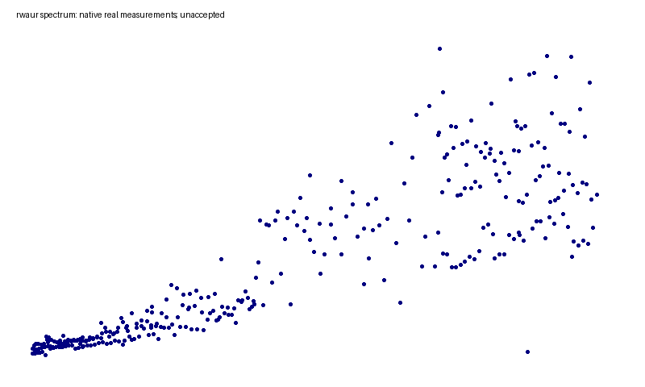

# G4b-repeat — INCONCLUSIVE (L3)

# Native target acceptance
Complete measurements and rejected frames:
```json
{
  "ra": 76.95654626058734,
  "dec": 30.401238860868116,
  "rows": [
    {
      "lam": 1.068110466003418,
      "dlam": 0.02883782982826233,
      "flux": 137241.03600468757,
      "err": 8204.64973676087,
      "mjd": 60919.420312786,
      "visit": "V1",
      "detector": 1,
      "flags": [
        "PERSIST",
        "SOURCE"
      ],
      "rchi2": 269.6364435084969,
      "contaminated": true,
      "release": "qr2",
      "quality": {
        "lam": 1.068110466003418,
        "dlam": 0.02883782982826233,
        "flux_uJy": 137241.03600468757,
        "err_uJy": 8204.64973676087,
        "stat_err_uJy": 7096.808123068727,
        "cal_err_uJy": 4117.2310801406275,
        "mjd": 60919.420312786,
        "detector": 1,
        "obsid": "2025W36_1A_0095_1",
        "rchi2": 269.6364435084969,
        "flags_near": [
          "PERSIST",
          "SOURCE"
        ],
        "wing_fit": true,
        "contaminated": true,
        "photometric_scale": "qr2",
        "blend_fit": false,
        "omega_arcsec2": 37.777706146240234,
        "zone": 43
      },
      "frame_id": "level2_2025W36_1A_0095_1D1_spx_l2b-v20-2025-271.fits"
    },
    {
      "lam": 3.649718999862671,
      "dlam": 0.10163342952728271,
      "flux": 2920055.7197882673,
      "err": 408901.09664189746,
      "mjd": 60919.420312798,
      "visit": "V1",
      "detector": 4,
      "flags": [
        "OVERFLOW",
        "SOURCE",
        "SUR_ERROR",
        "TRANSIENT"
      ],
      "rchi2": 707.7071820310517,
      "contaminated": true,
      "release": "qr2",
      "quality": {
        "lam": 3.649718999862671,
        "dlam": 0.10163342952728271,
        "flux_uJy": 2920055.7197882673,
        "err_uJy": 408901.09664189746,
        "stat_err_uJy": 399407.12808980385,
        "cal_err_uJy": 87601.67159364802,
        "mjd": 60919.420312798,
        "detector": 4,
        "obsid": "2025W36_1A_0095_1",
        "rchi2": 707.7071820310517,
        "flags_near": [
          "OVERFLOW",
          "SOURCE",
          "SUR_ERROR",
          "TRANSIENT"
        ],
        "wing_fit": true,
        "contaminated": true,
        "photometric_scale": "qr2",
        "blend_fit": false,
        "omega_arcsec2": 37.8385124206543,
        "zone": 43
      },
      "frame_id": "level2_2025W36_1A_0095_1D4_spx_l2b-v20-2025-271.fits"
    },
    {
      "lam": 1.093756914138794,
      "dlam": 0.02960258349776268,
      "flux": 146504.89815494497,
      "err": 9831.695680524772,
      "mjd": 60919.421805055,
      "visit": "V1",
      "detector": 1,
      "flags": [
        "SOURCE"
      ],
      "rchi2": 442.29805040491794,
      "contaminated": true,
      "release": "qr2",
      "quality": {
        "lam": 1.093756914138794,
        "dlam": 0.02960258349776268,
        "flux_uJy": 146504.89815494497,
        "err_uJy": 9831.695680524772,
        "stat_err_uJy": 8794.596255053313,
        "cal_err_uJy": 4395.146944648349,
        "mjd": 60919.421805055,
        "detector": 1,
        "obsid": "2025W36_1A_0095_2",
        "rchi2": 442.29805040491794,
        "flags_near": [
          "SOURCE"
        ],
        "wing_fit": false,
        "contaminated": true,
        "photometric_scale": "qr2",
        "blend_fit": false,
        "omega_arcsec2": 37.74681854248047,
        "zone": 22
      },
      "frame_id": "level2_2025W36_1A_0095_2D1_spx_l2b-v20-2025-271.fits"
    },
    {
      "lam": 3.7484912872314453,
      "dlam": 0.09999880939722061,
      "flux": 3024919.7660180707,
      "err": 377808.1861518535,
      "mjd": 60919.421805043,
      "visit": "V1",
      "detector": 4,
      "flags": [
        "OVERFLOW",
        "SOURCE",
        "SUR_ERROR",
        "TRANSIENT"
      ],
      "rchi2": 593.2246684989866,
      "contaminated": true,
      "release": "qr2",
      "quality": {
        "lam": 3.7484912872314453,
        "dlam": 0.09999880939722061,
        "flux_uJy": 3024919.7660180707,
        "err_uJy": 377808.1861518535,
        "stat_err_uJy": 366747.73331486515,
        "cal_err_uJy": 90747.59298054212,
        "mjd": 60919.421805043,
        "detector": 4,
        "obsid": "2025W36_1A_0095_2",
        "rchi2": 593.2246684989866,
        "flags_near": [
          "OVERFLOW",
          "SOURCE",
          "SUR_ERROR",
          "TRANSIENT"
        ],
        "wing_fit": true,
        "contaminated": true,
        "photometric_scale": "qr2",
        "blend_fit": false,
        "omega_arcsec2": 37.80501937866211,
        "zone": 22
      },
      "frame_id": "level2_2025W36_1A_0095_2D4_spx_l2b-v20-2025-271.fits"
    },
    {
      "lam": 1.1194452047348022,
      "dlam": 0.03028148040175438,
      "flux": 155567.8524775503,
      "err": 9073.005780749656,
      "mjd": 60919.687870495,
      "visit": "V1",
      "detector": 1,
      "flags": [
        "OVERFLOW",
        "SOURCE"
      ],
      "rchi2": 260.4704177523665,
      "contaminated": true,
      "release": "qr2",
      "quality": {
        "lam": 1.1194452047348022,
        "dlam": 0.03028148040175438,
        "flux_uJy": 155567.8524775503,
        "err_uJy": 9073.005780749656,
        "stat_err_uJy": 7780.630620038937,
        "cal_err_uJy": 4667.035574326509,
        "mjd": 60919.687870495,
        "detector": 1,
        "obsid": "2025W36_1A_0155_1",
        "rchi2": 260.4704177523665,
        "flags_near": [
          "OVERFLOW",
          "SOURCE"
        ],
        "wing_fit": false,
        "contaminated": true,
        "photometric_scale": "qr2",
        "blend_fit": false,
        "omega_arcsec2": 37.71725845336914,
        "zone": 1
      },
      "frame_id": "level2_2025W36_1A_0155_1D1_spx_l2b-v20-2025-271.fits"
    },
    {
      "lam": 3.850066900253296,
      "dlam": 0.10068311542272568,
      "flux": 3191202.5074786847,
      "err": 851872.5885697758,
      "mjd": 60919.687870495,
      "visit": "V1",
      "detector": 4,
      "flags": [
        "OVERFLOW",
        "SOURCE",
        "SUR_ERROR",
        "TRANSIENT"
      ],
      "rchi2": 6715.749773851274,
      "contaminated": true,
      "release": "qr2",
      "quality": {
        "lam": 3.850066900253296,
        "dlam": 0.10068311542272568,
        "flux_uJy": 3191202.5074786847,
        "err_uJy": 851872.5885697758,
        "stat_err_uJy": 846475.9364903447,
        "cal_err_uJy": 95736.07522436054,
        "mjd": 60919.687870495,
        "detector": 4,
        "obsid": "2025W36_1A_0155_1",
        "rchi2": 6715.749773851274,
        "flags_near": [
          "OVERFLOW",
          "SOURCE",
          "SUR_ERROR",
          "TRANSIENT"
        ],
        "wing_fit": true,
        "contaminated": true,
        "photometric_scale": "qr2",
        "blend_fit": false,
        "omega_arcsec2": 37.77268981933594,
        "zone": 1
      },
      "frame_id": "level2_2025W36_1A_0155_1D4_spx_l2b-v20-2025-271.fits"
    },
    {
      "lam": 0.7467580437660217,
      "dlam": 0.01763565093278885,
      "flux": 77473.21420644237,
      "err": 3735.3958348691494,
      "mjd": 60920.030804835,
      "visit": "V1",
      "detector": 1,
      "flags": [
        "SOURCE"
      ],
      "rchi2": 78.77010669027923,
      "contaminated": false,
      "release": "qr2",
      "quality": {
        "lam": 0.7467580437660217,
        "dlam": 0.01763565093278885,
        "flux_uJy": 77473.21420644237,
        "err_uJy": 3735.3958348691494,
        "stat_err_uJy": 2924.2593960912936,
        "cal_err_uJy": 2324.196426193271,
        "mjd": 60920.030804835,
        "detector": 1,
        "obsid": "2025W36_1A_0233_2",
        "rchi2": 78.77010669027923,
        "flags_near": [
          "SOURCE"
        ],
        "wing_fit": false,
        "contaminated": false,
        "photometric_scale": "qr2",
        "blend_fit": false,
        "omega_arcsec2": 38.32508850097656,
        "zone": 421
      },
      "frame_id": "level2_2025W36_1A_0233_2D1_spx_l2b-v20-2025-271.fits"
    },
    {
      "lam": 2.4349164962768555,
      "dlam": 0.04734408110380173,
      "flux": 984806.4776991243,
      "err": 65480.13668940811,
      "mjd": 60920.030804823,
      "visit": "V1",
      "detector": 4,
      "flags": [
        "OVERFLOW",
        "SOURCE"
      ],
      "rchi2": 1000.3556370649368,
      "contaminated": true,
      "release": "qr2",
      "quality": {
        "lam": 2.4349164962768555,
        "dlam": 0.04734408110380173,
        "flux_uJy": 984806.4776991243,
        "err_uJy": 65480.13668940811,
        "stat_err_uJy": 58436.194966794596,
        "cal_err_uJy": 29544.194330973725,
        "mjd": 60920.030804823,
        "detector": 4,
        "obsid": "2025W36_1A_0233_2",
        "rchi2": 1000.3556370649368,
        "flags_near": [
          "OVERFLOW",
          "SOURCE"
        ],
        "wing_fit": false,
        "contaminated": true,
        "photometric_scale": "qr2",
        "blend_fit": false,
        "omega_arcsec2": 38.40157699584961,
        "zone": 422
      },
      "frame_id": "level2_2025W36_1A_0233_2D4_spx_l2b-v20-2025-271.fits"
    },
    {
      "lam": 0.7639217972755432,
      "dlam": 0.01866561733186245,
      "flux": 74068.41647457989,
      "err": 4267.23308860454,
      "mjd": 60920.03229708,
      "visit": "V1",
      "detector": 1,
      "flags": [
        "SOURCE"
      ],
      "rchi2": 133.98243477444652,
      "contaminated": false,
      "release": "qr2",
      "quality": {
        "lam": 0.7639217972755432,
        "dlam": 0.01866561733186245,
        "flux_uJy": 74068.41647457989,
        "err_uJy": 4267.23308860454,
        "stat_err_uJy": 3643.042814095768,
        "cal_err_uJy": 2222.052494237397,
        "mjd": 60920.03229708,
        "detector": 1,
        "obsid": "2025W36_1A_0233_3",
        "rchi2": 133.98243477444652,
        "flags_near": [
          "SOURCE"
        ],
        "wing_fit": false,
        "contaminated": false,
        "photometric_scale": "qr2",
        "blend_fit": false,
        "omega_arcsec2": 38.28483963012695,
        "zone": 400
      },
      "frame_id": "level2_2025W36_1A_0233_3D1_spx_l2b-v20-2025-271.fits"
    },
    {
      "lam": 2.4875500202178955,
      "dlam": 0.07253755629062653,
      "flux": 651158.4965145752,
      "err": 92676.78095540273,
      "mjd": 60920.032297069,
      "visit": "V1",
      "detector": 4,
      "flags": [
        "OVERFLOW",
        "SOURCE",
        "SUR_ERROR",
        "TRANSIENT"
      ],
      "rchi2": 3458.9959092115573,
      "contaminated": true,
      "release": "qr2",
      "quality": {
        "lam": 2.4875500202178955,
        "dlam": 0.07253755629062653,
        "flux_uJy": 651158.4965145752,
        "err_uJy": 92676.78095540273,
        "stat_err_uJy": 90594.58636933494,
        "cal_err_uJy": 19534.754895437254,
        "mjd": 60920.032297069,
        "detector": 4,
        "obsid": "2025W36_1A_0233_3",
        "rchi2": 3458.9959092115573,
        "flags_near": [
          "OVERFLOW",
          "SOURCE",
          "SUR_ERROR",
          "TRANSIENT"
        ],
        "wing_fit": true,
        "contaminated": true,
        "photometric_scale": "qr2",
        "blend_fit": false,
        "omega_arcsec2": 38.36172103881836,
        "zone": 400
      },
      "frame_id": "level2_2025W36_1A_0233_3D4_spx_l2b-v20-2025-271.fits"
    },
    {
      "lam": 0.7819662690162659,
      "dlam": 0.0189242884516716,
      "flux": 83145.99674765652,
      "err": 5360.88012196144,
      "mjd": 60920.978031166,
      "visit": "V1",
      "detector": 1,
      "flags": [
        "SOURCE"
      ],
      "rchi2": 200.6759248885196,
      "contaminated": false,
      "release": "qr2",
      "quality": {
        "lam": 0.7819662690162659,
        "dlam": 0.0189242884516716,
        "flux_uJy": 83145.99674765652,
        "err_uJy": 5360.88012196144,
        "stat_err_uJy": 4745.219129228504,
        "cal_err_uJy": 2494.3799024296954,
        "mjd": 60920.978031166,
        "detector": 1,
        "obsid": "2025W36_1A_0446_1",
        "rchi2": 200.6759248885196,
        "flags_near": [
          "SOURCE"
        ],
        "wing_fit": false,
        "contaminated": false,
        "photometric_scale": "qr2",
        "blend_fit": false,
        "omega_arcsec2": 38.245460510253906,
        "zone": 379
      },
      "frame_id": "level2_2025W36_1A_0446_1D1_spx_l2b-v20-2025-271.fits"
    },
    {
      "lam": 2.5553531646728516,
      "dlam": 0.0747031420469284,
      "flux": 919032.9651497833,
      "err": 113120.88196485236,
      "mjd": 60920.978031166,
      "visit": "V1",
      "detector": 4,
      "flags": [
        "NONFUNC",
        "OVERFLOW",
        "PERSIST",
        "SOURCE",
        "SUR_ERROR",
        "TRANSIENT"
      ],
      "rchi2": 954.1361585473147,
      "contaminated": true,
      "release": "qr2",
      "quality": {
        "lam": 2.5553531646728516,
        "dlam": 0.0747031420469284,
        "flux_uJy": 919032.9651497833,
        "err_uJy": 113120.88196485236,
        "stat_err_uJy": 109709.50052104538,
        "cal_err_uJy": 27570.9889544935,
        "mjd": 60920.978031166,
        "detector": 4,
        "obsid": "2025W36_1A_0446_1",
        "rchi2": 954.1361585473147,
        "flags_near": [
          "NONFUNC",
          "OVERFLOW",
          "PERSIST",
          "SOURCE",
          "SUR_ERROR",
          "TRANSIENT"
        ],
        "wing_fit": true,
        "contaminated": true,
        "photometric_scale": "qr2",
        "blend_fit": false,
        "omega_arcsec2": 38.32272720336914,
        "zone": 379
      },
      "frame_id": "level2_2025W36_1A_0446_1D4_spx_l2b-v20-2025-271.fits"
    },
    {
      "lam": 0.800440788269043,
      "dlam": 0.019376475363969803,
      "flux": 92242.57921536465,
      "err": 5430.218926368072,
      "mjd": 60920.979523423,
      "visit": "V1",
      "detector": 1,
      "flags": [
        "SOURCE",
        "SUR_ERROR",
        "TRANSIENT"
      ],
      "rchi2": 187.79605224667569,
      "contaminated": true,
      "release": "qr2",
      "quality": {
        "lam": 0.800440788269043,
        "dlam": 0.019376475363969803,
        "flux_uJy": 92242.57921536465,
        "err_uJy": 5430.218926368072,
        "stat_err_uJy": 4672.200071702139,
        "cal_err_uJy": 2767.277376460939,
        "mjd": 60920.979523423,
        "detector": 1,
        "obsid": "2025W36_1A_0446_2",
        "rchi2": 187.79605224667569,
        "flags_near": [
          "SOURCE",
          "SUR_ERROR",
          "TRANSIENT"
        ],
        "wing_fit": true,
        "contaminated": true,
        "photometric_scale": "qr2",
        "blend_fit": false,
        "omega_arcsec2": 38.2064208984375,
        "zone": 358
      },
      "frame_id": "level2_2025W36_1A_0446_2D1_spx_l2b-v20-2025-271.fits"
    },
    {
      "lam": 2.6245970726013184,
      "dlam": 0.07518219202756882,
      "flux": 1027587.126494926,
      "err": 79629.12941128417,
      "mjd": 60920.979523423,
      "visit": "V1",
      "detector": 4,
      "flags": [
        "OVERFLOW",
        "SOURCE",
        "SUR_ERROR",
        "TRANSIENT"
      ],
      "rchi2": 601.4833177082801,
      "contaminated": true,
      "release": "qr2",
      "quality": {
        "lam": 2.6245970726013184,
        "dlam": 0.07518219202756882,
        "flux_uJy": 1027587.126494926,
        "err_uJy": 79629.12941128417,
        "stat_err_uJy": 73419.72812885343,
        "cal_err_uJy": 30827.61379484778,
        "mjd": 60920.979523423,
        "detector": 4,
        "obsid": "2025W36_1A_0446_2",
        "rchi2": 601.4833177082801,
        "flags_near": [
          "OVERFLOW",
          "SOURCE",
          "SUR_ERROR",
          "TRANSIENT"
        ],
        "wing_fit": true,
        "contaminated": true,
        "photometric_scale": "qr2",
        "blend_fit": false,
        "omega_arcsec2": 38.28314208984375,
        "zone": 337
      },
      "frame_id": "level2_2025W36_1A_0446_2D4_spx_l2b-v20-2025-271.fits"
    },
    {
      "lam": 0.8192868232727051,
      "dlam": 0.020371420308947563,
      "flux": 101122.84709957193,
      "err": 5583.378023705404,
      "mjd": 60920.98101568,
      "visit": "V1",
      "detector": 1,
      "flags": [
        "SOURCE"
      ],
      "rchi2": 175.20472684435163,
      "contaminated": false,
      "release": "qr2",
      "quality": {
        "lam": 0.8192868232727051,
        "dlam": 0.020371420308947563,
        "flux_uJy": 101122.84709957193,
        "err_uJy": 5583.378023705404,
        "stat_err_uJy": 4687.308712963699,
        "cal_err_uJy": 3033.6854129871576,
        "mjd": 60920.98101568,
        "detector": 1,
        "obsid": "2025W36_1A_0446_3",
        "rchi2": 175.20472684435163,
        "flags_near": [
          "SOURCE"
        ],
        "wing_fit": false,
        "contaminated": false,
        "photometric_scale": "qr2",
        "blend_fit": false,
        "omega_arcsec2": 38.16819763183594,
        "zone": 316
      },
      "frame_id": "level2_2025W36_1A_0446_3D1_spx_l2b-v20-2025-271.fits"
    },
    {
      "lam": 2.6954777240753174,
      "dlam": 0.07617326080799103,
      "flux": 668575.2889743439,
      "err": 98391.06557809755,
      "mjd": 60920.981015692,
      "visit": "V1",
      "detector": 4,
      "flags": [
        "OVERFLOW",
        "SOURCE",
        "SUR_ERROR",
        "TRANSIENT"
      ],
      "rchi2": 1281.6182324500296,
      "contaminated": true,
      "release": "qr2",
      "quality": {
        "lam": 2.6954777240753174,
        "dlam": 0.07617326080799103,
        "flux_uJy": 668575.2889743439,
        "err_uJy": 98391.06557809755,
        "stat_err_uJy": 96325.01315997355,
        "cal_err_uJy": 20057.258669230316,
        "mjd": 60920.981015692,
        "detector": 4,
        "obsid": "2025W36_1A_0446_3",
        "rchi2": 1281.6182324500296,
        "flags_near": [
          "OVERFLOW",
          "SOURCE",
          "SUR_ERROR",
          "TRANSIENT"
        ],
        "wing_fit": true,
        "contaminated": true,
        "photometric_scale": "qr2",
        "blend_fit": false,
        "omega_arcsec2": 38.24455642700195,
        "zone": 316
      },
      "frame_id": "level2_2025W36_1A_0446_3D4_spx_l2b-v20-2025-271.fits"
    },
    {
      "lam": 0.838848352432251,
      "dlam": 0.020804233849048615,
      "flux": 63566.074949103735,
      "err": 4899.36097482139,
      "mjd": 60920.982507937,
      "visit": "V1",
      "detector": 1,
      "flags": [
        "SOURCE"
      ],
      "rchi2": 225.21395265729203,
      "contaminated": false,
      "release": "qr2",
      "quality": {
        "lam": 0.838848352432251,
        "dlam": 0.020804233849048615,
        "flux_uJy": 63566.074949103735,
        "err_uJy": 4899.36097482139,
        "stat_err_uJy": 4512.998633459934,
        "cal_err_uJy": 1906.982248473112,
        "mjd": 60920.982507937,
        "detector": 1,
        "obsid": "2025W36_1A_0446_4",
        "rchi2": 225.21395265729203,
        "flags_near": [
          "SOURCE"
        ],
        "wing_fit": false,
        "contaminated": false,
        "photometric_scale": "qr2",
        "blend_fit": false,
        "omega_arcsec2": 38.130252838134766,
        "zone": 295
      },
      "frame_id": "level2_2025W36_1A_0446_4D1_spx_l2b-v20-2025-271.fits"
    },
    {
      "lam": 2.767956495285034,
      "dlam": 0.07685364037752151,
      "flux": 1936666.596935262,
      "err": 253475.8816779648,
      "mjd": 60920.982507937,
      "visit": "V1",
      "detector": 4,
      "flags": [
        "OVERFLOW",
        "SOURCE",
        "SUR_ERROR",
        "TRANSIENT"
      ],
      "rchi2": 1090.97806663663,
      "contaminated": true,
      "release": "qr2",
      "quality": {
        "lam": 2.767956495285034,
        "dlam": 0.07685364037752151,
        "flux_uJy": 1936666.596935262,
        "err_uJy": 253475.8816779648,
        "stat_err_uJy": 246727.4059270783,
        "cal_err_uJy": 58099.997908057856,
        "mjd": 60920.982507937,
        "detector": 4,
        "obsid": "2025W36_1A_0446_4",
        "rchi2": 1090.97806663663,
        "flags_near": [
          "OVERFLOW",
          "SOURCE",
          "SUR_ERROR",
          "TRANSIENT"
        ],
        "wing_fit": true,
        "contaminated": true,
        "photometric_scale": "qr2",
        "blend_fit": false,
        "omega_arcsec2": 38.20640563964844,
        "zone": 295
      },
      "frame_id": "level2_2025W36_1A_0446_4D4_spx_l2b-v20-2025-271.fits"
    },
    {
      "lam": 0.8583781719207764,
      "dlam": 0.02096378616988659,
      "flux": 166385.1317900424,
      "err": 6556.466465546581,
      "mjd": 60921.724549245,
      "visit": "V1",
      "detector": 1,
      "flags": [
        "OVERFLOW",
        "SOURCE",
        "SUR_ERROR",
        "TRANSIENT"
      ],
      "rchi2": 59.81712997982927,
      "contaminated": true,
      "release": "qr2",
      "quality": {
        "lam": 0.8583781719207764,
        "dlam": 0.02096378616988659,
        "flux_uJy": 166385.1317900424,
        "err_uJy": 6556.466465546581,
        "stat_err_uJy": 4251.075351146586,
        "cal_err_uJy": 4991.553953701272,
        "mjd": 60921.724549245,
        "detector": 1,
        "obsid": "2025W36_1A_0606_1",
        "rchi2": 59.81712997982927,
        "flags_near": [
          "OVERFLOW",
          "SOURCE",
          "SUR_ERROR",
          "TRANSIENT"
        ],
        "wing_fit": true,
        "contaminated": true,
        "photometric_scale": "qr2",
        "blend_fit": false,
        "omega_arcsec2": 38.09387969970703,
        "zone": 274
      },
      "frame_id": "level2_2025W36_1A_0606_1D1_spx_l2b-v20-2025-271.fits"
    },
    {
      "lam": 2.843428373336792,
      "dlam": 0.08412986248731613,
      "flux": 2205299.8198440615,
      "err": 270626.6697777456,
      "mjd": 60921.724549256,
      "visit": "V1",
      "detector": 4,
      "flags": [
        "OVERFLOW",
        "SOURCE",
        "SUR_ERROR",
        "TRANSIENT"
      ],
      "rchi2": 551.6384051616909,
      "contaminated": true,
      "release": "qr2",
      "quality": {
        "lam": 2.843428373336792,
        "dlam": 0.08412986248731613,
        "flux_uJy": 2205299.8198440615,
        "err_uJy": 270626.6697777456,
        "stat_err_uJy": 262415.2850523939,
        "cal_err_uJy": 66158.99459532184,
        "mjd": 60921.724549256,
        "detector": 4,
        "obsid": "2025W36_1A_0606_1",
        "rchi2": 551.6384051616909,
        "flags_near": [
          "OVERFLOW",
          "SOURCE",
          "SUR_ERROR",
          "TRANSIENT"
        ],
        "wing_fit": true,
        "contaminated": true,
        "photometric_scale": "qr2",
        "blend_fit": false,
        "omega_arcsec2": 38.169559478759766,
        "zone": 274
      },
      "frame_id": "level2_2025W36_1A_0606_1D4_spx_l2b-v20-2025-271.fits"
    },
    {
      "lam": 0.8784726858139038,
      "dlam": 0.022778887301683426,
      "flux": 139804.77651639262,
      "err": 8329.668428538607,
      "mjd": 60921.726041513,
      "visit": "V1",
      "detector": 1,
      "flags": [
        "SOURCE"
      ],
      "rchi2": 312.5396570706498,
      "contaminated": false,
      "release": "qr2",
      "quality": {
        "lam": 0.8784726858139038,
        "dlam": 0.022778887301683426,
        "flux_uJy": 139804.77651639262,
        "err_uJy": 8329.668428538607,
        "stat_err_uJy": 7196.703283189755,
        "cal_err_uJy": 4194.143295491778,
        "mjd": 60921.726041513,
        "detector": 1,
        "obsid": "2025W36_1A_0606_2",
        "rchi2": 312.5396570706498,
        "flags_near": [
          "SOURCE"
        ],
        "wing_fit": false,
        "contaminated": false,
        "photometric_scale": "qr2",
        "blend_fit": false,
        "omega_arcsec2": 38.05730438232422,
        "zone": 253
      },
      "frame_id": "level2_2025W36_1A_0606_2D1_spx_l2b-v20-2025-271.fits"
    },
    {
      "lam": 2.920109510421753,
      "dlam": 0.08340442180633545,
      "flux": 1027095.6416453426,
      "err": 87109.59059810729,
      "mjd": 60921.726041513,
      "visit": "V1",
      "detector": 4,
      "flags": [
        "OVERFLOW",
        "SOURCE",
        "SUR_ERROR",
        "TRANSIENT"
      ],
      "rchi2": 782.4656938162816,
      "contaminated": true,
      "release": "qr2",
      "quality": {
        "lam": 2.920109510421753,
        "dlam": 0.08340442180633545,
        "flux_uJy": 1027095.6416453426,
        "err_uJy": 87109.59059810729,
        "stat_err_uJy": 81477.89800179978,
        "cal_err_uJy": 30812.869249360276,
        "mjd": 60921.726041513,
        "detector": 4,
        "obsid": "2025W36_1A_0606_2",
        "rchi2": 782.4656938162816,
        "flags_near": [
          "OVERFLOW",
          "SOURCE",
          "SUR_ERROR",
          "TRANSIENT"
        ],
        "wing_fit": true,
        "contaminated": true,
        "photometric_scale": "qr2",
        "blend_fit": false,
        "omega_arcsec2": 38.13173294067383,
        "zone": 253
      },
      "frame_id": "level2_2025W36_1A_0606_2D4_spx_l2b-v20-2025-271.fits"
    },
    {
      "lam": 0.899458646774292,
      "dlam": 0.023183012381196022,
      "flux": 144083.5717559263,
      "err": 9364.604217554775,
      "mjd": 60921.72753377,
      "visit": "V1",
      "detector": 1,
      "flags": [
        "OVERFLOW",
        "SOURCE"
      ],
      "rchi2": 328.0974750017101,
      "contaminated": true,
      "release": "qr2",
      "quality": {
        "lam": 0.899458646774292,
        "dlam": 0.023183012381196022,
        "flux_uJy": 144083.5717559263,
        "err_uJy": 9364.604217554775,
        "stat_err_uJy": 8307.330742572734,
        "cal_err_uJy": 4322.507152677789,
        "mjd": 60921.72753377,
        "detector": 1,
        "obsid": "2025W36_1A_0606_3",
        "rchi2": 328.0974750017101,
        "flags_near": [
          "OVERFLOW",
          "SOURCE"
        ],
        "wing_fit": false,
        "contaminated": true,
        "photometric_scale": "qr2",
        "blend_fit": false,
        "omega_arcsec2": 38.02103805541992,
        "zone": 232
      },
      "frame_id": "level2_2025W36_1A_0606_3D1_spx_l2b-v20-2025-271.fits"
    },
    {
      "lam": 2.9997060298919678,
      "dlam": 0.08623197674751282,
      "flux": 1613901.8788570205,
      "err": 282673.20956059947,
      "mjd": 60921.72753377,
      "visit": "V1",
      "detector": 4,
      "flags": [
        "OVERFLOW",
        "SOURCE",
        "SUR_ERROR",
        "TRANSIENT"
      ],
      "rchi2": 1572.5277789639676,
      "contaminated": true,
      "release": "qr2",
      "quality": {
        "lam": 2.9997060298919678,
        "dlam": 0.08623197674751282,
        "flux_uJy": 1613901.8788570205,
        "err_uJy": 282673.20956059947,
        "stat_err_uJy": 278495.83848986,
        "cal_err_uJy": 48417.05636571061,
        "mjd": 60921.72753377,
        "detector": 4,
        "obsid": "2025W36_1A_0606_3",
        "rchi2": 1572.5277789639676,
        "flags_near": [
          "OVERFLOW",
          "SOURCE",
          "SUR_ERROR",
          "TRANSIENT"
        ],
        "wing_fit": true,
        "contaminated": true,
        "photometric_scale": "qr2",
        "blend_fit": false,
        "omega_arcsec2": 38.094688415527344,
        "zone": 232
      },
      "frame_id": "level2_2025W36_1A_0606_3D4_spx_l2b-v20-2025-271.fits"
    },
    {
      "lam": 0.9207496047019958,
      "dlam": 0.023573633283376694,
      "flux": 152178.98814056115,
      "err": 9762.908544977787,
      "mjd": 60921.729026027,
      "visit": "V1",
      "detector": 1,
      "flags": [
        "OVERFLOW",
        "SOURCE"
      ],
      "rchi2": 361.61328076513996,
      "contaminated": true,
      "release": "qr2",
      "quality": {
        "lam": 0.9207496047019958,
        "dlam": 0.023573633283376694,
        "flux_uJy": 152178.98814056115,
        "err_uJy": 9762.908544977787,
        "stat_err_uJy": 8629.703544691656,
        "cal_err_uJy": 4565.369644216835,
        "mjd": 60921.729026027,
        "detector": 1,
        "obsid": "2025W36_1A_0606_4",
        "rchi2": 361.61328076513996,
        "flags_near": [
          "OVERFLOW",
          "SOURCE"
        ],
        "wing_fit": false,
        "contaminated": true,
        "photometric_scale": "qr2",
        "blend_fit": false,
        "omega_arcsec2": 37.98561096191406,
        "zone": 211
      },
      "frame_id": "level2_2025W36_1A_0606_4D1_spx_l2b-v20-2025-271.fits"
    },
    {
      "lam": 3.0823960304260254,
      "dlam": 0.09207130968570709,
      "flux": 1255927.8382257046,
      "err": 210761.57904976216,
      "mjd": 60921.729026027,
      "visit": "V1",
      "detector": 4,
      "flags": [
        "OVERFLOW",
        "SOURCE",
        "SUR_ERROR",
        "TRANSIENT"
      ],
      "rchi2": 1248.562039409819,
      "contaminated": true,
      "release": "qr2",
      "quality": {
        "lam": 3.0823960304260254,
        "dlam": 0.09207130968570709,
        "flux_uJy": 1255927.8382257046,
        "err_uJy": 210761.57904976216,
        "stat_err_uJy": 207366.400224824,
        "cal_err_uJy": 37677.83514677114,
        "mjd": 60921.729026027,
        "detector": 4,
        "obsid": "2025W36_1A_0606_4",
        "rchi2": 1248.562039409819,
        "flags_near": [
          "OVERFLOW",
          "SOURCE",
          "SUR_ERROR",
          "TRANSIENT"
        ],
        "wing_fit": true,
        "contaminated": true,
        "photometric_scale": "qr2",
        "blend_fit": false,
        "omega_arcsec2": 38.0579833984375,
        "zone": 190
      },
      "frame_id": "level2_2025W36_1A_0606_4D4_spx_l2b-v20-2025-271.fits"
    },
    {
      "lam": 0.9721718430519104,
      "dlam": 0.024999620392918587,
      "flux": 156581.91466219892,
      "err": 10089.886781036366,
      "mjd": 60921.996175113,
      "visit": "V1",
      "detector": 1,
      "flags": [
        "OVERFLOW",
        "SOURCE"
      ],
      "rchi2": 365.6886108476112,
      "contaminated": true,
      "release": "qr2",
      "quality": {
        "lam": 0.9721718430519104,
        "dlam": 0.024999620392918587,
        "flux_uJy": 156581.91466219892,
        "err_uJy": 10089.886781036366,
        "stat_err_uJy": 8929.709337642536,
        "cal_err_uJy": 4697.457439865967,
        "mjd": 60921.996175113,
        "detector": 1,
        "obsid": "2025W36_1A_0663_1",
        "rchi2": 365.6886108476112,
        "flags_near": [
          "OVERFLOW",
          "SOURCE"
        ],
        "wing_fit": false,
        "contaminated": true,
        "photometric_scale": "qr2",
        "blend_fit": false,
        "omega_arcsec2": 37.906761169433594,
        "zone": 148
      },
      "frame_id": "level2_2025W36_1A_0663_1D1_spx_l2b-v20-2025-271.fits"
    },
    {
      "lam": 3.2803876399993896,
      "dlam": 0.09233950078487396,
      "flux": 1851688.0978115364,
      "err": 248128.69681159308,
      "mjd": 60921.996175113,
      "visit": "V1",
      "detector": 4,
      "flags": [
        "OVERFLOW",
        "SOURCE",
        "SUR_ERROR",
        "TRANSIENT"
      ],
      "rchi2": 722.5003710722284,
      "contaminated": true,
      "release": "qr2",
      "quality": {
        "lam": 3.2803876399993896,
        "dlam": 0.09233950078487396,
        "flux_uJy": 1851688.0978115364,
        "err_uJy": 248128.69681159308,
        "stat_err_uJy": 241830.4700632248,
        "cal_err_uJy": 55550.64293434609,
        "mjd": 60921.996175113,
        "detector": 4,
        "obsid": "2025W36_1A_0663_1",
        "rchi2": 722.5003710722284,
        "flags_near": [
          "OVERFLOW",
          "SOURCE",
          "SUR_ERROR",
          "TRANSIENT"
        ],
        "wing_fit": true,
        "contaminated": true,
        "photometric_scale": "qr2",
        "blend_fit": false,
        "omega_arcsec2": 37.976009368896484,
        "zone": 148
      },
      "frame_id": "level2_2025W36_1A_0663_1D4_spx_l2b-v20-2025-271.fits"
    },
    {
      "lam": 0.995485782623291,
      "dlam": 0.02571297623217106,
      "flux": 166325.75582635336,
      "err": 11017.559512791173,
      "mjd": 60921.99766737,
      "visit": "V1",
      "detector": 1,
      "flags": [
        "SOURCE"
      ],
      "rchi2": 472.9148303806293,
      "contaminated": false,
      "release": "qr2",
      "quality": {
        "lam": 0.995485782623291,
        "dlam": 0.02571297623217106,
        "flux_uJy": 166325.75582635336,
        "err_uJy": 11017.559512791173,
        "stat_err_uJy": 9822.870571875023,
        "cal_err_uJy": 4989.772674790601,
        "mjd": 60921.99766737,
        "detector": 1,
        "obsid": "2025W36_1A_0663_2",
        "rchi2": 472.9148303806293,
        "flags_near": [
          "SOURCE"
        ],
        "wing_fit": false,
        "contaminated": false,
        "photometric_scale": "qr2",
        "blend_fit": false,
        "omega_arcsec2": 37.87326431274414,
        "zone": 127
      },
      "frame_id": "level2_2025W36_1A_0663_2D1_spx_l2b-v20-2025-271.fits"
    },
    {
      "lam": 3.3696467876434326,
      "dlam": 0.09770358353853226,
      "flux": 1609139.331996116,
      "err": 295818.73946336267,
      "mjd": 60921.99766737,
      "visit": "V1",
      "detector": 4,
      "flags": [
        "OVERFLOW",
        "SOURCE",
        "SUR_ERROR",
        "TRANSIENT"
      ],
      "rchi2": 1129.7057559436068,
      "contaminated": true,
      "release": "qr2",
      "quality": {
        "lam": 3.3696467876434326,
        "dlam": 0.09770358353853226,
        "flux_uJy": 1609139.331996116,
        "err_uJy": 295818.73946336267,
        "stat_err_uJy": 291853.2682134871,
        "cal_err_uJy": 48274.179959883484,
        "mjd": 60921.99766737,
        "detector": 4,
        "obsid": "2025W36_1A_0663_2",
        "rchi2": 1129.7057559436068,
        "flags_near": [
          "OVERFLOW",
          "SOURCE",
          "SUR_ERROR",
          "TRANSIENT"
        ],
        "wing_fit": true,
        "contaminated": true,
        "photometric_scale": "qr2",
        "blend_fit": false,
        "omega_arcsec2": 37.94062423706055,
        "zone": 127
      },
      "frame_id": "level2_2025W36_1A_0663_2D4_spx_l2b-v20-2025-271.fits"
    },
    {
      "lam": 1.0191547870635986,
      "dlam": 0.02718864195048809,
      "flux": 178673.0043889382,
      "err": 9708.318564884572,
      "mjd": 60921.999159627,
      "visit": "V1",
      "detector": 1,
      "flags": [
        "OVERFLOW",
        "SOURCE"
      ],
      "rchi2": 294.7042750138001,
      "contaminated": true,
      "release": "qr2",
      "quality": {
        "lam": 1.0191547870635986,
        "dlam": 0.02718864195048809,
        "flux_uJy": 178673.0043889382,
        "err_uJy": 9708.318564884572,
        "stat_err_uJy": 8094.430870027234,
        "cal_err_uJy": 5360.190131668146,
        "mjd": 60921.999159627,
        "detector": 1,
        "obsid": "2025W36_1A_0663_3",
        "rchi2": 294.7042750138001,
        "flags_near": [
          "OVERFLOW",
          "SOURCE"
        ],
        "wing_fit": false,
        "contaminated": true,
        "photometric_scale": "qr2",
        "blend_fit": false,
        "omega_arcsec2": 37.84041976928711,
        "zone": 85
      },
      "frame_id": "level2_2025W36_1A_0663_3D1_spx_l2b-v20-2025-271.fits"
    },
    {
      "lam": 3.460986852645874,
      "dlam": 0.09870902448892593,
      "flux": 2581730.1563385134,
      "err": 370756.20238344866,
      "mjd": 60921.999159627,
      "visit": "V1",
      "detector": 4,
      "flags": [
        "OVERFLOW",
        "SOURCE",
        "SUR_ERROR",
        "TRANSIENT"
      ],
      "rchi2": 826.2810449653252,
      "contaminated": true,
      "release": "qr2",
      "quality": {
        "lam": 3.460986852645874,
        "dlam": 0.09870902448892593,
        "flux_uJy": 2581730.1563385134,
        "err_uJy": 370756.20238344866,
        "stat_err_uJy": 362576.0114316222,
        "cal_err_uJy": 77451.9046901554,
        "mjd": 60921.999159627,
        "detector": 4,
        "obsid": "2025W36_1A_0663_3",
        "rchi2": 826.2810449653252,
        "flags_near": [
          "OVERFLOW",
          "SOURCE",
          "SUR_ERROR",
          "TRANSIENT"
        ],
        "wing_fit": true,
        "contaminated": true,
        "photometric_scale": "qr2",
        "blend_fit": false,
        "omega_arcsec2": 37.905914306640625,
        "zone": 85
      },
      "frame_id": "level2_2025W36_1A_0663_3D4_spx_l2b-v20-2025-271.fits"
    },
    {
      "lam": 1.0433956384658813,
      "dlam": 0.027614984661340714,
      "flux": 178435.37719934373,
      "err": 12263.099771242269,
      "mjd": 60922.000651895,
      "visit": "V1",
      "detector": 1,
      "flags": [
        "OVERFLOW",
        "SOURCE"
      ],
      "rchi2": 543.8719699670226,
      "contaminated": true,
      "release": "qr2",
      "quality": {
        "lam": 1.0433956384658813,
        "dlam": 0.027614984661340714,
        "flux_uJy": 178435.37719934373,
        "err_uJy": 12263.099771242269,
        "stat_err_uJy": 11033.05717137355,
        "cal_err_uJy": 5353.0613159803115,
        "mjd": 60922.000651895,
        "detector": 1,
        "obsid": "2025W36_1A_0663_4",
        "rchi2": 543.8719699670226,
        "flags_near": [
          "OVERFLOW",
          "SOURCE"
        ],
        "wing_fit": false,
        "contaminated": true,
        "photometric_scale": "qr2",
        "blend_fit": false,
        "omega_arcsec2": 37.80842971801758,
        "zone": 64
      },
      "frame_id": "level2_2025W36_1A_0663_4D1_spx_l2b-v20-2025-271.fits"
    },
    {
      "lam": 3.554124593734741,
      "dlam": 0.09904508292675018,
      "flux": 2107554.805620675,
      "err": 361281.2088525769,
      "mjd": 60922.000651895,
      "visit": "V1",
      "detector": 4,
      "flags": [
        "OVERFLOW",
        "SOURCE",
        "SUR_ERROR",
        "TRANSIENT"
      ],
      "rchi2": 890.9173705622349,
      "contaminated": true,
      "release": "qr2",
      "quality": {
        "lam": 3.554124593734741,
        "dlam": 0.09904508292675018,
        "flux_uJy": 2107554.805620675,
        "err_uJy": 361281.2088525769,
        "stat_err_uJy": 355705.6414187916,
        "cal_err_uJy": 63226.644168620245,
        "mjd": 60922.000651895,
        "detector": 4,
        "obsid": "2025W36_1A_0663_4",
        "rchi2": 890.9173705622349,
        "flags_near": [
          "OVERFLOW",
          "SOURCE",
          "SUR_ERROR",
          "TRANSIENT"
        ],
        "wing_fit": true,
        "contaminated": true,
        "photometric_scale": "qr2",
        "blend_fit": false,
        "omega_arcsec2": 37.871673583984375,
        "zone": 64
      },
      "frame_id": "level2_2025W36_1A_0663_4D4_spx_l2b-v20-2025-271.fits"
    },
    {
      "lam": 0.9429052472114563,
      "dlam": 0.023939603939652443,
      "flux": 157590.16008518077,
      "err": 7901.396521444761,
      "mjd": 60922.067199337,
      "visit": "V1",
      "detector": 1,
      "flags": [
        "SOURCE"
      ],
      "rchi2": 210.7954141021349,
      "contaminated": false,
      "release": "qr2",
      "quality": {
        "lam": 0.9429052472114563,
        "dlam": 0.023939603939652443,
        "flux_uJy": 157590.16008518077,
        "err_uJy": 7901.396521444761,
        "stat_err_uJy": 6330.945765759943,
        "cal_err_uJy": 4727.704802555423,
        "mjd": 60922.067199337,
        "detector": 1,
        "obsid": "2025W36_1A_0677_1",
        "rchi2": 210.7954141021349,
        "flags_near": [
          "SOURCE"
        ],
        "wing_fit": false,
        "contaminated": false,
        "photometric_scale": "qr2",
        "blend_fit": false,
        "omega_arcsec2": 37.95144271850586,
        "zone": 169
      },
      "frame_id": "level2_2025W36_1A_0677_1D1_spx_l2b-v20-2025-271.fits"
    },
    {
      "lam": 3.1681735515594482,
      "dlam": 0.09083370119333267,
      "flux": 1851781.4582092252,
      "err": 192012.78740298696,
      "mjd": 60922.067199349,
      "visit": "V1",
      "detector": 4,
      "flags": [
        "OVERFLOW",
        "SOURCE",
        "SUR_ERROR",
        "TRANSIENT"
      ],
      "rchi2": 490.1334997420976,
      "contaminated": true,
      "release": "qr2",
      "quality": {
        "lam": 3.1681735515594482,
        "dlam": 0.09083370119333267,
        "flux_uJy": 1851781.4582092252,
        "err_uJy": 192012.78740298696,
        "stat_err_uJy": 183800.7764243501,
        "cal_err_uJy": 55553.44374627675,
        "mjd": 60922.067199349,
        "detector": 4,
        "obsid": "2025W36_1A_0677_1",
        "rchi2": 490.1334997420976,
        "flags_near": [
          "OVERFLOW",
          "SOURCE",
          "SUR_ERROR",
          "TRANSIENT"
        ],
        "wing_fit": true,
        "contaminated": true,
        "photometric_scale": "qr2",
        "blend_fit": false,
        "omega_arcsec2": 38.02289962768555,
        "zone": 169
      },
      "frame_id": "level2_2025W36_1A_0677_1D4_spx_l2b-v20-2025-271.fits"
    },
    {
      "lam": 0.9649794697761536,
      "dlam": 0.02479257993400097,
      "flux": 156126.58459877296,
      "err": 9358.535744021248,
      "mjd": 60922.068691594,
      "visit": "V1",
      "detector": 1,
      "flags": [
        "SOURCE"
      ],
      "rchi2": 352.7225557073424,
      "contaminated": false,
      "release": "qr2",
      "quality": {
        "lam": 0.9649794697761536,
        "dlam": 0.02479257993400097,
        "flux_uJy": 156126.58459877296,
        "err_uJy": 9358.535744021248,
        "stat_err_uJy": 8102.112804416716,
        "cal_err_uJy": 4683.797537963189,
        "mjd": 60922.068691594,
        "detector": 1,
        "obsid": "2025W36_1A_0677_2",
        "rchi2": 352.7225557073424,
        "flags_near": [
          "SOURCE"
        ],
        "wing_fit": false,
        "contaminated": false,
        "photometric_scale": "qr2",
        "blend_fit": false,
        "omega_arcsec2": 37.91740036010742,
        "zone": 148
      },
      "frame_id": "level2_2025W36_1A_0677_2D1_spx_l2b-v20-2025-271.fits"
    },
    {
      "lam": 3.2531352043151855,
      "dlam": 0.09403770416975021,
      "flux": 903001.4128285284,
      "err": 124238.92865421166,
      "mjd": 60922.068691594,
      "visit": "V1",
      "detector": 4,
      "flags": [
        "OVERFLOW",
        "SOURCE",
        "SUR_ERROR",
        "TRANSIENT"
      ],
      "rchi2": 909.1276760151101,
      "contaminated": true,
      "release": "qr2",
      "quality": {
        "lam": 3.2531352043151855,
        "dlam": 0.09403770416975021,
        "flux_uJy": 903001.4128285284,
        "err_uJy": 124238.92865421166,
        "stat_err_uJy": 121249.4989545648,
        "cal_err_uJy": 27090.042384855853,
        "mjd": 60922.068691594,
        "detector": 4,
        "obsid": "2025W36_1A_0677_2",
        "rchi2": 909.1276760151101,
        "flags_near": [
          "OVERFLOW",
          "SOURCE",
          "SUR_ERROR",
          "TRANSIENT"
        ],
        "wing_fit": true,
        "contaminated": true,
        "photometric_scale": "qr2",
        "blend_fit": false,
        "omega_arcsec2": 37.986900329589844,
        "zone": 148
      },
      "frame_id": "level2_2025W36_1A_0677_2D4_spx_l2b-v20-2025-271.fits"
    },
    {
      "lam": 1.4405478239059448,
      "dlam": 0.0353567935526371,
      "flux": 231704.89688195824,
      "err": 11369.322985121034,
      "mjd": 60926.275801849,
      "visit": "V1",
      "detector": 2,
      "flags": [
        "OVERFLOW",
        "SOURCE",
        "SUR_ERROR",
        "TRANSIENT"
      ],
      "rchi2": 182.1160910542798,
      "contaminated": true,
      "release": "qr2",
      "quality": {
        "lam": 1.4405478239059448,
        "dlam": 0.0353567935526371,
        "flux_uJy": 231704.89688195824,
        "err_uJy": 11369.322985121034,
        "stat_err_uJy": 8996.83621195976,
        "cal_err_uJy": 6951.146906458747,
        "mjd": 60926.275801849,
        "detector": 2,
        "obsid": "2025W37_1A_0068_1",
        "rchi2": 182.1160910542798,
        "flags_near": [
          "OVERFLOW",
          "SOURCE",
          "SUR_ERROR",
          "TRANSIENT"
        ],
        "wing_fit": true,
        "contaminated": true,
        "photometric_scale": "qr2",
        "blend_fit": false,
        "omega_arcsec2": 37.605899810791016,
        "zone": 165
      },
      "frame_id": "level2_2025W37_1A_0068_1D2_spx_l2b-v20-2025-272.fits"
    },
    {
      "lam": 4.2183756828308105,
      "dlam": 0.036975596100091934,
      "flux": 3055508.7243678328,
      "err": 234743.02000556258,
      "mjd": 60926.275801849,
      "visit": "V1",
      "detector": 5,
      "flags": [
        "OVERFLOW",
        "SOURCE",
        "SUR_ERROR",
        "TRANSIENT"
      ],
      "rchi2": 1143.0574095352133,
      "contaminated": true,
      "release": "qr2",
      "quality": {
        "lam": 4.2183756828308105,
        "dlam": 0.036975596100091934,
        "flux_uJy": 3055508.7243678328,
        "err_uJy": 234743.02000556258,
        "stat_err_uJy": 216105.91207348494,
        "cal_err_uJy": 91665.26173103497,
        "mjd": 60926.275801849,
        "detector": 5,
        "obsid": "2025W37_1A_0068_1",
        "rchi2": 1143.0574095352133,
        "flags_near": [
          "OVERFLOW",
          "SOURCE",
          "SUR_ERROR",
          "TRANSIENT"
        ],
        "wing_fit": true,
        "contaminated": true,
        "photometric_scale": "qr2",
        "blend_fit": false,
        "omega_arcsec2": 37.681297302246094,
        "zone": 144
      },
      "frame_id": "level2_2025W37_1A_0068_1D5_spx_l2b-v20-2025-272.fits"
    },
    {
      "lam": 1.4753233194351196,
      "dlam": 0.03587746247649193,
      "flux": 277171.21899523254,
      "err": 18472.48026224459,
      "mjd": 60926.277294094,
      "visit": "V1",
      "detector": 2,
      "flags": [
        "OVERFLOW",
        "SOURCE"
      ],
      "rchi2": 682.4248243054734,
      "contaminated": true,
      "release": "qr2",
      "quality": {
        "lam": 1.4753233194351196,
        "dlam": 0.03587746247649193,
        "flux_uJy": 277171.21899523254,
        "err_uJy": 18472.48026224459,
        "stat_err_uJy": 16495.18205003034,
        "cal_err_uJy": 8315.136569856975,
        "mjd": 60926.277294094,
        "detector": 2,
        "obsid": "2025W37_1A_0068_2",
        "rchi2": 682.4248243054734,
        "flags_near": [
          "OVERFLOW",
          "SOURCE"
        ],
        "wing_fit": false,
        "contaminated": true,
        "photometric_scale": "qr2",
        "blend_fit": false,
        "omega_arcsec2": 37.574615478515625,
        "zone": 123
      },
      "frame_id": "level2_2025W37_1A_0068_2D2_spx_l2b-v20-2025-272.fits"
    },
    {
      "lam": 4.254361152648926,
      "dlam": 0.037575721740722656,
      "flux": 2209446.4912132174,
      "err": 196104.4427080324,
      "mjd": 60926.277294106,
      "visit": "V1",
      "detector": 5,
      "flags": [
        "OVERFLOW",
        "SOURCE",
        "TRANSIENT"
      ],
      "rchi2": 1825.1222491561841,
      "contaminated": true,
      "release": "qr2",
      "quality": {
        "lam": 4.254361152648926,
        "dlam": 0.037575721740722656,
        "flux_uJy": 2209446.4912132174,
        "err_uJy": 196104.4427080324,
        "stat_err_uJy": 184562.89993399812,
        "cal_err_uJy": 66283.39473639651,
        "mjd": 60926.277294106,
        "detector": 5,
        "obsid": "2025W37_1A_0068_2",
        "rchi2": 1825.1222491561841,
        "flags_near": [
          "OVERFLOW",
          "SOURCE",
          "TRANSIENT"
        ],
        "wing_fit": false,
        "contaminated": true,
        "photometric_scale": "qr2",
        "blend_fit": false,
        "omega_arcsec2": 37.65037155151367,
        "zone": 123
      },
      "frame_id": "level2_2025W37_1A_0068_2D5_spx_l2b-v20-2025-272.fits"
    },
    {
      "lam": 1.5112262964248657,
      "dlam": 0.0371645912528038,
      "flux": 253124.9237666129,
      "err": 19137.08514253672,
      "mjd": 60926.278786351,
      "visit": "V1",
      "detector": 2,
      "flags": [
        "OVERFLOW",
        "SOURCE",
        "TRANSIENT"
      ],
      "rchi2": 492.48834947197696,
      "contaminated": true,
      "release": "qr2",
      "quality": {
        "lam": 1.5112262964248657,
        "dlam": 0.0371645912528038,
        "flux_uJy": 253124.9237666129,
        "err_uJy": 19137.08514253672,
        "stat_err_uJy": 17565.962069412293,
        "cal_err_uJy": 7593.747712998386,
        "mjd": 60926.278786351,
        "detector": 2,
        "obsid": "2025W37_1A_0068_3",
        "rchi2": 492.48834947197696,
        "flags_near": [
          "OVERFLOW",
          "SOURCE",
          "TRANSIENT"
        ],
        "wing_fit": false,
        "contaminated": true,
        "photometric_scale": "qr2",
        "blend_fit": false,
        "omega_arcsec2": 37.54377365112305,
        "zone": 102
      },
      "frame_id": "level2_2025W37_1A_0068_3D2_spx_l2b-v20-2025-272.fits"
    },
    {
      "lam": 4.290806293487549,
      "dlam": 0.03672206029295921,
      "flux": 2473937.995017027,
      "err": 221359.74952147156,
      "mjd": 60926.278786351,
      "visit": "V1",
      "detector": 5,
      "flags": [
        "OVERFLOW",
        "SOURCE",
        "TRANSIENT"
      ],
      "rchi2": 2125.1288323656304,
      "contaminated": true,
      "release": "qr2",
      "quality": {
        "lam": 4.290806293487549,
        "dlam": 0.03672206029295921,
        "flux_uJy": 2473937.995017027,
        "err_uJy": 221359.74952147156,
        "stat_err_uJy": 208546.89262930446,
        "cal_err_uJy": 74218.13985051081,
        "mjd": 60926.278786351,
        "detector": 5,
        "obsid": "2025W37_1A_0068_3",
        "rchi2": 2125.1288323656304,
        "flags_near": [
          "OVERFLOW",
          "SOURCE",
          "TRANSIENT"
        ],
        "wing_fit": false,
        "contaminated": true,
        "photometric_scale": "qr2",
        "blend_fit": false,
        "omega_arcsec2": 37.61994934082031,
        "zone": 102
      },
      "frame_id": "level2_2025W37_1A_0068_3D5_spx_l2b-v20-2025-272.fits"
    },
    {
      "lam": 1.5478037595748901,
      "dlam": 0.03818297013640404,
      "flux": 282458.8751823944,
      "err": 22430.491382420874,
      "mjd": 60926.280278608,
      "visit": "V1",
      "detector": 2,
      "flags": [
        "OVERFLOW",
        "SOURCE"
      ],
      "rchi2": 1148.9067419802957,
      "contaminated": true,
      "release": "qr2",
      "quality": {
        "lam": 1.5478037595748901,
        "dlam": 0.03818297013640404,
        "flux_uJy": 282458.8751823944,
        "err_uJy": 22430.491382420874,
        "stat_err_uJy": 20768.298656955125,
        "cal_err_uJy": 8473.766255471832,
        "mjd": 60926.280278608,
        "detector": 2,
        "obsid": "2025W37_1A_0068_4",
        "rchi2": 1148.9067419802957,
        "flags_near": [
          "OVERFLOW",
          "SOURCE"
        ],
        "wing_fit": false,
        "contaminated": true,
        "photometric_scale": "qr2",
        "blend_fit": false,
        "omega_arcsec2": 37.513858795166016,
        "zone": 81
      },
      "frame_id": "level2_2025W37_1A_0068_4D2_spx_l2b-v20-2025-272.fits"
    },
    {
      "lam": 4.327226638793945,
      "dlam": 0.03737927973270416,
      "flux": 1947278.0889544492,
      "err": 205176.159865772,
      "mjd": 60926.280278608,
      "visit": "V1",
      "detector": 5,
      "flags": [
        "OVERFLOW",
        "SOURCE",
        "TRANSIENT"
      ],
      "rchi2": 2303.115874633698,
      "contaminated": true,
      "release": "qr2",
      "quality": {
        "lam": 4.327226638793945,
        "dlam": 0.03737927973270416,
        "flux_uJy": 1947278.0889544492,
        "err_uJy": 205176.159865772,
        "stat_err_uJy": 196683.89313086862,
        "cal_err_uJy": 58418.34266863347,
        "mjd": 60926.280278608,
        "detector": 5,
        "obsid": "2025W37_1A_0068_4",
        "rchi2": 2303.115874633698,
        "flags_near": [
          "OVERFLOW",
          "SOURCE",
          "TRANSIENT"
        ],
        "wing_fit": false,
        "contaminated": true,
        "photometric_scale": "qr2",
        "blend_fit": false,
        "omega_arcsec2": 37.59040451049805,
        "zone": 81
      },
      "frame_id": "level2_2025W37_1A_0068_4D5_spx_l2b-v20-2025-272.fits"
    },
    {
      "lam": 1.1050399541854858,
      "dlam": 0.024695249274373055,
      "flux": 190787.29836076082,
      "err": 12324.792139578629,
      "mjd": 60926.550394499,
      "visit": "V1",
      "detector": 2,
      "flags": [
        "OVERFLOW",
        "SOURCE",
        "SUR_ERROR",
        "TRANSIENT"
      ],
      "rchi2": 323.35690704869967,
      "contaminated": true,
      "release": "qr2",
      "quality": {
        "lam": 1.1050399541854858,
        "dlam": 0.024695249274373055,
        "flux_uJy": 190787.29836076082,
        "err_uJy": 12324.792139578629,
        "stat_err_uJy": 10915.158605792267,
        "cal_err_uJy": 5723.618950822824,
        "mjd": 60926.550394499,
        "detector": 2,
        "obsid": "2025W37_1A_0124_1",
        "rchi2": 323.35690704869967,
        "flags_near": [
          "OVERFLOW",
          "SOURCE",
          "SUR_ERROR",
          "TRANSIENT"
        ],
        "wing_fit": true,
        "contaminated": true,
        "photometric_scale": "qr2",
        "blend_fit": false,
        "omega_arcsec2": 38.008941650390625,
        "zone": 438
      },
      "frame_id": "level2_2025W37_1A_0124_1D2_spx_l2b-v20-2025-272.fits"
    },
    {
      "lam": 3.826836585998535,
      "dlam": 0.034780725836753845,
      "flux": 3715661.0107817906,
      "err": 208346.52207956975,
      "mjd": 60926.550394499,
      "visit": "V1",
      "detector": 5,
      "flags": [
        "OVERFLOW",
        "SOURCE",
        "SUR_ERROR",
        "TRANSIENT"
      ],
      "rchi2": 280.67152247962997,
      "contaminated": true,
      "release": "qr2",
      "quality": {
        "lam": 3.826836585998535,
        "dlam": 0.034780725836753845,
        "flux_uJy": 3715661.0107817906,
        "err_uJy": 208346.52207956975,
        "stat_err_uJy": 176019.17563240966,
        "cal_err_uJy": 111469.83032345372,
        "mjd": 60926.550394499,
        "detector": 5,
        "obsid": "2025W37_1A_0124_1",
        "rchi2": 280.67152247962997,
        "flags_near": [
          "OVERFLOW",
          "SOURCE",
          "SUR_ERROR",
          "TRANSIENT"
        ],
        "wing_fit": true,
        "contaminated": true,
        "photometric_scale": "qr2",
        "blend_fit": false,
        "omega_arcsec2": 38.079830169677734,
        "zone": 438
      },
      "frame_id": "level2_2025W37_1A_0124_1D5_spx_l2b-v20-2025-272.fits"
    },
    {
      "lam": 1.1309223175048828,
      "dlam": 0.026495516300201416,
      "flux": 167612.8700329661,
      "err": 11147.194409402928,
      "mjd": 60926.551886756,
      "visit": "V1",
      "detector": 2,
      "flags": [
        "OVERFLOW",
        "SOURCE"
      ],
      "rchi2": 382.8046038066126,
      "contaminated": true,
      "release": "qr2",
      "quality": {
        "lam": 1.1309223175048828,
        "dlam": 0.026495516300201416,
        "flux_uJy": 167612.8700329661,
        "err_uJy": 11147.194409402928,
        "stat_err_uJy": 9948.631886867897,
        "cal_err_uJy": 5028.386100988983,
        "mjd": 60926.551886756,
        "detector": 2,
        "obsid": "2025W37_1A_0124_2",
        "rchi2": 382.8046038066126,
        "flags_near": [
          "OVERFLOW",
          "SOURCE"
        ],
        "wing_fit": false,
        "contaminated": true,
        "photometric_scale": "qr2",
        "blend_fit": false,
        "omega_arcsec2": 37.96989059448242,
        "zone": 417
      },
      "frame_id": "level2_2025W37_1A_0124_2D2_spx_l2b-v20-2025-272.fits"
    },
    {
      "lam": 3.859922170639038,
      "dlam": 0.03542150929570198,
      "flux": 2413986.7938299277,
      "err": 178384.90198614204,
      "mjd": 60926.551886756,
      "visit": "V1",
      "detector": 5,
      "flags": [
        "OVERFLOW",
        "SOURCE",
        "SUR_ERROR",
        "TRANSIENT"
      ],
      "rchi2": 905.1332145809754,
      "contaminated": true,
      "release": "qr2",
      "quality": {
        "lam": 3.859922170639038,
        "dlam": 0.03542150929570198,
        "flux_uJy": 2413986.7938299277,
        "err_uJy": 178384.90198614204,
        "stat_err_uJy": 163023.23220908956,
        "cal_err_uJy": 72419.60381489783,
        "mjd": 60926.551886756,
        "detector": 5,
        "obsid": "2025W37_1A_0124_2",
        "rchi2": 905.1332145809754,
        "flags_near": [
          "OVERFLOW",
          "SOURCE",
          "SUR_ERROR",
          "TRANSIENT"
        ],
        "wing_fit": true,
        "contaminated": true,
        "photometric_scale": "qr2",
        "blend_fit": false,
        "omega_arcsec2": 38.04107666015625,
        "zone": 417
      },
      "frame_id": "level2_2025W37_1A_0124_2D5_spx_l2b-v20-2025-272.fits"
    },
    {
      "lam": 1.1578587293624878,
      "dlam": 0.02781095914542675,
      "flux": 177918.87078511072,
      "err": 11744.314061995861,
      "mjd": 60926.553379013,
      "visit": "V1",
      "detector": 2,
      "flags": [
        "OVERFLOW",
        "SOURCE"
      ],
      "rchi2": 424.5098692630121,
      "contaminated": true,
      "release": "qr2",
      "quality": {
        "lam": 1.1578587293624878,
        "dlam": 0.02781095914542675,
        "flux_uJy": 177918.87078511072,
        "err_uJy": 11744.314061995861,
        "stat_err_uJy": 10461.324039694484,
        "cal_err_uJy": 5337.566123553322,
        "mjd": 60926.553379013,
        "detector": 2,
        "obsid": "2025W37_1A_0124_3",
        "rchi2": 424.5098692630121,
        "flags_near": [
          "OVERFLOW",
          "SOURCE"
        ],
        "wing_fit": false,
        "contaminated": true,
        "photometric_scale": "qr2",
        "blend_fit": false,
        "omega_arcsec2": 37.9315071105957,
        "zone": 396
      },
      "frame_id": "level2_2025W37_1A_0124_3D2_spx_l2b-v20-2025-272.fits"
    },
    {
      "lam": 3.89347243309021,
      "dlam": 0.03570272773504257,
      "flux": 2148599.000067211,
      "err": 178115.99359547027,
      "mjd": 60926.553379013,
      "visit": "V1",
      "detector": 5,
      "flags": [
        "OVERFLOW",
        "SOURCE",
        "SUR_ERROR",
        "TRANSIENT"
      ],
      "rchi2": 1382.7378320935736,
      "contaminated": true,
      "release": "qr2",
      "quality": {
        "lam": 3.89347243309021,
        "dlam": 0.03570272773504257,
        "flux_uJy": 2148599.000067211,
        "err_uJy": 178115.99359547027,
        "stat_err_uJy": 166043.60053227213,
        "cal_err_uJy": 64457.97000201634,
        "mjd": 60926.553379013,
        "detector": 5,
        "obsid": "2025W37_1A_0124_3",
        "rchi2": 1382.7378320935736,
        "flags_near": [
          "OVERFLOW",
          "SOURCE",
          "SUR_ERROR",
          "TRANSIENT"
        ],
        "wing_fit": true,
        "contaminated": true,
        "photometric_scale": "qr2",
        "blend_fit": false,
        "omega_arcsec2": 38.0030403137207,
        "zone": 375
      },
      "frame_id": "level2_2025W37_1A_0124_3D5_spx_l2b-v20-2025-272.fits"
    },
    {
      "lam": 1.185450553894043,
      "dlam": 0.028492160141468048,
      "flux": 171322.58720466215,
      "err": 7478.787925636584,
      "mjd": 60927.839187405,
      "visit": "V1",
      "detector": 2,
      "flags": [
        "SOURCE",
        "SUR_ERROR",
        "TRANSIENT"
      ],
      "rchi2": 107.33927656355674,
      "contaminated": true,
      "release": "qr2",
      "quality": {
        "lam": 1.185450553894043,
        "dlam": 0.028492160141468048,
        "flux_uJy": 171322.58720466215,
        "err_uJy": 7478.787925636584,
        "stat_err_uJy": 5432.861385936364,
        "cal_err_uJy": 5139.677616139865,
        "mjd": 60927.839187405,
        "detector": 2,
        "obsid": "2025W37_1A_0366_1",
        "rchi2": 107.33927656355674,
        "flags_near": [
          "SOURCE",
          "SUR_ERROR",
          "TRANSIENT"
        ],
        "wing_fit": true,
        "contaminated": true,
        "photometric_scale": "qr2",
        "blend_fit": false,
        "omega_arcsec2": 37.89358139038086,
        "zone": 354
      },
      "frame_id": "level2_2025W37_1A_0366_1D2_spx_l2b-v20-2025-272.fits"
    },
    {
      "lam": 3.9266581535339355,
      "dlam": 0.03609641641378403,
      "flux": 2525550.493556965,
      "err": 192478.36116395015,
      "mjd": 60927.839187405,
      "visit": "V1",
      "detector": 5,
      "flags": [
        "OVERFLOW",
        "SOURCE",
        "SUR_ERROR",
        "TRANSIENT"
      ],
      "rchi2": 848.5451513999624,
      "contaminated": true,
      "release": "qr2",
      "quality": {
        "lam": 3.9266581535339355,
        "dlam": 0.03609641641378403,
        "flux_uJy": 2525550.493556965,
        "err_uJy": 192478.36116395015,
        "stat_err_uJy": 176938.84466223008,
        "cal_err_uJy": 75766.51480670895,
        "mjd": 60927.839187405,
        "detector": 5,
        "obsid": "2025W37_1A_0366_1",
        "rchi2": 848.5451513999624,
        "flags_near": [
          "OVERFLOW",
          "SOURCE",
          "SUR_ERROR",
          "TRANSIENT"
        ],
        "wing_fit": true,
        "contaminated": true,
        "photometric_scale": "qr2",
        "blend_fit": false,
        "omega_arcsec2": 37.96578598022461,
        "zone": 354
      },
      "frame_id": "level2_2025W37_1A_0366_1D5_spx_l2b-v20-2025-272.fits"
    },
    {
      "lam": 1.2139962911605835,
      "dlam": 0.029486816376447678,
      "flux": 186309.32305172784,
      "err": 12847.972107768726,
      "mjd": 60927.840679661,
      "visit": "V1",
      "detector": 2,
      "flags": [
        "OVERFLOW",
        "SOURCE"
      ],
      "rchi2": 453.5356444122309,
      "contaminated": true,
      "release": "qr2",
      "quality": {
        "lam": 1.2139962911605835,
        "dlam": 0.029486816376447678,
        "flux_uJy": 186309.32305172784,
        "err_uJy": 12847.972107768726,
        "stat_err_uJy": 11568.506377731284,
        "cal_err_uJy": 5589.279691551835,
        "mjd": 60927.840679661,
        "detector": 2,
        "obsid": "2025W37_1A_0366_2",
        "rchi2": 453.5356444122309,
        "flags_near": [
          "OVERFLOW",
          "SOURCE"
        ],
        "wing_fit": false,
        "contaminated": true,
        "photometric_scale": "qr2",
        "blend_fit": false,
        "omega_arcsec2": 37.85658645629883,
        "zone": 333
      },
      "frame_id": "level2_2025W37_1A_0366_2D2_spx_l2b-v20-2025-272.fits"
    },
    {
      "lam": 3.960841417312622,
      "dlam": 0.036336880177259445,
      "flux": 1964145.407947773,
      "err": 148403.49364941652,
      "mjd": 60927.84067965,
      "visit": "V1",
      "detector": 5,
      "flags": [
        "OVERFLOW",
        "SOURCE",
        "SUR_ERROR",
        "TRANSIENT"
      ],
      "rchi2": 829.6041851317411,
      "contaminated": true,
      "release": "qr2",
      "quality": {
        "lam": 3.960841417312622,
        "dlam": 0.036336880177259445,
        "flux_uJy": 1964145.407947773,
        "err_uJy": 148403.49364941652,
        "stat_err_uJy": 136203.95171266622,
        "cal_err_uJy": 58924.36223843319,
        "mjd": 60927.84067965,
        "detector": 5,
        "obsid": "2025W37_1A_0366_2",
        "rchi2": 829.6041851317411,
        "flags_near": [
          "OVERFLOW",
          "SOURCE",
          "SUR_ERROR",
          "TRANSIENT"
        ],
        "wing_fit": true,
        "contaminated": true,
        "photometric_scale": "qr2",
        "blend_fit": false,
        "omega_arcsec2": 37.92905807495117,
        "zone": 333
      },
      "frame_id": "level2_2025W37_1A_0366_2D5_spx_l2b-v20-2025-272.fits"
    },
    {
      "lam": 1.2426255941390991,
      "dlam": 0.029956893995404243,
      "flux": 198944.00973114144,
      "err": 15027.532974829159,
      "mjd": 60927.842171907,
      "visit": "V1",
      "detector": 2,
      "flags": [
        "OVERFLOW",
        "SOURCE"
      ],
      "rchi2": 622.85967410731,
      "contaminated": true,
      "release": "qr2",
      "quality": {
        "lam": 1.2426255941390991,
        "dlam": 0.029956893995404243,
        "flux_uJy": 198944.00973114144,
        "err_uJy": 15027.532974829159,
        "stat_err_uJy": 13791.51551507171,
        "cal_err_uJy": 5968.320291934243,
        "mjd": 60927.842171907,
        "detector": 2,
        "obsid": "2025W37_1A_0366_3",
        "rchi2": 622.85967410731,
        "flags_near": [
          "OVERFLOW",
          "SOURCE"
        ],
        "wing_fit": false,
        "contaminated": true,
        "photometric_scale": "qr2",
        "blend_fit": false,
        "omega_arcsec2": 37.820186614990234,
        "zone": 312
      },
      "frame_id": "level2_2025W37_1A_0366_3D2_spx_l2b-v20-2025-272.fits"
    },
    {
      "lam": 3.9953837394714355,
      "dlam": 0.036561015993356705,
      "flux": 2575136.937149715,
      "err": 163999.17381833892,
      "mjd": 60927.842171907,
      "visit": "V1",
      "detector": 5,
      "flags": [
        "OVERFLOW",
        "SOURCE",
        "SUR_ERROR",
        "TRANSIENT"
      ],
      "rchi2": 445.33769521220165,
      "contaminated": true,
      "release": "qr2",
      "quality": {
        "lam": 3.9953837394714355,
        "dlam": 0.036561015993356705,
        "flux_uJy": 2575136.937149715,
        "err_uJy": 163999.17381833892,
        "stat_err_uJy": 144663.5123053917,
        "cal_err_uJy": 77254.10811449145,
        "mjd": 60927.842171907,
        "detector": 5,
        "obsid": "2025W37_1A_0366_3",
        "rchi2": 445.33769521220165,
        "flags_near": [
          "OVERFLOW",
          "SOURCE",
          "SUR_ERROR",
          "TRANSIENT"
        ],
        "wing_fit": true,
        "contaminated": true,
        "photometric_scale": "qr2",
        "blend_fit": false,
        "omega_arcsec2": 37.893062591552734,
        "zone": 312
      },
      "frame_id": "level2_2025W37_1A_0366_3D5_spx_l2b-v20-2025-272.fits"
    },
    {
      "lam": 1.272340178489685,
      "dlam": 0.03059661015868187,
      "flux": 212084.76105400128,
      "err": 15253.798621747936,
      "mjd": 60927.843664175,
      "visit": "V1",
      "detector": 2,
      "flags": [
        "OVERFLOW",
        "SOURCE"
      ],
      "rchi2": 474.04745641923466,
      "contaminated": true,
      "release": "qr2",
      "quality": {
        "lam": 1.272340178489685,
        "dlam": 0.03059661015868187,
        "flux_uJy": 212084.76105400128,
        "err_uJy": 15253.798621747936,
        "stat_err_uJy": 13863.4923849887,
        "cal_err_uJy": 6362.542831620039,
        "mjd": 60927.843664175,
        "detector": 2,
        "obsid": "2025W37_1A_0366_4",
        "rchi2": 474.04745641923466,
        "flags_near": [
          "OVERFLOW",
          "SOURCE"
        ],
        "wing_fit": false,
        "contaminated": true,
        "photometric_scale": "qr2",
        "blend_fit": false,
        "omega_arcsec2": 37.784515380859375,
        "zone": 291
      },
      "frame_id": "level2_2025W37_1A_0366_4D2_spx_l2b-v20-2025-272.fits"
    },
    {
      "lam": 4.030000686645508,
      "dlam": 0.03641863912343979,
      "flux": 2603182.260963806,
      "err": 157298.26225686137,
      "mjd": 60927.843664175,
      "visit": "V1",
      "detector": 5,
      "flags": [
        "OVERFLOW",
        "SOURCE",
        "SUR_ERROR",
        "TRANSIENT"
      ],
      "rchi2": 442.44939568547227,
      "contaminated": true,
      "release": "qr2",
      "quality": {
        "lam": 4.030000686645508,
        "dlam": 0.03641863912343979,
        "flux_uJy": 2603182.260963806,
        "err_uJy": 157298.26225686137,
        "stat_err_uJy": 136542.45205653575,
        "cal_err_uJy": 78095.46782891417,
        "mjd": 60927.843664175,
        "detector": 5,
        "obsid": "2025W37_1A_0366_4",
        "rchi2": 442.44939568547227,
        "flags_near": [
          "OVERFLOW",
          "SOURCE",
          "SUR_ERROR",
          "TRANSIENT"
        ],
        "wing_fit": true,
        "contaminated": true,
        "photometric_scale": "qr2",
        "blend_fit": false,
        "omega_arcsec2": 37.85771560668945,
        "zone": 291
      },
      "frame_id": "level2_2025W37_1A_0366_4D5_spx_l2b-v20-2025-272.fits"
    },
    {
      "lam": 1.3022658824920654,
      "dlam": 0.03127504140138626,
      "flux": 193201.99698188066,
      "err": 9565.17492968492,
      "mjd": 60927.90747583,
      "visit": "V1",
      "detector": 2,
      "flags": [
        "OVERFLOW",
        "SOURCE",
        "SUR_ERROR",
        "TRANSIENT"
      ],
      "rchi2": 189.50675485790035,
      "contaminated": true,
      "release": "qr2",
      "quality": {
        "lam": 1.3022658824920654,
        "dlam": 0.03127504140138626,
        "flux_uJy": 193201.99698188066,
        "err_uJy": 9565.17492968492,
        "stat_err_uJy": 7609.090679014474,
        "cal_err_uJy": 5796.0599094564195,
        "mjd": 60927.90747583,
        "detector": 2,
        "obsid": "2025W37_1A_0379_1",
        "rchi2": 189.50675485790035,
        "flags_near": [
          "OVERFLOW",
          "SOURCE",
          "SUR_ERROR",
          "TRANSIENT"
        ],
        "wing_fit": true,
        "contaminated": true,
        "photometric_scale": "qr2",
        "blend_fit": false,
        "omega_arcsec2": 37.749351501464844,
        "zone": 270
      },
      "frame_id": "level2_2025W37_1A_0379_1D2_spx_l2b-v20-2025-272.fits"
    },
    {
      "lam": 4.064670085906982,
      "dlam": 0.03689767047762871,
      "flux": 2047109.3738631154,
      "err": 136703.53667006525,
      "mjd": 60927.907475842,
      "visit": "V1",
      "detector": 5,
      "flags": [
        "OVERFLOW",
        "SOURCE",
        "SUR_ERROR",
        "TRANSIENT"
      ],
      "rchi2": 386.43999709371417,
      "contaminated": true,
      "release": "qr2",
      "quality": {
        "lam": 4.064670085906982,
        "dlam": 0.03689767047762871,
        "flux_uJy": 2047109.3738631154,
        "err_uJy": 136703.53667006525,
        "stat_err_uJy": 122132.16541272598,
        "cal_err_uJy": 61413.28121589346,
        "mjd": 60927.907475842,
        "detector": 5,
        "obsid": "2025W37_1A_0379_1",
        "rchi2": 386.43999709371417,
        "flags_near": [
          "OVERFLOW",
          "SOURCE",
          "SUR_ERROR",
          "TRANSIENT"
        ],
        "wing_fit": true,
        "contaminated": true,
        "photometric_scale": "qr2",
        "blend_fit": false,
        "omega_arcsec2": 37.82317352294922,
        "zone": 270
      },
      "frame_id": "level2_2025W37_1A_0379_1D5_spx_l2b-v20-2025-272.fits"
    },
    {
      "lam": 1.3329055309295654,
      "dlam": 0.03182370960712433,
      "flux": 205121.78638638268,
      "err": 17268.329299882367,
      "mjd": 60927.908968087,
      "visit": "V1",
      "detector": 2,
      "flags": [
        "OVERFLOW",
        "SOURCE"
      ],
      "rchi2": 772.2682165147454,
      "contaminated": true,
      "release": "qr2",
      "quality": {
        "lam": 1.3329055309295654,
        "dlam": 0.03182370960712433,
        "flux_uJy": 205121.78638638268,
        "err_uJy": 17268.329299882367,
        "stat_err_uJy": 16134.675214700454,
        "cal_err_uJy": 6153.65359159148,
        "mjd": 60927.908968087,
        "detector": 2,
        "obsid": "2025W37_1A_0379_2",
        "rchi2": 772.2682165147454,
        "flags_near": [
          "OVERFLOW",
          "SOURCE"
        ],
        "wing_fit": false,
        "contaminated": true,
        "photometric_scale": "qr2",
        "blend_fit": false,
        "omega_arcsec2": 37.715057373046875,
        "zone": 249
      },
      "frame_id": "level2_2025W37_1A_0379_2D2_spx_l2b-v20-2025-272.fits"
    },
    {
      "lam": 4.1002583503723145,
      "dlam": 0.03650348260998726,
      "flux": 2549015.9794030013,
      "err": 187193.19928572455,
      "mjd": 60927.908968087,
      "visit": "V1",
      "detector": 5,
      "flags": [
        "OVERFLOW",
        "SOURCE",
        "SUR_ERROR",
        "TRANSIENT"
      ],
      "rchi2": 1134.1691471946172,
      "contaminated": true,
      "release": "qr2",
      "quality": {
        "lam": 4.1002583503723145,
        "dlam": 0.03650348260998726,
        "flux_uJy": 2549015.9794030013,
        "err_uJy": 187193.19928572455,
        "stat_err_uJy": 170861.22919462546,
        "cal_err_uJy": 76470.47938209004,
        "mjd": 60927.908968087,
        "detector": 5,
        "obsid": "2025W37_1A_0379_2",
        "rchi2": 1134.1691471946172,
        "flags_near": [
          "OVERFLOW",
          "SOURCE",
          "SUR_ERROR",
          "TRANSIENT"
        ],
        "wing_fit": true,
        "contaminated": true,
        "photometric_scale": "qr2",
        "blend_fit": false,
        "omega_arcsec2": 37.788963317871094,
        "zone": 228
      },
      "frame_id": "level2_2025W37_1A_0379_2D5_spx_l2b-v20-2025-272.fits"
    },
    {
      "lam": 1.3643240928649902,
      "dlam": 0.032529450953006744,
      "flux": 230498.33016762396,
      "err": 16590.618488994507,
      "mjd": 60927.910460344,
      "visit": "V1",
      "detector": 2,
      "flags": [
        "OVERFLOW",
        "SOURCE"
      ],
      "rchi2": 602.087269960483,
      "contaminated": true,
      "release": "qr2",
      "quality": {
        "lam": 1.3643240928649902,
        "dlam": 0.032529450953006744,
        "flux_uJy": 230498.33016762396,
        "err_uJy": 16590.618488994507,
        "stat_err_uJy": 15080.851755067077,
        "cal_err_uJy": 6914.949905028719,
        "mjd": 60927.910460344,
        "detector": 2,
        "obsid": "2025W37_1A_0379_3",
        "rchi2": 602.087269960483,
        "flags_near": [
          "OVERFLOW",
          "SOURCE"
        ],
        "wing_fit": false,
        "contaminated": true,
        "photometric_scale": "qr2",
        "blend_fit": false,
        "omega_arcsec2": 37.681453704833984,
        "zone": 207
      },
      "frame_id": "level2_2025W37_1A_0379_3D2_spx_l2b-v20-2025-272.fits"
    },
    {
      "lam": 4.135705947875977,
      "dlam": 0.03659777715802193,
      "flux": 2480925.1038081963,
      "err": 216124.58037787856,
      "mjd": 60927.910460344,
      "visit": "V1",
      "detector": 5,
      "flags": [
        "OVERFLOW",
        "SOURCE",
        "SUR_ERROR",
        "TRANSIENT"
      ],
      "rchi2": 1316.5294703510694,
      "contaminated": true,
      "release": "qr2",
      "quality": {
        "lam": 4.135705947875977,
        "dlam": 0.03659777715802193,
        "flux_uJy": 2480925.1038081963,
        "err_uJy": 216124.58037787856,
        "stat_err_uJy": 202904.76537005964,
        "cal_err_uJy": 74427.75311424589,
        "mjd": 60927.910460344,
        "detector": 5,
        "obsid": "2025W37_1A_0379_3",
        "rchi2": 1316.5294703510694,
        "flags_near": [
          "OVERFLOW",
          "SOURCE",
          "SUR_ERROR",
          "TRANSIENT"
        ],
        "wing_fit": true,
        "contaminated": true,
        "photometric_scale": "qr2",
        "blend_fit": false,
        "omega_arcsec2": 37.755706787109375,
        "zone": 207
      },
      "frame_id": "level2_2025W37_1A_0379_3D5_spx_l2b-v20-2025-272.fits"
    },
    {
      "lam": 1.3967816829681396,
      "dlam": 0.03313158079981804,
      "flux": 226546.51490893474,
      "err": 16907.16323477304,
      "mjd": 60927.911952601,
      "visit": "V1",
      "detector": 2,
      "flags": [
        "OVERFLOW",
        "SOURCE"
      ],
      "rchi2": 827.5413203126942,
      "contaminated": true,
      "release": "qr2",
      "quality": {
        "lam": 1.3967816829681396,
        "dlam": 0.03313158079981804,
        "flux_uJy": 226546.51490893474,
        "err_uJy": 16907.16323477304,
        "stat_err_uJy": 15480.994075692148,
        "cal_err_uJy": 6796.395447268042,
        "mjd": 60927.911952601,
        "detector": 2,
        "obsid": "2025W37_1A_0379_4",
        "rchi2": 827.5413203126942,
        "flags_near": [
          "OVERFLOW",
          "SOURCE"
        ],
        "wing_fit": false,
        "contaminated": true,
        "photometric_scale": "qr2",
        "blend_fit": false,
        "omega_arcsec2": 37.64822006225586,
        "zone": 186
      },
      "frame_id": "level2_2025W37_1A_0379_4D2_spx_l2b-v20-2025-272.fits"
    },
    {
      "lam": 4.171314239501953,
      "dlam": 0.036567602306604385,
      "flux": 2589147.848843036,
      "err": 210372.25752108113,
      "mjd": 60927.911952601,
      "visit": "V1",
      "detector": 5,
      "flags": [
        "OVERFLOW",
        "SOURCE",
        "SUR_ERROR",
        "TRANSIENT"
      ],
      "rchi2": 739.5819629353631,
      "contaminated": true,
      "release": "qr2",
      "quality": {
        "lam": 4.171314239501953,
        "dlam": 0.036567602306604385,
        "flux_uJy": 2589147.848843036,
        "err_uJy": 210372.25752108113,
        "stat_err_uJy": 195507.46484383763,
        "cal_err_uJy": 77674.43546529108,
        "mjd": 60927.911952601,
        "detector": 5,
        "obsid": "2025W37_1A_0379_4",
        "rchi2": 739.5819629353631,
        "flags_near": [
          "OVERFLOW",
          "SOURCE",
          "SUR_ERROR",
          "TRANSIENT"
        ],
        "wing_fit": true,
        "contaminated": true,
        "photometric_scale": "qr2",
        "blend_fit": false,
        "omega_arcsec2": 37.723148345947266,
        "zone": 186
      },
      "frame_id": "level2_2025W37_1A_0379_4D5_spx_l2b-v20-2025-272.fits"
    },
    {
      "lam": 1.5849359035491943,
      "dlam": 0.03855811059474945,
      "flux": 379971.5850504611,
      "err": 23972.046257418235,
      "mjd": 60928.519122624,
      "visit": "V1",
      "detector": 2,
      "flags": [
        "OVERFLOW",
        "SOURCE",
        "SUR_ERROR",
        "TRANSIENT"
      ],
      "rchi2": 370.7421537320903,
      "contaminated": true,
      "release": "qr2",
      "quality": {
        "lam": 1.5849359035491943,
        "dlam": 0.03855811059474945,
        "flux_uJy": 379971.5850504611,
        "err_uJy": 23972.046257418235,
        "stat_err_uJy": 21088.348367442526,
        "cal_err_uJy": 11399.147551513834,
        "mjd": 60928.519122624,
        "detector": 2,
        "obsid": "2025W37_1A_0496_1",
        "rchi2": 370.7421537320903,
        "flags_near": [
          "OVERFLOW",
          "SOURCE",
          "SUR_ERROR",
          "TRANSIENT"
        ],
        "wing_fit": true,
        "contaminated": true,
        "photometric_scale": "qr2",
        "blend_fit": false,
        "omega_arcsec2": 37.48451614379883,
        "zone": 60
      },
      "frame_id": "level2_2025W37_1A_0496_1D2_spx_l2b-v20-2025-272.fits"
    },
    {
      "lam": 4.363905906677246,
      "dlam": 0.037414513528347015,
      "flux": 3349372.146377117,
      "err": 219318.68833404002,
      "mjd": 60928.519122624,
      "visit": "V1",
      "detector": 5,
      "flags": [
        "OVERFLOW",
        "SOURCE",
        "SUR_ERROR",
        "TRANSIENT"
      ],
      "rchi2": 1088.019712318998,
      "contaminated": true,
      "release": "qr2",
      "quality": {
        "lam": 4.363905906677246,
        "dlam": 0.037414513528347015,
        "flux_uJy": 3349372.146377117,
        "err_uJy": 219318.68833404002,
        "stat_err_uJy": 194946.71747718556,
        "cal_err_uJy": 100481.1643913135,
        "mjd": 60928.519122624,
        "detector": 5,
        "obsid": "2025W37_1A_0496_1",
        "rchi2": 1088.019712318998,
        "flags_near": [
          "OVERFLOW",
          "SOURCE",
          "SUR_ERROR",
          "TRANSIENT"
        ],
        "wing_fit": true,
        "contaminated": true,
        "photometric_scale": "qr2",
        "blend_fit": false,
        "omega_arcsec2": 37.56142044067383,
        "zone": 60
      },
      "frame_id": "level2_2025W37_1A_0496_1D5_spx_l2b-v20-2025-272.fits"
    },
    {
      "lam": 1.622955322265625,
      "dlam": 0.03942272439599037,
      "flux": 298180.8055124955,
      "err": 30221.915770073825,
      "mjd": 60928.52061487,
      "visit": "V1",
      "detector": 2,
      "flags": [
        "OVERFLOW",
        "SOURCE",
        "TRANSIENT"
      ],
      "rchi2": 966.7137769599374,
      "contaminated": true,
      "release": "qr2",
      "quality": {
        "lam": 1.622955322265625,
        "dlam": 0.03942272439599037,
        "flux_uJy": 298180.8055124955,
        "err_uJy": 30221.915770073825,
        "stat_err_uJy": 28867.69092454338,
        "cal_err_uJy": 8945.424165374865,
        "mjd": 60928.52061487,
        "detector": 2,
        "obsid": "2025W37_1A_0496_2",
        "rchi2": 966.7137769599374,
        "flags_near": [
          "OVERFLOW",
          "SOURCE",
          "TRANSIENT"
        ],
        "wing_fit": false,
        "contaminated": true,
        "photometric_scale": "qr2",
        "blend_fit": false,
        "omega_arcsec2": 37.455814361572266,
        "zone": 39
      },
      "frame_id": "level2_2025W37_1A_0496_2D2_spx_l2b-v20-2025-272.fits"
    },
    {
      "lam": 4.400945663452148,
      "dlam": 0.037445299327373505,
      "flux": 2847673.0959845576,
      "err": 217914.53806407642,
      "mjd": 60928.52061487,
      "visit": "V1",
      "detector": 5,
      "flags": [
        "OVERFLOW",
        "SOURCE"
      ],
      "rchi2": 1662.2506470622147,
      "contaminated": true,
      "release": "qr2",
      "quality": {
        "lam": 4.400945663452148,
        "dlam": 0.037445299327373505,
        "flux_uJy": 2847673.0959845576,
        "err_uJy": 217914.53806407642,
        "stat_err_uJy": 200470.51664582742,
        "cal_err_uJy": 85430.19287953673,
        "mjd": 60928.52061487,
        "detector": 5,
        "obsid": "2025W37_1A_0496_2",
        "rchi2": 1662.2506470622147,
        "flags_near": [
          "OVERFLOW",
          "SOURCE"
        ],
        "wing_fit": false,
        "contaminated": true,
        "photometric_scale": "qr2",
        "blend_fit": false,
        "omega_arcsec2": 37.53315734863281,
        "zone": 39
      },
      "frame_id": "level2_2025W37_1A_0496_2D5_spx_l2b-v20-2025-272.fits"
    },
    {
      "lam": 1.429818034172058,
      "dlam": 0.03495948761701584,
      "flux": 178911.58206023232,
      "err": 9873.119128698121,
      "mjd": 60928.790215564,
      "visit": "V1",
      "detector": 2,
      "flags": [
        "OVERFLOW",
        "SOURCE",
        "SUR_ERROR",
        "TRANSIENT"
      ],
      "rchi2": 205.325027244564,
      "contaminated": true,
      "release": "qr2",
      "quality": {
        "lam": 1.429818034172058,
        "dlam": 0.03495948761701584,
        "flux_uJy": 178911.58206023232,
        "err_uJy": 9873.119128698121,
        "stat_err_uJy": 8286.740164485613,
        "cal_err_uJy": 5367.3474618069695,
        "mjd": 60928.790215564,
        "detector": 2,
        "obsid": "2025W37_1A_0553_1",
        "rchi2": 205.325027244564,
        "flags_near": [
          "OVERFLOW",
          "SOURCE",
          "SUR_ERROR",
          "TRANSIENT"
        ],
        "wing_fit": true,
        "contaminated": true,
        "photometric_scale": "qr2",
        "blend_fit": false,
        "omega_arcsec2": 37.61611557006836,
        "zone": 165
      },
      "frame_id": "level2_2025W37_1A_0553_1D2_spx_l2b-v20-2025-272.fits"
    },
    {
      "lam": 4.206729412078857,
      "dlam": 0.03715593367815018,
      "flux": 2522291.2442945805,
      "err": 169724.34591618108,
      "mjd": 60928.790215564,
      "visit": "V1",
      "detector": 5,
      "flags": [
        "OVERFLOW",
        "SOURCE",
        "SUR_ERROR",
        "TRANSIENT"
      ],
      "rchi2": 962.4021738173706,
      "contaminated": true,
      "release": "qr2",
      "quality": {
        "lam": 4.206729412078857,
        "dlam": 0.03715593367815018,
        "flux_uJy": 2522291.2442945805,
        "err_uJy": 169724.34591618108,
        "stat_err_uJy": 151922.99295279468,
        "cal_err_uJy": 75668.73732883741,
        "mjd": 60928.790215564,
        "detector": 5,
        "obsid": "2025W37_1A_0553_1",
        "rchi2": 962.4021738173706,
        "flags_near": [
          "OVERFLOW",
          "SOURCE",
          "SUR_ERROR",
          "TRANSIENT"
        ],
        "wing_fit": true,
        "contaminated": true,
        "photometric_scale": "qr2",
        "blend_fit": false,
        "omega_arcsec2": 37.69137954711914,
        "zone": 165
      },
      "frame_id": "level2_2025W37_1A_0553_1D5_spx_l2b-v20-2025-272.fits"
    },
    {
      "lam": 2.3534953594207764,
      "dlam": 0.058000348508358,
      "flux": 817080.9054043802,
      "err": 64762.510020715985,
      "mjd": 60929.678142671,
      "visit": "V1",
      "detector": 3,
      "flags": [
        "SOURCE",
        "SUR_ERROR",
        "TRANSIENT"
      ],
      "rchi2": 598.4990572867183,
      "contaminated": true,
      "release": "qr2",
      "quality": {
        "lam": 2.3534953594207764,
        "dlam": 0.058000348508358,
        "flux_uJy": 817080.9054043802,
        "err_uJy": 64762.510020715985,
        "stat_err_uJy": 59944.33767091385,
        "cal_err_uJy": 24512.427162131404,
        "mjd": 60929.678142671,
        "detector": 3,
        "obsid": "2025W37_2A_0051_1",
        "rchi2": 598.4990572867183,
        "flags_near": [
          "SOURCE",
          "SUR_ERROR",
          "TRANSIENT"
        ],
        "wing_fit": true,
        "contaminated": true,
        "photometric_scale": "qr2",
        "blend_fit": false,
        "omega_arcsec2": 37.67280960083008,
        "zone": 40
      },
      "frame_id": "level2_2025W37_2A_0051_1D3_spx_l2b-v20-2025-267.fits"
    },
    {
      "lam": 4.96036434173584,
      "dlam": 0.03777334466576576,
      "flux": 3310393.1889791368,
      "err": 202446.44967629705,
      "mjd": 60929.678142671,
      "visit": "V1",
      "detector": 6,
      "flags": [
        "OVERFLOW",
        "SOURCE"
      ],
      "rchi2": 927.2025728265348,
      "contaminated": true,
      "release": "qr2",
      "quality": {
        "lam": 4.96036434173584,
        "dlam": 0.03777334466576576,
        "flux_uJy": 3310393.1889791368,
        "err_uJy": 202446.44967629705,
        "stat_err_uJy": 176413.52620324204,
        "cal_err_uJy": 99311.7956693741,
        "mjd": 60929.678142671,
        "detector": 6,
        "obsid": "2025W37_2A_0051_1",
        "rchi2": 927.2025728265348,
        "flags_near": [
          "OVERFLOW",
          "SOURCE"
        ],
        "wing_fit": false,
        "contaminated": true,
        "photometric_scale": "qr2",
        "blend_fit": false,
        "omega_arcsec2": 37.734580993652344,
        "zone": 35
      },
      "frame_id": "level2_2025W37_2A_0051_1D6_spx_l2b-v20-2025-267.fits"
    },
    {
      "lam": 4.408365249633789,
      "dlam": 0.03676069155335426,
      "flux": 2789308.4643875817,
      "err": 156534.01051640545,
      "mjd": 60935.107302983,
      "visit": "V1",
      "detector": 6,
      "flags": [
        "OVERFLOW",
        "SOURCE",
        "SUR_ERROR",
        "TRANSIENT"
      ],
      "rchi2": 691.7209666539624,
      "contaminated": true,
      "release": "qr2",
      "quality": {
        "lam": 4.408365249633789,
        "dlam": 0.03676069155335426,
        "flux_uJy": 2789308.4643875817,
        "err_uJy": 156534.01051640545,
        "stat_err_uJy": 132290.13156617671,
        "cal_err_uJy": 83679.25393162745,
        "mjd": 60935.107302983,
        "detector": 6,
        "obsid": "2025W38_1A_0538_1",
        "rchi2": 691.7209666539624,
        "flags_near": [
          "OVERFLOW",
          "SOURCE",
          "SUR_ERROR",
          "TRANSIENT"
        ],
        "wing_fit": true,
        "contaminated": true,
        "photometric_scale": "qr2",
        "blend_fit": false,
        "omega_arcsec2": 38.35434341430664,
        "zone": 434
      },
      "frame_id": "level2_2025W38_1A_0538_1D6_spx_l2b-v20-2025-268.fits"
    },
    {
      "lam": 1.6580756902694702,
      "dlam": 0.03930265083909035,
      "flux": 309965.116986277,
      "err": 16867.00549379399,
      "mjd": 60935.10879524,
      "visit": "V1",
      "detector": 3,
      "flags": [
        "OVERFLOW",
        "SOURCE"
      ],
      "rchi2": 402.0005345645128,
      "contaminated": true,
      "release": "qr2",
      "quality": {
        "lam": 1.6580756902694702,
        "dlam": 0.03930265083909035,
        "flux_uJy": 309965.116986277,
        "err_uJy": 16867.00549379399,
        "stat_err_uJy": 14072.147595665416,
        "cal_err_uJy": 9298.95350958831,
        "mjd": 60935.10879524,
        "detector": 3,
        "obsid": "2025W38_1A_0538_2",
        "rchi2": 402.0005345645128,
        "flags_near": [
          "OVERFLOW",
          "SOURCE"
        ],
        "wing_fit": false,
        "contaminated": true,
        "photometric_scale": "qr2",
        "blend_fit": false,
        "omega_arcsec2": 38.2153205871582,
        "zone": 425
      },
      "frame_id": "level2_2025W38_1A_0538_2D3_spx_l2b-v20-2025-268.fits"
    },
    {
      "lam": 4.440518379211426,
      "dlam": 0.03499387949705124,
      "flux": 2761831.0360591644,
      "err": 161700.22212254236,
      "mjd": 60935.10879524,
      "visit": "V1",
      "detector": 6,
      "flags": [
        "OVERFLOW",
        "SOURCE",
        "SUR_ERROR",
        "TRANSIENT"
      ],
      "rchi2": 857.7471732289175,
      "contaminated": true,
      "release": "qr2",
      "quality": {
        "lam": 4.440518379211426,
        "dlam": 0.03499387949705124,
        "flux_uJy": 2761831.0360591644,
        "err_uJy": 161700.22212254236,
        "stat_err_uJy": 138859.72140946367,
        "cal_err_uJy": 82854.93108177494,
        "mjd": 60935.10879524,
        "detector": 6,
        "obsid": "2025W38_1A_0538_2",
        "rchi2": 857.7471732289175,
        "flags_near": [
          "OVERFLOW",
          "SOURCE",
          "SUR_ERROR",
          "TRANSIENT"
        ],
        "wing_fit": false,
        "contaminated": true,
        "photometric_scale": "qr2",
        "blend_fit": false,
        "omega_arcsec2": 38.31021499633789,
        "zone": 413
      },
      "frame_id": "level2_2025W38_1A_0538_2D6_spx_l2b-v20-2025-268.fits"
    },
    {
      "lam": 1.6963329315185547,
      "dlam": 0.04024534672498703,
      "flux": 248923.8384399377,
      "err": 23946.789288214164,
      "mjd": 60935.110287486,
      "visit": "V1",
      "detector": 3,
      "flags": [
        "OVERFLOW",
        "SOURCE"
      ],
      "rchi2": 1053.2691668254236,
      "contaminated": true,
      "release": "qr2",
      "quality": {
        "lam": 1.6963329315185547,
        "dlam": 0.04024534672498703,
        "flux_uJy": 248923.8384399377,
        "err_uJy": 23946.789288214164,
        "stat_err_uJy": 22752.625070633578,
        "cal_err_uJy": 7467.715153198131,
        "mjd": 60935.110287486,
        "detector": 3,
        "obsid": "2025W38_1A_0538_3",
        "rchi2": 1053.2691668254236,
        "flags_near": [
          "OVERFLOW",
          "SOURCE"
        ],
        "wing_fit": false,
        "contaminated": true,
        "photometric_scale": "qr2",
        "blend_fit": false,
        "omega_arcsec2": 38.176002502441406,
        "zone": 403
      },
      "frame_id": "level2_2025W38_1A_0538_3D3_spx_l2b-v20-2025-268.fits"
    },
    {
      "lam": 4.472021579742432,
      "dlam": 0.03570910543203354,
      "flux": 2785668.1834278814,
      "err": 204708.1339603906,
      "mjd": 60935.110287486,
      "visit": "V1",
      "detector": 6,
      "flags": [
        "OVERFLOW",
        "SOURCE"
      ],
      "rchi2": 1494.042006432737,
      "contaminated": true,
      "release": "qr2",
      "quality": {
        "lam": 4.472021579742432,
        "dlam": 0.03570910543203354,
        "flux_uJy": 2785668.1834278814,
        "err_uJy": 204708.1339603906,
        "stat_err_uJy": 186872.86481509046,
        "cal_err_uJy": 83570.04550283644,
        "mjd": 60935.110287486,
        "detector": 6,
        "obsid": "2025W38_1A_0538_3",
        "rchi2": 1494.042006432737,
        "flags_near": [
          "OVERFLOW",
          "SOURCE"
        ],
        "wing_fit": false,
        "contaminated": true,
        "photometric_scale": "qr2",
        "blend_fit": false,
        "omega_arcsec2": 38.26726150512695,
        "zone": 392
      },
      "frame_id": "level2_2025W38_1A_0538_3D6_spx_l2b-v20-2025-268.fits"
    },
    {
      "lam": 1.7353004217147827,
      "dlam": 0.042101193219423294,
      "flux": 384400.9763777276,
      "err": 33023.83864547757,
      "mjd": 60935.922607069,
      "visit": "V1",
      "detector": 3,
      "flags": [
        "SOURCE",
        "SUR_ERROR",
        "TRANSIENT"
      ],
      "rchi2": 345.1550094177491,
      "contaminated": true,
      "release": "qr2",
      "quality": {
        "lam": 1.7353004217147827,
        "dlam": 0.042101193219423294,
        "flux_uJy": 384400.9763777276,
        "err_uJy": 33023.83864547757,
        "stat_err_uJy": 30944.890035455006,
        "cal_err_uJy": 11532.029291331826,
        "mjd": 60935.922607069,
        "detector": 3,
        "obsid": "2025W38_1A_0691_1",
        "rchi2": 345.1550094177491,
        "flags_near": [
          "SOURCE",
          "SUR_ERROR",
          "TRANSIENT"
        ],
        "wing_fit": true,
        "contaminated": true,
        "photometric_scale": "qr2",
        "blend_fit": false,
        "omega_arcsec2": 38.136871337890625,
        "zone": 381
      },
      "frame_id": "level2_2025W38_1A_0691_1D3_spx_l2b-v20-2025-268.fits"
    },
    {
      "lam": 4.5044636726379395,
      "dlam": 0.03545672819018364,
      "flux": 3404450.430870359,
      "err": 232702.10600568444,
      "mjd": 60935.922607069,
      "visit": "V1",
      "detector": 6,
      "flags": [
        "COLD",
        "NONFUNC",
        "OVERFLOW",
        "SOURCE",
        "SUR_ERROR",
        "TRANSIENT"
      ],
      "rchi2": 923.930803685071,
      "contaminated": true,
      "release": "qr2",
      "quality": {
        "lam": 4.5044636726379395,
        "dlam": 0.03545672819018364,
        "flux_uJy": 3404450.430870359,
        "err_uJy": 232702.10600568444,
        "stat_err_uJy": 209090.92681618867,
        "cal_err_uJy": 102133.51292611076,
        "mjd": 60935.922607069,
        "detector": 6,
        "obsid": "2025W38_1A_0691_1",
        "rchi2": 923.930803685071,
        "flags_near": [
          "COLD",
          "NONFUNC",
          "OVERFLOW",
          "SOURCE",
          "SUR_ERROR",
          "TRANSIENT"
        ],
        "wing_fit": true,
        "contaminated": true,
        "photometric_scale": "qr2",
        "blend_fit": false,
        "omega_arcsec2": 38.224342346191406,
        "zone": 371
      },
      "frame_id": "level2_2025W38_1A_0691_1D6_spx_l2b-v20-2025-268.fits"
    },
    {
      "lam": 1.7752163410186768,
      "dlam": 0.04303530231118202,
      "flux": 389591.9307025957,
      "err": 23670.8245217001,
      "mjd": 60935.924099314,
      "visit": "V1",
      "detector": 3,
      "flags": [
        "OVERFLOW",
        "SOURCE"
      ],
      "rchi2": 565.9619097534099,
      "contaminated": true,
      "release": "qr2",
      "quality": {
        "lam": 1.7752163410186768,
        "dlam": 0.04303530231118202,
        "flux_uJy": 389591.9307025957,
        "err_uJy": 23670.8245217001,
        "stat_err_uJy": 20584.07754346549,
        "cal_err_uJy": 11687.75792107787,
        "mjd": 60935.924099314,
        "detector": 3,
        "obsid": "2025W38_1A_0691_2",
        "rchi2": 565.9619097534099,
        "flags_near": [
          "OVERFLOW",
          "SOURCE"
        ],
        "wing_fit": false,
        "contaminated": true,
        "photometric_scale": "qr2",
        "blend_fit": false,
        "omega_arcsec2": 38.098873138427734,
        "zone": 348
      },
      "frame_id": "level2_2025W38_1A_0691_2D3_spx_l2b-v20-2025-268.fits"
    },
    {
      "lam": 4.536860466003418,
      "dlam": 0.036593932658433914,
      "flux": 3419847.9939126894,
      "err": 252858.3007410022,
      "mjd": 60935.924099303,
      "visit": "V1",
      "detector": 6,
      "flags": [
        "OVERFLOW",
        "SOURCE",
        "SUR_ERROR",
        "TRANSIENT"
      ],
      "rchi2": 1016.442164160419,
      "contaminated": true,
      "release": "qr2",
      "quality": {
        "lam": 4.536860466003418,
        "dlam": 0.036593932658433914,
        "flux_uJy": 3419847.9939126894,
        "err_uJy": 252858.3007410022,
        "stat_err_uJy": 231109.2728176551,
        "cal_err_uJy": 102595.43981738068,
        "mjd": 60935.924099303,
        "detector": 6,
        "obsid": "2025W38_1A_0691_2",
        "rchi2": 1016.442164160419,
        "flags_near": [
          "OVERFLOW",
          "SOURCE",
          "SUR_ERROR",
          "TRANSIENT"
        ],
        "wing_fit": true,
        "contaminated": true,
        "photometric_scale": "qr2",
        "blend_fit": false,
        "omega_arcsec2": 38.182979583740234,
        "zone": 350
      },
      "frame_id": "level2_2025W38_1A_0691_2D6_spx_l2b-v20-2025-268.fits"
    },
    {
      "lam": 1.8169745206832886,
      "dlam": 0.045036934316158295,
      "flux": 302751.30702589446,
      "err": 28145.850816440743,
      "mjd": 60935.925591583,
      "visit": "V1",
      "detector": 3,
      "flags": [
        "OVERFLOW",
        "SOURCE",
        "TRANSIENT"
      ],
      "rchi2": 935.0624915366313,
      "contaminated": true,
      "release": "qr2",
      "quality": {
        "lam": 1.8169745206832886,
        "dlam": 0.045036934316158295,
        "flux_uJy": 302751.30702589446,
        "err_uJy": 28145.850816440743,
        "stat_err_uJy": 26640.127621053907,
        "cal_err_uJy": 9082.539210776833,
        "mjd": 60935.925591583,
        "detector": 3,
        "obsid": "2025W38_1A_0691_3",
        "rchi2": 935.0624915366313,
        "flags_near": [
          "OVERFLOW",
          "SOURCE",
          "TRANSIENT"
        ],
        "wing_fit": false,
        "contaminated": true,
        "photometric_scale": "qr2",
        "blend_fit": false,
        "omega_arcsec2": 38.061119079589844,
        "zone": 326
      },
      "frame_id": "level2_2025W38_1A_0691_3D3_spx_l2b-v20-2025-268.fits"
    },
    {
      "lam": 4.569858551025391,
      "dlam": 0.03600659966468811,
      "flux": 2598030.4196222727,
      "err": 215367.7241211668,
      "mjd": 60935.925591571,
      "visit": "V1",
      "detector": 6,
      "flags": [
        "OVERFLOW",
        "SOURCE",
        "TRANSIENT"
      ],
      "rchi2": 1503.1783935703133,
      "contaminated": true,
      "release": "qr2",
      "quality": {
        "lam": 4.569858551025391,
        "dlam": 0.03600659966468811,
        "flux_uJy": 2598030.4196222727,
        "err_uJy": 215367.7241211668,
        "stat_err_uJy": 200769.69576601096,
        "cal_err_uJy": 77940.91258866817,
        "mjd": 60935.925591571,
        "detector": 6,
        "obsid": "2025W38_1A_0691_3",
        "rchi2": 1503.1783935703133,
        "flags_near": [
          "OVERFLOW",
          "SOURCE",
          "TRANSIENT"
        ],
        "wing_fit": false,
        "contaminated": true,
        "photometric_scale": "qr2",
        "blend_fit": false,
        "omega_arcsec2": 38.141876220703125,
        "zone": 308
      },
      "frame_id": "level2_2025W38_1A_0691_3D6_spx_l2b-v20-2025-268.fits"
    },
    {
      "lam": 1.8597723245620728,
      "dlam": 0.04558777064085007,
      "flux": 399214.41802535113,
      "err": 19458.714349582096,
      "mjd": 60935.927083817,
      "visit": "V1",
      "detector": 3,
      "flags": [
        "OVERFLOW",
        "SOURCE",
        "SUR_ERROR",
        "TRANSIENT"
      ],
      "rchi2": 253.3591232054976,
      "contaminated": true,
      "release": "qr2",
      "quality": {
        "lam": 1.8597723245620728,
        "dlam": 0.04558777064085007,
        "flux_uJy": 399214.41802535113,
        "err_uJy": 19458.714349582096,
        "stat_err_uJy": 15336.447689580675,
        "cal_err_uJy": 11976.432540760534,
        "mjd": 60935.927083817,
        "detector": 3,
        "obsid": "2025W38_1A_0691_4",
        "rchi2": 253.3591232054976,
        "flags_near": [
          "OVERFLOW",
          "SOURCE",
          "SUR_ERROR",
          "TRANSIENT"
        ],
        "wing_fit": true,
        "contaminated": true,
        "photometric_scale": "qr2",
        "blend_fit": false,
        "omega_arcsec2": 38.02376937866211,
        "zone": 304
      },
      "frame_id": "level2_2025W38_1A_0691_4D3_spx_l2b-v20-2025-268.fits"
    },
    {
      "lam": 4.602972030639648,
      "dlam": 0.03610099107027054,
      "flux": 2304699.5474478537,
      "err": 184979.22803011927,
      "mjd": 60935.927083817,
      "visit": "V1",
      "detector": 6,
      "flags": [
        "OVERFLOW",
        "SOURCE",
        "SUR_ERROR",
        "TRANSIENT"
      ],
      "rchi2": 1162.3437760664408,
      "contaminated": true,
      "release": "qr2",
      "quality": {
        "lam": 4.602972030639648,
        "dlam": 0.03610099107027054,
        "flux_uJy": 2304699.5474478537,
        "err_uJy": 184979.22803011927,
        "stat_err_uJy": 171571.67248416378,
        "cal_err_uJy": 69140.9864234356,
        "mjd": 60935.927083817,
        "detector": 6,
        "obsid": "2025W38_1A_0691_4",
        "rchi2": 1162.3437760664408,
        "flags_near": [
          "OVERFLOW",
          "SOURCE",
          "SUR_ERROR",
          "TRANSIENT"
        ],
        "wing_fit": true,
        "contaminated": true,
        "photometric_scale": "qr2",
        "blend_fit": false,
        "omega_arcsec2": 38.10194396972656,
        "zone": 287
      },
      "frame_id": "level2_2025W38_1A_0691_4D6_spx_l2b-v20-2025-268.fits"
    },
    {
      "lam": 2.1481082439422607,
      "dlam": 0.05431327596306801,
      "flux": 480088.088150703,
      "err": 21703.404277825153,
      "mjd": 60936.194463898,
      "visit": "V1",
      "detector": 3,
      "flags": [
        "OVERFLOW",
        "SOURCE",
        "SUR_ERROR",
        "TRANSIENT"
      ],
      "rchi2": 166.04692418172198,
      "contaminated": true,
      "release": "qr2",
      "quality": {
        "lam": 2.1481082439422607,
        "dlam": 0.05431327596306801,
        "flux_uJy": 480088.088150703,
        "err_uJy": 21703.404277825153,
        "stat_err_uJy": 16235.813564491977,
        "cal_err_uJy": 14402.64264452109,
        "mjd": 60936.194463898,
        "detector": 3,
        "obsid": "2025W38_1A_0738_1",
        "rchi2": 166.04692418172198,
        "flags_near": [
          "OVERFLOW",
          "SOURCE",
          "SUR_ERROR",
          "TRANSIENT"
        ],
        "wing_fit": true,
        "contaminated": true,
        "photometric_scale": "qr2",
        "blend_fit": false,
        "omega_arcsec2": 37.801673889160156,
        "zone": 139
      },
      "frame_id": "level2_2025W38_1A_0738_1D3_spx_l2b-v20-2025-268.fits"
    },
    {
      "lam": 4.8184638023376465,
      "dlam": 0.03677947074174881,
      "flux": 3612628.857647788,
      "err": 258897.8724272709,
      "mjd": 60936.194463898,
      "visit": "V1",
      "detector": 6,
      "flags": [
        "OVERFLOW",
        "SOURCE",
        "SUR_ERROR",
        "TRANSIENT"
      ],
      "rchi2": 792.1054351386944,
      "contaminated": true,
      "release": "qr2",
      "quality": {
        "lam": 4.8184638023376465,
        "dlam": 0.03677947074174881,
        "flux_uJy": 3612628.857647788,
        "err_uJy": 258897.8724272709,
        "stat_err_uJy": 235121.5213683529,
        "cal_err_uJy": 108378.86572943363,
        "mjd": 60936.194463898,
        "detector": 6,
        "obsid": "2025W38_1A_0738_1",
        "rchi2": 792.1054351386944,
        "flags_near": [
          "OVERFLOW",
          "SOURCE",
          "SUR_ERROR",
          "TRANSIENT"
        ],
        "wing_fit": true,
        "contaminated": true,
        "photometric_scale": "qr2",
        "blend_fit": false,
        "omega_arcsec2": 37.86671447753906,
        "zone": 140
      },
      "frame_id": "level2_2025W38_1A_0738_1D6_spx_l2b-v20-2025-268.fits"
    },
    {
      "lam": 2.1985888481140137,
      "dlam": 0.0546320304274559,
      "flux": 557350.1595059972,
      "err": 32250.382797658876,
      "mjd": 60936.195956155,
      "visit": "V1",
      "detector": 3,
      "flags": [
        "OVERFLOW",
        "SOURCE",
        "TRANSIENT"
      ],
      "rchi2": 559.7127303890683,
      "contaminated": true,
      "release": "qr2",
      "quality": {
        "lam": 2.1985888481140137,
        "dlam": 0.0546320304274559,
        "flux_uJy": 557350.1595059972,
        "err_uJy": 32250.382797658876,
        "stat_err_uJy": 27577.38041084227,
        "cal_err_uJy": 16720.504785179917,
        "mjd": 60936.195956155,
        "detector": 3,
        "obsid": "2025W38_1A_0738_2",
        "rchi2": 559.7127303890683,
        "flags_near": [
          "OVERFLOW",
          "SOURCE",
          "TRANSIENT"
        ],
        "wing_fit": false,
        "contaminated": true,
        "photometric_scale": "qr2",
        "blend_fit": false,
        "omega_arcsec2": 37.76860427856445,
        "zone": 117
      },
      "frame_id": "level2_2025W38_1A_0738_2D3_spx_l2b-v20-2025-268.fits"
    },
    {
      "lam": 2.249343156814575,
      "dlam": 0.05592074990272522,
      "flux": 536797.1913535374,
      "err": 39235.181433531165,
      "mjd": 60936.197448411,
      "visit": "V1",
      "detector": 3,
      "flags": [
        "OVERFLOW",
        "SOURCE",
        "SUR_ERROR",
        "TRANSIENT"
      ],
      "rchi2": 827.8657198294532,
      "contaminated": true,
      "release": "qr2",
      "quality": {
        "lam": 2.249343156814575,
        "dlam": 0.05592074990272522,
        "flux_uJy": 536797.1913535374,
        "err_uJy": 39235.181433531165,
        "stat_err_uJy": 35777.97311114154,
        "cal_err_uJy": 16103.91574060612,
        "mjd": 60936.197448411,
        "detector": 3,
        "obsid": "2025W38_1A_0738_3",
        "rchi2": 827.8657198294532,
        "flags_near": [
          "OVERFLOW",
          "SOURCE",
          "SUR_ERROR",
          "TRANSIENT"
        ],
        "wing_fit": true,
        "contaminated": true,
        "photometric_scale": "qr2",
        "blend_fit": false,
        "omega_arcsec2": 37.73624801635742,
        "zone": 84
      },
      "frame_id": "level2_2025W38_1A_0738_3D3_spx_l2b-v20-2025-268.fits"
    },
    {
      "lam": 4.888883590698242,
      "dlam": 0.03755990415811539,
      "flux": 2992286.9431067305,
      "err": 194709.8969167373,
      "mjd": 60936.197448411,
      "visit": "V1",
      "detector": 6,
      "flags": [
        "OVERFLOW",
        "SOURCE",
        "SUR_ERROR",
        "TRANSIENT"
      ],
      "rchi2": 635.4611640593296,
      "contaminated": true,
      "release": "qr2",
      "quality": {
        "lam": 4.888883590698242,
        "dlam": 0.03755990415811539,
        "flux_uJy": 2992286.9431067305,
        "err_uJy": 194709.8969167373,
        "stat_err_uJy": 172781.77254105292,
        "cal_err_uJy": 89768.6082932019,
        "mjd": 60936.197448411,
        "detector": 6,
        "obsid": "2025W38_1A_0738_3",
        "rchi2": 635.4611640593296,
        "flags_near": [
          "OVERFLOW",
          "SOURCE",
          "SUR_ERROR",
          "TRANSIENT"
        ],
        "wing_fit": true,
        "contaminated": true,
        "photometric_scale": "qr2",
        "blend_fit": false,
        "omega_arcsec2": 37.79934310913086,
        "zone": 77
      },
      "frame_id": "level2_2025W38_1A_0738_3D6_spx_l2b-v20-2025-268.fits"
    },
    {
      "lam": 2.300926923751831,
      "dlam": 0.05665506795048714,
      "flux": 714358.3369651921,
      "err": 62856.07860070243,
      "mjd": 60936.198940668,
      "visit": "V1",
      "detector": 3,
      "flags": [
        "OVERFLOW",
        "SOURCE",
        "SUR_ERROR",
        "TRANSIENT"
      ],
      "rchi2": 545.7133485122301,
      "contaminated": true,
      "release": "qr2",
      "quality": {
        "lam": 2.300926923751831,
        "dlam": 0.05665506795048714,
        "flux_uJy": 714358.3369651921,
        "err_uJy": 62856.07860070243,
        "stat_err_uJy": 59089.84317820766,
        "cal_err_uJy": 21430.750108955763,
        "mjd": 60936.198940668,
        "detector": 3,
        "obsid": "2025W38_1A_0738_4",
        "rchi2": 545.7133485122301,
        "flags_near": [
          "OVERFLOW",
          "SOURCE",
          "SUR_ERROR",
          "TRANSIENT"
        ],
        "wing_fit": true,
        "contaminated": true,
        "photometric_scale": "qr2",
        "blend_fit": false,
        "omega_arcsec2": 37.704505920410156,
        "zone": 62
      },
      "frame_id": "level2_2025W38_1A_0738_4D3_spx_l2b-v20-2025-268.fits"
    },
    {
      "lam": 4.924032211303711,
      "dlam": 0.03636804595589638,
      "flux": 2660251.4412897215,
      "err": 208969.25010502784,
      "mjd": 60936.198940657,
      "visit": "V1",
      "detector": 6,
      "flags": [
        "OVERFLOW",
        "SOURCE",
        "TRANSIENT"
      ],
      "rchi2": 1203.4380718947991,
      "contaminated": true,
      "release": "qr2",
      "quality": {
        "lam": 4.924032211303711,
        "dlam": 0.03636804595589638,
        "flux_uJy": 2660251.4412897215,
        "err_uJy": 208969.25010502784,
        "stat_err_uJy": 193129.24048849268,
        "cal_err_uJy": 79807.54323869164,
        "mjd": 60936.198940657,
        "detector": 6,
        "obsid": "2025W38_1A_0738_4",
        "rchi2": 1203.4380718947991,
        "flags_near": [
          "OVERFLOW",
          "SOURCE",
          "TRANSIENT"
        ],
        "wing_fit": false,
        "contaminated": true,
        "photometric_scale": "qr2",
        "blend_fit": false,
        "omega_arcsec2": 37.766841888427734,
        "zone": 56
      },
      "frame_id": "level2_2025W38_1A_0738_4D6_spx_l2b-v20-2025-268.fits"
    },
    {
      "lam": 1.9023035764694214,
      "dlam": 0.04699154570698738,
      "flux": 397403.0641547289,
      "err": 16434.2894141265,
      "mjd": 60936.599468932,
      "visit": "V1",
      "detector": 3,
      "flags": [
        "OVERFLOW",
        "SOURCE",
        "SUR_ERROR",
        "TRANSIENT"
      ],
      "rchi2": 70.06529328497373,
      "contaminated": true,
      "release": "qr2",
      "quality": {
        "lam": 1.9023035764694214,
        "dlam": 0.04699154570698738,
        "flux_uJy": 397403.0641547289,
        "err_uJy": 16434.2894141265,
        "stat_err_uJy": 11311.480570096006,
        "cal_err_uJy": 11922.091924641867,
        "mjd": 60936.599468932,
        "detector": 3,
        "obsid": "2025W38_2C_0023_1",
        "rchi2": 70.06529328497373,
        "flags_near": [
          "OVERFLOW",
          "SOURCE",
          "SUR_ERROR",
          "TRANSIENT"
        ],
        "wing_fit": true,
        "contaminated": true,
        "photometric_scale": "qr2",
        "blend_fit": false,
        "omega_arcsec2": 37.98689270019531,
        "zone": 271
      },
      "frame_id": "level2_2025W38_2C_0023_1D3_spx_l2b-v20-2025-269.fits"
    },
    {
      "lam": 4.63661527633667,
      "dlam": 0.036247964948415756,
      "flux": 3623206.7075579865,
      "err": 273009.53166509356,
      "mjd": 60936.599468932,
      "visit": "V1",
      "detector": 6,
      "flags": [
        "OVERFLOW",
        "SOURCE",
        "SUR_ERROR",
        "TRANSIENT"
      ],
      "rchi2": 765.5160799711757,
      "contaminated": true,
      "release": "qr2",
      "quality": {
        "lam": 4.63661527633667,
        "dlam": 0.036247964948415756,
        "flux_uJy": 3623206.7075579865,
        "err_uJy": 273009.53166509356,
        "stat_err_uJy": 250438.29623056826,
        "cal_err_uJy": 108696.20122673959,
        "mjd": 60936.599468932,
        "detector": 6,
        "obsid": "2025W38_2C_0023_1",
        "rchi2": 765.5160799711757,
        "flags_near": [
          "OVERFLOW",
          "SOURCE",
          "SUR_ERROR",
          "TRANSIENT"
        ],
        "wing_fit": true,
        "contaminated": true,
        "photometric_scale": "qr2",
        "blend_fit": false,
        "omega_arcsec2": 38.06229019165039,
        "zone": 266
      },
      "frame_id": "level2_2025W38_2C_0023_1D6_spx_l2b-v20-2025-269.fits"
    },
    {
      "lam": 1.9463520050048828,
      "dlam": 0.047205135226249695,
      "flux": 365346.60772548796,
      "err": 27562.70442716448,
      "mjd": 60936.600961178,
      "visit": "V1",
      "detector": 3,
      "flags": [
        "OVERFLOW",
        "SOURCE",
        "TRANSIENT"
      ],
      "rchi2": 944.1486819819713,
      "contaminated": true,
      "release": "qr2",
      "quality": {
        "lam": 1.9463520050048828,
        "dlam": 0.047205135226249695,
        "flux_uJy": 365346.60772548796,
        "err_uJy": 27562.70442716448,
        "stat_err_uJy": 25289.76761341162,
        "cal_err_uJy": 10960.398231764639,
        "mjd": 60936.600961178,
        "detector": 3,
        "obsid": "2025W38_2C_0023_2",
        "rchi2": 944.1486819819713,
        "flags_near": [
          "OVERFLOW",
          "SOURCE",
          "TRANSIENT"
        ],
        "wing_fit": false,
        "contaminated": true,
        "photometric_scale": "qr2",
        "blend_fit": false,
        "omega_arcsec2": 37.950904846191406,
        "zone": 249
      },
      "frame_id": "level2_2025W38_2C_0023_2D3_spx_l2b-v20-2025-269.fits"
    },
    {
      "lam": 4.67053747177124,
      "dlam": 0.03750929981470108,
      "flux": 2938307.490422857,
      "err": 221264.4687414307,
      "mjd": 60936.600961178,
      "visit": "V1",
      "detector": 6,
      "flags": [
        "NONFUNC",
        "OVERFLOW",
        "PERSIST",
        "SOURCE",
        "SUR_ERROR",
        "TRANSIENT"
      ],
      "rchi2": 1273.4935536708288,
      "contaminated": true,
      "release": "qr2",
      "quality": {
        "lam": 4.67053747177124,
        "dlam": 0.03750929981470108,
        "flux_uJy": 2938307.490422857,
        "err_uJy": 221264.4687414307,
        "stat_err_uJy": 202947.47919099662,
        "cal_err_uJy": 88149.22471268571,
        "mjd": 60936.600961178,
        "detector": 6,
        "obsid": "2025W38_2C_0023_2",
        "rchi2": 1273.4935536708288,
        "flags_near": [
          "NONFUNC",
          "OVERFLOW",
          "PERSIST",
          "SOURCE",
          "SUR_ERROR",
          "TRANSIENT"
        ],
        "wing_fit": true,
        "contaminated": true,
        "photometric_scale": "qr2",
        "blend_fit": false,
        "omega_arcsec2": 38.02416229248047,
        "zone": 245
      },
      "frame_id": "level2_2025W38_2C_0023_2D6_spx_l2b-v20-2025-269.fits"
    },
    {
      "lam": 1.9912445545196533,
      "dlam": 0.0489342138171196,
      "flux": 366476.35686891194,
      "err": 40011.736509205744,
      "mjd": 60936.602453423,
      "visit": "V1",
      "detector": 3,
      "flags": [
        "OVERFLOW",
        "SOURCE",
        "TRANSIENT"
      ],
      "rchi2": 1349.8106062411994,
      "contaminated": true,
      "release": "qr2",
      "quality": {
        "lam": 1.9912445545196533,
        "dlam": 0.0489342138171196,
        "flux_uJy": 366476.35686891194,
        "err_uJy": 40011.736509205744,
        "stat_err_uJy": 38471.608107181964,
        "cal_err_uJy": 10994.290706067357,
        "mjd": 60936.602453423,
        "detector": 3,
        "obsid": "2025W38_2C_0023_3",
        "rchi2": 1349.8106062411994,
        "flags_near": [
          "OVERFLOW",
          "SOURCE",
          "TRANSIENT"
        ],
        "wing_fit": false,
        "contaminated": true,
        "photometric_scale": "qr2",
        "blend_fit": false,
        "omega_arcsec2": 37.91551208496094,
        "zone": 227
      },
      "frame_id": "level2_2025W38_2C_0023_3D3_spx_l2b-v20-2025-269.fits"
    },
    {
      "lam": 4.705074310302734,
      "dlam": 0.03742698207497597,
      "flux": 3372845.6246917765,
      "err": 264469.82670836855,
      "mjd": 60936.602453435,
      "visit": "V1",
      "detector": 6,
      "flags": [
        "OVERFLOW",
        "SOURCE",
        "SUR_ERROR",
        "TRANSIENT"
      ],
      "rchi2": 1190.1926366598702,
      "contaminated": true,
      "release": "qr2",
      "quality": {
        "lam": 4.705074310302734,
        "dlam": 0.03742698207497597,
        "flux_uJy": 3372845.6246917765,
        "err_uJy": 264469.82670836855,
        "stat_err_uJy": 244347.72434371526,
        "cal_err_uJy": 101185.36874075329,
        "mjd": 60936.602453435,
        "detector": 6,
        "obsid": "2025W38_2C_0023_3",
        "rchi2": 1190.1926366598702,
        "flags_near": [
          "OVERFLOW",
          "SOURCE",
          "SUR_ERROR",
          "TRANSIENT"
        ],
        "wing_fit": true,
        "contaminated": true,
        "photometric_scale": "qr2",
        "blend_fit": false,
        "omega_arcsec2": 37.986351013183594,
        "zone": 224
      },
      "frame_id": "level2_2025W38_2C_0023_3D6_spx_l2b-v20-2025-269.fits"
    },
    {
      "lam": 2.036952495574951,
      "dlam": 0.05033515766263008,
      "flux": 355006.8344945718,
      "err": 35200.60191139504,
      "mjd": 60936.603945692,
      "visit": "V1",
      "detector": 3,
      "flags": [
        "OVERFLOW",
        "SOURCE",
        "TRANSIENT"
      ],
      "rchi2": 1321.0273056837082,
      "contaminated": true,
      "release": "qr2",
      "quality": {
        "lam": 2.036952495574951,
        "dlam": 0.05033515766263008,
        "flux_uJy": 355006.8344945718,
        "err_uJy": 35200.60191139504,
        "stat_err_uJy": 33550.789970437916,
        "cal_err_uJy": 10650.205034837154,
        "mjd": 60936.603945692,
        "detector": 3,
        "obsid": "2025W38_2C_0023_4",
        "rchi2": 1321.0273056837082,
        "flags_near": [
          "OVERFLOW",
          "SOURCE",
          "TRANSIENT"
        ],
        "wing_fit": false,
        "contaminated": true,
        "photometric_scale": "qr2",
        "blend_fit": false,
        "omega_arcsec2": 37.88053512573242,
        "zone": 194
      },
      "frame_id": "level2_2025W38_2C_0023_4D3_spx_l2b-v20-2025-269.fits"
    },
    {
      "lam": 4.739508152008057,
      "dlam": 0.03655015304684639,
      "flux": 2818874.2194532864,
      "err": 303469.2120850171,
      "mjd": 60936.603945692,
      "visit": "V1",
      "detector": 6,
      "flags": [
        "OVERFLOW",
        "SOURCE",
        "SUR_ERROR",
        "TRANSIENT"
      ],
      "rchi2": 1882.1257026846279,
      "contaminated": true,
      "release": "qr2",
      "quality": {
        "lam": 4.739508152008057,
        "dlam": 0.03655015304684639,
        "flux_uJy": 2818874.2194532864,
        "err_uJy": 303469.2120850171,
        "stat_err_uJy": 291448.3076034454,
        "cal_err_uJy": 84566.22658359859,
        "mjd": 60936.603945692,
        "detector": 6,
        "obsid": "2025W38_2C_0023_4",
        "rchi2": 1882.1257026846279,
        "flags_near": [
          "OVERFLOW",
          "SOURCE",
          "SUR_ERROR",
          "TRANSIENT"
        ],
        "wing_fit": true,
        "contaminated": true,
        "photometric_scale": "qr2",
        "blend_fit": false,
        "omega_arcsec2": 37.94937515258789,
        "zone": 203
      },
      "frame_id": "level2_2025W38_2C_0023_4D6_spx_l2b-v20-2025-269.fits"
    },
    {
      "lam": 2.4060115814208984,
      "dlam": 0.05798467993736267,
      "flux": 632560.2311576379,
      "err": 31167.69794428131,
      "mjd": 60937.145580865,
      "visit": "V1",
      "detector": 3,
      "flags": [
        "SOURCE",
        "SUR_ERROR",
        "TRANSIENT"
      ],
      "rchi2": 145.04659030856362,
      "contaminated": true,
      "release": "qr2",
      "quality": {
        "lam": 2.4060115814208984,
        "dlam": 0.05798467993736267,
        "flux_uJy": 632560.2311576379,
        "err_uJy": 31167.69794428131,
        "stat_err_uJy": 24724.60704860592,
        "cal_err_uJy": 18976.806934729135,
        "mjd": 60937.145580865,
        "detector": 3,
        "obsid": "2025W38_2C_0124_1",
        "rchi2": 145.04659030856362,
        "flags_near": [
          "SOURCE",
          "SUR_ERROR",
          "TRANSIENT"
        ],
        "wing_fit": true,
        "contaminated": true,
        "photometric_scale": "qr2",
        "blend_fit": false,
        "omega_arcsec2": 37.642372131347656,
        "zone": 18
      },
      "frame_id": "level2_2025W38_2C_0124_1D3_spx_l2b-v20-2025-269.fits"
    },
    {
      "lam": 2.083911418914795,
      "dlam": 0.05232516676187515,
      "flux": 553752.3783844569,
      "err": 37822.59664449235,
      "mjd": 60938.23123178,
      "visit": "V1",
      "detector": 3,
      "flags": [
        "OVERFLOW",
        "SOURCE",
        "SUR_ERROR",
        "TRANSIENT"
      ],
      "rchi2": 405.46689109028154,
      "contaminated": true,
      "release": "qr2",
      "quality": {
        "lam": 2.083911418914795,
        "dlam": 0.05232516676187515,
        "flux_uJy": 553752.3783844569,
        "err_uJy": 37822.59664449235,
        "stat_err_uJy": 33978.98306339031,
        "cal_err_uJy": 16612.571351533705,
        "mjd": 60938.23123178,
        "detector": 3,
        "obsid": "2025W38_2C_0342_1",
        "rchi2": 405.46689109028154,
        "flags_near": [
          "OVERFLOW",
          "SOURCE",
          "SUR_ERROR",
          "TRANSIENT"
        ],
        "wing_fit": true,
        "contaminated": true,
        "photometric_scale": "qr2",
        "blend_fit": false,
        "omega_arcsec2": 37.84589385986328,
        "zone": 172
      },
      "frame_id": "level2_2025W38_2C_0342_1D3_spx_l2b-v20-2025-269.fits"
    },
    {
      "lam": 4.773029327392578,
      "dlam": 0.03686293214559555,
      "flux": 2819986.4455470187,
      "err": 144774.01542027097,
      "mjd": 60938.23123178,
      "visit": "V1",
      "detector": 6,
      "flags": [
        "OVERFLOW",
        "SOURCE",
        "SUR_ERROR",
        "TRANSIENT"
      ],
      "rchi2": 344.5970707374876,
      "contaminated": true,
      "release": "qr2",
      "quality": {
        "lam": 4.773029327392578,
        "dlam": 0.03686293214559555,
        "flux_uJy": 2819986.4455470187,
        "err_uJy": 144774.01542027097,
        "stat_err_uJy": 117483.71948124062,
        "cal_err_uJy": 84599.59336641055,
        "mjd": 60938.23123178,
        "detector": 6,
        "obsid": "2025W38_2C_0342_1",
        "rchi2": 344.5970707374876,
        "flags_near": [
          "OVERFLOW",
          "SOURCE",
          "SUR_ERROR",
          "TRANSIENT"
        ],
        "wing_fit": true,
        "contaminated": true,
        "photometric_scale": "qr2",
        "blend_fit": false,
        "omega_arcsec2": 37.91305160522461,
        "zone": 161
      },
      "frame_id": "level2_2025W38_2C_0342_1D6_spx_l2b-v20-2025-269.fits"
    },
    {
      "lam": 2.132558822631836,
      "dlam": 0.05318098142743111,
      "flux": 476724.40710460674,
      "err": 48768.38741108044,
      "mjd": 60938.232724025,
      "visit": "V1",
      "detector": 3,
      "flags": [
        "OVERFLOW",
        "SOURCE",
        "SUR_ERROR",
        "TRANSIENT"
      ],
      "rchi2": 1308.8787767759763,
      "contaminated": true,
      "release": "qr2",
      "quality": {
        "lam": 2.132558822631836,
        "dlam": 0.05318098142743111,
        "flux_uJy": 476724.40710460674,
        "err_uJy": 48768.38741108044,
        "stat_err_uJy": 46624.20043690738,
        "cal_err_uJy": 14301.732213138202,
        "mjd": 60938.232724025,
        "detector": 3,
        "obsid": "2025W38_2C_0342_2",
        "rchi2": 1308.8787767759763,
        "flags_near": [
          "OVERFLOW",
          "SOURCE",
          "SUR_ERROR",
          "TRANSIENT"
        ],
        "wing_fit": false,
        "contaminated": true,
        "photometric_scale": "qr2",
        "blend_fit": false,
        "omega_arcsec2": 37.81230926513672,
        "zone": 150
      },
      "frame_id": "level2_2025W38_2C_0342_2D3_spx_l2b-v20-2025-269.fits"
    },
    {
      "lam": 4.807556629180908,
      "dlam": 0.0364949069917202,
      "flux": 2720717.484162661,
      "err": 177059.24572665093,
      "mjd": 60938.232724025,
      "visit": "V1",
      "detector": 6,
      "flags": [
        "OVERFLOW",
        "SOURCE",
        "TRANSIENT"
      ],
      "rchi2": 859.3889716636975,
      "contaminated": true,
      "release": "qr2",
      "quality": {
        "lam": 4.807556629180908,
        "dlam": 0.0364949069917202,
        "flux_uJy": 2720717.484162661,
        "err_uJy": 177059.24572665093,
        "stat_err_uJy": 157123.84679457475,
        "cal_err_uJy": 81621.52452487982,
        "mjd": 60938.232724025,
        "detector": 6,
        "obsid": "2025W38_2C_0342_2",
        "rchi2": 859.3889716636975,
        "flags_near": [
          "OVERFLOW",
          "SOURCE",
          "TRANSIENT"
        ],
        "wing_fit": false,
        "contaminated": true,
        "photometric_scale": "qr2",
        "blend_fit": false,
        "omega_arcsec2": 37.87775421142578,
        "zone": 140
      },
      "frame_id": "level2_2025W38_2C_0342_2D6_spx_l2b-v20-2025-269.fits"
    },
    {
      "lam": 1.9361776113510132,
      "dlam": 0.04736088588833809,
      "flux": 792567.1464212307,
      "err": 39253.55655238216,
      "mjd": 61091.720282138,
      "visit": "V2",
      "detector": 3,
      "flags": [
        "BLOOM",
        "OVERFLOW",
        "SOURCE",
        "SUR_ERROR",
        "TRANSIENT"
      ],
      "rchi2": 90.53298184872743,
      "contaminated": true,
      "release": "qr2",
      "quality": {
        "lam": 1.9361776113510132,
        "dlam": 0.04736088588833809,
        "flux_uJy": 792567.1464212307,
        "err_uJy": 39253.55655238216,
        "stat_err_uJy": 31232.919949684518,
        "cal_err_uJy": 23777.01439263692,
        "mjd": 61091.720282138,
        "detector": 3,
        "obsid": "2026W08_2A_0233_1",
        "rchi2": 90.53298184872743,
        "flags_near": [
          "BLOOM",
          "OVERFLOW",
          "SOURCE",
          "SUR_ERROR",
          "TRANSIENT"
        ],
        "wing_fit": true,
        "contaminated": true,
        "photometric_scale": "qr2",
        "blend_fit": false,
        "omega_arcsec2": 38.049556732177734,
        "zone": 262
      },
      "frame_id": "level2_2026W08_2A_0233_1D3_spx_l2b-v24-2026-089.fits"
    },
    {
      "lam": 4.661890506744385,
      "dlam": 0.037030935287475586,
      "flux": 1883345.574390587,
      "err": 118477.33221164001,
      "mjd": 61091.720282138,
      "visit": "V2",
      "detector": 6,
      "flags": [
        "OVERFLOW",
        "SOURCE"
      ],
      "rchi2": 838.067399455073,
      "contaminated": true,
      "release": "qr2",
      "quality": {
        "lam": 4.661890506744385,
        "dlam": 0.037030935287475586,
        "flux_uJy": 1883345.574390587,
        "err_uJy": 118477.33221164001,
        "stat_err_uJy": 104137.3456098645,
        "cal_err_uJy": 56500.3672317176,
        "mjd": 61091.720282138,
        "detector": 6,
        "obsid": "2026W08_2A_0233_1",
        "rchi2": 838.067399455073,
        "flags_near": [
          "OVERFLOW",
          "SOURCE"
        ],
        "wing_fit": false,
        "contaminated": true,
        "photometric_scale": "qr2",
        "blend_fit": false,
        "omega_arcsec2": 38.11709213256836,
        "zone": 249
      },
      "frame_id": "level2_2026W08_2A_0233_1D6_spx_l2b-v24-2026-089.fits"
    },
    {
      "lam": 1.9806841611862183,
      "dlam": 0.04854172468185425,
      "flux": 827990.1694786123,
      "err": 44657.904946759285,
      "mjd": 61091.721774395,
      "visit": "V2",
      "detector": 3,
      "flags": [
        "BLOOM",
        "OVERFLOW",
        "SOURCE",
        "TRANSIENT"
      ],
      "rchi2": 166.03403904967232,
      "contaminated": true,
      "release": "qr2",
      "quality": {
        "lam": 1.9806841611862183,
        "dlam": 0.04854172468185425,
        "flux_uJy": 827990.1694786123,
        "err_uJy": 44657.904946759285,
        "stat_err_uJy": 37112.228787232496,
        "cal_err_uJy": 24839.705084358367,
        "mjd": 61091.721774395,
        "detector": 3,
        "obsid": "2026W08_2A_0233_2",
        "rchi2": 166.03403904967232,
        "flags_near": [
          "BLOOM",
          "OVERFLOW",
          "SOURCE",
          "TRANSIENT"
        ],
        "wing_fit": true,
        "contaminated": true,
        "photometric_scale": "qr2",
        "blend_fit": false,
        "omega_arcsec2": 38.01380157470703,
        "zone": 240
      },
      "frame_id": "level2_2026W08_2A_0233_2D3_spx_l2b-v24-2026-089.fits"
    },
    {
      "lam": 4.696086883544922,
      "dlam": 0.03688707575201988,
      "flux": 1904435.0185075982,
      "err": 87211.65406546573,
      "mjd": 61091.721774395,
      "visit": "V2",
      "detector": 6,
      "flags": [
        "OVERFLOW",
        "SOURCE"
      ],
      "rchi2": 314.1973119577278,
      "contaminated": true,
      "release": "qr2",
      "quality": {
        "lam": 4.696086883544922,
        "dlam": 0.03688707575201988,
        "flux_uJy": 1904435.0185075982,
        "err_uJy": 87211.65406546573,
        "stat_err_uJy": 65891.48001895414,
        "cal_err_uJy": 57133.05055522794,
        "mjd": 61091.721774395,
        "detector": 6,
        "obsid": "2026W08_2A_0233_2",
        "rchi2": 314.1973119577278,
        "flags_near": [
          "OVERFLOW",
          "SOURCE"
        ],
        "wing_fit": false,
        "contaminated": true,
        "photometric_scale": "qr2",
        "blend_fit": false,
        "omega_arcsec2": 38.07768249511719,
        "zone": 228
      },
      "frame_id": "level2_2026W08_2A_0233_2D6_spx_l2b-v24-2026-089.fits"
    },
    {
      "lam": 2.0257906913757324,
      "dlam": 0.0492723286151886,
      "flux": 568108.907267688,
      "err": 39021.36040693647,
      "mjd": 61091.723266641,
      "visit": "V2",
      "detector": 3,
      "flags": [
        "BLOOM",
        "OVERFLOW",
        "SOURCE",
        "TRANSIENT"
      ],
      "rchi2": 68.6470062199328,
      "contaminated": true,
      "release": "qr2",
      "quality": {
        "lam": 2.0257906913757324,
        "dlam": 0.0492723286151886,
        "flux_uJy": 568108.907267688,
        "err_uJy": 39021.36040693647,
        "stat_err_uJy": 35102.615437354965,
        "cal_err_uJy": 17043.26721803064,
        "mjd": 61091.723266641,
        "detector": 3,
        "obsid": "2026W08_2A_0233_3",
        "rchi2": 68.6470062199328,
        "flags_near": [
          "BLOOM",
          "OVERFLOW",
          "SOURCE",
          "TRANSIENT"
        ],
        "wing_fit": true,
        "contaminated": true,
        "photometric_scale": "qr2",
        "blend_fit": false,
        "omega_arcsec2": 37.978946685791016,
        "zone": 218
      },
      "frame_id": "level2_2026W08_2A_0233_3D3_spx_l2b-v24-2026-089.fits"
    },
    {
      "lam": 4.7310404777526855,
      "dlam": 0.037204183638095856,
      "flux": 2233262.9911550977,
      "err": 105341.53470687642,
      "mjd": 61091.723266641,
      "visit": "V2",
      "detector": 6,
      "flags": [
        "OVERFLOW",
        "SOURCE"
      ],
      "rchi2": 397.20047631750145,
      "contaminated": true,
      "release": "qr2",
      "quality": {
        "lam": 4.7310404777526855,
        "dlam": 0.037204183638095856,
        "flux_uJy": 2233262.9911550977,
        "err_uJy": 105341.53470687642,
        "stat_err_uJy": 81290.35432019804,
        "cal_err_uJy": 66997.88973465293,
        "mjd": 61091.723266641,
        "detector": 6,
        "obsid": "2026W08_2A_0233_3",
        "rchi2": 397.20047631750145,
        "flags_near": [
          "OVERFLOW",
          "SOURCE"
        ],
        "wing_fit": false,
        "contaminated": true,
        "photometric_scale": "qr2",
        "blend_fit": false,
        "omega_arcsec2": 38.03963088989258,
        "zone": 207
      },
      "frame_id": "level2_2026W08_2A_0233_3D6_spx_l2b-v24-2026-089.fits"
    },
    {
      "lam": 2.072516918182373,
      "dlam": 0.0519099123775959,
      "flux": 754290.1787164616,
      "err": 46127.80626203301,
      "mjd": 61091.724758909,
      "visit": "V2",
      "detector": 3,
      "flags": [
        "BLOOM",
        "OVERFLOW",
        "SOURCE",
        "TRANSIENT"
      ],
      "rchi2": 210.25951502657205,
      "contaminated": true,
      "release": "qr2",
      "quality": {
        "lam": 2.072516918182373,
        "dlam": 0.0519099123775959,
        "flux_uJy": 754290.1787164616,
        "err_uJy": 46127.80626203301,
        "stat_err_uJy": 40195.972487431514,
        "cal_err_uJy": 22628.70536149385,
        "mjd": 61091.724758909,
        "detector": 3,
        "obsid": "2026W08_2A_0233_4",
        "rchi2": 210.25951502657205,
        "flags_near": [
          "BLOOM",
          "OVERFLOW",
          "SOURCE",
          "TRANSIENT"
        ],
        "wing_fit": true,
        "contaminated": true,
        "photometric_scale": "qr2",
        "blend_fit": false,
        "omega_arcsec2": 37.944156646728516,
        "zone": 185
      },
      "frame_id": "level2_2026W08_2A_0233_4D3_spx_l2b-v24-2026-089.fits"
    },
    {
      "lam": 4.764939785003662,
      "dlam": 0.035488639026880264,
      "flux": 2016434.7254519002,
      "err": 83977.58521481445,
      "mjd": 61091.724758921,
      "visit": "V2",
      "detector": 6,
      "flags": [
        "OVERFLOW",
        "SOURCE"
      ],
      "rchi2": 220.90593113583907,
      "contaminated": true,
      "release": "qr2",
      "quality": {
        "lam": 4.764939785003662,
        "dlam": 0.035488639026880264,
        "flux_uJy": 2016434.7254519002,
        "err_uJy": 83977.58521481445,
        "stat_err_uJy": 58247.97607388577,
        "cal_err_uJy": 60493.041763557005,
        "mjd": 61091.724758921,
        "detector": 6,
        "obsid": "2026W08_2A_0233_4",
        "rchi2": 220.90593113583907,
        "flags_near": [
          "OVERFLOW",
          "SOURCE"
        ],
        "wing_fit": false,
        "contaminated": true,
        "photometric_scale": "qr2",
        "blend_fit": false,
        "omega_arcsec2": 38.002071380615234,
        "zone": 186
      },
      "frame_id": "level2_2026W08_2A_0233_4D6_spx_l2b-v24-2026-089.fits"
    },
    {
      "lam": 2.120182514190674,
      "dlam": 0.05325469747185707,
      "flux": 788379.0346970254,
      "err": 51163.932593078076,
      "mjd": 61092.398440877,
      "visit": "V2",
      "detector": 3,
      "flags": [
        "BLOOM",
        "OVERFLOW",
        "SOURCE",
        "SUR_ERROR",
        "TRANSIENT"
      ],
      "rchi2": 255.30477193182395,
      "contaminated": true,
      "release": "qr2",
      "quality": {
        "lam": 2.120182514190674,
        "dlam": 0.05325469747185707,
        "flux_uJy": 788379.0346970254,
        "err_uJy": 51163.932593078076,
        "stat_err_uJy": 45369.15963817497,
        "cal_err_uJy": 23651.371040910763,
        "mjd": 61092.398440877,
        "detector": 3,
        "obsid": "2026W08_2A_0361_1",
        "rchi2": 255.30477193182395,
        "flags_near": [
          "BLOOM",
          "OVERFLOW",
          "SOURCE",
          "SUR_ERROR",
          "TRANSIENT"
        ],
        "wing_fit": true,
        "contaminated": true,
        "photometric_scale": "qr2",
        "blend_fit": false,
        "omega_arcsec2": 37.91047668457031,
        "zone": 163
      },
      "frame_id": "level2_2026W08_2A_0361_1D3_spx_l2b-v24-2026-089.fits"
    },
    {
      "lam": 4.798342704772949,
      "dlam": 0.03769838809967041,
      "flux": 2219391.503883752,
      "err": 103357.13724787309,
      "mjd": 61092.398440877,
      "visit": "V2",
      "detector": 6,
      "flags": [
        "OVERFLOW",
        "SOURCE"
      ],
      "rchi2": 359.9371973874169,
      "contaminated": true,
      "release": "qr2",
      "quality": {
        "lam": 4.798342704772949,
        "dlam": 0.03769838809967041,
        "flux_uJy": 2219391.503883752,
        "err_uJy": 103357.13724787309,
        "stat_err_uJy": 79054.21580988223,
        "cal_err_uJy": 66581.74511651255,
        "mjd": 61092.398440877,
        "detector": 6,
        "obsid": "2026W08_2A_0361_1",
        "rchi2": 359.9371973874169,
        "flags_near": [
          "OVERFLOW",
          "SOURCE"
        ],
        "wing_fit": false,
        "contaminated": true,
        "photometric_scale": "qr2",
        "blend_fit": false,
        "omega_arcsec2": 37.96547317504883,
        "zone": 165
      },
      "frame_id": "level2_2026W08_2A_0361_1D6_spx_l2b-v24-2026-089.fits"
    },
    {
      "lam": 2.1695454120635986,
      "dlam": 0.053933460265398026,
      "flux": 1205135.7915698874,
      "err": 68926.6761897164,
      "mjd": 61092.399950911,
      "visit": "V2",
      "detector": 3,
      "flags": [
        "BLOOM",
        "OVERFLOW",
        "SOURCE",
        "SUR_ERROR",
        "TRANSIENT"
      ],
      "rchi2": 215.32731424581556,
      "contaminated": true,
      "release": "qr2",
      "quality": {
        "lam": 2.1695454120635986,
        "dlam": 0.053933460265398026,
        "flux_uJy": 1205135.7915698874,
        "err_uJy": 68926.6761897164,
        "stat_err_uJy": 58683.64032719439,
        "cal_err_uJy": 36154.07374709662,
        "mjd": 61092.399950911,
        "detector": 3,
        "obsid": "2026W08_2A_0361_2",
        "rchi2": 215.32731424581556,
        "flags_near": [
          "BLOOM",
          "OVERFLOW",
          "SOURCE",
          "SUR_ERROR",
          "TRANSIENT"
        ],
        "wing_fit": true,
        "contaminated": true,
        "photometric_scale": "qr2",
        "blend_fit": false,
        "omega_arcsec2": 37.87710189819336,
        "zone": 141
      },
      "frame_id": "level2_2026W08_2A_0361_2D3_spx_l2b-v24-2026-089.fits"
    },
    {
      "lam": 4.832499027252197,
      "dlam": 0.03722726181149483,
      "flux": 2090133.354204937,
      "err": 98974.97859267621,
      "mjd": 61092.399950911,
      "visit": "V2",
      "detector": 6,
      "flags": [
        "OVERFLOW",
        "SOURCE"
      ],
      "rchi2": 388.0138962567002,
      "contaminated": true,
      "release": "qr2",
      "quality": {
        "lam": 4.832499027252197,
        "dlam": 0.03722726181149483,
        "flux_uJy": 2090133.354204937,
        "err_uJy": 98974.97859267621,
        "stat_err_uJy": 76578.42184908706,
        "cal_err_uJy": 62704.0006261481,
        "mjd": 61092.399950911,
        "detector": 6,
        "obsid": "2026W08_2A_0361_2",
        "rchi2": 388.0138962567002,
        "flags_near": [
          "OVERFLOW",
          "SOURCE"
        ],
        "wing_fit": false,
        "contaminated": true,
        "photometric_scale": "qr2",
        "blend_fit": false,
        "omega_arcsec2": 37.9295768737793,
        "zone": 144
      },
      "frame_id": "level2_2026W08_2A_0361_2D6_spx_l2b-v24-2026-089.fits"
    },
    {
      "lam": 2.2196638584136963,
      "dlam": 0.05586545169353485,
      "flux": 627688.0603996466,
      "err": 56966.36689540104,
      "mjd": 61092.401443157,
      "visit": "V2",
      "detector": 3,
      "flags": [
        "BLOOM",
        "OVERFLOW",
        "SOURCE",
        "TRANSIENT"
      ],
      "rchi2": 159.37624000208064,
      "contaminated": true,
      "release": "qr2",
      "quality": {
        "lam": 2.2196638584136963,
        "dlam": 0.05586545169353485,
        "flux_uJy": 627688.0603996466,
        "err_uJy": 56966.36689540104,
        "stat_err_uJy": 53764.05756832348,
        "cal_err_uJy": 18830.641811989397,
        "mjd": 61092.401443157,
        "detector": 3,
        "obsid": "2026W08_2A_0361_3",
        "rchi2": 159.37624000208064,
        "flags_near": [
          "BLOOM",
          "OVERFLOW",
          "SOURCE",
          "TRANSIENT"
        ],
        "wing_fit": true,
        "contaminated": true,
        "photometric_scale": "qr2",
        "blend_fit": false,
        "omega_arcsec2": 37.84432601928711,
        "zone": 108
      },
      "frame_id": "level2_2026W08_2A_0361_3D3_spx_l2b-v24-2026-089.fits"
    },
    {
      "lam": 4.867994785308838,
      "dlam": 0.038121968507766724,
      "flux": 1986949.5990651492,
      "err": 93226.3449462348,
      "mjd": 61092.401443157,
      "visit": "V2",
      "detector": 6,
      "flags": [
        "OVERFLOW",
        "SOURCE"
      ],
      "rchi2": 357.89605504935565,
      "contaminated": true,
      "release": "qr2",
      "quality": {
        "lam": 4.867994785308838,
        "dlam": 0.038121968507766724,
        "flux_uJy": 1986949.5990651492,
        "err_uJy": 93226.3449462348,
        "stat_err_uJy": 71679.70112752785,
        "cal_err_uJy": 59608.48797195448,
        "mjd": 61092.401443157,
        "detector": 6,
        "obsid": "2026W08_2A_0361_3",
        "rchi2": 357.89605504935565,
        "flags_near": [
          "OVERFLOW",
          "SOURCE"
        ],
        "wing_fit": false,
        "contaminated": true,
        "photometric_scale": "qr2",
        "blend_fit": false,
        "omega_arcsec2": 37.89482116699219,
        "zone": 102
      },
      "frame_id": "level2_2026W08_2A_0361_3D6_spx_l2b-v24-2026-089.fits"
    },
    {
      "lam": 2.270169734954834,
      "dlam": 0.056468985974788666,
      "flux": 612514.8874552554,
      "err": 45338.90188750492,
      "mjd": 61092.402935425,
      "visit": "V2",
      "detector": 3,
      "flags": [
        "BLOOM",
        "OVERFLOW",
        "SOURCE",
        "TRANSIENT"
      ],
      "rchi2": 111.28813349198309,
      "contaminated": true,
      "release": "qr2",
      "quality": {
        "lam": 2.270169734954834,
        "dlam": 0.056468985974788666,
        "flux_uJy": 612514.8874552554,
        "err_uJy": 45338.90188750492,
        "stat_err_uJy": 41448.26879069747,
        "cal_err_uJy": 18375.44662365766,
        "mjd": 61092.402935425,
        "detector": 3,
        "obsid": "2026W08_2A_0361_4",
        "rchi2": 111.28813349198309,
        "flags_near": [
          "BLOOM",
          "OVERFLOW",
          "SOURCE",
          "TRANSIENT"
        ],
        "wing_fit": true,
        "contaminated": true,
        "photometric_scale": "qr2",
        "blend_fit": false,
        "omega_arcsec2": 37.81243133544922,
        "zone": 86
      },
      "frame_id": "level2_2026W08_2A_0361_4D3_spx_l2b-v24-2026-089.fits"
    },
    {
      "lam": 4.9029340744018555,
      "dlam": 0.03804405406117439,
      "flux": 2118685.826426561,
      "err": 100551.72498827633,
      "mjd": 61092.402935425,
      "visit": "V2",
      "detector": 6,
      "flags": [
        "OVERFLOW",
        "SOURCE"
      ],
      "rchi2": 375.256534841429,
      "contaminated": true,
      "release": "qr2",
      "quality": {
        "lam": 4.9029340744018555,
        "dlam": 0.03804405406117439,
        "flux_uJy": 2118685.826426561,
        "err_uJy": 100551.72498827633,
        "stat_err_uJy": 77914.71446477382,
        "cal_err_uJy": 63560.574792796826,
        "mjd": 61092.402935425,
        "detector": 6,
        "obsid": "2026W08_2A_0361_4",
        "rchi2": 375.256534841429,
        "flags_near": [
          "OVERFLOW",
          "SOURCE"
        ],
        "wing_fit": false,
        "contaminated": true,
        "photometric_scale": "qr2",
        "blend_fit": false,
        "omega_arcsec2": 37.860416412353516,
        "zone": 81
      },
      "frame_id": "level2_2026W08_2A_0361_4D6_spx_l2b-v24-2026-089.fits"
    },
    {
      "lam": 1.6388719081878662,
      "dlam": 0.038890305906534195,
      "flux": 382888.48078137246,
      "err": 19135.106776122742,
      "mjd": 61098.645303736,
      "visit": "V2",
      "detector": 3,
      "flags": [
        "OVERFLOW",
        "SOURCE"
      ],
      "rchi2": 384.3291415889969,
      "contaminated": true,
      "release": "qr2",
      "quality": {
        "lam": 1.6388719081878662,
        "dlam": 0.038890305906534195,
        "flux_uJy": 382888.48078137246,
        "err_uJy": 19135.106776122742,
        "stat_err_uJy": 15303.891057180777,
        "cal_err_uJy": 11486.654423441174,
        "mjd": 61098.645303736,
        "detector": 3,
        "obsid": "2026W09_2A_0224_2",
        "rchi2": 384.3291415889969,
        "flags_near": [
          "OVERFLOW",
          "SOURCE"
        ],
        "wing_fit": false,
        "contaminated": true,
        "photometric_scale": "qr2",
        "blend_fit": false,
        "omega_arcsec2": 38.32659912109375,
        "zone": 449
      },
      "frame_id": "level2_2026W09_2A_0224_2D3_spx_l2b-v24-2026-094.fits"
    },
    {
      "lam": 4.424057483673096,
      "dlam": 0.033715881407260895,
      "flux": 1889839.0138711638,
      "err": 109324.54704980452,
      "mjd": 61098.645303736,
      "visit": "V2",
      "detector": 6,
      "flags": [
        "OVERFLOW",
        "SOURCE"
      ],
      "rchi2": 681.3689485396774,
      "contaminated": true,
      "release": "qr2",
      "quality": {
        "lam": 4.424057483673096,
        "dlam": 0.033715881407260895,
        "flux_uJy": 1889839.0138711638,
        "err_uJy": 109324.54704980452,
        "stat_err_uJy": 93474.67164494531,
        "cal_err_uJy": 56695.17041613491,
        "mjd": 61098.645303736,
        "detector": 6,
        "obsid": "2026W09_2A_0224_2",
        "rchi2": 681.3689485396774,
        "flags_near": [
          "OVERFLOW",
          "SOURCE"
        ],
        "wing_fit": false,
        "contaminated": true,
        "photometric_scale": "qr2",
        "blend_fit": false,
        "omega_arcsec2": 38.426090240478516,
        "zone": 438
      },
      "frame_id": "level2_2026W09_2A_0224_2D6_spx_l2b-v24-2026-094.fits"
    },
    {
      "lam": 1.6763436794281006,
      "dlam": 0.04009697213768959,
      "flux": 404279.9491191275,
      "err": 19396.994126471473,
      "mjd": 61098.646795992,
      "visit": "V2",
      "detector": 3,
      "flags": [
        "OVERFLOW",
        "SOURCE"
      ],
      "rchi2": 352.68906526605286,
      "contaminated": true,
      "release": "qr2",
      "quality": {
        "lam": 1.6763436794281006,
        "dlam": 0.04009697213768959,
        "flux_uJy": 404279.9491191275,
        "err_uJy": 19396.994126471473,
        "stat_err_uJy": 15137.547080309312,
        "cal_err_uJy": 12128.398473573823,
        "mjd": 61098.646795992,
        "detector": 3,
        "obsid": "2026W09_2A_0224_3",
        "rchi2": 352.68906526605286,
        "flags_near": [
          "OVERFLOW",
          "SOURCE"
        ],
        "wing_fit": false,
        "contaminated": true,
        "photometric_scale": "qr2",
        "blend_fit": false,
        "omega_arcsec2": 38.286781311035156,
        "zone": 427
      },
      "frame_id": "level2_2026W09_2A_0224_3D3_spx_l2b-v24-2026-094.fits"
    },
    {
      "lam": 4.455060958862305,
      "dlam": 0.03553222492337227,
      "flux": 1870582.0466571131,
      "err": 82918.11670629101,
      "mjd": 61098.646795981,
      "visit": "V2",
      "detector": 6,
      "flags": [
        "OVERFLOW",
        "SOURCE"
      ],
      "rchi2": 292.8110839366489,
      "contaminated": true,
      "release": "qr2",
      "quality": {
        "lam": 4.455060958862305,
        "dlam": 0.03553222492337227,
        "flux_uJy": 1870582.0466571131,
        "err_uJy": 82918.11670629101,
        "stat_err_uJy": 61042.973421760624,
        "cal_err_uJy": 56117.46139971339,
        "mjd": 61098.646795981,
        "detector": 6,
        "obsid": "2026W09_2A_0224_3",
        "rchi2": 292.8110839366489,
        "flags_near": [
          "OVERFLOW",
          "SOURCE"
        ],
        "wing_fit": false,
        "contaminated": true,
        "photometric_scale": "qr2",
        "blend_fit": false,
        "omega_arcsec2": 38.381771087646484,
        "zone": 417
      },
      "frame_id": "level2_2026W09_2A_0224_3D6_spx_l2b-v24-2026-094.fits"
    },
    {
      "lam": 1.714812159538269,
      "dlam": 0.04093925654888153,
      "flux": 392424.2806766615,
      "err": 23579.55148481626,
      "mjd": 61098.648288249,
      "visit": "V2",
      "detector": 3,
      "flags": [
        "BLOOM",
        "OVERFLOW",
        "SOURCE",
        "TRANSIENT"
      ],
      "rchi2": 148.2769794576707,
      "contaminated": true,
      "release": "qr2",
      "quality": {
        "lam": 1.714812159538269,
        "dlam": 0.04093925654888153,
        "flux_uJy": 392424.2806766615,
        "err_uJy": 23579.55148481626,
        "stat_err_uJy": 20430.323388702513,
        "cal_err_uJy": 11772.728420299845,
        "mjd": 61098.648288249,
        "detector": 3,
        "obsid": "2026W09_2A_0224_4",
        "rchi2": 148.2769794576707,
        "flags_near": [
          "BLOOM",
          "OVERFLOW",
          "SOURCE",
          "TRANSIENT"
        ],
        "wing_fit": true,
        "contaminated": true,
        "photometric_scale": "qr2",
        "blend_fit": false,
        "omega_arcsec2": 38.24773406982422,
        "zone": 394
      },
      "frame_id": "level2_2026W09_2A_0224_4D3_spx_l2b-v24-2026-094.fits"
    },
    {
      "lam": 4.486794948577881,
      "dlam": 0.03515355661511421,
      "flux": 1971852.2579326595,
      "err": 96430.22813891878,
      "mjd": 61098.648288238,
      "visit": "V2",
      "detector": 6,
      "flags": [
        "OVERFLOW",
        "SOURCE"
      ],
      "rchi2": 434.2816934172239,
      "contaminated": true,
      "release": "qr2",
      "quality": {
        "lam": 4.486794948577881,
        "dlam": 0.03515355661511421,
        "flux_uJy": 1971852.2579326595,
        "err_uJy": 96430.22813891878,
        "stat_err_uJy": 76153.84234903194,
        "cal_err_uJy": 59155.567737979785,
        "mjd": 61098.648288238,
        "detector": 6,
        "obsid": "2026W09_2A_0224_4",
        "rchi2": 434.2816934172239,
        "flags_near": [
          "OVERFLOW",
          "SOURCE"
        ],
        "wing_fit": false,
        "contaminated": true,
        "photometric_scale": "qr2",
        "blend_fit": false,
        "omega_arcsec2": 38.33762741088867,
        "zone": 396
      },
      "frame_id": "level2_2026W09_2A_0224_4D6_spx_l2b-v24-2026-094.fits"
    },
    {
      "lam": 2.321946859359741,
      "dlam": 0.057770974934101105,
      "flux": 692937.6178237301,
      "err": 71170.33662176803,
      "mjd": 61098.98552002,
      "visit": "V2",
      "detector": 3,
      "flags": [
        "BLOOM",
        "OVERFLOW",
        "SOURCE",
        "TRANSIENT"
      ],
      "rchi2": 206.2447865767324,
      "contaminated": true,
      "release": "qr2",
      "quality": {
        "lam": 2.321946859359741,
        "dlam": 0.057770974934101105,
        "flux_uJy": 692937.6178237301,
        "err_uJy": 71170.33662176803,
        "stat_err_uJy": 68066.66237505752,
        "cal_err_uJy": 20788.1285347119,
        "mjd": 61098.98552002,
        "detector": 3,
        "obsid": "2026W09_2A_0289_1",
        "rchi2": 206.2447865767324,
        "flags_near": [
          "BLOOM",
          "OVERFLOW",
          "SOURCE",
          "TRANSIENT"
        ],
        "wing_fit": true,
        "contaminated": true,
        "photometric_scale": "qr2",
        "blend_fit": false,
        "omega_arcsec2": 37.780643463134766,
        "zone": 64
      },
      "frame_id": "level2_2026W09_2A_0289_1D3_spx_l2b-v24-2026-094.fits"
    },
    {
      "lam": 4.938127040863037,
      "dlam": 0.037301838397979736,
      "flux": 2096410.0801890464,
      "err": 85775.89145852595,
      "mjd": 61098.98552002,
      "visit": "V2",
      "detector": 6,
      "flags": [
        "HALO",
        "OVERFLOW",
        "SOURCE"
      ],
      "rchi2": 203.18081894274368,
      "contaminated": true,
      "release": "qr2",
      "quality": {
        "lam": 4.938127040863037,
        "dlam": 0.037301838397979736,
        "flux_uJy": 2096410.0801890464,
        "err_uJy": 85775.89145852595,
        "stat_err_uJy": 58327.19651773438,
        "cal_err_uJy": 62892.30240567139,
        "mjd": 61098.98552002,
        "detector": 6,
        "obsid": "2026W09_2A_0289_1",
        "rchi2": 203.18081894274368,
        "flags_near": [
          "HALO",
          "OVERFLOW",
          "SOURCE"
        ],
        "wing_fit": false,
        "contaminated": true,
        "photometric_scale": "qr2",
        "blend_fit": false,
        "omega_arcsec2": 37.82714080810547,
        "zone": 60
      },
      "frame_id": "level2_2026W09_2A_0289_1D6_spx_l2b-v24-2026-094.fits"
    },
    {
      "lam": 2.374687433242798,
      "dlam": 0.05937262624502182,
      "flux": 742941.5759724532,
      "err": 42127.11960210025,
      "mjd": 61098.987012266,
      "visit": "V2",
      "detector": 3,
      "flags": [
        "BLOOM",
        "OVERFLOW",
        "SOURCE",
        "TRANSIENT"
      ],
      "rchi2": 185.69186384187446,
      "contaminated": true,
      "release": "qr2",
      "quality": {
        "lam": 2.374687433242798,
        "dlam": 0.05937262624502182,
        "flux_uJy": 742941.5759724532,
        "err_uJy": 42127.11960210025,
        "stat_err_uJy": 35748.12217714477,
        "cal_err_uJy": 22288.247279173596,
        "mjd": 61098.987012266,
        "detector": 3,
        "obsid": "2026W09_2A_0289_2",
        "rchi2": 185.69186384187446,
        "flags_near": [
          "BLOOM",
          "OVERFLOW",
          "SOURCE",
          "TRANSIENT"
        ],
        "wing_fit": true,
        "contaminated": true,
        "photometric_scale": "qr2",
        "blend_fit": false,
        "omega_arcsec2": 37.74945831298828,
        "zone": 31
      },
      "frame_id": "level2_2026W09_2A_0289_2D3_spx_l2b-v24-2026-094.fits"
    },
    {
      "lam": 4.974578380584717,
      "dlam": 0.03731589764356613,
      "flux": 1913528.5219698697,
      "err": 110529.89342699779,
      "mjd": 61098.987012277,
      "visit": "V2",
      "detector": 6,
      "flags": [
        "OVERFLOW",
        "SOURCE"
      ],
      "rchi2": 582.7566274406297,
      "contaminated": true,
      "release": "qr2",
      "quality": {
        "lam": 4.974578380584717,
        "dlam": 0.03731589764356613,
        "flux_uJy": 1913528.5219698697,
        "err_uJy": 110529.89342699779,
        "stat_err_uJy": 94453.29574467221,
        "cal_err_uJy": 57405.85565909609,
        "mjd": 61098.987012277,
        "detector": 6,
        "obsid": "2026W09_2A_0289_2",
        "rchi2": 582.7566274406297,
        "flags_near": [
          "OVERFLOW",
          "SOURCE"
        ],
        "wing_fit": false,
        "contaminated": true,
        "photometric_scale": "qr2",
        "blend_fit": false,
        "omega_arcsec2": 37.7944221496582,
        "zone": 39
      },
      "frame_id": "level2_2026W09_2A_0289_2D6_spx_l2b-v24-2026-094.fits"
    },
    {
      "lam": 2.4207956790924072,
      "dlam": 0.04228411242365837,
      "flux": 667719.1347557753,
      "err": 26830.29156577816,
      "mjd": 61098.988504534,
      "visit": "V2",
      "detector": 3,
      "flags": [
        "DICHROIC",
        "OVERFLOW",
        "SOURCE"
      ],
      "rchi2": 113.07851496110105,
      "contaminated": true,
      "release": "qr2",
      "quality": {
        "lam": 2.4207956790924072,
        "dlam": 0.04228411242365837,
        "flux_uJy": 667719.1347557753,
        "err_uJy": 26830.29156577816,
        "stat_err_uJy": 17849.386176492608,
        "cal_err_uJy": 20031.57404267326,
        "mjd": 61098.988504534,
        "detector": 3,
        "obsid": "2026W09_2A_0289_3",
        "rchi2": 113.07851496110105,
        "flags_near": [
          "DICHROIC",
          "OVERFLOW",
          "SOURCE"
        ],
        "wing_fit": false,
        "contaminated": true,
        "photometric_scale": "qr2",
        "blend_fit": false,
        "omega_arcsec2": 37.7191047668457,
        "zone": 9
      },
      "frame_id": "level2_2026W09_2A_0289_3D3_spx_l2b-v24-2026-094.fits"
    },
    {
      "lam": 5.01171350479126,
      "dlam": 0.037858668714761734,
      "flux": 1968925.7092428452,
      "err": 110446.8543959926,
      "mjd": 61098.988504534,
      "visit": "V2",
      "detector": 6,
      "flags": [
        "OVERFLOW",
        "SOURCE"
      ],
      "rchi2": 559.1575785164792,
      "contaminated": true,
      "release": "qr2",
      "quality": {
        "lam": 5.01171350479126,
        "dlam": 0.037858668714761734,
        "flux_uJy": 1968925.7092428452,
        "err_uJy": 110446.8543959926,
        "stat_err_uJy": 93324.7343543173,
        "cal_err_uJy": 59067.771277285356,
        "mjd": 61098.988504534,
        "detector": 6,
        "obsid": "2026W09_2A_0289_3",
        "rchi2": 559.1575785164792,
        "flags_near": [
          "OVERFLOW",
          "SOURCE"
        ],
        "wing_fit": false,
        "contaminated": true,
        "photometric_scale": "qr2",
        "blend_fit": false,
        "omega_arcsec2": 37.762718200683594,
        "zone": 18
      },
      "frame_id": "level2_2026W09_2A_0289_3D6_spx_l2b-v24-2026-094.fits"
    },
    {
      "lam": 1.2685941457748413,
      "dlam": 0.030867241322994232,
      "flux": 315119.5437576282,
      "err": 16937.46089019138,
      "mjd": 61100.206042277,
      "visit": "V2",
      "detector": 2,
      "flags": [
        "OVERFLOW",
        "SOURCE"
      ],
      "rchi2": 335.5241326297178,
      "contaminated": true,
      "release": "qr2",
      "quality": {
        "lam": 1.2685941457748413,
        "dlam": 0.030867241322994232,
        "flux_uJy": 315119.5437576282,
        "err_uJy": 16937.46089019138,
        "stat_err_uJy": 14053.728588333719,
        "cal_err_uJy": 9453.586312728845,
        "mjd": 61100.206042277,
        "detector": 2,
        "obsid": "2026W09_2A_0503_1",
        "rchi2": 335.5241326297178,
        "flags_near": [
          "OVERFLOW",
          "SOURCE"
        ],
        "wing_fit": false,
        "contaminated": true,
        "photometric_scale": "qr2",
        "blend_fit": false,
        "omega_arcsec2": 37.79134750366211,
        "zone": 275
      },
      "frame_id": "level2_2026W09_2A_0503_1D2_spx_l2b-v24-2026-094.fits"
    },
    {
      "lam": 4.026305198669434,
      "dlam": 0.036795780062675476,
      "flux": 2326609.8087058924,
      "err": 141734.8705639969,
      "mjd": 61100.206042277,
      "visit": "V2",
      "detector": 5,
      "flags": [
        "BLOOM",
        "OVERFLOW",
        "SOURCE",
        "SUR_ERROR",
        "TRANSIENT"
      ],
      "rchi2": 286.28633775638053,
      "contaminated": true,
      "release": "qr2",
      "quality": {
        "lam": 4.026305198669434,
        "dlam": 0.036795780062675476,
        "flux_uJy": 2326609.8087058924,
        "err_uJy": 141734.8705639969,
        "stat_err_uJy": 123357.0899949538,
        "cal_err_uJy": 69798.29426117676,
        "mjd": 61100.206042277,
        "detector": 5,
        "obsid": "2026W09_2A_0503_1",
        "rchi2": 286.28633775638053,
        "flags_near": [
          "BLOOM",
          "OVERFLOW",
          "SOURCE",
          "SUR_ERROR",
          "TRANSIENT"
        ],
        "wing_fit": true,
        "contaminated": true,
        "photometric_scale": "qr2",
        "blend_fit": false,
        "omega_arcsec2": 37.86851501464844,
        "zone": 275
      },
      "frame_id": "level2_2026W09_2A_0503_1D5_spx_l2b-v24-2026-094.fits"
    },
    {
      "lam": 1.29869544506073,
      "dlam": 0.030588943511247635,
      "flux": 332770.33491051034,
      "err": 15721.031088984279,
      "mjd": 61100.207534523,
      "visit": "V2",
      "detector": 2,
      "flags": [
        "OVERFLOW",
        "SOURCE"
      ],
      "rchi2": 263.0313111097982,
      "contaminated": true,
      "release": "qr2",
      "quality": {
        "lam": 1.29869544506073,
        "dlam": 0.030588943511247635,
        "flux_uJy": 332770.33491051034,
        "err_uJy": 15721.031088984279,
        "stat_err_uJy": 12144.47743972553,
        "cal_err_uJy": 9983.11004731531,
        "mjd": 61100.207534523,
        "detector": 2,
        "obsid": "2026W09_2A_0503_2",
        "rchi2": 263.0313111097982,
        "flags_near": [
          "OVERFLOW",
          "SOURCE"
        ],
        "wing_fit": false,
        "contaminated": true,
        "photometric_scale": "qr2",
        "blend_fit": false,
        "omega_arcsec2": 37.756404876708984,
        "zone": 254
      },
      "frame_id": "level2_2026W09_2A_0503_2D2_spx_l2b-v24-2026-094.fits"
    },
    {
      "lam": 4.061366081237793,
      "dlam": 0.0368778295814991,
      "flux": 2856604.298297924,
      "err": 169281.92646743814,
      "mjd": 61100.207534523,
      "visit": "V2",
      "detector": 5,
      "flags": [
        "BLOOM",
        "OVERFLOW",
        "SOURCE",
        "SUR_ERROR",
        "TRANSIENT"
      ],
      "rchi2": 336.5770554688691,
      "contaminated": true,
      "release": "qr2",
      "quality": {
        "lam": 4.061366081237793,
        "dlam": 0.0368778295814991,
        "flux_uJy": 2856604.298297924,
        "err_uJy": 169281.92646743814,
        "stat_err_uJy": 145986.99025316734,
        "cal_err_uJy": 85698.12894893772,
        "mjd": 61100.207534523,
        "detector": 5,
        "obsid": "2026W09_2A_0503_2",
        "rchi2": 336.5770554688691,
        "flags_near": [
          "BLOOM",
          "OVERFLOW",
          "SOURCE",
          "SUR_ERROR",
          "TRANSIENT"
        ],
        "wing_fit": true,
        "contaminated": true,
        "photometric_scale": "qr2",
        "blend_fit": false,
        "omega_arcsec2": 37.83340072631836,
        "zone": 254
      },
      "frame_id": "level2_2026W09_2A_0503_2D5_spx_l2b-v24-2026-094.fits"
    },
    {
      "lam": 1.3296703100204468,
      "dlam": 0.032602984458208084,
      "flux": 341111.682184991,
      "err": 19159.6564682223,
      "mjd": 61100.20902678,
      "visit": "V2",
      "detector": 2,
      "flags": [
        "OVERFLOW",
        "SOURCE"
      ],
      "rchi2": 467.22460160492085,
      "contaminated": true,
      "release": "qr2",
      "quality": {
        "lam": 1.3296703100204468,
        "dlam": 0.032602984458208084,
        "flux_uJy": 341111.682184991,
        "err_uJy": 19159.6564682223,
        "stat_err_uJy": 16197.869434883274,
        "cal_err_uJy": 10233.35046554973,
        "mjd": 61100.20902678,
        "detector": 2,
        "obsid": "2026W09_2A_0503_3",
        "rchi2": 467.22460160492085,
        "flags_near": [
          "OVERFLOW",
          "SOURCE"
        ],
        "wing_fit": false,
        "contaminated": true,
        "photometric_scale": "qr2",
        "blend_fit": false,
        "omega_arcsec2": 37.72186279296875,
        "zone": 233
      },
      "frame_id": "level2_2026W09_2A_0503_3D2_spx_l2b-v24-2026-094.fits"
    },
    {
      "lam": 4.096426486968994,
      "dlam": 0.036797963082790375,
      "flux": 2129714.2198716844,
      "err": 116295.03554268935,
      "mjd": 61100.20902678,
      "visit": "V2",
      "detector": 5,
      "flags": [
        "OVERFLOW",
        "SOURCE"
      ],
      "rchi2": 618.9215921780683,
      "contaminated": true,
      "release": "qr2",
      "quality": {
        "lam": 4.096426486968994,
        "dlam": 0.036797963082790375,
        "flux_uJy": 2129714.2198716844,
        "err_uJy": 116295.03554268935,
        "stat_err_uJy": 97172.11996958844,
        "cal_err_uJy": 63891.42659615053,
        "mjd": 61100.20902678,
        "detector": 5,
        "obsid": "2026W09_2A_0503_3",
        "rchi2": 618.9215921780683,
        "flags_near": [
          "OVERFLOW",
          "SOURCE"
        ],
        "wing_fit": false,
        "contaminated": true,
        "photometric_scale": "qr2",
        "blend_fit": false,
        "omega_arcsec2": 37.79903793334961,
        "zone": 233
      },
      "frame_id": "level2_2026W09_2A_0503_3D5_spx_l2b-v24-2026-094.fits"
    },
    {
      "lam": 1.3611284494400024,
      "dlam": 0.0329977385699749,
      "flux": 316388.45310952753,
      "err": 23765.888814642985,
      "mjd": 61100.210519025,
      "visit": "V2",
      "detector": 2,
      "flags": [
        "OVERFLOW",
        "SOURCE"
      ],
      "rchi2": 727.4434988938546,
      "contaminated": true,
      "release": "qr2",
      "quality": {
        "lam": 1.3611284494400024,
        "dlam": 0.0329977385699749,
        "flux_uJy": 316388.45310952753,
        "err_uJy": 23765.888814642985,
        "stat_err_uJy": 21788.2074346431,
        "cal_err_uJy": 9491.653593285826,
        "mjd": 61100.210519025,
        "detector": 2,
        "obsid": "2026W09_2A_0503_4",
        "rchi2": 727.4434988938546,
        "flags_near": [
          "OVERFLOW",
          "SOURCE"
        ],
        "wing_fit": false,
        "contaminated": true,
        "photometric_scale": "qr2",
        "blend_fit": false,
        "omega_arcsec2": 37.68832015991211,
        "zone": 191
      },
      "frame_id": "level2_2026W09_2A_0503_4D2_spx_l2b-v24-2026-094.fits"
    },
    {
      "lam": 4.131961345672607,
      "dlam": 0.03682905063033104,
      "flux": 2066274.0193895304,
      "err": 121772.68852839846,
      "mjd": 61100.210519013,
      "visit": "V2",
      "detector": 5,
      "flags": [
        "HALO",
        "OVERFLOW",
        "SOURCE"
      ],
      "rchi2": 785.2109715934976,
      "contaminated": true,
      "release": "qr2",
      "quality": {
        "lam": 4.131961345672607,
        "dlam": 0.03682905063033104,
        "flux_uJy": 2066274.0193895304,
        "err_uJy": 121772.68852839846,
        "stat_err_uJy": 104814.35102384881,
        "cal_err_uJy": 61988.22058168591,
        "mjd": 61100.210519013,
        "detector": 5,
        "obsid": "2026W09_2A_0503_4",
        "rchi2": 785.2109715934976,
        "flags_near": [
          "HALO",
          "OVERFLOW",
          "SOURCE"
        ],
        "wing_fit": true,
        "contaminated": true,
        "photometric_scale": "qr2",
        "blend_fit": false,
        "omega_arcsec2": 37.76532745361328,
        "zone": 191
      },
      "frame_id": "level2_2026W09_2A_0503_4D5_spx_l2b-v24-2026-094.fits"
    },
    {
      "lam": 1.7542493343353271,
      "dlam": 0.042173754423856735,
      "flux": 718241.4439255022,
      "err": 44768.96717308687,
      "mjd": 61100.478076733,
      "visit": "V2",
      "detector": 3,
      "flags": [
        "BLOOM",
        "OVERFLOW",
        "SOURCE",
        "TRANSIENT"
      ],
      "rchi2": 190.3555812575221,
      "contaminated": true,
      "release": "qr2",
      "quality": {
        "lam": 1.7542493343353271,
        "dlam": 0.042173754423856735,
        "flux_uJy": 718241.4439255022,
        "err_uJy": 44768.96717308687,
        "stat_err_uJy": 39242.537216010365,
        "cal_err_uJy": 21547.243317765067,
        "mjd": 61100.478076733,
        "detector": 3,
        "obsid": "2026W09_2A_0552_1",
        "rchi2": 190.3555812575221,
        "flags_near": [
          "BLOOM",
          "OVERFLOW",
          "SOURCE",
          "TRANSIENT"
        ],
        "wing_fit": true,
        "contaminated": true,
        "photometric_scale": "qr2",
        "blend_fit": false,
        "omega_arcsec2": 38.20924377441406,
        "zone": 372
      },
      "frame_id": "level2_2026W09_2A_0552_1D3_spx_l2b-v24-2026-094.fits"
    },
    {
      "lam": 4.519106388092041,
      "dlam": 0.03614083305001259,
      "flux": 2555902.77321396,
      "err": 123663.83591055553,
      "mjd": 61100.478076733,
      "visit": "V2",
      "detector": 6,
      "flags": [
        "OVERFLOW",
        "SOURCE"
      ],
      "rchi2": 477.43706156547296,
      "contaminated": true,
      "release": "qr2",
      "quality": {
        "lam": 4.519106388092041,
        "dlam": 0.03614083305001259,
        "flux_uJy": 2555902.77321396,
        "err_uJy": 123663.83591055553,
        "stat_err_uJy": 97022.51916231752,
        "cal_err_uJy": 76677.08319641881,
        "mjd": 61100.478076733,
        "detector": 6,
        "obsid": "2026W09_2A_0552_1",
        "rchi2": 477.43706156547296,
        "flags_near": [
          "OVERFLOW",
          "SOURCE"
        ],
        "wing_fit": false,
        "contaminated": true,
        "photometric_scale": "qr2",
        "blend_fit": false,
        "omega_arcsec2": 38.29448699951172,
        "zone": 375
      },
      "frame_id": "level2_2026W09_2A_0552_1D6_spx_l2b-v24-2026-094.fits"
    },
    {
      "lam": 1.7945870161056519,
      "dlam": 0.044130854308605194,
      "flux": 897354.7457037262,
      "err": 49311.59769407818,
      "mjd": 61100.47956899,
      "visit": "V2",
      "detector": 3,
      "flags": [
        "BLOOM",
        "OVERFLOW",
        "SOURCE",
        "SUR_ERROR",
        "TRANSIENT"
      ],
      "rchi2": 120.56958392587505,
      "contaminated": true,
      "release": "qr2",
      "quality": {
        "lam": 1.7945870161056519,
        "dlam": 0.044130854308605194,
        "flux_uJy": 897354.7457037262,
        "err_uJy": 49311.59769407818,
        "stat_err_uJy": 41314.79978735607,
        "cal_err_uJy": 26920.642371111786,
        "mjd": 61100.47956899,
        "detector": 3,
        "obsid": "2026W09_2A_0552_2",
        "rchi2": 120.56958392587505,
        "flags_near": [
          "BLOOM",
          "OVERFLOW",
          "SOURCE",
          "SUR_ERROR",
          "TRANSIENT"
        ],
        "wing_fit": true,
        "contaminated": true,
        "photometric_scale": "qr2",
        "blend_fit": false,
        "omega_arcsec2": 38.171321868896484,
        "zone": 350
      },
      "frame_id": "level2_2026W09_2A_0552_2D3_spx_l2b-v24-2026-094.fits"
    },
    {
      "lam": 4.551519393920898,
      "dlam": 0.035264670848846436,
      "flux": 2140842.962162272,
      "err": 113120.92575497236,
      "mjd": 61100.47956899,
      "visit": "V2",
      "detector": 6,
      "flags": [
        "OVERFLOW",
        "SOURCE"
      ],
      "rchi2": 556.1539489335777,
      "contaminated": true,
      "release": "qr2",
      "quality": {
        "lam": 4.551519393920898,
        "dlam": 0.035264670848846436,
        "flux_uJy": 2140842.962162272,
        "err_uJy": 113120.92575497236,
        "stat_err_uJy": 93120.65353017132,
        "cal_err_uJy": 64225.28886486816,
        "mjd": 61100.47956899,
        "detector": 6,
        "obsid": "2026W09_2A_0552_2",
        "rchi2": 556.1539489335777,
        "flags_near": [
          "OVERFLOW",
          "SOURCE"
        ],
        "wing_fit": false,
        "contaminated": true,
        "photometric_scale": "qr2",
        "blend_fit": false,
        "omega_arcsec2": 38.25213623046875,
        "zone": 333
      },
      "frame_id": "level2_2026W09_2A_0552_2D6_spx_l2b-v24-2026-094.fits"
    },
    {
      "lam": 1.8361637592315674,
      "dlam": 0.04530205950140953,
      "flux": 854861.6386200219,
      "err": 40841.072508414654,
      "mjd": 61100.481061247,
      "visit": "V2",
      "detector": 3,
      "flags": [
        "BLOOM",
        "OVERFLOW",
        "SOURCE",
        "SUR_ERROR",
        "TRANSIENT"
      ],
      "rchi2": 98.02301220052178,
      "contaminated": true,
      "release": "qr2",
      "quality": {
        "lam": 1.8361637592315674,
        "dlam": 0.04530205950140953,
        "flux_uJy": 854861.6386200219,
        "err_uJy": 40841.072508414654,
        "stat_err_uJy": 31784.959093443635,
        "cal_err_uJy": 25645.849158600657,
        "mjd": 61100.481061247,
        "detector": 3,
        "obsid": "2026W09_2A_0552_3",
        "rchi2": 98.02301220052178,
        "flags_near": [
          "BLOOM",
          "OVERFLOW",
          "SOURCE",
          "SUR_ERROR",
          "TRANSIENT"
        ],
        "wing_fit": true,
        "contaminated": true,
        "photometric_scale": "qr2",
        "blend_fit": false,
        "omega_arcsec2": 38.13396453857422,
        "zone": 328
      },
      "frame_id": "level2_2026W09_2A_0552_3D3_spx_l2b-v24-2026-094.fits"
    },
    {
      "lam": 4.584594249725342,
      "dlam": 0.03632810711860657,
      "flux": 2196715.244410522,
      "err": 125455.90524619062,
      "mjd": 61100.481061247,
      "visit": "V2",
      "detector": 6,
      "flags": [
        "OVERFLOW",
        "SOURCE"
      ],
      "rchi2": 703.9804205627778,
      "contaminated": true,
      "release": "qr2",
      "quality": {
        "lam": 4.584594249725342,
        "dlam": 0.03632810711860657,
        "flux_uJy": 2196715.244410522,
        "err_uJy": 125455.90524619062,
        "stat_err_uJy": 106752.90198686937,
        "cal_err_uJy": 65901.45733231565,
        "mjd": 61100.481061247,
        "detector": 6,
        "obsid": "2026W09_2A_0552_3",
        "rchi2": 703.9804205627778,
        "flags_near": [
          "OVERFLOW",
          "SOURCE"
        ],
        "wing_fit": false,
        "contaminated": true,
        "photometric_scale": "qr2",
        "blend_fit": false,
        "omega_arcsec2": 38.210018157958984,
        "zone": 312
      },
      "frame_id": "level2_2026W09_2A_0552_3D6_spx_l2b-v24-2026-094.fits"
    },
    {
      "lam": 1.8792452812194824,
      "dlam": 0.04651818424463272,
      "flux": 658494.0056527278,
      "err": 62116.64623633033,
      "mjd": 61100.482553504,
      "visit": "V2",
      "detector": 3,
      "flags": [
        "BLOOM",
        "OVERFLOW",
        "SOURCE",
        "TRANSIENT"
      ],
      "rchi2": 147.01082520682985,
      "contaminated": true,
      "release": "qr2",
      "quality": {
        "lam": 1.8792452812194824,
        "dlam": 0.04651818424463272,
        "flux_uJy": 658494.0056527278,
        "err_uJy": 62116.64623633033,
        "stat_err_uJy": 58891.636245878704,
        "cal_err_uJy": 19754.82016958183,
        "mjd": 61100.482553504,
        "detector": 3,
        "obsid": "2026W09_2A_0552_4",
        "rchi2": 147.01082520682985,
        "flags_near": [
          "BLOOM",
          "OVERFLOW",
          "SOURCE",
          "TRANSIENT"
        ],
        "wing_fit": true,
        "contaminated": true,
        "photometric_scale": "qr2",
        "blend_fit": false,
        "omega_arcsec2": 38.09685516357422,
        "zone": 295
      },
      "frame_id": "level2_2026W09_2A_0552_4D3_spx_l2b-v24-2026-094.fits"
    },
    {
      "lam": 4.61784029006958,
      "dlam": 0.03658435493707657,
      "flux": 2530334.6910541863,
      "err": 148738.7714859371,
      "mjd": 61100.482553504,
      "visit": "V2",
      "detector": 6,
      "flags": [
        "OVERFLOW",
        "SOURCE"
      ],
      "rchi2": 828.4878210848148,
      "contaminated": true,
      "release": "qr2",
      "quality": {
        "lam": 4.61784029006958,
        "dlam": 0.03658435493707657,
        "flux_uJy": 2530334.6910541863,
        "err_uJy": 148738.7714859371,
        "stat_err_uJy": 127909.68633871617,
        "cal_err_uJy": 75910.04073162559,
        "mjd": 61100.482553504,
        "detector": 6,
        "obsid": "2026W09_2A_0552_4",
        "rchi2": 828.4878210848148,
        "flags_near": [
          "OVERFLOW",
          "SOURCE"
        ],
        "wing_fit": false,
        "contaminated": true,
        "photometric_scale": "qr2",
        "blend_fit": false,
        "omega_arcsec2": 38.16927719116211,
        "zone": 291
      },
      "frame_id": "level2_2026W09_2A_0552_4D6_spx_l2b-v24-2026-094.fits"
    },
    {
      "lam": 1.393476128578186,
      "dlam": 0.03369065374135971,
      "flux": 388091.3118771504,
      "err": 29066.336992686494,
      "mjd": 61101.42805671,
      "visit": "V2",
      "detector": 2,
      "flags": [
        "BLOOM",
        "OVERFLOW",
        "SOURCE",
        "TRANSIENT"
      ],
      "rchi2": 134.0684056671693,
      "contaminated": true,
      "release": "qr2",
      "quality": {
        "lam": 1.393476128578186,
        "dlam": 0.03369065374135971,
        "flux_uJy": 388091.3118771504,
        "err_uJy": 29066.336992686494,
        "stat_err_uJy": 26632.659770540013,
        "cal_err_uJy": 11642.73935631451,
        "mjd": 61101.42805671,
        "detector": 2,
        "obsid": "2026W10_1A_0092_1",
        "rchi2": 134.0684056671693,
        "flags_near": [
          "BLOOM",
          "OVERFLOW",
          "SOURCE",
          "TRANSIENT"
        ],
        "wing_fit": true,
        "contaminated": true,
        "photometric_scale": "qr2",
        "blend_fit": false,
        "omega_arcsec2": 37.655479431152344,
        "zone": 170
      },
      "frame_id": "level2_2026W10_1A_0092_1D2_spx_l2b-v24-2026-094.fits"
    },
    {
      "lam": 4.16765022277832,
      "dlam": 0.03674117103219032,
      "flux": 2412480.601139705,
      "err": 158491.16388853037,
      "mjd": 61101.428056698,
      "visit": "V2",
      "detector": 5,
      "flags": [
        "OVERFLOW",
        "SOURCE"
      ],
      "rchi2": 1104.5605290201138,
      "contaminated": true,
      "release": "qr2",
      "quality": {
        "lam": 4.16765022277832,
        "dlam": 0.03674117103219032,
        "flux_uJy": 2412480.601139705,
        "err_uJy": 158491.16388853037,
        "stat_err_uJy": 141001.39235111524,
        "cal_err_uJy": 72374.41803419116,
        "mjd": 61101.428056698,
        "detector": 5,
        "obsid": "2026W10_1A_0092_1",
        "rchi2": 1104.5605290201138,
        "flags_near": [
          "OVERFLOW",
          "SOURCE"
        ],
        "wing_fit": false,
        "contaminated": true,
        "photometric_scale": "qr2",
        "blend_fit": false,
        "omega_arcsec2": 37.73237228393555,
        "zone": 170
      },
      "frame_id": "level2_2026W10_1A_0092_1D5_spx_l2b-v24-2026-094.fits"
    },
    {
      "lam": 1.4265058040618896,
      "dlam": 0.03472108021378517,
      "flux": 450178.5941155046,
      "err": 25373.679266332536,
      "mjd": 61101.429548944,
      "visit": "V2",
      "detector": 2,
      "flags": [
        "BLOOM",
        "OVERFLOW",
        "SOURCE",
        "SUR_ERROR",
        "TRANSIENT"
      ],
      "rchi2": 59.319100082529445,
      "contaminated": true,
      "release": "qr2",
      "quality": {
        "lam": 1.4265058040618896,
        "dlam": 0.03472108021378517,
        "flux_uJy": 450178.5941155046,
        "err_uJy": 25373.679266332536,
        "stat_err_uJy": 21480.896386577602,
        "cal_err_uJy": 13505.357823465138,
        "mjd": 61101.429548944,
        "detector": 2,
        "obsid": "2026W10_1A_0092_2",
        "rchi2": 59.319100082529445,
        "flags_near": [
          "BLOOM",
          "OVERFLOW",
          "SOURCE",
          "SUR_ERROR",
          "TRANSIENT"
        ],
        "wing_fit": true,
        "contaminated": true,
        "photometric_scale": "qr2",
        "blend_fit": false,
        "omega_arcsec2": 37.62334060668945,
        "zone": 149
      },
      "frame_id": "level2_2026W10_1A_0092_2D2_spx_l2b-v24-2026-094.fits"
    },
    {
      "lam": 4.2035980224609375,
      "dlam": 0.03728637844324112,
      "flux": 2456758.5841367473,
      "err": 140314.3996181426,
      "mjd": 61101.429548944,
      "visit": "V2",
      "detector": 5,
      "flags": [
        "OVERFLOW",
        "SOURCE"
      ],
      "rchi2": 794.1247273859968,
      "contaminated": true,
      "release": "qr2",
      "quality": {
        "lam": 4.2035980224609375,
        "dlam": 0.03728637844324112,
        "flux_uJy": 2456758.5841367473,
        "err_uJy": 140314.3996181426,
        "stat_err_uJy": 119398.63597857046,
        "cal_err_uJy": 73702.75752410242,
        "mjd": 61101.429548944,
        "detector": 5,
        "obsid": "2026W10_1A_0092_2",
        "rchi2": 794.1247273859968,
        "flags_near": [
          "OVERFLOW",
          "SOURCE"
        ],
        "wing_fit": false,
        "contaminated": true,
        "photometric_scale": "qr2",
        "blend_fit": false,
        "omega_arcsec2": 37.700069427490234,
        "zone": 149
      },
      "frame_id": "level2_2026W10_1A_0092_2D5_spx_l2b-v24-2026-094.fits"
    },
    {
      "lam": 1.4606075286865234,
      "dlam": 0.03599526360630989,
      "flux": 402094.91415229667,
      "err": 36972.228636642125,
      "mjd": 61101.431041212,
      "visit": "V2",
      "detector": 2,
      "flags": [
        "BLOOM",
        "OVERFLOW",
        "SOURCE",
        "TRANSIENT"
      ],
      "rchi2": 477.71473263524445,
      "contaminated": true,
      "release": "qr2",
      "quality": {
        "lam": 1.4606075286865234,
        "dlam": 0.03599526360630989,
        "flux_uJy": 402094.91415229667,
        "err_uJy": 36972.228636642125,
        "stat_err_uJy": 34949.011464871386,
        "cal_err_uJy": 12062.8474245689,
        "mjd": 61101.431041212,
        "detector": 2,
        "obsid": "2026W10_1A_0092_3",
        "rchi2": 477.71473263524445,
        "flags_near": [
          "BLOOM",
          "OVERFLOW",
          "SOURCE",
          "TRANSIENT"
        ],
        "wing_fit": true,
        "contaminated": true,
        "photometric_scale": "qr2",
        "blend_fit": false,
        "omega_arcsec2": 37.59190368652344,
        "zone": 128
      },
      "frame_id": "level2_2026W10_1A_0092_3D2_spx_l2b-v24-2026-094.fits"
    },
    {
      "lam": 4.239694118499756,
      "dlam": 0.0367688350379467,
      "flux": 2376074.6474323915,
      "err": 140797.77898749264,
      "mjd": 61101.431041224,
      "visit": "V2",
      "detector": 5,
      "flags": [
        "OVERFLOW",
        "SOURCE"
      ],
      "rchi2": 857.9231443368651,
      "contaminated": true,
      "release": "qr2",
      "quality": {
        "lam": 4.239694118499756,
        "dlam": 0.0367688350379467,
        "flux_uJy": 2376074.6474323915,
        "err_uJy": 140797.77898749264,
        "stat_err_uJy": 121420.16682024841,
        "cal_err_uJy": 71282.23942297175,
        "mjd": 61101.431041224,
        "detector": 5,
        "obsid": "2026W10_1A_0092_3",
        "rchi2": 857.9231443368651,
        "flags_near": [
          "OVERFLOW",
          "SOURCE"
        ],
        "wing_fit": false,
        "contaminated": true,
        "photometric_scale": "qr2",
        "blend_fit": false,
        "omega_arcsec2": 37.66853332519531,
        "zone": 128
      },
      "frame_id": "level2_2026W10_1A_0092_3D5_spx_l2b-v24-2026-094.fits"
    },
    {
      "lam": 1.4964381456375122,
      "dlam": 0.03686429187655449,
      "flux": 559180.0887805972,
      "err": 46860.022359392206,
      "mjd": 61101.432533469,
      "visit": "V2",
      "detector": 2,
      "flags": [
        "BLOOM",
        "OVERFLOW",
        "SOURCE",
        "TRANSIENT"
      ],
      "rchi2": 369.52941357556557,
      "contaminated": true,
      "release": "qr2",
      "quality": {
        "lam": 1.4964381456375122,
        "dlam": 0.03686429187655449,
        "flux_uJy": 559180.0887805972,
        "err_uJy": 46860.022359392206,
        "stat_err_uJy": 43754.40047587132,
        "cal_err_uJy": 16775.402663417917,
        "mjd": 61101.432533469,
        "detector": 2,
        "obsid": "2026W10_1A_0092_4",
        "rchi2": 369.52941357556557,
        "flags_near": [
          "BLOOM",
          "OVERFLOW",
          "SOURCE",
          "TRANSIENT"
        ],
        "wing_fit": true,
        "contaminated": true,
        "photometric_scale": "qr2",
        "blend_fit": false,
        "omega_arcsec2": 37.5609130859375,
        "zone": 107
      },
      "frame_id": "level2_2026W10_1A_0092_4D2_spx_l2b-v24-2026-094.fits"
    },
    {
      "lam": 4.275892734527588,
      "dlam": 0.03687066212296486,
      "flux": 2130430.412089004,
      "err": 129227.5266241639,
      "mjd": 61101.432533469,
      "visit": "V2",
      "detector": 5,
      "flags": [
        "OVERFLOW",
        "SOURCE"
      ],
      "rchi2": 827.0116347895648,
      "contaminated": true,
      "release": "qr2",
      "quality": {
        "lam": 4.275892734527588,
        "dlam": 0.03687066212296486,
        "flux_uJy": 2130430.412089004,
        "err_uJy": 129227.5266241639,
        "stat_err_uJy": 112316.04191174402,
        "cal_err_uJy": 63912.912362670126,
        "mjd": 61101.432533469,
        "detector": 5,
        "obsid": "2026W10_1A_0092_4",
        "rchi2": 827.0116347895648,
        "flags_near": [
          "OVERFLOW",
          "SOURCE"
        ],
        "wing_fit": false,
        "contaminated": true,
        "photometric_scale": "qr2",
        "blend_fit": false,
        "omega_arcsec2": 37.637386322021484,
        "zone": 107
      },
      "frame_id": "level2_2026W10_1A_0092_4D5_spx_l2b-v24-2026-094.fits"
    },
    {
      "lam": 1.9221816062927246,
      "dlam": 0.046535924077034,
      "flux": 605263.3854873406,
      "err": 45788.8407409839,
      "mjd": 61101.564029511,
      "visit": "V2",
      "detector": 3,
      "flags": [
        "BLOOM",
        "OVERFLOW",
        "SOURCE",
        "SUR_ERROR",
        "TRANSIENT"
      ],
      "rchi2": 79.71481800011115,
      "contaminated": true,
      "release": "qr2",
      "quality": {
        "lam": 1.9221816062927246,
        "dlam": 0.046535924077034,
        "flux_uJy": 605263.3854873406,
        "err_uJy": 45788.8407409839,
        "stat_err_uJy": 42034.61130036472,
        "cal_err_uJy": 18157.901564620217,
        "mjd": 61101.564029511,
        "detector": 3,
        "obsid": "2026W10_1A_0120_1",
        "rchi2": 79.71481800011115,
        "flags_near": [
          "BLOOM",
          "OVERFLOW",
          "SOURCE",
          "SUR_ERROR",
          "TRANSIENT"
        ],
        "wing_fit": true,
        "contaminated": true,
        "photometric_scale": "qr2",
        "blend_fit": false,
        "omega_arcsec2": 38.06064987182617,
        "zone": 273
      },
      "frame_id": "level2_2026W10_1A_0120_1D3_spx_l2b-v24-2026-094.fits"
    },
    {
      "lam": 4.651376247406006,
      "dlam": 0.03692399337887764,
      "flux": 2321625.245964861,
      "err": 137185.33421488208,
      "mjd": 61101.564029523,
      "visit": "V2",
      "detector": 6,
      "flags": [
        "OVERFLOW",
        "SOURCE"
      ],
      "rchi2": 787.1021762126265,
      "contaminated": true,
      "release": "qr2",
      "quality": {
        "lam": 4.651376247406006,
        "dlam": 0.03692399337887764,
        "flux_uJy": 2321625.245964861,
        "err_uJy": 137185.33421488208,
        "stat_err_uJy": 118189.95946871984,
        "cal_err_uJy": 69648.75737894583,
        "mjd": 61101.564029523,
        "detector": 6,
        "obsid": "2026W10_1A_0120_1",
        "rchi2": 787.1021762126265,
        "flags_near": [
          "OVERFLOW",
          "SOURCE"
        ],
        "wing_fit": false,
        "contaminated": true,
        "photometric_scale": "qr2",
        "blend_fit": false,
        "omega_arcsec2": 38.129337310791016,
        "zone": 270
      },
      "frame_id": "level2_2026W10_1A_0120_1D6_spx_l2b-v24-2026-094.fits"
    },
    {
      "lam": 0.8580664396286011,
      "dlam": 0.020620189607143402,
      "flux": 212827.27497861846,
      "err": 8997.820960276304,
      "mjd": 61103.330272729,
      "visit": "V2",
      "detector": 1,
      "flags": [
        "HALO",
        "OVERFLOW",
        "SOURCE"
      ],
      "rchi2": 128.60733225297608,
      "contaminated": true,
      "release": "qr2",
      "quality": {
        "lam": 0.8580664396286011,
        "dlam": 0.020620189607143402,
        "flux_uJy": 212827.27497861846,
        "err_uJy": 8997.820960276304,
        "stat_err_uJy": 6339.943056198972,
        "cal_err_uJy": 6384.818249358554,
        "mjd": 61103.330272729,
        "detector": 1,
        "obsid": "2026W10_1A_0445_1",
        "rchi2": 128.60733225297608,
        "flags_near": [
          "HALO",
          "OVERFLOW",
          "SOURCE"
        ],
        "wing_fit": false,
        "contaminated": true,
        "photometric_scale": "qr2",
        "blend_fit": false,
        "omega_arcsec2": 38.00785446166992,
        "zone": 278
      },
      "frame_id": "level2_2026W10_1A_0445_1D1_spx_l2b-v24-2026-094.fits"
    },
    {
      "lam": 2.840824842453003,
      "dlam": 0.0836925283074379,
      "flux": 1431352.7798397688,
      "err": 235253.85964601094,
      "mjd": 61103.330272729,
      "visit": "V2",
      "detector": 4,
      "flags": [
        "BLOOM",
        "OVERFLOW",
        "SOURCE",
        "SUR_ERROR",
        "TRANSIENT"
      ],
      "rchi2": 539.1926137624112,
      "contaminated": true,
      "release": "qr2",
      "quality": {
        "lam": 2.840824842453003,
        "dlam": 0.0836925283074379,
        "flux_uJy": 1431352.7798397688,
        "err_uJy": 235253.85964601094,
        "stat_err_uJy": 231301.71805679586,
        "cal_err_uJy": 42940.58339519306,
        "mjd": 61103.330272729,
        "detector": 4,
        "obsid": "2026W10_1A_0445_1",
        "rchi2": 539.1926137624112,
        "flags_near": [
          "BLOOM",
          "OVERFLOW",
          "SOURCE",
          "SUR_ERROR",
          "TRANSIENT"
        ],
        "wing_fit": true,
        "contaminated": true,
        "photometric_scale": "qr2",
        "blend_fit": false,
        "omega_arcsec2": 38.07949447631836,
        "zone": 278
      },
      "frame_id": "level2_2026W10_1A_0445_1D4_spx_l2b-v24-2026-094.fits"
    },
    {
      "lam": 0.8782229423522949,
      "dlam": 0.022003531455993652,
      "flux": 161769.3585142203,
      "err": 7836.272301508825,
      "mjd": 61103.331764974,
      "visit": "V2",
      "detector": 1,
      "flags": [
        "SOURCE"
      ],
      "rchi2": 195.94525307122487,
      "contaminated": false,
      "release": "qr2",
      "quality": {
        "lam": 0.8782229423522949,
        "dlam": 0.022003531455993652,
        "flux_uJy": 161769.3585142203,
        "err_uJy": 7836.272301508825,
        "stat_err_uJy": 6152.623080012484,
        "cal_err_uJy": 4853.080755426609,
        "mjd": 61103.331764974,
        "detector": 1,
        "obsid": "2026W10_1A_0445_2",
        "rchi2": 195.94525307122487,
        "flags_near": [
          "SOURCE"
        ],
        "wing_fit": false,
        "contaminated": false,
        "photometric_scale": "qr2",
        "blend_fit": false,
        "omega_arcsec2": 37.97145080566406,
        "zone": 257
      },
      "frame_id": "level2_2026W10_1A_0445_2D1_spx_l2b-v24-2026-094.fits"
    },
    {
      "lam": 2.918097734451294,
      "dlam": 0.08492770791053772,
      "flux": 1621313.8483516139,
      "err": 279665.59722268843,
      "mjd": 61103.331764974,
      "visit": "V2",
      "detector": 4,
      "flags": [
        "BLOOM",
        "NONFUNC",
        "OVERFLOW",
        "SOURCE",
        "SUR_ERROR",
        "TRANSIENT"
      ],
      "rchi2": 604.1594034911866,
      "contaminated": true,
      "release": "qr2",
      "quality": {
        "lam": 2.918097734451294,
        "dlam": 0.08492770791053772,
        "flux_uJy": 1621313.8483516139,
        "err_uJy": 279665.59722268843,
        "stat_err_uJy": 275403.4377682166,
        "cal_err_uJy": 48639.41545054841,
        "mjd": 61103.331764974,
        "detector": 4,
        "obsid": "2026W10_1A_0445_2",
        "rchi2": 604.1594034911866,
        "flags_near": [
          "BLOOM",
          "NONFUNC",
          "OVERFLOW",
          "SOURCE",
          "SUR_ERROR",
          "TRANSIENT"
        ],
        "wing_fit": true,
        "contaminated": true,
        "photometric_scale": "qr2",
        "blend_fit": false,
        "omega_arcsec2": 38.0432014465332,
        "zone": 236
      },
      "frame_id": "level2_2026W10_1A_0445_2D4_spx_l2b-v24-2026-094.fits"
    },
    {
      "lam": 0.8990078568458557,
      "dlam": 0.02339470572769642,
      "flux": 157825.13579469142,
      "err": 7718.767997595632,
      "mjd": 61103.333257242,
      "visit": "V2",
      "detector": 1,
      "flags": [
        "HALO",
        "SOURCE"
      ],
      "rchi2": 187.0113386905357,
      "contaminated": true,
      "release": "qr2",
      "quality": {
        "lam": 0.8990078568458557,
        "dlam": 0.02339470572769642,
        "flux_uJy": 157825.13579469142,
        "err_uJy": 7718.767997595632,
        "stat_err_uJy": 6096.021920970672,
        "cal_err_uJy": 4734.754073840742,
        "mjd": 61103.333257242,
        "detector": 1,
        "obsid": "2026W10_1A_0445_3",
        "rchi2": 187.0113386905357,
        "flags_near": [
          "HALO",
          "SOURCE"
        ],
        "wing_fit": false,
        "contaminated": true,
        "photometric_scale": "qr2",
        "blend_fit": false,
        "omega_arcsec2": 37.93618392944336,
        "zone": 215
      },
      "frame_id": "level2_2026W10_1A_0445_3D1_spx_l2b-v24-2026-094.fits"
    },
    {
      "lam": 2.998464345932007,
      "dlam": 0.08759930729866028,
      "flux": 1807656.8802095575,
      "err": 274383.09866970393,
      "mjd": 61103.333257254,
      "visit": "V2",
      "detector": 4,
      "flags": [
        "BLOOM",
        "OVERFLOW",
        "SOURCE",
        "SUR_ERROR",
        "TRANSIENT"
      ],
      "rchi2": 420.524422995884,
      "contaminated": true,
      "release": "qr2",
      "quality": {
        "lam": 2.998464345932007,
        "dlam": 0.08759930729866028,
        "flux_uJy": 1807656.8802095575,
        "err_uJy": 274383.09866970393,
        "stat_err_uJy": 268970.67457006616,
        "cal_err_uJy": 54229.70640628672,
        "mjd": 61103.333257254,
        "detector": 4,
        "obsid": "2026W10_1A_0445_3",
        "rchi2": 420.524422995884,
        "flags_near": [
          "BLOOM",
          "OVERFLOW",
          "SOURCE",
          "SUR_ERROR",
          "TRANSIENT"
        ],
        "wing_fit": true,
        "contaminated": true,
        "photometric_scale": "qr2",
        "blend_fit": false,
        "omega_arcsec2": 38.00685501098633,
        "zone": 215
      },
      "frame_id": "level2_2026W10_1A_0445_3D4_spx_l2b-v24-2026-094.fits"
    },
    {
      "lam": 0.9207637906074524,
      "dlam": 0.02336343377828598,
      "flux": 157764.72181500506,
      "err": 8917.87558587547,
      "mjd": 61103.334749499,
      "visit": "V2",
      "detector": 1,
      "flags": [
        "OVERFLOW",
        "SOURCE"
      ],
      "rchi2": 244.505156685611,
      "contaminated": true,
      "release": "qr2",
      "quality": {
        "lam": 0.9207637906074524,
        "dlam": 0.02336343377828598,
        "flux_uJy": 157764.72181500506,
        "err_uJy": 8917.87558587547,
        "stat_err_uJy": 7558.291358549525,
        "cal_err_uJy": 4732.941654450152,
        "mjd": 61103.334749499,
        "detector": 1,
        "obsid": "2026W10_1A_0445_4",
        "rchi2": 244.505156685611,
        "flags_near": [
          "OVERFLOW",
          "SOURCE"
        ],
        "wing_fit": false,
        "contaminated": true,
        "photometric_scale": "qr2",
        "blend_fit": false,
        "omega_arcsec2": 37.90106201171875,
        "zone": 194
      },
      "frame_id": "level2_2026W10_1A_0445_4D1_spx_l2b-v24-2026-094.fits"
    },
    {
      "lam": 3.0822689533233643,
      "dlam": 0.09330043196678162,
      "flux": 2136393.02428276,
      "err": 334449.92794032994,
      "mjd": 61103.334749499,
      "visit": "V2",
      "detector": 4,
      "flags": [
        "BLOOM",
        "NONFUNC",
        "OVERFLOW",
        "SOURCE",
        "SUR_ERROR",
        "TRANSIENT"
      ],
      "rchi2": 707.743332793711,
      "contaminated": true,
      "release": "qr2",
      "quality": {
        "lam": 3.0822689533233643,
        "dlam": 0.09330043196678162,
        "flux_uJy": 2136393.02428276,
        "err_uJy": 334449.92794032994,
        "stat_err_uJy": 328251.42293752247,
        "cal_err_uJy": 64091.790728482796,
        "mjd": 61103.334749499,
        "detector": 4,
        "obsid": "2026W10_1A_0445_4",
        "rchi2": 707.743332793711,
        "flags_near": [
          "BLOOM",
          "NONFUNC",
          "OVERFLOW",
          "SOURCE",
          "SUR_ERROR",
          "TRANSIENT"
        ],
        "wing_fit": true,
        "contaminated": true,
        "photometric_scale": "qr2",
        "blend_fit": false,
        "omega_arcsec2": 37.971153259277344,
        "zone": 194
      },
      "frame_id": "level2_2026W10_1A_0445_4D4_spx_l2b-v24-2026-094.fits"
    },
    {
      "lam": 1.5325125455856323,
      "dlam": 0.03797946870326996,
      "flux": 435489.5015425376,
      "err": 19731.343094271826,
      "mjd": 61104.212550541,
      "visit": "V2",
      "detector": 2,
      "flags": [
        "BLOOM",
        "OVERFLOW",
        "SOURCE",
        "TRANSIENT"
      ],
      "rchi2": 77.79008527157183,
      "contaminated": true,
      "release": "qr2",
      "quality": {
        "lam": 1.5325125455856323,
        "dlam": 0.03797946870326996,
        "flux_uJy": 435489.5015425376,
        "err_uJy": 19731.343094271826,
        "stat_err_uJy": 14786.47709718165,
        "cal_err_uJy": 13064.685046276127,
        "mjd": 61104.212550541,
        "detector": 2,
        "obsid": "2026W10_1A_0602_1",
        "rchi2": 77.79008527157183,
        "flags_near": [
          "BLOOM",
          "OVERFLOW",
          "SOURCE",
          "TRANSIENT"
        ],
        "wing_fit": true,
        "contaminated": true,
        "photometric_scale": "qr2",
        "blend_fit": false,
        "omega_arcsec2": 37.53089904785156,
        "zone": 86
      },
      "frame_id": "level2_2026W10_1A_0602_1D2_spx_l2b-v24-2026-094.fits"
    },
    {
      "lam": 4.312341213226318,
      "dlam": 0.037526022642850876,
      "flux": 2341937.22218494,
      "err": 162183.22967106657,
      "mjd": 61104.212550541,
      "visit": "V2",
      "detector": 5,
      "flags": [
        "OVERFLOW",
        "SOURCE"
      ],
      "rchi2": 1245.9001250300835,
      "contaminated": true,
      "release": "qr2",
      "quality": {
        "lam": 4.312341213226318,
        "dlam": 0.037526022642850876,
        "flux_uJy": 2341937.22218494,
        "err_uJy": 162183.22967106657,
        "stat_err_uJy": 146175.22713903387,
        "cal_err_uJy": 70258.1166655482,
        "mjd": 61104.212550541,
        "detector": 5,
        "obsid": "2026W10_1A_0602_1",
        "rchi2": 1245.9001250300835,
        "flags_near": [
          "OVERFLOW",
          "SOURCE"
        ],
        "wing_fit": false,
        "contaminated": true,
        "photometric_scale": "qr2",
        "blend_fit": false,
        "omega_arcsec2": 37.607276916503906,
        "zone": 65
      },
      "frame_id": "level2_2026W10_1A_0602_1D5_spx_l2b-v24-2026-094.fits"
    },
    {
      "lam": 1.5698322057724,
      "dlam": 0.03859100118279457,
      "flux": 473652.8353684844,
      "err": 28833.932133080707,
      "mjd": 61104.214042798,
      "visit": "V2",
      "detector": 2,
      "flags": [
        "BLOOM",
        "OVERFLOW",
        "SOURCE",
        "SUR_ERROR",
        "TRANSIENT"
      ],
      "rchi2": 133.71101182791236,
      "contaminated": true,
      "release": "qr2",
      "quality": {
        "lam": 1.5698322057724,
        "dlam": 0.03859100118279457,
        "flux_uJy": 473652.8353684844,
        "err_uJy": 28833.932133080707,
        "stat_err_uJy": 25089.506464810343,
        "cal_err_uJy": 14209.585061054531,
        "mjd": 61104.214042798,
        "detector": 2,
        "obsid": "2026W10_1A_0602_2",
        "rchi2": 133.71101182791236,
        "flags_near": [
          "BLOOM",
          "OVERFLOW",
          "SOURCE",
          "SUR_ERROR",
          "TRANSIENT"
        ],
        "wing_fit": true,
        "contaminated": true,
        "photometric_scale": "qr2",
        "blend_fit": false,
        "omega_arcsec2": 37.5013427734375,
        "zone": 44
      },
      "frame_id": "level2_2026W10_1A_0602_2D2_spx_l2b-v24-2026-094.fits"
    },
    {
      "lam": 4.349178314208984,
      "dlam": 0.03716082498431206,
      "flux": 2232536.2933956943,
      "err": 165485.09131413858,
      "mjd": 61104.214042798,
      "visit": "V2",
      "detector": 5,
      "flags": [
        "HALO",
        "OVERFLOW",
        "SOURCE"
      ],
      "rchi2": 1398.8464770732767,
      "contaminated": true,
      "release": "qr2",
      "quality": {
        "lam": 4.349178314208984,
        "dlam": 0.03716082498431206,
        "flux_uJy": 2232536.2933956943,
        "err_uJy": 165485.09131413858,
        "stat_err_uJy": 151325.87014801105,
        "cal_err_uJy": 66976.08880187082,
        "mjd": 61104.214042798,
        "detector": 5,
        "obsid": "2026W10_1A_0602_2",
        "rchi2": 1398.8464770732767,
        "flags_near": [
          "HALO",
          "OVERFLOW",
          "SOURCE"
        ],
        "wing_fit": false,
        "contaminated": true,
        "photometric_scale": "qr2",
        "blend_fit": false,
        "omega_arcsec2": 37.57783126831055,
        "zone": 44
      },
      "frame_id": "level2_2026W10_1A_0602_2D5_spx_l2b-v24-2026-094.fits"
    },
    {
      "lam": 1.607569694519043,
      "dlam": 0.03900154307484627,
      "flux": 589984.9391147916,
      "err": 40222.15066738717,
      "mjd": 61104.215535055,
      "visit": "V2",
      "detector": 2,
      "flags": [
        "BLOOM",
        "OVERFLOW",
        "SOURCE",
        "TRANSIENT"
      ],
      "rchi2": 235.97062512007406,
      "contaminated": true,
      "release": "qr2",
      "quality": {
        "lam": 1.607569694519043,
        "dlam": 0.03900154307484627,
        "flux_uJy": 589984.9391147916,
        "err_uJy": 40222.15066738717,
        "stat_err_uJy": 36118.518778681086,
        "cal_err_uJy": 17699.548173443745,
        "mjd": 61104.215535055,
        "detector": 2,
        "obsid": "2026W10_1A_0602_3",
        "rchi2": 235.97062512007406,
        "flags_near": [
          "BLOOM",
          "OVERFLOW",
          "SOURCE",
          "TRANSIENT"
        ],
        "wing_fit": true,
        "contaminated": true,
        "photometric_scale": "qr2",
        "blend_fit": false,
        "omega_arcsec2": 37.472755432128906,
        "zone": 23
      },
      "frame_id": "level2_2026W10_1A_0602_3D2_spx_l2b-v24-2026-094.fits"
    },
    {
      "lam": 4.386150360107422,
      "dlam": 0.037895504385232925,
      "flux": 2495246.4554618592,
      "err": 165502.1701321502,
      "mjd": 61104.215535055,
      "visit": "V2",
      "detector": 5,
      "flags": [
        "OVERFLOW",
        "SOURCE"
      ],
      "rchi2": 1141.6395407760203,
      "contaminated": true,
      "release": "qr2",
      "quality": {
        "lam": 4.386150360107422,
        "dlam": 0.037895504385232925,
        "flux_uJy": 2495246.4554618592,
        "err_uJy": 165502.1701321502,
        "stat_err_uJy": 147605.3485897639,
        "cal_err_uJy": 74857.39366385578,
        "mjd": 61104.215535055,
        "detector": 5,
        "obsid": "2026W10_1A_0602_3",
        "rchi2": 1141.6395407760203,
        "flags_near": [
          "OVERFLOW",
          "SOURCE"
        ],
        "wing_fit": false,
        "contaminated": true,
        "photometric_scale": "qr2",
        "blend_fit": false,
        "omega_arcsec2": 37.54890441894531,
        "zone": 23
      },
      "frame_id": "level2_2026W10_1A_0602_3D5_spx_l2b-v24-2026-094.fits"
    },
    {
      "lam": 1.6460464000701904,
      "dlam": 0.039734914898872375,
      "flux": 635548.924947269,
      "err": 34518.94499440362,
      "mjd": 61104.217027312,
      "visit": "V2",
      "detector": 2,
      "flags": [
        "BLOOM",
        "OVERFLOW",
        "SOURCE",
        "TRANSIENT"
      ],
      "rchi2": 115.63484383790072,
      "contaminated": true,
      "release": "qr2",
      "quality": {
        "lam": 1.6460464000701904,
        "dlam": 0.039734914898872375,
        "flux_uJy": 635548.924947269,
        "err_uJy": 34518.94499440362,
        "stat_err_uJy": 28775.46474212356,
        "cal_err_uJy": 19066.46774841807,
        "mjd": 61104.217027312,
        "detector": 2,
        "obsid": "2026W10_1A_0602_4",
        "rchi2": 115.63484383790072,
        "flags_near": [
          "BLOOM",
          "OVERFLOW",
          "SOURCE",
          "TRANSIENT"
        ],
        "wing_fit": true,
        "contaminated": true,
        "photometric_scale": "qr2",
        "blend_fit": false,
        "omega_arcsec2": 37.444637298583984,
        "zone": 2
      },
      "frame_id": "level2_2026W10_1A_0602_4D2_spx_l2b-v24-2026-094.fits"
    },
    {
      "lam": 4.4243974685668945,
      "dlam": 0.03839820623397827,
      "flux": 2494425.686022046,
      "err": 165212.9596080667,
      "mjd": 61104.217027312,
      "visit": "V2",
      "detector": 5,
      "flags": [
        "OVERFLOW",
        "SOURCE"
      ],
      "rchi2": 1131.298794895403,
      "contaminated": true,
      "release": "qr2",
      "quality": {
        "lam": 4.4243974685668945,
        "dlam": 0.03839820623397827,
        "flux_uJy": 2494425.686022046,
        "err_uJy": 165212.9596080667,
        "stat_err_uJy": 147293.51129523249,
        "cal_err_uJy": 74832.77058066138,
        "mjd": 61104.217027312,
        "detector": 5,
        "obsid": "2026W10_1A_0602_4",
        "rchi2": 1131.298794895403,
        "flags_near": [
          "OVERFLOW",
          "SOURCE"
        ],
        "wing_fit": false,
        "contaminated": true,
        "photometric_scale": "qr2",
        "blend_fit": false,
        "omega_arcsec2": 37.52089309692383,
        "zone": 2
      },
      "frame_id": "level2_2026W10_1A_0602_4D5_spx_l2b-v24-2026-094.fits"
    },
    {
      "lam": 3.81199049949646,
      "dlam": 0.03535454347729683,
      "flux": 2684498.09553531,
      "err": 127692.14851511741,
      "mjd": 61104.418517219,
      "visit": "V2",
      "detector": 5,
      "flags": [
        "BLOOM",
        "OVERFLOW",
        "SOURCE",
        "SUR_ERROR",
        "TRANSIENT"
      ],
      "rchi2": 163.0762536574293,
      "contaminated": true,
      "release": "qr2",
      "quality": {
        "lam": 3.81199049949646,
        "dlam": 0.03535454347729683,
        "flux_uJy": 2684498.09553531,
        "err_uJy": 127692.14851511741,
        "stat_err_uJy": 99092.92492386815,
        "cal_err_uJy": 80534.9428660593,
        "mjd": 61104.418517219,
        "detector": 5,
        "obsid": "2026W10_1A_0639_3",
        "rchi2": 163.0762536574293,
        "flags_near": [
          "BLOOM",
          "OVERFLOW",
          "SOURCE",
          "SUR_ERROR",
          "TRANSIENT"
        ],
        "wing_fit": true,
        "contaminated": true,
        "photometric_scale": "qr2",
        "blend_fit": false,
        "omega_arcsec2": 38.10564422607422,
        "zone": 422
      },
      "frame_id": "level2_2026W10_1A_0639_3D5_spx_l2b-v24-2026-094.fits"
    },
    {
      "lam": 1.1193476915359497,
      "dlam": 0.02567816525697708,
      "flux": 265917.3149025608,
      "err": 13504.910358322892,
      "mjd": 61104.420009476,
      "visit": "V2",
      "detector": 2,
      "flags": [
        "OVERFLOW",
        "SOURCE"
      ],
      "rchi2": 296.753982773143,
      "contaminated": true,
      "release": "qr2",
      "quality": {
        "lam": 1.1193476915359497,
        "dlam": 0.02567816525697708,
        "flux_uJy": 265917.3149025608,
        "err_uJy": 13504.910358322892,
        "stat_err_uJy": 10896.87052588256,
        "cal_err_uJy": 7977.519447076823,
        "mjd": 61104.420009476,
        "detector": 2,
        "obsid": "2026W10_1A_0639_4",
        "rchi2": 296.753982773143,
        "flags_near": [
          "OVERFLOW",
          "SOURCE"
        ],
        "wing_fit": false,
        "contaminated": true,
        "photometric_scale": "qr2",
        "blend_fit": false,
        "omega_arcsec2": 37.98825454711914,
        "zone": 401
      },
      "frame_id": "level2_2026W10_1A_0639_4D2_spx_l2b-v24-2026-094.fits"
    },
    {
      "lam": 3.8458523750305176,
      "dlam": 0.03503366932272911,
      "flux": 2001699.5518754814,
      "err": 131019.22614133608,
      "mjd": 61104.420009488,
      "visit": "V2",
      "detector": 5,
      "flags": [
        "OVERFLOW",
        "SOURCE"
      ],
      "rchi2": 1013.3848054932545,
      "contaminated": true,
      "release": "qr2",
      "quality": {
        "lam": 3.8458523750305176,
        "dlam": 0.03503366932272911,
        "flux_uJy": 2001699.5518754814,
        "err_uJy": 131019.22614133608,
        "stat_err_uJy": 116447.05506063222,
        "cal_err_uJy": 60050.98655626444,
        "mjd": 61104.420009488,
        "detector": 5,
        "obsid": "2026W10_1A_0639_4",
        "rchi2": 1013.3848054932545,
        "flags_near": [
          "OVERFLOW",
          "SOURCE"
        ],
        "wing_fit": false,
        "contaminated": true,
        "photometric_scale": "qr2",
        "blend_fit": false,
        "omega_arcsec2": 38.06620407104492,
        "zone": 401
      },
      "frame_id": "level2_2026W10_1A_0639_4D5_spx_l2b-v24-2026-094.fits"
    },
    {
      "lam": 0.942735493183136,
      "dlam": 0.02406204491853714,
      "flux": 182414.92041882317,
      "err": 9709.616450414826,
      "mjd": 61105.230463608,
      "visit": "V2",
      "detector": 1,
      "flags": [
        "OVERFLOW",
        "SOURCE"
      ],
      "rchi2": 206.4344680509286,
      "contaminated": true,
      "release": "qr2",
      "quality": {
        "lam": 0.942735493183136,
        "dlam": 0.02406204491853714,
        "flux_uJy": 182414.92041882317,
        "err_uJy": 9709.616450414826,
        "stat_err_uJy": 8020.534193051056,
        "cal_err_uJy": 5472.447612564695,
        "mjd": 61105.230463608,
        "detector": 1,
        "obsid": "2026W10_2B_0137_1",
        "rchi2": 206.4344680509286,
        "flags_near": [
          "OVERFLOW",
          "SOURCE"
        ],
        "wing_fit": false,
        "contaminated": true,
        "photometric_scale": "qr2",
        "blend_fit": false,
        "omega_arcsec2": 37.86659240722656,
        "zone": 173
      },
      "frame_id": "level2_2026W10_2B_0137_1D1_spx_l2b-v24-2026-094.fits"
    },
    {
      "lam": 3.166670322418213,
      "dlam": 0.0924086794257164,
      "flux": 1996197.7798463681,
      "err": 293697.2624062451,
      "mjd": 61105.230463608,
      "visit": "V2",
      "detector": 4,
      "flags": [
        "BLOOM",
        "NONFUNC",
        "OVERFLOW",
        "SOURCE",
        "SUR_ERROR",
        "TRANSIENT"
      ],
      "rchi2": 457.44501890302195,
      "contaminated": true,
      "release": "qr2",
      "quality": {
        "lam": 3.166670322418213,
        "dlam": 0.0924086794257164,
        "flux_uJy": 1996197.7798463681,
        "err_uJy": 293697.2624062451,
        "stat_err_uJy": 287526.96730269596,
        "cal_err_uJy": 59885.93339539104,
        "mjd": 61105.230463608,
        "detector": 4,
        "obsid": "2026W10_2B_0137_1",
        "rchi2": 457.44501890302195,
        "flags_near": [
          "BLOOM",
          "NONFUNC",
          "OVERFLOW",
          "SOURCE",
          "SUR_ERROR",
          "TRANSIENT"
        ],
        "wing_fit": true,
        "contaminated": true,
        "photometric_scale": "qr2",
        "blend_fit": false,
        "omega_arcsec2": 37.935733795166016,
        "zone": 173
      },
      "frame_id": "level2_2026W10_2B_0137_1D4_spx_l2b-v24-2026-094.fits"
    },
    {
      "lam": 0.9647939205169678,
      "dlam": 0.025377588346600533,
      "flux": 195059.64153344173,
      "err": 11106.285077638287,
      "mjd": 61105.231955854,
      "visit": "V2",
      "detector": 1,
      "flags": [
        "OVERFLOW",
        "SOURCE"
      ],
      "rchi2": 252.75817713947754,
      "contaminated": true,
      "release": "qr2",
      "quality": {
        "lam": 0.9647939205169678,
        "dlam": 0.025377588346600533,
        "flux_uJy": 195059.64153344173,
        "err_uJy": 11106.285077638287,
        "stat_err_uJy": 9439.604379746623,
        "cal_err_uJy": 5851.789246003252,
        "mjd": 61105.231955854,
        "detector": 1,
        "obsid": "2026W10_2B_0137_2",
        "rchi2": 252.75817713947754,
        "flags_near": [
          "OVERFLOW",
          "SOURCE"
        ],
        "wing_fit": false,
        "contaminated": true,
        "photometric_scale": "qr2",
        "blend_fit": false,
        "omega_arcsec2": 37.83277130126953,
        "zone": 152
      },
      "frame_id": "level2_2026W10_2B_0137_2D1_spx_l2b-v24-2026-094.fits"
    },
    {
      "lam": 3.2515058517456055,
      "dlam": 0.09149183332920074,
      "flux": 1564741.2040421625,
      "err": 467287.75840096566,
      "mjd": 61105.231955854,
      "visit": "V2",
      "detector": 4,
      "flags": [
        "BLOOM",
        "OVERFLOW",
        "SOURCE",
        "SUR_ERROR",
        "TRANSIENT"
      ],
      "rchi2": 979.5963310156669,
      "contaminated": true,
      "release": "qr2",
      "quality": {
        "lam": 3.2515058517456055,
        "dlam": 0.09149183332920074,
        "flux_uJy": 1564741.2040421625,
        "err_uJy": 467287.75840096566,
        "stat_err_uJy": 464923.9460592826,
        "cal_err_uJy": 46942.236121264876,
        "mjd": 61105.231955854,
        "detector": 4,
        "obsid": "2026W10_2B_0137_2",
        "rchi2": 979.5963310156669,
        "flags_near": [
          "BLOOM",
          "OVERFLOW",
          "SOURCE",
          "SUR_ERROR",
          "TRANSIENT"
        ],
        "wing_fit": true,
        "contaminated": true,
        "photometric_scale": "qr2",
        "blend_fit": false,
        "omega_arcsec2": 37.901092529296875,
        "zone": 152
      },
      "frame_id": "level2_2026W10_2B_0137_2D4_spx_l2b-v24-2026-094.fits"
    },
    {
      "lam": 0.9878506064414978,
      "dlam": 0.02607668563723564,
      "flux": 219777.046409478,
      "err": 9789.265079654942,
      "mjd": 61105.233448099,
      "visit": "V2",
      "detector": 1,
      "flags": [
        "OVERFLOW",
        "SOURCE"
      ],
      "rchi2": 131.97696785153474,
      "contaminated": true,
      "release": "qr2",
      "quality": {
        "lam": 0.9878506064414978,
        "dlam": 0.02607668563723564,
        "flux_uJy": 219777.046409478,
        "err_uJy": 9789.265079654942,
        "stat_err_uJy": 7235.879745001657,
        "cal_err_uJy": 6593.3113922843395,
        "mjd": 61105.233448099,
        "detector": 1,
        "obsid": "2026W10_2B_0137_3",
        "rchi2": 131.97696785153474,
        "flags_near": [
          "OVERFLOW",
          "SOURCE"
        ],
        "wing_fit": false,
        "contaminated": true,
        "photometric_scale": "qr2",
        "blend_fit": false,
        "omega_arcsec2": 37.79960632324219,
        "zone": 131
      },
      "frame_id": "level2_2026W10_2B_0137_3D1_spx_l2b-v24-2026-094.fits"
    },
    {
      "lam": 3.3409368991851807,
      "dlam": 0.09530908614397049,
      "flux": 1919400.2496359034,
      "err": 535721.017432572,
      "mjd": 61105.233448111,
      "visit": "V2",
      "detector": 4,
      "flags": [
        "BLOOM",
        "OVERFLOW",
        "SOURCE",
        "SUR_ERROR",
        "TRANSIENT"
      ],
      "rchi2": 1399.029543165575,
      "contaminated": true,
      "release": "qr2",
      "quality": {
        "lam": 3.3409368991851807,
        "dlam": 0.09530908614397049,
        "flux_uJy": 1919400.2496359034,
        "err_uJy": 535721.017432572,
        "stat_err_uJy": 532617.4245483506,
        "cal_err_uJy": 57582.0074890771,
        "mjd": 61105.233448111,
        "detector": 4,
        "obsid": "2026W10_2B_0137_3",
        "rchi2": 1399.029543165575,
        "flags_near": [
          "BLOOM",
          "OVERFLOW",
          "SOURCE",
          "SUR_ERROR",
          "TRANSIENT"
        ],
        "wing_fit": true,
        "contaminated": true,
        "photometric_scale": "qr2",
        "blend_fit": false,
        "omega_arcsec2": 37.86661148071289,
        "zone": 131
      },
      "frame_id": "level2_2026W10_2B_0137_3D4_spx_l2b-v24-2026-094.fits"
    },
    {
      "lam": 1.011684536933899,
      "dlam": 0.026685919612646103,
      "flux": 238627.76832044593,
      "err": 10895.578337848165,
      "mjd": 61105.234940379,
      "visit": "V2",
      "detector": 1,
      "flags": [
        "HALO",
        "OVERFLOW",
        "SOURCE"
      ],
      "rchi2": 171.8595413576091,
      "contaminated": true,
      "release": "qr2",
      "quality": {
        "lam": 1.011684536933899,
        "dlam": 0.026685919612646103,
        "flux_uJy": 238627.76832044593,
        "err_uJy": 10895.578337848165,
        "stat_err_uJy": 8213.692025146147,
        "cal_err_uJy": 7158.833049613378,
        "mjd": 61105.234940379,
        "detector": 1,
        "obsid": "2026W10_2B_0137_4",
        "rchi2": 171.8595413576091,
        "flags_near": [
          "HALO",
          "OVERFLOW",
          "SOURCE"
        ],
        "wing_fit": false,
        "contaminated": true,
        "photometric_scale": "qr2",
        "blend_fit": false,
        "omega_arcsec2": 37.76709747314453,
        "zone": 89
      },
      "frame_id": "level2_2026W10_2B_0137_4D1_spx_l2b-v24-2026-094.fits"
    },
    {
      "lam": 3.430450916290283,
      "dlam": 0.09520553052425385,
      "flux": 1680852.6941725353,
      "err": 369814.05259090645,
      "mjd": 61105.234940379,
      "visit": "V2",
      "detector": 4,
      "flags": [
        "BLOOM",
        "OVERFLOW",
        "SOURCE",
        "SUR_ERROR",
        "TRANSIENT"
      ],
      "rchi2": 640.8544303389187,
      "contaminated": true,
      "release": "qr2",
      "quality": {
        "lam": 3.430450916290283,
        "dlam": 0.09520553052425385,
        "flux_uJy": 1680852.6941725353,
        "err_uJy": 369814.05259090645,
        "stat_err_uJy": 366360.06099485426,
        "cal_err_uJy": 50425.58082517606,
        "mjd": 61105.234940379,
        "detector": 4,
        "obsid": "2026W10_2B_0137_4",
        "rchi2": 640.8544303389187,
        "flags_near": [
          "BLOOM",
          "OVERFLOW",
          "SOURCE",
          "SUR_ERROR",
          "TRANSIENT"
        ],
        "wing_fit": true,
        "contaminated": true,
        "photometric_scale": "qr2",
        "blend_fit": false,
        "omega_arcsec2": 37.83278274536133,
        "zone": 89
      },
      "frame_id": "level2_2026W10_2B_0137_4D4_spx_l2b-v24-2026-094.fits"
    },
    {
      "lam": 1.1460646390914917,
      "dlam": 0.02684273011982441,
      "flux": 235494.93720632963,
      "err": 9826.180643724496,
      "mjd": 61106.316753898,
      "visit": "V2",
      "detector": 2,
      "flags": [
        "OVERFLOW",
        "SOURCE"
      ],
      "rchi2": 128.81000192997587,
      "contaminated": true,
      "release": "qr2",
      "quality": {
        "lam": 1.1460646390914917,
        "dlam": 0.02684273011982441,
        "flux_uJy": 235494.93720632963,
        "err_uJy": 9826.180643724496,
        "stat_err_uJy": 6829.4763443674165,
        "cal_err_uJy": 7064.848116189889,
        "mjd": 61106.316753898,
        "detector": 2,
        "obsid": "2026W10_2B_0340_1",
        "rchi2": 128.81000192997587,
        "flags_near": [
          "OVERFLOW",
          "SOURCE"
        ],
        "wing_fit": false,
        "contaminated": true,
        "photometric_scale": "qr2",
        "blend_fit": false,
        "omega_arcsec2": 37.94997024536133,
        "zone": 380
      },
      "frame_id": "level2_2026W10_2B_0340_1D2_spx_l2b-v24-2026-094.fits"
    },
    {
      "lam": 3.878666400909424,
      "dlam": 0.0353986918926239,
      "flux": 2453254.6512847915,
      "err": 165602.57741368125,
      "mjd": 61106.316753898,
      "visit": "V2",
      "detector": 5,
      "flags": [
        "BLOOM",
        "NONFUNC",
        "OVERFLOW",
        "SOURCE",
        "SUR_ERROR",
        "TRANSIENT"
      ],
      "rchi2": 419.67556557675226,
      "contaminated": true,
      "release": "qr2",
      "quality": {
        "lam": 3.878666400909424,
        "dlam": 0.0353986918926239,
        "flux_uJy": 2453254.6512847915,
        "err_uJy": 165602.57741368125,
        "stat_err_uJy": 148349.59083330454,
        "cal_err_uJy": 73597.63953854375,
        "mjd": 61106.316753898,
        "detector": 5,
        "obsid": "2026W10_2B_0340_1",
        "rchi2": 419.67556557675226,
        "flags_near": [
          "BLOOM",
          "NONFUNC",
          "OVERFLOW",
          "SOURCE",
          "SUR_ERROR",
          "TRANSIENT"
        ],
        "wing_fit": true,
        "contaminated": true,
        "photometric_scale": "qr2",
        "blend_fit": false,
        "omega_arcsec2": 38.02782440185547,
        "zone": 380
      },
      "frame_id": "level2_2026W10_2B_0340_1D5_spx_l2b-v24-2026-094.fits"
    },
    {
      "lam": 1.173302173614502,
      "dlam": 0.02815631777048111,
      "flux": 245052.50925649639,
      "err": 10749.789409242478,
      "mjd": 61106.318246155,
      "visit": "V2",
      "detector": 2,
      "flags": [
        "OVERFLOW",
        "SOURCE"
      ],
      "rchi2": 154.42626998730995,
      "contaminated": true,
      "release": "qr2",
      "quality": {
        "lam": 1.173302173614502,
        "dlam": 0.02815631777048111,
        "flux_uJy": 245052.50925649639,
        "err_uJy": 10749.789409242478,
        "stat_err_uJy": 7842.978597411,
        "cal_err_uJy": 7351.575277694891,
        "mjd": 61106.318246155,
        "detector": 2,
        "obsid": "2026W10_2B_0340_2",
        "rchi2": 154.42626998730995,
        "flags_near": [
          "OVERFLOW",
          "SOURCE"
        ],
        "wing_fit": false,
        "contaminated": true,
        "photometric_scale": "qr2",
        "blend_fit": false,
        "omega_arcsec2": 37.912113189697266,
        "zone": 359
      },
      "frame_id": "level2_2026W10_2B_0340_2D2_spx_l2b-v24-2026-094.fits"
    },
    {
      "lam": 3.912158489227295,
      "dlam": 0.03588895872235298,
      "flux": 2783817.931953392,
      "err": 245167.67021396497,
      "mjd": 61106.318246155,
      "visit": "V2",
      "detector": 5,
      "flags": [
        "BLOOM",
        "OVERFLOW",
        "SOURCE",
        "TRANSIENT"
      ],
      "rchi2": 556.3846327108656,
      "contaminated": true,
      "release": "qr2",
      "quality": {
        "lam": 3.912158489227295,
        "dlam": 0.03588895872235298,
        "flux_uJy": 2783817.931953392,
        "err_uJy": 245167.67021396497,
        "stat_err_uJy": 230504.89901020488,
        "cal_err_uJy": 83514.53795860175,
        "mjd": 61106.318246155,
        "detector": 5,
        "obsid": "2026W10_2B_0340_2",
        "rchi2": 556.3846327108656,
        "flags_near": [
          "BLOOM",
          "OVERFLOW",
          "SOURCE",
          "TRANSIENT"
        ],
        "wing_fit": true,
        "contaminated": true,
        "photometric_scale": "qr2",
        "blend_fit": false,
        "omega_arcsec2": 37.989784240722656,
        "zone": 359
      },
      "frame_id": "level2_2026W10_2B_0340_2D5_spx_l2b-v24-2026-094.fits"
    },
    {
      "lam": 1.201293706893921,
      "dlam": 0.029366517439484596,
      "flux": 259869.81249177628,
      "err": 12649.097166099915,
      "mjd": 61106.319738411,
      "visit": "V2",
      "detector": 2,
      "flags": [
        "OVERFLOW",
        "SOURCE"
      ],
      "rchi2": 239.48503416516047,
      "contaminated": true,
      "release": "qr2",
      "quality": {
        "lam": 1.201293706893921,
        "dlam": 0.029366517439484596,
        "flux_uJy": 259869.81249177628,
        "err_uJy": 12649.097166099915,
        "stat_err_uJy": 9960.952344900414,
        "cal_err_uJy": 7796.094374753288,
        "mjd": 61106.319738411,
        "detector": 2,
        "obsid": "2026W10_2B_0340_3",
        "rchi2": 239.48503416516047,
        "flags_near": [
          "OVERFLOW",
          "SOURCE"
        ],
        "wing_fit": false,
        "contaminated": true,
        "photometric_scale": "qr2",
        "blend_fit": false,
        "omega_arcsec2": 37.87489318847656,
        "zone": 338
      },
      "frame_id": "level2_2026W10_2B_0340_3D2_spx_l2b-v24-2026-094.fits"
    },
    {
      "lam": 3.9462060928344727,
      "dlam": 0.036386456340551376,
      "flux": 2776305.26458691,
      "err": 191462.40791350868,
      "mjd": 61106.319738411,
      "visit": "V2",
      "detector": 5,
      "flags": [
        "BLOOM",
        "OVERFLOW",
        "SOURCE",
        "SUR_ERROR",
        "TRANSIENT"
      ],
      "rchi2": 299.9361984676792,
      "contaminated": true,
      "release": "qr2",
      "quality": {
        "lam": 3.9462060928344727,
        "dlam": 0.036386456340551376,
        "flux_uJy": 2776305.26458691,
        "err_uJy": 191462.40791350868,
        "stat_err_uJy": 172397.12820718068,
        "cal_err_uJy": 83289.1579376073,
        "mjd": 61106.319738411,
        "detector": 5,
        "obsid": "2026W10_2B_0340_3",
        "rchi2": 299.9361984676792,
        "flags_near": [
          "BLOOM",
          "OVERFLOW",
          "SOURCE",
          "SUR_ERROR",
          "TRANSIENT"
        ],
        "wing_fit": true,
        "contaminated": true,
        "photometric_scale": "qr2",
        "blend_fit": false,
        "omega_arcsec2": 37.95237731933594,
        "zone": 338
      },
      "frame_id": "level2_2026W10_2B_0340_3D5_spx_l2b-v24-2026-094.fits"
    },
    {
      "lam": 1.2302240133285522,
      "dlam": 0.02978873811662197,
      "flux": 268809.0794749386,
      "err": 14061.100064588856,
      "mjd": 61106.321230657,
      "visit": "V2",
      "detector": 2,
      "flags": [
        "OVERFLOW",
        "SOURCE"
      ],
      "rchi2": 303.9759580499353,
      "contaminated": true,
      "release": "qr2",
      "quality": {
        "lam": 1.2302240133285522,
        "dlam": 0.02978873811662197,
        "flux_uJy": 268809.0794749386,
        "err_uJy": 14061.100064588856,
        "stat_err_uJy": 11518.769289252792,
        "cal_err_uJy": 8064.272384248158,
        "mjd": 61106.321230657,
        "detector": 2,
        "obsid": "2026W10_2B_0340_4",
        "rchi2": 303.9759580499353,
        "flags_near": [
          "OVERFLOW",
          "SOURCE"
        ],
        "wing_fit": false,
        "contaminated": true,
        "photometric_scale": "qr2",
        "blend_fit": false,
        "omega_arcsec2": 37.838356018066406,
        "zone": 317
      },
      "frame_id": "level2_2026W10_2B_0340_4D2_spx_l2b-v24-2026-094.fits"
    },
    {
      "lam": 3.9805822372436523,
      "dlam": 0.03628062829375267,
      "flux": 1975051.4927955347,
      "err": 109646.57150036456,
      "mjd": 61106.321230657,
      "visit": "V2",
      "detector": 5,
      "flags": [
        "OVERFLOW",
        "SOURCE"
      ],
      "rchi2": 633.0535379034811,
      "contaminated": true,
      "release": "qr2",
      "quality": {
        "lam": 3.9805822372436523,
        "dlam": 0.03628062829375267,
        "flux_uJy": 1975051.4927955347,
        "err_uJy": 109646.57150036456,
        "stat_err_uJy": 92258.46889315947,
        "cal_err_uJy": 59251.54478386604,
        "mjd": 61106.321230657,
        "detector": 5,
        "obsid": "2026W10_2B_0340_4",
        "rchi2": 633.0535379034811,
        "flags_near": [
          "OVERFLOW",
          "SOURCE"
        ],
        "wing_fit": false,
        "contaminated": true,
        "photometric_scale": "qr2",
        "blend_fit": false,
        "omega_arcsec2": 37.91571044921875,
        "zone": 317
      },
      "frame_id": "level2_2026W10_2B_0340_4D5_spx_l2b-v24-2026-094.fits"
    },
    {
      "lam": 0.7406628131866455,
      "dlam": 0.017519893124699593,
      "flux": 131338.6687984179,
      "err": 5654.807263431282,
      "mjd": 61107.676268921,
      "visit": "V2",
      "detector": 1,
      "flags": [
        "SOURCE"
      ],
      "rchi2": 87.74397758484177,
      "contaminated": false,
      "release": "qr2",
      "quality": {
        "lam": 0.7406628131866455,
        "dlam": 0.017519893124699593,
        "flux_uJy": 131338.6687984179,
        "err_uJy": 5654.807263431282,
        "stat_err_uJy": 4056.104517512921,
        "cal_err_uJy": 3940.160063952537,
        "mjd": 61107.676268921,
        "detector": 1,
        "obsid": "2026W10_2B_0591_3",
        "rchi2": 87.74397758484177,
        "flags_near": [
          "SOURCE"
        ],
        "wing_fit": false,
        "contaminated": false,
        "photometric_scale": "qr2",
        "blend_fit": false,
        "omega_arcsec2": 38.251190185546875,
        "zone": 426
      },
      "frame_id": "level2_2026W10_2B_0591_3D1_spx_l2b-v24-2026-094.fits"
    },
    {
      "lam": 2.4182286262512207,
      "dlam": 0.04617740213871002,
      "flux": 704557.9797868878,
      "err": 34661.76052372578,
      "mjd": 61107.676268909,
      "visit": "V2",
      "detector": 4,
      "flags": [
        "DICHROIC",
        "OVERFLOW",
        "SOURCE"
      ],
      "rchi2": 269.1907888765622,
      "contaminated": true,
      "release": "qr2",
      "quality": {
        "lam": 2.4182286262512207,
        "dlam": 0.04617740213871002,
        "flux_uJy": 704557.9797868878,
        "err_uJy": 34661.76052372578,
        "stat_err_uJy": 27471.364917143677,
        "cal_err_uJy": 21136.739393606633,
        "mjd": 61107.676268909,
        "detector": 4,
        "obsid": "2026W10_2B_0591_3",
        "rchi2": 269.1907888765622,
        "flags_near": [
          "DICHROIC",
          "OVERFLOW",
          "SOURCE"
        ],
        "wing_fit": false,
        "contaminated": true,
        "photometric_scale": "qr2",
        "blend_fit": false,
        "omega_arcsec2": 38.32094192504883,
        "zone": 426
      },
      "frame_id": "level2_2026W10_2B_0591_3D4_spx_l2b-v24-2026-094.fits"
    },
    {
      "lam": 0.7576192617416382,
      "dlam": 0.01747223362326622,
      "flux": 124974.34917843767,
      "err": 7358.791155261583,
      "mjd": 61107.677761178,
      "visit": "V2",
      "detector": 1,
      "flags": [
        "SOURCE"
      ],
      "rchi2": 238.03787213902217,
      "contaminated": false,
      "release": "qr2",
      "quality": {
        "lam": 0.7576192617416382,
        "dlam": 0.01747223362326622,
        "flux_uJy": 124974.34917843767,
        "err_uJy": 7358.791155261583,
        "stat_err_uJy": 6332.067443532124,
        "cal_err_uJy": 3749.23047535313,
        "mjd": 61107.677761178,
        "detector": 1,
        "obsid": "2026W10_2B_0591_4",
        "rchi2": 238.03787213902217,
        "flags_near": [
          "SOURCE"
        ],
        "wing_fit": false,
        "contaminated": false,
        "photometric_scale": "qr2",
        "blend_fit": false,
        "omega_arcsec2": 38.211181640625,
        "zone": 404
      },
      "frame_id": "level2_2026W10_2B_0591_4D1_spx_l2b-v24-2026-094.fits"
    },
    {
      "lam": 2.46525239944458,
      "dlam": 0.07019979506731033,
      "flux": 1665969.6420150823,
      "err": 175930.0295161885,
      "mjd": 61107.677761166,
      "visit": "V2",
      "detector": 4,
      "flags": [
        "BLOOM",
        "OVERFLOW",
        "SOURCE",
        "SUR_ERROR",
        "TRANSIENT"
      ],
      "rchi2": 406.61084131518743,
      "contaminated": true,
      "release": "qr2",
      "quality": {
        "lam": 2.46525239944458,
        "dlam": 0.07019979506731033,
        "flux_uJy": 1665969.6420150823,
        "err_uJy": 175930.0295161885,
        "stat_err_uJy": 168681.55181365472,
        "cal_err_uJy": 49979.08926045247,
        "mjd": 61107.677761166,
        "detector": 4,
        "obsid": "2026W10_2B_0591_4",
        "rchi2": 406.61084131518743,
        "flags_near": [
          "BLOOM",
          "OVERFLOW",
          "SOURCE",
          "SUR_ERROR",
          "TRANSIENT"
        ],
        "wing_fit": true,
        "contaminated": true,
        "photometric_scale": "qr2",
        "blend_fit": false,
        "omega_arcsec2": 38.28133773803711,
        "zone": 405
      },
      "frame_id": "level2_2026W10_2B_0591_4D4_spx_l2b-v24-2026-094.fits"
    },
    {
      "lam": 1.035738468170166,
      "dlam": 0.02695630118250847,
      "flux": 218273.207263469,
      "err": 9846.04118875361,
      "mjd": 61107.879286583,
      "visit": "V2",
      "detector": 1,
      "flags": [
        "OVERFLOW",
        "SOURCE"
      ],
      "rchi2": 155.05213907836105,
      "contaminated": true,
      "release": "qr2",
      "quality": {
        "lam": 1.035738468170166,
        "dlam": 0.02695630118250847,
        "flux_uJy": 218273.207263469,
        "err_uJy": 9846.04118875361,
        "stat_err_uJy": 7352.935018239958,
        "cal_err_uJy": 6548.196217904069,
        "mjd": 61107.879286583,
        "detector": 1,
        "obsid": "2026W10_2B_0626_1",
        "rchi2": 155.05213907836105,
        "flags_near": [
          "OVERFLOW",
          "SOURCE"
        ],
        "wing_fit": false,
        "contaminated": true,
        "photometric_scale": "qr2",
        "blend_fit": false,
        "omega_arcsec2": 37.73524475097656,
        "zone": 68
      },
      "frame_id": "level2_2026W10_2B_0626_1D1_spx_l2b-v24-2026-094.fits"
    },
    {
      "lam": 3.524524688720703,
      "dlam": 0.09845530241727829,
      "flux": 681683.3353764844,
      "err": 313461.3060857324,
      "mjd": 61107.879286583,
      "visit": "V2",
      "detector": 4,
      "flags": [
        "BLOOM",
        "OVERFLOW",
        "SOURCE",
        "SUR_ERROR",
        "TRANSIENT"
      ],
      "rchi2": 992.1035170744946,
      "contaminated": true,
      "release": "qr2",
      "quality": {
        "lam": 3.524524688720703,
        "dlam": 0.09845530241727829,
        "flux_uJy": 681683.3353764844,
        "err_uJy": 313461.3060857324,
        "stat_err_uJy": 312793.49011802697,
        "cal_err_uJy": 20450.500061294533,
        "mjd": 61107.879286583,
        "detector": 4,
        "obsid": "2026W10_2B_0626_1",
        "rchi2": 992.1035170744946,
        "flags_near": [
          "BLOOM",
          "OVERFLOW",
          "SOURCE",
          "SUR_ERROR",
          "TRANSIENT"
        ],
        "wing_fit": true,
        "contaminated": true,
        "photometric_scale": "qr2",
        "blend_fit": false,
        "omega_arcsec2": 37.799251556396484,
        "zone": 68
      },
      "frame_id": "level2_2026W10_2B_0626_1D4_spx_l2b-v24-2026-094.fits"
    },
    {
      "lam": 1.0602110624313354,
      "dlam": 0.02865620143711567,
      "flux": 229220.48556716644,
      "err": 10340.381521916574,
      "mjd": 61107.88077884,
      "visit": "V2",
      "detector": 1,
      "flags": [
        "NONFUNC",
        "OVERFLOW",
        "SOURCE",
        "SUR_ERROR",
        "TRANSIENT"
      ],
      "rchi2": 168.496926051001,
      "contaminated": true,
      "release": "qr2",
      "quality": {
        "lam": 1.0602110624313354,
        "dlam": 0.02865620143711567,
        "flux_uJy": 229220.48556716644,
        "err_uJy": 10340.381521916574,
        "stat_err_uJy": 7722.4129723494425,
        "cal_err_uJy": 6876.614567014993,
        "mjd": 61107.88077884,
        "detector": 1,
        "obsid": "2026W10_2B_0626_2",
        "rchi2": 168.496926051001,
        "flags_near": [
          "NONFUNC",
          "OVERFLOW",
          "SOURCE",
          "SUR_ERROR",
          "TRANSIENT"
        ],
        "wing_fit": false,
        "contaminated": true,
        "photometric_scale": "qr2",
        "blend_fit": false,
        "omega_arcsec2": 37.70405197143555,
        "zone": 47
      },
      "frame_id": "level2_2026W10_2B_0626_2D1_spx_l2b-v24-2026-094.fits"
    },
    {
      "lam": 3.618873119354248,
      "dlam": 0.09865356236696243,
      "flux": 2411076.8778416086,
      "err": 435719.75494200824,
      "mjd": 61107.88077884,
      "visit": "V2",
      "detector": 4,
      "flags": [
        "BLOOM",
        "NONFUNC",
        "OVERFLOW",
        "SOURCE",
        "SUR_ERROR",
        "TRANSIENT"
      ],
      "rchi2": 1046.464923953385,
      "contaminated": true,
      "release": "qr2",
      "quality": {
        "lam": 3.618873119354248,
        "dlam": 0.09865356236696243,
        "flux_uJy": 2411076.8778416086,
        "err_uJy": 435719.75494200824,
        "stat_err_uJy": 429673.99538132106,
        "cal_err_uJy": 72332.30633524826,
        "mjd": 61107.88077884,
        "detector": 4,
        "obsid": "2026W10_2B_0626_2",
        "rchi2": 1046.464923953385,
        "flags_near": [
          "BLOOM",
          "NONFUNC",
          "OVERFLOW",
          "SOURCE",
          "SUR_ERROR",
          "TRANSIENT"
        ],
        "wing_fit": true,
        "contaminated": true,
        "photometric_scale": "qr2",
        "blend_fit": false,
        "omega_arcsec2": 37.766204833984375,
        "zone": 47
      },
      "frame_id": "level2_2026W10_2B_0626_2D4_spx_l2b-v24-2026-094.fits"
    },
    {
      "lam": 1.085803747177124,
      "dlam": 0.029743919149041176,
      "flux": 243332.27316202485,
      "err": 12404.986689373152,
      "mjd": 61107.882271108,
      "visit": "V2",
      "detector": 1,
      "flags": [
        "OVERFLOW",
        "SOURCE"
      ],
      "rchi2": 247.920308642972,
      "contaminated": true,
      "release": "qr2",
      "quality": {
        "lam": 1.085803747177124,
        "dlam": 0.029743919149041176,
        "flux_uJy": 243332.27316202485,
        "err_uJy": 12404.986689373152,
        "stat_err_uJy": 10029.663958356065,
        "cal_err_uJy": 7299.968194860745,
        "mjd": 61107.882271108,
        "detector": 1,
        "obsid": "2026W10_2B_0626_3",
        "rchi2": 247.920308642972,
        "flags_near": [
          "OVERFLOW",
          "SOURCE"
        ],
        "wing_fit": false,
        "contaminated": true,
        "photometric_scale": "qr2",
        "blend_fit": false,
        "omega_arcsec2": 37.67352294921875,
        "zone": 26
      },
      "frame_id": "level2_2026W10_2B_0626_3D1_spx_l2b-v24-2026-094.fits"
    },
    {
      "lam": 3.716841220855713,
      "dlam": 0.10442942380905151,
      "flux": 1469286.044501045,
      "err": 433072.60079233703,
      "mjd": 61107.882271108,
      "visit": "V2",
      "detector": 4,
      "flags": [
        "BLOOM",
        "OVERFLOW",
        "SOURCE",
        "SUR_ERROR",
        "TRANSIENT"
      ],
      "rchi2": 797.7418350175639,
      "contaminated": true,
      "release": "qr2",
      "quality": {
        "lam": 3.716841220855713,
        "dlam": 0.10442942380905151,
        "flux_uJy": 1469286.044501045,
        "err_uJy": 433072.60079233703,
        "stat_err_uJy": 430823.5790025077,
        "cal_err_uJy": 44078.58133503135,
        "mjd": 61107.882271108,
        "detector": 4,
        "obsid": "2026W10_2B_0626_3",
        "rchi2": 797.7418350175639,
        "flags_near": [
          "BLOOM",
          "OVERFLOW",
          "SOURCE",
          "SUR_ERROR",
          "TRANSIENT"
        ],
        "wing_fit": true,
        "contaminated": true,
        "photometric_scale": "qr2",
        "blend_fit": false,
        "omega_arcsec2": 37.73380661010742,
        "zone": 26
      },
      "frame_id": "level2_2026W10_2B_0626_3D4_spx_l2b-v24-2026-094.fits"
    },
    {
      "lam": 1.1118191480636597,
      "dlam": 0.029761124402284622,
      "flux": 230966.91336685925,
      "err": 11696.268098423898,
      "mjd": 61107.883763354,
      "visit": "V2",
      "detector": 1,
      "flags": [
        "HALO",
        "NONFUNC",
        "OVERFLOW",
        "SOURCE",
        "SUR_ERROR",
        "TRANSIENT"
      ],
      "rchi2": 244.26870259799074,
      "contaminated": true,
      "release": "qr2",
      "quality": {
        "lam": 1.1118191480636597,
        "dlam": 0.029761124402284622,
        "flux_uJy": 230966.91336685925,
        "err_uJy": 11696.268098423898,
        "stat_err_uJy": 9422.926502261162,
        "cal_err_uJy": 6929.007401005777,
        "mjd": 61107.883763354,
        "detector": 1,
        "obsid": "2026W10_2B_0626_4",
        "rchi2": 244.26870259799074,
        "flags_near": [
          "HALO",
          "NONFUNC",
          "OVERFLOW",
          "SOURCE",
          "SUR_ERROR",
          "TRANSIENT"
        ],
        "wing_fit": true,
        "contaminated": true,
        "photometric_scale": "qr2",
        "blend_fit": false,
        "omega_arcsec2": 37.643653869628906,
        "zone": 5
      },
      "frame_id": "level2_2026W10_2B_0626_4D1_spx_l2b-v24-2026-094.fits"
    },
    {
      "lam": 3.8185863494873047,
      "dlam": 0.10509506613016129,
      "flux": 2713081.6868516253,
      "err": 945459.160944297,
      "mjd": 61107.883763354,
      "visit": "V2",
      "detector": 4,
      "flags": [
        "BLOOM",
        "OVERFLOW",
        "SOURCE",
        "SUR_ERROR",
        "TRANSIENT"
      ],
      "rchi2": 3655.986925262474,
      "contaminated": true,
      "release": "qr2",
      "quality": {
        "lam": 3.8185863494873047,
        "dlam": 0.10509506613016129,
        "flux_uJy": 2713081.6868516253,
        "err_uJy": 945459.160944297,
        "stat_err_uJy": 941949.1992660313,
        "cal_err_uJy": 81392.45060554876,
        "mjd": 61107.883763354,
        "detector": 4,
        "obsid": "2026W10_2B_0626_4",
        "rchi2": 3655.986925262474,
        "flags_near": [
          "BLOOM",
          "OVERFLOW",
          "SOURCE",
          "SUR_ERROR",
          "TRANSIENT"
        ],
        "wing_fit": true,
        "contaminated": true,
        "photometric_scale": "qr2",
        "blend_fit": false,
        "omega_arcsec2": 37.70172119140625,
        "zone": 5
      },
      "frame_id": "level2_2026W10_2B_0626_4D4_spx_l2b-v24-2026-094.fits"
    },
    {
      "lam": 1.2595469951629639,
      "dlam": 0.030354276299476624,
      "flux": 257666.79054325845,
      "err": 12347.734259778677,
      "mjd": 61108.217673053,
      "visit": "V2",
      "detector": 2,
      "flags": [
        "OVERFLOW",
        "SOURCE"
      ],
      "rchi2": 252.8542300670503,
      "contaminated": true,
      "release": "qr2",
      "quality": {
        "lam": 1.2595469951629639,
        "dlam": 0.030354276299476624,
        "flux_uJy": 257666.79054325845,
        "err_uJy": 12347.734259778677,
        "stat_err_uJy": 9628.789326604618,
        "cal_err_uJy": 7730.003716297753,
        "mjd": 61108.217673053,
        "detector": 2,
        "obsid": "2026W11_1A_0042_1",
        "rchi2": 252.8542300670503,
        "flags_near": [
          "OVERFLOW",
          "SOURCE"
        ],
        "wing_fit": false,
        "contaminated": true,
        "photometric_scale": "qr2",
        "blend_fit": false,
        "omega_arcsec2": 37.80250549316406,
        "zone": 275
      },
      "frame_id": "level2_2026W11_1A_0042_1D2_spx_l2b-v24-2026-094.fits"
    },
    {
      "lam": 4.014959812164307,
      "dlam": 0.036298997700214386,
      "flux": 2047486.2296345232,
      "err": 120266.99801681862,
      "mjd": 61108.217673053,
      "visit": "V2",
      "detector": 5,
      "flags": [
        "OVERFLOW",
        "SOURCE"
      ],
      "rchi2": 790.5007785407597,
      "contaminated": true,
      "release": "qr2",
      "quality": {
        "lam": 4.014959812164307,
        "dlam": 0.036298997700214386,
        "flux_uJy": 2047486.2296345232,
        "err_uJy": 120266.99801681862,
        "stat_err_uJy": 103398.11863611812,
        "cal_err_uJy": 61424.586889035694,
        "mjd": 61108.217673053,
        "detector": 5,
        "obsid": "2026W11_1A_0042_1",
        "rchi2": 790.5007785407597,
        "flags_near": [
          "OVERFLOW",
          "SOURCE"
        ],
        "wing_fit": false,
        "contaminated": true,
        "photometric_scale": "qr2",
        "blend_fit": false,
        "omega_arcsec2": 37.8799934387207,
        "zone": 275
      },
      "frame_id": "level2_2026W11_1A_0042_1D5_spx_l2b-v24-2026-094.fits"
    },
    {
      "lam": 0.7753416299819946,
      "dlam": 0.019333679229021072,
      "flux": 126794.62483345196,
      "err": 6805.799283551208,
      "mjd": 61109.44007818,
      "visit": "V2",
      "detector": 1,
      "flags": [
        "SOURCE"
      ],
      "rchi2": 187.81580829928222,
      "contaminated": false,
      "release": "qr2",
      "quality": {
        "lam": 0.7753416299819946,
        "dlam": 0.019333679229021072,
        "flux_uJy": 126794.62483345196,
        "err_uJy": 6805.799283551208,
        "stat_err_uJy": 5643.555146359065,
        "cal_err_uJy": 3803.838745003559,
        "mjd": 61109.44007818,
        "detector": 1,
        "obsid": "2026W11_1A_0285_1",
        "rchi2": 187.81580829928222,
        "flags_near": [
          "SOURCE"
        ],
        "wing_fit": false,
        "contaminated": false,
        "photometric_scale": "qr2",
        "blend_fit": false,
        "omega_arcsec2": 38.171966552734375,
        "zone": 383
      },
      "frame_id": "level2_2026W11_1A_0285_1D1_spx_l2b-v24-2026-094.fits"
    },
    {
      "lam": 2.530583620071411,
      "dlam": 0.07457317411899567,
      "flux": 1605308.653491819,
      "err": 153011.71576272958,
      "mjd": 61109.440078168,
      "visit": "V2",
      "detector": 4,
      "flags": [
        "BLOOM",
        "OVERFLOW",
        "SOURCE",
        "SUR_ERROR",
        "TRANSIENT"
      ],
      "rchi2": 277.2922789629044,
      "contaminated": true,
      "release": "qr2",
      "quality": {
        "lam": 2.530583620071411,
        "dlam": 0.07457317411899567,
        "flux_uJy": 1605308.653491819,
        "err_uJy": 153011.71576272958,
        "stat_err_uJy": 145235.2260127556,
        "cal_err_uJy": 48159.25960475457,
        "mjd": 61109.440078168,
        "detector": 4,
        "obsid": "2026W11_1A_0285_1",
        "rchi2": 277.2922789629044,
        "flags_near": [
          "BLOOM",
          "OVERFLOW",
          "SOURCE",
          "SUR_ERROR",
          "TRANSIENT"
        ],
        "wing_fit": true,
        "contaminated": true,
        "photometric_scale": "qr2",
        "blend_fit": false,
        "omega_arcsec2": 38.242706298828125,
        "zone": 383
      },
      "frame_id": "level2_2026W11_1A_0285_1D4_spx_l2b-v24-2026-094.fits"
    },
    {
      "lam": 0.7942193150520325,
      "dlam": 0.019552676007151604,
      "flux": 131711.18607128758,
      "err": 7191.178180174825,
      "mjd": 61109.441570448,
      "visit": "V2",
      "detector": 1,
      "flags": [
        "OVERFLOW",
        "SOURCE"
      ],
      "rchi2": 200.37122958629746,
      "contaminated": true,
      "release": "qr2",
      "quality": {
        "lam": 0.7942193150520325,
        "dlam": 0.019552676007151604,
        "flux_uJy": 131711.18607128758,
        "err_uJy": 7191.178180174825,
        "stat_err_uJy": 6008.3267834188,
        "cal_err_uJy": 3951.335582138627,
        "mjd": 61109.441570448,
        "detector": 1,
        "obsid": "2026W11_1A_0285_2",
        "rchi2": 200.37122958629746,
        "flags_near": [
          "OVERFLOW",
          "SOURCE"
        ],
        "wing_fit": false,
        "contaminated": true,
        "photometric_scale": "qr2",
        "blend_fit": false,
        "omega_arcsec2": 38.13283920288086,
        "zone": 362
      },
      "frame_id": "level2_2026W11_1A_0285_2D1_spx_l2b-v24-2026-094.fits"
    },
    {
      "lam": 2.598909616470337,
      "dlam": 0.07480108737945557,
      "flux": 1770081.132568437,
      "err": 201555.98504640613,
      "mjd": 61109.441570437,
      "visit": "V2",
      "detector": 4,
      "flags": [
        "BLOOM",
        "OVERFLOW",
        "SOURCE",
        "SUR_ERROR",
        "TRANSIENT"
      ],
      "rchi2": 662.8006732442032,
      "contaminated": true,
      "release": "qr2",
      "quality": {
        "lam": 2.598909616470337,
        "dlam": 0.07480108737945557,
        "flux_uJy": 1770081.132568437,
        "err_uJy": 201555.98504640613,
        "stat_err_uJy": 194434.94185392658,
        "cal_err_uJy": 53102.43397705311,
        "mjd": 61109.441570437,
        "detector": 4,
        "obsid": "2026W11_1A_0285_2",
        "rchi2": 662.8006732442032,
        "flags_near": [
          "BLOOM",
          "OVERFLOW",
          "SOURCE",
          "SUR_ERROR",
          "TRANSIENT"
        ],
        "wing_fit": true,
        "contaminated": true,
        "photometric_scale": "qr2",
        "blend_fit": false,
        "omega_arcsec2": 38.20431137084961,
        "zone": 362
      },
      "frame_id": "level2_2026W11_1A_0285_2D4_spx_l2b-v24-2026-094.fits"
    },
    {
      "lam": 0.8128721714019775,
      "dlam": 0.019490033388137817,
      "flux": 146028.65660081728,
      "err": 7008.464653996779,
      "mjd": 61109.443062682,
      "visit": "V2",
      "detector": 1,
      "flags": [
        "OVERFLOW",
        "SOURCE"
      ],
      "rchi2": 147.06701457812247,
      "contaminated": true,
      "release": "qr2",
      "quality": {
        "lam": 0.8128721714019775,
        "dlam": 0.019490033388137817,
        "flux_uJy": 146028.65660081728,
        "err_uJy": 7008.464653996779,
        "stat_err_uJy": 5470.52512219318,
        "cal_err_uJy": 4380.859698024518,
        "mjd": 61109.443062682,
        "detector": 1,
        "obsid": "2026W11_1A_0285_3",
        "rchi2": 147.06701457812247,
        "flags_near": [
          "OVERFLOW",
          "SOURCE"
        ],
        "wing_fit": false,
        "contaminated": true,
        "photometric_scale": "qr2",
        "blend_fit": false,
        "omega_arcsec2": 38.09467315673828,
        "zone": 341
      },
      "frame_id": "level2_2026W11_1A_0285_3D1_spx_l2b-v24-2026-094.fits"
    },
    {
      "lam": 2.6692593097686768,
      "dlam": 0.07487607002258301,
      "flux": 1688689.2922678643,
      "err": 205720.05631822653,
      "mjd": 61109.443062682,
      "visit": "V2",
      "detector": 4,
      "flags": [
        "BLOOM",
        "OVERFLOW",
        "SOURCE",
        "SUR_ERROR",
        "TRANSIENT"
      ],
      "rchi2": 543.0538749119694,
      "contaminated": true,
      "release": "qr2",
      "quality": {
        "lam": 2.6692593097686768,
        "dlam": 0.07487607002258301,
        "flux_uJy": 1688689.2922678643,
        "err_uJy": 205720.05631822653,
        "stat_err_uJy": 199384.64634554027,
        "cal_err_uJy": 50660.67876803593,
        "mjd": 61109.443062682,
        "detector": 4,
        "obsid": "2026W11_1A_0285_3",
        "rchi2": 543.0538749119694,
        "flags_near": [
          "BLOOM",
          "OVERFLOW",
          "SOURCE",
          "SUR_ERROR",
          "TRANSIENT"
        ],
        "wing_fit": true,
        "contaminated": true,
        "photometric_scale": "qr2",
        "blend_fit": false,
        "omega_arcsec2": 38.166542053222656,
        "zone": 320
      },
      "frame_id": "level2_2026W11_1A_0285_3D4_spx_l2b-v24-2026-094.fits"
    },
    {
      "lam": 0.832352876663208,
      "dlam": 0.02107584848999977,
      "flux": 155241.373642596,
      "err": 7808.332600751906,
      "mjd": 61109.444554951,
      "visit": "V2",
      "detector": 1,
      "flags": [
        "OVERFLOW",
        "SOURCE"
      ],
      "rchi2": 172.85825981825099,
      "contaminated": true,
      "release": "qr2",
      "quality": {
        "lam": 0.832352876663208,
        "dlam": 0.02107584848999977,
        "flux_uJy": 155241.373642596,
        "err_uJy": 7808.332600751906,
        "stat_err_uJy": 6267.388796186889,
        "cal_err_uJy": 4657.24120927788,
        "mjd": 61109.444554951,
        "detector": 1,
        "obsid": "2026W11_1A_0285_4",
        "rchi2": 172.85825981825099,
        "flags_near": [
          "OVERFLOW",
          "SOURCE"
        ],
        "wing_fit": false,
        "contaminated": true,
        "photometric_scale": "qr2",
        "blend_fit": false,
        "omega_arcsec2": 38.056793212890625,
        "zone": 299
      },
      "frame_id": "level2_2026W11_1A_0285_4D1_spx_l2b-v24-2026-094.fits"
    },
    {
      "lam": 2.742417573928833,
      "dlam": 0.07823804020881653,
      "flux": 1604072.4465714192,
      "err": 222310.26558225445,
      "mjd": 61109.444554951,
      "visit": "V2",
      "detector": 4,
      "flags": [
        "BLOOM",
        "SOURCE",
        "SUR_ERROR",
        "TRANSIENT"
      ],
      "rchi2": 456.81828970130795,
      "contaminated": true,
      "release": "qr2",
      "quality": {
        "lam": 2.742417573928833,
        "dlam": 0.07823804020881653,
        "flux_uJy": 1604072.4465714192,
        "err_uJy": 222310.26558225445,
        "stat_err_uJy": 217039.42178965517,
        "cal_err_uJy": 48122.17339714258,
        "mjd": 61109.444554951,
        "detector": 4,
        "obsid": "2026W11_1A_0285_4",
        "rchi2": 456.81828970130795,
        "flags_near": [
          "BLOOM",
          "SOURCE",
          "SUR_ERROR",
          "TRANSIENT"
        ],
        "wing_fit": true,
        "contaminated": true,
        "photometric_scale": "qr2",
        "blend_fit": false,
        "omega_arcsec2": 38.12868881225586,
        "zone": 299
      },
      "frame_id": "level2_2026W11_1A_0285_4D4_spx_l2b-v24-2026-094.fits"
    },
    {
      "lam": 0.8514958620071411,
      "dlam": 0.02111179009079933,
      "flux": 245108.16164322116,
      "err": 9240.394967315884,
      "mjd": 61111.002753168,
      "visit": "V2",
      "detector": 1,
      "flags": [
        "OVERFLOW",
        "SOURCE"
      ],
      "rchi2": 66.01521887837826,
      "contaminated": true,
      "release": "qr2",
      "quality": {
        "lam": 0.8514958620071411,
        "dlam": 0.02111179009079933,
        "flux_uJy": 245108.16164322116,
        "err_uJy": 9240.394967315884,
        "stat_err_uJy": 5595.952942822984,
        "cal_err_uJy": 7353.244849296634,
        "mjd": 61111.002753168,
        "detector": 1,
        "obsid": "2026W11_1A_0645_1",
        "rchi2": 66.01521887837826,
        "flags_near": [
          "OVERFLOW",
          "SOURCE"
        ],
        "wing_fit": false,
        "contaminated": true,
        "photometric_scale": "qr2",
        "blend_fit": false,
        "omega_arcsec2": 38.01987838745117,
        "zone": 278
      },
      "frame_id": "level2_2026W11_1A_0645_1D1_spx_l2b-v24-2026-094.fits"
    },
    {
      "lam": 2.8168466091156006,
      "dlam": 0.08107712864875793,
      "flux": 1688125.6174225537,
      "err": 264977.5482605909,
      "mjd": 61111.002753168,
      "visit": "V2",
      "detector": 4,
      "flags": [
        "BLOOM",
        "OVERFLOW",
        "SOURCE",
        "SUR_ERROR",
        "TRANSIENT"
      ],
      "rchi2": 281.4392738765498,
      "contaminated": true,
      "release": "qr2",
      "quality": {
        "lam": 2.8168466091156006,
        "dlam": 0.08107712864875793,
        "flux_uJy": 1688125.6174225537,
        "err_uJy": 264977.5482605909,
        "stat_err_uJy": 260092.88685393785,
        "cal_err_uJy": 50643.76852267661,
        "mjd": 61111.002753168,
        "detector": 4,
        "obsid": "2026W11_1A_0645_1",
        "rchi2": 281.4392738765498,
        "flags_near": [
          "BLOOM",
          "OVERFLOW",
          "SOURCE",
          "SUR_ERROR",
          "TRANSIENT"
        ],
        "wing_fit": true,
        "contaminated": true,
        "photometric_scale": "qr2",
        "blend_fit": false,
        "omega_arcsec2": 38.09161376953125,
        "zone": 278
      },
      "frame_id": "level2_2026W11_1A_0645_1D4_spx_l2b-v24-2026-094.fits"
    },
    {
      "lam": 0.9812362194061279,
      "dlam": 0.025746339932084084,
      "flux": 199285.42776119336,
      "err": 10048.22348840042,
      "mjd": 61285.097835518,
      "visit": "V3",
      "detector": 1,
      "flags": [
        "OVERFLOW",
        "SOURCE"
      ],
      "rchi2": 223.17638742069386,
      "contaminated": true,
      "release": "qr3",
      "quality": {
        "lam": 0.9812362194061279,
        "dlam": 0.025746339932084084,
        "flux_uJy": 199285.42776119336,
        "err_uJy": 10048.22348840042,
        "stat_err_uJy": 8076.111795082845,
        "cal_err_uJy": 5978.562832835801,
        "mjd": 61285.097835518,
        "detector": 1,
        "obsid": "2026W36_1A_0476_1",
        "rchi2": 223.17638742069386,
        "flags_near": [
          "OVERFLOW",
          "SOURCE"
        ],
        "wing_fit": false,
        "contaminated": true,
        "photometric_scale": "qr3",
        "blend_fit": false,
        "omega_arcsec2": 37.86729049682617,
        "zone": 128
      },
      "frame_id": "level2_2026W36_1A_0476_1D1_spx_l2b-v27-2026-252.fits"
    },
    {
      "lam": 3.316403865814209,
      "dlam": 0.09209313243627548,
      "flux": 1545515.0244736678,
      "err": 167060.19943164318,
      "mjd": 61285.097835518,
      "visit": "V3",
      "detector": 4,
      "flags": [
        "BLOOM",
        "OVERFLOW",
        "SOURCE",
        "SUR_ERROR",
        "TRANSIENT"
      ],
      "rchi2": 566.616277269867,
      "contaminated": true,
      "release": "qr3",
      "quality": {
        "lam": 3.316403865814209,
        "dlam": 0.09209313243627548,
        "flux_uJy": 1545515.0244736678,
        "err_uJy": 167060.19943164318,
        "stat_err_uJy": 160497.21247533846,
        "cal_err_uJy": 46365.45073421003,
        "mjd": 61285.097835518,
        "detector": 4,
        "obsid": "2026W36_1A_0476_1",
        "rchi2": 566.616277269867,
        "flags_near": [
          "BLOOM",
          "OVERFLOW",
          "SOURCE",
          "SUR_ERROR",
          "TRANSIENT"
        ],
        "wing_fit": true,
        "contaminated": true,
        "photometric_scale": "qr3",
        "blend_fit": false,
        "omega_arcsec2": 37.93507385253906,
        "zone": 128
      },
      "frame_id": "level2_2026W36_1A_0476_1D4_spx_l2b-v27-2026-252.fits"
    },
    {
      "lam": 1.0048083066940308,
      "dlam": 0.026168163865804672,
      "flux": 211558.60108490605,
      "err": 11040.113078966811,
      "mjd": 61285.099327775,
      "visit": "V3",
      "detector": 1,
      "flags": [
        "OVERFLOW",
        "SOURCE"
      ],
      "rchi2": 290.32916810313384,
      "contaminated": true,
      "release": "qr3",
      "quality": {
        "lam": 1.0048083066940308,
        "dlam": 0.026168163865804672,
        "flux_uJy": 211558.60108490605,
        "err_uJy": 11040.113078966811,
        "stat_err_uJy": 9033.42455952735,
        "cal_err_uJy": 6346.758032547182,
        "mjd": 61285.099327775,
        "detector": 1,
        "obsid": "2026W36_1A_0476_2",
        "rchi2": 290.32916810313384,
        "flags_near": [
          "OVERFLOW",
          "SOURCE"
        ],
        "wing_fit": false,
        "contaminated": true,
        "photometric_scale": "qr3",
        "blend_fit": false,
        "omega_arcsec2": 37.834556579589844,
        "zone": 107
      },
      "frame_id": "level2_2026W36_1A_0476_2D1_spx_l2b-v27-2026-252.fits"
    },
    {
      "lam": 3.406900405883789,
      "dlam": 0.09671355038881302,
      "flux": 955004.5253760578,
      "err": 158255.12213178116,
      "mjd": 61285.099327775,
      "visit": "V3",
      "detector": 4,
      "flags": [
        "BLOOM",
        "OVERFLOW",
        "SOURCE",
        "SUR_ERROR",
        "TRANSIENT"
      ],
      "rchi2": 377.24986543276106,
      "contaminated": true,
      "release": "qr3",
      "quality": {
        "lam": 3.406900405883789,
        "dlam": 0.09671355038881302,
        "flux_uJy": 955004.5253760578,
        "err_uJy": 158255.12213178116,
        "stat_err_uJy": 155640.14071506457,
        "cal_err_uJy": 28650.135761281734,
        "mjd": 61285.099327775,
        "detector": 4,
        "obsid": "2026W36_1A_0476_2",
        "rchi2": 377.24986543276106,
        "flags_near": [
          "BLOOM",
          "OVERFLOW",
          "SOURCE",
          "SUR_ERROR",
          "TRANSIENT"
        ],
        "wing_fit": true,
        "contaminated": true,
        "photometric_scale": "qr3",
        "blend_fit": false,
        "omega_arcsec2": 37.9005241394043,
        "zone": 107
      },
      "frame_id": "level2_2026W36_1A_0476_2D4_spx_l2b-v27-2026-252.fits"
    },
    {
      "lam": 1.028772234916687,
      "dlam": 0.027039464563131332,
      "flux": 235859.1906326007,
      "err": 13072.466671528931,
      "mjd": 61285.100820032,
      "visit": "V3",
      "detector": 1,
      "flags": [
        "OVERFLOW",
        "SOURCE"
      ],
      "rchi2": 338.5122270438758,
      "contaminated": true,
      "release": "qr3",
      "quality": {
        "lam": 1.028772234916687,
        "dlam": 0.027039464563131332,
        "flux_uJy": 235859.1906326007,
        "err_uJy": 13072.466671528931,
        "stat_err_uJy": 10991.941723506168,
        "cal_err_uJy": 7075.77571897802,
        "mjd": 61285.100820032,
        "detector": 1,
        "obsid": "2026W36_1A_0476_3",
        "rchi2": 338.5122270438758,
        "flags_near": [
          "OVERFLOW",
          "SOURCE"
        ],
        "wing_fit": false,
        "contaminated": true,
        "photometric_scale": "qr3",
        "blend_fit": false,
        "omega_arcsec2": 37.802276611328125,
        "zone": 86
      },
      "frame_id": "level2_2026W36_1A_0476_3D1_spx_l2b-v27-2026-252.fits"
    },
    {
      "lam": 3.497859239578247,
      "dlam": 0.09890313446521759,
      "flux": 1397276.663425795,
      "err": 150833.55542749245,
      "mjd": 61285.100820032,
      "visit": "V3",
      "detector": 4,
      "flags": [
        "BLOOM",
        "OVERFLOW",
        "SOURCE",
        "SUR_ERROR",
        "TRANSIENT"
      ],
      "rchi2": 470.84367317197285,
      "contaminated": true,
      "release": "qr3",
      "quality": {
        "lam": 3.497859239578247,
        "dlam": 0.09890313446521759,
        "flux_uJy": 1397276.663425795,
        "err_uJy": 150833.55542749245,
        "stat_err_uJy": 144891.7443340356,
        "cal_err_uJy": 41918.29990277385,
        "mjd": 61285.100820032,
        "detector": 4,
        "obsid": "2026W36_1A_0476_3",
        "rchi2": 470.84367317197285,
        "flags_near": [
          "BLOOM",
          "OVERFLOW",
          "SOURCE",
          "SUR_ERROR",
          "TRANSIENT"
        ],
        "wing_fit": true,
        "contaminated": true,
        "photometric_scale": "qr3",
        "blend_fit": false,
        "omega_arcsec2": 37.86625289916992,
        "zone": 86
      },
      "frame_id": "level2_2026W36_1A_0476_3D4_spx_l2b-v27-2026-252.fits"
    },
    {
      "lam": 1.0532258749008179,
      "dlam": 0.028440222144126892,
      "flux": 242145.40773566547,
      "err": 14252.934631170909,
      "mjd": 61285.102312277,
      "visit": "V3",
      "detector": 1,
      "flags": [
        "OVERFLOW",
        "SOURCE"
      ],
      "rchi2": 352.0135909500754,
      "contaminated": true,
      "release": "qr3",
      "quality": {
        "lam": 1.0532258749008179,
        "dlam": 0.028440222144126892,
        "flux_uJy": 242145.40773566547,
        "err_uJy": 14252.934631170909,
        "stat_err_uJy": 12262.75609158506,
        "cal_err_uJy": 7264.362232069964,
        "mjd": 61285.102312277,
        "detector": 1,
        "obsid": "2026W36_1A_0476_4",
        "rchi2": 352.0135909500754,
        "flags_near": [
          "OVERFLOW",
          "SOURCE"
        ],
        "wing_fit": false,
        "contaminated": true,
        "photometric_scale": "qr3",
        "blend_fit": false,
        "omega_arcsec2": 37.77064895629883,
        "zone": 65
      },
      "frame_id": "level2_2026W36_1A_0476_4D1_spx_l2b-v27-2026-252.fits"
    },
    {
      "lam": 3.59244704246521,
      "dlam": 0.09814787656068802,
      "flux": 1661106.6055295665,
      "err": 140510.3127565815,
      "mjd": 61285.102312277,
      "visit": "V3",
      "detector": 4,
      "flags": [
        "BLOOM",
        "OVERFLOW",
        "SOURCE",
        "SUR_ERROR",
        "TRANSIENT"
      ],
      "rchi2": 419.8887961177535,
      "contaminated": true,
      "release": "qr3",
      "quality": {
        "lam": 3.59244704246521,
        "dlam": 0.09814787656068802,
        "flux_uJy": 1661106.6055295665,
        "err_uJy": 140510.3127565815,
        "stat_err_uJy": 131376.5593685258,
        "cal_err_uJy": 49833.19816588699,
        "mjd": 61285.102312277,
        "detector": 4,
        "obsid": "2026W36_1A_0476_4",
        "rchi2": 419.8887961177535,
        "flags_near": [
          "BLOOM",
          "OVERFLOW",
          "SOURCE",
          "SUR_ERROR",
          "TRANSIENT"
        ],
        "wing_fit": true,
        "contaminated": true,
        "photometric_scale": "qr3",
        "blend_fit": false,
        "omega_arcsec2": 37.832645416259766,
        "zone": 65
      },
      "frame_id": "level2_2026W36_1A_0476_4D4_spx_l2b-v27-2026-252.fits"
    },
    {
      "lam": 1.0784144401550293,
      "dlam": 0.029557067900896072,
      "flux": 230750.64495099903,
      "err": 12394.889769027886,
      "mjd": 61285.170245402,
      "visit": "V3",
      "detector": 1,
      "flags": [
        "OVERFLOW",
        "SOURCE"
      ],
      "rchi2": 289.7735591835618,
      "contaminated": true,
      "release": "qr3",
      "quality": {
        "lam": 1.0784144401550293,
        "dlam": 0.029557067900896072,
        "flux_uJy": 230750.64495099903,
        "err_uJy": 12394.889769027886,
        "stat_err_uJy": 10281.634999141934,
        "cal_err_uJy": 6922.519348529971,
        "mjd": 61285.170245402,
        "detector": 1,
        "obsid": "2026W36_1A_0493_1",
        "rchi2": 289.7735591835618,
        "flags_near": [
          "OVERFLOW",
          "SOURCE"
        ],
        "wing_fit": false,
        "contaminated": true,
        "photometric_scale": "qr3",
        "blend_fit": false,
        "omega_arcsec2": 37.739681243896484,
        "zone": 23
      },
      "frame_id": "level2_2026W36_1A_0493_1D1_spx_l2b-v27-2026-252.fits"
    },
    {
      "lam": 3.6881942749023438,
      "dlam": 0.10381828248500824,
      "flux": 1113823.1549295026,
      "err": 250793.842383456,
      "mjd": 61285.170245402,
      "visit": "V3",
      "detector": 4,
      "flags": [
        "BLOOM",
        "SOURCE",
        "SUR_ERROR",
        "TRANSIENT"
      ],
      "rchi2": 812.4505732129758,
      "contaminated": true,
      "release": "qr3",
      "quality": {
        "lam": 3.6881942749023438,
        "dlam": 0.10381828248500824,
        "flux_uJy": 1113823.1549295026,
        "err_uJy": 250793.842383456,
        "stat_err_uJy": 248557.8595801114,
        "cal_err_uJy": 33414.69464788508,
        "mjd": 61285.170245402,
        "detector": 4,
        "obsid": "2026W36_1A_0493_1",
        "rchi2": 812.4505732129758,
        "flags_near": [
          "BLOOM",
          "SOURCE",
          "SUR_ERROR",
          "TRANSIENT"
        ],
        "wing_fit": true,
        "contaminated": true,
        "photometric_scale": "qr3",
        "blend_fit": false,
        "omega_arcsec2": 37.799617767333984,
        "zone": 23
      },
      "frame_id": "level2_2026W36_1A_0493_1D4_spx_l2b-v27-2026-252.fits"
    },
    {
      "lam": 1.1042665243148804,
      "dlam": 0.030145099386572838,
      "flux": 248523.34502091655,
      "err": 15067.094269356096,
      "mjd": 61285.237894314,
      "visit": "V3",
      "detector": 1,
      "flags": [
        "OVERFLOW",
        "SOURCE"
      ],
      "rchi2": 452.3662656600468,
      "contaminated": true,
      "release": "qr3",
      "quality": {
        "lam": 1.1042665243148804,
        "dlam": 0.030145099386572838,
        "flux_uJy": 248523.34502091655,
        "err_uJy": 15067.094269356096,
        "stat_err_uJy": 13093.122698703939,
        "cal_err_uJy": 7455.700350627496,
        "mjd": 61285.237894314,
        "detector": 1,
        "obsid": "2026W36_1A_0506_1",
        "rchi2": 452.3662656600468,
        "flags_near": [
          "OVERFLOW",
          "SOURCE"
        ],
        "wing_fit": false,
        "contaminated": true,
        "photometric_scale": "qr3",
        "blend_fit": false,
        "omega_arcsec2": 37.70936965942383,
        "zone": 2
      },
      "frame_id": "level2_2026W36_1A_0506_1D1_spx_l2b-v27-2026-252.fits"
    },
    {
      "lam": 3.7876651287078857,
      "dlam": 0.10203613340854645,
      "flux": 1112078.4713272632,
      "err": 260954.08931309605,
      "mjd": 61285.237894314,
      "visit": "V3",
      "detector": 4,
      "flags": [
        "BLOOM",
        "OVERFLOW",
        "SOURCE",
        "SUR_ERROR",
        "TRANSIENT"
      ],
      "rchi2": 874.0771950717011,
      "contaminated": true,
      "release": "qr3",
      "quality": {
        "lam": 3.7876651287078857,
        "dlam": 0.10203613340854645,
        "flux_uJy": 1112078.4713272632,
        "err_uJy": 260954.08931309605,
        "stat_err_uJy": 258812.6543573105,
        "cal_err_uJy": 33362.35413981789,
        "mjd": 61285.237894314,
        "detector": 4,
        "obsid": "2026W36_1A_0506_1",
        "rchi2": 874.0771950717011,
        "flags_near": [
          "BLOOM",
          "OVERFLOW",
          "SOURCE",
          "SUR_ERROR",
          "TRANSIENT"
        ],
        "wing_fit": true,
        "contaminated": true,
        "photometric_scale": "qr3",
        "blend_fit": false,
        "omega_arcsec2": 37.76676559448242,
        "zone": 2
      },
      "frame_id": "level2_2026W36_1A_0506_1D4_spx_l2b-v27-2026-252.fits"
    },
    {
      "lam": 0.7530626654624939,
      "dlam": 0.01762789860367775,
      "flux": 173658.9988802578,
      "err": 8630.40861528422,
      "mjd": 61291.275824175,
      "visit": "V3",
      "detector": 1,
      "flags": [
        "SOURCE"
      ],
      "rchi2": 219.18063130232363,
      "contaminated": false,
      "release": "qr3",
      "quality": {
        "lam": 0.7530626654624939,
        "dlam": 0.01762789860367775,
        "flux_uJy": 173658.9988802578,
        "err_uJy": 8630.40861528422,
        "stat_err_uJy": 6880.570453377252,
        "cal_err_uJy": 5209.769966407734,
        "mjd": 61291.275824175,
        "detector": 1,
        "obsid": "2026W37_1A_0234_2",
        "rchi2": 219.18063130232363,
        "flags_near": [
          "SOURCE"
        ],
        "wing_fit": false,
        "contaminated": false,
        "photometric_scale": "qr3",
        "blend_fit": false,
        "omega_arcsec2": 38.28282165527344,
        "zone": 423
      },
      "frame_id": "level2_2026W37_1A_0234_2D1_spx_l2b-v27-2026-255.fits"
    },
    {
      "lam": 2.451110601425171,
      "dlam": 0.0627787858247757,
      "flux": 1167097.3826013526,
      "err": 109793.6651554241,
      "mjd": 61291.275824175,
      "visit": "V3",
      "detector": 4,
      "flags": [
        "OVERFLOW",
        "SOURCE"
      ],
      "rchi2": 2850.8542259545907,
      "contaminated": true,
      "release": "qr3",
      "quality": {
        "lam": 2.451110601425171,
        "dlam": 0.0627787858247757,
        "flux_uJy": 1167097.3826013526,
        "err_uJy": 109793.6651554241,
        "stat_err_uJy": 104061.25233646746,
        "cal_err_uJy": 35012.921478040575,
        "mjd": 61291.275824175,
        "detector": 4,
        "obsid": "2026W37_1A_0234_2",
        "rchi2": 2850.8542259545907,
        "flags_near": [
          "OVERFLOW",
          "SOURCE"
        ],
        "wing_fit": false,
        "contaminated": true,
        "photometric_scale": "qr3",
        "blend_fit": false,
        "omega_arcsec2": 38.357635498046875,
        "zone": 402
      },
      "frame_id": "level2_2026W37_1A_0234_2D4_spx_l2b-v27-2026-255.fits"
    },
    {
      "lam": 0.770932674407959,
      "dlam": 0.01852169632911682,
      "flux": 194085.304787663,
      "err": 8289.71943056883,
      "mjd": 61291.277316444,
      "visit": "V3",
      "detector": 1,
      "flags": [
        "SOURCE"
      ],
      "rchi2": 141.4416139768469,
      "contaminated": false,
      "release": "qr3",
      "quality": {
        "lam": 0.770932674407959,
        "dlam": 0.01852169632911682,
        "flux_uJy": 194085.304787663,
        "err_uJy": 8289.71943056883,
        "stat_err_uJy": 5900.614650736173,
        "cal_err_uJy": 5822.559143629889,
        "mjd": 61291.277316444,
        "detector": 1,
        "obsid": "2026W37_1A_0234_3",
        "rchi2": 141.4416139768469,
        "flags_near": [
          "SOURCE"
        ],
        "wing_fit": false,
        "contaminated": false,
        "photometric_scale": "qr3",
        "blend_fit": false,
        "omega_arcsec2": 38.2429313659668,
        "zone": 381
      },
      "frame_id": "level2_2026W37_1A_0234_3D1_spx_l2b-v27-2026-255.fits"
    },
    {
      "lam": 2.514380931854248,
      "dlam": 0.07212857902050018,
      "flux": 1616328.2198890967,
      "err": 206951.97466281912,
      "mjd": 61291.277316444,
      "visit": "V3",
      "detector": 4,
      "flags": [
        "BLOOM",
        "OVERFLOW",
        "SOURCE",
        "SUR_ERROR",
        "TRANSIENT"
      ],
      "rchi2": 516.8619509120342,
      "contaminated": true,
      "release": "qr3",
      "quality": {
        "lam": 2.514380931854248,
        "dlam": 0.07212857902050018,
        "flux_uJy": 1616328.2198890967,
        "err_uJy": 206951.97466281912,
        "stat_err_uJy": 201191.0897477104,
        "cal_err_uJy": 48489.8465966729,
        "mjd": 61291.277316444,
        "detector": 4,
        "obsid": "2026W37_1A_0234_3",
        "rchi2": 516.8619509120342,
        "flags_near": [
          "BLOOM",
          "OVERFLOW",
          "SOURCE",
          "SUR_ERROR",
          "TRANSIENT"
        ],
        "wing_fit": true,
        "contaminated": true,
        "photometric_scale": "qr3",
        "blend_fit": false,
        "omega_arcsec2": 38.31779861450195,
        "zone": 381
      },
      "frame_id": "level2_2026W37_1A_0234_3D4_spx_l2b-v27-2026-255.fits"
    },
    {
      "lam": 0.7893527746200562,
      "dlam": 0.01889107935130596,
      "flux": 196538.27236808452,
      "err": 8974.04187961159,
      "mjd": 61291.278808689,
      "visit": "V3",
      "detector": 1,
      "flags": [
        "OVERFLOW",
        "SOURCE"
      ],
      "rchi2": 153.3254333380414,
      "contaminated": true,
      "release": "qr3",
      "quality": {
        "lam": 0.7893527746200562,
        "dlam": 0.01889107935130596,
        "flux_uJy": 196538.27236808452,
        "err_uJy": 8974.04187961159,
        "stat_err_uJy": 6765.268982245606,
        "cal_err_uJy": 5896.148171042535,
        "mjd": 61291.278808689,
        "detector": 1,
        "obsid": "2026W37_1A_0234_4",
        "rchi2": 153.3254333380414,
        "flags_near": [
          "OVERFLOW",
          "SOURCE"
        ],
        "wing_fit": false,
        "contaminated": true,
        "photometric_scale": "qr3",
        "blend_fit": false,
        "omega_arcsec2": 38.20380401611328,
        "zone": 360
      },
      "frame_id": "level2_2026W37_1A_0234_4D1_spx_l2b-v27-2026-255.fits"
    },
    {
      "lam": 2.581887722015381,
      "dlam": 0.07438137382268906,
      "flux": 1663359.1981219568,
      "err": 230392.28928742258,
      "mjd": 61291.278808689,
      "visit": "V3",
      "detector": 4,
      "flags": [
        "BLOOM",
        "OVERFLOW",
        "SOURCE",
        "SUR_ERROR",
        "TRANSIENT"
      ],
      "rchi2": 508.0394501090564,
      "contaminated": true,
      "release": "qr3",
      "quality": {
        "lam": 2.581887722015381,
        "dlam": 0.07438137382268906,
        "flux_uJy": 1663359.1981219568,
        "err_uJy": 230392.28928742258,
        "stat_err_uJy": 224923.36366709482,
        "cal_err_uJy": 49900.7759436587,
        "mjd": 61291.278808689,
        "detector": 4,
        "obsid": "2026W37_1A_0234_4",
        "rchi2": 508.0394501090564,
        "flags_near": [
          "BLOOM",
          "OVERFLOW",
          "SOURCE",
          "SUR_ERROR",
          "TRANSIENT"
        ],
        "wing_fit": true,
        "contaminated": true,
        "photometric_scale": "qr3",
        "blend_fit": false,
        "omega_arcsec2": 38.27895736694336,
        "zone": 360
      },
      "frame_id": "level2_2026W37_1A_0234_4D4_spx_l2b-v27-2026-255.fits"
    },
    {
      "lam": 0.8080005049705505,
      "dlam": 0.020490242168307304,
      "flux": 180336.29728427605,
      "err": 11582.003269790228,
      "mjd": 61291.8180634,
      "visit": "V3",
      "detector": 1,
      "flags": [
        "OVERFLOW",
        "SOURCE"
      ],
      "rchi2": 310.52487546361135,
      "contaminated": true,
      "release": "qr3",
      "quality": {
        "lam": 0.8080005049705505,
        "dlam": 0.020490242168307304,
        "flux_uJy": 180336.29728427605,
        "err_uJy": 11582.003269790228,
        "stat_err_uJy": 10240.787940146452,
        "cal_err_uJy": 5410.088918528281,
        "mjd": 61291.8180634,
        "detector": 1,
        "obsid": "2026W37_1A_0331_1",
        "rchi2": 310.52487546361135,
        "flags_near": [
          "OVERFLOW",
          "SOURCE"
        ],
        "wing_fit": false,
        "contaminated": true,
        "photometric_scale": "qr3",
        "blend_fit": false,
        "omega_arcsec2": 38.165283203125,
        "zone": 338
      },
      "frame_id": "level2_2026W37_1A_0331_1D1_spx_l2b-v27-2026-255.fits"
    },
    {
      "lam": 2.650717258453369,
      "dlam": 0.07534340023994446,
      "flux": 1439381.024864001,
      "err": 160563.0335720385,
      "mjd": 61291.8180634,
      "visit": "V3",
      "detector": 4,
      "flags": [
        "BLOOM",
        "OVERFLOW",
        "SOURCE",
        "SUR_ERROR",
        "TRANSIENT"
      ],
      "rchi2": 322.9703165906882,
      "contaminated": true,
      "release": "qr3",
      "quality": {
        "lam": 2.650717258453369,
        "dlam": 0.07534340023994446,
        "flux_uJy": 1439381.024864001,
        "err_uJy": 160563.0335720385,
        "stat_err_uJy": 154647.50818746118,
        "cal_err_uJy": 43181.43074592003,
        "mjd": 61291.8180634,
        "detector": 4,
        "obsid": "2026W37_1A_0331_1",
        "rchi2": 322.9703165906882,
        "flags_near": [
          "BLOOM",
          "OVERFLOW",
          "SOURCE",
          "SUR_ERROR",
          "TRANSIENT"
        ],
        "wing_fit": true,
        "contaminated": true,
        "photometric_scale": "qr3",
        "blend_fit": false,
        "omega_arcsec2": 38.240325927734375,
        "zone": 339
      },
      "frame_id": "level2_2026W37_1A_0331_1D4_spx_l2b-v27-2026-255.fits"
    },
    {
      "lam": 0.8271982073783875,
      "dlam": 0.020608367398381233,
      "flux": 191436.1068824453,
      "err": 10012.643718636302,
      "mjd": 61291.819555657,
      "visit": "V3",
      "detector": 1,
      "flags": [
        "OVERFLOW",
        "SOURCE"
      ],
      "rchi2": 232.9244169657749,
      "contaminated": true,
      "release": "qr3",
      "quality": {
        "lam": 0.8271982073783875,
        "dlam": 0.020608367398381233,
        "flux_uJy": 191436.1068824453,
        "err_uJy": 10012.643718636302,
        "stat_err_uJy": 8201.830863890737,
        "cal_err_uJy": 5743.0832064733595,
        "mjd": 61291.819555657,
        "detector": 1,
        "obsid": "2026W37_1A_0331_2",
        "rchi2": 232.9244169657749,
        "flags_near": [
          "OVERFLOW",
          "SOURCE"
        ],
        "wing_fit": false,
        "contaminated": true,
        "photometric_scale": "qr3",
        "blend_fit": false,
        "omega_arcsec2": 38.12704086303711,
        "zone": 317
      },
      "frame_id": "level2_2026W37_1A_0331_2D1_spx_l2b-v27-2026-255.fits"
    },
    {
      "lam": 2.722752809524536,
      "dlam": 0.0784437283873558,
      "flux": 1772863.778354313,
      "err": 249301.6413734823,
      "mjd": 61291.819555668,
      "visit": "V3",
      "detector": 4,
      "flags": [
        "BLOOM",
        "NONFUNC",
        "OVERFLOW",
        "SOURCE",
        "SUR_ERROR",
        "TRANSIENT"
      ],
      "rchi2": 765.2601822139069,
      "contaminated": true,
      "release": "qr3",
      "quality": {
        "lam": 2.722752809524536,
        "dlam": 0.0784437283873558,
        "flux_uJy": 1772863.778354313,
        "err_uJy": 249301.6413734823,
        "stat_err_uJy": 243562.24463691353,
        "cal_err_uJy": 53185.91335062939,
        "mjd": 61291.819555668,
        "detector": 4,
        "obsid": "2026W37_1A_0331_2",
        "rchi2": 765.2601822139069,
        "flags_near": [
          "BLOOM",
          "NONFUNC",
          "OVERFLOW",
          "SOURCE",
          "SUR_ERROR",
          "TRANSIENT"
        ],
        "wing_fit": true,
        "contaminated": true,
        "photometric_scale": "qr3",
        "blend_fit": false,
        "omega_arcsec2": 38.20233917236328,
        "zone": 317
      },
      "frame_id": "level2_2026W37_1A_0331_2D4_spx_l2b-v27-2026-255.fits"
    },
    {
      "lam": 0.846347451210022,
      "dlam": 0.021499544382095337,
      "flux": 275886.74950299173,
      "err": 11157.052324146534,
      "mjd": 61291.821047925,
      "visit": "V3",
      "detector": 1,
      "flags": [
        "OVERFLOW",
        "SOURCE"
      ],
      "rchi2": 164.48228352492166,
      "contaminated": true,
      "release": "qr3",
      "quality": {
        "lam": 0.846347451210022,
        "dlam": 0.021499544382095337,
        "flux_uJy": 275886.74950299173,
        "err_uJy": 11157.052324146534,
        "stat_err_uJy": 7481.822496394159,
        "cal_err_uJy": 8276.602485089752,
        "mjd": 61291.821047925,
        "detector": 1,
        "obsid": "2026W37_1A_0331_3",
        "rchi2": 164.48228352492166,
        "flags_near": [
          "OVERFLOW",
          "SOURCE"
        ],
        "wing_fit": false,
        "contaminated": true,
        "photometric_scale": "qr3",
        "blend_fit": false,
        "omega_arcsec2": 38.08995819091797,
        "zone": 296
      },
      "frame_id": "level2_2026W37_1A_0331_3D1_spx_l2b-v27-2026-255.fits"
    },
    {
      "lam": 2.7974746227264404,
      "dlam": 0.08011361211538315,
      "flux": 1539442.8553024984,
      "err": 251911.1237602079,
      "mjd": 61291.821047925,
      "visit": "V3",
      "detector": 4,
      "flags": [
        "BLOOM",
        "SOURCE",
        "SUR_ERROR",
        "TRANSIENT"
      ],
      "rchi2": 274.4114640992083,
      "contaminated": true,
      "release": "qr3",
      "quality": {
        "lam": 2.7974746227264404,
        "dlam": 0.08011361211538315,
        "flux_uJy": 1539442.8553024984,
        "err_uJy": 251911.1237602079,
        "stat_err_uJy": 247641.51186718085,
        "cal_err_uJy": 46183.28565907495,
        "mjd": 61291.821047925,
        "detector": 4,
        "obsid": "2026W37_1A_0331_3",
        "rchi2": 274.4114640992083,
        "flags_near": [
          "BLOOM",
          "SOURCE",
          "SUR_ERROR",
          "TRANSIENT"
        ],
        "wing_fit": true,
        "contaminated": true,
        "photometric_scale": "qr3",
        "blend_fit": false,
        "omega_arcsec2": 38.164241790771484,
        "zone": 296
      },
      "frame_id": "level2_2026W37_1A_0331_3D4_spx_l2b-v27-2026-255.fits"
    },
    {
      "lam": 0.8663159012794495,
      "dlam": 0.02189917303621769,
      "flux": 271052.18832821964,
      "err": 11835.864627237313,
      "mjd": 61291.822540171,
      "visit": "V3",
      "detector": 1,
      "flags": [
        "OVERFLOW",
        "SOURCE"
      ],
      "rchi2": 147.56328609250505,
      "contaminated": true,
      "release": "qr3",
      "quality": {
        "lam": 0.8663159012794495,
        "dlam": 0.02189917303621769,
        "flux_uJy": 271052.18832821964,
        "err_uJy": 11835.864627237313,
        "stat_err_uJy": 8600.309968630345,
        "cal_err_uJy": 8131.565649846589,
        "mjd": 61291.822540171,
        "detector": 1,
        "obsid": "2026W37_1A_0331_4",
        "rchi2": 147.56328609250505,
        "flags_near": [
          "OVERFLOW",
          "SOURCE"
        ],
        "wing_fit": false,
        "contaminated": true,
        "photometric_scale": "qr3",
        "blend_fit": false,
        "omega_arcsec2": 38.05297088623047,
        "zone": 254
      },
      "frame_id": "level2_2026W37_1A_0331_4D1_spx_l2b-v27-2026-255.fits"
    },
    {
      "lam": 2.8738749027252197,
      "dlam": 0.0825556069612503,
      "flux": 1289063.1930410787,
      "err": 202028.17946772804,
      "mjd": 61291.822540171,
      "visit": "V3",
      "detector": 4,
      "flags": [
        "BLOOM",
        "OVERFLOW",
        "SOURCE",
        "SUR_ERROR",
        "TRANSIENT"
      ],
      "rchi2": 382.53899890466556,
      "contaminated": true,
      "release": "qr3",
      "quality": {
        "lam": 2.8738749027252197,
        "dlam": 0.0825556069612503,
        "flux_uJy": 1289063.1930410787,
        "err_uJy": 202028.17946772804,
        "stat_err_uJy": 198292.3845611742,
        "cal_err_uJy": 38671.89579123236,
        "mjd": 61291.822540171,
        "detector": 4,
        "obsid": "2026W37_1A_0331_4",
        "rchi2": 382.53899890466556,
        "flags_near": [
          "BLOOM",
          "OVERFLOW",
          "SOURCE",
          "SUR_ERROR",
          "TRANSIENT"
        ],
        "wing_fit": true,
        "contaminated": true,
        "photometric_scale": "qr3",
        "blend_fit": false,
        "omega_arcsec2": 38.126800537109375,
        "zone": 254
      },
      "frame_id": "level2_2026W37_1A_0331_4D4_spx_l2b-v27-2026-255.fits"
    },
    {
      "lam": 0.886587917804718,
      "dlam": 0.023169133812189102,
      "flux": 240672.38602178724,
      "err": 10803.892876534346,
      "mjd": 61292.022537867,
      "visit": "V3",
      "detector": 1,
      "flags": [
        "OVERFLOW",
        "SOURCE"
      ],
      "rchi2": 144.7553779747676,
      "contaminated": true,
      "release": "qr3",
      "quality": {
        "lam": 0.886587917804718,
        "dlam": 0.023169133812189102,
        "flux_uJy": 240672.38602178724,
        "err_uJy": 10803.892876534346,
        "stat_err_uJy": 8036.990956418419,
        "cal_err_uJy": 7220.171580653617,
        "mjd": 61292.022537867,
        "detector": 1,
        "obsid": "2026W37_1A_0365_1",
        "rchi2": 144.7553779747676,
        "flags_near": [
          "OVERFLOW",
          "SOURCE"
        ],
        "wing_fit": false,
        "contaminated": true,
        "photometric_scale": "qr3",
        "blend_fit": false,
        "omega_arcsec2": 38.01693344116211,
        "zone": 233
      },
      "frame_id": "level2_2026W37_1A_0365_1D1_spx_l2b-v27-2026-255.fits"
    },
    {
      "lam": 2.950388193130493,
      "dlam": 0.08706625550985336,
      "flux": 1257835.3932954748,
      "err": 197242.9420040644,
      "mjd": 61292.022537867,
      "visit": "V3",
      "detector": 4,
      "flags": [
        "BLOOM",
        "OVERFLOW",
        "SOURCE",
        "SUR_ERROR",
        "TRANSIENT"
      ],
      "rchi2": 356.13958790061565,
      "contaminated": true,
      "release": "qr3",
      "quality": {
        "lam": 2.950388193130493,
        "dlam": 0.08706625550985336,
        "flux_uJy": 1257835.3932954748,
        "err_uJy": 197242.9420040644,
        "stat_err_uJy": 193599.69855724106,
        "cal_err_uJy": 37735.06179886424,
        "mjd": 61292.022537867,
        "detector": 4,
        "obsid": "2026W37_1A_0365_1",
        "rchi2": 356.13958790061565,
        "flags_near": [
          "BLOOM",
          "OVERFLOW",
          "SOURCE",
          "SUR_ERROR",
          "TRANSIENT"
        ],
        "wing_fit": true,
        "contaminated": true,
        "photometric_scale": "qr3",
        "blend_fit": false,
        "omega_arcsec2": 38.09025955200195,
        "zone": 233
      },
      "frame_id": "level2_2026W37_1A_0365_1D4_spx_l2b-v27-2026-255.fits"
    },
    {
      "lam": 0.9078820943832397,
      "dlam": 0.02346905507147312,
      "flux": 223383.62040542884,
      "err": 12326.694147091177,
      "mjd": 61292.024030113,
      "visit": "V3",
      "detector": 1,
      "flags": [
        "NONFUNC",
        "OVERFLOW",
        "SOURCE"
      ],
      "rchi2": 239.92332757612033,
      "contaminated": true,
      "release": "qr3",
      "quality": {
        "lam": 0.9078820943832397,
        "dlam": 0.02346905507147312,
        "flux_uJy": 223383.62040542884,
        "err_uJy": 12326.694147091177,
        "stat_err_uJy": 10345.877000865556,
        "cal_err_uJy": 6701.508612162865,
        "mjd": 61292.024030113,
        "detector": 1,
        "obsid": "2026W37_1A_0365_2",
        "rchi2": 239.92332757612033,
        "flags_near": [
          "NONFUNC",
          "OVERFLOW",
          "SOURCE"
        ],
        "wing_fit": true,
        "contaminated": true,
        "photometric_scale": "qr3",
        "blend_fit": false,
        "omega_arcsec2": 37.98121643066406,
        "zone": 212
      },
      "frame_id": "level2_2026W37_1A_0365_2D1_spx_l2b-v27-2026-255.fits"
    },
    {
      "lam": 3.032992124557495,
      "dlam": 0.08971018344163895,
      "flux": 1449762.3666907374,
      "err": 238282.81051522814,
      "mjd": 61292.024030124,
      "visit": "V3",
      "detector": 4,
      "flags": [
        "BLOOM",
        "OVERFLOW",
        "SOURCE",
        "SUR_ERROR",
        "TRANSIENT"
      ],
      "rchi2": 481.8422009197612,
      "contaminated": true,
      "release": "qr3",
      "quality": {
        "lam": 3.032992124557495,
        "dlam": 0.08971018344163895,
        "flux_uJy": 1449762.3666907374,
        "err_uJy": 238282.81051522814,
        "stat_err_uJy": 234279.89234919555,
        "cal_err_uJy": 43492.87100072212,
        "mjd": 61292.024030124,
        "detector": 4,
        "obsid": "2026W37_1A_0365_2",
        "rchi2": 481.8422009197612,
        "flags_near": [
          "BLOOM",
          "OVERFLOW",
          "SOURCE",
          "SUR_ERROR",
          "TRANSIENT"
        ],
        "wing_fit": true,
        "contaminated": true,
        "photometric_scale": "qr3",
        "blend_fit": false,
        "omega_arcsec2": 38.053714752197266,
        "zone": 212
      },
      "frame_id": "level2_2026W37_1A_0365_2D4_spx_l2b-v27-2026-255.fits"
    },
    {
      "lam": 0.9296368360519409,
      "dlam": 0.02375352382659912,
      "flux": 216380.28970974727,
      "err": 10916.715470127088,
      "mjd": 61292.025522381,
      "visit": "V3",
      "detector": 1,
      "flags": [
        "OVERFLOW",
        "SOURCE"
      ],
      "rchi2": 222.51548467105533,
      "contaminated": true,
      "release": "qr3",
      "quality": {
        "lam": 0.9296368360519409,
        "dlam": 0.02375352382659912,
        "flux_uJy": 216380.28970974727,
        "err_uJy": 10916.715470127088,
        "stat_err_uJy": 8777.031950399027,
        "cal_err_uJy": 6491.408691292418,
        "mjd": 61292.025522381,
        "detector": 1,
        "obsid": "2026W37_1A_0365_3",
        "rchi2": 222.51548467105533,
        "flags_near": [
          "OVERFLOW",
          "SOURCE"
        ],
        "wing_fit": false,
        "contaminated": true,
        "photometric_scale": "qr3",
        "blend_fit": false,
        "omega_arcsec2": 37.946136474609375,
        "zone": 191
      },
      "frame_id": "level2_2026W37_1A_0365_3D1_spx_l2b-v27-2026-255.fits"
    },
    {
      "lam": 3.1162822246551514,
      "dlam": 0.09039219468832016,
      "flux": 1710547.5818692823,
      "err": 247950.9676287964,
      "mjd": 61292.025522381,
      "visit": "V3",
      "detector": 4,
      "flags": [
        "BLOOM",
        "SOURCE",
        "SUR_ERROR",
        "TRANSIENT"
      ],
      "rchi2": 588.3732970732626,
      "contaminated": true,
      "release": "qr3",
      "quality": {
        "lam": 3.1162822246551514,
        "dlam": 0.09039219468832016,
        "flux_uJy": 1710547.5818692823,
        "err_uJy": 247950.9676287964,
        "stat_err_uJy": 242582.5769118662,
        "cal_err_uJy": 51316.42745607847,
        "mjd": 61292.025522381,
        "detector": 4,
        "obsid": "2026W37_1A_0365_3",
        "rchi2": 588.3732970732626,
        "flags_near": [
          "BLOOM",
          "SOURCE",
          "SUR_ERROR",
          "TRANSIENT"
        ],
        "wing_fit": true,
        "contaminated": true,
        "photometric_scale": "qr3",
        "blend_fit": false,
        "omega_arcsec2": 38.01742172241211,
        "zone": 191
      },
      "frame_id": "level2_2026W37_1A_0365_3D4_spx_l2b-v27-2026-255.fits"
    },
    {
      "lam": 0.9517083168029785,
      "dlam": 0.024520203471183777,
      "flux": 235529.25157514305,
      "err": 12525.34285128891,
      "mjd": 61292.027032393,
      "visit": "V3",
      "detector": 1,
      "flags": [
        "OVERFLOW",
        "SOURCE"
      ],
      "rchi2": 306.4138611399433,
      "contaminated": true,
      "release": "qr3",
      "quality": {
        "lam": 0.9517083168029785,
        "dlam": 0.024520203471183777,
        "flux_uJy": 235529.25157514305,
        "err_uJy": 12525.34285128891,
        "stat_err_uJy": 10342.03016963023,
        "cal_err_uJy": 7065.877547254291,
        "mjd": 61292.027032393,
        "detector": 1,
        "obsid": "2026W37_1A_0365_4",
        "rchi2": 306.4138611399433,
        "flags_near": [
          "OVERFLOW",
          "SOURCE"
        ],
        "wing_fit": false,
        "contaminated": true,
        "photometric_scale": "qr3",
        "blend_fit": false,
        "omega_arcsec2": 37.911903381347656,
        "zone": 170
      },
      "frame_id": "level2_2026W37_1A_0365_4D1_spx_l2b-v27-2026-255.fits"
    },
    {
      "lam": 3.201430320739746,
      "dlam": 0.09103883802890778,
      "flux": 1474392.4884806261,
      "err": 228687.77094841702,
      "mjd": 61292.027032381,
      "visit": "V3",
      "detector": 4,
      "flags": [
        "BLOOM",
        "NONFUNC",
        "OVERFLOW",
        "SOURCE",
        "SUR_ERROR",
        "TRANSIENT"
      ],
      "rchi2": 538.6765398073371,
      "contaminated": true,
      "release": "qr3",
      "quality": {
        "lam": 3.201430320739746,
        "dlam": 0.09103883802890778,
        "flux_uJy": 1474392.4884806261,
        "err_uJy": 228687.77094841702,
        "stat_err_uJy": 224369.44242092408,
        "cal_err_uJy": 44231.77465441878,
        "mjd": 61292.027032381,
        "detector": 4,
        "obsid": "2026W37_1A_0365_4",
        "rchi2": 538.6765398073371,
        "flags_near": [
          "BLOOM",
          "NONFUNC",
          "OVERFLOW",
          "SOURCE",
          "SUR_ERROR",
          "TRANSIENT"
        ],
        "wing_fit": true,
        "contaminated": true,
        "photometric_scale": "qr3",
        "blend_fit": false,
        "omega_arcsec2": 37.98159408569336,
        "zone": 170
      },
      "frame_id": "level2_2026W37_1A_0365_4D4_spx_l2b-v27-2026-255.fits"
    },
    {
      "lam": 0.9738761186599731,
      "dlam": 0.025872601196169853,
      "flux": 292867.96377942635,
      "err": 19694.97937926436,
      "mjd": 61292.904993458,
      "visit": "V3",
      "detector": 1,
      "flags": [
        "BLOOM",
        "HALO",
        "OVERFLOW",
        "SOURCE",
        "SUR_ERROR",
        "TRANSIENT"
      ],
      "rchi2": 198.30459331797786,
      "contaminated": true,
      "release": "qr3",
      "quality": {
        "lam": 0.9738761186599731,
        "dlam": 0.025872601196169853,
        "flux_uJy": 292867.96377942635,
        "err_uJy": 19694.97937926436,
        "stat_err_uJy": 17626.620009581296,
        "cal_err_uJy": 8786.03891338279,
        "mjd": 61292.904993458,
        "detector": 1,
        "obsid": "2026W37_1A_0524_1",
        "rchi2": 198.30459331797786,
        "flags_near": [
          "BLOOM",
          "HALO",
          "OVERFLOW",
          "SOURCE",
          "SUR_ERROR",
          "TRANSIENT"
        ],
        "wing_fit": true,
        "contaminated": true,
        "photometric_scale": "qr3",
        "blend_fit": false,
        "omega_arcsec2": 37.87841033935547,
        "zone": 149
      },
      "frame_id": "level2_2026W37_1A_0524_1D1_spx_l2b-v27-2026-255.fits"
    },
    {
      "lam": 3.288503646850586,
      "dlam": 0.0948067158460617,
      "flux": 1208271.043422809,
      "err": 200790.07368596116,
      "mjd": 61292.904993458,
      "visit": "V3",
      "detector": 4,
      "flags": [
        "BLOOM",
        "OVERFLOW",
        "SOURCE",
        "SUR_ERROR",
        "TRANSIENT"
      ],
      "rchi2": 679.7094486951429,
      "contaminated": true,
      "release": "qr3",
      "quality": {
        "lam": 3.288503646850586,
        "dlam": 0.0948067158460617,
        "flux_uJy": 1208271.043422809,
        "err_uJy": 200790.07368596116,
        "stat_err_uJy": 197491.07997040544,
        "cal_err_uJy": 36248.13130268427,
        "mjd": 61292.904993458,
        "detector": 4,
        "obsid": "2026W37_1A_0524_1",
        "rchi2": 679.7094486951429,
        "flags_near": [
          "BLOOM",
          "OVERFLOW",
          "SOURCE",
          "SUR_ERROR",
          "TRANSIENT"
        ],
        "wing_fit": true,
        "contaminated": true,
        "photometric_scale": "qr3",
        "blend_fit": false,
        "omega_arcsec2": 37.94674301147461,
        "zone": 128
      },
      "frame_id": "level2_2026W37_1A_0524_1D4_spx_l2b-v27-2026-255.fits"
    },
    {
      "lam": 1.461613416671753,
      "dlam": 0.035597946494817734,
      "flux": 342422.43933026737,
      "err": 28467.26980464535,
      "mjd": 61293.379139719,
      "visit": "V3",
      "detector": 2,
      "flags": [
        "BLOOM",
        "OVERFLOW",
        "PERSIST",
        "SOURCE",
        "TRANSIENT"
      ],
      "rchi2": 73.39836797765963,
      "contaminated": true,
      "release": "qr3",
      "quality": {
        "lam": 1.461613416671753,
        "dlam": 0.035597946494817734,
        "flux_uJy": 342422.43933026737,
        "err_uJy": 28467.26980464535,
        "stat_err_uJy": 26549.155087672214,
        "cal_err_uJy": 10272.67317990802,
        "mjd": 61293.379139719,
        "detector": 2,
        "obsid": "2026W37_1A_0615_1",
        "rchi2": 73.39836797765963,
        "flags_near": [
          "BLOOM",
          "OVERFLOW",
          "PERSIST",
          "SOURCE",
          "TRANSIENT"
        ],
        "wing_fit": true,
        "contaminated": true,
        "photometric_scale": "qr3",
        "blend_fit": false,
        "omega_arcsec2": 37.595069885253906,
        "zone": 145
      },
      "frame_id": "level2_2026W37_1A_0615_1D2_spx_l2b-v27-2026-255.fits"
    },
    {
      "lam": 4.2402191162109375,
      "dlam": 0.03662431985139847,
      "flux": 1212125.1110762863,
      "err": 63803.57626554922,
      "mjd": 61293.379139719,
      "visit": "V3",
      "detector": 5,
      "flags": [
        "OVERFLOW",
        "SOURCE"
      ],
      "rchi2": 423.8064312640294,
      "contaminated": true,
      "release": "qr3",
      "quality": {
        "lam": 4.2402191162109375,
        "dlam": 0.03662431985139847,
        "flux_uJy": 1212125.1110762863,
        "err_uJy": 63803.57626554922,
        "stat_err_uJy": 52426.84224576402,
        "cal_err_uJy": 36363.75333228859,
        "mjd": 61293.379139719,
        "detector": 5,
        "obsid": "2026W37_1A_0615_1",
        "rchi2": 423.8064312640294,
        "flags_near": [
          "OVERFLOW",
          "SOURCE"
        ],
        "wing_fit": false,
        "contaminated": true,
        "photometric_scale": "qr3",
        "blend_fit": false,
        "omega_arcsec2": 37.67079544067383,
        "zone": 145
      },
      "frame_id": "level2_2026W37_1A_0615_1D5_spx_l2b-v27-2026-255.fits"
    },
    {
      "lam": 1.4971191883087158,
      "dlam": 0.03710228577256203,
      "flux": 245880.73419712347,
      "err": 10961.897322983023,
      "mjd": 61293.380631965,
      "visit": "V3",
      "detector": 2,
      "flags": [
        "BLOOM",
        "OVERFLOW",
        "SOURCE",
        "TRANSIENT"
      ],
      "rchi2": 91.75667672525981,
      "contaminated": true,
      "release": "qr3",
      "quality": {
        "lam": 1.4971191883087158,
        "dlam": 0.03710228577256203,
        "flux_uJy": 245880.73419712347,
        "err_uJy": 10961.897322983023,
        "stat_err_uJy": 8108.73547572231,
        "cal_err_uJy": 7376.422025913704,
        "mjd": 61293.380631965,
        "detector": 2,
        "obsid": "2026W37_1A_0615_2",
        "rchi2": 91.75667672525981,
        "flags_near": [
          "BLOOM",
          "OVERFLOW",
          "SOURCE",
          "TRANSIENT"
        ],
        "wing_fit": true,
        "contaminated": true,
        "photometric_scale": "qr3",
        "blend_fit": false,
        "omega_arcsec2": 37.56386947631836,
        "zone": 124
      },
      "frame_id": "level2_2026W37_1A_0615_2D2_spx_l2b-v27-2026-255.fits"
    },
    {
      "lam": 4.276424407958984,
      "dlam": 0.03673885390162468,
      "flux": 1263642.9768159622,
      "err": 46094.74989745894,
      "mjd": 61293.380631965,
      "visit": "V3",
      "detector": 5,
      "flags": [
        "OVERFLOW",
        "SOURCE"
      ],
      "rchi2": 106.72393551626438,
      "contaminated": true,
      "release": "qr3",
      "quality": {
        "lam": 4.276424407958984,
        "dlam": 0.03673885390162468,
        "flux_uJy": 1263642.9768159622,
        "err_uJy": 46094.74989745894,
        "stat_err_uJy": 26222.352154957716,
        "cal_err_uJy": 37909.289304478865,
        "mjd": 61293.380631965,
        "detector": 5,
        "obsid": "2026W37_1A_0615_2",
        "rchi2": 106.72393551626438,
        "flags_near": [
          "OVERFLOW",
          "SOURCE"
        ],
        "wing_fit": false,
        "contaminated": true,
        "photometric_scale": "qr3",
        "blend_fit": false,
        "omega_arcsec2": 37.640254974365234,
        "zone": 124
      },
      "frame_id": "level2_2026W37_1A_0615_2D5_spx_l2b-v27-2026-255.fits"
    },
    {
      "lam": 1.5332412719726562,
      "dlam": 0.037839945405721664,
      "flux": 386029.16228120483,
      "err": 21867.92053123438,
      "mjd": 61293.382124222,
      "visit": "V3",
      "detector": 2,
      "flags": [
        "BLOOM",
        "OVERFLOW",
        "SOURCE",
        "TRANSIENT"
      ],
      "rchi2": 86.7207415826667,
      "contaminated": true,
      "release": "qr3",
      "quality": {
        "lam": 1.5332412719726562,
        "dlam": 0.037839945405721664,
        "flux_uJy": 386029.16228120483,
        "err_uJy": 21867.92053123438,
        "stat_err_uJy": 18549.643814424206,
        "cal_err_uJy": 11580.874868436145,
        "mjd": 61293.382124222,
        "detector": 2,
        "obsid": "2026W37_1A_0615_3",
        "rchi2": 86.7207415826667,
        "flags_near": [
          "BLOOM",
          "OVERFLOW",
          "SOURCE",
          "TRANSIENT"
        ],
        "wing_fit": true,
        "contaminated": true,
        "photometric_scale": "qr3",
        "blend_fit": false,
        "omega_arcsec2": 37.53364181518555,
        "zone": 103
      },
      "frame_id": "level2_2026W37_1A_0615_3D2_spx_l2b-v27-2026-255.fits"
    },
    {
      "lam": 4.312945365905762,
      "dlam": 0.037576377391815186,
      "flux": 1259744.3598366748,
      "err": 57926.7897658835,
      "mjd": 61293.382124222,
      "visit": "V3",
      "detector": 5,
      "flags": [
        "OVERFLOW",
        "SOURCE"
      ],
      "rchi2": 298.8992322680633,
      "contaminated": true,
      "release": "qr3",
      "quality": {
        "lam": 4.312945365905762,
        "dlam": 0.037576377391815186,
        "flux_uJy": 1259744.3598366748,
        "err_uJy": 57926.7897658835,
        "stat_err_uJy": 43900.4863942825,
        "cal_err_uJy": 37792.33079510024,
        "mjd": 61293.382124222,
        "detector": 5,
        "obsid": "2026W37_1A_0615_3",
        "rchi2": 298.8992322680633,
        "flags_near": [
          "OVERFLOW",
          "SOURCE"
        ],
        "wing_fit": false,
        "contaminated": true,
        "photometric_scale": "qr3",
        "blend_fit": false,
        "omega_arcsec2": 37.610225677490234,
        "zone": 82
      },
      "frame_id": "level2_2026W37_1A_0615_3D5_spx_l2b-v27-2026-255.fits"
    },
    {
      "lam": 1.5703754425048828,
      "dlam": 0.038453977555036545,
      "flux": 407089.3925197934,
      "err": 19964.54866388848,
      "mjd": 61293.383616479,
      "visit": "V3",
      "detector": 2,
      "flags": [
        "BLOOM",
        "NONFUNC",
        "OVERFLOW",
        "SOURCE",
        "TRANSIENT"
      ],
      "rchi2": 175.4394207282654,
      "contaminated": true,
      "release": "qr3",
      "quality": {
        "lam": 1.5703754425048828,
        "dlam": 0.038453977555036545,
        "flux_uJy": 407089.3925197934,
        "err_uJy": 19964.54866388848,
        "stat_err_uJy": 15793.46723176549,
        "cal_err_uJy": 12212.681775593803,
        "mjd": 61293.383616479,
        "detector": 2,
        "obsid": "2026W37_1A_0615_4",
        "rchi2": 175.4394207282654,
        "flags_near": [
          "BLOOM",
          "NONFUNC",
          "OVERFLOW",
          "SOURCE",
          "TRANSIENT"
        ],
        "wing_fit": true,
        "contaminated": true,
        "photometric_scale": "qr3",
        "blend_fit": false,
        "omega_arcsec2": 37.503814697265625,
        "zone": 61
      },
      "frame_id": "level2_2026W37_1A_0615_4D2_spx_l2b-v27-2026-255.fits"
    },
    {
      "lam": 4.349616527557373,
      "dlam": 0.037609171122312546,
      "flux": 1491571.619374386,
      "err": 71979.17090326383,
      "mjd": 61293.383616479,
      "visit": "V3",
      "detector": 5,
      "flags": [
        "OVERFLOW",
        "SOURCE"
      ],
      "rchi2": 373.3584351597194,
      "contaminated": true,
      "release": "qr3",
      "quality": {
        "lam": 4.349616527557373,
        "dlam": 0.037609171122312546,
        "flux_uJy": 1491571.619374386,
        "err_uJy": 71979.17090326383,
        "stat_err_uJy": 56379.90544307828,
        "cal_err_uJy": 44747.14858123158,
        "mjd": 61293.383616479,
        "detector": 5,
        "obsid": "2026W37_1A_0615_4",
        "rchi2": 373.3584351597194,
        "flags_near": [
          "OVERFLOW",
          "SOURCE"
        ],
        "wing_fit": false,
        "contaminated": true,
        "photometric_scale": "qr3",
        "blend_fit": false,
        "omega_arcsec2": 37.581111907958984,
        "zone": 61
      },
      "frame_id": "level2_2026W37_1A_0615_4D5_spx_l2b-v27-2026-255.fits"
    },
    {
      "lam": 3.814208507537842,
      "dlam": 0.03526526689529419,
      "flux": 1524148.8071856569,
      "err": 74840.44447850474,
      "mjd": 61294.875231803,
      "visit": "V3",
      "detector": 5,
      "flags": [
        "OVERFLOW",
        "SOURCE"
      ],
      "rchi2": 409.9191630464073,
      "contaminated": true,
      "release": "qr3",
      "quality": {
        "lam": 3.814208507537842,
        "dlam": 0.03526526689529419,
        "flux_uJy": 1524148.8071856569,
        "err_uJy": 74840.44447850474,
        "stat_err_uJy": 59248.337545784656,
        "cal_err_uJy": 45724.46421556971,
        "mjd": 61294.875231803,
        "detector": 5,
        "obsid": "2026W37_2A_0287_3",
        "rchi2": 409.9191630464073,
        "flags_near": [
          "OVERFLOW",
          "SOURCE"
        ],
        "wing_fit": false,
        "contaminated": true,
        "photometric_scale": "qr3",
        "blend_fit": false,
        "omega_arcsec2": 38.1033935546875,
        "zone": 439
      },
      "frame_id": "level2_2026W37_2A_0287_3D5_spx_l2b-v27-2026-259.fits"
    },
    {
      "lam": 1.1212244033813477,
      "dlam": 0.02680320292711258,
      "flux": 227858.10486736405,
      "err": 13223.988470333274,
      "mjd": 61294.87672406,
      "visit": "V3",
      "detector": 2,
      "flags": [
        "NONFUNC",
        "OVERFLOW",
        "SOURCE",
        "SUR_ERROR",
        "TRANSIENT"
      ],
      "rchi2": 385.80684391541837,
      "contaminated": true,
      "release": "qr3",
      "quality": {
        "lam": 1.1212244033813477,
        "dlam": 0.02680320292711258,
        "flux_uJy": 227858.10486736405,
        "err_uJy": 13223.988470333274,
        "stat_err_uJy": 11320.180506738194,
        "cal_err_uJy": 6835.743146020921,
        "mjd": 61294.87672406,
        "detector": 2,
        "obsid": "2026W37_2A_0287_4",
        "rchi2": 385.80684391541837,
        "flags_near": [
          "NONFUNC",
          "OVERFLOW",
          "SOURCE",
          "SUR_ERROR",
          "TRANSIENT"
        ],
        "wing_fit": false,
        "contaminated": true,
        "photometric_scale": "qr3",
        "blend_fit": false,
        "omega_arcsec2": 37.993263244628906,
        "zone": 418
      },
      "frame_id": "level2_2026W37_2A_0287_4D2_spx_l2b-v27-2026-259.fits"
    },
    {
      "lam": 3.8478286266326904,
      "dlam": 0.03536541759967804,
      "flux": 1269736.0791314652,
      "err": 48054.02097344558,
      "mjd": 61294.87672406,
      "visit": "V3",
      "detector": 5,
      "flags": [
        "OVERFLOW",
        "SOURCE"
      ],
      "rchi2": 131.2308951232855,
      "contaminated": true,
      "release": "qr3",
      "quality": {
        "lam": 3.8478286266326904,
        "dlam": 0.03536541759967804,
        "flux_uJy": 1269736.0791314652,
        "err_uJy": 48054.02097344558,
        "stat_err_uJy": 29294.746835107082,
        "cal_err_uJy": 38092.08237394395,
        "mjd": 61294.87672406,
        "detector": 5,
        "obsid": "2026W37_2A_0287_4",
        "rchi2": 131.2308951232855,
        "flags_near": [
          "OVERFLOW",
          "SOURCE"
        ],
        "wing_fit": false,
        "contaminated": true,
        "photometric_scale": "qr3",
        "blend_fit": false,
        "omega_arcsec2": 38.06439971923828,
        "zone": 418
      },
      "frame_id": "level2_2026W37_2A_0287_4D5_spx_l2b-v27-2026-259.fits"
    },
    {
      "lam": 1.1475498676300049,
      "dlam": 0.02757120318710804,
      "flux": 223509.1509009239,
      "err": 18555.116563818126,
      "mjd": 61295.958981942,
      "visit": "V3",
      "detector": 2,
      "flags": [
        "BLOOM",
        "OVERFLOW",
        "SOURCE",
        "TRANSIENT"
      ],
      "rchi2": 72.48334632533488,
      "contaminated": true,
      "release": "qr3",
      "quality": {
        "lam": 1.1475498676300049,
        "dlam": 0.02757120318710804,
        "flux_uJy": 223509.1509009239,
        "err_uJy": 18555.116563818126,
        "stat_err_uJy": 17301.203548137077,
        "cal_err_uJy": 6705.274527027717,
        "mjd": 61295.958981942,
        "detector": 2,
        "obsid": "2026W37_2A_0516_1",
        "rchi2": 72.48334632533488,
        "flags_near": [
          "BLOOM",
          "OVERFLOW",
          "SOURCE",
          "TRANSIENT"
        ],
        "wing_fit": true,
        "contaminated": true,
        "photometric_scale": "qr3",
        "blend_fit": false,
        "omega_arcsec2": 37.95489501953125,
        "zone": 397
      },
      "frame_id": "level2_2026W37_2A_0516_1D2_spx_l2b-v27-2026-259.fits"
    },
    {
      "lam": 3.8806145191192627,
      "dlam": 0.03576185926795006,
      "flux": 1256450.0206480154,
      "err": 61516.756880970795,
      "mjd": 61295.958981953,
      "visit": "V3",
      "detector": 5,
      "flags": [
        "OVERFLOW",
        "SOURCE"
      ],
      "rchi2": 366.7418060121262,
      "contaminated": true,
      "release": "qr3",
      "quality": {
        "lam": 3.8806145191192627,
        "dlam": 0.03576185926795006,
        "flux_uJy": 1256450.0206480154,
        "err_uJy": 61516.756880970795,
        "stat_err_uJy": 48615.95816400937,
        "cal_err_uJy": 37693.50061944046,
        "mjd": 61295.958981953,
        "detector": 5,
        "obsid": "2026W37_2A_0516_1",
        "rchi2": 366.7418060121262,
        "flags_near": [
          "OVERFLOW",
          "SOURCE"
        ],
        "wing_fit": false,
        "contaminated": true,
        "photometric_scale": "qr3",
        "blend_fit": false,
        "omega_arcsec2": 38.0263557434082,
        "zone": 397
      },
      "frame_id": "level2_2026W37_2A_0516_1D5_spx_l2b-v27-2026-259.fits"
    },
    {
      "lam": 1.17495858669281,
      "dlam": 0.02812330238521099,
      "flux": 267912.95069721347,
      "err": 17605.796193564194,
      "mjd": 61295.96047421,
      "visit": "V3",
      "detector": 2,
      "flags": [
        "BLOOM",
        "OVERFLOW",
        "SOURCE",
        "TRANSIENT"
      ],
      "rchi2": 54.241104085427615,
      "contaminated": true,
      "release": "qr3",
      "quality": {
        "lam": 1.17495858669281,
        "dlam": 0.02812330238521099,
        "flux_uJy": 267912.95069721347,
        "err_uJy": 17605.796193564194,
        "stat_err_uJy": 15664.113296741718,
        "cal_err_uJy": 8037.388520916404,
        "mjd": 61295.96047421,
        "detector": 2,
        "obsid": "2026W37_2A_0516_2",
        "rchi2": 54.241104085427615,
        "flags_near": [
          "BLOOM",
          "OVERFLOW",
          "SOURCE",
          "TRANSIENT"
        ],
        "wing_fit": true,
        "contaminated": true,
        "photometric_scale": "qr3",
        "blend_fit": false,
        "omega_arcsec2": 37.9168586730957,
        "zone": 376
      },
      "frame_id": "level2_2026W37_2A_0516_2D2_spx_l2b-v27-2026-259.fits"
    },
    {
      "lam": 3.913928985595703,
      "dlam": 0.035905659198760986,
      "flux": 1106978.2970075898,
      "err": 42063.40238396517,
      "mjd": 61295.96047421,
      "visit": "V3",
      "detector": 5,
      "flags": [
        "OVERFLOW",
        "SOURCE"
      ],
      "rchi2": 124.7328946109088,
      "contaminated": true,
      "release": "qr3",
      "quality": {
        "lam": 3.913928985595703,
        "dlam": 0.035905659198760986,
        "flux_uJy": 1106978.2970075898,
        "err_uJy": 42063.40238396517,
        "stat_err_uJy": 25816.06021596102,
        "cal_err_uJy": 33209.348910227694,
        "mjd": 61295.96047421,
        "detector": 5,
        "obsid": "2026W37_2A_0516_2",
        "rchi2": 124.7328946109088,
        "flags_near": [
          "OVERFLOW",
          "SOURCE"
        ],
        "wing_fit": false,
        "contaminated": true,
        "photometric_scale": "qr3",
        "blend_fit": false,
        "omega_arcsec2": 37.98865509033203,
        "zone": 376
      },
      "frame_id": "level2_2026W37_2A_0516_2D5_spx_l2b-v27-2026-259.fits"
    },
    {
      "lam": 1.203109622001648,
      "dlam": 0.029516592621803284,
      "flux": 247562.0566210546,
      "err": 13804.728331174661,
      "mjd": 61295.961966455,
      "visit": "V3",
      "detector": 2,
      "flags": [
        "BLOOM",
        "OVERFLOW",
        "SOURCE",
        "TRANSIENT"
      ],
      "rchi2": 39.0479827521689,
      "contaminated": true,
      "release": "qr3",
      "quality": {
        "lam": 1.203109622001648,
        "dlam": 0.029516592621803284,
        "flux_uJy": 247562.0566210546,
        "err_uJy": 13804.728331174661,
        "stat_err_uJy": 11636.67691426271,
        "cal_err_uJy": 7426.861698631637,
        "mjd": 61295.961966455,
        "detector": 2,
        "obsid": "2026W37_2A_0516_3",
        "rchi2": 39.0479827521689,
        "flags_near": [
          "BLOOM",
          "OVERFLOW",
          "SOURCE",
          "TRANSIENT"
        ],
        "wing_fit": true,
        "contaminated": true,
        "photometric_scale": "qr3",
        "blend_fit": false,
        "omega_arcsec2": 37.879493713378906,
        "zone": 355
      },
      "frame_id": "level2_2026W37_2A_0516_3D2_spx_l2b-v27-2026-259.fits"
    },
    {
      "lam": 3.9479947090148926,
      "dlam": 0.036561086773872375,
      "flux": 1107595.913786239,
      "err": 44802.01488658992,
      "mjd": 61295.961966455,
      "visit": "V3",
      "detector": 5,
      "flags": [
        "OVERFLOW",
        "SOURCE"
      ],
      "rchi2": 169.19789464261873,
      "contaminated": true,
      "release": "qr3",
      "quality": {
        "lam": 3.9479947090148926,
        "dlam": 0.036561086773872375,
        "flux_uJy": 1107595.913786239,
        "err_uJy": 44802.01488658992,
        "stat_err_uJy": 30052.099768333137,
        "cal_err_uJy": 33227.87741358717,
        "mjd": 61295.961966455,
        "detector": 5,
        "obsid": "2026W37_2A_0516_3",
        "rchi2": 169.19789464261873,
        "flags_near": [
          "OVERFLOW",
          "SOURCE"
        ],
        "wing_fit": false,
        "contaminated": true,
        "photometric_scale": "qr3",
        "blend_fit": false,
        "omega_arcsec2": 37.95167922973633,
        "zone": 355
      },
      "frame_id": "level2_2026W37_2A_0516_3D5_spx_l2b-v27-2026-259.fits"
    },
    {
      "lam": 1.2316045761108398,
      "dlam": 0.030051153153181076,
      "flux": 280351.29637002206,
      "err": 16686.035012501525,
      "mjd": 61295.963458712,
      "visit": "V3",
      "detector": 2,
      "flags": [
        "OVERFLOW",
        "SOURCE"
      ],
      "rchi2": 403.96366935197165,
      "contaminated": true,
      "release": "qr3",
      "quality": {
        "lam": 1.2316045761108398,
        "dlam": 0.030051153153181076,
        "flux_uJy": 280351.29637002206,
        "err_uJy": 16686.035012501525,
        "stat_err_uJy": 14411.335815937051,
        "cal_err_uJy": 8410.538891100661,
        "mjd": 61295.963458712,
        "detector": 2,
        "obsid": "2026W37_2A_0516_4",
        "rchi2": 403.96366935197165,
        "flags_near": [
          "OVERFLOW",
          "SOURCE"
        ],
        "wing_fit": false,
        "contaminated": true,
        "photometric_scale": "qr3",
        "blend_fit": false,
        "omega_arcsec2": 37.842803955078125,
        "zone": 334
      },
      "frame_id": "level2_2026W37_2A_0516_4D2_spx_l2b-v27-2026-259.fits"
    },
    {
      "lam": 3.9822442531585693,
      "dlam": 0.036588240414857864,
      "flux": 1135802.729306274,
      "err": 44627.41755037984,
      "mjd": 61295.963458712,
      "visit": "V3",
      "detector": 5,
      "flags": [
        "OVERFLOW",
        "SOURCE"
      ],
      "rchi2": 144.95895597583402,
      "contaminated": true,
      "release": "qr3",
      "quality": {
        "lam": 3.9822442531585693,
        "dlam": 0.036588240414857864,
        "flux_uJy": 1135802.729306274,
        "err_uJy": 44627.41755037984,
        "stat_err_uJy": 28819.49585447892,
        "cal_err_uJy": 34074.08187918822,
        "mjd": 61295.963458712,
        "detector": 5,
        "obsid": "2026W37_2A_0516_4",
        "rchi2": 144.95895597583402,
        "flags_near": [
          "OVERFLOW",
          "SOURCE"
        ],
        "wing_fit": false,
        "contaminated": true,
        "photometric_scale": "qr3",
        "blend_fit": false,
        "omega_arcsec2": 37.91533660888672,
        "zone": 313
      },
      "frame_id": "level2_2026W37_2A_0516_4D5_spx_l2b-v27-2026-259.fits"
    },
    {
      "lam": 2.177776336669922,
      "dlam": 0.054726023226976395,
      "flux": 639565.0838082142,
      "err": 40313.90741257999,
      "mjd": 61296.298256745,
      "visit": "V3",
      "detector": 3,
      "flags": [
        "BLOOM",
        "OVERFLOW",
        "SOURCE",
        "TRANSIENT"
      ],
      "rchi2": 111.92672269350268,
      "contaminated": true,
      "release": "qr3",
      "quality": {
        "lam": 2.177776336669922,
        "dlam": 0.054726023226976395,
        "flux_uJy": 639565.0838082142,
        "err_uJy": 40313.90741257999,
        "stat_err_uJy": 35455.210958138785,
        "cal_err_uJy": 19186.952514246423,
        "mjd": 61296.298256745,
        "detector": 3,
        "obsid": "2026W37_2A_0581_1",
        "rchi2": 111.92672269350268,
        "flags_near": [
          "BLOOM",
          "OVERFLOW",
          "SOURCE",
          "TRANSIENT"
        ],
        "wing_fit": true,
        "contaminated": true,
        "photometric_scale": "qr3",
        "blend_fit": false,
        "omega_arcsec2": 37.805946350097656,
        "zone": 129
      },
      "frame_id": "level2_2026W37_2A_0581_1D3_spx_l2b-v27-2026-259.fits"
    },
    {
      "lam": 4.838827610015869,
      "dlam": 0.0364597849547863,
      "flux": 1416257.960994161,
      "err": 49600.42132329446,
      "mjd": 61296.298256745,
      "visit": "V3",
      "detector": 6,
      "flags": [
        "HALO",
        "OVERFLOW",
        "SOURCE"
      ],
      "rchi2": 70.25096233877785,
      "contaminated": true,
      "release": "qr3",
      "quality": {
        "lam": 4.838827610015869,
        "dlam": 0.0364597849547863,
        "flux_uJy": 1416257.960994161,
        "err_uJy": 49600.42132329446,
        "stat_err_uJy": 25592.847527716014,
        "cal_err_uJy": 42487.738829824826,
        "mjd": 61296.298256745,
        "detector": 6,
        "obsid": "2026W37_2A_0581_1",
        "rchi2": 70.25096233877785,
        "flags_near": [
          "HALO",
          "OVERFLOW",
          "SOURCE"
        ],
        "wing_fit": false,
        "contaminated": true,
        "photometric_scale": "qr3",
        "blend_fit": false,
        "omega_arcsec2": 37.86715316772461,
        "zone": 120
      },
      "frame_id": "level2_2026W37_2A_0581_1D6_spx_l2b-v27-2026-259.fits"
    },
    {
      "lam": 2.2279531955718994,
      "dlam": 0.054800137877464294,
      "flux": 536578.8648717318,
      "err": 56370.63379161059,
      "mjd": 61296.299749013,
      "visit": "V3",
      "detector": 3,
      "flags": [
        "BLOOM",
        "OVERFLOW",
        "SOURCE",
        "TRANSIENT"
      ],
      "rchi2": 175.98176079759548,
      "contaminated": true,
      "release": "qr3",
      "quality": {
        "lam": 2.2279531955718994,
        "dlam": 0.054800137877464294,
        "flux_uJy": 536578.8648717318,
        "err_uJy": 56370.63379161059,
        "stat_err_uJy": 54023.35757488178,
        "cal_err_uJy": 16097.365946151955,
        "mjd": 61296.299749013,
        "detector": 3,
        "obsid": "2026W37_2A_0581_2",
        "rchi2": 175.98176079759548,
        "flags_near": [
          "BLOOM",
          "OVERFLOW",
          "SOURCE",
          "TRANSIENT"
        ],
        "wing_fit": true,
        "contaminated": true,
        "photometric_scale": "qr3",
        "blend_fit": false,
        "omega_arcsec2": 37.7733154296875,
        "zone": 107
      },
      "frame_id": "level2_2026W37_2A_0581_2D3_spx_l2b-v27-2026-259.fits"
    },
    {
      "lam": 4.8735270500183105,
      "dlam": 0.037765517830848694,
      "flux": 1366887.1729205989,
      "err": 48498.68311144843,
      "mjd": 61296.299749013,
      "visit": "V3",
      "detector": 6,
      "flags": [
        "OVERFLOW",
        "SOURCE"
      ],
      "rchi2": 78.67818164125467,
      "contaminated": true,
      "release": "qr3",
      "quality": {
        "lam": 4.8735270500183105,
        "dlam": 0.037765517830848694,
        "flux_uJy": 1366887.1729205989,
        "err_uJy": 48498.68311144843,
        "stat_err_uJy": 25895.55510892387,
        "cal_err_uJy": 41006.615187617965,
        "mjd": 61296.299749013,
        "detector": 6,
        "obsid": "2026W37_2A_0581_2",
        "rchi2": 78.67818164125467,
        "flags_near": [
          "OVERFLOW",
          "SOURCE"
        ],
        "wing_fit": false,
        "contaminated": true,
        "photometric_scale": "qr3",
        "blend_fit": false,
        "omega_arcsec2": 37.83311462402344,
        "zone": 99
      },
      "frame_id": "level2_2026W37_2A_0581_2D6_spx_l2b-v27-2026-259.fits"
    },
    {
      "lam": 2.2796106338500977,
      "dlam": 0.05609336122870445,
      "flux": 441638.32444539026,
      "err": 33485.548646144096,
      "mjd": 61296.301241259,
      "visit": "V3",
      "detector": 3,
      "flags": [
        "BLOOM",
        "OVERFLOW",
        "SOURCE",
        "TRANSIENT"
      ],
      "rchi2": 86.98336519950567,
      "contaminated": true,
      "release": "qr3",
      "quality": {
        "lam": 2.2796106338500977,
        "dlam": 0.05609336122870445,
        "flux_uJy": 441638.32444539026,
        "err_uJy": 33485.548646144096,
        "stat_err_uJy": 30752.91855216744,
        "cal_err_uJy": 13249.149733361708,
        "mjd": 61296.301241259,
        "detector": 3,
        "obsid": "2026W37_2A_0581_3",
        "rchi2": 86.98336519950567,
        "flags_near": [
          "BLOOM",
          "OVERFLOW",
          "SOURCE",
          "TRANSIENT"
        ],
        "wing_fit": true,
        "contaminated": true,
        "photometric_scale": "qr3",
        "blend_fit": false,
        "omega_arcsec2": 37.74082565307617,
        "zone": 74
      },
      "frame_id": "level2_2026W37_2A_0581_3D3_spx_l2b-v27-2026-259.fits"
    },
    {
      "lam": 4.909224033355713,
      "dlam": 0.03800053149461746,
      "flux": 1424816.391948665,
      "err": 49281.75295708949,
      "mjd": 61296.301241259,
      "visit": "V3",
      "detector": 6,
      "flags": [
        "OVERFLOW",
        "SOURCE"
      ],
      "rchi2": 60.06702170438576,
      "contaminated": true,
      "release": "qr3",
      "quality": {
        "lam": 4.909224033355713,
        "dlam": 0.03800053149461746,
        "flux_uJy": 1424816.391948665,
        "err_uJy": 49281.75295708949,
        "stat_err_uJy": 24527.527368949126,
        "cal_err_uJy": 42744.491758459946,
        "mjd": 61296.301241259,
        "detector": 6,
        "obsid": "2026W37_2A_0581_3",
        "rchi2": 60.06702170438576,
        "flags_near": [
          "OVERFLOW",
          "SOURCE"
        ],
        "wing_fit": false,
        "contaminated": true,
        "photometric_scale": "qr3",
        "blend_fit": false,
        "omega_arcsec2": 37.79975891113281,
        "zone": 78
      },
      "frame_id": "level2_2026W37_2A_0581_3D6_spx_l2b_retry-v27-2026-261.fits"
    },
    {
      "lam": 2.3316893577575684,
      "dlam": 0.05786123126745224,
      "flux": 715236.4393399162,
      "err": 57173.895504023334,
      "mjd": 61296.302733516,
      "visit": "V3",
      "detector": 3,
      "flags": [
        "BLOOM",
        "OVERFLOW",
        "SOURCE",
        "TRANSIENT"
      ],
      "rchi2": 380.33226548936113,
      "contaminated": true,
      "release": "qr3",
      "quality": {
        "lam": 2.3316893577575684,
        "dlam": 0.05786123126745224,
        "flux_uJy": 715236.4393399162,
        "err_uJy": 57173.895504023334,
        "stat_err_uJy": 52994.787284800965,
        "cal_err_uJy": 21457.093180197488,
        "mjd": 61296.302733516,
        "detector": 3,
        "obsid": "2026W37_2A_0581_4",
        "rchi2": 380.33226548936113,
        "flags_near": [
          "BLOOM",
          "OVERFLOW",
          "SOURCE",
          "TRANSIENT"
        ],
        "wing_fit": true,
        "contaminated": true,
        "photometric_scale": "qr3",
        "blend_fit": false,
        "omega_arcsec2": 37.70942306518555,
        "zone": 52
      },
      "frame_id": "level2_2026W37_2A_0581_4D3_spx_l2b-v27-2026-259.fits"
    },
    {
      "lam": 4.945254802703857,
      "dlam": 0.036353591829538345,
      "flux": 1385603.8752870474,
      "err": 52234.32054549849,
      "mjd": 61296.302733516,
      "visit": "V3",
      "detector": 6,
      "flags": [
        "OVERFLOW",
        "SOURCE"
      ],
      "rchi2": 113.65760908998224,
      "contaminated": true,
      "release": "qr3",
      "quality": {
        "lam": 4.945254802703857,
        "dlam": 0.036353591829538345,
        "flux_uJy": 1385603.8752870474,
        "err_uJy": 52234.32054549849,
        "stat_err_uJy": 31630.933491764834,
        "cal_err_uJy": 41568.11625861142,
        "mjd": 61296.302733516,
        "detector": 6,
        "obsid": "2026W37_2A_0581_4",
        "rchi2": 113.65760908998224,
        "flags_near": [
          "OVERFLOW",
          "SOURCE"
        ],
        "wing_fit": false,
        "contaminated": true,
        "photometric_scale": "qr3",
        "blend_fit": false,
        "omega_arcsec2": 37.767250061035156,
        "zone": 57
      },
      "frame_id": "level2_2026W37_2A_0581_4D6_spx_l2b-v27-2026-259.fits"
    },
    {
      "lam": 1.607638955116272,
      "dlam": 0.03865185007452965,
      "flux": 463439.2389380516,
      "err": 43021.37156168005,
      "mjd": 61296.570166907,
      "visit": "V3",
      "detector": 2,
      "flags": [
        "BLOOM",
        "OVERFLOW",
        "SOURCE",
        "TRANSIENT"
      ],
      "rchi2": 418.0001067208922,
      "contaminated": true,
      "release": "qr3",
      "quality": {
        "lam": 1.607638955116272,
        "dlam": 0.03865185007452965,
        "flux_uJy": 463439.2389380516,
        "err_uJy": 43021.37156168005,
        "stat_err_uJy": 40712.898148859415,
        "cal_err_uJy": 13903.177168141548,
        "mjd": 61296.570166907,
        "detector": 2,
        "obsid": "2026W37_2A_0630_1",
        "rchi2": 418.0001067208922,
        "flags_near": [
          "BLOOM",
          "OVERFLOW",
          "SOURCE",
          "TRANSIENT"
        ],
        "wing_fit": true,
        "contaminated": true,
        "photometric_scale": "qr3",
        "blend_fit": false,
        "omega_arcsec2": 37.47524642944336,
        "zone": 40
      },
      "frame_id": "level2_2026W37_2A_0630_1D2_spx_l2b-v27-2026-259.fits"
    },
    {
      "lam": 4.386251926422119,
      "dlam": 0.038107406347990036,
      "flux": 1442241.724463782,
      "err": 75444.612329519,
      "mjd": 61296.570166907,
      "visit": "V3",
      "detector": 5,
      "flags": [
        "OVERFLOW",
        "SOURCE"
      ],
      "rchi2": 466.086695940094,
      "contaminated": true,
      "release": "qr3",
      "quality": {
        "lam": 4.386251926422119,
        "dlam": 0.038107406347990036,
        "flux_uJy": 1442241.724463782,
        "err_uJy": 75444.612329519,
        "stat_err_uJy": 61804.80933507985,
        "cal_err_uJy": 43267.25173391346,
        "mjd": 61296.570166907,
        "detector": 5,
        "obsid": "2026W37_2A_0630_1",
        "rchi2": 466.086695940094,
        "flags_near": [
          "OVERFLOW",
          "SOURCE"
        ],
        "wing_fit": false,
        "contaminated": true,
        "photometric_scale": "qr3",
        "blend_fit": false,
        "omega_arcsec2": 37.55270767211914,
        "zone": 40
      },
      "frame_id": "level2_2026W37_2A_0630_1D5_spx_l2b-v27-2026-259.fits"
    },
    {
      "lam": 1.645985722541809,
      "dlam": 0.03997654467821121,
      "flux": 569785.0595480188,
      "err": 48322.30443005775,
      "mjd": 61296.571659152,
      "visit": "V3",
      "detector": 2,
      "flags": [
        "BLOOM",
        "OVERFLOW",
        "SOURCE",
        "SUR_ERROR",
        "TRANSIENT"
      ],
      "rchi2": 313.89441987798364,
      "contaminated": true,
      "release": "qr3",
      "quality": {
        "lam": 1.645985722541809,
        "dlam": 0.03997654467821121,
        "flux_uJy": 569785.0595480188,
        "err_uJy": 48322.30443005775,
        "stat_err_uJy": 45197.96005081926,
        "cal_err_uJy": 17093.551786440567,
        "mjd": 61296.571659152,
        "detector": 2,
        "obsid": "2026W37_2A_0630_2",
        "rchi2": 313.89441987798364,
        "flags_near": [
          "BLOOM",
          "OVERFLOW",
          "SOURCE",
          "SUR_ERROR",
          "TRANSIENT"
        ],
        "wing_fit": true,
        "contaminated": true,
        "photometric_scale": "qr3",
        "blend_fit": false,
        "omega_arcsec2": 37.446895599365234,
        "zone": 19
      },
      "frame_id": "level2_2026W37_2A_0630_2D2_spx_l2b-v27-2026-259.fits"
    },
    {
      "lam": 4.424158096313477,
      "dlam": 0.038524121046066284,
      "flux": 1519282.157283261,
      "err": 70018.90564336284,
      "mjd": 61296.571659164,
      "visit": "V3",
      "detector": 5,
      "flags": [
        "OVERFLOW",
        "SOURCE"
      ],
      "rchi2": 314.6271234630712,
      "contaminated": true,
      "release": "qr3",
      "quality": {
        "lam": 4.424158096313477,
        "dlam": 0.038524121046066284,
        "flux_uJy": 1519282.157283261,
        "err_uJy": 70018.90564336284,
        "stat_err_uJy": 53153.087411728004,
        "cal_err_uJy": 45578.464718497824,
        "mjd": 61296.571659164,
        "detector": 5,
        "obsid": "2026W37_2A_0630_2",
        "rchi2": 314.6271234630712,
        "flags_near": [
          "OVERFLOW",
          "SOURCE"
        ],
        "wing_fit": false,
        "contaminated": true,
        "photometric_scale": "qr3",
        "blend_fit": false,
        "omega_arcsec2": 37.5250129699707,
        "zone": 19
      },
      "frame_id": "level2_2026W37_2A_0630_2D5_spx_l2b-v27-2026-259.fits"
    },
    {
      "lam": 1.260556697845459,
      "dlam": 0.030391955748200417,
      "flux": 443801.3596542092,
      "err": 31355.215248918612,
      "mjd": 61297.316969384,
      "visit": "V3",
      "detector": 2,
      "flags": [
        "BLOOM",
        "OVERFLOW",
        "PERSIST",
        "SOURCE",
        "TRANSIENT"
      ],
      "rchi2": 440.2937238497117,
      "contaminated": true,
      "release": "qr3",
      "quality": {
        "lam": 1.260556697845459,
        "dlam": 0.030391955748200417,
        "flux_uJy": 443801.3596542092,
        "err_uJy": 31355.215248918612,
        "stat_err_uJy": 28388.128525110387,
        "cal_err_uJy": 13314.040789626277,
        "mjd": 61297.316969384,
        "detector": 2,
        "obsid": "2026W38_1A_0064_1",
        "rchi2": 440.2937238497117,
        "flags_near": [
          "BLOOM",
          "OVERFLOW",
          "PERSIST",
          "SOURCE",
          "TRANSIENT"
        ],
        "wing_fit": true,
        "contaminated": true,
        "photometric_scale": "qr3",
        "blend_fit": false,
        "omega_arcsec2": 37.80705261230469,
        "zone": 292
      },
      "frame_id": "level2_2026W38_1A_0064_1D2_spx_l2b-v27-2026-261.fits"
    },
    {
      "lam": 4.016550064086914,
      "dlam": 0.03630943223834038,
      "flux": 1175522.7019817473,
      "err": 56290.19700256397,
      "mjd": 61297.316969395,
      "visit": "V3",
      "detector": 5,
      "flags": [
        "OVERFLOW",
        "SOURCE"
      ],
      "rchi2": 321.92873343773874,
      "contaminated": true,
      "release": "qr3",
      "quality": {
        "lam": 4.016550064086914,
        "dlam": 0.03630943223834038,
        "flux_uJy": 1175522.7019817473,
        "err_uJy": 56290.19700256397,
        "stat_err_uJy": 43873.88765542029,
        "cal_err_uJy": 35265.681059452414,
        "mjd": 61297.316969395,
        "detector": 5,
        "obsid": "2026W38_1A_0064_1",
        "rchi2": 321.92873343773874,
        "flags_near": [
          "OVERFLOW",
          "SOURCE"
        ],
        "wing_fit": false,
        "contaminated": true,
        "photometric_scale": "qr3",
        "blend_fit": false,
        "omega_arcsec2": 37.87998962402344,
        "zone": 292
      },
      "frame_id": "level2_2026W38_1A_0064_1D5_spx_l2b-v27-2026-261.fits"
    },
    {
      "lam": 1.2903625965118408,
      "dlam": 0.03107081912457943,
      "flux": 390091.7506699686,
      "err": 20878.41711093218,
      "mjd": 61297.318461641,
      "visit": "V3",
      "detector": 2,
      "flags": [
        "OVERFLOW",
        "PERSIST",
        "SOURCE"
      ],
      "rchi2": 198.5154082417226,
      "contaminated": true,
      "release": "qr3",
      "quality": {
        "lam": 1.2903625965118408,
        "dlam": 0.03107081912457943,
        "flux_uJy": 390091.7506699686,
        "err_uJy": 20878.41711093218,
        "stat_err_uJy": 17290.282950587614,
        "cal_err_uJy": 11702.752520099059,
        "mjd": 61297.318461641,
        "detector": 2,
        "obsid": "2026W38_1A_0064_2",
        "rchi2": 198.5154082417226,
        "flags_near": [
          "OVERFLOW",
          "PERSIST",
          "SOURCE"
        ],
        "wing_fit": true,
        "contaminated": true,
        "photometric_scale": "qr3",
        "blend_fit": false,
        "omega_arcsec2": 37.77172088623047,
        "zone": 271
      },
      "frame_id": "level2_2026W38_1A_0064_2D2_spx_l2b-v27-2026-261.fits"
    },
    {
      "lam": 4.051163196563721,
      "dlam": 0.036708932369947433,
      "flux": 1235219.880490169,
      "err": 55446.0262354447,
      "mjd": 61297.318461641,
      "visit": "V3",
      "detector": 5,
      "flags": [
        "OVERFLOW",
        "SOURCE"
      ],
      "rchi2": 268.43093675954896,
      "contaminated": true,
      "release": "qr3",
      "quality": {
        "lam": 4.051163196563721,
        "dlam": 0.036708932369947433,
        "flux_uJy": 1235219.880490169,
        "err_uJy": 55446.0262354447,
        "stat_err_uJy": 41244.03578045302,
        "cal_err_uJy": 37056.59641470507,
        "mjd": 61297.318461641,
        "detector": 5,
        "obsid": "2026W38_1A_0064_2",
        "rchi2": 268.43093675954896,
        "flags_near": [
          "OVERFLOW",
          "SOURCE"
        ],
        "wing_fit": false,
        "contaminated": true,
        "photometric_scale": "qr3",
        "blend_fit": false,
        "omega_arcsec2": 37.84501647949219,
        "zone": 271
      },
      "frame_id": "level2_2026W38_1A_0064_2D5_spx_l2b-v27-2026-261.fits"
    },
    {
      "lam": 1.3210525512695312,
      "dlam": 0.031890928745269775,
      "flux": 275855.3796777903,
      "err": 17285.518844550308,
      "mjd": 61297.319971664,
      "visit": "V3",
      "detector": 2,
      "flags": [
        "BLOOM",
        "OVERFLOW",
        "PERSIST",
        "SOURCE",
        "TRANSIENT"
      ],
      "rchi2": 66.67272863015178,
      "contaminated": true,
      "release": "qr3",
      "quality": {
        "lam": 1.3210525512695312,
        "dlam": 0.031890928745269775,
        "flux_uJy": 275855.3796777903,
        "err_uJy": 17285.518844550308,
        "stat_err_uJy": 15175.723715126202,
        "cal_err_uJy": 8275.661390333707,
        "mjd": 61297.319971664,
        "detector": 2,
        "obsid": "2026W38_1A_0064_3",
        "rchi2": 66.67272863015178,
        "flags_near": [
          "BLOOM",
          "OVERFLOW",
          "PERSIST",
          "SOURCE",
          "TRANSIENT"
        ],
        "wing_fit": true,
        "contaminated": true,
        "photometric_scale": "qr3",
        "blend_fit": false,
        "omega_arcsec2": 37.736778259277344,
        "zone": 250
      },
      "frame_id": "level2_2026W38_1A_0064_3D2_spx_l2b-v27-2026-261.fits"
    },
    {
      "lam": 4.086485385894775,
      "dlam": 0.036672335118055344,
      "flux": 1206039.9854450484,
      "err": 54659.21687966214,
      "mjd": 61297.319971664,
      "visit": "V3",
      "detector": 5,
      "flags": [
        "OVERFLOW",
        "SOURCE"
      ],
      "rchi2": 257.43296372851114,
      "contaminated": true,
      "release": "qr3",
      "quality": {
        "lam": 4.086485385894775,
        "dlam": 0.036672335118055344,
        "flux_uJy": 1206039.9854450484,
        "err_uJy": 54659.21687966214,
        "stat_err_uJy": 40970.12067415569,
        "cal_err_uJy": 36181.19956335145,
        "mjd": 61297.319971664,
        "detector": 5,
        "obsid": "2026W38_1A_0064_3",
        "rchi2": 257.43296372851114,
        "flags_near": [
          "OVERFLOW",
          "SOURCE"
        ],
        "wing_fit": false,
        "contaminated": true,
        "photometric_scale": "qr3",
        "blend_fit": false,
        "omega_arcsec2": 37.810791015625,
        "zone": 250
      },
      "frame_id": "level2_2026W38_1A_0064_3D5_spx_l2b-v27-2026-261.fits"
    },
    {
      "lam": 1.352023959159851,
      "dlam": 0.03204263746738434,
      "flux": 305988.0329452488,
      "err": 20649.125468614788,
      "mjd": 61297.321463921,
      "visit": "V3",
      "detector": 2,
      "flags": [
        "BLOOM",
        "NONFUNC",
        "OVERFLOW",
        "SOURCE",
        "TRANSIENT"
      ],
      "rchi2": 85.77883488029235,
      "contaminated": true,
      "release": "qr3",
      "quality": {
        "lam": 1.352023959159851,
        "dlam": 0.03204263746738434,
        "flux_uJy": 305988.0329452488,
        "err_uJy": 20649.125468614788,
        "stat_err_uJy": 18496.50166770634,
        "cal_err_uJy": 9179.640988357465,
        "mjd": 61297.321463921,
        "detector": 2,
        "obsid": "2026W38_1A_0064_4",
        "rchi2": 85.77883488029235,
        "flags_near": [
          "BLOOM",
          "NONFUNC",
          "OVERFLOW",
          "SOURCE",
          "TRANSIENT"
        ],
        "wing_fit": true,
        "contaminated": true,
        "photometric_scale": "qr3",
        "blend_fit": false,
        "omega_arcsec2": 37.70283126831055,
        "zone": 229
      },
      "frame_id": "level2_2026W38_1A_0064_4D2_spx_l2b-v27-2026-261.fits"
    },
    {
      "lam": 4.121688365936279,
      "dlam": 0.03681715577840805,
      "flux": 1299823.53637277,
      "err": 63239.502617871665,
      "mjd": 61297.321463921,
      "visit": "V3",
      "detector": 5,
      "flags": [
        "OVERFLOW",
        "SOURCE"
      ],
      "rchi2": 353.9822828700115,
      "contaminated": true,
      "release": "qr3",
      "quality": {
        "lam": 4.121688365936279,
        "dlam": 0.03681715577840805,
        "flux_uJy": 1299823.53637277,
        "err_uJy": 63239.502617871665,
        "stat_err_uJy": 49786.017999213844,
        "cal_err_uJy": 38994.7060911831,
        "mjd": 61297.321463921,
        "detector": 5,
        "obsid": "2026W38_1A_0064_4",
        "rchi2": 353.9822828700115,
        "flags_near": [
          "OVERFLOW",
          "SOURCE"
        ],
        "wing_fit": false,
        "contaminated": true,
        "photometric_scale": "qr3",
        "blend_fit": false,
        "omega_arcsec2": 37.77721405029297,
        "zone": 229
      },
      "frame_id": "level2_2026W38_1A_0064_4D5_spx_l2b-v27-2026-261.fits"
    },
    {
      "lam": 1.6430813074111938,
      "dlam": 0.03916057571768761,
      "flux": 414779.7881589772,
      "err": 18362.871705621856,
      "mjd": 61297.856099777,
      "visit": "V3",
      "detector": 3,
      "flags": [
        "BLOOM",
        "OVERFLOW",
        "SOURCE",
        "TRANSIENT"
      ],
      "rchi2": 52.58525957967262,
      "contaminated": true,
      "release": "qr3",
      "quality": {
        "lam": 1.6430813074111938,
        "dlam": 0.03916057571768761,
        "flux_uJy": 414779.7881589772,
        "err_uJy": 18362.871705621856,
        "stat_err_uJy": 13503.962821277404,
        "cal_err_uJy": 12443.393644769314,
        "mjd": 61297.856099777,
        "detector": 3,
        "obsid": "2026W38_1A_0162_1",
        "rchi2": 52.58525957967262,
        "flags_near": [
          "BLOOM",
          "OVERFLOW",
          "SOURCE",
          "TRANSIENT"
        ],
        "wing_fit": true,
        "contaminated": true,
        "photometric_scale": "qr3",
        "blend_fit": false,
        "omega_arcsec2": 38.255226135253906,
        "zone": 437
      },
      "frame_id": "level2_2026W38_1A_0162_1D3_spx_l2b-v27-2026-261.fits"
    },
    {
      "lam": 4.427708625793457,
      "dlam": 0.03413553908467293,
      "flux": 1488233.022066764,
      "err": 63177.830166561806,
      "mjd": 61297.856099777,
      "visit": "V3",
      "detector": 6,
      "flags": [
        "OVERFLOW",
        "SOURCE"
      ],
      "rchi2": 224.43582643327275,
      "contaminated": true,
      "release": "qr3",
      "quality": {
        "lam": 4.427708625793457,
        "dlam": 0.03413553908467293,
        "flux_uJy": 1488233.022066764,
        "err_uJy": 63177.830166561806,
        "stat_err_uJy": 44699.93791250667,
        "cal_err_uJy": 44646.99066200292,
        "mjd": 61297.856099777,
        "detector": 6,
        "obsid": "2026W38_1A_0162_1",
        "rchi2": 224.43582643327275,
        "flags_near": [
          "OVERFLOW",
          "SOURCE"
        ],
        "wing_fit": false,
        "contaminated": true,
        "photometric_scale": "qr3",
        "blend_fit": false,
        "omega_arcsec2": 38.35277557373047,
        "zone": 435
      },
      "frame_id": "level2_2026W38_1A_0162_1D6_spx_l2b_retry-v27-2026-262.fits"
    },
    {
      "lam": 1.6807652711868286,
      "dlam": 0.040241874754428864,
      "flux": 431986.8102034243,
      "err": 22880.440711468094,
      "mjd": 61297.857592034,
      "visit": "V3",
      "detector": 3,
      "flags": [
        "OVERFLOW",
        "SOURCE"
      ],
      "rchi2": 429.39989481940967,
      "contaminated": true,
      "release": "qr3",
      "quality": {
        "lam": 1.6807652711868286,
        "dlam": 0.040241874754428864,
        "flux_uJy": 431986.8102034243,
        "err_uJy": 22880.440711468094,
        "stat_err_uJy": 18856.384154451516,
        "cal_err_uJy": 12959.604306102729,
        "mjd": 61297.857592034,
        "detector": 3,
        "obsid": "2026W38_1A_0162_2",
        "rchi2": 429.39989481940967,
        "flags_near": [
          "OVERFLOW",
          "SOURCE"
        ],
        "wing_fit": false,
        "contaminated": true,
        "photometric_scale": "qr3",
        "blend_fit": false,
        "omega_arcsec2": 38.21548843383789,
        "zone": 415
      },
      "frame_id": "level2_2026W38_1A_0162_2D3_spx_l2b-v27-2026-261.fits"
    },
    {
      "lam": 4.4590559005737305,
      "dlam": 0.035626430064439774,
      "flux": 1421489.6727441363,
      "err": 56505.930444539124,
      "mjd": 61297.857592034,
      "visit": "V3",
      "detector": 6,
      "flags": [
        "OVERFLOW",
        "SOURCE"
      ],
      "rchi2": 172.09556847920524,
      "contaminated": true,
      "release": "qr3",
      "quality": {
        "lam": 4.4590559005737305,
        "dlam": 0.035626430064439774,
        "flux_uJy": 1421489.6727441363,
        "err_uJy": 56505.930444539124,
        "stat_err_uJy": 37072.23455170574,
        "cal_err_uJy": 42644.690182324084,
        "mjd": 61297.857592034,
        "detector": 6,
        "obsid": "2026W38_1A_0162_2",
        "rchi2": 172.09556847920524,
        "flags_near": [
          "OVERFLOW",
          "SOURCE"
        ],
        "wing_fit": false,
        "contaminated": true,
        "photometric_scale": "qr3",
        "blend_fit": false,
        "omega_arcsec2": 38.3086051940918,
        "zone": 414
      },
      "frame_id": "level2_2026W38_1A_0162_2D6_spx_l2b-v27-2026-261.fits"
    },
    {
      "lam": 1.7198015451431274,
      "dlam": 0.04134295508265495,
      "flux": 558314.5624888473,
      "err": 33944.78557083632,
      "mjd": 61297.859084291,
      "visit": "V3",
      "detector": 3,
      "flags": [
        "BLOOM",
        "OVERFLOW",
        "SOURCE",
        "TRANSIENT"
      ],
      "rchi2": 141.74889103668644,
      "contaminated": true,
      "release": "qr3",
      "quality": {
        "lam": 1.7198015451431274,
        "dlam": 0.04134295508265495,
        "flux_uJy": 558314.5624888473,
        "err_uJy": 33944.78557083632,
        "stat_err_uJy": 29524.647869731758,
        "cal_err_uJy": 16749.436874665418,
        "mjd": 61297.859084291,
        "detector": 3,
        "obsid": "2026W38_1A_0162_3",
        "rchi2": 141.74889103668644,
        "flags_near": [
          "BLOOM",
          "OVERFLOW",
          "SOURCE",
          "TRANSIENT"
        ],
        "wing_fit": true,
        "contaminated": true,
        "photometric_scale": "qr3",
        "blend_fit": false,
        "omega_arcsec2": 38.17616271972656,
        "zone": 393
      },
      "frame_id": "level2_2026W38_1A_0162_3D3_spx_l2b-v27-2026-261.fits"
    },
    {
      "lam": 4.49134635925293,
      "dlam": 0.03554774820804596,
      "flux": 94019.97483151135,
      "err": 48639.77927589244,
      "mjd": 61297.859084291,
      "visit": "V3",
      "detector": 6,
      "flags": [
        "OVERFLOW",
        "SOURCE"
      ],
      "rchi2": 4925.001219226643,
      "contaminated": true,
      "release": "qr3",
      "quality": {
        "lam": 4.49134635925293,
        "dlam": 0.03554774820804596,
        "flux_uJy": 94019.97483151135,
        "err_uJy": 48639.77927589244,
        "stat_err_uJy": 48557.9277554855,
        "cal_err_uJy": 2820.5992449453406,
        "mjd": 61297.859084291,
        "detector": 6,
        "obsid": "2026W38_1A_0162_3",
        "rchi2": 4925.001219226643,
        "flags_near": [
          "OVERFLOW",
          "SOURCE"
        ],
        "wing_fit": false,
        "contaminated": true,
        "photometric_scale": "qr3",
        "blend_fit": false,
        "omega_arcsec2": 38.265804290771484,
        "zone": 372
      },
      "frame_id": "level2_2026W38_1A_0162_3D6_spx_l2b-v27-2026-261.fits"
    },
    {
      "lam": 1.7593469619750977,
      "dlam": 0.04271721467375755,
      "flux": 506281.5523298445,
      "err": 33670.621498603876,
      "mjd": 61297.860576548,
      "visit": "V3",
      "detector": 3,
      "flags": [
        "BLOOM",
        "OVERFLOW",
        "SOURCE",
        "TRANSIENT"
      ],
      "rchi2": 130.6705998390176,
      "contaminated": true,
      "release": "qr3",
      "quality": {
        "lam": 1.7593469619750977,
        "dlam": 0.04271721467375755,
        "flux_uJy": 506281.5523298445,
        "err_uJy": 33670.621498603876,
        "stat_err_uJy": 30050.321843462512,
        "cal_err_uJy": 15188.446569895335,
        "mjd": 61297.860576548,
        "detector": 3,
        "obsid": "2026W38_1A_0162_4",
        "rchi2": 130.6705998390176,
        "flags_near": [
          "BLOOM",
          "OVERFLOW",
          "SOURCE",
          "TRANSIENT"
        ],
        "wing_fit": true,
        "contaminated": true,
        "photometric_scale": "qr3",
        "blend_fit": false,
        "omega_arcsec2": 38.137752532958984,
        "zone": 360
      },
      "frame_id": "level2_2026W38_1A_0162_4D3_spx_l2b-v27-2026-261.fits"
    },
    {
      "lam": 4.523689270019531,
      "dlam": 0.03590632602572441,
      "flux": 1565867.2590859341,
      "err": 68178.9812672582,
      "mjd": 61297.860576548,
      "visit": "V3",
      "detector": 6,
      "flags": [
        "NONFUNC",
        "OVERFLOW",
        "SOURCE",
        "SUR_ERROR",
        "TRANSIENT"
      ],
      "rchi2": 247.99697728535568,
      "contaminated": true,
      "release": "qr3",
      "quality": {
        "lam": 4.523689270019531,
        "dlam": 0.03590632602572441,
        "flux_uJy": 1565867.2590859341,
        "err_uJy": 68178.9812672582,
        "stat_err_uJy": 49412.82465991577,
        "cal_err_uJy": 46976.01777257802,
        "mjd": 61297.860576548,
        "detector": 6,
        "obsid": "2026W38_1A_0162_4",
        "rchi2": 247.99697728535568,
        "flags_near": [
          "NONFUNC",
          "OVERFLOW",
          "SOURCE",
          "SUR_ERROR",
          "TRANSIENT"
        ],
        "wing_fit": false,
        "contaminated": true,
        "photometric_scale": "qr3",
        "blend_fit": false,
        "omega_arcsec2": 38.22322082519531,
        "zone": 351
      },
      "frame_id": "level2_2026W38_1A_0162_4D6_spx_l2b-v27-2026-261.fits"
    },
    {
      "lam": 2.3848211765289307,
      "dlam": 0.05957622453570366,
      "flux": 609864.9844669224,
      "err": 31043.649154200382,
      "mjd": 61298.129857486,
      "visit": "V3",
      "detector": 3,
      "flags": [
        "OVERFLOW",
        "SOURCE"
      ],
      "rchi2": 401.05226085756016,
      "contaminated": true,
      "release": "qr3",
      "quality": {
        "lam": 2.3848211765289307,
        "dlam": 0.05957622453570366,
        "flux_uJy": 609864.9844669224,
        "err_uJy": 31043.649154200382,
        "stat_err_uJy": 25079.20220936325,
        "cal_err_uJy": 18295.94953400767,
        "mjd": 61298.129857486,
        "detector": 3,
        "obsid": "2026W38_1A_0213_1",
        "rchi2": 401.05226085756016,
        "flags_near": [
          "OVERFLOW",
          "SOURCE"
        ],
        "wing_fit": false,
        "contaminated": true,
        "photometric_scale": "qr3",
        "blend_fit": false,
        "omega_arcsec2": 37.67870330810547,
        "zone": 30
      },
      "frame_id": "level2_2026W38_1A_0213_1D3_spx_l2b-v27-2026-261.fits"
    },
    {
      "lam": 4.981467247009277,
      "dlam": 0.03615831583738327,
      "flux": 1577162.5978176827,
      "err": 59111.98490056973,
      "mjd": 61298.129857486,
      "visit": "V3",
      "detector": 6,
      "flags": [
        "OVERFLOW",
        "SOURCE"
      ],
      "rchi2": 114.70089785181912,
      "contaminated": true,
      "release": "qr3",
      "quality": {
        "lam": 4.981467247009277,
        "dlam": 0.03615831583738327,
        "flux_uJy": 1577162.5978176827,
        "err_uJy": 59111.98490056973,
        "stat_err_uJy": 35433.44585170436,
        "cal_err_uJy": 47314.87793453048,
        "mjd": 61298.129857486,
        "detector": 6,
        "obsid": "2026W38_1A_0213_1",
        "rchi2": 114.70089785181912,
        "flags_near": [
          "OVERFLOW",
          "SOURCE"
        ],
        "wing_fit": false,
        "contaminated": true,
        "photometric_scale": "qr3",
        "blend_fit": false,
        "omega_arcsec2": 37.735755920410156,
        "zone": 15
      },
      "frame_id": "level2_2026W38_1A_0213_1D6_spx_l2b-v27-2026-261.fits"
    },
    {
      "lam": 1.3838988542556763,
      "dlam": 0.03294491767883301,
      "flux": 333775.91534638504,
      "err": 16103.298049556835,
      "mjd": 61298.334331942,
      "visit": "V3",
      "detector": 2,
      "flags": [
        "OVERFLOW",
        "SOURCE"
      ],
      "rchi2": 352.7582902881093,
      "contaminated": true,
      "release": "qr3",
      "quality": {
        "lam": 1.3838988542556763,
        "dlam": 0.03294491767883301,
        "flux_uJy": 333775.91534638504,
        "err_uJy": 16103.298049556835,
        "stat_err_uJy": 12611.521818324522,
        "cal_err_uJy": 10013.277460391551,
        "mjd": 61298.334331942,
        "detector": 2,
        "obsid": "2026W38_1A_0254_1",
        "rchi2": 352.7582902881093,
        "flags_near": [
          "OVERFLOW",
          "SOURCE"
        ],
        "wing_fit": false,
        "contaminated": true,
        "photometric_scale": "qr3",
        "blend_fit": false,
        "omega_arcsec2": 37.669525146484375,
        "zone": 208
      },
      "frame_id": "level2_2026W38_1A_0254_1D2_spx_l2b-v27-2026-261.fits"
    },
    {
      "lam": 4.157097816467285,
      "dlam": 0.036711327731609344,
      "flux": 1573282.4009820446,
      "err": 77232.61699555311,
      "mjd": 61298.334331942,
      "visit": "V3",
      "detector": 5,
      "flags": [
        "OVERFLOW",
        "SOURCE"
      ],
      "rchi2": 419.5147426975951,
      "contaminated": true,
      "release": "qr3",
      "quality": {
        "lam": 4.157097816467285,
        "dlam": 0.036711327731609344,
        "flux_uJy": 1573282.4009820446,
        "err_uJy": 77232.61699555311,
        "stat_err_uJy": 61132.49026553682,
        "cal_err_uJy": 47198.472029461336,
        "mjd": 61298.334331942,
        "detector": 5,
        "obsid": "2026W38_1A_0254_1",
        "rchi2": 419.5147426975951,
        "flags_near": [
          "OVERFLOW",
          "SOURCE"
        ],
        "wing_fit": false,
        "contaminated": true,
        "photometric_scale": "qr3",
        "blend_fit": false,
        "omega_arcsec2": 37.74433135986328,
        "zone": 208
      },
      "frame_id": "level2_2026W38_1A_0254_1D5_spx_l2b-v27-2026-261.fits"
    },
    {
      "lam": 1.4167543649673462,
      "dlam": 0.03457532078027725,
      "flux": 498928.1160050465,
      "err": 28776.388434014352,
      "mjd": 61298.33582421,
      "visit": "V3",
      "detector": 2,
      "flags": [
        "BLOOM",
        "OVERFLOW",
        "SOURCE",
        "TRANSIENT"
      ],
      "rchi2": 66.48784241046917,
      "contaminated": true,
      "release": "qr3",
      "quality": {
        "lam": 1.4167543649673462,
        "dlam": 0.03457532078027725,
        "flux_uJy": 498928.1160050465,
        "err_uJy": 28776.388434014352,
        "stat_err_uJy": 24577.310529408307,
        "cal_err_uJy": 14967.843480151396,
        "mjd": 61298.33582421,
        "detector": 2,
        "obsid": "2026W38_1A_0254_2",
        "rchi2": 66.48784241046917,
        "flags_near": [
          "BLOOM",
          "OVERFLOW",
          "SOURCE",
          "TRANSIENT"
        ],
        "wing_fit": true,
        "contaminated": true,
        "photometric_scale": "qr3",
        "blend_fit": false,
        "omega_arcsec2": 37.636966705322266,
        "zone": 187
      },
      "frame_id": "level2_2026W38_1A_0254_2D2_spx_l2b-v27-2026-261.fits"
    },
    {
      "lam": 4.192963123321533,
      "dlam": 0.03724110126495361,
      "flux": 1615430.6839717142,
      "err": 88733.86379515237,
      "mjd": 61298.33582421,
      "visit": "V3",
      "detector": 5,
      "flags": [
        "OVERFLOW",
        "SOURCE"
      ],
      "rchi2": 579.9950030087848,
      "contaminated": true,
      "release": "qr3",
      "quality": {
        "lam": 4.192963123321533,
        "dlam": 0.03724110126495361,
        "flux_uJy": 1615430.6839717142,
        "err_uJy": 88733.86379515237,
        "stat_err_uJy": 74330.63916562984,
        "cal_err_uJy": 48462.92051915143,
        "mjd": 61298.33582421,
        "detector": 5,
        "obsid": "2026W38_1A_0254_2",
        "rchi2": 579.9950030087848,
        "flags_near": [
          "OVERFLOW",
          "SOURCE"
        ],
        "wing_fit": false,
        "contaminated": true,
        "photometric_scale": "qr3",
        "blend_fit": false,
        "omega_arcsec2": 37.712154388427734,
        "zone": 166
      },
      "frame_id": "level2_2026W38_1A_0254_2D5_spx_l2b-v27-2026-261.fits"
    },
    {
      "lam": 1.450561285018921,
      "dlam": 0.03552025556564331,
      "flux": 385550.01557502593,
      "err": 22501.132235141864,
      "mjd": 61298.337316455,
      "visit": "V3",
      "detector": 2,
      "flags": [
        "NONFUNC",
        "OVERFLOW",
        "SOURCE",
        "SUR_ERROR",
        "TRANSIENT"
      ],
      "rchi2": 532.0538419209644,
      "contaminated": true,
      "release": "qr3",
      "quality": {
        "lam": 1.450561285018921,
        "dlam": 0.03552025556564331,
        "flux_uJy": 385550.01557502593,
        "err_uJy": 22501.132235141864,
        "stat_err_uJy": 19300.699956333912,
        "cal_err_uJy": 11566.500467250777,
        "mjd": 61298.337316455,
        "detector": 2,
        "obsid": "2026W38_1A_0254_3",
        "rchi2": 532.0538419209644,
        "flags_near": [
          "NONFUNC",
          "OVERFLOW",
          "SOURCE",
          "SUR_ERROR",
          "TRANSIENT"
        ],
        "wing_fit": false,
        "contaminated": true,
        "photometric_scale": "qr3",
        "blend_fit": false,
        "omega_arcsec2": 37.6051025390625,
        "zone": 145
      },
      "frame_id": "level2_2026W38_1A_0254_3D2_spx_l2b-v27-2026-261.fits"
    },
    {
      "lam": 4.228641510009766,
      "dlam": 0.03667711094021797,
      "flux": 1501212.2273459043,
      "err": 71111.05482232875,
      "mjd": 61298.337316455,
      "visit": "V3",
      "detector": 5,
      "flags": [
        "OVERFLOW",
        "SOURCE"
      ],
      "rchi2": 356.72552726966194,
      "contaminated": true,
      "release": "qr3",
      "quality": {
        "lam": 4.228641510009766,
        "dlam": 0.03667711094021797,
        "flux_uJy": 1501212.2273459043,
        "err_uJy": 71111.05482232875,
        "stat_err_uJy": 55031.87968409473,
        "cal_err_uJy": 45036.36682037713,
        "mjd": 61298.337316455,
        "detector": 5,
        "obsid": "2026W38_1A_0254_3",
        "rchi2": 356.72552726966194,
        "flags_near": [
          "OVERFLOW",
          "SOURCE"
        ],
        "wing_fit": false,
        "contaminated": true,
        "photometric_scale": "qr3",
        "blend_fit": false,
        "omega_arcsec2": 37.68073654174805,
        "zone": 145
      },
      "frame_id": "level2_2026W38_1A_0254_3D5_spx_l2b-v27-2026-261.fits"
    },
    {
      "lam": 1.8000694513320923,
      "dlam": 0.04392019659280777,
      "flux": 424371.44477345014,
      "err": 54718.070315453304,
      "mjd": 61298.877477196,
      "visit": "V3",
      "detector": 3,
      "flags": [
        "BLOOM",
        "OVERFLOW",
        "SOURCE",
        "TRANSIENT"
      ],
      "rchi2": 137.73826498355987,
      "contaminated": true,
      "release": "qr3",
      "quality": {
        "lam": 1.8000694513320923,
        "dlam": 0.04392019659280777,
        "flux_uJy": 424371.44477345014,
        "err_uJy": 54718.070315453304,
        "stat_err_uJy": 53216.3998051512,
        "cal_err_uJy": 12731.143343203505,
        "mjd": 61298.877477196,
        "detector": 3,
        "obsid": "2026W38_1A_0359_1",
        "rchi2": 137.73826498355987,
        "flags_near": [
          "BLOOM",
          "OVERFLOW",
          "SOURCE",
          "TRANSIENT"
        ],
        "wing_fit": true,
        "contaminated": true,
        "photometric_scale": "qr3",
        "blend_fit": false,
        "omega_arcsec2": 38.09971618652344,
        "zone": 338
      },
      "frame_id": "level2_2026W38_1A_0359_1D3_spx_l2b-v27-2026-261.fits"
    },
    {
      "lam": 4.556253910064697,
      "dlam": 0.035357341170310974,
      "flux": 1658192.0194739436,
      "err": 67758.59256789321,
      "mjd": 61298.877477196,
      "visit": "V3",
      "detector": 6,
      "flags": [
        "OVERFLOW",
        "SOURCE"
      ],
      "rchi2": 198.7331828718636,
      "contaminated": true,
      "release": "qr3",
      "quality": {
        "lam": 4.556253910064697,
        "dlam": 0.035357341170310974,
        "flux_uJy": 1658192.0194739436,
        "err_uJy": 67758.59256789321,
        "stat_err_uJy": 46006.37097923924,
        "cal_err_uJy": 49745.760584218304,
        "mjd": 61298.877477196,
        "detector": 6,
        "obsid": "2026W38_1A_0359_1",
        "rchi2": 198.7331828718636,
        "flags_near": [
          "OVERFLOW",
          "SOURCE"
        ],
        "wing_fit": false,
        "contaminated": true,
        "photometric_scale": "qr3",
        "blend_fit": false,
        "omega_arcsec2": 38.18163299560547,
        "zone": 330
      },
      "frame_id": "level2_2026W38_1A_0359_1D6_spx_l2b-v27-2026-261.fits"
    },
    {
      "lam": 1.8424047231674194,
      "dlam": 0.04489952698349953,
      "flux": 511627.64859287883,
      "err": 24765.328102773045,
      "mjd": 61298.878969453,
      "visit": "V3",
      "detector": 3,
      "flags": [
        "BLOOM",
        "OVERFLOW",
        "SOURCE",
        "TRANSIENT"
      ],
      "rchi2": 97.20203695075288,
      "contaminated": true,
      "release": "qr3",
      "quality": {
        "lam": 1.8424047231674194,
        "dlam": 0.04489952698349953,
        "flux_uJy": 511627.64859287883,
        "err_uJy": 24765.328102773045,
        "stat_err_uJy": 19435.403528452654,
        "cal_err_uJy": 15348.829457786363,
        "mjd": 61298.878969453,
        "detector": 3,
        "obsid": "2026W38_1A_0359_2",
        "rchi2": 97.20203695075288,
        "flags_near": [
          "BLOOM",
          "OVERFLOW",
          "SOURCE",
          "TRANSIENT"
        ],
        "wing_fit": true,
        "contaminated": true,
        "photometric_scale": "qr3",
        "blend_fit": false,
        "omega_arcsec2": 38.0621223449707,
        "zone": 316
      },
      "frame_id": "level2_2026W38_1A_0359_2D3_spx_l2b-v27-2026-261.fits"
    },
    {
      "lam": 4.589206218719482,
      "dlam": 0.036392200738191605,
      "flux": 1658174.4946586688,
      "err": 70635.73881246551,
      "mjd": 61298.878969465,
      "visit": "V3",
      "detector": 6,
      "flags": [
        "OVERFLOW",
        "SOURCE"
      ],
      "rchi2": 228.21756911818179,
      "contaminated": true,
      "release": "qr3",
      "quality": {
        "lam": 4.589206218719482,
        "dlam": 0.036392200738191605,
        "flux_uJy": 1658174.4946586688,
        "err_uJy": 70635.73881246551,
        "stat_err_uJy": 50147.97312274912,
        "cal_err_uJy": 49745.23483976006,
        "mjd": 61298.878969465,
        "detector": 6,
        "obsid": "2026W38_1A_0359_2",
        "rchi2": 228.21756911818179,
        "flags_near": [
          "OVERFLOW",
          "SOURCE"
        ],
        "wing_fit": false,
        "contaminated": true,
        "photometric_scale": "qr3",
        "blend_fit": false,
        "omega_arcsec2": 38.14104080200195,
        "zone": 309
      },
      "frame_id": "level2_2026W38_1A_0359_2D6_spx_l2b-v27-2026-261.fits"
    },
    {
      "lam": 1.8849620819091797,
      "dlam": 0.046319227665662766,
      "flux": 775839.1032749498,
      "err": 64155.790228795886,
      "mjd": 61298.880461722,
      "visit": "V3",
      "detector": 3,
      "flags": [
        "BLOOM",
        "OVERFLOW",
        "SOURCE",
        "SUR_ERROR",
        "TRANSIENT"
      ],
      "rchi2": 269.584713261405,
      "contaminated": true,
      "release": "qr3",
      "quality": {
        "lam": 1.8849620819091797,
        "dlam": 0.046319227665662766,
        "flux_uJy": 775839.1032749498,
        "err_uJy": 64155.790228795886,
        "stat_err_uJy": 59784.87883342937,
        "cal_err_uJy": 23275.173098248495,
        "mjd": 61298.880461722,
        "detector": 3,
        "obsid": "2026W38_1A_0359_3",
        "rchi2": 269.584713261405,
        "flags_near": [
          "BLOOM",
          "OVERFLOW",
          "SOURCE",
          "SUR_ERROR",
          "TRANSIENT"
        ],
        "wing_fit": true,
        "contaminated": true,
        "photometric_scale": "qr3",
        "blend_fit": false,
        "omega_arcsec2": 38.02543640136719,
        "zone": 283
      },
      "frame_id": "level2_2026W38_1A_0359_3D3_spx_l2b-v27-2026-261.fits"
    },
    {
      "lam": 4.622871398925781,
      "dlam": 0.036734357476234436,
      "flux": 1454873.0123747992,
      "err": 104907.61060859454,
      "mjd": 61298.88046171,
      "visit": "V3",
      "detector": 6,
      "flags": [
        "BLOOM",
        "OVERFLOW",
        "SOURCE",
        "TRANSIENT"
      ],
      "rchi2": 558.141335617681,
      "contaminated": true,
      "release": "qr3",
      "quality": {
        "lam": 4.622871398925781,
        "dlam": 0.036734357476234436,
        "flux_uJy": 1454873.0123747992,
        "err_uJy": 104907.61060859454,
        "stat_err_uJy": 95397.15315291975,
        "cal_err_uJy": 43646.190371243974,
        "mjd": 61298.88046171,
        "detector": 6,
        "obsid": "2026W38_1A_0359_3",
        "rchi2": 558.141335617681,
        "flags_near": [
          "BLOOM",
          "OVERFLOW",
          "SOURCE",
          "TRANSIENT"
        ],
        "wing_fit": true,
        "contaminated": true,
        "photometric_scale": "qr3",
        "blend_fit": false,
        "omega_arcsec2": 38.10072708129883,
        "zone": 288
      },
      "frame_id": "level2_2026W38_1A_0359_3D6_spx_l2b-v27-2026-261.fits"
    },
    {
      "lam": 1.928755760192871,
      "dlam": 0.04732130467891693,
      "flux": 626669.9383532766,
      "err": 43511.63044902391,
      "mjd": 61298.881971733,
      "visit": "V3",
      "detector": 3,
      "flags": [
        "BLOOM",
        "OVERFLOW",
        "SOURCE",
        "SUR_ERROR",
        "TRANSIENT"
      ],
      "rchi2": 235.22233280810678,
      "contaminated": true,
      "release": "qr3",
      "quality": {
        "lam": 1.928755760192871,
        "dlam": 0.04732130467891693,
        "flux_uJy": 626669.9383532766,
        "err_uJy": 43511.63044902391,
        "stat_err_uJy": 39240.518521807215,
        "cal_err_uJy": 18800.098150598296,
        "mjd": 61298.881971733,
        "detector": 3,
        "obsid": "2026W38_1A_0359_4",
        "rchi2": 235.22233280810678,
        "flags_near": [
          "BLOOM",
          "OVERFLOW",
          "SOURCE",
          "SUR_ERROR",
          "TRANSIENT"
        ],
        "wing_fit": true,
        "contaminated": true,
        "photometric_scale": "qr3",
        "blend_fit": false,
        "omega_arcsec2": 37.989017486572266,
        "zone": 261
      },
      "frame_id": "level2_2026W38_1A_0359_4D3_spx_l2b-v27-2026-261.fits"
    },
    {
      "lam": 4.656607151031494,
      "dlam": 0.036894019693136215,
      "flux": 1699551.301764778,
      "err": 68164.21372051342,
      "mjd": 61298.881971722,
      "visit": "V3",
      "detector": 6,
      "flags": [
        "HALO",
        "OVERFLOW",
        "SOURCE",
        "SUR_ERROR",
        "TRANSIENT"
      ],
      "rchi2": 161.34265649219577,
      "contaminated": true,
      "release": "qr3",
      "quality": {
        "lam": 4.656607151031494,
        "dlam": 0.036894019693136215,
        "flux_uJy": 1699551.301764778,
        "err_uJy": 68164.21372051342,
        "stat_err_uJy": 45240.83186169893,
        "cal_err_uJy": 50986.53905294334,
        "mjd": 61298.881971722,
        "detector": 6,
        "obsid": "2026W38_1A_0359_4",
        "rchi2": 161.34265649219577,
        "flags_near": [
          "HALO",
          "OVERFLOW",
          "SOURCE",
          "SUR_ERROR",
          "TRANSIENT"
        ],
        "wing_fit": true,
        "contaminated": true,
        "photometric_scale": "qr3",
        "blend_fit": false,
        "omega_arcsec2": 38.061763763427734,
        "zone": 246
      },
      "frame_id": "level2_2026W38_1A_0359_4D6_spx_l2b-v27-2026-261.fits"
    },
    {
      "lam": 1.9729493856430054,
      "dlam": 0.04797929897904396,
      "flux": 646333.3864545781,
      "err": 37485.42493494657,
      "mjd": 61299.284241016,
      "visit": "V3",
      "detector": 3,
      "flags": [
        "BLOOM",
        "OVERFLOW",
        "SOURCE",
        "TRANSIENT"
      ],
      "rchi2": 43.97595839344973,
      "contaminated": true,
      "release": "qr3",
      "quality": {
        "lam": 1.9729493856430054,
        "dlam": 0.04797929897904396,
        "flux_uJy": 646333.3864545781,
        "err_uJy": 37485.42493494657,
        "stat_err_uJy": 32080.91209352152,
        "cal_err_uJy": 19390.001593637342,
        "mjd": 61299.284241016,
        "detector": 3,
        "obsid": "2026W38_1A_0435_1",
        "rchi2": 43.97595839344973,
        "flags_near": [
          "BLOOM",
          "OVERFLOW",
          "SOURCE",
          "TRANSIENT"
        ],
        "wing_fit": true,
        "contaminated": true,
        "photometric_scale": "qr3",
        "blend_fit": false,
        "omega_arcsec2": 37.95330810546875,
        "zone": 239
      },
      "frame_id": "level2_2026W38_1A_0435_1D3_spx_l2b-v27-2026-261.fits"
    },
    {
      "lam": 4.690136909484863,
      "dlam": 0.03708633780479431,
      "flux": 1627232.4797916294,
      "err": 67667.20395321825,
      "mjd": 61299.284241016,
      "visit": "V3",
      "detector": 6,
      "flags": [
        "OVERFLOW",
        "SOURCE"
      ],
      "rchi2": 199.00397947666536,
      "contaminated": true,
      "release": "qr3",
      "quality": {
        "lam": 4.690136909484863,
        "dlam": 0.03708633780479431,
        "flux_uJy": 1627232.4797916294,
        "err_uJy": 67667.20395321825,
        "stat_err_uJy": 46858.867910850146,
        "cal_err_uJy": 48816.97439374888,
        "mjd": 61299.284241016,
        "detector": 6,
        "obsid": "2026W38_1A_0435_1",
        "rchi2": 199.00397947666536,
        "flags_near": [
          "OVERFLOW",
          "SOURCE"
        ],
        "wing_fit": false,
        "contaminated": true,
        "photometric_scale": "qr3",
        "blend_fit": false,
        "omega_arcsec2": 38.023433685302734,
        "zone": 225
      },
      "frame_id": "level2_2026W38_1A_0435_1D6_spx_l2b-v27-2026-261.fits"
    },
    {
      "lam": 2.018242835998535,
      "dlam": 0.04936644807457924,
      "flux": 740166.9247122856,
      "err": 55346.649256305485,
      "mjd": 61299.285733273,
      "visit": "V3",
      "detector": 3,
      "flags": [
        "BLOOM",
        "OVERFLOW",
        "SOURCE",
        "SUR_ERROR",
        "TRANSIENT"
      ],
      "rchi2": 253.1564880793168,
      "contaminated": true,
      "release": "qr3",
      "quality": {
        "lam": 2.018242835998535,
        "dlam": 0.04936644807457924,
        "flux_uJy": 740166.9247122856,
        "err_uJy": 55346.649256305485,
        "stat_err_uJy": 50697.03359276815,
        "cal_err_uJy": 22205.00774136857,
        "mjd": 61299.285733273,
        "detector": 3,
        "obsid": "2026W38_1A_0435_2",
        "rchi2": 253.1564880793168,
        "flags_near": [
          "BLOOM",
          "OVERFLOW",
          "SOURCE",
          "SUR_ERROR",
          "TRANSIENT"
        ],
        "wing_fit": true,
        "contaminated": true,
        "photometric_scale": "qr3",
        "blend_fit": false,
        "omega_arcsec2": 37.91807556152344,
        "zone": 217
      },
      "frame_id": "level2_2026W38_1A_0435_2D3_spx_l2b-v27-2026-261.fits"
    },
    {
      "lam": 4.724764823913574,
      "dlam": 0.037715598940849304,
      "flux": 1933563.3755269423,
      "err": 106687.39751675277,
      "mjd": 61299.285733273,
      "visit": "V3",
      "detector": 6,
      "flags": [
        "BLOOM",
        "HALO",
        "NONFUNC",
        "OVERFLOW",
        "SOURCE",
        "SUR_ERROR",
        "TRANSIENT"
      ],
      "rchi2": 282.1088610580902,
      "contaminated": true,
      "release": "qr3",
      "quality": {
        "lam": 4.724764823913574,
        "dlam": 0.037715598940849304,
        "flux_uJy": 1933563.3755269423,
        "err_uJy": 106687.39751675277,
        "stat_err_uJy": 89539.93631020962,
        "cal_err_uJy": 58006.901265808265,
        "mjd": 61299.285733273,
        "detector": 6,
        "obsid": "2026W38_1A_0435_2",
        "rchi2": 282.1088610580902,
        "flags_near": [
          "BLOOM",
          "HALO",
          "NONFUNC",
          "OVERFLOW",
          "SOURCE",
          "SUR_ERROR",
          "TRANSIENT"
        ],
        "wing_fit": true,
        "contaminated": true,
        "photometric_scale": "qr3",
        "blend_fit": false,
        "omega_arcsec2": 37.985782623291016,
        "zone": 204
      },
      "frame_id": "level2_2026W38_1A_0435_2D6_spx_l2b-v27-2026-261.fits"
    },
    {
      "lam": 2.0649454593658447,
      "dlam": 0.051873624324798584,
      "flux": 485134.1627570222,
      "err": 30131.557930403327,
      "mjd": 61299.287225518,
      "visit": "V3",
      "detector": 3,
      "flags": [
        "BLOOM",
        "OVERFLOW",
        "SOURCE",
        "TRANSIENT"
      ],
      "rchi2": 199.19230076461992,
      "contaminated": true,
      "release": "qr3",
      "quality": {
        "lam": 2.0649454593658447,
        "dlam": 0.051873624324798584,
        "flux_uJy": 485134.1627570222,
        "err_uJy": 30131.557930403327,
        "stat_err_uJy": 26383.53924375368,
        "cal_err_uJy": 14554.024882710664,
        "mjd": 61299.287225518,
        "detector": 3,
        "obsid": "2026W38_1A_0435_3",
        "rchi2": 199.19230076461992,
        "flags_near": [
          "BLOOM",
          "OVERFLOW",
          "SOURCE",
          "TRANSIENT"
        ],
        "wing_fit": true,
        "contaminated": true,
        "photometric_scale": "qr3",
        "blend_fit": false,
        "omega_arcsec2": 37.883445739746094,
        "zone": 184
      },
      "frame_id": "level2_2026W38_1A_0435_3D3_spx_l2b-v27-2026-261.fits"
    },
    {
      "lam": 4.759689807891846,
      "dlam": 0.03631678968667984,
      "flux": 1745153.4410322253,
      "err": 79958.22406331424,
      "mjd": 61299.287225518,
      "visit": "V3",
      "detector": 6,
      "flags": [
        "BLOOM",
        "OVERFLOW",
        "SOURCE",
        "TRANSIENT"
      ],
      "rchi2": 114.25884852993968,
      "contaminated": true,
      "release": "qr3",
      "quality": {
        "lam": 4.759689807891846,
        "dlam": 0.03631678968667984,
        "flux_uJy": 1745153.4410322253,
        "err_uJy": 79958.22406331424,
        "stat_err_uJy": 60434.370319274516,
        "cal_err_uJy": 52354.60323096676,
        "mjd": 61299.287225518,
        "detector": 6,
        "obsid": "2026W38_1A_0435_3",
        "rchi2": 114.25884852993968,
        "flags_near": [
          "BLOOM",
          "OVERFLOW",
          "SOURCE",
          "TRANSIENT"
        ],
        "wing_fit": true,
        "contaminated": true,
        "photometric_scale": "qr3",
        "blend_fit": false,
        "omega_arcsec2": 37.94879150390625,
        "zone": 183
      },
      "frame_id": "level2_2026W38_1A_0435_3D6_spx_l2b-v27-2026-261.fits"
    },
    {
      "lam": 2.112734317779541,
      "dlam": 0.05280003324151039,
      "flux": 587957.5866696876,
      "err": 30238.093636627396,
      "mjd": 61299.288717786,
      "visit": "V3",
      "detector": 3,
      "flags": [
        "BLOOM",
        "OVERFLOW",
        "SOURCE",
        "SUR_ERROR",
        "TRANSIENT"
      ],
      "rchi2": 73.54105622621304,
      "contaminated": true,
      "release": "qr3",
      "quality": {
        "lam": 2.112734317779541,
        "dlam": 0.05280003324151039,
        "flux_uJy": 587957.5866696876,
        "err_uJy": 30238.093636627396,
        "stat_err_uJy": 24560.48850139686,
        "cal_err_uJy": 17638.727600090628,
        "mjd": 61299.288717786,
        "detector": 3,
        "obsid": "2026W38_1A_0435_4",
        "rchi2": 73.54105622621304,
        "flags_near": [
          "BLOOM",
          "OVERFLOW",
          "SOURCE",
          "SUR_ERROR",
          "TRANSIENT"
        ],
        "wing_fit": true,
        "contaminated": true,
        "photometric_scale": "qr3",
        "blend_fit": false,
        "omega_arcsec2": 37.84951400756836,
        "zone": 162
      },
      "frame_id": "level2_2026W38_1A_0435_4D3_spx_l2b-v27-2026-261.fits"
    },
    {
      "lam": 4.793728351593018,
      "dlam": 0.03663903847336769,
      "flux": 1588734.7494175537,
      "err": 59993.49445545298,
      "mjd": 61299.288717786,
      "visit": "V3",
      "detector": 6,
      "flags": [
        "OVERFLOW",
        "SOURCE"
      ],
      "rchi2": 120.84486647295961,
      "contaminated": true,
      "release": "qr3",
      "quality": {
        "lam": 4.793728351593018,
        "dlam": 0.03663903847336769,
        "flux_uJy": 1588734.7494175537,
        "err_uJy": 59993.49445545298,
        "stat_err_uJy": 36435.54697503931,
        "cal_err_uJy": 47662.04248252661,
        "mjd": 61299.288717786,
        "detector": 6,
        "obsid": "2026W38_1A_0435_4",
        "rchi2": 120.84486647295961,
        "flags_near": [
          "OVERFLOW",
          "SOURCE"
        ],
        "wing_fit": false,
        "contaminated": true,
        "photometric_scale": "qr3",
        "blend_fit": false,
        "omega_arcsec2": 37.91281509399414,
        "zone": 162
      },
      "frame_id": "level2_2026W38_1A_0435_4D6_spx_l2b-v27-2026-261.fits"
    },
    {
      "lam": 2.16188383102417,
      "dlam": 0.05443020910024643,
      "flux": 511848.37216186814,
      "err": 40934.19657860144,
      "mjd": 61299.896562983,
      "visit": "V3",
      "detector": 3,
      "flags": [
        "BLOOM",
        "OVERFLOW",
        "SOURCE",
        "TRANSIENT"
      ],
      "rchi2": 300.45540160222106,
      "contaminated": true,
      "release": "qr3",
      "quality": {
        "lam": 2.16188383102417,
        "dlam": 0.05443020910024643,
        "flux_uJy": 511848.37216186814,
        "err_uJy": 40934.19657860144,
        "stat_err_uJy": 37944.94128417261,
        "cal_err_uJy": 15355.451164856044,
        "mjd": 61299.896562983,
        "detector": 3,
        "obsid": "2026W38_1A_0565_1",
        "rchi2": 300.45540160222106,
        "flags_near": [
          "BLOOM",
          "OVERFLOW",
          "SOURCE",
          "TRANSIENT"
        ],
        "wing_fit": true,
        "contaminated": true,
        "photometric_scale": "qr3",
        "blend_fit": false,
        "omega_arcsec2": 37.81608581542969,
        "zone": 140
      },
      "frame_id": "level2_2026W38_1A_0565_1D3_spx_l2b-v27-2026-261.fits"
    },
    {
      "lam": 4.827103614807129,
      "dlam": 0.03669578954577446,
      "flux": 1232929.142099578,
      "err": 55670.29374836536,
      "mjd": 61299.896562983,
      "visit": "V3",
      "detector": 6,
      "flags": [
        "OVERFLOW",
        "SOURCE"
      ],
      "rchi2": 216.98554145606272,
      "contaminated": true,
      "release": "qr3",
      "quality": {
        "lam": 4.827103614807129,
        "dlam": 0.03669578954577446,
        "flux_uJy": 1232929.142099578,
        "err_uJy": 55670.29374836536,
        "stat_err_uJy": 41606.23467143748,
        "cal_err_uJy": 36987.87426298734,
        "mjd": 61299.896562983,
        "detector": 6,
        "obsid": "2026W38_1A_0565_1",
        "rchi2": 216.98554145606272,
        "flags_near": [
          "OVERFLOW",
          "SOURCE"
        ],
        "wing_fit": false,
        "contaminated": true,
        "photometric_scale": "qr3",
        "blend_fit": false,
        "omega_arcsec2": 37.877811431884766,
        "zone": 141
      },
      "frame_id": "level2_2026W38_1A_0565_1D6_spx_l2b-v27-2026-261.fits"
    }
  ],
  "indices": null,
  "indices_by_visit": {},
  "validity": "unvalidated",
  "notes": [
    "Signed native-frame flux; 3% calibration floor; no field-calibrated methane index without field-star fits.",
    "QR2 and QR3 rows are separate scales; cross-release indices and light curves prohibited until F4."
  ],
  "skipped": [
    [
      "level2_2025W38_1A_0538_1D3_spx_l2b-v20-2025-268.fits",
      "QA, off-edge, missing calibration or degenerate native ePSF fit"
    ],
    [
      "level2_2026W10_1A_0639_3D2_spx_l2b-v24-2026-094.fits",
      "QA, off-edge, missing calibration or degenerate native ePSF fit"
    ]
  ],
  "photometric_scales": [
    "qr2",
    "qr3"
  ],
  "pin": "177ce03ed2a6"
}
```
A passing numerical sample is still subject to foundations, external comparison and I review.

## Metrics

| metric | value | threshold | pass |
|---|---|---|---|

## Caveats

- recorded on a dirty working tree: code_digest identifies the exact code

## Figures



git 8d12a02 (dirty) · contracts {'spherex.types': '0.1.0', 'http-api': '0.1.0'} · calibration 94e18b883fdc9b28 · author M · reviewer pending
