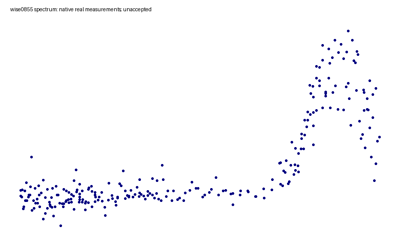

# G4b-wise-stacks — PASS (L3)

# Native target acceptance
Complete measurements and rejected frames:
```json
{
  "ra": 133.76017495970984,
  "dec": -7.242245262123162,
  "rows": [
    {
      "lam": 2.3628344535827637,
      "dlam": 0.058327462524175644,
      "flux": 64.06572314398538,
      "err": 29.42276302583143,
      "mjd": 60800.70069465,
      "visit": "V1",
      "detector": 3,
      "flags": [
        "SOURCE"
      ],
      "rchi2": 1.149802578595118,
      "contaminated": false,
      "release": "qr2",
      "quality": {
        "lam": 2.3628344535827637,
        "dlam": 0.058327462524175644,
        "flux_uJy": 64.06572314398538,
        "err_uJy": 29.42276302583143,
        "stat_err_uJy": 29.35992181325535,
        "cal_err_uJy": 1.9219716943195613,
        "mjd": 60800.70069465,
        "detector": 3,
        "obsid": "2025W19_1B_0116_1",
        "rchi2": 1.149802578595118,
        "flags_near": [
          "SOURCE"
        ],
        "wing_fit": false,
        "contaminated": false,
        "photometric_scale": "qr2",
        "blend_fit": true,
        "omega_arcsec2": 37.51771926879883,
        "zone": 34
      },
      "frame_id": "level2_2025W19_1B_0116_1D3_spx_l2b-v20-2025-241.fits"
    },
    {
      "lam": 4.967217922210693,
      "dlam": 0.03865577653050423,
      "flux": 149.63075911989824,
      "err": 135.45275567267626,
      "mjd": 60800.70069465,
      "visit": "V1",
      "detector": 6,
      "flags": [
        "SOURCE"
      ],
      "rchi2": 1.0417246326627174,
      "contaminated": false,
      "release": "qr2",
      "quality": {
        "lam": 4.967217922210693,
        "dlam": 0.03865577653050423,
        "flux_uJy": 149.63075911989824,
        "err_uJy": 135.45275567267626,
        "stat_err_uJy": 135.3783534825801,
        "cal_err_uJy": 4.488922773596947,
        "mjd": 60800.70069465,
        "detector": 6,
        "obsid": "2025W19_1B_0116_1",
        "rchi2": 1.0417246326627174,
        "flags_near": [
          "SOURCE"
        ],
        "wing_fit": false,
        "contaminated": false,
        "photometric_scale": "qr2",
        "blend_fit": true,
        "omega_arcsec2": 37.60438537597656,
        "zone": 24
      },
      "frame_id": "level2_2025W19_1B_0116_1D6_spx_l2b-v20-2025-241.fits"
    },
    {
      "lam": 2.4126639366149902,
      "dlam": 0.05181024223566055,
      "flux": -37.94807772513697,
      "err": 42.62659557955507,
      "mjd": 60800.702186907,
      "visit": "V1",
      "detector": 3,
      "flags": [
        "COLD",
        "DICHROIC",
        "OUTLIER",
        "SOURCE",
        "SUR_ERROR",
        "TRANSIENT"
      ],
      "rchi2": 1.2121511127019908,
      "contaminated": true,
      "release": "qr2",
      "quality": {
        "lam": 2.4126639366149902,
        "dlam": 0.05181024223566055,
        "flux_uJy": -37.94807772513697,
        "err_uJy": 42.62659557955507,
        "stat_err_uJy": 42.61139049315587,
        "cal_err_uJy": 1.138442331754109,
        "mjd": 60800.702186907,
        "detector": 3,
        "obsid": "2025W19_1B_0116_2",
        "rchi2": 1.2121511127019908,
        "flags_near": [
          "COLD",
          "DICHROIC",
          "OUTLIER",
          "SOURCE",
          "SUR_ERROR",
          "TRANSIENT"
        ],
        "wing_fit": false,
        "contaminated": true,
        "photometric_scale": "qr2",
        "blend_fit": true,
        "omega_arcsec2": 37.487396240234375,
        "zone": 1
      },
      "frame_id": "level2_2025W19_1B_0116_2D3_spx_l2b-v20-2025-241.fits"
    },
    {
      "lam": 5.004439353942871,
      "dlam": 0.037165168672800064,
      "flux": 283.55701674249667,
      "err": 177.56917416708248,
      "mjd": 60800.702186907,
      "visit": "V1",
      "detector": 6,
      "flags": [
        "SOURCE"
      ],
      "rchi2": 0.863071797384832,
      "contaminated": false,
      "release": "qr2",
      "quality": {
        "lam": 5.004439353942871,
        "dlam": 0.037165168672800064,
        "flux_uJy": 283.55701674249667,
        "err_uJy": 177.56917416708248,
        "stat_err_uJy": 177.36529392981637,
        "cal_err_uJy": 8.506710502274899,
        "mjd": 60800.702186907,
        "detector": 6,
        "obsid": "2025W19_1B_0116_2",
        "rchi2": 0.863071797384832,
        "flags_near": [
          "SOURCE"
        ],
        "wing_fit": false,
        "contaminated": false,
        "photometric_scale": "qr2",
        "blend_fit": true,
        "omega_arcsec2": 37.57661819458008,
        "zone": 3
      },
      "frame_id": "level2_2025W19_1B_0116_2D6_spx_l2b-v20-2025-241.fits"
    },
    {
      "lam": 2.2074756622314453,
      "dlam": 0.05515826493501663,
      "flux": -14.405861283147306,
      "err": 20.600605109295337,
      "mjd": 60800.835104036,
      "visit": "V1",
      "detector": 3,
      "flags": [
        "SOURCE"
      ],
      "rchi2": 1.1924731832807889,
      "contaminated": false,
      "release": "qr2",
      "quality": {
        "lam": 2.2074756622314453,
        "dlam": 0.05515826493501663,
        "flux_uJy": -14.405861283147306,
        "err_uJy": 20.600605109295337,
        "stat_err_uJy": 20.596071346588086,
        "cal_err_uJy": 0.43217583849441915,
        "mjd": 60800.835104036,
        "detector": 3,
        "obsid": "2025W19_1B_0138_1",
        "rchi2": 1.1924731832807889,
        "flags_near": [
          "SOURCE"
        ],
        "wing_fit": false,
        "contaminated": false,
        "photometric_scale": "qr2",
        "blend_fit": true,
        "omega_arcsec2": 37.613006591796875,
        "zone": 111
      },
      "frame_id": "level2_2025W19_1B_0138_1D3_spx_l2b-v20-2025-241.fits"
    },
    {
      "lam": 4.85945463180542,
      "dlam": 0.03546510264277458,
      "flux": 475.68605718735284,
      "err": 139.99030232782647,
      "mjd": 60800.835104036,
      "visit": "V1",
      "detector": 6,
      "flags": [
        "SOURCE"
      ],
      "rchi2": 0.8405879463559226,
      "contaminated": false,
      "release": "qr2",
      "quality": {
        "lam": 4.85945463180542,
        "dlam": 0.03546510264277458,
        "flux_uJy": 475.68605718735284,
        "err_uJy": 139.99030232782647,
        "stat_err_uJy": 139.26103275264782,
        "cal_err_uJy": 14.270581715620585,
        "mjd": 60800.835104036,
        "detector": 6,
        "obsid": "2025W19_1B_0138_1",
        "rchi2": 0.8405879463559226,
        "flags_near": [
          "SOURCE"
        ],
        "wing_fit": false,
        "contaminated": false,
        "photometric_scale": "qr2",
        "blend_fit": true,
        "omega_arcsec2": 37.6927375793457,
        "zone": 108
      },
      "frame_id": "level2_2025W19_1B_0138_1D6_spx_l2b-v20-2025-241.fits"
    },
    {
      "lam": 1.5147364139556885,
      "dlam": 0.03721190616488457,
      "flux": -82.9939918434616,
      "err": 30.34840968579654,
      "mjd": 60801.107262601,
      "visit": "V1",
      "detector": 2,
      "flags": [
        "OUTLIER",
        "SOURCE"
      ],
      "rchi2": 1.1089947491655288,
      "contaminated": false,
      "release": "qr2",
      "quality": {
        "lam": 1.5147364139556885,
        "dlam": 0.03721190616488457,
        "flux_uJy": -82.9939918434616,
        "err_uJy": 30.34840968579654,
        "stat_err_uJy": 30.24610335304447,
        "cal_err_uJy": 2.489819755303848,
        "mjd": 60801.107262601,
        "detector": 2,
        "obsid": "2025W19_1B_0181_1",
        "rchi2": 1.1089947491655288,
        "flags_near": [
          "OUTLIER",
          "SOURCE"
        ],
        "wing_fit": false,
        "contaminated": false,
        "photometric_scale": "qr2",
        "blend_fit": true,
        "omega_arcsec2": 37.520572662353516,
        "zone": 91
      },
      "frame_id": "level2_2025W19_1B_0181_1D2_spx_l2b-v20-2025-241.fits"
    },
    {
      "lam": 4.294766426086426,
      "dlam": 0.03684428334236145,
      "flux": 632.645506623794,
      "err": 105.77143141215866,
      "mjd": 60801.107262601,
      "visit": "V1",
      "detector": 5,
      "flags": [
        "SOURCE"
      ],
      "rchi2": 1.1272520703393327,
      "contaminated": false,
      "release": "qr2",
      "quality": {
        "lam": 4.294766426086426,
        "dlam": 0.03684428334236145,
        "flux_uJy": 632.645506623794,
        "err_uJy": 105.77143141215866,
        "stat_err_uJy": 104.05469427003683,
        "cal_err_uJy": 18.97936519871382,
        "mjd": 60801.107262601,
        "detector": 5,
        "obsid": "2025W19_1B_0181_1",
        "rchi2": 1.1272520703393327,
        "flags_near": [
          "SOURCE"
        ],
        "wing_fit": false,
        "contaminated": false,
        "photometric_scale": "qr2",
        "blend_fit": true,
        "omega_arcsec2": 37.59602737426758,
        "zone": 91
      },
      "frame_id": "level2_2025W19_1B_0181_1D5_spx_l2b-v20-2025-241.fits"
    },
    {
      "lam": 1.551997184753418,
      "dlam": 0.03822125867009163,
      "flux": -46.42219134116408,
      "err": 28.862963251646477,
      "mjd": 60801.108754847,
      "visit": "V1",
      "detector": 2,
      "flags": [
        "SOURCE"
      ],
      "rchi2": 1.1439593279002673,
      "contaminated": false,
      "release": "qr2",
      "quality": {
        "lam": 1.551997184753418,
        "dlam": 0.03822125867009163,
        "flux_uJy": -46.42219134116408,
        "err_uJy": 28.862963251646477,
        "stat_err_uJy": 28.8293449422957,
        "cal_err_uJy": 1.3926657402349223,
        "mjd": 60801.108754847,
        "detector": 2,
        "obsid": "2025W19_1B_0181_2",
        "rchi2": 1.1439593279002673,
        "flags_near": [
          "SOURCE"
        ],
        "wing_fit": false,
        "contaminated": false,
        "photometric_scale": "qr2",
        "blend_fit": true,
        "omega_arcsec2": 37.49062728881836,
        "zone": 70
      },
      "frame_id": "level2_2025W19_1B_0181_2D2_spx_l2b-v20-2025-241.fits"
    },
    {
      "lam": 4.331647872924805,
      "dlam": 0.0372602753341198,
      "flux": 668.3601214041992,
      "err": 89.78914487563554,
      "mjd": 60801.108754847,
      "visit": "V1",
      "detector": 5,
      "flags": [
        "SOURCE"
      ],
      "rchi2": 0.9828353777875836,
      "contaminated": false,
      "release": "qr2",
      "quality": {
        "lam": 4.331647872924805,
        "dlam": 0.0372602753341198,
        "flux_uJy": 668.3601214041992,
        "err_uJy": 89.78914487563554,
        "stat_err_uJy": 87.52174478838259,
        "cal_err_uJy": 20.050803642125974,
        "mjd": 60801.108754847,
        "detector": 5,
        "obsid": "2025W19_1B_0181_2",
        "rchi2": 0.9828353777875836,
        "flags_near": [
          "SOURCE"
        ],
        "wing_fit": false,
        "contaminated": false,
        "photometric_scale": "qr2",
        "blend_fit": true,
        "omega_arcsec2": 37.56611633300781,
        "zone": 70
      },
      "frame_id": "level2_2025W19_1B_0181_2D5_spx_l2b-v20-2025-241.fits"
    },
    {
      "lam": 1.5898631811141968,
      "dlam": 0.03884069621562958,
      "flux": 9.46020141611129,
      "err": 30.162552313729517,
      "mjd": 60801.110247104,
      "visit": "V1",
      "detector": 2,
      "flags": [
        "SOURCE",
        "TRANSIENT"
      ],
      "rchi2": 1.4516203600638589,
      "contaminated": true,
      "release": "qr2",
      "quality": {
        "lam": 1.5898631811141968,
        "dlam": 0.03884069621562958,
        "flux_uJy": 9.46020141611129,
        "err_uJy": 30.162552313729517,
        "stat_err_uJy": 30.161217087656123,
        "cal_err_uJy": 0.28380604248333874,
        "mjd": 60801.110247104,
        "detector": 2,
        "obsid": "2025W19_1B_0181_3",
        "rchi2": 1.4516203600638589,
        "flags_near": [
          "SOURCE",
          "TRANSIENT"
        ],
        "wing_fit": false,
        "contaminated": true,
        "photometric_scale": "qr2",
        "blend_fit": true,
        "omega_arcsec2": 37.461421966552734,
        "zone": 28
      },
      "frame_id": "level2_2025W19_1B_0181_3D2_spx_l2b-v20-2025-241.fits"
    },
    {
      "lam": 4.368845462799072,
      "dlam": 0.038155559450387955,
      "flux": 490.3859753314892,
      "err": 98.45762280044272,
      "mjd": 60801.110247104,
      "visit": "V1",
      "detector": 5,
      "flags": [
        "SOURCE",
        "TRANSIENT"
      ],
      "rchi2": 1.1104977136836294,
      "contaminated": true,
      "release": "qr2",
      "quality": {
        "lam": 4.368845462799072,
        "dlam": 0.038155559450387955,
        "flux_uJy": 490.3859753314892,
        "err_uJy": 98.45762280044272,
        "stat_err_uJy": 97.3523133941491,
        "cal_err_uJy": 14.711579259944676,
        "mjd": 60801.110247104,
        "detector": 5,
        "obsid": "2025W19_1B_0181_3",
        "rchi2": 1.1104977136836294,
        "flags_near": [
          "SOURCE",
          "TRANSIENT"
        ],
        "wing_fit": false,
        "contaminated": true,
        "photometric_scale": "qr2",
        "blend_fit": true,
        "omega_arcsec2": 37.53697204589844,
        "zone": 28
      },
      "frame_id": "level2_2025W19_1B_0181_3D5_spx_l2b-v20-2025-241.fits"
    },
    {
      "lam": 1.6278156042099,
      "dlam": 0.0388767346739769,
      "flux": -7.416498434795128,
      "err": 38.005947851099535,
      "mjd": 60801.111739349,
      "visit": "V1",
      "detector": 2,
      "flags": [
        "SOURCE"
      ],
      "rchi2": 1.4589025575455432,
      "contaminated": false,
      "release": "qr2",
      "quality": {
        "lam": 1.6278156042099,
        "dlam": 0.0388767346739769,
        "flux_uJy": -7.416498434795128,
        "err_uJy": 38.005947851099535,
        "stat_err_uJy": 38.00529657898182,
        "cal_err_uJy": 0.22249495304385383,
        "mjd": 60801.111739349,
        "detector": 2,
        "obsid": "2025W19_1B_0181_4",
        "rchi2": 1.4589025575455432,
        "flags_near": [
          "SOURCE"
        ],
        "wing_fit": false,
        "contaminated": false,
        "photometric_scale": "qr2",
        "blend_fit": true,
        "omega_arcsec2": 37.43318557739258,
        "zone": 7
      },
      "frame_id": "level2_2025W19_1B_0181_4D2_spx_l2b-v20-2025-241.fits"
    },
    {
      "lam": 4.40563440322876,
      "dlam": 0.03751873970031738,
      "flux": 726.4280214054987,
      "err": 99.27313177288767,
      "mjd": 60801.111739349,
      "visit": "V1",
      "detector": 5,
      "flags": [
        "SOURCE"
      ],
      "rchi2": 1.015682114892851,
      "contaminated": false,
      "release": "qr2",
      "quality": {
        "lam": 4.40563440322876,
        "dlam": 0.03751873970031738,
        "flux_uJy": 726.4280214054987,
        "err_uJy": 99.27313177288767,
        "stat_err_uJy": 96.85157091520159,
        "cal_err_uJy": 21.79284064216496,
        "mjd": 60801.111739349,
        "detector": 5,
        "obsid": "2025W19_1B_0181_4",
        "rchi2": 1.015682114892851,
        "flags_near": [
          "SOURCE"
        ],
        "wing_fit": false,
        "contaminated": false,
        "photometric_scale": "qr2",
        "blend_fit": true,
        "omega_arcsec2": 37.50878143310547,
        "zone": 7
      },
      "frame_id": "level2_2025W19_1B_0181_4D5_spx_l2b-v20-2025-241.fits"
    },
    {
      "lam": 1.2792575359344482,
      "dlam": 0.031099624931812286,
      "flux": -40.78708843449162,
      "err": 27.401389120643394,
      "mjd": 60801.446306085,
      "visit": "V1",
      "detector": 2,
      "flags": [
        "SOURCE"
      ],
      "rchi2": 0.8204446047738229,
      "contaminated": false,
      "release": "qr2",
      "quality": {
        "lam": 1.2792575359344482,
        "dlam": 0.031099624931812286,
        "flux_uJy": -40.78708843449162,
        "err_uJy": 27.401389120643394,
        "stat_err_uJy": 27.37405519495143,
        "cal_err_uJy": 1.2236126530347486,
        "mjd": 60801.446306085,
        "detector": 2,
        "obsid": "2025W19_1B_0231_1",
        "rchi2": 0.8204446047738229,
        "flags_near": [
          "SOURCE"
        ],
        "wing_fit": false,
        "contaminated": false,
        "photometric_scale": "qr2",
        "blend_fit": true,
        "omega_arcsec2": 37.774505615234375,
        "zone": 276
      },
      "frame_id": "level2_2025W19_1B_0231_1D2_spx_l2b-v20-2025-241.fits"
    },
    {
      "lam": 4.038520336151123,
      "dlam": 0.03681262955069542,
      "flux": 137.82360372000377,
      "err": 71.1349831468275,
      "mjd": 60801.446306085,
      "visit": "V1",
      "detector": 5,
      "flags": [
        "SOURCE"
      ],
      "rchi2": 1.3245623700520295,
      "contaminated": false,
      "release": "qr2",
      "quality": {
        "lam": 4.038520336151123,
        "dlam": 0.03681262955069542,
        "flux_uJy": 137.82360372000377,
        "err_uJy": 71.1349831468275,
        "stat_err_uJy": 71.01471689819864,
        "cal_err_uJy": 4.134708111600113,
        "mjd": 60801.446306085,
        "detector": 5,
        "obsid": "2025W19_1B_0231_1",
        "rchi2": 1.3245623700520295,
        "flags_near": [
          "SOURCE"
        ],
        "wing_fit": false,
        "contaminated": false,
        "photometric_scale": "qr2",
        "blend_fit": true,
        "omega_arcsec2": 37.851356506347656,
        "zone": 255
      },
      "frame_id": "level2_2025W19_1B_0231_1D5_spx_l2b-v20-2025-241.fits"
    },
    {
      "lam": 1.3096519708633423,
      "dlam": 0.03164643794298172,
      "flux": -30.350400630136512,
      "err": 39.46588484790895,
      "mjd": 60801.44779833,
      "visit": "V1",
      "detector": 2,
      "flags": [
        "SOURCE"
      ],
      "rchi2": 1.2390314999999041,
      "contaminated": false,
      "release": "qr2",
      "quality": {
        "lam": 1.3096519708633423,
        "dlam": 0.03164643794298172,
        "flux_uJy": -30.350400630136512,
        "err_uJy": 39.46588484790895,
        "stat_err_uJy": 39.45538030094046,
        "cal_err_uJy": 0.9105120189040954,
        "mjd": 60801.44779833,
        "detector": 2,
        "obsid": "2025W19_1B_0231_2",
        "rchi2": 1.2390314999999041,
        "flags_near": [
          "SOURCE"
        ],
        "wing_fit": false,
        "contaminated": false,
        "photometric_scale": "qr2",
        "blend_fit": true,
        "omega_arcsec2": 37.739723205566406,
        "zone": 234
      },
      "frame_id": "level2_2025W19_1B_0231_2D2_spx_l2b-v20-2025-241.fits"
    },
    {
      "lam": 4.073602199554443,
      "dlam": 0.03651406615972519,
      "flux": 223.18594119398293,
      "err": 70.69470051742486,
      "mjd": 60801.44779833,
      "visit": "V1",
      "detector": 5,
      "flags": [
        "SOURCE"
      ],
      "rchi2": 1.0249205138328894,
      "contaminated": false,
      "release": "qr2",
      "quality": {
        "lam": 4.073602199554443,
        "dlam": 0.03651406615972519,
        "flux_uJy": 223.18594119398293,
        "err_uJy": 70.69470051742486,
        "stat_err_uJy": 70.37691321261832,
        "cal_err_uJy": 6.695578235819488,
        "mjd": 60801.44779833,
        "detector": 5,
        "obsid": "2025W19_1B_0231_2",
        "rchi2": 1.0249205138328894,
        "flags_near": [
          "SOURCE"
        ],
        "wing_fit": false,
        "contaminated": false,
        "photometric_scale": "qr2",
        "blend_fit": true,
        "omega_arcsec2": 37.81646728515625,
        "zone": 234
      },
      "frame_id": "level2_2025W19_1B_0231_2D5_spx_l2b-v20-2025-241.fits"
    },
    {
      "lam": 1.3407639265060425,
      "dlam": 0.03207793086767197,
      "flux": -28.714171134228664,
      "err": 33.56059895385029,
      "mjd": 60801.449290587,
      "visit": "V1",
      "detector": 2,
      "flags": [
        "SOURCE"
      ],
      "rchi2": 1.424405241599242,
      "contaminated": false,
      "release": "qr2",
      "quality": {
        "lam": 1.3407639265060425,
        "dlam": 0.03207793086767197,
        "flux_uJy": -28.714171134228664,
        "err_uJy": 33.56059895385029,
        "stat_err_uJy": 33.54954170893611,
        "cal_err_uJy": 0.8614251340268599,
        "mjd": 60801.449290587,
        "detector": 2,
        "obsid": "2025W19_1B_0231_3",
        "rchi2": 1.424405241599242,
        "flags_near": [
          "SOURCE"
        ],
        "wing_fit": false,
        "contaminated": false,
        "photometric_scale": "qr2",
        "blend_fit": true,
        "omega_arcsec2": 37.705387115478516,
        "zone": 213
      },
      "frame_id": "level2_2025W19_1B_0231_3D2_spx_l2b-v20-2025-241.fits"
    },
    {
      "lam": 4.108796119689941,
      "dlam": 0.03666824847459793,
      "flux": 223.43185481465252,
      "err": 69.45643438415611,
      "mjd": 60801.449290576,
      "visit": "V1",
      "detector": 5,
      "flags": [
        "SOURCE"
      ],
      "rchi2": 1.026856130158086,
      "contaminated": false,
      "release": "qr2",
      "quality": {
        "lam": 4.108796119689941,
        "dlam": 0.03666824847459793,
        "flux_uJy": 223.43185481465252,
        "err_uJy": 69.45643438415611,
        "stat_err_uJy": 69.13224040192289,
        "cal_err_uJy": 6.702955644439576,
        "mjd": 60801.449290576,
        "detector": 5,
        "obsid": "2025W19_1B_0231_3",
        "rchi2": 1.026856130158086,
        "flags_near": [
          "SOURCE"
        ],
        "wing_fit": false,
        "contaminated": false,
        "photometric_scale": "qr2",
        "blend_fit": true,
        "omega_arcsec2": 37.78227615356445,
        "zone": 213
      },
      "frame_id": "level2_2025W19_1B_0231_3D5_spx_l2b-v20-2025-241.fits"
    },
    {
      "lam": 1.3724098205566406,
      "dlam": 0.03333469107747078,
      "flux": -12.81713320171013,
      "err": 29.538265982262825,
      "mjd": 60801.450782833,
      "visit": "V1",
      "detector": 2,
      "flags": [
        "SOURCE"
      ],
      "rchi2": 1.1671771915563744,
      "contaminated": false,
      "release": "qr2",
      "quality": {
        "lam": 1.3724098205566406,
        "dlam": 0.03333469107747078,
        "flux_uJy": -12.81713320171013,
        "err_uJy": 29.538265982262825,
        "stat_err_uJy": 29.535763173240436,
        "cal_err_uJy": 0.3845139960513039,
        "mjd": 60801.450782833,
        "detector": 2,
        "obsid": "2025W19_1B_0231_4",
        "rchi2": 1.1671771915563744,
        "flags_near": [
          "SOURCE"
        ],
        "wing_fit": false,
        "contaminated": false,
        "photometric_scale": "qr2",
        "blend_fit": true,
        "omega_arcsec2": 37.67205047607422,
        "zone": 192
      },
      "frame_id": "level2_2025W19_1B_0231_4D2_spx_l2b-v20-2025-241.fits"
    },
    {
      "lam": 4.144399166107178,
      "dlam": 0.03658374771475792,
      "flux": 335.55081903479277,
      "err": 82.87052497072081,
      "mjd": 60801.450782821,
      "visit": "V1",
      "detector": 5,
      "flags": [
        "SOURCE"
      ],
      "rchi2": 1.204475519726505,
      "contaminated": false,
      "release": "qr2",
      "quality": {
        "lam": 4.144399166107178,
        "dlam": 0.03658374771475792,
        "flux_uJy": 335.55081903479277,
        "err_uJy": 82.87052497072081,
        "stat_err_uJy": 82.25684769053233,
        "cal_err_uJy": 10.066524571043782,
        "mjd": 60801.450782821,
        "detector": 5,
        "obsid": "2025W19_1B_0231_4",
        "rchi2": 1.204475519726505,
        "flags_near": [
          "SOURCE"
        ],
        "wing_fit": false,
        "contaminated": false,
        "photometric_scale": "qr2",
        "blend_fit": true,
        "omega_arcsec2": 37.748836517333984,
        "zone": 192
      },
      "frame_id": "level2_2025W19_1B_0231_4D5_spx_l2b-v20-2025-241.fits"
    },
    {
      "lam": 0.9923018217086792,
      "dlam": 0.026088815182447433,
      "flux": 1.4056453044150143,
      "err": 35.47532878621818,
      "mjd": 60801.514843134,
      "visit": "V1",
      "detector": 1,
      "flags": [
        "SOURCE"
      ],
      "rchi2": 1.3397260385676277,
      "contaminated": false,
      "release": "qr2",
      "quality": {
        "lam": 0.9923018217086792,
        "dlam": 0.026088815182447433,
        "flux_uJy": 1.4056453044150143,
        "err_uJy": 35.47532878621818,
        "stat_err_uJy": 35.47530372294832,
        "cal_err_uJy": 0.04216935913245043,
        "mjd": 60801.514843134,
        "detector": 1,
        "obsid": "2025W19_1B_0241_1",
        "rchi2": 1.3397260385676277,
        "flags_near": [
          "SOURCE"
        ],
        "wing_fit": false,
        "contaminated": false,
        "photometric_scale": "qr2",
        "blend_fit": true,
        "omega_arcsec2": 37.70840835571289,
        "zone": 115
      },
      "frame_id": "level2_2025W19_1B_0241_1D1_spx_l2b-v20-2025-242.fits"
    },
    {
      "lam": 3.3563060760498047,
      "dlam": 0.09663751721382141,
      "flux": 12.950633366665167,
      "err": 38.27744601661609,
      "mjd": 60801.514843134,
      "visit": "V1",
      "detector": 4,
      "flags": [
        "SOURCE",
        "SUR_ERROR",
        "TRANSIENT"
      ],
      "rchi2": 2.268538468917751,
      "contaminated": true,
      "release": "qr2",
      "quality": {
        "lam": 3.3563060760498047,
        "dlam": 0.09663751721382141,
        "flux_uJy": 12.950633366665167,
        "err_uJy": 38.27744601661609,
        "stat_err_uJy": 38.27547421705995,
        "cal_err_uJy": 0.388519000999955,
        "mjd": 60801.514843134,
        "detector": 4,
        "obsid": "2025W19_1B_0241_1",
        "rchi2": 2.268538468917751,
        "flags_near": [
          "SOURCE",
          "SUR_ERROR",
          "TRANSIENT"
        ],
        "wing_fit": false,
        "contaminated": true,
        "photometric_scale": "qr2",
        "blend_fit": true,
        "omega_arcsec2": 37.77674102783203,
        "zone": 115
      },
      "frame_id": "level2_2025W19_1B_0241_1D4_spx_l2b-v20-2025-241.fits"
    },
    {
      "lam": 1.015901803970337,
      "dlam": 0.027164557948708534,
      "flux": 65.6043058778248,
      "err": 37.845838298928065,
      "mjd": 60801.516335379,
      "visit": "V1",
      "detector": 1,
      "flags": [
        "SOURCE"
      ],
      "rchi2": 1.2277465850015363,
      "contaminated": false,
      "release": "qr2",
      "quality": {
        "lam": 1.015901803970337,
        "dlam": 0.027164557948708534,
        "flux_uJy": 65.6043058778248,
        "err_uJy": 37.845838298928065,
        "stat_err_uJy": 37.79462850847816,
        "cal_err_uJy": 1.968129176334744,
        "mjd": 60801.516335379,
        "detector": 1,
        "obsid": "2025W19_1B_0241_2",
        "rchi2": 1.2277465850015363,
        "flags_near": [
          "SOURCE"
        ],
        "wing_fit": false,
        "contaminated": false,
        "photometric_scale": "qr2",
        "blend_fit": true,
        "omega_arcsec2": 37.6761360168457,
        "zone": 94
      },
      "frame_id": "level2_2025W19_1B_0241_2D1_spx_l2b-v20-2025-242.fits"
    },
    {
      "lam": 3.4483163356781006,
      "dlam": 0.09471051394939423,
      "flux": 5.923014038286489,
      "err": 32.72092183633412,
      "mjd": 60801.516335391,
      "visit": "V1",
      "detector": 4,
      "flags": [
        "SOURCE"
      ],
      "rchi2": 1.3635184391320971,
      "contaminated": false,
      "release": "qr2",
      "quality": {
        "lam": 3.4483163356781006,
        "dlam": 0.09471051394939423,
        "flux_uJy": 5.923014038286489,
        "err_uJy": 32.72092183633412,
        "stat_err_uJy": 32.72043936034049,
        "cal_err_uJy": 0.17769042114859465,
        "mjd": 60801.516335391,
        "detector": 4,
        "obsid": "2025W19_1B_0241_2",
        "rchi2": 1.3635184391320971,
        "flags_near": [
          "SOURCE"
        ],
        "wing_fit": false,
        "contaminated": false,
        "photometric_scale": "qr2",
        "blend_fit": true,
        "omega_arcsec2": 37.74365997314453,
        "zone": 94
      },
      "frame_id": "level2_2025W19_1B_0241_2D4_spx_l2b-v20-2025-241.fits"
    },
    {
      "lam": 1.0405385494232178,
      "dlam": 0.027375807985663414,
      "flux": -20.901188297048847,
      "err": 32.8249526431529,
      "mjd": 60801.517827636,
      "visit": "V1",
      "detector": 1,
      "flags": [
        "SOURCE"
      ],
      "rchi2": 1.1988964310526877,
      "contaminated": false,
      "release": "qr2",
      "quality": {
        "lam": 1.0405385494232178,
        "dlam": 0.027375807985663414,
        "flux_uJy": -20.901188297048847,
        "err_uJy": 32.8249526431529,
        "stat_err_uJy": 32.81896315120611,
        "cal_err_uJy": 0.6270356489114653,
        "mjd": 60801.517827636,
        "detector": 1,
        "obsid": "2025W19_1B_0241_3",
        "rchi2": 1.1988964310526877,
        "flags_near": [
          "SOURCE"
        ],
        "wing_fit": false,
        "contaminated": false,
        "photometric_scale": "qr2",
        "blend_fit": true,
        "omega_arcsec2": 37.6443977355957,
        "zone": 73
      },
      "frame_id": "level2_2025W19_1B_0241_3D1_spx_l2b-v20-2025-242.fits"
    },
    {
      "lam": 3.5419838428497314,
      "dlam": 0.09625247120857239,
      "flux": -15.43965997366765,
      "err": 26.031562616817748,
      "mjd": 60801.517827636,
      "visit": "V1",
      "detector": 4,
      "flags": [
        "OUTLIER",
        "SOURCE"
      ],
      "rchi2": 1.0814903311838147,
      "contaminated": false,
      "release": "qr2",
      "quality": {
        "lam": 3.5419838428497314,
        "dlam": 0.09625247120857239,
        "flux_uJy": -15.43965997366765,
        "err_uJy": 26.031562616817748,
        "stat_err_uJy": 26.027441431750663,
        "cal_err_uJy": 0.4631897992100295,
        "mjd": 60801.517827636,
        "detector": 4,
        "obsid": "2025W19_1B_0241_3",
        "rchi2": 1.0814903311838147,
        "flags_near": [
          "OUTLIER",
          "SOURCE"
        ],
        "wing_fit": false,
        "contaminated": false,
        "photometric_scale": "qr2",
        "blend_fit": true,
        "omega_arcsec2": 37.71091842651367,
        "zone": 73
      },
      "frame_id": "level2_2025W19_1B_0241_3D4_spx_l2b-v20-2025-241.fits"
    },
    {
      "lam": 1.0652621984481812,
      "dlam": 0.028516625985503197,
      "flux": 19.013895932396895,
      "err": 42.130668354395524,
      "mjd": 60801.519319893,
      "visit": "V1",
      "detector": 1,
      "flags": [
        "SOURCE"
      ],
      "rchi2": 0.8729241103819713,
      "contaminated": false,
      "release": "qr2",
      "quality": {
        "lam": 1.0652621984481812,
        "dlam": 0.028516625985503197,
        "flux_uJy": 19.013895932396895,
        "err_uJy": 42.130668354395524,
        "stat_err_uJy": 42.12680667429457,
        "cal_err_uJy": 0.5704168779719069,
        "mjd": 60801.519319893,
        "detector": 1,
        "obsid": "2025W19_1B_0241_4",
        "rchi2": 0.8729241103819713,
        "flags_near": [
          "SOURCE"
        ],
        "wing_fit": false,
        "contaminated": false,
        "photometric_scale": "qr2",
        "blend_fit": true,
        "omega_arcsec2": 37.613609313964844,
        "zone": 52
      },
      "frame_id": "level2_2025W19_1B_0241_4D1_spx_l2b-v20-2025-242.fits"
    },
    {
      "lam": 3.63769268989563,
      "dlam": 0.10356384515762329,
      "flux": -24.35817844880192,
      "err": 26.91163519456074,
      "mjd": 60801.519319893,
      "visit": "V1",
      "detector": 4,
      "flags": [
        "NONFUNC",
        "PERSIST",
        "SOURCE",
        "SUR_ERROR",
        "TRANSIENT"
      ],
      "rchi2": 1.8163643764432011,
      "contaminated": true,
      "release": "qr2",
      "quality": {
        "lam": 3.63769268989563,
        "dlam": 0.10356384515762329,
        "flux_uJy": -24.35817844880192,
        "err_uJy": 26.91163519456074,
        "stat_err_uJy": 26.9017122145322,
        "cal_err_uJy": 0.7307453534640576,
        "mjd": 60801.519319893,
        "detector": 4,
        "obsid": "2025W19_1B_0241_4",
        "rchi2": 1.8163643764432011,
        "flags_near": [
          "NONFUNC",
          "PERSIST",
          "SOURCE",
          "SUR_ERROR",
          "TRANSIENT"
        ],
        "wing_fit": false,
        "contaminated": true,
        "photometric_scale": "qr2",
        "blend_fit": true,
        "omega_arcsec2": 37.67908477783203,
        "zone": 52
      },
      "frame_id": "level2_2025W19_1B_0241_4D4_spx_l2b-v20-2025-241.fits"
    },
    {
      "lam": 0.8609219193458557,
      "dlam": 0.021849341690540314,
      "flux": 33.86125518389345,
      "err": 30.514543523354586,
      "mjd": 60979.723343354,
      "visit": "V2",
      "detector": 1,
      "flags": [
        "SOURCE"
      ],
      "rchi2": 0.8069227952058267,
      "contaminated": false,
      "release": "qr2",
      "quality": {
        "lam": 0.8609219193458557,
        "dlam": 0.021849341690540314,
        "flux_uJy": 33.86125518389345,
        "err_uJy": 30.514543523354586,
        "stat_err_uJy": 30.497630076718018,
        "cal_err_uJy": 1.0158376555168034,
        "mjd": 60979.723343354,
        "detector": 1,
        "obsid": "2025W44_2B_0305_1",
        "rchi2": 0.8069227952058267,
        "flags_near": [
          "SOURCE"
        ],
        "wing_fit": false,
        "contaminated": false,
        "photometric_scale": "qr2",
        "blend_fit": true,
        "omega_arcsec2": 38.07497024536133,
        "zone": 275
      },
      "frame_id": "level2_2025W44_2B_0305_1D1_spx_l2b-v20-2025-307.fits"
    },
    {
      "lam": 2.8527088165283203,
      "dlam": 0.08277446031570435,
      "flux": 25.80455224377764,
      "err": 34.90643445742436,
      "mjd": 60979.723343354,
      "visit": "V2",
      "detector": 4,
      "flags": [
        "SOURCE"
      ],
      "rchi2": 1.9221061117142528,
      "contaminated": false,
      "release": "qr2",
      "quality": {
        "lam": 2.8527088165283203,
        "dlam": 0.08277446031570435,
        "flux_uJy": 25.80455224377764,
        "err_uJy": 34.90643445742436,
        "stat_err_uJy": 34.89784920458009,
        "cal_err_uJy": 0.7741365673133291,
        "mjd": 60979.723343354,
        "detector": 4,
        "obsid": "2025W44_2B_0305_1",
        "rchi2": 1.9221061117142528,
        "flags_near": [
          "SOURCE"
        ],
        "wing_fit": false,
        "contaminated": false,
        "photometric_scale": "qr2",
        "blend_fit": true,
        "omega_arcsec2": 38.14988708496094,
        "zone": 275
      },
      "frame_id": "level2_2025W44_2B_0305_1D4_spx_l2b-v20-2025-307.fits"
    },
    {
      "lam": 0.8813449740409851,
      "dlam": 0.0220778938382864,
      "flux": -86.53954908896989,
      "err": 39.04150409615411,
      "mjd": 60979.724835611,
      "visit": "V2",
      "detector": 1,
      "flags": [
        "SOURCE"
      ],
      "rchi2": 1.1827236962630034,
      "contaminated": false,
      "release": "qr2",
      "quality": {
        "lam": 0.8813449740409851,
        "dlam": 0.0220778938382864,
        "flux_uJy": -86.53954908896989,
        "err_uJy": 39.04150409615411,
        "stat_err_uJy": 38.9550877022392,
        "cal_err_uJy": 2.5961864726690966,
        "mjd": 60979.724835611,
        "detector": 1,
        "obsid": "2025W44_2B_0305_2",
        "rchi2": 1.1827236962630034,
        "flags_near": [
          "SOURCE"
        ],
        "wing_fit": false,
        "contaminated": false,
        "photometric_scale": "qr2",
        "blend_fit": true,
        "omega_arcsec2": 38.03841018676758,
        "zone": 254
      },
      "frame_id": "level2_2025W44_2B_0305_2D1_spx_l2b-v20-2025-307.fits"
    },
    {
      "lam": 2.9309613704681396,
      "dlam": 0.08515335619449615,
      "flux": -8.129990898151071,
      "err": 26.697233595671378,
      "mjd": 60979.724835611,
      "visit": "V2",
      "detector": 4,
      "flags": [
        "SOURCE"
      ],
      "rchi2": 1.1663183956478373,
      "contaminated": false,
      "release": "qr2",
      "quality": {
        "lam": 2.9309613704681396,
        "dlam": 0.08515335619449615,
        "flux_uJy": -8.129990898151071,
        "err_uJy": 26.697233595671378,
        "stat_err_uJy": 26.696119466788442,
        "cal_err_uJy": 0.24389972694453213,
        "mjd": 60979.724835611,
        "detector": 4,
        "obsid": "2025W44_2B_0305_2",
        "rchi2": 1.1663183956478373,
        "flags_near": [
          "SOURCE"
        ],
        "wing_fit": false,
        "contaminated": false,
        "photometric_scale": "qr2",
        "blend_fit": true,
        "omega_arcsec2": 38.11245346069336,
        "zone": 254
      },
      "frame_id": "level2_2025W44_2B_0305_2D4_spx_l2b-v20-2025-307.fits"
    },
    {
      "lam": 0.9024448990821838,
      "dlam": 0.02272484079003334,
      "flux": -75.46044340709916,
      "err": 42.94164703602693,
      "mjd": 60979.726327879,
      "visit": "V2",
      "detector": 1,
      "flags": [
        "SOURCE"
      ],
      "rchi2": 1.1488017262381207,
      "contaminated": false,
      "release": "qr2",
      "quality": {
        "lam": 0.9024448990821838,
        "dlam": 0.02272484079003334,
        "flux_uJy": -75.46044340709916,
        "err_uJy": 42.94164703602693,
        "stat_err_uJy": 42.88193325282157,
        "cal_err_uJy": 2.263813302212975,
        "mjd": 60979.726327879,
        "detector": 1,
        "obsid": "2025W44_2B_0305_3",
        "rchi2": 1.1488017262381207,
        "flags_near": [
          "SOURCE"
        ],
        "wing_fit": false,
        "contaminated": false,
        "photometric_scale": "qr2",
        "blend_fit": true,
        "omega_arcsec2": 38.002689361572266,
        "zone": 212
      },
      "frame_id": "level2_2025W44_2B_0305_3D1_spx_l2b-v20-2025-307.fits"
    },
    {
      "lam": 3.0110676288604736,
      "dlam": 0.08771640062332153,
      "flux": 19.12043503651649,
      "err": 31.087245569916,
      "mjd": 60979.726327879,
      "visit": "V2",
      "detector": 4,
      "flags": [
        "SOURCE"
      ],
      "rchi2": 1.6199587451318185,
      "contaminated": false,
      "release": "qr2",
      "quality": {
        "lam": 3.0110676288604736,
        "dlam": 0.08771640062332153,
        "flux_uJy": 19.12043503651649,
        "err_uJy": 31.087245569916,
        "stat_err_uJy": 31.081953046613314,
        "cal_err_uJy": 0.5736130510954947,
        "mjd": 60979.726327879,
        "detector": 4,
        "obsid": "2025W44_2B_0305_3",
        "rchi2": 1.6199587451318185,
        "flags_near": [
          "SOURCE"
        ],
        "wing_fit": false,
        "contaminated": false,
        "photometric_scale": "qr2",
        "blend_fit": true,
        "omega_arcsec2": 38.075687408447266,
        "zone": 212
      },
      "frame_id": "level2_2025W44_2B_0305_3D4_spx_l2b-v20-2025-307.fits"
    },
    {
      "lam": 0.923876941204071,
      "dlam": 0.023951081559062004,
      "flux": -50.37770450557893,
      "err": 39.844186277394996,
      "mjd": 60979.727820136,
      "visit": "V2",
      "detector": 1,
      "flags": [
        "SOURCE"
      ],
      "rchi2": 1.3640574355145296,
      "contaminated": false,
      "release": "qr2",
      "quality": {
        "lam": 0.923876941204071,
        "dlam": 0.023951081559062004,
        "flux_uJy": -50.37770450557893,
        "err_uJy": 39.844186277394996,
        "stat_err_uJy": 39.81551278468765,
        "cal_err_uJy": 1.511331135167368,
        "mjd": 60979.727820136,
        "detector": 1,
        "obsid": "2025W44_2B_0305_4",
        "rchi2": 1.3640574355145296,
        "flags_near": [
          "SOURCE"
        ],
        "wing_fit": false,
        "contaminated": false,
        "photometric_scale": "qr2",
        "blend_fit": true,
        "omega_arcsec2": 37.96771240234375,
        "zone": 191
      },
      "frame_id": "level2_2025W44_2B_0305_4D1_spx_l2b-v20-2025-307.fits"
    },
    {
      "lam": 3.0937676429748535,
      "dlam": 0.09020697325468063,
      "flux": -9.11515881913676,
      "err": 28.987462208109726,
      "mjd": 60979.727820136,
      "visit": "V2",
      "detector": 4,
      "flags": [
        "SOURCE"
      ],
      "rchi2": 1.2577216047779953,
      "contaminated": false,
      "release": "qr2",
      "quality": {
        "lam": 3.0937676429748535,
        "dlam": 0.09020697325468063,
        "flux_uJy": -9.11515881913676,
        "err_uJy": 28.987462208109726,
        "stat_err_uJy": 28.986172354388586,
        "cal_err_uJy": 0.2734547645741028,
        "mjd": 60979.727820136,
        "detector": 4,
        "obsid": "2025W44_2B_0305_4",
        "rchi2": 1.2577216047779953,
        "flags_near": [
          "SOURCE"
        ],
        "wing_fit": false,
        "contaminated": false,
        "photometric_scale": "qr2",
        "blend_fit": true,
        "omega_arcsec2": 38.03948974609375,
        "zone": 191
      },
      "frame_id": "level2_2025W44_2B_0305_4D4_spx_l2b-v20-2025-307.fits"
    },
    {
      "lam": 0.9458149671554565,
      "dlam": 0.02437712252140045,
      "flux": -49.04558229559393,
      "err": 41.27564835459464,
      "mjd": 60979.786089141,
      "visit": "V2",
      "detector": 1,
      "flags": [
        "SOURCE"
      ],
      "rchi2": 1.046909406730799,
      "contaminated": false,
      "release": "qr2",
      "quality": {
        "lam": 0.9458149671554565,
        "dlam": 0.02437712252140045,
        "flux_uJy": -49.04558229559393,
        "err_uJy": 41.27564835459464,
        "stat_err_uJy": 41.24941484268242,
        "cal_err_uJy": 1.4713674688678178,
        "mjd": 60979.786089141,
        "detector": 1,
        "obsid": "2025W44_2B_0321_1",
        "rchi2": 1.046909406730799,
        "flags_near": [
          "SOURCE"
        ],
        "wing_fit": false,
        "contaminated": false,
        "photometric_scale": "qr2",
        "blend_fit": true,
        "omega_arcsec2": 37.93306350708008,
        "zone": 170
      },
      "frame_id": "level2_2025W44_2B_0321_1D1_spx_l2b-v20-2025-307.fits"
    },
    {
      "lam": 3.1786463260650635,
      "dlam": 0.08955389261245728,
      "flux": 14.411445602332925,
      "err": 30.906776114487055,
      "mjd": 60979.786089152,
      "visit": "V2",
      "detector": 4,
      "flags": [
        "SOURCE"
      ],
      "rchi2": 1.3986454702811237,
      "contaminated": false,
      "release": "qr2",
      "quality": {
        "lam": 3.1786463260650635,
        "dlam": 0.08955389261245728,
        "flux_uJy": 14.411445602332925,
        "err_uJy": 30.906776114487055,
        "stat_err_uJy": 30.90375202144739,
        "cal_err_uJy": 0.43234336806998774,
        "mjd": 60979.786089152,
        "detector": 4,
        "obsid": "2025W44_2B_0321_1",
        "rchi2": 1.3986454702811237,
        "flags_near": [
          "SOURCE"
        ],
        "wing_fit": false,
        "contaminated": false,
        "photometric_scale": "qr2",
        "blend_fit": true,
        "omega_arcsec2": 38.00394821166992,
        "zone": 170
      },
      "frame_id": "level2_2025W44_2B_0321_1D4_spx_l2b-v20-2025-307.fits"
    },
    {
      "lam": 0.9679388403892517,
      "dlam": 0.025411315262317657,
      "flux": -9.562011975019432,
      "err": 44.41178632893367,
      "mjd": 60979.787581398,
      "visit": "V2",
      "detector": 1,
      "flags": [
        "SOURCE"
      ],
      "rchi2": 0.8291568349918317,
      "contaminated": false,
      "release": "qr2",
      "quality": {
        "lam": 0.9679388403892517,
        "dlam": 0.025411315262317657,
        "flux_uJy": -9.562011975019432,
        "err_uJy": 44.41178632893367,
        "stat_err_uJy": 44.4108598887834,
        "cal_err_uJy": 0.28686035925058295,
        "mjd": 60979.787581398,
        "detector": 1,
        "obsid": "2025W44_2B_0321_2",
        "rchi2": 0.8291568349918317,
        "flags_near": [
          "SOURCE"
        ],
        "wing_fit": false,
        "contaminated": false,
        "photometric_scale": "qr2",
        "blend_fit": true,
        "omega_arcsec2": 37.899356842041016,
        "zone": 149
      },
      "frame_id": "level2_2025W44_2B_0321_2D1_spx_l2b-v20-2025-307.fits"
    },
    {
      "lam": 3.2652251720428467,
      "dlam": 0.0945122241973877,
      "flux": -56.67933429238711,
      "err": 24.439863720811942,
      "mjd": 60979.787581398,
      "visit": "V2",
      "detector": 4,
      "flags": [
        "SOURCE"
      ],
      "rchi2": 1.0842737851380202,
      "contaminated": false,
      "release": "qr2",
      "quality": {
        "lam": 3.2652251720428467,
        "dlam": 0.0945122241973877,
        "flux_uJy": -56.67933429238711,
        "err_uJy": 24.439863720811942,
        "stat_err_uJy": 24.38064081294039,
        "cal_err_uJy": 1.7003800287716133,
        "mjd": 60979.787581398,
        "detector": 4,
        "obsid": "2025W44_2B_0321_2",
        "rchi2": 1.0842737851380202,
        "flags_near": [
          "SOURCE"
        ],
        "wing_fit": false,
        "contaminated": false,
        "photometric_scale": "qr2",
        "blend_fit": true,
        "omega_arcsec2": 37.96834182739258,
        "zone": 149
      },
      "frame_id": "level2_2025W44_2B_0321_2D4_spx_l2b-v20-2025-307.fits"
    },
    {
      "lam": 0.9911146759986877,
      "dlam": 0.02597234584391117,
      "flux": 3.167449954095921,
      "err": 41.51108576130646,
      "mjd": 60979.789304592,
      "visit": "V2",
      "detector": 1,
      "flags": [
        "SOURCE"
      ],
      "rchi2": 1.2654587822663435,
      "contaminated": false,
      "release": "qr2",
      "quality": {
        "lam": 0.9911146759986877,
        "dlam": 0.02597234584391117,
        "flux_uJy": 3.167449954095921,
        "err_uJy": 41.51108576130646,
        "stat_err_uJy": 41.51097700147817,
        "cal_err_uJy": 0.09502349862287762,
        "mjd": 60979.789304592,
        "detector": 1,
        "obsid": "2025W44_2B_0322_1",
        "rchi2": 1.2654587822663435,
        "flags_near": [
          "SOURCE"
        ],
        "wing_fit": false,
        "contaminated": false,
        "photometric_scale": "qr2",
        "blend_fit": true,
        "omega_arcsec2": 37.8661994934082,
        "zone": 128
      },
      "frame_id": "level2_2025W44_2B_0322_1D1_spx_l2b-v20-2025-307.fits"
    },
    {
      "lam": 3.3541674613952637,
      "dlam": 0.0935373604297638,
      "flux": -9.692024616529926,
      "err": 30.53203140517478,
      "mjd": 60979.789304592,
      "visit": "V2",
      "detector": 4,
      "flags": [
        "SOURCE",
        "SUR_ERROR",
        "TRANSIENT"
      ],
      "rchi2": 1.308155910455305,
      "contaminated": true,
      "release": "qr2",
      "quality": {
        "lam": 3.3541674613952637,
        "dlam": 0.0935373604297638,
        "flux_uJy": -9.692024616529926,
        "err_uJy": 30.53203140517478,
        "stat_err_uJy": 30.5306468965125,
        "cal_err_uJy": 0.2907607384958978,
        "mjd": 60979.789304592,
        "detector": 4,
        "obsid": "2025W44_2B_0322_1",
        "rchi2": 1.308155910455305,
        "flags_near": [
          "SOURCE",
          "SUR_ERROR",
          "TRANSIENT"
        ],
        "wing_fit": false,
        "contaminated": true,
        "photometric_scale": "qr2",
        "blend_fit": true,
        "omega_arcsec2": 37.933406829833984,
        "zone": 128
      },
      "frame_id": "level2_2025W44_2B_0322_1D4_spx_l2b-v20-2025-307.fits"
    },
    {
      "lam": 1.0147212743759155,
      "dlam": 0.02637474238872528,
      "flux": -128.56628249100226,
      "err": 35.42165926944992,
      "mjd": 60979.790796861,
      "visit": "V2",
      "detector": 1,
      "flags": [
        "OUTLIER",
        "SOURCE"
      ],
      "rchi2": 1.119262934590535,
      "contaminated": false,
      "release": "qr2",
      "quality": {
        "lam": 1.0147212743759155,
        "dlam": 0.02637474238872528,
        "flux_uJy": -128.56628249100226,
        "err_uJy": 35.42165926944992,
        "stat_err_uJy": 35.21104351346047,
        "cal_err_uJy": 3.8569884747300676,
        "mjd": 60979.790796861,
        "detector": 1,
        "obsid": "2025W44_2B_0322_2",
        "rchi2": 1.119262934590535,
        "flags_near": [
          "OUTLIER",
          "SOURCE"
        ],
        "wing_fit": false,
        "contaminated": false,
        "photometric_scale": "qr2",
        "blend_fit": true,
        "omega_arcsec2": 37.83348846435547,
        "zone": 107
      },
      "frame_id": "level2_2025W44_2B_0322_2D1_spx_l2b-v20-2025-307.fits"
    },
    {
      "lam": 3.4443633556365967,
      "dlam": 0.09734196960926056,
      "flux": 11.639385541715269,
      "err": 32.764986323988985,
      "mjd": 60979.790796861,
      "visit": "V2",
      "detector": 4,
      "flags": [
        "SOURCE"
      ],
      "rchi2": 1.6925006334211379,
      "contaminated": false,
      "release": "qr2",
      "quality": {
        "lam": 3.4443633556365967,
        "dlam": 0.09734196960926056,
        "flux_uJy": 11.639385541715269,
        "err_uJy": 32.764986323988985,
        "stat_err_uJy": 32.763125629966616,
        "cal_err_uJy": 0.3491815662514581,
        "mjd": 60979.790796861,
        "detector": 4,
        "obsid": "2025W44_2B_0322_2",
        "rchi2": 1.6925006334211379,
        "flags_near": [
          "SOURCE"
        ],
        "wing_fit": false,
        "contaminated": false,
        "photometric_scale": "qr2",
        "blend_fit": true,
        "omega_arcsec2": 37.898738861083984,
        "zone": 86
      },
      "frame_id": "level2_2025W44_2B_0322_2D4_spx_l2b-v20-2025-307.fits"
    },
    {
      "lam": 1.0389132499694824,
      "dlam": 0.02682378888130188,
      "flux": -100.99729992157827,
      "err": 31.533821989235282,
      "mjd": 60979.792289106,
      "visit": "V2",
      "detector": 1,
      "flags": [
        "SOURCE"
      ],
      "rchi2": 1.1331379430402926,
      "contaminated": false,
      "release": "qr2",
      "quality": {
        "lam": 1.0389132499694824,
        "dlam": 0.02682378888130188,
        "flux_uJy": -100.99729992157827,
        "err_uJy": 31.533821989235282,
        "stat_err_uJy": 31.387919971168433,
        "cal_err_uJy": 3.029918997647348,
        "mjd": 60979.792289106,
        "detector": 1,
        "obsid": "2025W44_2B_0322_3",
        "rchi2": 1.1331379430402926,
        "flags_near": [
          "SOURCE"
        ],
        "wing_fit": false,
        "contaminated": false,
        "photometric_scale": "qr2",
        "blend_fit": true,
        "omega_arcsec2": 37.801429748535156,
        "zone": 65
      },
      "frame_id": "level2_2025W44_2B_0322_3D1_spx_l2b-v20-2025-307.fits"
    },
    {
      "lam": 3.5366806983947754,
      "dlam": 0.09721297770738602,
      "flux": -16.74187785661321,
      "err": 32.32874953145673,
      "mjd": 60979.792289106,
      "visit": "V2",
      "detector": 4,
      "flags": [
        "SOURCE"
      ],
      "rchi2": 1.197719170385668,
      "contaminated": false,
      "release": "qr2",
      "quality": {
        "lam": 3.5366806983947754,
        "dlam": 0.09721297770738602,
        "flux_uJy": -16.74187785661321,
        "err_uJy": 32.32874953145673,
        "stat_err_uJy": 32.32484779300461,
        "cal_err_uJy": 0.5022563356983963,
        "mjd": 60979.792289106,
        "detector": 4,
        "obsid": "2025W44_2B_0322_3",
        "rchi2": 1.197719170385668,
        "flags_near": [
          "SOURCE"
        ],
        "wing_fit": false,
        "contaminated": false,
        "photometric_scale": "qr2",
        "blend_fit": true,
        "omega_arcsec2": 37.864540100097656,
        "zone": 65
      },
      "frame_id": "level2_2025W44_2B_0322_3D4_spx_l2b-v20-2025-307.fits"
    },
    {
      "lam": 1.0636154413223267,
      "dlam": 0.028390051797032356,
      "flux": -74.21187308384943,
      "err": 63.40608683652868,
      "mjd": 60979.793781363,
      "visit": "V2",
      "detector": 1,
      "flags": [
        "SOURCE"
      ],
      "rchi2": 2.102443483663942,
      "contaminated": false,
      "release": "qr2",
      "quality": {
        "lam": 1.0636154413223267,
        "dlam": 0.028390051797032356,
        "flux_uJy": -74.21187308384943,
        "err_uJy": 63.40608683652868,
        "stat_err_uJy": 63.36698814071459,
        "cal_err_uJy": 2.2263561925154827,
        "mjd": 60979.793781363,
        "detector": 1,
        "obsid": "2025W44_2B_0322_4",
        "rchi2": 2.102443483663942,
        "flags_near": [
          "SOURCE"
        ],
        "wing_fit": false,
        "contaminated": false,
        "photometric_scale": "qr2",
        "blend_fit": true,
        "omega_arcsec2": 37.770023345947266,
        "zone": 44
      },
      "frame_id": "level2_2025W44_2B_0322_4D1_spx_l2b-v20-2025-307.fits"
    },
    {
      "lam": 3.6319427490234375,
      "dlam": 0.09552481770515442,
      "flux": 22.080809312246828,
      "err": 33.5955825125823,
      "mjd": 60979.793781374,
      "visit": "V2",
      "detector": 4,
      "flags": [
        "SOURCE"
      ],
      "rchi2": 1.2822699962562003,
      "contaminated": false,
      "release": "qr2",
      "quality": {
        "lam": 3.6319427490234375,
        "dlam": 0.09552481770515442,
        "flux_uJy": 22.080809312246828,
        "err_uJy": 33.5955825125823,
        "stat_err_uJy": 33.589051169001934,
        "cal_err_uJy": 0.6624242793674048,
        "mjd": 60979.793781374,
        "detector": 4,
        "obsid": "2025W44_2B_0322_4",
        "rchi2": 1.2822699962562003,
        "flags_near": [
          "SOURCE"
        ],
        "wing_fit": false,
        "contaminated": false,
        "photometric_scale": "qr2",
        "blend_fit": true,
        "omega_arcsec2": 37.831016540527344,
        "zone": 44
      },
      "frame_id": "level2_2025W44_2B_0322_4D4_spx_l2b-v20-2025-307.fits"
    },
    {
      "lam": 1.088922381401062,
      "dlam": 0.030017660930752754,
      "flux": -44.18804396036119,
      "err": 92.63234273810932,
      "mjd": 60979.857397601,
      "visit": "V2",
      "detector": 1,
      "flags": [
        "SOURCE"
      ],
      "rchi2": 1.3036349619213912,
      "contaminated": true,
      "release": "qr2",
      "quality": {
        "lam": 1.088922381401062,
        "dlam": 0.030017660930752754,
        "flux_uJy": -44.18804396036119,
        "err_uJy": 92.63234273810932,
        "stat_err_uJy": 92.62285677004579,
        "cal_err_uJy": 1.3256413188108358,
        "mjd": 60979.857397601,
        "detector": 1,
        "obsid": "2025W44_2B_0339_1",
        "rchi2": 1.3036349619213912,
        "flags_near": [
          "SOURCE"
        ],
        "wing_fit": false,
        "contaminated": true,
        "photometric_scale": "qr2",
        "blend_fit": true,
        "omega_arcsec2": 37.73927688598633,
        "zone": 22
      },
      "frame_id": "level2_2025W44_2B_0339_1D1_spx_l2b-v20-2025-307.fits"
    },
    {
      "lam": 3.730879783630371,
      "dlam": 0.10256755352020264,
      "flux": 16.088609228078713,
      "err": 51.76399553677493,
      "mjd": 60979.857397601,
      "visit": "V2",
      "detector": 4,
      "flags": [
        "SOURCE"
      ],
      "rchi2": 4.3422087835595615,
      "contaminated": false,
      "release": "qr2",
      "quality": {
        "lam": 3.730879783630371,
        "dlam": 0.10256755352020264,
        "flux_uJy": 16.088609228078713,
        "err_uJy": 51.76399553677493,
        "stat_err_uJy": 51.761745284708574,
        "cal_err_uJy": 0.4826582768423614,
        "mjd": 60979.857397601,
        "detector": 4,
        "obsid": "2025W44_2B_0339_1",
        "rchi2": 4.3422087835595615,
        "flags_near": [
          "SOURCE"
        ],
        "wing_fit": false,
        "contaminated": false,
        "photometric_scale": "qr2",
        "blend_fit": true,
        "omega_arcsec2": 37.798057556152344,
        "zone": 23
      },
      "frame_id": "level2_2025W44_2B_0339_1D4_spx_l2b-v20-2025-307.fits"
    },
    {
      "lam": 1.1149541139602661,
      "dlam": 0.03061511181294918,
      "flux": -70.08065523524206,
      "err": 56.876319876540954,
      "mjd": 60979.858889858,
      "visit": "V2",
      "detector": 1,
      "flags": [
        "SOURCE",
        "TRANSIENT"
      ],
      "rchi2": 1.5772567532537851,
      "contaminated": true,
      "release": "qr2",
      "quality": {
        "lam": 1.1149541139602661,
        "dlam": 0.03061511181294918,
        "flux_uJy": -70.08065523524206,
        "err_uJy": 56.876319876540954,
        "stat_err_uJy": 56.83744887206169,
        "cal_err_uJy": 2.1024196570572617,
        "mjd": 60979.858889858,
        "detector": 1,
        "obsid": "2025W44_2B_0339_2",
        "rchi2": 1.5772567532537851,
        "flags_near": [
          "SOURCE",
          "TRANSIENT"
        ],
        "wing_fit": false,
        "contaminated": true,
        "photometric_scale": "qr2",
        "blend_fit": true,
        "omega_arcsec2": 37.70918273925781,
        "zone": 1
      },
      "frame_id": "level2_2025W44_2B_0339_2D1_spx_l2b-v20-2025-307.fits"
    },
    {
      "lam": 3.830578088760376,
      "dlam": 0.10460096597671509,
      "flux": 44.8721762631266,
      "err": 33.17968998609453,
      "mjd": 60979.858889858,
      "visit": "V2",
      "detector": 4,
      "flags": [
        "SOURCE"
      ],
      "rchi2": 1.0520020352731976,
      "contaminated": false,
      "release": "qr2",
      "quality": {
        "lam": 3.830578088760376,
        "dlam": 0.10460096597671509,
        "flux_uJy": 44.8721762631266,
        "err_uJy": 33.17968998609453,
        "stat_err_uJy": 33.15237045206589,
        "cal_err_uJy": 1.346165287893798,
        "mjd": 60979.858889858,
        "detector": 4,
        "obsid": "2025W44_2B_0339_2",
        "rchi2": 1.0520020352731976,
        "flags_near": [
          "SOURCE"
        ],
        "wing_fit": false,
        "contaminated": false,
        "photometric_scale": "qr2",
        "blend_fit": true,
        "omega_arcsec2": 37.76528549194336,
        "zone": 1
      },
      "frame_id": "level2_2025W44_2B_0339_2D4_spx_l2b-v20-2025-307.fits"
    },
    {
      "lam": 0.7490220069885254,
      "dlam": 0.017151592299342155,
      "flux": 15.734731473445752,
      "err": 32.00311534381671,
      "mjd": 60982.442853747,
      "visit": "V2",
      "detector": 1,
      "flags": [
        "SOURCE"
      ],
      "rchi2": 1.236950580794802,
      "contaminated": false,
      "release": "qr2",
      "quality": {
        "lam": 0.7490220069885254,
        "dlam": 0.017151592299342155,
        "flux_uJy": 15.734731473445752,
        "err_uJy": 32.00311534381671,
        "stat_err_uJy": 31.999633874664084,
        "cal_err_uJy": 0.47204194420337253,
        "mjd": 60982.442853747,
        "detector": 1,
        "obsid": "2025W45_1A_0095_4",
        "rchi2": 1.236950580794802,
        "flags_near": [
          "SOURCE"
        ],
        "wing_fit": false,
        "contaminated": false,
        "photometric_scale": "qr2",
        "blend_fit": true,
        "omega_arcsec2": 38.078529357910156,
        "zone": 436
      },
      "frame_id": "level2_2025W45_1A_0095_4D1_spx_l2b-v20-2025-311.fits"
    },
    {
      "lam": 2.4386537075042725,
      "dlam": 0.05040643736720085,
      "flux": 69.71408784451886,
      "err": 38.86432732317929,
      "mjd": 60982.442853747,
      "visit": "V2",
      "detector": 4,
      "flags": [
        "SOURCE"
      ],
      "rchi2": 1.1483606594205342,
      "contaminated": false,
      "release": "qr2",
      "quality": {
        "lam": 2.4386537075042725,
        "dlam": 0.05040643736720085,
        "flux_uJy": 69.71408784451886,
        "err_uJy": 38.86432732317929,
        "stat_err_uJy": 38.80801321433019,
        "cal_err_uJy": 2.0914226353355656,
        "mjd": 60982.442853747,
        "detector": 4,
        "obsid": "2025W45_1A_0095_4",
        "rchi2": 1.1483606594205342,
        "flags_near": [
          "SOURCE"
        ],
        "wing_fit": false,
        "contaminated": false,
        "photometric_scale": "qr2",
        "blend_fit": true,
        "omega_arcsec2": 38.13636779785156,
        "zone": 437
      },
      "frame_id": "level2_2025W45_1A_0095_4D4_spx_l2b-v20-2025-311.fits"
    },
    {
      "lam": 0.7841023206710815,
      "dlam": 0.018071725964546204,
      "flux": -68.29569693872826,
      "err": 36.47349749557901,
      "mjd": 60982.507251652,
      "visit": "V2",
      "detector": 1,
      "flags": [
        "SOURCE"
      ],
      "rchi2": 1.0942792266097976,
      "contaminated": false,
      "release": "qr2",
      "quality": {
        "lam": 0.7841023206710815,
        "dlam": 0.018071725964546204,
        "flux_uJy": -68.29569693872826,
        "err_uJy": 36.47349749557901,
        "stat_err_uJy": 36.41590514544018,
        "cal_err_uJy": 2.0488709081618475,
        "mjd": 60982.507251652,
        "detector": 1,
        "obsid": "2025W45_1A_0110_1",
        "rchi2": 1.0942792266097976,
        "flags_near": [
          "SOURCE"
        ],
        "wing_fit": false,
        "contaminated": false,
        "photometric_scale": "qr2",
        "blend_fit": true,
        "omega_arcsec2": 38.000465393066406,
        "zone": 373
      },
      "frame_id": "level2_2025W45_1A_0110_1D1_spx_l2b-v20-2025-311.fits"
    },
    {
      "lam": 2.5623433589935303,
      "dlam": 0.07267165929079056,
      "flux": 13.386301212468778,
      "err": 27.073854151015823,
      "mjd": 60982.507251652,
      "visit": "V2",
      "detector": 4,
      "flags": [
        "SOURCE"
      ],
      "rchi2": 0.8220170854356645,
      "contaminated": false,
      "release": "qr2",
      "quality": {
        "lam": 2.5623433589935303,
        "dlam": 0.07267165929079056,
        "flux_uJy": 13.386301212468778,
        "err_uJy": 27.073854151015823,
        "stat_err_uJy": 27.07087558311221,
        "cal_err_uJy": 0.40158903637406335,
        "mjd": 60982.507251652,
        "detector": 4,
        "obsid": "2025W45_1A_0110_1",
        "rchi2": 0.8220170854356645,
        "flags_near": [
          "SOURCE"
        ],
        "wing_fit": false,
        "contaminated": false,
        "photometric_scale": "qr2",
        "blend_fit": true,
        "omega_arcsec2": 38.062599182128906,
        "zone": 373
      },
      "frame_id": "level2_2025W45_1A_0110_1D4_spx_l2b-v20-2025-311.fits"
    },
    {
      "lam": 0.8027617931365967,
      "dlam": 0.02010035328567028,
      "flux": -37.444599672279345,
      "err": 45.27285615288373,
      "mjd": 60982.508743909,
      "visit": "V2",
      "detector": 1,
      "flags": [
        "SOURCE",
        "SUR_ERROR",
        "TRANSIENT"
      ],
      "rchi2": 1.5496362455734027,
      "contaminated": true,
      "release": "qr2",
      "quality": {
        "lam": 0.8027617931365967,
        "dlam": 0.02010035328567028,
        "flux_uJy": -37.444599672279345,
        "err_uJy": 45.27285615288373,
        "stat_err_uJy": 45.25891753013484,
        "cal_err_uJy": 1.1233379901683802,
        "mjd": 60982.508743909,
        "detector": 1,
        "obsid": "2025W45_1A_0110_2",
        "rchi2": 1.5496362455734027,
        "flags_near": [
          "SOURCE",
          "SUR_ERROR",
          "TRANSIENT"
        ],
        "wing_fit": true,
        "contaminated": true,
        "photometric_scale": "qr2",
        "blend_fit": true,
        "omega_arcsec2": 37.9622688293457,
        "zone": 352
      },
      "frame_id": "level2_2025W45_1A_0110_2D1_spx_l2b-v20-2025-311.fits"
    },
    {
      "lam": 2.6314969062805176,
      "dlam": 0.0757804736495018,
      "flux": -23.80921364887063,
      "err": 25.234897496685402,
      "mjd": 60982.508743909,
      "visit": "V2",
      "detector": 4,
      "flags": [
        "SOURCE"
      ],
      "rchi2": 1.0640856036291417,
      "contaminated": false,
      "release": "qr2",
      "quality": {
        "lam": 2.6314969062805176,
        "dlam": 0.0757804736495018,
        "flux_uJy": -23.80921364887063,
        "err_uJy": 25.234897496685402,
        "stat_err_uJy": 25.224786636939058,
        "cal_err_uJy": 0.7142764094661189,
        "mjd": 60982.508743909,
        "detector": 4,
        "obsid": "2025W45_1A_0110_2",
        "rchi2": 1.0640856036291417,
        "flags_near": [
          "SOURCE"
        ],
        "wing_fit": false,
        "contaminated": false,
        "photometric_scale": "qr2",
        "blend_fit": true,
        "omega_arcsec2": 38.0261116027832,
        "zone": 352
      },
      "frame_id": "level2_2025W45_1A_0110_2D4_spx_l2b-v20-2025-311.fits"
    },
    {
      "lam": 0.822140097618103,
      "dlam": 0.020726311951875687,
      "flux": -35.96568110261141,
      "err": 45.523204844545525,
      "mjd": 60982.510236178,
      "visit": "V2",
      "detector": 1,
      "flags": [
        "SOURCE"
      ],
      "rchi2": 1.2670637989041766,
      "contaminated": false,
      "release": "qr2",
      "quality": {
        "lam": 0.822140097618103,
        "dlam": 0.020726311951875687,
        "flux_uJy": -35.96568110261141,
        "err_uJy": 45.523204844545525,
        "stat_err_uJy": 45.510416413421176,
        "cal_err_uJy": 1.0789704330783423,
        "mjd": 60982.510236178,
        "detector": 1,
        "obsid": "2025W45_1A_0110_3",
        "rchi2": 1.2670637989041766,
        "flags_near": [
          "SOURCE"
        ],
        "wing_fit": false,
        "contaminated": false,
        "photometric_scale": "qr2",
        "blend_fit": true,
        "omega_arcsec2": 37.924598693847656,
        "zone": 331
      },
      "frame_id": "level2_2025W45_1A_0110_3D1_spx_l2b-v20-2025-311.fits"
    },
    {
      "lam": 2.703387498855591,
      "dlam": 0.07764659076929092,
      "flux": 1.7371889632062987,
      "err": 34.30810490592411,
      "mjd": 60982.510236178,
      "visit": "V2",
      "detector": 4,
      "flags": [
        "SOURCE"
      ],
      "rchi2": 2.0038883243472476,
      "contaminated": false,
      "release": "qr2",
      "quality": {
        "lam": 2.703387498855591,
        "dlam": 0.07764659076929092,
        "flux_uJy": 1.7371889632062987,
        "err_uJy": 34.30810490592411,
        "stat_err_uJy": 34.308065322791805,
        "cal_err_uJy": 0.05211566889618896,
        "mjd": 60982.510236178,
        "detector": 4,
        "obsid": "2025W45_1A_0110_3",
        "rchi2": 2.0038883243472476,
        "flags_near": [
          "SOURCE"
        ],
        "wing_fit": false,
        "contaminated": false,
        "photometric_scale": "qr2",
        "blend_fit": true,
        "omega_arcsec2": 37.990196228027344,
        "zone": 331
      },
      "frame_id": "level2_2025W45_1A_0110_3D4_spx_l2b-v20-2025-311.fits"
    },
    {
      "lam": 0.8413943648338318,
      "dlam": 0.020868703722953796,
      "flux": -7.201474530291361,
      "err": 37.168410832445375,
      "mjd": 60982.511728423,
      "visit": "V2",
      "detector": 1,
      "flags": [
        "SOURCE"
      ],
      "rchi2": 1.161019307496871,
      "contaminated": false,
      "release": "qr2",
      "quality": {
        "lam": 0.8413943648338318,
        "dlam": 0.020868703722953796,
        "flux_uJy": -7.201474530291361,
        "err_uJy": 37.168410832445375,
        "stat_err_uJy": 37.16778294030427,
        "cal_err_uJy": 0.21604423590874083,
        "mjd": 60982.511728423,
        "detector": 1,
        "obsid": "2025W45_1A_0110_4",
        "rchi2": 1.161019307496871,
        "flags_near": [
          "SOURCE"
        ],
        "wing_fit": false,
        "contaminated": false,
        "photometric_scale": "qr2",
        "blend_fit": true,
        "omega_arcsec2": 37.8876838684082,
        "zone": 310
      },
      "frame_id": "level2_2025W45_1A_0110_4D1_spx_l2b-v20-2025-311.fits"
    },
    {
      "lam": 2.7766988277435303,
      "dlam": 0.07987447082996368,
      "flux": 56.75594939034888,
      "err": 42.529526619808365,
      "mjd": 60982.511728435,
      "visit": "V2",
      "detector": 4,
      "flags": [
        "SOURCE"
      ],
      "rchi2": 2.3437487787572207,
      "contaminated": false,
      "release": "qr2",
      "quality": {
        "lam": 2.7766988277435303,
        "dlam": 0.07987447082996368,
        "flux_uJy": 56.75594939034888,
        "err_uJy": 42.529526619808365,
        "stat_err_uJy": 42.49542940708928,
        "cal_err_uJy": 1.7026784817104663,
        "mjd": 60982.511728435,
        "detector": 4,
        "obsid": "2025W45_1A_0110_4",
        "rchi2": 2.3437487787572207,
        "flags_near": [
          "SOURCE"
        ],
        "wing_fit": false,
        "contaminated": false,
        "photometric_scale": "qr2",
        "blend_fit": true,
        "omega_arcsec2": 37.954742431640625,
        "zone": 310
      },
      "frame_id": "level2_2025W45_1A_0110_4D4_spx_l2b-v20-2025-311.fits"
    },
    {
      "lam": 0.7660309076309204,
      "dlam": 0.018511803820729256,
      "flux": 17.670374955325045,
      "err": 36.978167896061606,
      "mjd": 60982.709114661,
      "visit": "V2",
      "detector": 1,
      "flags": [
        "SOURCE"
      ],
      "rchi2": 1.057584329647628,
      "contaminated": false,
      "release": "qr2",
      "quality": {
        "lam": 0.7660309076309204,
        "dlam": 0.018511803820729256,
        "flux_uJy": 17.670374955325045,
        "err_uJy": 36.978167896061606,
        "stat_err_uJy": 36.97436791905124,
        "cal_err_uJy": 0.5301112486597513,
        "mjd": 60982.709114661,
        "detector": 1,
        "obsid": "2025W45_1A_0153_1",
        "rchi2": 1.057584329647628,
        "flags_near": [
          "SOURCE"
        ],
        "wing_fit": false,
        "contaminated": false,
        "photometric_scale": "qr2",
        "blend_fit": true,
        "omega_arcsec2": 38.03941345214844,
        "zone": 415
      },
      "frame_id": "level2_2025W45_1A_0153_1D1_spx_l2b-v20-2025-311.fits"
    },
    {
      "lam": 2.4946672916412354,
      "dlam": 0.07253321260213852,
      "flux": 11.437904438038794,
      "err": 42.79957280658033,
      "mjd": 60982.709114673,
      "visit": "V2",
      "detector": 4,
      "flags": [
        "SOURCE"
      ],
      "rchi2": 2.1310467634700925,
      "contaminated": false,
      "release": "qr2",
      "quality": {
        "lam": 2.4946672916412354,
        "dlam": 0.07253321260213852,
        "flux_uJy": 11.437904438038794,
        "err_uJy": 42.79957280658033,
        "stat_err_uJy": 42.79819726733394,
        "cal_err_uJy": 0.3431371331411638,
        "mjd": 60982.709114673,
        "detector": 4,
        "obsid": "2025W45_1A_0153_1",
        "rchi2": 2.1310467634700925,
        "flags_near": [
          "SOURCE"
        ],
        "wing_fit": false,
        "contaminated": false,
        "photometric_scale": "qr2",
        "blend_fit": true,
        "omega_arcsec2": 38.099098205566406,
        "zone": 394
      },
      "frame_id": "level2_2025W45_1A_0153_1D4_spx_l2b-v20-2025-311.fits"
    },
    {
      "lam": 1.1006755828857422,
      "dlam": 0.02590133063495159,
      "flux": -65.75019845668096,
      "err": 81.97367551763764,
      "mjd": 60986.241655321,
      "visit": "V2",
      "detector": 2,
      "flags": [
        "SOURCE"
      ],
      "rchi2": 4.3564993355070305,
      "contaminated": false,
      "release": "qr2",
      "quality": {
        "lam": 1.1006755828857422,
        "dlam": 0.02590133063495159,
        "flux_uJy": -65.75019845668096,
        "err_uJy": 81.97367551763764,
        "stat_err_uJy": 81.94994019603408,
        "cal_err_uJy": 1.9725059537004288,
        "mjd": 60986.241655321,
        "detector": 2,
        "obsid": "2025W45_2A_0164_1",
        "rchi2": 4.3564993355070305,
        "flags_near": [
          "SOURCE"
        ],
        "wing_fit": false,
        "contaminated": false,
        "photometric_scale": "qr2",
        "blend_fit": true,
        "omega_arcsec2": 37.99064636230469,
        "zone": 433
      },
      "frame_id": "level2_2025W45_2A_0164_1D2_spx_l2b-v20-2025-314.fits"
    },
    {
      "lam": 3.8209662437438965,
      "dlam": 0.03488995134830475,
      "flux": 152.4508944948742,
      "err": 65.25439509551744,
      "mjd": 60986.241655321,
      "visit": "V2",
      "detector": 5,
      "flags": [
        "SOURCE"
      ],
      "rchi2": 0.8312606670727308,
      "contaminated": false,
      "release": "qr2",
      "quality": {
        "lam": 3.8209662437438965,
        "dlam": 0.03488995134830475,
        "flux_uJy": 152.4508944948742,
        "err_uJy": 65.25439509551744,
        "stat_err_uJy": 65.09392392207457,
        "cal_err_uJy": 4.573526834846226,
        "mjd": 60986.241655321,
        "detector": 5,
        "obsid": "2025W45_2A_0164_1",
        "rchi2": 0.8312606670727308,
        "flags_near": [
          "SOURCE"
        ],
        "wing_fit": false,
        "contaminated": false,
        "photometric_scale": "qr2",
        "blend_fit": true,
        "omega_arcsec2": 38.06298065185547,
        "zone": 433
      },
      "frame_id": "level2_2025W45_2A_0164_1D5_spx_l2b-v20-2025-314.fits"
    },
    {
      "lam": 1.1265686750411987,
      "dlam": 0.02623162977397442,
      "flux": 26.150189271790904,
      "err": 36.09556072547789,
      "mjd": 60986.243147578,
      "visit": "V2",
      "detector": 2,
      "flags": [
        "SOURCE"
      ],
      "rchi2": 1.4536290533825904,
      "contaminated": false,
      "release": "qr2",
      "quality": {
        "lam": 1.1265686750411987,
        "dlam": 0.02623162977397442,
        "flux_uJy": 26.150189271790904,
        "err_uJy": 36.09556072547789,
        "stat_err_uJy": 36.08703444351733,
        "cal_err_uJy": 0.7845056781537271,
        "mjd": 60986.243147578,
        "detector": 2,
        "obsid": "2025W45_2A_0164_2",
        "rchi2": 1.4536290533825904,
        "flags_near": [
          "SOURCE"
        ],
        "wing_fit": false,
        "contaminated": false,
        "photometric_scale": "qr2",
        "blend_fit": true,
        "omega_arcsec2": 37.951515197753906,
        "zone": 412
      },
      "frame_id": "level2_2025W45_2A_0164_2D2_spx_l2b-v20-2025-314.fits"
    },
    {
      "lam": 3.8544533252716064,
      "dlam": 0.0352625772356987,
      "flux": 37.58643217590828,
      "err": 57.39065346604287,
      "mjd": 60986.243147578,
      "visit": "V2",
      "detector": 5,
      "flags": [
        "SOURCE"
      ],
      "rchi2": 0.8725930338794295,
      "contaminated": false,
      "release": "qr2",
      "quality": {
        "lam": 3.8544533252716064,
        "dlam": 0.0352625772356987,
        "flux_uJy": 37.58643217590828,
        "err_uJy": 57.39065346604287,
        "stat_err_uJy": 57.3795751061654,
        "cal_err_uJy": 1.1275929652772483,
        "mjd": 60986.243147578,
        "detector": 5,
        "obsid": "2025W45_2A_0164_2",
        "rchi2": 0.8725930338794295,
        "flags_near": [
          "SOURCE"
        ],
        "wing_fit": false,
        "contaminated": false,
        "photometric_scale": "qr2",
        "blend_fit": true,
        "omega_arcsec2": 38.024017333984375,
        "zone": 412
      },
      "frame_id": "level2_2025W45_2A_0164_2D5_spx_l2b-v20-2025-314.fits"
    },
    {
      "lam": 1.153416395187378,
      "dlam": 0.027582652866840363,
      "flux": -68.06367056792419,
      "err": 31.62650918090689,
      "mjd": 60986.244639835,
      "visit": "V2",
      "detector": 2,
      "flags": [
        "SOURCE"
      ],
      "rchi2": 1.0477663668818957,
      "contaminated": false,
      "release": "qr2",
      "quality": {
        "lam": 1.153416395187378,
        "dlam": 0.027582652866840363,
        "flux_uJy": -68.06367056792419,
        "err_uJy": 31.62650918090689,
        "stat_err_uJy": 31.560524172515365,
        "cal_err_uJy": 2.041910117037726,
        "mjd": 60986.244639835,
        "detector": 2,
        "obsid": "2025W45_2A_0164_3",
        "rchi2": 1.0477663668818957,
        "flags_near": [
          "SOURCE"
        ],
        "wing_fit": false,
        "contaminated": false,
        "photometric_scale": "qr2",
        "blend_fit": true,
        "omega_arcsec2": 37.91307067871094,
        "zone": 370
      },
      "frame_id": "level2_2025W45_2A_0164_3D2_spx_l2b-v20-2025-314.fits"
    },
    {
      "lam": 3.887934684753418,
      "dlam": 0.03571583330631256,
      "flux": 106.1723257281966,
      "err": 65.49437666874479,
      "mjd": 60986.244639835,
      "visit": "V2",
      "detector": 5,
      "flags": [
        "SOURCE"
      ],
      "rchi2": 1.1845629572180878,
      "contaminated": false,
      "release": "qr2",
      "quality": {
        "lam": 3.887934684753418,
        "dlam": 0.03571583330631256,
        "flux_uJy": 106.1723257281966,
        "err_uJy": 65.49437666874479,
        "stat_err_uJy": 65.41687908141095,
        "cal_err_uJy": 3.185169771845898,
        "mjd": 60986.244639835,
        "detector": 5,
        "obsid": "2025W45_2A_0164_3",
        "rchi2": 1.1845629572180878,
        "flags_near": [
          "SOURCE"
        ],
        "wing_fit": false,
        "contaminated": false,
        "photometric_scale": "qr2",
        "blend_fit": true,
        "omega_arcsec2": 37.98573303222656,
        "zone": 370
      },
      "frame_id": "level2_2025W45_2A_0164_3D5_spx_l2b-v20-2025-314.fits"
    },
    {
      "lam": 1.1812183856964111,
      "dlam": 0.028228340670466423,
      "flux": -9.390448177776323,
      "err": 34.26665564522179,
      "mjd": 60986.24613208,
      "visit": "V2",
      "detector": 2,
      "flags": [
        "SOURCE"
      ],
      "rchi2": 1.1889176427390358,
      "contaminated": false,
      "release": "qr2",
      "quality": {
        "lam": 1.1812183856964111,
        "dlam": 0.028228340670466423,
        "flux_uJy": -9.390448177776323,
        "err_uJy": 34.26665564522179,
        "stat_err_uJy": 34.26549761265593,
        "cal_err_uJy": 0.2817134453332897,
        "mjd": 60986.24613208,
        "detector": 2,
        "obsid": "2025W45_2A_0164_4",
        "rchi2": 1.1889176427390358,
        "flags_near": [
          "SOURCE"
        ],
        "wing_fit": false,
        "contaminated": false,
        "photometric_scale": "qr2",
        "blend_fit": true,
        "omega_arcsec2": 37.87528610229492,
        "zone": 349
      },
      "frame_id": "level2_2025W45_2A_0164_4D2_spx_l2b-v20-2025-314.fits"
    },
    {
      "lam": 3.9215736389160156,
      "dlam": 0.035929013043642044,
      "flux": 48.21438488638779,
      "err": 56.22092602818041,
      "mjd": 60986.246132092,
      "visit": "V2",
      "detector": 5,
      "flags": [
        "SOURCE"
      ],
      "rchi2": 1.1107912701462874,
      "contaminated": false,
      "release": "qr2",
      "quality": {
        "lam": 3.9215736389160156,
        "dlam": 0.035929013043642044,
        "flux_uJy": 48.21438488638779,
        "err_uJy": 56.22092602818041,
        "stat_err_uJy": 56.20231631567473,
        "cal_err_uJy": 1.4464315465916338,
        "mjd": 60986.246132092,
        "detector": 5,
        "obsid": "2025W45_2A_0164_4",
        "rchi2": 1.1107912701462874,
        "flags_near": [
          "SOURCE"
        ],
        "wing_fit": false,
        "contaminated": false,
        "photometric_scale": "qr2",
        "blend_fit": true,
        "omega_arcsec2": 37.9481315612793,
        "zone": 349
      },
      "frame_id": "level2_2025W45_2A_0164_4D5_spx_l2b-v20-2025-314.fits"
    },
    {
      "lam": 1.2096021175384521,
      "dlam": 0.02911442331969738,
      "flux": -50.7250116612761,
      "err": 45.300838967807785,
      "mjd": 60986.377414997,
      "visit": "V2",
      "detector": 2,
      "flags": [
        "PERSIST",
        "SOURCE"
      ],
      "rchi2": 1.212569619267566,
      "contaminated": true,
      "release": "qr2",
      "quality": {
        "lam": 1.2096021175384521,
        "dlam": 0.02911442331969738,
        "flux_uJy": -50.7250116612761,
        "err_uJy": 45.300838967807785,
        "stat_err_uJy": 45.275272357656995,
        "cal_err_uJy": 1.521750349838283,
        "mjd": 60986.377414997,
        "detector": 2,
        "obsid": "2025W45_2A_0192_1",
        "rchi2": 1.212569619267566,
        "flags_near": [
          "PERSIST",
          "SOURCE"
        ],
        "wing_fit": true,
        "contaminated": true,
        "photometric_scale": "qr2",
        "blend_fit": true,
        "omega_arcsec2": 37.83818054199219,
        "zone": 328
      },
      "frame_id": "level2_2025W45_2A_0192_1D2_spx_l2b-v20-2025-314.fits"
    },
    {
      "lam": 3.9555747509002686,
      "dlam": 0.03627203032374382,
      "flux": 141.91302707167358,
      "err": 133.5106441613875,
      "mjd": 60986.377414997,
      "visit": "V2",
      "detector": 5,
      "flags": [
        "COLD",
        "PERSIST",
        "SOURCE",
        "SUR_ERROR",
        "TRANSIENT"
      ],
      "rchi2": 1.5315065534299035,
      "contaminated": true,
      "release": "qr2",
      "quality": {
        "lam": 3.9555747509002686,
        "dlam": 0.03627203032374382,
        "flux_uJy": 141.91302707167358,
        "err_uJy": 133.5106441613875,
        "stat_err_uJy": 133.44274700357923,
        "cal_err_uJy": 4.2573908121502075,
        "mjd": 60986.377414997,
        "detector": 5,
        "obsid": "2025W45_2A_0192_1",
        "rchi2": 1.5315065534299035,
        "flags_near": [
          "COLD",
          "PERSIST",
          "SOURCE",
          "SUR_ERROR",
          "TRANSIENT"
        ],
        "wing_fit": true,
        "contaminated": true,
        "photometric_scale": "qr2",
        "blend_fit": true,
        "omega_arcsec2": 37.911529541015625,
        "zone": 328
      },
      "frame_id": "level2_2025W45_2A_0192_1D5_spx_l2b-v20-2025-314.fits"
    },
    {
      "lam": 1.2383257150650024,
      "dlam": 0.0295198243111372,
      "flux": -52.42095950751415,
      "err": 40.01070288034435,
      "mjd": 60986.378907266,
      "visit": "V2",
      "detector": 2,
      "flags": [
        "PERSIST",
        "SOURCE"
      ],
      "rchi2": 1.8379358328203312,
      "contaminated": true,
      "release": "qr2",
      "quality": {
        "lam": 1.2383257150650024,
        "dlam": 0.0295198243111372,
        "flux_uJy": -52.42095950751415,
        "err_uJy": 40.01070288034435,
        "stat_err_uJy": 39.979784687802855,
        "cal_err_uJy": 1.5726287852254244,
        "mjd": 60986.378907266,
        "detector": 2,
        "obsid": "2025W45_2A_0192_2",
        "rchi2": 1.8379358328203312,
        "flags_near": [
          "PERSIST",
          "SOURCE"
        ],
        "wing_fit": true,
        "contaminated": true,
        "photometric_scale": "qr2",
        "blend_fit": true,
        "omega_arcsec2": 37.80177688598633,
        "zone": 307
      },
      "frame_id": "level2_2025W45_2A_0192_2D2_spx_l2b-v20-2025-314.fits"
    },
    {
      "lam": 3.990074872970581,
      "dlam": 0.03660750389099121,
      "flux": 93.79186214612477,
      "err": 77.18915182175195,
      "mjd": 60986.378907266,
      "visit": "V2",
      "detector": 5,
      "flags": [
        "SOURCE"
      ],
      "rchi2": 1.0832089425453224,
      "contaminated": false,
      "release": "qr2",
      "quality": {
        "lam": 3.990074872970581,
        "dlam": 0.03660750389099121,
        "flux_uJy": 93.79186214612477,
        "err_uJy": 77.18915182175195,
        "stat_err_uJy": 77.13785022216473,
        "cal_err_uJy": 2.813755864383743,
        "mjd": 60986.378907266,
        "detector": 5,
        "obsid": "2025W45_2A_0192_2",
        "rchi2": 1.0832089425453224,
        "flags_near": [
          "SOURCE"
        ],
        "wing_fit": false,
        "contaminated": false,
        "photometric_scale": "qr2",
        "blend_fit": true,
        "omega_arcsec2": 37.87529754638672,
        "zone": 307
      },
      "frame_id": "level2_2025W45_2A_0192_2D5_spx_l2b-v20-2025-314.fits"
    },
    {
      "lam": 1.257014274597168,
      "dlam": 0.030169881880283356,
      "flux": -52.41474496003991,
      "err": 37.68252917147784,
      "mjd": 60986.783468215,
      "visit": "V2",
      "detector": 2,
      "flags": [
        "SOURCE"
      ],
      "rchi2": 1.1133533525288095,
      "contaminated": false,
      "release": "qr2",
      "quality": {
        "lam": 1.257014274597168,
        "dlam": 0.030169881880283356,
        "flux_uJy": -52.41474496003991,
        "err_uJy": 37.68252917147784,
        "stat_err_uJy": 37.64970690216558,
        "cal_err_uJy": 1.5724423488011974,
        "mjd": 60986.783468215,
        "detector": 2,
        "obsid": "2025W45_2A_0278_1",
        "rchi2": 1.1133533525288095,
        "flags_near": [
          "SOURCE"
        ],
        "wing_fit": false,
        "contaminated": false,
        "photometric_scale": "qr2",
        "blend_fit": true,
        "omega_arcsec2": 37.79850387573242,
        "zone": 290
      },
      "frame_id": "level2_2025W45_2A_0278_1D2_spx_l2b-v20-2025-314.fits"
    },
    {
      "lam": 4.011849403381348,
      "dlam": 0.036726318299770355,
      "flux": 226.43809798958205,
      "err": 90.464875470422,
      "mjd": 60986.783468215,
      "visit": "V2",
      "detector": 5,
      "flags": [
        "SOURCE",
        "SUR_ERROR",
        "TRANSIENT"
      ],
      "rchi2": 1.2408877723573446,
      "contaminated": true,
      "release": "qr2",
      "quality": {
        "lam": 4.011849403381348,
        "dlam": 0.036726318299770355,
        "flux_uJy": 226.43809798958205,
        "err_uJy": 90.464875470422,
        "stat_err_uJy": 90.20946127142061,
        "cal_err_uJy": 6.793142939687461,
        "mjd": 60986.783468215,
        "detector": 5,
        "obsid": "2025W45_2A_0278_1",
        "rchi2": 1.2408877723573446,
        "flags_near": [
          "SOURCE",
          "SUR_ERROR",
          "TRANSIENT"
        ],
        "wing_fit": true,
        "contaminated": true,
        "photometric_scale": "qr2",
        "blend_fit": true,
        "omega_arcsec2": 37.871734619140625,
        "zone": 290
      },
      "frame_id": "level2_2025W45_2A_0278_1D5_spx_l2b-v20-2025-314.fits"
    },
    {
      "lam": 1.2867320775985718,
      "dlam": 0.03076367825269699,
      "flux": 11.061668560308616,
      "err": 33.329595402778295,
      "mjd": 60986.784960483,
      "visit": "V2",
      "detector": 2,
      "flags": [
        "SOURCE"
      ],
      "rchi2": 1.4546515799064113,
      "contaminated": false,
      "release": "qr2",
      "quality": {
        "lam": 1.2867320775985718,
        "dlam": 0.03076367825269699,
        "flux_uJy": 11.061668560308616,
        "err_uJy": 33.329595402778295,
        "stat_err_uJy": 33.32794330967178,
        "cal_err_uJy": 0.3318500568092585,
        "mjd": 60986.784960483,
        "detector": 2,
        "obsid": "2025W45_2A_0278_2",
        "rchi2": 1.4546515799064113,
        "flags_near": [
          "SOURCE"
        ],
        "wing_fit": false,
        "contaminated": false,
        "photometric_scale": "qr2",
        "blend_fit": true,
        "omega_arcsec2": 37.76313400268555,
        "zone": 269
      },
      "frame_id": "level2_2025W45_2A_0278_2D2_spx_l2b-v20-2025-314.fits"
    },
    {
      "lam": 4.04667329788208,
      "dlam": 0.03656500205397606,
      "flux": 199.5908808479151,
      "err": 85.69258422188078,
      "mjd": 60986.784960483,
      "visit": "V2",
      "detector": 5,
      "flags": [
        "SOURCE"
      ],
      "rchi2": 1.231459539595627,
      "contaminated": false,
      "release": "qr2",
      "quality": {
        "lam": 4.04667329788208,
        "dlam": 0.03656500205397606,
        "flux_uJy": 199.5908808479151,
        "err_uJy": 85.69258422188078,
        "stat_err_uJy": 85.4831335579028,
        "cal_err_uJy": 5.987726425437453,
        "mjd": 60986.784960483,
        "detector": 5,
        "obsid": "2025W45_2A_0278_2",
        "rchi2": 1.231459539595627,
        "flags_near": [
          "SOURCE"
        ],
        "wing_fit": false,
        "contaminated": false,
        "photometric_scale": "qr2",
        "blend_fit": true,
        "omega_arcsec2": 37.83671188354492,
        "zone": 269
      },
      "frame_id": "level2_2025W45_2A_0278_2D5_spx_l2b-v20-2025-314.fits"
    },
    {
      "lam": 1.317043662071228,
      "dlam": 0.03178751468658447,
      "flux": -47.24917704468998,
      "err": 35.81581704452801,
      "mjd": 60986.78645274,
      "visit": "V2",
      "detector": 2,
      "flags": [
        "SOURCE"
      ],
      "rchi2": 2.1344039684569704,
      "contaminated": false,
      "release": "qr2",
      "quality": {
        "lam": 1.317043662071228,
        "dlam": 0.03178751468658447,
        "flux_uJy": -47.24917704468998,
        "err_uJy": 35.81581704452801,
        "stat_err_uJy": 35.78775648610629,
        "cal_err_uJy": 1.4174753113406993,
        "mjd": 60986.78645274,
        "detector": 2,
        "obsid": "2025W45_2A_0278_3",
        "rchi2": 2.1344039684569704,
        "flags_near": [
          "SOURCE"
        ],
        "wing_fit": false,
        "contaminated": false,
        "photometric_scale": "qr2",
        "blend_fit": true,
        "omega_arcsec2": 37.72845458984375,
        "zone": 248
      },
      "frame_id": "level2_2025W45_2A_0278_3D2_spx_l2b-v20-2025-314.fits"
    },
    {
      "lam": 4.082149028778076,
      "dlam": 0.03659365326166153,
      "flux": 298.80044701780787,
      "err": 83.77964510082549,
      "mjd": 60986.78645274,
      "visit": "V2",
      "detector": 5,
      "flags": [
        "SOURCE"
      ],
      "rchi2": 1.0620093257193874,
      "contaminated": false,
      "release": "qr2",
      "quality": {
        "lam": 4.082149028778076,
        "dlam": 0.03659365326166153,
        "flux_uJy": 298.80044701780787,
        "err_uJy": 83.77964510082549,
        "stat_err_uJy": 83.29871185556254,
        "cal_err_uJy": 8.964013410534236,
        "mjd": 60986.78645274,
        "detector": 5,
        "obsid": "2025W45_2A_0278_3",
        "rchi2": 1.0620093257193874,
        "flags_near": [
          "SOURCE"
        ],
        "wing_fit": false,
        "contaminated": false,
        "photometric_scale": "qr2",
        "blend_fit": true,
        "omega_arcsec2": 37.80204772949219,
        "zone": 248
      },
      "frame_id": "level2_2025W45_2A_0278_3D5_spx_l2b-v20-2025-314.fits"
    },
    {
      "lam": 1.3481097221374512,
      "dlam": 0.03191779926419258,
      "flux": -45.17442731833839,
      "err": 41.44709658289562,
      "mjd": 60986.787944986,
      "visit": "V2",
      "detector": 2,
      "flags": [
        "SOURCE"
      ],
      "rchi2": 1.3668164716899682,
      "contaminated": false,
      "release": "qr2",
      "quality": {
        "lam": 1.3481097221374512,
        "dlam": 0.03191779926419258,
        "flux_uJy": -45.17442731833839,
        "err_uJy": 41.44709658289562,
        "stat_err_uJy": 41.42493402718575,
        "cal_err_uJy": 1.3552328195501515,
        "mjd": 60986.787944986,
        "detector": 2,
        "obsid": "2025W45_2A_0278_4",
        "rchi2": 1.3668164716899682,
        "flags_near": [
          "SOURCE"
        ],
        "wing_fit": false,
        "contaminated": false,
        "photometric_scale": "qr2",
        "blend_fit": true,
        "omega_arcsec2": 37.6944694519043,
        "zone": 227
      },
      "frame_id": "level2_2025W45_2A_0278_4D2_spx_l2b-v20-2025-314.fits"
    },
    {
      "lam": 4.117518901824951,
      "dlam": 0.03720575198531151,
      "flux": 368.0036541102292,
      "err": 88.02795708772032,
      "mjd": 60986.787944997,
      "visit": "V2",
      "detector": 5,
      "flags": [
        "SOURCE"
      ],
      "rchi2": 1.0314301344697994,
      "contaminated": false,
      "release": "qr2",
      "quality": {
        "lam": 4.117518901824951,
        "dlam": 0.03720575198531151,
        "flux_uJy": 368.0036541102292,
        "err_uJy": 88.02795708772032,
        "stat_err_uJy": 87.33291022600184,
        "cal_err_uJy": 11.040109623306876,
        "mjd": 60986.787944997,
        "detector": 5,
        "obsid": "2025W45_2A_0278_4",
        "rchi2": 1.0314301344697994,
        "flags_near": [
          "SOURCE"
        ],
        "wing_fit": false,
        "contaminated": false,
        "photometric_scale": "qr2",
        "blend_fit": true,
        "omega_arcsec2": 37.76838302612305,
        "zone": 227
      },
      "frame_id": "level2_2025W45_2A_0278_4D5_spx_l2b-v20-2025-314.fits"
    },
    {
      "lam": 1.3798080682754517,
      "dlam": 0.033017225563526154,
      "flux": -79.91634971324378,
      "err": 40.13605383285411,
      "mjd": 60986.854350333,
      "visit": "V2",
      "detector": 2,
      "flags": [
        "PERSIST",
        "SOURCE"
      ],
      "rchi2": 1.4002243676871773,
      "contaminated": true,
      "release": "qr2",
      "quality": {
        "lam": 1.3798080682754517,
        "dlam": 0.033017225563526154,
        "flux_uJy": -79.91634971324378,
        "err_uJy": 40.13605383285411,
        "stat_err_uJy": 40.06438389164898,
        "cal_err_uJy": 2.397490491397313,
        "mjd": 60986.854350333,
        "detector": 2,
        "obsid": "2025W45_2A_0292_1",
        "rchi2": 1.4002243676871773,
        "flags_near": [
          "PERSIST",
          "SOURCE"
        ],
        "wing_fit": true,
        "contaminated": true,
        "photometric_scale": "qr2",
        "blend_fit": true,
        "omega_arcsec2": 37.661136627197266,
        "zone": 206
      },
      "frame_id": "level2_2025W45_2A_0292_1D2_spx_l2b-v20-2025-314.fits"
    },
    {
      "lam": 4.152681350708008,
      "dlam": 0.03682534769177437,
      "flux": 408.9807140367169,
      "err": 89.90878357027114,
      "mjd": 60986.854350333,
      "visit": "V2",
      "detector": 5,
      "flags": [
        "SOURCE",
        "TRANSIENT"
      ],
      "rchi2": 0.9453093437993797,
      "contaminated": true,
      "release": "qr2",
      "quality": {
        "lam": 4.152681350708008,
        "dlam": 0.03682534769177437,
        "flux_uJy": 408.9807140367169,
        "err_uJy": 89.90878357027114,
        "stat_err_uJy": 89.06767461361767,
        "cal_err_uJy": 12.269421421101507,
        "mjd": 60986.854350333,
        "detector": 5,
        "obsid": "2025W45_2A_0292_1",
        "rchi2": 0.9453093437993797,
        "flags_near": [
          "SOURCE",
          "TRANSIENT"
        ],
        "wing_fit": false,
        "contaminated": true,
        "photometric_scale": "qr2",
        "blend_fit": true,
        "omega_arcsec2": 37.73569869995117,
        "zone": 206
      },
      "frame_id": "level2_2025W45_2A_0292_1D5_spx_l2b-v20-2025-314.fits"
    },
    {
      "lam": 1.4130439758300781,
      "dlam": 0.034176070243120193,
      "flux": 18.533425532277903,
      "err": 38.426961216844354,
      "mjd": 60986.85584259,
      "visit": "V2",
      "detector": 2,
      "flags": [
        "SOURCE"
      ],
      "rchi2": 1.1767225644866515,
      "contaminated": false,
      "release": "qr2",
      "quality": {
        "lam": 1.4130439758300781,
        "dlam": 0.034176070243120193,
        "flux_uJy": 18.533425532277903,
        "err_uJy": 38.426961216844354,
        "stat_err_uJy": 38.42293858211649,
        "cal_err_uJy": 0.5560027659683371,
        "mjd": 60986.85584259,
        "detector": 2,
        "obsid": "2025W45_2A_0292_2",
        "rchi2": 1.1767225644866515,
        "flags_near": [
          "SOURCE"
        ],
        "wing_fit": false,
        "contaminated": false,
        "photometric_scale": "qr2",
        "blend_fit": true,
        "omega_arcsec2": 37.62826156616211,
        "zone": 185
      },
      "frame_id": "level2_2025W45_2A_0292_2D2_spx_l2b-v20-2025-314.fits"
    },
    {
      "lam": 4.188809394836426,
      "dlam": 0.036949802190065384,
      "flux": 501.0047903844693,
      "err": 111.28162350952162,
      "mjd": 60986.855842601,
      "visit": "V2",
      "detector": 5,
      "flags": [
        "SOURCE"
      ],
      "rchi2": 1.3609938415774956,
      "contaminated": false,
      "release": "qr2",
      "quality": {
        "lam": 4.188809394836426,
        "dlam": 0.036949802190065384,
        "flux_uJy": 501.0047903844693,
        "err_uJy": 111.28162350952162,
        "stat_err_uJy": 110.26193591138127,
        "cal_err_uJy": 15.030143711534079,
        "mjd": 60986.855842601,
        "detector": 5,
        "obsid": "2025W45_2A_0292_2",
        "rchi2": 1.3609938415774956,
        "flags_near": [
          "SOURCE"
        ],
        "wing_fit": false,
        "contaminated": false,
        "photometric_scale": "qr2",
        "blend_fit": true,
        "omega_arcsec2": 37.70320129394531,
        "zone": 164
      },
      "frame_id": "level2_2025W45_2A_0292_2D5_spx_l2b-v20-2025-314.fits"
    },
    {
      "lam": 1.4466204643249512,
      "dlam": 0.03555726632475853,
      "flux": -2.5284744348151817,
      "err": 37.776724650377226,
      "mjd": 60986.857334847,
      "visit": "V2",
      "detector": 2,
      "flags": [
        "SOURCE"
      ],
      "rchi2": 2.098477496923495,
      "contaminated": false,
      "release": "qr2",
      "quality": {
        "lam": 1.4466204643249512,
        "dlam": 0.03555726632475853,
        "flux_uJy": -2.5284744348151817,
        "err_uJy": 37.776724650377226,
        "stat_err_uJy": 37.77664849408623,
        "cal_err_uJy": 0.07585423304445545,
        "mjd": 60986.857334847,
        "detector": 2,
        "obsid": "2025W45_2A_0292_3",
        "rchi2": 2.098477496923495,
        "flags_near": [
          "SOURCE"
        ],
        "wing_fit": false,
        "contaminated": false,
        "photometric_scale": "qr2",
        "blend_fit": true,
        "omega_arcsec2": 37.596370697021484,
        "zone": 143
      },
      "frame_id": "level2_2025W45_2A_0292_3D2_spx_l2b-v20-2025-314.fits"
    },
    {
      "lam": 4.224607944488525,
      "dlam": 0.03698551282286644,
      "flux": 338.8765197317045,
      "err": 88.67563439689786,
      "mjd": 60986.857334847,
      "visit": "V2",
      "detector": 5,
      "flags": [
        "SOURCE"
      ],
      "rchi2": 1.1242853439587392,
      "contaminated": false,
      "release": "qr2",
      "quality": {
        "lam": 4.224607944488525,
        "dlam": 0.03698551282286644,
        "flux_uJy": 338.8765197317045,
        "err_uJy": 88.67563439689786,
        "stat_err_uJy": 88.09094487874091,
        "cal_err_uJy": 10.166295591951135,
        "mjd": 60986.857334847,
        "detector": 5,
        "obsid": "2025W45_2A_0292_3",
        "rchi2": 1.1242853439587392,
        "flags_near": [
          "SOURCE"
        ],
        "wing_fit": false,
        "contaminated": false,
        "photometric_scale": "qr2",
        "blend_fit": true,
        "omega_arcsec2": 37.67164611816406,
        "zone": 143
      },
      "frame_id": "level2_2025W45_2A_0292_3D5_spx_l2b-v20-2025-314.fits"
    },
    {
      "lam": 1.517220377922058,
      "dlam": 0.03749610856175423,
      "flux": -41.58175028212689,
      "err": 37.454707417635824,
      "mjd": 60986.921910402,
      "visit": "V2",
      "detector": 2,
      "flags": [
        "SOURCE"
      ],
      "rchi2": 1.2474042500822191,
      "contaminated": false,
      "release": "qr2",
      "quality": {
        "lam": 1.517220377922058,
        "dlam": 0.03749610856175423,
        "flux_uJy": -41.58175028212689,
        "err_uJy": 37.454707417635824,
        "stat_err_uJy": 37.43392805971384,
        "cal_err_uJy": 1.2474525084638066,
        "mjd": 60986.921910402,
        "detector": 2,
        "obsid": "2025W45_2A_0308_1",
        "rchi2": 1.2474042500822191,
        "flags_near": [
          "SOURCE"
        ],
        "wing_fit": false,
        "contaminated": false,
        "photometric_scale": "qr2",
        "blend_fit": true,
        "omega_arcsec2": 37.53466033935547,
        "zone": 101
      },
      "frame_id": "level2_2025W45_2A_0308_1D2_spx_l2b-v20-2025-314.fits"
    },
    {
      "lam": 4.296946048736572,
      "dlam": 0.03722737357020378,
      "flux": 566.11027979861,
      "err": 102.97436426364644,
      "mjd": 60986.921910402,
      "visit": "V2",
      "detector": 5,
      "flags": [
        "SOURCE"
      ],
      "rchi2": 1.1979217534315478,
      "contaminated": false,
      "release": "qr2",
      "quality": {
        "lam": 4.296946048736572,
        "dlam": 0.03722737357020378,
        "flux_uJy": 566.11027979861,
        "err_uJy": 102.97436426364644,
        "stat_err_uJy": 101.56420103312904,
        "cal_err_uJy": 16.9833083939583,
        "mjd": 60986.921910402,
        "detector": 5,
        "obsid": "2025W45_2A_0308_1",
        "rchi2": 1.1979217534315478,
        "flags_near": [
          "SOURCE"
        ],
        "wing_fit": false,
        "contaminated": false,
        "photometric_scale": "qr2",
        "blend_fit": true,
        "omega_arcsec2": 37.61066436767578,
        "zone": 101
      },
      "frame_id": "level2_2025W45_2A_0308_1D5_spx_l2b-v20-2025-314.fits"
    },
    {
      "lam": 1.5541038513183594,
      "dlam": 0.0375731959939003,
      "flux": 27.16186457662249,
      "err": 37.2514528936151,
      "mjd": 60986.923402648,
      "visit": "V2",
      "detector": 2,
      "flags": [
        "SOURCE"
      ],
      "rchi2": 2.149139098707381,
      "contaminated": false,
      "release": "qr2",
      "quality": {
        "lam": 1.5541038513183594,
        "dlam": 0.0375731959939003,
        "flux_uJy": 27.16186457662249,
        "err_uJy": 37.2514528936151,
        "stat_err_uJy": 37.242539554744035,
        "cal_err_uJy": 0.8148559372986747,
        "mjd": 60986.923402648,
        "detector": 2,
        "obsid": "2025W45_2A_0308_2",
        "rchi2": 2.149139098707381,
        "flags_near": [
          "SOURCE"
        ],
        "wing_fit": false,
        "contaminated": false,
        "photometric_scale": "qr2",
        "blend_fit": true,
        "omega_arcsec2": 37.50462341308594,
        "zone": 80
      },
      "frame_id": "level2_2025W45_2A_0308_2D2_spx_l2b-v20-2025-314.fits"
    },
    {
      "lam": 4.333784103393555,
      "dlam": 0.03738478943705559,
      "flux": 430.89385329101594,
      "err": 103.72239621163766,
      "mjd": 60986.923402648,
      "visit": "V2",
      "detector": 5,
      "flags": [
        "SOURCE",
        "SUR_ERROR",
        "TRANSIENT"
      ],
      "rchi2": 1.258581366358769,
      "contaminated": true,
      "release": "qr2",
      "quality": {
        "lam": 4.333784103393555,
        "dlam": 0.03738478943705559,
        "flux_uJy": 430.89385329101594,
        "err_uJy": 103.72239621163766,
        "stat_err_uJy": 102.91371587091957,
        "cal_err_uJy": 12.926815598730478,
        "mjd": 60986.923402648,
        "detector": 5,
        "obsid": "2025W45_2A_0308_2",
        "rchi2": 1.258581366358769,
        "flags_near": [
          "SOURCE",
          "SUR_ERROR",
          "TRANSIENT"
        ],
        "wing_fit": true,
        "contaminated": true,
        "photometric_scale": "qr2",
        "blend_fit": true,
        "omega_arcsec2": 37.58098602294922,
        "zone": 80
      },
      "frame_id": "level2_2025W45_2A_0308_2D5_spx_l2b-v20-2025-314.fits"
    },
    {
      "lam": 1.5919398069381714,
      "dlam": 0.038679543882608414,
      "flux": -68.28796391218012,
      "err": 52.68552508170433,
      "mjd": 60986.924894905,
      "visit": "V2",
      "detector": 2,
      "flags": [
        "OUTLIER",
        "SOURCE"
      ],
      "rchi2": 2.7080353484629214,
      "contaminated": false,
      "release": "qr2",
      "quality": {
        "lam": 1.5919398069381714,
        "dlam": 0.038679543882608414,
        "flux_uJy": -68.28796391218012,
        "err_uJy": 52.68552508170433,
        "stat_err_uJy": 52.64568008603509,
        "cal_err_uJy": 2.0486389173654036,
        "mjd": 60986.924894905,
        "detector": 2,
        "obsid": "2025W45_2A_0308_3",
        "rchi2": 2.7080353484629214,
        "flags_near": [
          "OUTLIER",
          "SOURCE"
        ],
        "wing_fit": false,
        "contaminated": false,
        "photometric_scale": "qr2",
        "blend_fit": true,
        "omega_arcsec2": 37.475311279296875,
        "zone": 59
      },
      "frame_id": "level2_2025W45_2A_0308_3D2_spx_l2b-v20-2025-314.fits"
    },
    {
      "lam": 4.370585918426514,
      "dlam": 0.037773482501506805,
      "flux": 509.70916954381994,
      "err": 99.69227755197406,
      "mjd": 60986.924894905,
      "visit": "V2",
      "detector": 5,
      "flags": [
        "SOURCE"
      ],
      "rchi2": 0.8541484913293801,
      "contaminated": false,
      "release": "qr2",
      "quality": {
        "lam": 4.370585918426514,
        "dlam": 0.037773482501506805,
        "flux_uJy": 509.70916954381994,
        "err_uJy": 99.69227755197406,
        "stat_err_uJy": 98.51257335860477,
        "cal_err_uJy": 15.291275086314597,
        "mjd": 60986.924894905,
        "detector": 5,
        "obsid": "2025W45_2A_0308_3",
        "rchi2": 0.8541484913293801,
        "flags_near": [
          "SOURCE"
        ],
        "wing_fit": false,
        "contaminated": false,
        "photometric_scale": "qr2",
        "blend_fit": true,
        "omega_arcsec2": 37.55228042602539,
        "zone": 38
      },
      "frame_id": "level2_2025W45_2A_0308_3D5_spx_l2b-v20-2025-314.fits"
    },
    {
      "lam": 1.629866123199463,
      "dlam": 0.038952406495809555,
      "flux": 5.740014019432582,
      "err": 35.32065445381335,
      "mjd": 60986.926387161,
      "visit": "V2",
      "detector": 2,
      "flags": [
        "SOURCE"
      ],
      "rchi2": 1.26603853450503,
      "contaminated": false,
      "release": "qr2",
      "quality": {
        "lam": 1.629866123199463,
        "dlam": 0.038952406495809555,
        "flux_uJy": 5.740014019432582,
        "err_uJy": 35.32065445381335,
        "stat_err_uJy": 35.32023468298074,
        "cal_err_uJy": 0.17220042058297746,
        "mjd": 60986.926387161,
        "detector": 2,
        "obsid": "2025W45_2A_0308_4",
        "rchi2": 1.26603853450503,
        "flags_near": [
          "SOURCE"
        ],
        "wing_fit": false,
        "contaminated": false,
        "photometric_scale": "qr2",
        "blend_fit": true,
        "omega_arcsec2": 37.446956634521484,
        "zone": 17
      },
      "frame_id": "level2_2025W45_2A_0308_4D2_spx_l2b-v20-2025-314.fits"
    },
    {
      "lam": 4.4078216552734375,
      "dlam": 0.03776763379573822,
      "flux": 579.69979169303,
      "err": 134.86965802677577,
      "mjd": 60986.926387161,
      "visit": "V2",
      "detector": 5,
      "flags": [
        "NONFUNC",
        "OVERFLOW",
        "PERSIST",
        "SOURCE"
      ],
      "rchi2": 1.510047658997304,
      "contaminated": true,
      "release": "qr2",
      "quality": {
        "lam": 4.4078216552734375,
        "dlam": 0.03776763379573822,
        "flux_uJy": 579.69979169303,
        "err_uJy": 134.86965802677577,
        "stat_err_uJy": 133.7437026278972,
        "cal_err_uJy": 17.390993750790898,
        "mjd": 60986.926387161,
        "detector": 5,
        "obsid": "2025W45_2A_0308_4",
        "rchi2": 1.510047658997304,
        "flags_near": [
          "NONFUNC",
          "OVERFLOW",
          "PERSIST",
          "SOURCE"
        ],
        "wing_fit": false,
        "contaminated": true,
        "photometric_scale": "qr2",
        "blend_fit": true,
        "omega_arcsec2": 37.52409362792969,
        "zone": 17
      },
      "frame_id": "level2_2025W45_2A_0308_4D5_spx_l2b-v20-2025-314.fits"
    },
    {
      "lam": 1.4814902544021606,
      "dlam": 0.03622352331876755,
      "flux": -31.575390146840093,
      "err": 44.66690099365364,
      "mjd": 60987.189468145,
      "visit": "V2",
      "detector": 2,
      "flags": [
        "SOURCE"
      ],
      "rchi2": 1.5776341787018937,
      "contaminated": false,
      "release": "qr2",
      "quality": {
        "lam": 1.4814902544021606,
        "dlam": 0.03622352331876755,
        "flux_uJy": -31.575390146840093,
        "err_uJy": 44.66690099365364,
        "stat_err_uJy": 44.65685546072656,
        "cal_err_uJy": 0.9472617044052027,
        "mjd": 60987.189468145,
        "detector": 2,
        "obsid": "2025W45_2A_0367_1",
        "rchi2": 1.5776341787018937,
        "flags_near": [
          "SOURCE"
        ],
        "wing_fit": false,
        "contaminated": false,
        "photometric_scale": "qr2",
        "blend_fit": true,
        "omega_arcsec2": 37.565185546875,
        "zone": 122
      },
      "frame_id": "level2_2025W45_2A_0367_1D2_spx_l2b-v20-2025-314.fits"
    },
    {
      "lam": 4.260748386383057,
      "dlam": 0.03774388134479523,
      "flux": 579.211421334292,
      "err": 98.83182344322745,
      "mjd": 60987.189468145,
      "visit": "V2",
      "detector": 5,
      "flags": [
        "COLD",
        "SOURCE",
        "SUR_ERROR",
        "TRANSIENT"
      ],
      "rchi2": 1.0757591562523503,
      "contaminated": true,
      "release": "qr2",
      "quality": {
        "lam": 4.260748386383057,
        "dlam": 0.03774388134479523,
        "flux_uJy": 579.211421334292,
        "err_uJy": 98.83182344322745,
        "stat_err_uJy": 97.29230206737633,
        "cal_err_uJy": 17.37634264002876,
        "mjd": 60987.189468145,
        "detector": 5,
        "obsid": "2025W45_2A_0367_1",
        "rchi2": 1.0757591562523503,
        "flags_near": [
          "COLD",
          "SOURCE",
          "SUR_ERROR",
          "TRANSIENT"
        ],
        "wing_fit": true,
        "contaminated": true,
        "photometric_scale": "qr2",
        "blend_fit": true,
        "omega_arcsec2": 37.64080047607422,
        "zone": 122
      },
      "frame_id": "level2_2025W45_2A_0367_1D5_spx_l2b-v20-2025-314.fits"
    },
    {
      "lam": 1.6305848360061646,
      "dlam": 0.038579631596803665,
      "flux": -42.130658614111674,
      "err": 36.094742953658915,
      "mjd": 60989.297473655,
      "visit": "V2",
      "detector": 3,
      "flags": [
        "SOURCE"
      ],
      "rchi2": 1.9480293463807068,
      "contaminated": false,
      "release": "qr2",
      "quality": {
        "lam": 1.6305848360061646,
        "dlam": 0.038579631596803665,
        "flux_uJy": -42.130658614111674,
        "err_uJy": 36.094742953658915,
        "stat_err_uJy": 36.07260699942516,
        "cal_err_uJy": 1.2639197584233501,
        "mjd": 60989.297473655,
        "detector": 3,
        "obsid": "2025W46_1A_0075_4",
        "rchi2": 1.9480293463807068,
        "flags_near": [
          "SOURCE"
        ],
        "wing_fit": false,
        "contaminated": false,
        "photometric_scale": "qr2",
        "blend_fit": true,
        "omega_arcsec2": 38.15604019165039,
        "zone": 445
      },
      "frame_id": "level2_2025W46_1A_0075_4D3_spx_l2b-v20-2025-318.fits"
    },
    {
      "lam": 4.417096138000488,
      "dlam": 0.03493731841444969,
      "flux": 654.7833653591225,
      "err": 147.3268964306951,
      "mjd": 60989.297473643,
      "visit": "V2",
      "detector": 6,
      "flags": [
        "SOURCE"
      ],
      "rchi2": 1.1910169584669807,
      "contaminated": false,
      "release": "qr2",
      "quality": {
        "lam": 4.417096138000488,
        "dlam": 0.03493731841444969,
        "flux_uJy": 654.7833653591225,
        "err_uJy": 147.3268964306951,
        "stat_err_uJy": 146.01146284420562,
        "cal_err_uJy": 19.643500960773675,
        "mjd": 60989.297473643,
        "detector": 6,
        "obsid": "2025W46_1A_0075_4",
        "rchi2": 1.1910169584669807,
        "flags_near": [
          "SOURCE"
        ],
        "wing_fit": false,
        "contaminated": false,
        "photometric_scale": "qr2",
        "blend_fit": true,
        "omega_arcsec2": 38.24624252319336,
        "zone": 429
      },
      "frame_id": "level2_2025W46_1A_0075_4D6_spx_l2b-v20-2025-318.fits"
    },
    {
      "lam": 1.668088436126709,
      "dlam": 0.0399189256131649,
      "flux": -35.24866085027511,
      "err": 50.67085961278653,
      "mjd": 60989.299214604,
      "visit": "V2",
      "detector": 3,
      "flags": [
        "SOURCE"
      ],
      "rchi2": 1.9304505774228926,
      "contaminated": false,
      "release": "qr2",
      "quality": {
        "lam": 1.668088436126709,
        "dlam": 0.0399189256131649,
        "flux_uJy": -35.24866085027511,
        "err_uJy": 50.67085961278653,
        "stat_err_uJy": 50.65982424580801,
        "cal_err_uJy": 1.0574598255082532,
        "mjd": 60989.299214604,
        "detector": 3,
        "obsid": "2025W46_1A_0076_1",
        "rchi2": 1.9304505774228926,
        "flags_near": [
          "SOURCE"
        ],
        "wing_fit": false,
        "contaminated": false,
        "photometric_scale": "qr2",
        "blend_fit": true,
        "omega_arcsec2": 38.11613082885742,
        "zone": 412
      },
      "frame_id": "level2_2025W46_1A_0076_1D3_spx_l2b-v20-2025-318.fits"
    },
    {
      "lam": 4.4488019943237305,
      "dlam": 0.03479795157909393,
      "flux": 682.7408092225438,
      "err": 140.08605334958537,
      "mjd": 60989.299214604,
      "visit": "V2",
      "detector": 6,
      "flags": [
        "SOURCE"
      ],
      "rchi2": 0.765721196619237,
      "contaminated": false,
      "release": "qr2",
      "quality": {
        "lam": 4.4488019943237305,
        "dlam": 0.03479795157909393,
        "flux_uJy": 682.7408092225438,
        "err_uJy": 140.08605334958537,
        "stat_err_uJy": 138.58059327244493,
        "cal_err_uJy": 20.482224276676313,
        "mjd": 60989.299214604,
        "detector": 6,
        "obsid": "2025W46_1A_0076_1",
        "rchi2": 0.765721196619237,
        "flags_near": [
          "SOURCE"
        ],
        "wing_fit": false,
        "contaminated": false,
        "photometric_scale": "qr2",
        "blend_fit": true,
        "omega_arcsec2": 38.20392608642578,
        "zone": 408
      },
      "frame_id": "level2_2025W46_1A_0076_1D6_spx_l2b-v20-2025-318.fits"
    },
    {
      "lam": 1.7068113088607788,
      "dlam": 0.040604349225759506,
      "flux": 4.740697341812645,
      "err": 36.77946689968331,
      "mjd": 60989.300706861,
      "visit": "V2",
      "detector": 3,
      "flags": [
        "SOURCE"
      ],
      "rchi2": 2.072523050904338,
      "contaminated": false,
      "release": "qr2",
      "quality": {
        "lam": 1.7068113088607788,
        "dlam": 0.040604349225759506,
        "flux_uJy": 4.740697341812645,
        "err_uJy": 36.77946689968331,
        "stat_err_uJy": 36.779191924711206,
        "cal_err_uJy": 0.14222092025437935,
        "mjd": 60989.300706861,
        "detector": 3,
        "obsid": "2025W46_1A_0076_2",
        "rchi2": 2.072523050904338,
        "flags_near": [
          "SOURCE"
        ],
        "wing_fit": false,
        "contaminated": false,
        "photometric_scale": "qr2",
        "blend_fit": true,
        "omega_arcsec2": 38.07659149169922,
        "zone": 390
      },
      "frame_id": "level2_2025W46_1A_0076_2D3_spx_l2b-v20-2025-318.fits"
    },
    {
      "lam": 4.480703353881836,
      "dlam": 0.0359359011054039,
      "flux": 771.2069712602242,
      "err": 122.99905826896361,
      "mjd": 60989.300706861,
      "visit": "V2",
      "detector": 6,
      "flags": [
        "NONFUNC",
        "PERSIST",
        "SOURCE",
        "SUR_ERROR",
        "TRANSIENT"
      ],
      "rchi2": 1.0021740417517073,
      "contaminated": true,
      "release": "qr2",
      "quality": {
        "lam": 4.480703353881836,
        "dlam": 0.0359359011054039,
        "flux_uJy": 771.2069712602242,
        "err_uJy": 122.99905826896361,
        "stat_err_uJy": 120.80349399658759,
        "cal_err_uJy": 23.136209137806727,
        "mjd": 60989.300706861,
        "detector": 6,
        "obsid": "2025W46_1A_0076_2",
        "rchi2": 1.0021740417517073,
        "flags_near": [
          "NONFUNC",
          "PERSIST",
          "SOURCE",
          "SUR_ERROR",
          "TRANSIENT"
        ],
        "wing_fit": true,
        "contaminated": true,
        "photometric_scale": "qr2",
        "blend_fit": true,
        "omega_arcsec2": 38.16188049316406,
        "zone": 387
      },
      "frame_id": "level2_2025W46_1A_0076_2D6_spx_l2b-v20-2025-318.fits"
    },
    {
      "lam": 1.7464511394500732,
      "dlam": 0.04294551908969879,
      "flux": -70.39878220646814,
      "err": 35.08175671736665,
      "mjd": 60989.302199117,
      "visit": "V2",
      "detector": 3,
      "flags": [
        "SOURCE"
      ],
      "rchi2": 0.8561282938044584,
      "contaminated": false,
      "release": "qr2",
      "quality": {
        "lam": 1.7464511394500732,
        "dlam": 0.04294551908969879,
        "flux_uJy": -70.39878220646814,
        "err_uJy": 35.08175671736665,
        "stat_err_uJy": 35.0181276583138,
        "cal_err_uJy": 2.111963466194044,
        "mjd": 60989.302199117,
        "detector": 3,
        "obsid": "2025W46_1A_0076_3",
        "rchi2": 0.8561282938044584,
        "flags_near": [
          "SOURCE"
        ],
        "wing_fit": false,
        "contaminated": false,
        "photometric_scale": "qr2",
        "blend_fit": true,
        "omega_arcsec2": 38.037635803222656,
        "zone": 368
      },
      "frame_id": "level2_2025W46_1A_0076_3D3_spx_l2b-v20-2025-318.fits"
    },
    {
      "lam": 4.51353645324707,
      "dlam": 0.03599988669157028,
      "flux": 420.810231942977,
      "err": 135.0593360868884,
      "mjd": 60989.302199117,
      "visit": "V2",
      "detector": 6,
      "flags": [
        "SOURCE"
      ],
      "rchi2": 1.151313196952315,
      "contaminated": false,
      "release": "qr2",
      "quality": {
        "lam": 4.51353645324707,
        "dlam": 0.03599988669157028,
        "flux_uJy": 420.810231942977,
        "err_uJy": 135.0593360868884,
        "stat_err_uJy": 134.46803017094422,
        "cal_err_uJy": 12.62430695828931,
        "mjd": 60989.302199117,
        "detector": 6,
        "obsid": "2025W46_1A_0076_3",
        "rchi2": 1.151313196952315,
        "flags_near": [
          "SOURCE"
        ],
        "wing_fit": false,
        "contaminated": false,
        "photometric_scale": "qr2",
        "blend_fit": true,
        "omega_arcsec2": 38.12065505981445,
        "zone": 345
      },
      "frame_id": "level2_2025W46_1A_0076_3D6_spx_l2b-v20-2025-318.fits"
    },
    {
      "lam": 1.786820888519287,
      "dlam": 0.04391024634242058,
      "flux": -32.94842762318957,
      "err": 67.85312007767187,
      "mjd": 60989.3654423,
      "visit": "V2",
      "detector": 3,
      "flags": [
        "NONFUNC",
        "SOURCE"
      ],
      "rchi2": 5.676812238506312,
      "contaminated": true,
      "release": "qr2",
      "quality": {
        "lam": 1.786820888519287,
        "dlam": 0.04391024634242058,
        "flux_uJy": -32.94842762318957,
        "err_uJy": 67.85312007767187,
        "stat_err_uJy": 67.84592003415092,
        "cal_err_uJy": 0.9884528286956872,
        "mjd": 60989.3654423,
        "detector": 3,
        "obsid": "2025W46_1A_0090_1",
        "rchi2": 5.676812238506312,
        "flags_near": [
          "NONFUNC",
          "SOURCE"
        ],
        "wing_fit": false,
        "contaminated": true,
        "photometric_scale": "qr2",
        "blend_fit": true,
        "omega_arcsec2": 37.999454498291016,
        "zone": 335
      },
      "frame_id": "level2_2025W46_1A_0090_1D3_spx_l2b-v20-2025-318.fits"
    },
    {
      "lam": 1.8286864757537842,
      "dlam": 0.04526669159531593,
      "flux": -9.856001478274338,
      "err": 80.06457512834714,
      "mjd": 60989.366934557,
      "visit": "V2",
      "detector": 3,
      "flags": [
        "PERSIST",
        "SOURCE"
      ],
      "rchi2": 2.6477080975054212,
      "contaminated": true,
      "release": "qr2",
      "quality": {
        "lam": 1.8286864757537842,
        "dlam": 0.04526669159531593,
        "flux_uJy": -9.856001478274338,
        "err_uJy": 80.06457512834714,
        "stat_err_uJy": 80.06402915038763,
        "cal_err_uJy": 0.29568004434823014,
        "mjd": 60989.366934557,
        "detector": 3,
        "obsid": "2025W46_1A_0090_2",
        "rchi2": 2.6477080975054212,
        "flags_near": [
          "PERSIST",
          "SOURCE"
        ],
        "wing_fit": true,
        "contaminated": true,
        "photometric_scale": "qr2",
        "blend_fit": true,
        "omega_arcsec2": 37.96185302734375,
        "zone": 312
      },
      "frame_id": "level2_2025W46_1A_0090_2D3_spx_l2b-v20-2025-318.fits"
    },
    {
      "lam": 4.578829288482666,
      "dlam": 0.036423806101083755,
      "flux": 676.9266867712489,
      "err": 138.5393322869363,
      "mjd": 60989.366934557,
      "visit": "V2",
      "detector": 6,
      "flags": [
        "SOURCE",
        "SUR_ERROR",
        "TRANSIENT"
      ],
      "rchi2": 1.308255548592755,
      "contaminated": true,
      "release": "qr2",
      "quality": {
        "lam": 4.578829288482666,
        "dlam": 0.036423806101083755,
        "flux_uJy": 676.9266867712489,
        "err_uJy": 138.5393322869363,
        "stat_err_uJy": 137.04283937941943,
        "cal_err_uJy": 20.307800603137466,
        "mjd": 60989.366934557,
        "detector": 6,
        "obsid": "2025W46_1A_0090_2",
        "rchi2": 1.308255548592755,
        "flags_near": [
          "SOURCE",
          "SUR_ERROR",
          "TRANSIENT"
        ],
        "wing_fit": false,
        "contaminated": true,
        "photometric_scale": "qr2",
        "blend_fit": true,
        "omega_arcsec2": 38.04152297973633,
        "zone": 303
      },
      "frame_id": "level2_2025W46_1A_0090_2D6_spx_l2b-v20-2025-318.fits"
    },
    {
      "lam": 1.8714942932128906,
      "dlam": 0.046096071600914,
      "flux": -42.8497263429867,
      "err": 34.10668603808768,
      "mjd": 60989.368426814,
      "visit": "V2",
      "detector": 3,
      "flags": [
        "SOURCE"
      ],
      "rchi2": 2.2967898146208077,
      "contaminated": false,
      "release": "qr2",
      "quality": {
        "lam": 1.8714942932128906,
        "dlam": 0.046096071600914,
        "flux_uJy": -42.8497263429867,
        "err_uJy": 34.10668603808768,
        "stat_err_uJy": 34.082452132406544,
        "cal_err_uJy": 1.285491790289601,
        "mjd": 60989.368426814,
        "detector": 3,
        "obsid": "2025W46_1A_0090_3",
        "rchi2": 2.2967898146208077,
        "flags_near": [
          "SOURCE"
        ],
        "wing_fit": false,
        "contaminated": false,
        "photometric_scale": "qr2",
        "blend_fit": true,
        "omega_arcsec2": 37.92466354370117,
        "zone": 290
      },
      "frame_id": "level2_2025W46_1A_0090_3D3_spx_l2b-v20-2025-318.fits"
    },
    {
      "lam": 4.612728118896484,
      "dlam": 0.0365498885512352,
      "flux": 536.1455316488054,
      "err": 132.33357444084754,
      "mjd": 60989.368426814,
      "visit": "V2",
      "detector": 6,
      "flags": [
        "SOURCE"
      ],
      "rchi2": 1.312667669782348,
      "contaminated": false,
      "release": "qr2",
      "quality": {
        "lam": 4.612728118896484,
        "dlam": 0.0365498885512352,
        "flux_uJy": 536.1455316488054,
        "err_uJy": 132.33357444084754,
        "stat_err_uJy": 131.35245751905464,
        "cal_err_uJy": 16.084365949464164,
        "mjd": 60989.368426814,
        "detector": 6,
        "obsid": "2025W46_1A_0090_3",
        "rchi2": 1.312667669782348,
        "flags_near": [
          "SOURCE"
        ],
        "wing_fit": false,
        "contaminated": false,
        "photometric_scale": "qr2",
        "blend_fit": true,
        "omega_arcsec2": 38.002777099609375,
        "zone": 282
      },
      "frame_id": "level2_2025W46_1A_0090_3D6_spx_l2b-v20-2025-318.fits"
    },
    {
      "lam": 1.2569319009780884,
      "dlam": 0.03053845465183258,
      "flux": 21.001421911963426,
      "err": 38.76777584330291,
      "mjd": 60989.438651617,
      "visit": "V2",
      "detector": 2,
      "flags": [
        "PERSIST",
        "SOURCE"
      ],
      "rchi2": 1.1360213541756403,
      "contaminated": true,
      "release": "qr2",
      "quality": {
        "lam": 1.2569319009780884,
        "dlam": 0.03053845465183258,
        "flux_uJy": 21.001421911963426,
        "err_uJy": 38.76777584330291,
        "stat_err_uJy": 38.762655869876724,
        "cal_err_uJy": 0.6300426573589027,
        "mjd": 60989.438651617,
        "detector": 2,
        "obsid": "2025W46_1A_0108_1",
        "rchi2": 1.1360213541756403,
        "flags_near": [
          "PERSIST",
          "SOURCE"
        ],
        "wing_fit": false,
        "contaminated": true,
        "photometric_scale": "qr2",
        "blend_fit": true,
        "omega_arcsec2": 37.798465728759766,
        "zone": 290
      },
      "frame_id": "level2_2025W46_1A_0108_1D2_spx_l2b-v20-2025-318.fits"
    },
    {
      "lam": 4.012130260467529,
      "dlam": 0.0367153137922287,
      "flux": 115.5682132045953,
      "err": 90.783294353834,
      "mjd": 60989.438651617,
      "visit": "V2",
      "detector": 5,
      "flags": [
        "SOURCE",
        "SUR_ERROR",
        "TRANSIENT"
      ],
      "rchi2": 1.3724876277316282,
      "contaminated": true,
      "release": "qr2",
      "quality": {
        "lam": 4.012130260467529,
        "dlam": 0.0367153137922287,
        "flux_uJy": 115.5682132045953,
        "err_uJy": 90.783294353834,
        "stat_err_uJy": 90.71706632724569,
        "cal_err_uJy": 3.467046396137859,
        "mjd": 60989.438651617,
        "detector": 5,
        "obsid": "2025W46_1A_0108_1",
        "rchi2": 1.3724876277316282,
        "flags_near": [
          "SOURCE",
          "SUR_ERROR",
          "TRANSIENT"
        ],
        "wing_fit": true,
        "contaminated": true,
        "photometric_scale": "qr2",
        "blend_fit": true,
        "omega_arcsec2": 37.871429443359375,
        "zone": 290
      },
      "frame_id": "level2_2025W46_1A_0108_1D5_spx_l2b-v20-2025-318.fits"
    },
    {
      "lam": 1.898797631263733,
      "dlam": 0.046502385288476944,
      "flux": -19.30255298793857,
      "err": 56.80545574442494,
      "mjd": 60989.977657659,
      "visit": "V2",
      "detector": 3,
      "flags": [
        "SOURCE"
      ],
      "rchi2": 2.7697139512981037,
      "contaminated": false,
      "release": "qr2",
      "quality": {
        "lam": 1.898797631263733,
        "dlam": 0.046502385288476944,
        "flux_uJy": -19.30255298793857,
        "err_uJy": 56.80545574442494,
        "stat_err_uJy": 56.80250410532227,
        "cal_err_uJy": 0.579076589638157,
        "mjd": 60989.977657659,
        "detector": 3,
        "obsid": "2025W46_1A_0238_1",
        "rchi2": 2.7697139512981037,
        "flags_near": [
          "SOURCE"
        ],
        "wing_fit": false,
        "contaminated": false,
        "photometric_scale": "qr2",
        "blend_fit": true,
        "omega_arcsec2": 37.96614456176758,
        "zone": 271
      },
      "frame_id": "level2_2025W46_1A_0238_1D3_spx_l2b-v20-2025-318.fits"
    },
    {
      "lam": 4.633749485015869,
      "dlam": 0.03686220943927765,
      "flux": 817.7786975760769,
      "err": 149.6574093243277,
      "mjd": 60989.977657659,
      "visit": "V2",
      "detector": 6,
      "flags": [
        "SOURCE"
      ],
      "rchi2": 1.1535965659989118,
      "contaminated": false,
      "release": "qr2",
      "quality": {
        "lam": 4.633749485015869,
        "dlam": 0.03686220943927765,
        "flux_uJy": 817.7786975760769,
        "err_uJy": 149.6574093243277,
        "stat_err_uJy": 147.63283634503898,
        "cal_err_uJy": 24.533360927282306,
        "mjd": 60989.977657659,
        "detector": 6,
        "obsid": "2025W46_1A_0238_1",
        "rchi2": 1.1535965659989118,
        "flags_near": [
          "SOURCE"
        ],
        "wing_fit": false,
        "contaminated": false,
        "photometric_scale": "qr2",
        "blend_fit": true,
        "omega_arcsec2": 38.04275131225586,
        "zone": 265
      },
      "frame_id": "level2_2025W46_1A_0238_1D6_spx_l2b-v20-2025-318.fits"
    },
    {
      "lam": 1.9424216747283936,
      "dlam": 0.04712098091840744,
      "flux": 38.38922647456225,
      "err": 56.34234536267549,
      "mjd": 60989.979149905,
      "visit": "V2",
      "detector": 3,
      "flags": [
        "SOURCE"
      ],
      "rchi2": 2.937581663814649,
      "contaminated": false,
      "release": "qr2",
      "quality": {
        "lam": 1.9424216747283936,
        "dlam": 0.04712098091840744,
        "flux_uJy": 38.38922647456225,
        "err_uJy": 56.34234536267549,
        "stat_err_uJy": 56.33057359488377,
        "cal_err_uJy": 1.1516767942368675,
        "mjd": 60989.979149905,
        "detector": 3,
        "obsid": "2025W46_1A_0238_2",
        "rchi2": 2.937581663814649,
        "flags_near": [
          "SOURCE"
        ],
        "wing_fit": false,
        "contaminated": false,
        "photometric_scale": "qr2",
        "blend_fit": true,
        "omega_arcsec2": 37.93006134033203,
        "zone": 249
      },
      "frame_id": "level2_2025W46_1A_0238_2D3_spx_l2b-v20-2025-318.fits"
    },
    {
      "lam": 4.667912483215332,
      "dlam": 0.03758961334824562,
      "flux": 343.3697918449826,
      "err": 129.16282424883238,
      "mjd": 60989.979149916,
      "visit": "V2",
      "detector": 6,
      "flags": [
        "SOURCE",
        "SUR_ERROR",
        "TRANSIENT"
      ],
      "rchi2": 0.9549133058061814,
      "contaminated": true,
      "release": "qr2",
      "quality": {
        "lam": 4.667912483215332,
        "dlam": 0.03758961334824562,
        "flux_uJy": 343.3697918449826,
        "err_uJy": 129.16282424883238,
        "stat_err_uJy": 128.75139857639707,
        "cal_err_uJy": 10.301093755349479,
        "mjd": 60989.979149916,
        "detector": 6,
        "obsid": "2025W46_1A_0238_2",
        "rchi2": 0.9549133058061814,
        "flags_near": [
          "SOURCE",
          "SUR_ERROR",
          "TRANSIENT"
        ],
        "wing_fit": false,
        "contaminated": true,
        "photometric_scale": "qr2",
        "blend_fit": true,
        "omega_arcsec2": 38.00473403930664,
        "zone": 244
      },
      "frame_id": "level2_2025W46_1A_0238_2D6_spx_l2b-v20-2025-318.fits"
    },
    {
      "lam": 1.987052321434021,
      "dlam": 0.04866603761911392,
      "flux": 12.102277202021416,
      "err": 28.686736016945957,
      "mjd": 60993.505774916,
      "visit": "V2",
      "detector": 3,
      "flags": [
        "SOURCE"
      ],
      "rchi2": 1.8029635522292733,
      "contaminated": false,
      "release": "qr2",
      "quality": {
        "lam": 1.987052321434021,
        "dlam": 0.04866603761911392,
        "flux_uJy": 12.102277202021416,
        "err_uJy": 28.686736016945957,
        "stat_err_uJy": 28.684438371769062,
        "cal_err_uJy": 0.36306831606064244,
        "mjd": 60993.505774916,
        "detector": 3,
        "obsid": "2025W46_2A_0214_1",
        "rchi2": 1.8029635522292733,
        "flags_near": [
          "SOURCE"
        ],
        "wing_fit": false,
        "contaminated": false,
        "photometric_scale": "qr2",
        "blend_fit": true,
        "omega_arcsec2": 37.89426040649414,
        "zone": 227
      },
      "frame_id": "level2_2025W46_2A_0214_1D3_spx_l2b-v20-2025-321.fits"
    },
    {
      "lam": 2.03293776512146,
      "dlam": 0.05031203851103783,
      "flux": -19.499752878525022,
      "err": 33.341877279358954,
      "mjd": 60993.507267173,
      "visit": "V2",
      "detector": 3,
      "flags": [
        "SOURCE"
      ],
      "rchi2": 1.5007234845471225,
      "contaminated": false,
      "release": "qr2",
      "quality": {
        "lam": 2.03293776512146,
        "dlam": 0.05031203851103783,
        "flux_uJy": -19.499752878525022,
        "err_uJy": 33.341877279358954,
        "stat_err_uJy": 33.336744954865374,
        "cal_err_uJy": 0.5849925863557507,
        "mjd": 60993.507267173,
        "detector": 3,
        "obsid": "2025W46_2A_0214_2",
        "rchi2": 1.5007234845471225,
        "flags_near": [
          "SOURCE"
        ],
        "wing_fit": false,
        "contaminated": false,
        "photometric_scale": "qr2",
        "blend_fit": true,
        "omega_arcsec2": 37.85923767089844,
        "zone": 205
      },
      "frame_id": "level2_2025W46_2A_0214_2D3_spx_l2b-v20-2025-321.fits"
    },
    {
      "lam": 4.736369609832764,
      "dlam": 0.037540238350629807,
      "flux": 516.3998439712063,
      "err": 224.90006380232083,
      "mjd": 60993.507267173,
      "visit": "V2",
      "detector": 6,
      "flags": [
        "NONFUNC",
        "SOURCE",
        "TRANSIENT"
      ],
      "rchi2": 2.073058583499827,
      "contaminated": true,
      "release": "qr2",
      "quality": {
        "lam": 4.736369609832764,
        "dlam": 0.037540238350629807,
        "flux_uJy": 516.3998439712063,
        "err_uJy": 224.90006380232083,
        "stat_err_uJy": 224.36585475361406,
        "cal_err_uJy": 15.491995319136189,
        "mjd": 60993.507267173,
        "detector": 6,
        "obsid": "2025W46_2A_0214_2",
        "rchi2": 2.073058583499827,
        "flags_near": [
          "NONFUNC",
          "SOURCE",
          "TRANSIENT"
        ],
        "wing_fit": true,
        "contaminated": true,
        "photometric_scale": "qr2",
        "blend_fit": true,
        "omega_arcsec2": 37.930206298828125,
        "zone": 202
      },
      "frame_id": "level2_2025W46_2A_0214_2D6_spx_l2b-v20-2025-321.fits"
    },
    {
      "lam": 2.0802948474884033,
      "dlam": 0.05186193436384201,
      "flux": -17.588371597208145,
      "err": 29.700859850277798,
      "mjd": 60993.508759418,
      "visit": "V2",
      "detector": 3,
      "flags": [
        "SOURCE"
      ],
      "rchi2": 1.1685972437243892,
      "contaminated": false,
      "release": "qr2",
      "quality": {
        "lam": 2.0802948474884033,
        "dlam": 0.05186193436384201,
        "flux_uJy": -17.588371597208145,
        "err_uJy": 29.700859850277798,
        "stat_err_uJy": 29.6961724825262,
        "cal_err_uJy": 0.5276511479162443,
        "mjd": 60993.508759418,
        "detector": 3,
        "obsid": "2025W46_2A_0214_3",
        "rchi2": 1.1685972437243892,
        "flags_near": [
          "SOURCE"
        ],
        "wing_fit": false,
        "contaminated": false,
        "photometric_scale": "qr2",
        "blend_fit": true,
        "omega_arcsec2": 37.82464599609375,
        "zone": 172
      },
      "frame_id": "level2_2025W46_2A_0214_3D3_spx_l2b-v20-2025-321.fits"
    },
    {
      "lam": 4.770557403564453,
      "dlam": 0.036341939121484756,
      "flux": 361.9469855834131,
      "err": 135.22283141458274,
      "mjd": 60993.508759418,
      "visit": "V2",
      "detector": 6,
      "flags": [
        "SOURCE"
      ],
      "rchi2": 1.0498425575396435,
      "contaminated": false,
      "release": "qr2",
      "quality": {
        "lam": 4.770557403564453,
        "dlam": 0.036341939121484756,
        "flux_uJy": 361.9469855834131,
        "err_uJy": 135.22283141458274,
        "stat_err_uJy": 134.78616055604908,
        "cal_err_uJy": 10.858409567502392,
        "mjd": 60993.508759418,
        "detector": 6,
        "obsid": "2025W46_2A_0214_3",
        "rchi2": 1.0498425575396435,
        "flags_near": [
          "SOURCE"
        ],
        "wing_fit": false,
        "contaminated": false,
        "photometric_scale": "qr2",
        "blend_fit": true,
        "omega_arcsec2": 37.89420700073242,
        "zone": 160
      },
      "frame_id": "level2_2025W46_2A_0214_3D6_spx_l2b-v20-2025-321.fits"
    },
    {
      "lam": 2.128807306289673,
      "dlam": 0.05343916267156601,
      "flux": 29.59139647304,
      "err": 26.688230412695233,
      "mjd": 60993.510251698,
      "visit": "V2",
      "detector": 3,
      "flags": [
        "SOURCE"
      ],
      "rchi2": 1.562586602193739,
      "contaminated": false,
      "release": "qr2",
      "quality": {
        "lam": 2.128807306289673,
        "dlam": 0.05343916267156601,
        "flux_uJy": 29.59139647304,
        "err_uJy": 26.688230412695233,
        "stat_err_uJy": 26.673461659304902,
        "cal_err_uJy": 0.8877418941912,
        "mjd": 60993.510251698,
        "detector": 3,
        "obsid": "2025W46_2A_0214_4",
        "rchi2": 1.562586602193739,
        "flags_near": [
          "SOURCE"
        ],
        "wing_fit": false,
        "contaminated": false,
        "photometric_scale": "qr2",
        "blend_fit": true,
        "omega_arcsec2": 37.790836334228516,
        "zone": 150
      },
      "frame_id": "level2_2025W46_2A_0214_4D3_spx_l2b-v20-2025-321.fits"
    },
    {
      "lam": 4.804523468017578,
      "dlam": 0.03555617108941078,
      "flux": 294.5565939569531,
      "err": 184.5871808144777,
      "mjd": 60993.510251698,
      "visit": "V2",
      "detector": 6,
      "flags": [
        "SOURCE"
      ],
      "rchi2": 1.398269075497987,
      "contaminated": false,
      "release": "qr2",
      "quality": {
        "lam": 4.804523468017578,
        "dlam": 0.03555617108941078,
        "flux_uJy": 294.5565939569531,
        "err_uJy": 184.5871808144777,
        "stat_err_uJy": 184.37554092855567,
        "cal_err_uJy": 8.836697818708593,
        "mjd": 60993.510251698,
        "detector": 6,
        "obsid": "2025W46_2A_0214_4",
        "rchi2": 1.398269075497987,
        "flags_near": [
          "SOURCE"
        ],
        "wing_fit": false,
        "contaminated": false,
        "photometric_scale": "qr2",
        "blend_fit": true,
        "omega_arcsec2": 37.85951232910156,
        "zone": 139
      },
      "frame_id": "level2_2025W46_2A_0214_4D6_spx_l2b-v20-2025-321.fits"
    },
    {
      "lam": 2.1780505180358887,
      "dlam": 0.05453254655003548,
      "flux": -5.003981620201133,
      "err": 31.922483602784222,
      "mjd": 60993.574916062,
      "visit": "V2",
      "detector": 3,
      "flags": [
        "SOURCE"
      ],
      "rchi2": 1.434733068555516,
      "contaminated": false,
      "release": "qr2",
      "quality": {
        "lam": 2.1780505180358887,
        "dlam": 0.05453254655003548,
        "flux_uJy": -5.003981620201133,
        "err_uJy": 31.922483602784222,
        "stat_err_uJy": 31.922130623145723,
        "cal_err_uJy": 0.15011944860603396,
        "mjd": 60993.574916062,
        "detector": 3,
        "obsid": "2025W46_2A_0226_1",
        "rchi2": 1.434733068555516,
        "flags_near": [
          "SOURCE"
        ],
        "wing_fit": false,
        "contaminated": false,
        "photometric_scale": "qr2",
        "blend_fit": true,
        "omega_arcsec2": 37.7579231262207,
        "zone": 128
      },
      "frame_id": "level2_2025W46_2A_0226_1D3_spx_l2b-v20-2025-321.fits"
    },
    {
      "lam": 4.8384175300598145,
      "dlam": 0.037916045635938644,
      "flux": 227.56120725487852,
      "err": 137.0013396191,
      "mjd": 60993.574916062,
      "visit": "V2",
      "detector": 6,
      "flags": [
        "SOURCE"
      ],
      "rchi2": 1.1298860915628641,
      "contaminated": false,
      "release": "qr2",
      "quality": {
        "lam": 4.8384175300598145,
        "dlam": 0.037916045635938644,
        "flux_uJy": 227.56120725487852,
        "err_uJy": 137.0013396191,
        "stat_err_uJy": 136.8311417941304,
        "cal_err_uJy": 6.826836217646355,
        "mjd": 60993.574916062,
        "detector": 6,
        "obsid": "2025W46_2A_0226_1",
        "rchi2": 1.1298860915628641,
        "flags_near": [
          "SOURCE"
        ],
        "wing_fit": false,
        "contaminated": false,
        "photometric_scale": "qr2",
        "blend_fit": true,
        "omega_arcsec2": 37.825199127197266,
        "zone": 118
      },
      "frame_id": "level2_2025W46_2A_0226_1D6_spx_l2b-v20-2025-321.fits"
    },
    {
      "lam": 2.2284646034240723,
      "dlam": 0.05585800111293793,
      "flux": -29.859974157818556,
      "err": 30.14907957842536,
      "mjd": 60993.576408319,
      "visit": "V2",
      "detector": 3,
      "flags": [
        "SOURCE"
      ],
      "rchi2": 1.5479034922001007,
      "contaminated": false,
      "release": "qr2",
      "quality": {
        "lam": 2.2284646034240723,
        "dlam": 0.05585800111293793,
        "flux_uJy": -29.859974157818556,
        "err_uJy": 30.14907957842536,
        "stat_err_uJy": 30.13576850148657,
        "cal_err_uJy": 0.8957992247345566,
        "mjd": 60993.576408319,
        "detector": 3,
        "obsid": "2025W46_2A_0226_2",
        "rchi2": 1.5479034922001007,
        "flags_near": [
          "SOURCE"
        ],
        "wing_fit": false,
        "contaminated": false,
        "photometric_scale": "qr2",
        "blend_fit": true,
        "omega_arcsec2": 37.725154876708984,
        "zone": 95
      },
      "frame_id": "level2_2025W46_2A_0226_2D3_spx_l2b-v20-2025-321.fits"
    },
    {
      "lam": 4.874138832092285,
      "dlam": 0.03709586337208748,
      "flux": 418.2259228556832,
      "err": 163.14536073921084,
      "mjd": 60993.576408319,
      "visit": "V2",
      "detector": 6,
      "flags": [
        "SOURCE"
      ],
      "rchi2": 1.0918099825443985,
      "contaminated": false,
      "release": "qr2",
      "quality": {
        "lam": 4.874138832092285,
        "dlam": 0.03709586337208748,
        "flux_uJy": 418.2259228556832,
        "err_uJy": 163.14536073921084,
        "stat_err_uJy": 162.66218706396884,
        "cal_err_uJy": 12.546777685670497,
        "mjd": 60993.576408319,
        "detector": 6,
        "obsid": "2025W46_2A_0226_2",
        "rchi2": 1.0918099825443985,
        "flags_near": [
          "SOURCE"
        ],
        "wing_fit": false,
        "contaminated": false,
        "photometric_scale": "qr2",
        "blend_fit": true,
        "omega_arcsec2": 37.7917366027832,
        "zone": 97
      },
      "frame_id": "level2_2025W46_2A_0226_2D6_spx_l2b-v20-2025-321.fits"
    },
    {
      "lam": 2.279770851135254,
      "dlam": 0.05662883073091507,
      "flux": 0.23966988114509008,
      "err": 54.99748545810989,
      "mjd": 60993.577900564,
      "visit": "V2",
      "detector": 3,
      "flags": [
        "SOURCE"
      ],
      "rchi2": 4.514447670485105,
      "contaminated": false,
      "release": "qr2",
      "quality": {
        "lam": 2.279770851135254,
        "dlam": 0.05662883073091507,
        "flux_uJy": 0.23966988114509008,
        "err_uJy": 54.99748545810989,
        "stat_err_uJy": 54.997484988111246,
        "cal_err_uJy": 0.007190096434352702,
        "mjd": 60993.577900564,
        "detector": 3,
        "obsid": "2025W46_2A_0226_3",
        "rchi2": 4.514447670485105,
        "flags_near": [
          "SOURCE"
        ],
        "wing_fit": false,
        "contaminated": false,
        "photometric_scale": "qr2",
        "blend_fit": true,
        "omega_arcsec2": 37.69317626953125,
        "zone": 73
      },
      "frame_id": "level2_2025W46_2A_0226_3D3_spx_l2b-v20-2025-321.fits"
    },
    {
      "lam": 4.90981912612915,
      "dlam": 0.037930458784103394,
      "flux": 181.21748747579366,
      "err": 146.38838091303978,
      "mjd": 60993.577900564,
      "visit": "V2",
      "detector": 6,
      "flags": [
        "SOURCE",
        "SUR_ERROR",
        "TRANSIENT"
      ],
      "rchi2": 1.0898980473742033,
      "contaminated": true,
      "release": "qr2",
      "quality": {
        "lam": 4.90981912612915,
        "dlam": 0.037930458784103394,
        "flux_uJy": 181.21748747579366,
        "err_uJy": 146.38838091303978,
        "stat_err_uJy": 146.28739612950562,
        "cal_err_uJy": 5.43652462427381,
        "mjd": 60993.577900564,
        "detector": 6,
        "obsid": "2025W46_2A_0226_3",
        "rchi2": 1.0898980473742033,
        "flags_near": [
          "SOURCE",
          "SUR_ERROR",
          "TRANSIENT"
        ],
        "wing_fit": false,
        "contaminated": true,
        "photometric_scale": "qr2",
        "blend_fit": true,
        "omega_arcsec2": 37.75927734375,
        "zone": 76
      },
      "frame_id": "level2_2025W46_2A_0226_3D6_spx_l2b-v20-2025-321.fits"
    },
    {
      "lam": 2.3322713375091553,
      "dlam": 0.05764218792319298,
      "flux": -24.739281638570418,
      "err": 34.67973735676553,
      "mjd": 60993.579392821,
      "visit": "V2",
      "detector": 3,
      "flags": [
        "PERSIST",
        "SOURCE"
      ],
      "rchi2": 1.2883480279128545,
      "contaminated": true,
      "release": "qr2",
      "quality": {
        "lam": 2.3322713375091553,
        "dlam": 0.05764218792319298,
        "flux_uJy": -24.739281638570418,
        "err_uJy": 34.67973735676553,
        "stat_err_uJy": 34.67179479467202,
        "cal_err_uJy": 0.7421784491571125,
        "mjd": 60993.579392821,
        "detector": 3,
        "obsid": "2025W46_2A_0226_4",
        "rchi2": 1.2883480279128545,
        "flags_near": [
          "PERSIST",
          "SOURCE"
        ],
        "wing_fit": true,
        "contaminated": true,
        "photometric_scale": "qr2",
        "blend_fit": true,
        "omega_arcsec2": 37.66136932373047,
        "zone": 51
      },
      "frame_id": "level2_2025W46_2A_0226_4D3_spx_l2b-v20-2025-321.fits"
    },
    {
      "lam": 4.94641637802124,
      "dlam": 0.03696051239967346,
      "flux": 64.02746770824044,
      "err": 148.7790898321149,
      "mjd": 60993.579392833,
      "visit": "V2",
      "detector": 6,
      "flags": [
        "SOURCE"
      ],
      "rchi2": 1.1308910321107868,
      "contaminated": false,
      "release": "qr2",
      "quality": {
        "lam": 4.94641637802124,
        "dlam": 0.03696051239967346,
        "flux_uJy": 64.02746770824044,
        "err_uJy": 148.7790898321149,
        "stat_err_uJy": 148.76668984121915,
        "cal_err_uJy": 1.9208240312472131,
        "mjd": 60993.579392833,
        "detector": 6,
        "obsid": "2025W46_2A_0226_4",
        "rchi2": 1.1308910321107868,
        "flags_near": [
          "SOURCE"
        ],
        "wing_fit": false,
        "contaminated": false,
        "photometric_scale": "qr2",
        "blend_fit": true,
        "omega_arcsec2": 37.72751998901367,
        "zone": 55
      },
      "frame_id": "level2_2025W46_2A_0226_4D6_spx_l2b-v20-2025-321.fits"
    },
    {
      "lam": 2.385096311569214,
      "dlam": 0.058277565985918045,
      "flux": -28.83445832156528,
      "err": 34.61455616645809,
      "mjd": 60993.913551317,
      "visit": "V2",
      "detector": 3,
      "flags": [
        "SOURCE"
      ],
      "rchi2": 1.3173944892974212,
      "contaminated": false,
      "release": "qr2",
      "quality": {
        "lam": 2.385096311569214,
        "dlam": 0.058277565985918045,
        "flux_uJy": -28.83445832156528,
        "err_uJy": 34.61455616645809,
        "stat_err_uJy": 34.60374568183123,
        "cal_err_uJy": 0.8650337496469583,
        "mjd": 60993.913551317,
        "detector": 3,
        "obsid": "2025W46_2A_0289_1",
        "rchi2": 1.3173944892974212,
        "flags_near": [
          "SOURCE"
        ],
        "wing_fit": false,
        "contaminated": false,
        "photometric_scale": "qr2",
        "blend_fit": true,
        "omega_arcsec2": 37.63089370727539,
        "zone": 18
      },
      "frame_id": "level2_2025W46_2A_0289_1D3_spx_l2b-v20-2025-321.fits"
    },
    {
      "lam": 4.982486724853516,
      "dlam": 0.03911202400922775,
      "flux": 261.9378279448054,
      "err": 164.28320540989844,
      "mjd": 60993.913551328,
      "visit": "V2",
      "detector": 6,
      "flags": [
        "SOURCE"
      ],
      "rchi2": 1.1724419480475103,
      "contaminated": false,
      "release": "qr2",
      "quality": {
        "lam": 4.982486724853516,
        "dlam": 0.03911202400922775,
        "flux_uJy": 261.9378279448054,
        "err_uJy": 164.28320540989844,
        "stat_err_uJy": 164.0951592723359,
        "cal_err_uJy": 7.858134838344162,
        "mjd": 60993.913551328,
        "detector": 6,
        "obsid": "2025W46_2A_0289_1",
        "rchi2": 1.1724419480475103,
        "flags_near": [
          "SOURCE"
        ],
        "wing_fit": false,
        "contaminated": false,
        "photometric_scale": "qr2",
        "blend_fit": true,
        "omega_arcsec2": 37.69688034057617,
        "zone": 13
      },
      "frame_id": "level2_2025W46_2A_0289_1D6_spx_l2b-v20-2025-321.fits"
    },
    {
      "lam": 1.2863149642944336,
      "dlam": 0.03084750659763813,
      "flux": -37.90414674997679,
      "err": 31.593412293568203,
      "mjd": 61020.80435546,
      "visit": "V3",
      "detector": 2,
      "flags": [
        "PERSIST",
        "SOURCE"
      ],
      "rchi2": 1.27115566465898,
      "contaminated": true,
      "release": "qr2",
      "quality": {
        "lam": 1.2863149642944336,
        "dlam": 0.03084750659763813,
        "flux_uJy": -37.90414674997679,
        "err_uJy": 31.593412293568203,
        "stat_err_uJy": 31.57294171350885,
        "cal_err_uJy": 1.1371244024993037,
        "mjd": 61020.80435546,
        "detector": 2,
        "obsid": "2025W50_2A_0086_1",
        "rchi2": 1.27115566465898,
        "flags_near": [
          "PERSIST",
          "SOURCE"
        ],
        "wing_fit": false,
        "contaminated": true,
        "photometric_scale": "qr2",
        "blend_fit": true,
        "omega_arcsec2": 37.76289749145508,
        "zone": 269
      },
      "frame_id": "level2_2025W50_2A_0086_1D2_spx_l2b-v20-2025-349.fits"
    },
    {
      "lam": 4.046875953674316,
      "dlam": 0.03671896457672119,
      "flux": 107.40206781569908,
      "err": 68.90460143498582,
      "mjd": 61020.80435546,
      "visit": "V3",
      "detector": 5,
      "flags": [
        "SOURCE",
        "SUR_ERROR",
        "TRANSIENT"
      ],
      "rchi2": 1.0744084647236098,
      "contaminated": true,
      "release": "qr2",
      "quality": {
        "lam": 4.046875953674316,
        "dlam": 0.03671896457672119,
        "flux_uJy": 107.40206781569908,
        "err_uJy": 68.90460143498582,
        "stat_err_uJy": 68.82922646056885,
        "cal_err_uJy": 3.2220620344709725,
        "mjd": 61020.80435546,
        "detector": 5,
        "obsid": "2025W50_2A_0086_1",
        "rchi2": 1.0744084647236098,
        "flags_near": [
          "SOURCE",
          "SUR_ERROR",
          "TRANSIENT"
        ],
        "wing_fit": false,
        "contaminated": true,
        "photometric_scale": "qr2",
        "blend_fit": true,
        "omega_arcsec2": 37.836158752441406,
        "zone": 269
      },
      "frame_id": "level2_2025W50_2A_0086_1D5_spx_l2b-v20-2025-349.fits"
    },
    {
      "lam": 1.3169745206832886,
      "dlam": 0.03148992359638214,
      "flux": 5.293194301683176,
      "err": 31.113752943981016,
      "mjd": 61021.076105749,
      "visit": "V3",
      "detector": 2,
      "flags": [
        "SOURCE"
      ],
      "rchi2": 1.516483595201489,
      "contaminated": false,
      "release": "qr2",
      "quality": {
        "lam": 1.3169745206832886,
        "dlam": 0.03148992359638214,
        "flux_uJy": 5.293194301683176,
        "err_uJy": 31.113752943981016,
        "stat_err_uJy": 31.113347716755964,
        "cal_err_uJy": 0.15879582905049527,
        "mjd": 61021.076105749,
        "detector": 2,
        "obsid": "2025W50_2A_0164_1",
        "rchi2": 1.516483595201489,
        "flags_near": [
          "SOURCE"
        ],
        "wing_fit": false,
        "contaminated": false,
        "photometric_scale": "qr2",
        "blend_fit": true,
        "omega_arcsec2": 37.728214263916016,
        "zone": 248
      },
      "frame_id": "level2_2025W50_2A_0164_1D2_spx_l2b-v20-2025-349.fits"
    },
    {
      "lam": 4.081722259521484,
      "dlam": 0.036558594554662704,
      "flux": 275.1037106062941,
      "err": 68.11350421700628,
      "mjd": 61021.076105738,
      "visit": "V3",
      "detector": 5,
      "flags": [
        "SOURCE",
        "SUR_ERROR",
        "TRANSIENT"
      ],
      "rchi2": 1.003263077501711,
      "contaminated": true,
      "release": "qr2",
      "quality": {
        "lam": 4.081722259521484,
        "dlam": 0.036558594554662704,
        "flux_uJy": 275.1037106062941,
        "err_uJy": 68.11350421700628,
        "stat_err_uJy": 67.61165291789364,
        "cal_err_uJy": 8.253111318188823,
        "mjd": 61021.076105738,
        "detector": 5,
        "obsid": "2025W50_2A_0164_1",
        "rchi2": 1.003263077501711,
        "flags_near": [
          "SOURCE",
          "SUR_ERROR",
          "TRANSIENT"
        ],
        "wing_fit": true,
        "contaminated": true,
        "photometric_scale": "qr2",
        "blend_fit": true,
        "omega_arcsec2": 37.80208969116211,
        "zone": 248
      },
      "frame_id": "level2_2025W50_2A_0164_1D5_spx_l2b-v20-2025-349.fits"
    },
    {
      "lam": 1.898679494857788,
      "dlam": 0.04700855910778046,
      "flux": -23.413539159237462,
      "err": 35.30241101673295,
      "mjd": 61021.283493666,
      "visit": "V3",
      "detector": 3,
      "flags": [
        "SOURCE"
      ],
      "rchi2": 1.65833877169928,
      "contaminated": false,
      "release": "qr2",
      "quality": {
        "lam": 1.898679494857788,
        "dlam": 0.04700855910778046,
        "flux_uJy": -23.413539159237462,
        "err_uJy": 35.30241101673295,
        "stat_err_uJy": 35.295422495841905,
        "cal_err_uJy": 0.7024061747771239,
        "mjd": 61021.283493666,
        "detector": 3,
        "obsid": "2025W50_2A_0232_1",
        "rchi2": 1.65833877169928,
        "flags_near": [
          "SOURCE"
        ],
        "wing_fit": false,
        "contaminated": false,
        "photometric_scale": "qr2",
        "blend_fit": true,
        "omega_arcsec2": 37.96525955200195,
        "zone": 271
      },
      "frame_id": "level2_2025W50_2A_0232_1D3_spx_l2b-v20-2025-349.fits"
    },
    {
      "lam": 4.633575916290283,
      "dlam": 0.03640901669859886,
      "flux": 553.9837898963558,
      "err": 115.35367312133295,
      "mjd": 61021.283493666,
      "visit": "V3",
      "detector": 6,
      "flags": [
        "SOURCE"
      ],
      "rchi2": 1.0715294389533245,
      "contaminated": false,
      "release": "qr2",
      "quality": {
        "lam": 4.633575916290283,
        "dlam": 0.03640901669859886,
        "flux_uJy": 553.9837898963558,
        "err_uJy": 115.35367312133295,
        "stat_err_uJy": 114.15017155949523,
        "cal_err_uJy": 16.619513696890674,
        "mjd": 61021.283493666,
        "detector": 6,
        "obsid": "2025W50_2A_0232_1",
        "rchi2": 1.0715294389533245,
        "flags_near": [
          "SOURCE"
        ],
        "wing_fit": false,
        "contaminated": false,
        "photometric_scale": "qr2",
        "blend_fit": true,
        "omega_arcsec2": 38.04206848144531,
        "zone": 265
      },
      "frame_id": "level2_2025W50_2A_0232_1D6_spx_l2b-v20-2025-349.fits"
    },
    {
      "lam": 1.9869812726974487,
      "dlam": 0.04853970184922218,
      "flux": -26.957144313958686,
      "err": 36.02086427469435,
      "mjd": 61021.352084106,
      "visit": "V3",
      "detector": 3,
      "flags": [
        "SOURCE"
      ],
      "rchi2": 2.640822476502215,
      "contaminated": false,
      "release": "qr2",
      "quality": {
        "lam": 1.9869812726974487,
        "dlam": 0.04853970184922218,
        "flux_uJy": -26.957144313958686,
        "err_uJy": 36.02086427469435,
        "stat_err_uJy": 36.01178479649883,
        "cal_err_uJy": 0.8087143294187605,
        "mjd": 61021.352084106,
        "detector": 3,
        "obsid": "2025W50_2A_0254_1",
        "rchi2": 2.640822476502215,
        "flags_near": [
          "SOURCE"
        ],
        "wing_fit": false,
        "contaminated": false,
        "photometric_scale": "qr2",
        "blend_fit": true,
        "omega_arcsec2": 37.893550872802734,
        "zone": 227
      },
      "frame_id": "level2_2025W50_2A_0254_1D3_spx_l2b-v20-2025-349.fits"
    },
    {
      "lam": 4.702078342437744,
      "dlam": 0.036392610520124435,
      "flux": 667.4411583838644,
      "err": 144.3953286027224,
      "mjd": 61021.352084106,
      "visit": "V3",
      "detector": 6,
      "flags": [
        "NONFUNC",
        "SOURCE"
      ],
      "rchi2": 1.3373484364346802,
      "contaminated": true,
      "release": "qr2",
      "quality": {
        "lam": 4.702078342437744,
        "dlam": 0.036392610520124435,
        "flux_uJy": 667.4411583838644,
        "err_uJy": 144.3953286027224,
        "stat_err_uJy": 143.000283189838,
        "cal_err_uJy": 20.02323475151593,
        "mjd": 61021.352084106,
        "detector": 6,
        "obsid": "2025W50_2A_0254_1",
        "rchi2": 1.3373484364346802,
        "flags_near": [
          "NONFUNC",
          "SOURCE"
        ],
        "wing_fit": false,
        "contaminated": true,
        "photometric_scale": "qr2",
        "blend_fit": true,
        "omega_arcsec2": 37.96622085571289,
        "zone": 223
      },
      "frame_id": "level2_2025W50_2A_0254_1D6_spx_l2b-v20-2025-349.fits"
    },
    {
      "lam": 1.348004937171936,
      "dlam": 0.0322185643017292,
      "flux": -6.328467351320832,
      "err": 34.9625956341959,
      "mjd": 61021.824187428,
      "visit": "V3",
      "detector": 2,
      "flags": [
        "SOURCE"
      ],
      "rchi2": 1.3369473074029585,
      "contaminated": false,
      "release": "qr2",
      "quality": {
        "lam": 1.348004937171936,
        "dlam": 0.0322185643017292,
        "flux_uJy": -6.328467351320832,
        "err_uJy": 34.9625956341959,
        "stat_err_uJy": 34.96208015738164,
        "cal_err_uJy": 0.18985402053962494,
        "mjd": 61021.824187428,
        "detector": 2,
        "obsid": "2025W50_2A_0374_1",
        "rchi2": 1.3369473074029585,
        "flags_near": [
          "SOURCE"
        ],
        "wing_fit": false,
        "contaminated": false,
        "photometric_scale": "qr2",
        "blend_fit": true,
        "omega_arcsec2": 37.6942253112793,
        "zone": 227
      },
      "frame_id": "level2_2025W50_2A_0374_1D2_spx_l2b-v20-2025-349.fits"
    },
    {
      "lam": 4.117404937744141,
      "dlam": 0.03687640279531479,
      "flux": 292.41972835843427,
      "err": 82.16553000075487,
      "mjd": 61021.824187428,
      "visit": "V3",
      "detector": 5,
      "flags": [
        "SOURCE"
      ],
      "rchi2": 1.2123572851500708,
      "contaminated": false,
      "release": "qr2",
      "quality": {
        "lam": 4.117404937744141,
        "dlam": 0.03687640279531479,
        "flux_uJy": 292.41972835843427,
        "err_uJy": 82.16553000075487,
        "stat_err_uJy": 81.69587475830741,
        "cal_err_uJy": 8.772591850753027,
        "mjd": 61021.824187428,
        "detector": 5,
        "obsid": "2025W50_2A_0374_1",
        "rchi2": 1.2123572851500708,
        "flags_near": [
          "SOURCE"
        ],
        "wing_fit": false,
        "contaminated": false,
        "photometric_scale": "qr2",
        "blend_fit": true,
        "omega_arcsec2": 37.768123626708984,
        "zone": 227
      },
      "frame_id": "level2_2025W50_2A_0374_1D5_spx_l2b-v20-2025-349.fits"
    },
    {
      "lam": 1.3801254034042358,
      "dlam": 0.0332077294588089,
      "flux": 64.10784832747223,
      "err": 48.40815964777783,
      "mjd": 61021.892866687,
      "visit": "V3",
      "detector": 2,
      "flags": [
        "SOURCE"
      ],
      "rchi2": 1.7319313374232017,
      "contaminated": false,
      "release": "qr2",
      "quality": {
        "lam": 1.3801254034042358,
        "dlam": 0.0332077294588089,
        "flux_uJy": 64.10784832747223,
        "err_uJy": 48.40815964777783,
        "stat_err_uJy": 48.369939899583144,
        "cal_err_uJy": 1.9232354498241666,
        "mjd": 61021.892866687,
        "detector": 2,
        "obsid": "2025W50_2A_0391_1",
        "rchi2": 1.7319313374232017,
        "flags_near": [
          "SOURCE"
        ],
        "wing_fit": false,
        "contaminated": false,
        "photometric_scale": "qr2",
        "blend_fit": true,
        "omega_arcsec2": 37.660606384277344,
        "zone": 206
      },
      "frame_id": "level2_2025W50_2A_0391_1D2_spx_l2b-v20-2025-349.fits"
    },
    {
      "lam": 4.152864456176758,
      "dlam": 0.036735519766807556,
      "flux": 368.119599945514,
      "err": 82.24175488524546,
      "mjd": 61021.892866687,
      "visit": "V3",
      "detector": 5,
      "flags": [
        "SOURCE"
      ],
      "rchi2": 1.1179311510314618,
      "contaminated": false,
      "release": "qr2",
      "quality": {
        "lam": 4.152864456176758,
        "dlam": 0.036735519766807556,
        "flux_uJy": 368.119599945514,
        "err_uJy": 82.24175488524546,
        "stat_err_uJy": 81.49690430149573,
        "cal_err_uJy": 11.04358799836542,
        "mjd": 61021.892866687,
        "detector": 5,
        "obsid": "2025W50_2A_0391_1",
        "rchi2": 1.1179311510314618,
        "flags_near": [
          "SOURCE"
        ],
        "wing_fit": false,
        "contaminated": false,
        "photometric_scale": "qr2",
        "blend_fit": true,
        "omega_arcsec2": 37.73515701293945,
        "zone": 206
      },
      "frame_id": "level2_2025W50_2A_0391_1D5_spx_l2b-v20-2025-349.fits"
    },
    {
      "lam": 2.03291916847229,
      "dlam": 0.050003912299871445,
      "flux": -14.15651683887367,
      "err": 31.899821277917646,
      "mjd": 61022.029798828,
      "visit": "V3",
      "detector": 3,
      "flags": [
        "SOURCE"
      ],
      "rchi2": 1.32705501755467,
      "contaminated": false,
      "release": "qr2",
      "quality": {
        "lam": 2.03291916847229,
        "dlam": 0.050003912299871445,
        "flux_uJy": -14.15651683887367,
        "err_uJy": 31.899821277917646,
        "stat_err_uJy": 31.89699407923855,
        "cal_err_uJy": 0.42469550516621013,
        "mjd": 61022.029798828,
        "detector": 3,
        "obsid": "2025W50_2A_0428_1",
        "rchi2": 1.32705501755467,
        "flags_near": [
          "SOURCE"
        ],
        "wing_fit": false,
        "contaminated": false,
        "photometric_scale": "qr2",
        "blend_fit": true,
        "omega_arcsec2": 37.85835266113281,
        "zone": 205
      },
      "frame_id": "level2_2025W50_2A_0428_1D3_spx_l2b-v20-2025-349.fits"
    },
    {
      "lam": 4.736752986907959,
      "dlam": 0.03677020221948624,
      "flux": 714.6216071086541,
      "err": 180.8882677579602,
      "mjd": 61022.029798828,
      "visit": "V3",
      "detector": 6,
      "flags": [
        "SOURCE"
      ],
      "rchi2": 1.6008197692062387,
      "contaminated": false,
      "release": "qr2",
      "quality": {
        "lam": 4.736752986907959,
        "dlam": 0.03677020221948624,
        "flux_uJy": 714.6216071086541,
        "err_uJy": 180.8882677579602,
        "stat_err_uJy": 179.61333406866987,
        "cal_err_uJy": 21.438648213259622,
        "mjd": 61022.029798828,
        "detector": 6,
        "obsid": "2025W50_2A_0428_1",
        "rchi2": 1.6008197692062387,
        "flags_near": [
          "SOURCE"
        ],
        "wing_fit": false,
        "contaminated": false,
        "photometric_scale": "qr2",
        "blend_fit": true,
        "omega_arcsec2": 37.92939376831055,
        "zone": 202
      },
      "frame_id": "level2_2025W50_2A_0428_1D6_spx_l2b-v20-2025-349.fits"
    },
    {
      "lam": 1.4129678010940552,
      "dlam": 0.033777009695768356,
      "flux": 7.092917484275901,
      "err": 39.0485651965003,
      "mjd": 61022.23175068,
      "visit": "V3",
      "detector": 2,
      "flags": [
        "SOURCE"
      ],
      "rchi2": 1.46031370043353,
      "contaminated": false,
      "release": "qr2",
      "quality": {
        "lam": 1.4129678010940552,
        "dlam": 0.033777009695768356,
        "flux_uJy": 7.092917484275901,
        "err_uJy": 39.0485651965003,
        "stat_err_uJy": 39.04798542018192,
        "cal_err_uJy": 0.212787524528277,
        "mjd": 61022.23175068,
        "detector": 2,
        "obsid": "2025W50_2A_0479_1",
        "rchi2": 1.46031370043353,
        "flags_near": [
          "SOURCE"
        ],
        "wing_fit": false,
        "contaminated": false,
        "photometric_scale": "qr2",
        "blend_fit": true,
        "omega_arcsec2": 37.628013610839844,
        "zone": 185
      },
      "frame_id": "level2_2025W50_2A_0479_1D2_spx_l2b-v20-2025-349.fits"
    },
    {
      "lam": 4.188642501831055,
      "dlam": 0.03717152774333954,
      "flux": 396.2342041274727,
      "err": 86.23018194241435,
      "mjd": 61022.23175068,
      "visit": "V3",
      "detector": 5,
      "flags": [
        "SOURCE"
      ],
      "rchi2": 0.9874144161541215,
      "contaminated": false,
      "release": "qr2",
      "quality": {
        "lam": 4.188642501831055,
        "dlam": 0.03717152774333954,
        "flux_uJy": 396.2342041274727,
        "err_uJy": 86.23018194241435,
        "stat_err_uJy": 85.40692529153245,
        "cal_err_uJy": 11.887026123824182,
        "mjd": 61022.23175068,
        "detector": 5,
        "obsid": "2025W50_2A_0479_1",
        "rchi2": 0.9874144161541215,
        "flags_near": [
          "SOURCE"
        ],
        "wing_fit": false,
        "contaminated": false,
        "photometric_scale": "qr2",
        "blend_fit": true,
        "omega_arcsec2": 37.702938079833984,
        "zone": 164
      },
      "frame_id": "level2_2025W50_2A_0479_1D5_spx_l2b-v20-2025-349.fits"
    },
    {
      "lam": 1.4465370178222656,
      "dlam": 0.035276416689157486,
      "flux": -30.977517506216287,
      "err": 39.07672089994401,
      "mjd": 61022.368771664,
      "visit": "V3",
      "detector": 2,
      "flags": [
        "SOURCE"
      ],
      "rchi2": 2.826538382134778,
      "contaminated": false,
      "release": "qr2",
      "quality": {
        "lam": 1.4465370178222656,
        "dlam": 0.035276416689157486,
        "flux_uJy": -30.977517506216287,
        "err_uJy": 39.07672089994401,
        "stat_err_uJy": 39.06566869209278,
        "cal_err_uJy": 0.9293255251864886,
        "mjd": 61022.368771664,
        "detector": 2,
        "obsid": "2025W50_2A_0512_1",
        "rchi2": 2.826538382134778,
        "flags_near": [
          "SOURCE"
        ],
        "wing_fit": false,
        "contaminated": false,
        "photometric_scale": "qr2",
        "blend_fit": true,
        "omega_arcsec2": 37.596126556396484,
        "zone": 143
      },
      "frame_id": "level2_2025W50_2A_0512_1D2_spx_l2b-v20-2025-349.fits"
    },
    {
      "lam": 4.224499225616455,
      "dlam": 0.03674190118908882,
      "flux": 483.97429783436047,
      "err": 94.82967735943903,
      "mjd": 61022.368771652,
      "visit": "V3",
      "detector": 5,
      "flags": [
        "PERSIST",
        "SOURCE"
      ],
      "rchi2": 1.443741628225041,
      "contaminated": true,
      "release": "qr2",
      "quality": {
        "lam": 4.224499225616455,
        "dlam": 0.03674190118908882,
        "flux_uJy": 483.97429783436047,
        "err_uJy": 94.82967735943903,
        "stat_err_uJy": 93.71157718888028,
        "cal_err_uJy": 14.519228935030814,
        "mjd": 61022.368771652,
        "detector": 5,
        "obsid": "2025W50_2A_0512_1",
        "rchi2": 1.443741628225041,
        "flags_near": [
          "PERSIST",
          "SOURCE"
        ],
        "wing_fit": false,
        "contaminated": true,
        "photometric_scale": "qr2",
        "blend_fit": true,
        "omega_arcsec2": 37.671382904052734,
        "zone": 143
      },
      "frame_id": "level2_2025W50_2A_0512_1D5_spx_l2b-v20-2025-349.fits"
    },
    {
      "lam": 1.637839674949646,
      "dlam": 0.038754645735025406,
      "flux": -18.64613182805143,
      "err": 77.23750986360197,
      "mjd": 61151.198599395,
      "visit": "V4",
      "detector": 3,
      "flags": [
        "SOURCE"
      ],
      "rchi2": 1.915484258097326,
      "contaminated": false,
      "release": "qr2",
      "quality": {
        "lam": 1.637839674949646,
        "dlam": 0.038754645735025406,
        "flux_uJy": -18.64613182805143,
        "err_uJy": 77.23750986360197,
        "stat_err_uJy": 77.23548419943438,
        "cal_err_uJy": 0.5593839548415429,
        "mjd": 61151.198599395,
        "detector": 3,
        "obsid": "2026W17_1B_0227_2",
        "rchi2": 1.915484258097326,
        "flags_near": [
          "SOURCE"
        ],
        "wing_fit": false,
        "contaminated": false,
        "photometric_scale": "qr2",
        "blend_fit": true,
        "omega_arcsec2": 38.31298828125,
        "zone": 449
      },
      "frame_id": "level2_2026W17_1B_0227_2D3_spx_l2b-v24-2026-115.fits"
    },
    {
      "lam": 4.423023700714111,
      "dlam": 0.03390483185648918,
      "flux": 430.5916425987197,
      "err": 147.26358514880067,
      "mjd": 61151.198599395,
      "visit": "V4",
      "detector": 6,
      "flags": [
        "SOURCE"
      ],
      "rchi2": 1.0346282278980732,
      "contaminated": false,
      "release": "qr2",
      "quality": {
        "lam": 4.423023700714111,
        "dlam": 0.03390483185648918,
        "flux_uJy": 430.5916425987197,
        "err_uJy": 147.26358514880067,
        "stat_err_uJy": 146.69592790691155,
        "cal_err_uJy": 12.91774927796159,
        "mjd": 61151.198599395,
        "detector": 6,
        "obsid": "2026W17_1B_0227_2",
        "rchi2": 1.0346282278980732,
        "flags_near": [
          "SOURCE"
        ],
        "wing_fit": false,
        "contaminated": false,
        "photometric_scale": "qr2",
        "blend_fit": true,
        "omega_arcsec2": 38.41254425048828,
        "zone": 438
      },
      "frame_id": "level2_2026W17_1B_0227_2D6_spx_l2b-v24-2026-115.fits"
    },
    {
      "lam": 1.6753592491149902,
      "dlam": 0.04044434428215027,
      "flux": -18.995811599085698,
      "err": 89.09415944424667,
      "mjd": 61151.200091652,
      "visit": "V4",
      "detector": 3,
      "flags": [
        "SOURCE"
      ],
      "rchi2": 2.313190464652325,
      "contaminated": false,
      "release": "qr2",
      "quality": {
        "lam": 1.6753592491149902,
        "dlam": 0.04044434428215027,
        "flux_uJy": -18.995811599085698,
        "err_uJy": 89.09415944424667,
        "stat_err_uJy": 89.0923368775585,
        "cal_err_uJy": 0.569874347972571,
        "mjd": 61151.200091652,
        "detector": 3,
        "obsid": "2026W17_1B_0227_3",
        "rchi2": 2.313190464652325,
        "flags_near": [
          "SOURCE"
        ],
        "wing_fit": false,
        "contaminated": false,
        "photometric_scale": "qr2",
        "blend_fit": true,
        "omega_arcsec2": 38.273372650146484,
        "zone": 427
      },
      "frame_id": "level2_2026W17_1B_0227_3D3_spx_l2b-v24-2026-115.fits"
    },
    {
      "lam": 4.454165458679199,
      "dlam": 0.035401832312345505,
      "flux": 506.87735108771943,
      "err": 201.9403578404723,
      "mjd": 61151.200091652,
      "visit": "V4",
      "detector": 6,
      "flags": [
        "SOURCE"
      ],
      "rchi2": 1.1164474583015245,
      "contaminated": false,
      "release": "qr2",
      "quality": {
        "lam": 4.454165458679199,
        "dlam": 0.035401832312345505,
        "flux_uJy": 506.87735108771943,
        "err_uJy": 201.9403578404723,
        "stat_err_uJy": 201.3670180059209,
        "cal_err_uJy": 15.206320532631583,
        "mjd": 61151.200091652,
        "detector": 6,
        "obsid": "2026W17_1B_0227_3",
        "rchi2": 1.1164474583015245,
        "flags_near": [
          "SOURCE"
        ],
        "wing_fit": false,
        "contaminated": false,
        "photometric_scale": "qr2",
        "blend_fit": true,
        "omega_arcsec2": 38.36777877807617,
        "zone": 417
      },
      "frame_id": "level2_2026W17_1B_0227_3D6_spx_l2b-v24-2026-115.fits"
    },
    {
      "lam": 1.7138441801071167,
      "dlam": 0.041092902421951294,
      "flux": -39.55291041498955,
      "err": 67.68262799582614,
      "mjd": 61151.201583909,
      "visit": "V4",
      "detector": 3,
      "flags": [
        "SOURCE"
      ],
      "rchi2": 1.8773322871374165,
      "contaminated": false,
      "release": "qr2",
      "quality": {
        "lam": 1.7138441801071167,
        "dlam": 0.041092902421951294,
        "flux_uJy": -39.55291041498955,
        "err_uJy": 67.68262799582614,
        "stat_err_uJy": 67.6722257870341,
        "cal_err_uJy": 1.1865873124496864,
        "mjd": 61151.201583909,
        "detector": 3,
        "obsid": "2026W17_1B_0227_4",
        "rchi2": 1.8773322871374165,
        "flags_near": [
          "SOURCE"
        ],
        "wing_fit": false,
        "contaminated": false,
        "photometric_scale": "qr2",
        "blend_fit": true,
        "omega_arcsec2": 38.234310150146484,
        "zone": 394
      },
      "frame_id": "level2_2026W17_1B_0227_4D3_spx_l2b-v24-2026-115.fits"
    },
    {
      "lam": 4.4863600730896,
      "dlam": 0.035723164677619934,
      "flux": 539.738722791104,
      "err": 185.00995122419306,
      "mjd": 61151.201583909,
      "visit": "V4",
      "detector": 6,
      "flags": [
        "SOURCE"
      ],
      "rchi2": 1.0888299803319774,
      "contaminated": false,
      "release": "qr2",
      "quality": {
        "lam": 4.4863600730896,
        "dlam": 0.035723164677619934,
        "flux_uJy": 539.738722791104,
        "err_uJy": 185.00995122419306,
        "stat_err_uJy": 184.30001614754715,
        "cal_err_uJy": 16.19216168373312,
        "mjd": 61151.201583909,
        "detector": 6,
        "obsid": "2026W17_1B_0227_4",
        "rchi2": 1.0888299803319774,
        "flags_near": [
          "SOURCE"
        ],
        "wing_fit": false,
        "contaminated": false,
        "photometric_scale": "qr2",
        "blend_fit": true,
        "omega_arcsec2": 38.32400894165039,
        "zone": 396
      },
      "frame_id": "level2_2026W17_1B_0227_4D6_spx_l2b-v24-2026-115.fits"
    },
    {
      "lam": 1.7531590461730957,
      "dlam": 0.04235375300049782,
      "flux": -111.6912383247998,
      "err": 74.20748623598851,
      "mjd": 61152.757969777,
      "visit": "V4",
      "detector": 3,
      "flags": [
        "SOURCE"
      ],
      "rchi2": 2.15213709687374,
      "contaminated": false,
      "release": "qr2",
      "quality": {
        "lam": 1.7531590461730957,
        "dlam": 0.04235375300049782,
        "flux_uJy": -111.6912383247998,
        "err_uJy": 74.20748623598851,
        "stat_err_uJy": 74.13179866978643,
        "cal_err_uJy": 3.3507371497439937,
        "mjd": 61152.757969777,
        "detector": 3,
        "obsid": "2026W17_1B_0507_1",
        "rchi2": 2.15213709687374,
        "flags_near": [
          "SOURCE"
        ],
        "wing_fit": false,
        "contaminated": false,
        "photometric_scale": "qr2",
        "blend_fit": true,
        "omega_arcsec2": 38.19580841064453,
        "zone": 372
      },
      "frame_id": "level2_2026W17_1B_0507_1D3_spx_l2b-v24-2026-115.fits"
    },
    {
      "lam": 4.518390655517578,
      "dlam": 0.03607190400362015,
      "flux": 708.7264916164265,
      "err": 157.90166619296377,
      "mjd": 61152.757969777,
      "visit": "V4",
      "detector": 6,
      "flags": [
        "SOURCE"
      ],
      "rchi2": 1.0057634157859576,
      "contaminated": false,
      "release": "qr2",
      "quality": {
        "lam": 4.518390655517578,
        "dlam": 0.03607190400362015,
        "flux_uJy": 708.7264916164265,
        "err_uJy": 157.90166619296377,
        "stat_err_uJy": 156.4636452042043,
        "cal_err_uJy": 21.261794748492797,
        "mjd": 61152.757969777,
        "detector": 6,
        "obsid": "2026W17_1B_0507_1",
        "rchi2": 1.0057634157859576,
        "flags_near": [
          "SOURCE"
        ],
        "wing_fit": false,
        "contaminated": false,
        "photometric_scale": "qr2",
        "blend_fit": true,
        "omega_arcsec2": 38.281028747558594,
        "zone": 375
      },
      "frame_id": "level2_2026W17_1B_0507_1D6_spx_l2b-v24-2026-115.fits"
    },
    {
      "lam": 1.7934741973876953,
      "dlam": 0.04380480945110321,
      "flux": 51.43186971039025,
      "err": 64.44662650696243,
      "mjd": 61152.759462023,
      "visit": "V4",
      "detector": 3,
      "flags": [
        "SOURCE"
      ],
      "rchi2": 1.636614160933518,
      "contaminated": false,
      "release": "qr2",
      "quality": {
        "lam": 1.7934741973876953,
        "dlam": 0.04380480945110321,
        "flux_uJy": 51.43186971039025,
        "err_uJy": 64.44662650696243,
        "stat_err_uJy": 64.42815343177388,
        "cal_err_uJy": 1.5429560913117075,
        "mjd": 61152.759462023,
        "detector": 3,
        "obsid": "2026W17_1B_0507_2",
        "rchi2": 1.636614160933518,
        "flags_near": [
          "SOURCE"
        ],
        "wing_fit": false,
        "contaminated": false,
        "photometric_scale": "qr2",
        "blend_fit": true,
        "omega_arcsec2": 38.15787124633789,
        "zone": 350
      },
      "frame_id": "level2_2026W17_1B_0507_2D3_spx_l2b-v24-2026-115.fits"
    },
    {
      "lam": 4.550881862640381,
      "dlam": 0.03538168594241142,
      "flux": 750.5585308185453,
      "err": 170.1039370522714,
      "mjd": 61152.759462023,
      "visit": "V4",
      "detector": 6,
      "flags": [
        "SOURCE"
      ],
      "rchi2": 1.2112171735253061,
      "contaminated": false,
      "release": "qr2",
      "quality": {
        "lam": 4.550881862640381,
        "dlam": 0.03538168594241142,
        "flux_uJy": 750.5585308185453,
        "err_uJy": 170.1039370522714,
        "stat_err_uJy": 168.60707311176796,
        "cal_err_uJy": 22.516755924556357,
        "mjd": 61152.759462023,
        "detector": 6,
        "obsid": "2026W17_1B_0507_2",
        "rchi2": 1.2112171735253061,
        "flags_near": [
          "SOURCE"
        ],
        "wing_fit": false,
        "contaminated": false,
        "photometric_scale": "qr2",
        "blend_fit": true,
        "omega_arcsec2": 38.23884201049805,
        "zone": 333
      },
      "frame_id": "level2_2026W17_1B_0507_2D6_spx_l2b-v24-2026-115.fits"
    },
    {
      "lam": 1.835787057876587,
      "dlam": 0.04530303552746773,
      "flux": -25.42443147085897,
      "err": 40.73043681770616,
      "mjd": 61152.76095428,
      "visit": "V4",
      "detector": 3,
      "flags": [
        "SOURCE"
      ],
      "rchi2": 1.0491281016340586,
      "contaminated": false,
      "release": "qr2",
      "quality": {
        "lam": 1.835787057876587,
        "dlam": 0.04530303552746773,
        "flux_uJy": -25.42443147085897,
        "err_uJy": 40.73043681770616,
        "stat_err_uJy": 40.723294584513894,
        "cal_err_uJy": 0.7627329441257691,
        "mjd": 61152.76095428,
        "detector": 3,
        "obsid": "2026W17_1B_0507_3",
        "rchi2": 1.0491281016340586,
        "flags_near": [
          "SOURCE"
        ],
        "wing_fit": false,
        "contaminated": false,
        "photometric_scale": "qr2",
        "blend_fit": true,
        "omega_arcsec2": 38.12017822265625,
        "zone": 317
      },
      "frame_id": "level2_2026W17_1B_0507_3D3_spx_l2b-v24-2026-115.fits"
    },
    {
      "lam": 4.583934783935547,
      "dlam": 0.03647288307547569,
      "flux": 419.2859088357656,
      "err": 161.40480951124044,
      "mjd": 61152.76095428,
      "visit": "V4",
      "detector": 6,
      "flags": [
        "SOURCE"
      ],
      "rchi2": 0.9158439118818793,
      "contaminated": false,
      "release": "qr2",
      "quality": {
        "lam": 4.583934783935547,
        "dlam": 0.03647288307547569,
        "flux_uJy": 419.2859088357656,
        "err_uJy": 161.40480951124044,
        "stat_err_uJy": 160.91392707701345,
        "cal_err_uJy": 12.578577265072967,
        "mjd": 61152.76095428,
        "detector": 6,
        "obsid": "2026W17_1B_0507_3",
        "rchi2": 0.9158439118818793,
        "flags_near": [
          "SOURCE"
        ],
        "wing_fit": false,
        "contaminated": false,
        "photometric_scale": "qr2",
        "blend_fit": true,
        "omega_arcsec2": 38.1972541809082,
        "zone": 312
      },
      "frame_id": "level2_2026W17_1B_0507_3D6_spx_l2b-v24-2026-115.fits"
    },
    {
      "lam": 1.8781771659851074,
      "dlam": 0.046492621302604675,
      "flux": -59.711390442710545,
      "err": 61.251545500035185,
      "mjd": 61153.437123226,
      "visit": "V4",
      "detector": 3,
      "flags": [
        "SOURCE"
      ],
      "rchi2": 3.889747113797968,
      "contaminated": false,
      "release": "qr2",
      "quality": {
        "lam": 1.8781771659851074,
        "dlam": 0.046492621302604675,
        "flux_uJy": -59.711390442710545,
        "err_uJy": 61.251545500035185,
        "stat_err_uJy": 61.225345413555154,
        "cal_err_uJy": 1.7913417132813163,
        "mjd": 61153.437123226,
        "detector": 3,
        "obsid": "2026W17_1B_0634_1",
        "rchi2": 3.889747113797968,
        "flags_near": [
          "SOURCE"
        ],
        "wing_fit": false,
        "contaminated": false,
        "photometric_scale": "qr2",
        "blend_fit": true,
        "omega_arcsec2": 38.08338928222656,
        "zone": 295
      },
      "frame_id": "level2_2026W17_1B_0634_1D3_spx_l2b-v24-2026-115.fits"
    },
    {
      "lam": 4.617260932922363,
      "dlam": 0.03675195202231407,
      "flux": 709.6637554623463,
      "err": 149.83319483534189,
      "mjd": 61153.437123226,
      "visit": "V4",
      "detector": 6,
      "flags": [
        "SOURCE"
      ],
      "rchi2": 1.20007012672425,
      "contaminated": false,
      "release": "qr2",
      "quality": {
        "lam": 4.617260932922363,
        "dlam": 0.03675195202231407,
        "flux_uJy": 709.6637554623463,
        "err_uJy": 149.83319483534189,
        "stat_err_uJy": 148.3129323199103,
        "cal_err_uJy": 21.28991266387039,
        "mjd": 61153.437123226,
        "detector": 6,
        "obsid": "2026W17_1B_0634_1",
        "rchi2": 1.20007012672425,
        "flags_near": [
          "SOURCE"
        ],
        "wing_fit": false,
        "contaminated": false,
        "photometric_scale": "qr2",
        "blend_fit": true,
        "omega_arcsec2": 38.15666961669922,
        "zone": 291
      },
      "frame_id": "level2_2026W17_1B_0634_1D6_spx_l2b-v24-2026-115.fits"
    },
    {
      "lam": 1.9212322235107422,
      "dlam": 0.047280874103307724,
      "flux": 47.266829430440296,
      "err": 44.34561984166281,
      "mjd": 61153.438615495,
      "visit": "V4",
      "detector": 3,
      "flags": [
        "SOURCE"
      ],
      "rchi2": 1.3243215196365892,
      "contaminated": false,
      "release": "qr2",
      "quality": {
        "lam": 1.9212322235107422,
        "dlam": 0.047280874103307724,
        "flux_uJy": 47.266829430440296,
        "err_uJy": 44.34561984166281,
        "stat_err_uJy": 44.32294283205158,
        "cal_err_uJy": 1.4180048829132088,
        "mjd": 61153.438615495,
        "detector": 3,
        "obsid": "2026W17_1B_0634_2",
        "rchi2": 1.3243215196365892,
        "flags_near": [
          "SOURCE"
        ],
        "wing_fit": false,
        "contaminated": false,
        "photometric_scale": "qr2",
        "blend_fit": true,
        "omega_arcsec2": 38.04696273803711,
        "zone": 273
      },
      "frame_id": "level2_2026W17_1B_0634_2D3_spx_l2b-v24-2026-115.fits"
    },
    {
      "lam": 4.650671482086182,
      "dlam": 0.03694423660635948,
      "flux": 475.47106141104643,
      "err": 173.2913920710535,
      "mjd": 61153.438615495,
      "visit": "V4",
      "detector": 6,
      "flags": [
        "SOURCE"
      ],
      "rchi2": 1.1827118314647207,
      "contaminated": false,
      "release": "qr2",
      "quality": {
        "lam": 4.650671482086182,
        "dlam": 0.03694423660635948,
        "flux_uJy": 475.47106141104643,
        "err_uJy": 173.2913920710535,
        "stat_err_uJy": 172.70333265084426,
        "cal_err_uJy": 14.264131842331393,
        "mjd": 61153.438615495,
        "detector": 6,
        "obsid": "2026W17_1B_0634_2",
        "rchi2": 1.1827118314647207,
        "flags_near": [
          "SOURCE"
        ],
        "wing_fit": false,
        "contaminated": false,
        "photometric_scale": "qr2",
        "blend_fit": true,
        "omega_arcsec2": 38.116695404052734,
        "zone": 270
      },
      "frame_id": "level2_2026W17_1B_0634_2D6_spx_l2b-v24-2026-115.fits"
    },
    {
      "lam": 1.9656091928482056,
      "dlam": 0.0483836755156517,
      "flux": 113.29925399722991,
      "err": 75.20912453393409,
      "mjd": 61153.44010774,
      "visit": "V4",
      "detector": 3,
      "flags": [
        "SOURCE"
      ],
      "rchi2": 2.7155765257565645,
      "contaminated": false,
      "release": "qr2",
      "quality": {
        "lam": 1.9656091928482056,
        "dlam": 0.0483836755156517,
        "flux_uJy": 113.29925399722991,
        "err_uJy": 75.20912453393409,
        "stat_err_uJy": 75.13227911024735,
        "cal_err_uJy": 3.3989776199168973,
        "mjd": 61153.44010774,
        "detector": 3,
        "obsid": "2026W17_1B_0634_3",
        "rchi2": 2.7155765257565645,
        "flags_near": [
          "SOURCE"
        ],
        "wing_fit": false,
        "contaminated": false,
        "photometric_scale": "qr2",
        "blend_fit": true,
        "omega_arcsec2": 38.011016845703125,
        "zone": 251
      },
      "frame_id": "level2_2026W17_1B_0634_3D3_spx_l2b-v24-2026-115.fits"
    },
    {
      "lam": 4.684814453125,
      "dlam": 0.03703826293349266,
      "flux": 770.4533798714361,
      "err": 195.93894448839484,
      "mjd": 61153.44010774,
      "visit": "V4",
      "detector": 6,
      "flags": [
        "SOURCE"
      ],
      "rchi2": 1.1755106332814333,
      "contaminated": false,
      "release": "qr2",
      "quality": {
        "lam": 4.684814453125,
        "dlam": 0.03703826293349266,
        "flux_uJy": 770.4533798714361,
        "err_uJy": 195.93894448839484,
        "stat_err_uJy": 194.57089041716,
        "cal_err_uJy": 23.113601396143082,
        "mjd": 61153.44010774,
        "detector": 6,
        "obsid": "2026W17_1B_0634_3",
        "rchi2": 1.1755106332814333,
        "flags_near": [
          "SOURCE"
        ],
        "wing_fit": false,
        "contaminated": false,
        "photometric_scale": "qr2",
        "blend_fit": true,
        "omega_arcsec2": 38.077728271484375,
        "zone": 249
      },
      "frame_id": "level2_2026W17_1B_0634_3D6_spx_l2b-v24-2026-115.fits"
    },
    {
      "lam": 2.010369300842285,
      "dlam": 0.04913575202226639,
      "flux": -11.885978704713969,
      "err": 50.274672081996535,
      "mjd": 61153.441599986,
      "visit": "V4",
      "detector": 3,
      "flags": [
        "SOURCE"
      ],
      "rchi2": 1.5547270955775288,
      "contaminated": false,
      "release": "qr2",
      "quality": {
        "lam": 2.010369300842285,
        "dlam": 0.04913575202226639,
        "flux_uJy": -11.885978704713969,
        "err_uJy": 50.274672081996535,
        "stat_err_uJy": 50.273407524371066,
        "cal_err_uJy": 0.356579361141419,
        "mjd": 61153.441599986,
        "detector": 3,
        "obsid": "2026W17_1B_0634_4",
        "rchi2": 1.5547270955775288,
        "flags_near": [
          "SOURCE"
        ],
        "wing_fit": false,
        "contaminated": false,
        "photometric_scale": "qr2",
        "blend_fit": true,
        "omega_arcsec2": 37.97596740722656,
        "zone": 218
      },
      "frame_id": "level2_2026W17_1B_0634_4D3_spx_l2b-v24-2026-115.fits"
    },
    {
      "lam": 4.718799114227295,
      "dlam": 0.036693159490823746,
      "flux": 657.3267696997242,
      "err": 174.2972204547471,
      "mjd": 61153.441599997,
      "visit": "V4",
      "detector": 6,
      "flags": [
        "SOURCE"
      ],
      "rchi2": 0.9233981723142466,
      "contaminated": false,
      "release": "qr2",
      "quality": {
        "lam": 4.718799114227295,
        "dlam": 0.036693159490823746,
        "flux_uJy": 657.3267696997242,
        "err_uJy": 174.2972204547471,
        "stat_err_uJy": 173.17808875346566,
        "cal_err_uJy": 19.719803090991725,
        "mjd": 61153.441599997,
        "detector": 6,
        "obsid": "2026W17_1B_0634_4",
        "rchi2": 0.9233981723142466,
        "flags_near": [
          "SOURCE"
        ],
        "wing_fit": false,
        "contaminated": false,
        "photometric_scale": "qr2",
        "blend_fit": true,
        "omega_arcsec2": 38.03924560546875,
        "zone": 207
      },
      "frame_id": "level2_2026W17_1B_0634_4D6_spx_l2b-v24-2026-115.fits"
    },
    {
      "lam": 2.1529829502105713,
      "dlam": 0.05468480661511421,
      "flux": -15.609262266674973,
      "err": 59.04376228548143,
      "mjd": 61156.086177138,
      "visit": "V4",
      "detector": 3,
      "flags": [
        "HALO",
        "SOURCE",
        "SUR_ERROR",
        "TRANSIENT"
      ],
      "rchi2": 3.0660636198595115,
      "contaminated": true,
      "release": "qr2",
      "quality": {
        "lam": 2.1529829502105713,
        "dlam": 0.05468480661511421,
        "flux_uJy": -15.609262266674973,
        "err_uJy": 59.04376228548143,
        "stat_err_uJy": 59.041905293298086,
        "cal_err_uJy": 0.4682778680002492,
        "mjd": 61156.086177138,
        "detector": 3,
        "obsid": "2026W17_2A_0591_1",
        "rchi2": 3.0660636198595115,
        "flags_near": [
          "HALO",
          "SOURCE",
          "SUR_ERROR",
          "TRANSIENT"
        ],
        "wing_fit": true,
        "contaminated": true,
        "photometric_scale": "qr2",
        "blend_fit": true,
        "omega_arcsec2": 37.87377166748047,
        "zone": 141
      },
      "frame_id": "level2_2026W17_2A_0591_1D3_spx_l2b-v24-2026-118.fits"
    },
    {
      "lam": 4.821086406707764,
      "dlam": 0.03660004213452339,
      "flux": 520.6992513839142,
      "err": 213.34148911282347,
      "mjd": 61156.086177138,
      "visit": "V4",
      "detector": 6,
      "flags": [
        "SOURCE"
      ],
      "rchi2": 1.1247375757520763,
      "contaminated": false,
      "release": "qr2",
      "quality": {
        "lam": 4.821086406707764,
        "dlam": 0.03660004213452339,
        "flux_uJy": 520.6992513839142,
        "err_uJy": 213.34148911282347,
        "stat_err_uJy": 212.76883239216306,
        "cal_err_uJy": 15.620977541517426,
        "mjd": 61156.086177138,
        "detector": 6,
        "obsid": "2026W17_2A_0591_1",
        "rchi2": 1.1247375757520763,
        "flags_near": [
          "SOURCE"
        ],
        "wing_fit": false,
        "contaminated": false,
        "photometric_scale": "qr2",
        "blend_fit": true,
        "omega_arcsec2": 37.92922592163086,
        "zone": 144
      },
      "frame_id": "level2_2026W17_2A_0591_1D6_spx_l2b-v24-2026-118.fits"
    },
    {
      "lam": 2.0568442344665527,
      "dlam": 0.05131399631500244,
      "flux": 13.572422687459571,
      "err": 36.56578625114825,
      "mjd": 61156.153381895,
      "visit": "V4",
      "detector": 3,
      "flags": [
        "SOURCE"
      ],
      "rchi2": 1.1699555588442352,
      "contaminated": false,
      "release": "qr2",
      "quality": {
        "lam": 2.0568442344665527,
        "dlam": 0.05131399631500244,
        "flux_uJy": 13.572422687459571,
        "err_uJy": 36.56578625114825,
        "stat_err_uJy": 36.56351917653464,
        "cal_err_uJy": 0.40717268062378714,
        "mjd": 61156.153381895,
        "detector": 3,
        "obsid": "2026W17_2A_0609_1",
        "rchi2": 1.1699555588442352,
        "flags_near": [
          "SOURCE"
        ],
        "wing_fit": false,
        "contaminated": false,
        "photometric_scale": "qr2",
        "blend_fit": true,
        "omega_arcsec2": 37.94120788574219,
        "zone": 196
      },
      "frame_id": "level2_2026W17_2A_0609_1D3_spx_l2b-v24-2026-118.fits"
    },
    {
      "lam": 4.753143787384033,
      "dlam": 0.035810504108667374,
      "flux": 698.953226810909,
      "err": 203.300594146092,
      "mjd": 61156.153381895,
      "visit": "V4",
      "detector": 6,
      "flags": [
        "SOURCE"
      ],
      "rchi2": 1.1602011652686315,
      "contaminated": false,
      "release": "qr2",
      "quality": {
        "lam": 4.753143787384033,
        "dlam": 0.035810504108667374,
        "flux_uJy": 698.953226810909,
        "err_uJy": 203.300594146092,
        "stat_err_uJy": 202.2163433756322,
        "cal_err_uJy": 20.96859680432727,
        "mjd": 61156.153381895,
        "detector": 6,
        "obsid": "2026W17_2A_0609_1",
        "rchi2": 1.1602011652686315,
        "flags_near": [
          "SOURCE"
        ],
        "wing_fit": false,
        "contaminated": false,
        "photometric_scale": "qr2",
        "blend_fit": true,
        "omega_arcsec2": 38.00172805786133,
        "zone": 186
      },
      "frame_id": "level2_2026W17_2A_0609_1D6_spx_l2b-v24-2026-118.fits"
    },
    {
      "lam": 2.103841543197632,
      "dlam": 0.05320994555950165,
      "flux": -4.62906913114848,
      "err": 63.126593995601255,
      "mjd": 61156.154891907,
      "visit": "V4",
      "detector": 3,
      "flags": [
        "SOURCE"
      ],
      "rchi2": 2.405188556470353,
      "contaminated": false,
      "release": "qr2",
      "quality": {
        "lam": 2.103841543197632,
        "dlam": 0.05320994555950165,
        "flux_uJy": -4.62906913114848,
        "err_uJy": 63.126593995601255,
        "stat_err_uJy": 63.12644124321093,
        "cal_err_uJy": 0.1388720739344544,
        "mjd": 61156.154891907,
        "detector": 3,
        "obsid": "2026W17_2A_0609_2",
        "rchi2": 2.405188556470353,
        "flags_near": [
          "SOURCE"
        ],
        "wing_fit": false,
        "contaminated": false,
        "photometric_scale": "qr2",
        "blend_fit": true,
        "omega_arcsec2": 37.90712356567383,
        "zone": 174
      },
      "frame_id": "level2_2026W17_2A_0609_2D3_spx_l2b-v24-2026-118.fits"
    },
    {
      "lam": 4.786957740783691,
      "dlam": 0.03625566139817238,
      "flux": 274.86616246898564,
      "err": 173.18460530888856,
      "mjd": 61156.154891907,
      "visit": "V4",
      "detector": 6,
      "flags": [
        "SOURCE"
      ],
      "rchi2": 0.8280204453830949,
      "contaminated": false,
      "release": "qr2",
      "quality": {
        "lam": 4.786957740783691,
        "dlam": 0.03625566139817238,
        "flux_uJy": 274.86616246898564,
        "err_uJy": 173.18460530888856,
        "stat_err_uJy": 172.98818239825553,
        "cal_err_uJy": 8.245984874069569,
        "mjd": 61156.154891907,
        "detector": 6,
        "obsid": "2026W17_2A_0609_2",
        "rchi2": 0.8280204453830949,
        "flags_near": [
          "SOURCE"
        ],
        "wing_fit": false,
        "contaminated": false,
        "photometric_scale": "qr2",
        "blend_fit": true,
        "omega_arcsec2": 37.96490478515625,
        "zone": 165
      },
      "frame_id": "level2_2026W17_2A_0609_2D6_spx_l2b-v24-2026-118.fits"
    },
    {
      "lam": 2.257542133331299,
      "dlam": 0.05609757453203201,
      "flux": -10.319646154190474,
      "err": 60.28935010947594,
      "mjd": 61156.493846861,
      "visit": "V4",
      "detector": 3,
      "flags": [
        "SOURCE"
      ],
      "rchi2": 3.075331482737044,
      "contaminated": false,
      "release": "qr2",
      "quality": {
        "lam": 2.257542133331299,
        "dlam": 0.05609757453203201,
        "flux_uJy": -10.319646154190474,
        "err_uJy": 60.28935010947594,
        "stat_err_uJy": 60.28855522432009,
        "cal_err_uJy": 0.3095893846257142,
        "mjd": 61156.493846861,
        "detector": 3,
        "obsid": "2026W17_2A_0692_1",
        "rchi2": 3.075331482737044,
        "flags_near": [
          "SOURCE"
        ],
        "wing_fit": false,
        "contaminated": false,
        "photometric_scale": "qr2",
        "blend_fit": true,
        "omega_arcsec2": 37.58098602294922,
        "zone": 78
      },
      "frame_id": "level2_2026W17_2A_0692_1D3_spx_l2b-v24-2026-118.fits"
    },
    {
      "lam": 4.894769668579102,
      "dlam": 0.0366273932158947,
      "flux": 328.46923627453646,
      "err": 210.10331287395726,
      "mjd": 61156.493846861,
      "visit": "V4",
      "detector": 6,
      "flags": [
        "SOURCE"
      ],
      "rchi2": 1.2694301432235828,
      "contaminated": false,
      "release": "qr2",
      "quality": {
        "lam": 4.894769668579102,
        "dlam": 0.0366273932158947,
        "flux_uJy": 328.46923627453646,
        "err_uJy": 210.10331287395726,
        "stat_err_uJy": 209.87210211305143,
        "cal_err_uJy": 9.854077088236094,
        "mjd": 61156.493846861,
        "detector": 6,
        "obsid": "2026W17_2A_0692_1",
        "rchi2": 1.2694301432235828,
        "flags_near": [
          "SOURCE"
        ],
        "wing_fit": false,
        "contaminated": false,
        "photometric_scale": "qr2",
        "blend_fit": true,
        "omega_arcsec2": 37.66262435913086,
        "zone": 66
      },
      "frame_id": "level2_2026W17_2A_0692_1D6_spx_l2b-v24-2026-118.fits"
    },
    {
      "lam": 2.3098230361938477,
      "dlam": 0.05782660096883774,
      "flux": 73.90413840749703,
      "err": 74.96169439832727,
      "mjd": 61156.495339106,
      "visit": "V4",
      "detector": 3,
      "flags": [
        "SOURCE"
      ],
      "rchi2": 3.4655392935034057,
      "contaminated": false,
      "release": "qr2",
      "quality": {
        "lam": 2.3098230361938477,
        "dlam": 0.05782660096883774,
        "flux_uJy": 73.90413840749703,
        "err_uJy": 74.96169439832727,
        "stat_err_uJy": 74.92889954858425,
        "cal_err_uJy": 2.217124152224911,
        "mjd": 61156.495339106,
        "detector": 3,
        "obsid": "2026W17_2A_0692_2",
        "rchi2": 3.4655392935034057,
        "flags_near": [
          "SOURCE"
        ],
        "wing_fit": false,
        "contaminated": false,
        "photometric_scale": "qr2",
        "blend_fit": true,
        "omega_arcsec2": 37.54893493652344,
        "zone": 56
      },
      "frame_id": "level2_2026W17_2A_0692_2D3_spx_l2b-v24-2026-118.fits"
    },
    {
      "lam": 4.930599689483643,
      "dlam": 0.0368669331073761,
      "flux": 497.0136715677447,
      "err": 194.5127937290104,
      "mjd": 61156.495339106,
      "visit": "V4",
      "detector": 6,
      "flags": [
        "SOURCE"
      ],
      "rchi2": 1.2791430667660357,
      "contaminated": false,
      "release": "qr2",
      "quality": {
        "lam": 4.930599689483643,
        "dlam": 0.0368669331073761,
        "flux_uJy": 497.0136715677447,
        "err_uJy": 194.5127937290104,
        "stat_err_uJy": 193.94047177809955,
        "cal_err_uJy": 14.91041014703234,
        "mjd": 61156.495339106,
        "detector": 6,
        "obsid": "2026W17_2A_0692_2",
        "rchi2": 1.2791430667660357,
        "flags_near": [
          "SOURCE"
        ],
        "wing_fit": false,
        "contaminated": false,
        "photometric_scale": "qr2",
        "blend_fit": true,
        "omega_arcsec2": 37.63319778442383,
        "zone": 45
      },
      "frame_id": "level2_2026W17_2A_0692_2D6_spx_l2b-v24-2026-118.fits"
    },
    {
      "lam": 2.1566355228424072,
      "dlam": 0.054703809320926666,
      "flux": 68.07012667456344,
      "err": 38.2698518635926,
      "mjd": 61160.771483435,
      "visit": "V4",
      "detector": 3,
      "flags": [
        "SOURCE"
      ],
      "rchi2": 1.0981786639955717,
      "contaminated": false,
      "release": "qr2",
      "quality": {
        "lam": 2.1566355228424072,
        "dlam": 0.054703809320926666,
        "flux_uJy": 68.07012667456344,
        "err_uJy": 38.2698518635926,
        "stat_err_uJy": 38.215329041241816,
        "cal_err_uJy": 2.042103800236903,
        "mjd": 61160.771483435,
        "detector": 3,
        "obsid": "2026W18_2A_0065_1",
        "rchi2": 1.0981786639955717,
        "flags_near": [
          "SOURCE"
        ],
        "wing_fit": false,
        "contaminated": false,
        "photometric_scale": "qr2",
        "blend_fit": true,
        "omega_arcsec2": 37.6461181640625,
        "zone": 133
      },
      "frame_id": "level2_2026W18_2A_0065_1D3_spx_l2b-v24-2026-125.fits"
    },
    {
      "lam": 4.8238525390625,
      "dlam": 0.036692697554826736,
      "flux": 415.7350494567752,
      "err": 285.92522118419,
      "mjd": 61160.771483435,
      "visit": "V4",
      "detector": 6,
      "flags": [
        "SOURCE"
      ],
      "rchi2": 1.6559450866349164,
      "contaminated": false,
      "release": "qr2",
      "quality": {
        "lam": 4.8238525390625,
        "dlam": 0.036692697554826736,
        "flux_uJy": 415.7350494567752,
        "err_uJy": 285.92522118419,
        "stat_err_uJy": 285.65307637239937,
        "cal_err_uJy": 12.472051483703256,
        "mjd": 61160.771483435,
        "detector": 6,
        "obsid": "2026W18_2A_0065_1",
        "rchi2": 1.6559450866349164,
        "flags_near": [
          "SOURCE"
        ],
        "wing_fit": false,
        "contaminated": false,
        "photometric_scale": "qr2",
        "blend_fit": true,
        "omega_arcsec2": 37.72404861450195,
        "zone": 129
      },
      "frame_id": "level2_2026W18_2A_0065_1D6_spx_l2b-v24-2026-125.fits"
    },
    {
      "lam": 1.1102814674377441,
      "dlam": 0.02623884752392769,
      "flux": -21.888079175365142,
      "err": 57.55013376999892,
      "mjd": 61161.58753355,
      "visit": "V4",
      "detector": 2,
      "flags": [
        "SOURCE"
      ],
      "rchi2": 2.2408266673731063,
      "contaminated": false,
      "release": "qr2",
      "quality": {
        "lam": 1.1102814674377441,
        "dlam": 0.02623884752392769,
        "flux_uJy": -21.888079175365142,
        "err_uJy": 57.55013376999892,
        "stat_err_uJy": 57.546387529850925,
        "cal_err_uJy": 0.6566423752609543,
        "mjd": 61161.58753355,
        "detector": 2,
        "obsid": "2026W18_2A_0247_1",
        "rchi2": 2.2408266673731063,
        "flags_near": [
          "SOURCE"
        ],
        "wing_fit": false,
        "contaminated": false,
        "photometric_scale": "qr2",
        "blend_fit": true,
        "omega_arcsec2": 37.99711227416992,
        "zone": 423
      },
      "frame_id": "level2_2026W18_2A_0247_1D2_spx_l2b-v24-2026-125.fits"
    },
    {
      "lam": 3.8345348834991455,
      "dlam": 0.035276345908641815,
      "flux": 153.48452022020723,
      "err": 84.18192846502988,
      "mjd": 61161.58753355,
      "visit": "V4",
      "detector": 5,
      "flags": [
        "SOURCE"
      ],
      "rchi2": 1.1448839542315945,
      "contaminated": false,
      "release": "qr2",
      "quality": {
        "lam": 3.8345348834991455,
        "dlam": 0.035276345908641815,
        "flux_uJy": 153.48452022020723,
        "err_uJy": 84.18192846502988,
        "stat_err_uJy": 84.05590599082794,
        "cal_err_uJy": 4.604535606606217,
        "mjd": 61161.58753355,
        "detector": 5,
        "obsid": "2026W18_2A_0247_1",
        "rchi2": 1.1448839542315945,
        "flags_near": [
          "SOURCE"
        ],
        "wing_fit": false,
        "contaminated": false,
        "photometric_scale": "qr2",
        "blend_fit": true,
        "omega_arcsec2": 38.074462890625,
        "zone": 423
      },
      "frame_id": "level2_2026W18_2A_0247_1D5_spx_l2b-v24-2026-125.fits"
    },
    {
      "lam": 1.1368263959884644,
      "dlam": 0.02727152593433857,
      "flux": -112.94457499862023,
      "err": 68.34770389009418,
      "mjd": 61161.589025807,
      "visit": "V4",
      "detector": 2,
      "flags": [
        "SOURCE"
      ],
      "rchi2": 2.2476969177407513,
      "contaminated": false,
      "release": "qr2",
      "quality": {
        "lam": 1.1368263959884644,
        "dlam": 0.02727152593433857,
        "flux_uJy": -112.94457499862023,
        "err_uJy": 68.34770389009418,
        "stat_err_uJy": 68.26366381705964,
        "cal_err_uJy": 3.3883372499586066,
        "mjd": 61161.589025807,
        "detector": 2,
        "obsid": "2026W18_2A_0247_2",
        "rchi2": 2.2476969177407513,
        "flags_near": [
          "SOURCE"
        ],
        "wing_fit": false,
        "contaminated": false,
        "photometric_scale": "qr2",
        "blend_fit": true,
        "omega_arcsec2": 37.958351135253906,
        "zone": 381
      },
      "frame_id": "level2_2026W18_2A_0247_2D2_spx_l2b-v24-2026-125.fits"
    },
    {
      "lam": 3.867349863052368,
      "dlam": 0.03573300316929817,
      "flux": 111.91671221788857,
      "err": 84.51822204748008,
      "mjd": 61161.589025807,
      "visit": "V4",
      "detector": 5,
      "flags": [
        "SOURCE"
      ],
      "rchi2": 1.1492302838774622,
      "contaminated": false,
      "release": "qr2",
      "quality": {
        "lam": 3.867349863052368,
        "dlam": 0.03573300316929817,
        "flux_uJy": 111.91671221788857,
        "err_uJy": 84.51822204748008,
        "stat_err_uJy": 84.45150704777774,
        "cal_err_uJy": 3.357501366536657,
        "mjd": 61161.589025807,
        "detector": 5,
        "obsid": "2026W18_2A_0247_2",
        "rchi2": 1.1492302838774622,
        "flags_near": [
          "SOURCE"
        ],
        "wing_fit": false,
        "contaminated": false,
        "photometric_scale": "qr2",
        "blend_fit": true,
        "omega_arcsec2": 38.0358772277832,
        "zone": 381
      },
      "frame_id": "level2_2026W18_2A_0247_2D5_spx_l2b-v24-2026-125.fits"
    },
    {
      "lam": 1.1640167236328125,
      "dlam": 0.027397211641073227,
      "flux": 36.490593098693594,
      "err": 84.41748511418312,
      "mjd": 61161.590518064,
      "visit": "V4",
      "detector": 2,
      "flags": [
        "SOURCE"
      ],
      "rchi2": 2.3568534766087326,
      "contaminated": false,
      "release": "qr2",
      "quality": {
        "lam": 1.1640167236328125,
        "dlam": 0.027397211641073227,
        "flux_uJy": 36.490593098693594,
        "err_uJy": 84.41748511418312,
        "stat_err_uJy": 84.41038671844304,
        "cal_err_uJy": 1.0947177929608078,
        "mjd": 61161.590518064,
        "detector": 2,
        "obsid": "2026W18_2A_0247_3",
        "rchi2": 2.3568534766087326,
        "flags_near": [
          "SOURCE"
        ],
        "wing_fit": false,
        "contaminated": false,
        "photometric_scale": "qr2",
        "blend_fit": true,
        "omega_arcsec2": 37.92022705078125,
        "zone": 360
      },
      "frame_id": "level2_2026W18_2A_0247_3D2_spx_l2b-v24-2026-125.fits"
    },
    {
      "lam": 3.9008123874664307,
      "dlam": 0.03606409206986427,
      "flux": 163.70432510450237,
      "err": 81.35510337909349,
      "mjd": 61161.590518064,
      "visit": "V4",
      "detector": 5,
      "flags": [
        "SOURCE"
      ],
      "rchi2": 1.2151712743314274,
      "contaminated": false,
      "release": "qr2",
      "quality": {
        "lam": 3.9008123874664307,
        "dlam": 0.03606409206986427,
        "flux_uJy": 163.70432510450237,
        "err_uJy": 81.35510337909349,
        "stat_err_uJy": 81.20673402108264,
        "cal_err_uJy": 4.911129753135071,
        "mjd": 61161.590518064,
        "detector": 5,
        "obsid": "2026W18_2A_0247_3",
        "rchi2": 1.2151712743314274,
        "flags_near": [
          "SOURCE"
        ],
        "wing_fit": false,
        "contaminated": false,
        "photometric_scale": "qr2",
        "blend_fit": true,
        "omega_arcsec2": 37.997581481933594,
        "zone": 360
      },
      "frame_id": "level2_2026W18_2A_0247_3D5_spx_l2b-v24-2026-125.fits"
    },
    {
      "lam": 1.1920312643051147,
      "dlam": 0.029002957046031952,
      "flux": -7.816742510600831,
      "err": 88.66343077385004,
      "mjd": 61161.592010321,
      "visit": "V4",
      "detector": 2,
      "flags": [
        "HALO",
        "SOURCE"
      ],
      "rchi2": 2.816829931615092,
      "contaminated": true,
      "release": "qr2",
      "quality": {
        "lam": 1.1920312643051147,
        "dlam": 0.029002957046031952,
        "flux_uJy": -7.816742510600831,
        "err_uJy": 88.66343077385004,
        "stat_err_uJy": 88.66312066057775,
        "cal_err_uJy": 0.23450227531802492,
        "mjd": 61161.592010321,
        "detector": 2,
        "obsid": "2026W18_2A_0247_4",
        "rchi2": 2.816829931615092,
        "flags_near": [
          "HALO",
          "SOURCE"
        ],
        "wing_fit": true,
        "contaminated": true,
        "photometric_scale": "qr2",
        "blend_fit": true,
        "omega_arcsec2": 37.88273620605469,
        "zone": 339
      },
      "frame_id": "level2_2026W18_2A_0247_4D2_spx_l2b-v24-2026-125.fits"
    },
    {
      "lam": 3.9346463680267334,
      "dlam": 0.03629797697067261,
      "flux": 58.71868290409623,
      "err": 96.9311141213205,
      "mjd": 61161.592010321,
      "visit": "V4",
      "detector": 5,
      "flags": [
        "SOURCE"
      ],
      "rchi2": 1.0687238542843664,
      "contaminated": false,
      "release": "qr2",
      "quality": {
        "lam": 3.9346463680267334,
        "dlam": 0.03629797697067261,
        "flux_uJy": 58.71868290409623,
        "err_uJy": 96.9311141213205,
        "stat_err_uJy": 96.91510609523506,
        "cal_err_uJy": 1.7615604871228867,
        "mjd": 61161.592010321,
        "detector": 5,
        "obsid": "2026W18_2A_0247_4",
        "rchi2": 1.0687238542843664,
        "flags_near": [
          "SOURCE"
        ],
        "wing_fit": false,
        "contaminated": false,
        "photometric_scale": "qr2",
        "blend_fit": true,
        "omega_arcsec2": 37.96001434326172,
        "zone": 339
      },
      "frame_id": "level2_2026W18_2A_0247_4D5_spx_l2b-v24-2026-125.fits"
    },
    {
      "lam": 1.0905156135559082,
      "dlam": 0.029624588787555695,
      "flux": -56.79121405921786,
      "err": 89.99100577913143,
      "mjd": 61161.655839742,
      "visit": "V4",
      "detector": 1,
      "flags": [
        "SOURCE"
      ],
      "rchi2": 1.5871267200396404,
      "contaminated": true,
      "release": "qr2",
      "quality": {
        "lam": 1.0905156135559082,
        "dlam": 0.029624588787555695,
        "flux_uJy": -56.79121405921786,
        "err_uJy": 89.99100577913143,
        "stat_err_uJy": 89.97487651197292,
        "cal_err_uJy": 1.7037364217765356,
        "mjd": 61161.655839742,
        "detector": 1,
        "obsid": "2026W18_2A_0264_1",
        "rchi2": 1.5871267200396404,
        "flags_near": [
          "SOURCE"
        ],
        "wing_fit": false,
        "contaminated": true,
        "photometric_scale": "qr2",
        "blend_fit": true,
        "omega_arcsec2": 37.58430480957031,
        "zone": 31
      },
      "frame_id": "level2_2026W18_2A_0264_1D1_spx_l2b-v24-2026-125.fits"
    },
    {
      "lam": 3.7342512607574463,
      "dlam": 0.10549382865428925,
      "flux": 69.92940484820441,
      "err": 43.71359838593886,
      "mjd": 61161.655839731,
      "visit": "V4",
      "detector": 4,
      "flags": [
        "SOURCE"
      ],
      "rchi2": 1.4009099708207593,
      "contaminated": false,
      "release": "qr2",
      "quality": {
        "lam": 3.7342512607574463,
        "dlam": 0.10549382865428925,
        "flux_uJy": 69.92940484820441,
        "err_uJy": 43.71359838593886,
        "stat_err_uJy": 43.66322908753972,
        "cal_err_uJy": 2.0978821454461323,
        "mjd": 61161.655839731,
        "detector": 4,
        "obsid": "2026W18_2A_0264_1",
        "rchi2": 1.4009099708207593,
        "flags_near": [
          "SOURCE"
        ],
        "wing_fit": false,
        "contaminated": false,
        "photometric_scale": "qr2",
        "blend_fit": true,
        "omega_arcsec2": 37.64839172363281,
        "zone": 10
      },
      "frame_id": "level2_2026W18_2A_0264_1D4_spx_l2b-v24-2026-125.fits"
    },
    {
      "lam": 0.7434321641921997,
      "dlam": 0.016965270042419434,
      "flux": -13.719697755332483,
      "err": 73.65567278231552,
      "mjd": 61162.334637937,
      "visit": "V4",
      "detector": 1,
      "flags": [
        "SOURCE"
      ],
      "rchi2": 2.0905815185868697,
      "contaminated": false,
      "release": "qr2",
      "quality": {
        "lam": 0.7434321641921997,
        "dlam": 0.016965270042419434,
        "flux_uJy": -13.719697755332483,
        "err_uJy": 73.65567278231552,
        "stat_err_uJy": 73.65452277979735,
        "cal_err_uJy": 0.4115909326599745,
        "mjd": 61162.334637937,
        "detector": 1,
        "obsid": "2026W18_2A_0424_2",
        "rchi2": 2.0905815185868697,
        "flags_near": [
          "SOURCE"
        ],
        "wing_fit": false,
        "contaminated": false,
        "photometric_scale": "qr2",
        "blend_fit": true,
        "omega_arcsec2": 38.22062683105469,
        "zone": 427
      },
      "frame_id": "level2_2026W18_2A_0424_2D1_spx_l2b-v24-2026-125.fits"
    },
    {
      "lam": 2.42700457572937,
      "dlam": 0.04497309774160385,
      "flux": 140.678326390766,
      "err": 75.03122382050832,
      "mjd": 61162.334637937,
      "visit": "V4",
      "detector": 4,
      "flags": [
        "DICHROIC",
        "SOURCE"
      ],
      "rchi2": 1.4167195301065447,
      "contaminated": true,
      "release": "qr2",
      "quality": {
        "lam": 2.42700457572937,
        "dlam": 0.04497309774160385,
        "flux_uJy": 140.678326390766,
        "err_uJy": 75.03122382050832,
        "stat_err_uJy": 74.91243685556303,
        "cal_err_uJy": 4.220349791722979,
        "mjd": 61162.334637937,
        "detector": 4,
        "obsid": "2026W18_2A_0424_2",
        "rchi2": 1.4167195301065447,
        "flags_near": [
          "DICHROIC",
          "SOURCE"
        ],
        "wing_fit": false,
        "contaminated": true,
        "photometric_scale": "qr2",
        "blend_fit": true,
        "omega_arcsec2": 38.28837203979492,
        "zone": 427
      },
      "frame_id": "level2_2026W18_2A_0424_2D4_spx_l2b-v24-2026-125.fits"
    },
    {
      "lam": 0.7608201503753662,
      "dlam": 0.017503147944808006,
      "flux": -19.838124809339767,
      "err": 59.987670415266145,
      "mjd": 61162.336130194,
      "visit": "V4",
      "detector": 1,
      "flags": [
        "SOURCE"
      ],
      "rchi2": 1.1083521206788218,
      "contaminated": false,
      "release": "qr2",
      "quality": {
        "lam": 0.7608201503753662,
        "dlam": 0.017503147944808006,
        "flux_uJy": -19.838124809339767,
        "err_uJy": 59.987670415266145,
        "stat_err_uJy": 59.984718101981954,
        "cal_err_uJy": 0.595143744280193,
        "mjd": 61162.336130194,
        "detector": 1,
        "obsid": "2026W18_2A_0424_3",
        "rchi2": 1.1083521206788218,
        "flags_near": [
          "SOURCE"
        ],
        "wing_fit": false,
        "contaminated": false,
        "photometric_scale": "qr2",
        "blend_fit": true,
        "omega_arcsec2": 38.180450439453125,
        "zone": 406
      },
      "frame_id": "level2_2026W18_2A_0424_3D1_spx_l2b-v24-2026-125.fits"
    },
    {
      "lam": 2.475186824798584,
      "dlam": 0.07062189280986786,
      "flux": -15.91376844540125,
      "err": 37.99476555601817,
      "mjd": 61162.336130194,
      "visit": "V4",
      "detector": 4,
      "flags": [
        "NONFUNC",
        "SOURCE"
      ],
      "rchi2": 1.59814200452811,
      "contaminated": true,
      "release": "qr2",
      "quality": {
        "lam": 2.475186824798584,
        "dlam": 0.07062189280986786,
        "flux_uJy": -15.91376844540125,
        "err_uJy": 37.99476555601817,
        "stat_err_uJy": 37.9917660346721,
        "cal_err_uJy": 0.4774130533620375,
        "mjd": 61162.336130194,
        "detector": 4,
        "obsid": "2026W18_2A_0424_3",
        "rchi2": 1.59814200452811,
        "flags_near": [
          "NONFUNC",
          "SOURCE"
        ],
        "wing_fit": false,
        "contaminated": true,
        "photometric_scale": "qr2",
        "blend_fit": true,
        "omega_arcsec2": 38.249427795410156,
        "zone": 406
      },
      "frame_id": "level2_2026W18_2A_0424_3D4_spx_l2b-v24-2026-125.fits"
    },
    {
      "lam": 0.7788267731666565,
      "dlam": 0.018882321193814278,
      "flux": -77.30415439257776,
      "err": 36.82687222462463,
      "mjd": 61162.337622451,
      "visit": "V4",
      "detector": 1,
      "flags": [
        "OUTLIER",
        "SOURCE"
      ],
      "rchi2": 1.0256810947332118,
      "contaminated": false,
      "release": "qr2",
      "quality": {
        "lam": 0.7788267731666565,
        "dlam": 0.018882321193814278,
        "flux_uJy": -77.30415439257776,
        "err_uJy": 36.82687222462463,
        "stat_err_uJy": 36.753777748567735,
        "cal_err_uJy": 2.3191246317773326,
        "mjd": 61162.337622451,
        "detector": 1,
        "obsid": "2026W18_2A_0424_4",
        "rchi2": 1.0256810947332118,
        "flags_near": [
          "OUTLIER",
          "SOURCE"
        ],
        "wing_fit": false,
        "contaminated": false,
        "photometric_scale": "qr2",
        "blend_fit": true,
        "omega_arcsec2": 38.1412353515625,
        "zone": 385
      },
      "frame_id": "level2_2026W18_2A_0424_4D1_spx_l2b-v24-2026-125.fits"
    },
    {
      "lam": 2.5432779788970947,
      "dlam": 0.07487474381923676,
      "flux": -38.064822722470936,
      "err": 50.15123965957093,
      "mjd": 61162.337622451,
      "visit": "V4",
      "detector": 4,
      "flags": [
        "SOURCE"
      ],
      "rchi2": 2.569028595232491,
      "contaminated": false,
      "release": "qr2",
      "quality": {
        "lam": 2.5432779788970947,
        "dlam": 0.07487474381923676,
        "flux_uJy": -38.064822722470936,
        "err_uJy": 50.15123965957093,
        "stat_err_uJy": 50.138236922888666,
        "cal_err_uJy": 1.141944681674128,
        "mjd": 61162.337622451,
        "detector": 4,
        "obsid": "2026W18_2A_0424_4",
        "rchi2": 2.569028595232491,
        "flags_near": [
          "SOURCE"
        ],
        "wing_fit": false,
        "contaminated": false,
        "photometric_scale": "qr2",
        "blend_fit": true,
        "omega_arcsec2": 38.2105712890625,
        "zone": 364
      },
      "frame_id": "level2_2026W18_2A_0424_4D4_spx_l2b-v24-2026-125.fits"
    },
    {
      "lam": 1.2203434705734253,
      "dlam": 0.02867121994495392,
      "flux": -161.80980358891495,
      "err": 56.14385594938151,
      "mjd": 61162.402197983,
      "visit": "V4",
      "detector": 2,
      "flags": [
        "SOURCE"
      ],
      "rchi2": 1.3845229677730206,
      "contaminated": false,
      "release": "qr2",
      "quality": {
        "lam": 1.2203434705734253,
        "dlam": 0.02867121994495392,
        "flux_uJy": -161.80980358891495,
        "err_uJy": 56.14385594938151,
        "stat_err_uJy": 55.933606978105445,
        "cal_err_uJy": 4.854294107667449,
        "mjd": 61162.402197983,
        "detector": 2,
        "obsid": "2026W18_2A_0441_1",
        "rchi2": 1.3845229677730206,
        "flags_near": [
          "SOURCE"
        ],
        "wing_fit": false,
        "contaminated": false,
        "photometric_scale": "qr2",
        "blend_fit": true,
        "omega_arcsec2": 37.845970153808594,
        "zone": 318
      },
      "frame_id": "level2_2026W18_2A_0441_1D2_spx_l2b-v24-2026-125.fits"
    },
    {
      "lam": 3.968829870223999,
      "dlam": 0.036427129060029984,
      "flux": 257.01724635112663,
      "err": 81.94574589095866,
      "mjd": 61162.402197983,
      "visit": "V4",
      "detector": 5,
      "flags": [
        "NONFUNC",
        "SOURCE",
        "SUR_ERROR",
        "TRANSIENT"
      ],
      "rchi2": 0.7366237227908958,
      "contaminated": true,
      "release": "qr2",
      "quality": {
        "lam": 3.968829870223999,
        "dlam": 0.036427129060029984,
        "flux_uJy": 257.01724635112663,
        "err_uJy": 81.94574589095866,
        "stat_err_uJy": 81.58218672722523,
        "cal_err_uJy": 7.7105173905337985,
        "mjd": 61162.402197983,
        "detector": 5,
        "obsid": "2026W18_2A_0441_1",
        "rchi2": 0.7366237227908958,
        "flags_near": [
          "NONFUNC",
          "SOURCE",
          "SUR_ERROR",
          "TRANSIENT"
        ],
        "wing_fit": false,
        "contaminated": true,
        "photometric_scale": "qr2",
        "blend_fit": true,
        "omega_arcsec2": 37.92308807373047,
        "zone": 318
      },
      "frame_id": "level2_2026W18_2A_0441_1D5_spx_l2b-v24-2026-125.fits"
    },
    {
      "lam": 1.2494425773620605,
      "dlam": 0.030363555997610092,
      "flux": -68.12779710635452,
      "err": 87.50720875900603,
      "mjd": 61162.403690252,
      "visit": "V4",
      "detector": 2,
      "flags": [
        "SOURCE"
      ],
      "rchi2": 3.3273626854123948,
      "contaminated": false,
      "release": "qr2",
      "quality": {
        "lam": 1.2494425773620605,
        "dlam": 0.030363555997610092,
        "flux_uJy": -68.12779710635452,
        "err_uJy": 87.50720875900603,
        "stat_err_uJy": 87.48333742906448,
        "cal_err_uJy": 2.0438339131906353,
        "mjd": 61162.403690252,
        "detector": 2,
        "obsid": "2026W18_2A_0441_2",
        "rchi2": 3.3273626854123948,
        "flags_near": [
          "SOURCE"
        ],
        "wing_fit": false,
        "contaminated": false,
        "photometric_scale": "qr2",
        "blend_fit": true,
        "omega_arcsec2": 37.80989456176758,
        "zone": 297
      },
      "frame_id": "level2_2026W18_2A_0441_2D2_spx_l2b-v24-2026-125.fits"
    },
    {
      "lam": 4.003606796264648,
      "dlam": 0.03629303351044655,
      "flux": 142.902706394403,
      "err": 120.82951911434765,
      "mjd": 61162.403690252,
      "visit": "V4",
      "detector": 5,
      "flags": [
        "HALO",
        "SOURCE",
        "SUR_ERROR",
        "TRANSIENT"
      ],
      "rchi2": 1.1718959290130089,
      "contaminated": true,
      "release": "qr2",
      "quality": {
        "lam": 4.003606796264648,
        "dlam": 0.03629303351044655,
        "flux_uJy": 142.902706394403,
        "err_uJy": 120.82951911434765,
        "stat_err_uJy": 120.75344145927744,
        "cal_err_uJy": 4.2870811918320895,
        "mjd": 61162.403690252,
        "detector": 5,
        "obsid": "2026W18_2A_0441_2",
        "rchi2": 1.1718959290130089,
        "flags_near": [
          "HALO",
          "SOURCE",
          "SUR_ERROR",
          "TRANSIENT"
        ],
        "wing_fit": true,
        "contaminated": true,
        "photometric_scale": "qr2",
        "blend_fit": true,
        "omega_arcsec2": 37.886898040771484,
        "zone": 297
      },
      "frame_id": "level2_2026W18_2A_0441_2D5_spx_l2b-v24-2026-125.fits"
    },
    {
      "lam": 1.4438837766647339,
      "dlam": 0.03509844094514847,
      "flux": -18.66908717075052,
      "err": 65.54431946977932,
      "mjd": 61162.674321282,
      "visit": "V4",
      "detector": 2,
      "flags": [
        "SOURCE"
      ],
      "rchi2": 2.380153583777495,
      "contaminated": false,
      "release": "qr2",
      "quality": {
        "lam": 1.4438837766647339,
        "dlam": 0.03509844094514847,
        "flux_uJy": -18.66908717075052,
        "err_uJy": 65.54431946977932,
        "stat_err_uJy": 65.54192653120812,
        "cal_err_uJy": 0.5600726151225155,
        "mjd": 61162.674321282,
        "detector": 2,
        "obsid": "2026W18_2A_0519_1",
        "rchi2": 2.380153583777495,
        "flags_near": [
          "SOURCE"
        ],
        "wing_fit": false,
        "contaminated": false,
        "photometric_scale": "qr2",
        "blend_fit": true,
        "omega_arcsec2": 37.58232116699219,
        "zone": 133
      },
      "frame_id": "level2_2026W18_2A_0519_1D2_spx_l2b-v24-2026-125.fits"
    },
    {
      "lam": 4.221911907196045,
      "dlam": 0.03667614609003067,
      "flux": 406.6946730686916,
      "err": 105.4673689515779,
      "mjd": 61162.674321282,
      "visit": "V4",
      "detector": 5,
      "flags": [
        "NONFUNC",
        "SOURCE"
      ],
      "rchi2": 0.9308598754187853,
      "contaminated": true,
      "release": "qr2",
      "quality": {
        "lam": 4.221911907196045,
        "dlam": 0.03667614609003067,
        "flux_uJy": 406.6946730686916,
        "err_uJy": 105.4673689515779,
        "stat_err_uJy": 104.75927363329727,
        "cal_err_uJy": 12.200840192060747,
        "mjd": 61162.674321282,
        "detector": 5,
        "obsid": "2026W18_2A_0519_1",
        "rchi2": 0.9308598754187853,
        "flags_near": [
          "NONFUNC",
          "SOURCE"
        ],
        "wing_fit": true,
        "contaminated": true,
        "photometric_scale": "qr2",
        "blend_fit": true,
        "omega_arcsec2": 37.65768051147461,
        "zone": 133
      },
      "frame_id": "level2_2026W18_2A_0519_1D5_spx_l2b-v24-2026-125.fits"
    },
    {
      "lam": 1.478684425354004,
      "dlam": 0.035796720534563065,
      "flux": -43.73347937134606,
      "err": 66.47262756135727,
      "mjd": 61162.675813539,
      "visit": "V4",
      "detector": 2,
      "flags": [
        "SOURCE"
      ],
      "rchi2": 2.348959367757849,
      "contaminated": false,
      "release": "qr2",
      "quality": {
        "lam": 1.478684425354004,
        "dlam": 0.035796720534563065,
        "flux_uJy": -43.73347937134606,
        "err_uJy": 66.47262756135727,
        "stat_err_uJy": 66.45967844802428,
        "cal_err_uJy": 1.3120043811403816,
        "mjd": 61162.675813539,
        "detector": 2,
        "obsid": "2026W18_2A_0519_2",
        "rchi2": 2.348959367757849,
        "flags_near": [
          "SOURCE"
        ],
        "wing_fit": false,
        "contaminated": false,
        "photometric_scale": "qr2",
        "blend_fit": true,
        "omega_arcsec2": 37.55122375488281,
        "zone": 112
      },
      "frame_id": "level2_2026W18_2A_0519_2D2_spx_l2b-v24-2026-125.fits"
    },
    {
      "lam": 4.258278846740723,
      "dlam": 0.037286654114723206,
      "flux": 415.95971976978984,
      "err": 122.7693082793205,
      "mjd": 61162.675813539,
      "visit": "V4",
      "detector": 5,
      "flags": [
        "SOURCE"
      ],
      "rchi2": 1.3427388705906191,
      "contaminated": false,
      "release": "qr2",
      "quality": {
        "lam": 4.258278846740723,
        "dlam": 0.037286654114723206,
        "flux_uJy": 415.95971976978984,
        "err_uJy": 122.7693082793205,
        "stat_err_uJy": 122.13346312849303,
        "cal_err_uJy": 12.478791593093694,
        "mjd": 61162.675813539,
        "detector": 5,
        "obsid": "2026W18_2A_0519_2",
        "rchi2": 1.3427388705906191,
        "flags_near": [
          "SOURCE"
        ],
        "wing_fit": false,
        "contaminated": false,
        "photometric_scale": "qr2",
        "blend_fit": true,
        "omega_arcsec2": 37.62636184692383,
        "zone": 112
      },
      "frame_id": "level2_2026W18_2A_0519_2D5_spx_l2b-v24-2026-125.fits"
    },
    {
      "lam": 1.4046937227249146,
      "dlam": 0.03362799808382988,
      "flux": 118.42881948695096,
      "err": 77.04727742898203,
      "mjd": 61163.21638281,
      "visit": "V4",
      "detector": 2,
      "flags": [
        "SOURCE"
      ],
      "rchi2": 2.4930622210631177,
      "contaminated": false,
      "release": "qr2",
      "quality": {
        "lam": 1.4046937227249146,
        "dlam": 0.03362799808382988,
        "flux_uJy": 118.42881948695096,
        "err_uJy": 77.04727742898203,
        "stat_err_uJy": 76.96531759475795,
        "cal_err_uJy": 3.5528645846085287,
        "mjd": 61163.21638281,
        "detector": 2,
        "obsid": "2026W18_2A_0663_1",
        "rchi2": 2.4930622210631177,
        "flags_near": [
          "SOURCE"
        ],
        "wing_fit": false,
        "contaminated": false,
        "photometric_scale": "qr2",
        "blend_fit": true,
        "omega_arcsec2": 37.63991928100586,
        "zone": 170
      },
      "frame_id": "level2_2026W18_2A_0663_1D2_spx_l2b-v24-2026-125.fits"
    },
    {
      "lam": 4.179911136627197,
      "dlam": 0.03684595227241516,
      "flux": 544.1555071161739,
      "err": 113.9611451003646,
      "mjd": 61163.216382821,
      "visit": "V4",
      "detector": 5,
      "flags": [
        "SOURCE"
      ],
      "rchi2": 1.0273016664448436,
      "contaminated": false,
      "release": "qr2",
      "quality": {
        "lam": 4.179911136627197,
        "dlam": 0.03684595227241516,
        "flux_uJy": 544.1555071161739,
        "err_uJy": 113.9611451003646,
        "stat_err_uJy": 112.78584972528239,
        "cal_err_uJy": 16.32466521348522,
        "mjd": 61163.216382821,
        "detector": 5,
        "obsid": "2026W18_2A_0663_1",
        "rchi2": 1.0273016664448436,
        "flags_near": [
          "SOURCE"
        ],
        "wing_fit": false,
        "contaminated": false,
        "photometric_scale": "qr2",
        "blend_fit": true,
        "omega_arcsec2": 37.71657943725586,
        "zone": 170
      },
      "frame_id": "level2_2026W18_2A_0663_1D5_spx_l2b-v24-2026-125.fits"
    },
    {
      "lam": 1.4381550550460815,
      "dlam": 0.035165272653102875,
      "flux": -44.91143825956133,
      "err": 66.97753217215246,
      "mjd": 61163.217875078,
      "visit": "V4",
      "detector": 2,
      "flags": [
        "SOURCE"
      ],
      "rchi2": 2.604387435896374,
      "contaminated": false,
      "release": "qr2",
      "quality": {
        "lam": 1.4381550550460815,
        "dlam": 0.035165272653102875,
        "flux_uJy": -44.91143825956133,
        "err_uJy": 66.97753217215246,
        "stat_err_uJy": 66.96397899105033,
        "cal_err_uJy": 1.3473431477868398,
        "mjd": 61163.217875078,
        "detector": 2,
        "obsid": "2026W18_2A_0663_2",
        "rchi2": 2.604387435896374,
        "flags_near": [
          "SOURCE"
        ],
        "wing_fit": false,
        "contaminated": false,
        "photometric_scale": "qr2",
        "blend_fit": true,
        "omega_arcsec2": 37.608028411865234,
        "zone": 149
      },
      "frame_id": "level2_2026W18_2A_0663_2D2_spx_l2b-v24-2026-125.fits"
    },
    {
      "lam": 4.216301918029785,
      "dlam": 0.0366327203810215,
      "flux": 538.1580190976098,
      "err": 123.5601591786883,
      "mjd": 61163.217875078,
      "visit": "V4",
      "detector": 5,
      "flags": [
        "SOURCE"
      ],
      "rchi2": 1.4029600203062897,
      "contaminated": false,
      "release": "qr2",
      "quality": {
        "lam": 4.216301918029785,
        "dlam": 0.0366327203810215,
        "flux_uJy": 538.1580190976098,
        "err_uJy": 123.5601591786883,
        "stat_err_uJy": 122.50085831575072,
        "cal_err_uJy": 16.144740572928292,
        "mjd": 61163.217875078,
        "detector": 5,
        "obsid": "2026W18_2A_0663_2",
        "rchi2": 1.4029600203062897,
        "flags_near": [
          "SOURCE"
        ],
        "wing_fit": false,
        "contaminated": false,
        "photometric_scale": "qr2",
        "blend_fit": true,
        "omega_arcsec2": 37.68427276611328,
        "zone": 149
      },
      "frame_id": "level2_2026W18_2A_0663_2D5_spx_l2b-v24-2026-125.fits"
    },
    {
      "lam": 0.7971978187561035,
      "dlam": 0.01935616135597229,
      "flux": 12.7747363903034,
      "err": 62.67024299835651,
      "mjd": 61163.283996166,
      "visit": "V4",
      "detector": 1,
      "flags": [
        "SOURCE"
      ],
      "rchi2": 1.653893908164375,
      "contaminated": false,
      "release": "qr2",
      "quality": {
        "lam": 0.7971978187561035,
        "dlam": 0.01935616135597229,
        "flux_uJy": 12.7747363903034,
        "err_uJy": 62.67024299835651,
        "stat_err_uJy": 62.6690711832575,
        "cal_err_uJy": 0.38324209170910195,
        "mjd": 61163.283996166,
        "detector": 1,
        "obsid": "2026W18_2A_0684_1",
        "rchi2": 1.653893908164375,
        "flags_near": [
          "SOURCE"
        ],
        "wing_fit": false,
        "contaminated": false,
        "photometric_scale": "qr2",
        "blend_fit": true,
        "omega_arcsec2": 38.102638244628906,
        "zone": 343
      },
      "frame_id": "level2_2026W18_2A_0684_1D1_spx_l2b-v24-2026-125.fits"
    },
    {
      "lam": 2.6115355491638184,
      "dlam": 0.07482040673494339,
      "flux": -32.306973764162514,
      "err": 39.75298586966741,
      "mjd": 61163.283996155,
      "visit": "V4",
      "detector": 4,
      "flags": [
        "NONFUNC",
        "SOURCE"
      ],
      "rchi2": 1.504699450681945,
      "contaminated": true,
      "release": "qr2",
      "quality": {
        "lam": 2.6115355491638184,
        "dlam": 0.07482040673494339,
        "flux_uJy": -32.306973764162514,
        "err_uJy": 39.75298586966741,
        "stat_err_uJy": 39.74116907006585,
        "cal_err_uJy": 0.9692092129248754,
        "mjd": 61163.283996155,
        "detector": 4,
        "obsid": "2026W18_2A_0684_1",
        "rchi2": 1.504699450681945,
        "flags_near": [
          "NONFUNC",
          "SOURCE"
        ],
        "wing_fit": false,
        "contaminated": true,
        "photometric_scale": "qr2",
        "blend_fit": true,
        "omega_arcsec2": 38.1724967956543,
        "zone": 343
      },
      "frame_id": "level2_2026W18_2A_0684_1D4_spx_l2b-v24-2026-125.fits"
    },
    {
      "lam": 0.816364049911499,
      "dlam": 0.02015184797346592,
      "flux": 53.34493182403777,
      "err": 66.44350579752805,
      "mjd": 61163.285488411,
      "visit": "V4",
      "detector": 1,
      "flags": [
        "SOURCE"
      ],
      "rchi2": 1.2884182663592314,
      "contaminated": false,
      "release": "qr2",
      "quality": {
        "lam": 0.816364049911499,
        "dlam": 0.02015184797346592,
        "flux_uJy": 53.34493182403777,
        "err_uJy": 66.44350579752805,
        "stat_err_uJy": 66.42423013547062,
        "cal_err_uJy": 1.600347954721133,
        "mjd": 61163.285488411,
        "detector": 1,
        "obsid": "2026W18_2A_0684_2",
        "rchi2": 1.2884182663592314,
        "flags_near": [
          "SOURCE"
        ],
        "wing_fit": false,
        "contaminated": false,
        "photometric_scale": "qr2",
        "blend_fit": true,
        "omega_arcsec2": 38.06432342529297,
        "zone": 322
      },
      "frame_id": "level2_2026W18_2A_0684_2D1_spx_l2b-v24-2026-125.fits"
    },
    {
      "lam": 2.6817479133605957,
      "dlam": 0.07656340301036835,
      "flux": -35.68637895438672,
      "err": 43.95508686986131,
      "mjd": 61163.285488411,
      "visit": "V4",
      "detector": 4,
      "flags": [
        "SOURCE"
      ],
      "rchi2": 1.625715316382477,
      "contaminated": false,
      "release": "qr2",
      "quality": {
        "lam": 2.6817479133605957,
        "dlam": 0.07656340301036835,
        "flux_uJy": -35.68637895438672,
        "err_uJy": 43.95508686986131,
        "stat_err_uJy": 43.94204701488616,
        "cal_err_uJy": 1.0705913686316015,
        "mjd": 61163.285488411,
        "detector": 4,
        "obsid": "2026W18_2A_0684_2",
        "rchi2": 1.625715316382477,
        "flags_near": [
          "SOURCE"
        ],
        "wing_fit": false,
        "contaminated": false,
        "photometric_scale": "qr2",
        "blend_fit": true,
        "omega_arcsec2": 38.135040283203125,
        "zone": 322
      },
      "frame_id": "level2_2026W18_2A_0684_2D4_spx_l2b-v24-2026-125.fits"
    },
    {
      "lam": 0.8357081413269043,
      "dlam": 0.02129029482603073,
      "flux": -17.487964534482234,
      "err": 52.96378984610579,
      "mjd": 61163.286980668,
      "visit": "V4",
      "detector": 1,
      "flags": [
        "COLD",
        "NONFUNC",
        "SOURCE",
        "SUR_ERROR",
        "TRANSIENT"
      ],
      "rchi2": 1.1467482910089672,
      "contaminated": true,
      "release": "qr2",
      "quality": {
        "lam": 0.8357081413269043,
        "dlam": 0.02129029482603073,
        "flux_uJy": -17.487964534482234,
        "err_uJy": 52.96378984610579,
        "stat_err_uJy": 52.96119134658184,
        "cal_err_uJy": 0.524638936034467,
        "mjd": 61163.286980668,
        "detector": 1,
        "obsid": "2026W18_2A_0684_3",
        "rchi2": 1.1467482910089672,
        "flags_near": [
          "COLD",
          "NONFUNC",
          "SOURCE",
          "SUR_ERROR",
          "TRANSIENT"
        ],
        "wing_fit": false,
        "contaminated": true,
        "photometric_scale": "qr2",
        "blend_fit": true,
        "omega_arcsec2": 38.026641845703125,
        "zone": 301
      },
      "frame_id": "level2_2026W18_2A_0684_3D1_spx_l2b-v24-2026-125.fits"
    },
    {
      "lam": 2.7553791999816895,
      "dlam": 0.07607042044401169,
      "flux": 14.86706798306593,
      "err": 31.39057564775886,
      "mjd": 61163.286980668,
      "visit": "V4",
      "detector": 4,
      "flags": [
        "SOURCE"
      ],
      "rchi2": 1.0911115055907556,
      "contaminated": false,
      "release": "qr2",
      "quality": {
        "lam": 2.7553791999816895,
        "dlam": 0.07607042044401169,
        "flux_uJy": 14.86706798306593,
        "err_uJy": 31.39057564775886,
        "stat_err_uJy": 31.387406913574427,
        "cal_err_uJy": 0.4460120394919779,
        "mjd": 61163.286980668,
        "detector": 4,
        "obsid": "2026W18_2A_0684_3",
        "rchi2": 1.0911115055907556,
        "flags_near": [
          "SOURCE"
        ],
        "wing_fit": false,
        "contaminated": false,
        "photometric_scale": "qr2",
        "blend_fit": true,
        "omega_arcsec2": 38.09751510620117,
        "zone": 301
      },
      "frame_id": "level2_2026W18_2A_0684_3D4_spx_l2b-v24-2026-125.fits"
    },
    {
      "lam": 0.8552206754684448,
      "dlam": 0.02067086659371853,
      "flux": -8.130272241052879,
      "err": 59.87116732969724,
      "mjd": 61163.288472914,
      "visit": "V4",
      "detector": 1,
      "flags": [
        "SOURCE"
      ],
      "rchi2": 2.1632881987344104,
      "contaminated": false,
      "release": "qr2",
      "quality": {
        "lam": 0.8552206754684448,
        "dlam": 0.02067086659371853,
        "flux_uJy": -8.130272241052879,
        "err_uJy": 59.87116732969724,
        "stat_err_uJy": 59.87067050089354,
        "cal_err_uJy": 0.24390816723158634,
        "mjd": 61163.288472914,
        "detector": 1,
        "obsid": "2026W18_2A_0684_4",
        "rchi2": 2.1632881987344104,
        "flags_near": [
          "SOURCE"
        ],
        "wing_fit": false,
        "contaminated": false,
        "photometric_scale": "qr2",
        "blend_fit": true,
        "omega_arcsec2": 37.989925384521484,
        "zone": 280
      },
      "frame_id": "level2_2026W18_2A_0684_4D1_spx_l2b-v24-2026-125.fits"
    },
    {
      "lam": 2.8310976028442383,
      "dlam": 0.08237072080373764,
      "flux": 26.326097649398363,
      "err": 52.91520205966974,
      "mjd": 61163.288472925,
      "visit": "V4",
      "detector": 4,
      "flags": [
        "SOURCE"
      ],
      "rchi2": 2.092959287037666,
      "contaminated": false,
      "release": "qr2",
      "quality": {
        "lam": 2.8310976028442383,
        "dlam": 0.08237072080373764,
        "flux_uJy": 26.326097649398363,
        "err_uJy": 52.91520205966974,
        "stat_err_uJy": 52.909307800612694,
        "cal_err_uJy": 0.7897829294819508,
        "mjd": 61163.288472925,
        "detector": 4,
        "obsid": "2026W18_2A_0684_4",
        "rchi2": 2.092959287037666,
        "flags_near": [
          "SOURCE"
        ],
        "wing_fit": false,
        "contaminated": false,
        "photometric_scale": "qr2",
        "blend_fit": true,
        "omega_arcsec2": 38.06061935424805,
        "zone": 280
      },
      "frame_id": "level2_2026W18_2A_0684_4D4_spx_l2b-v24-2026-125.fits"
    },
    {
      "lam": 0.9689157605171204,
      "dlam": 0.024660417810082436,
      "flux": -68.45585110766105,
      "err": 59.85532020019526,
      "mjd": 61164.570764013,
      "visit": "V4",
      "detector": 1,
      "flags": [
        "SOURCE"
      ],
      "rchi2": 1.42192194375086,
      "contaminated": false,
      "release": "qr2",
      "quality": {
        "lam": 0.9689157605171204,
        "dlam": 0.024660417810082436,
        "flux_uJy": -68.45585110766105,
        "err_uJy": 59.85532020019526,
        "stat_err_uJy": 59.82007834391489,
        "cal_err_uJy": 2.0536755332298315,
        "mjd": 61164.570764013,
        "detector": 1,
        "obsid": "2026W19_1A_0201_1",
        "rchi2": 1.42192194375086,
        "flags_near": [
          "SOURCE"
        ],
        "wing_fit": false,
        "contaminated": false,
        "photometric_scale": "qr2",
        "blend_fit": true,
        "omega_arcsec2": 37.741493225097656,
        "zone": 157
      },
      "frame_id": "level2_2026W19_1A_0201_1D1_spx_l2b-v24-2026-131.fits"
    },
    {
      "lam": 3.2666172981262207,
      "dlam": 0.0926923081278801,
      "flux": -0.8309714366959063,
      "err": 48.527630740598525,
      "mjd": 61164.570764013,
      "visit": "V4",
      "detector": 4,
      "flags": [
        "SOURCE"
      ],
      "rchi2": 2.1299817344980103,
      "contaminated": false,
      "release": "qr2",
      "quality": {
        "lam": 3.2666172981262207,
        "dlam": 0.0926923081278801,
        "flux_uJy": -0.8309714366959063,
        "err_uJy": 48.527630740598525,
        "stat_err_uJy": 48.527624337419475,
        "cal_err_uJy": 0.02492914310087719,
        "mjd": 61164.570764013,
        "detector": 4,
        "obsid": "2026W19_1A_0201_1",
        "rchi2": 2.1299817344980103,
        "flags_near": [
          "SOURCE"
        ],
        "wing_fit": false,
        "contaminated": false,
        "photometric_scale": "qr2",
        "blend_fit": true,
        "omega_arcsec2": 37.81033706665039,
        "zone": 136
      },
      "frame_id": "level2_2026W19_1A_0201_1D4_spx_l2b-v24-2026-131.fits"
    },
    {
      "lam": 0.8753772377967834,
      "dlam": 0.02169935218989849,
      "flux": 182.1658152565997,
      "err": 71.09597106396453,
      "mjd": 61164.639656444,
      "visit": "V4",
      "detector": 1,
      "flags": [
        "SOURCE"
      ],
      "rchi2": 1.2504221150641541,
      "contaminated": false,
      "release": "qr2",
      "quality": {
        "lam": 0.8753772377967834,
        "dlam": 0.02169935218989849,
        "flux_uJy": 182.1658152565997,
        "err_uJy": 71.09597106396453,
        "stat_err_uJy": 70.88562023220781,
        "cal_err_uJy": 5.46497445769799,
        "mjd": 61164.639656444,
        "detector": 1,
        "obsid": "2026W19_1A_0227_1",
        "rchi2": 1.2504221150641541,
        "flags_near": [
          "SOURCE"
        ],
        "wing_fit": false,
        "contaminated": false,
        "photometric_scale": "qr2",
        "blend_fit": true,
        "omega_arcsec2": 37.95351791381836,
        "zone": 259
      },
      "frame_id": "level2_2026W19_1A_0227_1D1_spx_l2b-v24-2026-131.fits"
    },
    {
      "lam": 2.9072234630584717,
      "dlam": 0.08513980358839035,
      "flux": -19.362358659051665,
      "err": 48.38313881794508,
      "mjd": 61164.639656444,
      "visit": "V4",
      "detector": 4,
      "flags": [
        "SOURCE"
      ],
      "rchi2": 2.400169101599935,
      "contaminated": false,
      "release": "qr2",
      "quality": {
        "lam": 2.9072234630584717,
        "dlam": 0.08513980358839035,
        "flux_uJy": -19.362358659051665,
        "err_uJy": 48.38313881794508,
        "stat_err_uJy": 48.37965182839772,
        "cal_err_uJy": 0.5808707597715499,
        "mjd": 61164.639656444,
        "detector": 4,
        "obsid": "2026W19_1A_0227_1",
        "rchi2": 2.400169101599935,
        "flags_near": [
          "SOURCE"
        ],
        "wing_fit": false,
        "contaminated": false,
        "photometric_scale": "qr2",
        "blend_fit": true,
        "omega_arcsec2": 38.02415084838867,
        "zone": 259
      },
      "frame_id": "level2_2026W19_1A_0227_1D4_spx_l2b-v24-2026-131.fits"
    },
    {
      "lam": 0.8959991335868835,
      "dlam": 0.023656699806451797,
      "flux": -36.886625604762074,
      "err": 53.677453094435975,
      "mjd": 61164.641148689,
      "visit": "V4",
      "detector": 1,
      "flags": [
        "SOURCE"
      ],
      "rchi2": 1.4524130557572088,
      "contaminated": false,
      "release": "qr2",
      "quality": {
        "lam": 0.8959991335868835,
        "dlam": 0.023656699806451797,
        "flux_uJy": -36.886625604762074,
        "err_uJy": 53.677453094435975,
        "stat_err_uJy": 53.666045222950046,
        "cal_err_uJy": 1.1065987681428622,
        "mjd": 61164.641148689,
        "detector": 1,
        "obsid": "2026W19_1A_0227_2",
        "rchi2": 1.4524130557572088,
        "flags_near": [
          "SOURCE"
        ],
        "wing_fit": false,
        "contaminated": false,
        "photometric_scale": "qr2",
        "blend_fit": true,
        "omega_arcsec2": 37.91806411743164,
        "zone": 238
      },
      "frame_id": "level2_2026W19_1A_0227_2D1_spx_l2b-v24-2026-131.fits"
    },
    {
      "lam": 2.9867119789123535,
      "dlam": 0.08913207054138184,
      "flux": 4.685521130375672,
      "err": 47.02115809884254,
      "mjd": 61164.641148689,
      "visit": "V4",
      "detector": 4,
      "flags": [
        "SOURCE"
      ],
      "rchi2": 1.7320081540861034,
      "contaminated": false,
      "release": "qr2",
      "quality": {
        "lam": 2.9867119789123535,
        "dlam": 0.08913207054138184,
        "flux_uJy": 4.685521130375672,
        "err_uJy": 47.02115809884254,
        "stat_err_uJy": 47.02094799404738,
        "cal_err_uJy": 0.14056563391127014,
        "mjd": 61164.641148689,
        "detector": 4,
        "obsid": "2026W19_1A_0227_2",
        "rchi2": 1.7320081540861034,
        "flags_near": [
          "SOURCE"
        ],
        "wing_fit": false,
        "contaminated": false,
        "photometric_scale": "qr2",
        "blend_fit": true,
        "omega_arcsec2": 37.988487243652344,
        "zone": 217
      },
      "frame_id": "level2_2026W19_1A_0227_2D4_spx_l2b-v24-2026-131.fits"
    },
    {
      "lam": 0.9175412058830261,
      "dlam": 0.023815765976905823,
      "flux": 23.9417678128662,
      "err": 42.504040191209114,
      "mjd": 61165.320870749,
      "visit": "V4",
      "detector": 1,
      "flags": [
        "SOURCE"
      ],
      "rchi2": 1.1386324341041685,
      "contaminated": false,
      "release": "qr2",
      "quality": {
        "lam": 0.9175412058830261,
        "dlam": 0.023815765976905823,
        "flux_uJy": 23.9417678128662,
        "err_uJy": 42.504040191209114,
        "stat_err_uJy": 42.49797107103485,
        "cal_err_uJy": 0.718253034385986,
        "mjd": 61165.320870749,
        "detector": 1,
        "obsid": "2026W19_1A_0493_1",
        "rchi2": 1.1386324341041685,
        "flags_near": [
          "SOURCE"
        ],
        "wing_fit": false,
        "contaminated": false,
        "photometric_scale": "qr2",
        "blend_fit": true,
        "omega_arcsec2": 37.8829460144043,
        "zone": 195
      },
      "frame_id": "level2_2026W19_1A_0493_1D1_spx_l2b-v24-2026-131.fits"
    },
    {
      "lam": 3.068711519241333,
      "dlam": 0.09197312593460083,
      "flux": 78.05404329427985,
      "err": 85.99604396503702,
      "mjd": 61165.320870749,
      "visit": "V4",
      "detector": 4,
      "flags": [
        "HALO",
        "NONFUNC",
        "SOURCE"
      ],
      "rchi2": 1.3527681561326954,
      "contaminated": true,
      "release": "qr2",
      "quality": {
        "lam": 3.068711519241333,
        "dlam": 0.09197312593460083,
        "flux_uJy": 78.05404329427985,
        "err_uJy": 85.99604396503702,
        "stat_err_uJy": 85.96415757354603,
        "cal_err_uJy": 2.3416212988283953,
        "mjd": 61165.320870749,
        "detector": 4,
        "obsid": "2026W19_1A_0493_1",
        "rchi2": 1.3527681561326954,
        "flags_near": [
          "HALO",
          "NONFUNC",
          "SOURCE"
        ],
        "wing_fit": true,
        "contaminated": true,
        "photometric_scale": "qr2",
        "blend_fit": true,
        "omega_arcsec2": 37.952789306640625,
        "zone": 196
      },
      "frame_id": "level2_2026W19_1A_0493_1D4_spx_l2b-v24-2026-131.fits"
    },
    {
      "lam": 0.9394609332084656,
      "dlam": 0.02394191175699234,
      "flux": -29.397119662736447,
      "err": 50.97863553755709,
      "mjd": 61165.589316733,
      "visit": "V4",
      "detector": 1,
      "flags": [
        "SOURCE"
      ],
      "rchi2": 1.3532101898700541,
      "contaminated": false,
      "release": "qr2",
      "quality": {
        "lam": 0.9394609332084656,
        "dlam": 0.02394191175699234,
        "flux_uJy": -29.397119662736447,
        "err_uJy": 50.97863553755709,
        "stat_err_uJy": 50.971006559524206,
        "cal_err_uJy": 0.8819135898820933,
        "mjd": 61165.589316733,
        "detector": 1,
        "obsid": "2026W19_1A_0594_1",
        "rchi2": 1.3532101898700541,
        "flags_near": [
          "SOURCE"
        ],
        "wing_fit": false,
        "contaminated": false,
        "photometric_scale": "qr2",
        "blend_fit": true,
        "omega_arcsec2": 37.848472595214844,
        "zone": 174
      },
      "frame_id": "level2_2026W19_1A_0594_1D1_spx_l2b-v24-2026-131.fits"
    },
    {
      "lam": 3.1532626152038574,
      "dlam": 0.09183918684720993,
      "flux": 12.401222085524902,
      "err": 36.83379545779516,
      "mjd": 61165.589316733,
      "visit": "V4",
      "detector": 4,
      "flags": [
        "SOURCE"
      ],
      "rchi2": 1.3536339417275485,
      "contaminated": false,
      "release": "qr2",
      "quality": {
        "lam": 3.1532626152038574,
        "dlam": 0.09183918684720993,
        "flux_uJy": 12.401222085524902,
        "err_uJy": 36.83379545779516,
        "stat_err_uJy": 36.8319165473153,
        "cal_err_uJy": 0.372036662565747,
        "mjd": 61165.589316733,
        "detector": 4,
        "obsid": "2026W19_1A_0594_1",
        "rchi2": 1.3536339417275485,
        "flags_near": [
          "SOURCE"
        ],
        "wing_fit": false,
        "contaminated": false,
        "photometric_scale": "qr2",
        "blend_fit": true,
        "omega_arcsec2": 37.91756057739258,
        "zone": 174
      },
      "frame_id": "level2_2026W19_1A_0594_1D4_spx_l2b-v24-2026-131.fits"
    },
    {
      "lam": 0.961664617061615,
      "dlam": 0.0243375264108181,
      "flux": 36.94931626141636,
      "err": 43.91285435231733,
      "mjd": 61165.590808979,
      "visit": "V4",
      "detector": 1,
      "flags": [
        "SOURCE"
      ],
      "rchi2": 1.164124357065154,
      "contaminated": false,
      "release": "qr2",
      "quality": {
        "lam": 0.961664617061615,
        "dlam": 0.0243375264108181,
        "flux_uJy": 36.94931626141636,
        "err_uJy": 43.91285435231733,
        "stat_err_uJy": 43.89886160930449,
        "cal_err_uJy": 1.1084794878424906,
        "mjd": 61165.590808979,
        "detector": 1,
        "obsid": "2026W19_1A_0594_2",
        "rchi2": 1.164124357065154,
        "flags_near": [
          "SOURCE"
        ],
        "wing_fit": false,
        "contaminated": false,
        "photometric_scale": "qr2",
        "blend_fit": true,
        "omega_arcsec2": 37.81465530395508,
        "zone": 153
      },
      "frame_id": "level2_2026W19_1A_0594_2D1_spx_l2b-v24-2026-131.fits"
    },
    {
      "lam": 3.2397658824920654,
      "dlam": 0.09247903525829315,
      "flux": -4.504865501940833,
      "err": 71.12268449582707,
      "mjd": 61165.590808979,
      "visit": "V4",
      "detector": 4,
      "flags": [
        "SOURCE"
      ],
      "rchi2": 2.4164222048667066,
      "contaminated": false,
      "release": "qr2",
      "quality": {
        "lam": 3.2397658824920654,
        "dlam": 0.09247903525829315,
        "flux_uJy": -4.504865501940833,
        "err_uJy": 71.12268449582707,
        "stat_err_uJy": 71.12255609482192,
        "cal_err_uJy": 0.13514596505822496,
        "mjd": 61165.590808979,
        "detector": 4,
        "obsid": "2026W19_1A_0594_2",
        "rchi2": 2.4164222048667066,
        "flags_near": [
          "SOURCE"
        ],
        "wing_fit": false,
        "contaminated": false,
        "photometric_scale": "qr2",
        "blend_fit": true,
        "omega_arcsec2": 37.88280487060547,
        "zone": 153
      },
      "frame_id": "level2_2026W19_1A_0594_2D4_spx_l2b-v24-2026-131.fits"
    },
    {
      "lam": 2.156648635864258,
      "dlam": 0.0547262467443943,
      "flux": 2.590021491507559,
      "err": 33.65085542198673,
      "mjd": 61168.985404546,
      "visit": "V4",
      "detector": 3,
      "flags": [
        "SOURCE"
      ],
      "rchi2": 1.3254971325969709,
      "contaminated": false,
      "release": "qr2",
      "quality": {
        "lam": 2.156648635864258,
        "dlam": 0.0547262467443943,
        "flux_uJy": 2.590021491507559,
        "err_uJy": 33.65085542198673,
        "stat_err_uJy": 33.650765715526596,
        "cal_err_uJy": 0.07770064474522675,
        "mjd": 61168.985404546,
        "detector": 3,
        "obsid": "2026W19_2A_0568_1",
        "rchi2": 1.3254971325969709,
        "flags_near": [
          "SOURCE"
        ],
        "wing_fit": false,
        "contaminated": false,
        "photometric_scale": "qr2",
        "blend_fit": true,
        "omega_arcsec2": 37.646018981933594,
        "zone": 133
      },
      "frame_id": "level2_2026W19_2A_0568_1D3_spx_l2b-v24-2026-131.fits"
    },
    {
      "lam": 4.823854923248291,
      "dlam": 0.03682580590248108,
      "flux": 508.0862511845269,
      "err": 229.96321001614746,
      "mjd": 61168.985404546,
      "visit": "V4",
      "detector": 6,
      "flags": [
        "SOURCE"
      ],
      "rchi2": 1.418003000179321,
      "contaminated": false,
      "release": "qr2",
      "quality": {
        "lam": 4.823854923248291,
        "dlam": 0.03682580590248108,
        "flux_uJy": 508.0862511845269,
        "err_uJy": 229.96321001614746,
        "stat_err_uJy": 229.45749385485814,
        "cal_err_uJy": 15.242587535535806,
        "mjd": 61168.985404546,
        "detector": 6,
        "obsid": "2026W19_2A_0568_1",
        "rchi2": 1.418003000179321,
        "flags_near": [
          "SOURCE"
        ],
        "wing_fit": false,
        "contaminated": false,
        "photometric_scale": "qr2",
        "blend_fit": true,
        "omega_arcsec2": 37.72394943237305,
        "zone": 129
      },
      "frame_id": "level2_2026W19_2A_0568_1D6_spx_l2b-v24-2026-131.fits"
    },
    {
      "lam": 2.2068898677825928,
      "dlam": 0.055332958698272705,
      "flux": -12.487653005408367,
      "err": 32.6252886781449,
      "mjd": 61169.194888736,
      "visit": "V4",
      "detector": 3,
      "flags": [
        "SOURCE"
      ],
      "rchi2": 1.0873161805174973,
      "contaminated": false,
      "release": "qr2",
      "quality": {
        "lam": 2.2068898677825928,
        "dlam": 0.055332958698272705,
        "flux_uJy": -12.487653005408367,
        "err_uJy": 32.6252886781449,
        "stat_err_uJy": 32.623137709338515,
        "cal_err_uJy": 0.374629590162251,
        "mjd": 61169.194888736,
        "detector": 3,
        "obsid": "2026W19_2A_0651_1",
        "rchi2": 1.0873161805174973,
        "flags_near": [
          "SOURCE"
        ],
        "wing_fit": false,
        "contaminated": false,
        "photometric_scale": "qr2",
        "blend_fit": true,
        "omega_arcsec2": 37.61309051513672,
        "zone": 111
      },
      "frame_id": "level2_2026W19_2A_0651_1D3_spx_l2b-v24-2026-131.fits"
    },
    {
      "lam": 4.859357833862305,
      "dlam": 0.035431575030088425,
      "flux": 420.8998845093911,
      "err": 197.76576180487572,
      "mjd": 61169.194888736,
      "visit": "V4",
      "detector": 6,
      "flags": [
        "SOURCE"
      ],
      "rchi2": 1.2656196810215041,
      "contaminated": false,
      "release": "qr2",
      "quality": {
        "lam": 4.859357833862305,
        "dlam": 0.035431575030088425,
        "flux_uJy": 420.8998845093911,
        "err_uJy": 197.76576180487572,
        "stat_err_uJy": 197.36224436492614,
        "cal_err_uJy": 12.626996535281732,
        "mjd": 61169.194888736,
        "detector": 6,
        "obsid": "2026W19_2A_0651_1",
        "rchi2": 1.2656196810215041,
        "flags_near": [
          "SOURCE"
        ],
        "wing_fit": false,
        "contaminated": false,
        "photometric_scale": "qr2",
        "blend_fit": true,
        "omega_arcsec2": 37.69281005859375,
        "zone": 108
      },
      "frame_id": "level2_2026W19_2A_0651_1D6_spx_l2b-v24-2026-131.fits"
    },
    {
      "lam": 2.2576074600219727,
      "dlam": 0.05568189173936844,
      "flux": 10.109354340235036,
      "err": 62.141126650213195,
      "mjd": 61169.528318874,
      "visit": "V4",
      "detector": 3,
      "flags": [
        "SOURCE"
      ],
      "rchi2": 2.0569348069844424,
      "contaminated": false,
      "release": "qr2",
      "quality": {
        "lam": 2.2576074600219727,
        "dlam": 0.05568189173936844,
        "flux_uJy": 10.109354340235036,
        "err_uJy": 62.141126650213195,
        "stat_err_uJy": 62.1403865631457,
        "cal_err_uJy": 0.3032806302070511,
        "mjd": 61169.528318874,
        "detector": 3,
        "obsid": "2026W19_2A_0782_1",
        "rchi2": 2.0569348069844424,
        "flags_near": [
          "SOURCE"
        ],
        "wing_fit": false,
        "contaminated": false,
        "photometric_scale": "qr2",
        "blend_fit": true,
        "omega_arcsec2": 37.580787658691406,
        "zone": 78
      },
      "frame_id": "level2_2026W19_2A_0782_1D3_spx_l2b-v24-2026-131.fits"
    },
    {
      "lam": 4.8948187828063965,
      "dlam": 0.03664921224117279,
      "flux": 567.4762743748103,
      "err": 213.76009447556243,
      "mjd": 61169.528318874,
      "visit": "V4",
      "detector": 6,
      "flags": [
        "SOURCE"
      ],
      "rchi2": 0.9611174229376559,
      "contaminated": false,
      "release": "qr2",
      "quality": {
        "lam": 4.8948187828063965,
        "dlam": 0.03664921224117279,
        "flux_uJy": 567.4762743748103,
        "err_uJy": 213.76009447556243,
        "stat_err_uJy": 213.0810916069769,
        "cal_err_uJy": 17.024288231244306,
        "mjd": 61169.528318874,
        "detector": 6,
        "obsid": "2026W19_2A_0782_1",
        "rchi2": 0.9611174229376559,
        "flags_near": [
          "SOURCE"
        ],
        "wing_fit": false,
        "contaminated": false,
        "photometric_scale": "qr2",
        "blend_fit": true,
        "omega_arcsec2": 37.66252899169922,
        "zone": 66
      },
      "frame_id": "level2_2026W19_2A_0782_1D6_spx_l2b-v24-2026-131.fits"
    },
    {
      "lam": 2.309812545776367,
      "dlam": 0.05711320415139198,
      "flux": -8.465991386875736,
      "err": 67.96721261402149,
      "mjd": 61169.933874661,
      "visit": "V4",
      "detector": 3,
      "flags": [
        "SOURCE"
      ],
      "rchi2": 2.1434193320636754,
      "contaminated": false,
      "release": "qr2",
      "quality": {
        "lam": 2.309812545776367,
        "dlam": 0.05711320415139198,
        "flux_uJy": -8.465991386875736,
        "err_uJy": 67.96721261402149,
        "stat_err_uJy": 67.96673807687445,
        "cal_err_uJy": 0.25397974160627207,
        "mjd": 61169.933874661,
        "detector": 3,
        "obsid": "2026W19_2A_0952_1",
        "rchi2": 2.1434193320636754,
        "flags_near": [
          "SOURCE"
        ],
        "wing_fit": false,
        "contaminated": false,
        "photometric_scale": "qr2",
        "blend_fit": true,
        "omega_arcsec2": 37.54883575439453,
        "zone": 56
      },
      "frame_id": "level2_2026W19_2A_0952_1D3_spx_l2b-v24-2026-131.fits"
    },
    {
      "lam": 4.930810928344727,
      "dlam": 0.03671766072511673,
      "flux": 379.67952536118764,
      "err": 190.90941380024583,
      "mjd": 61169.933874661,
      "visit": "V4",
      "detector": 6,
      "flags": [
        "SOURCE"
      ],
      "rchi2": 1.1780750032405625,
      "contaminated": false,
      "release": "qr2",
      "quality": {
        "lam": 4.930810928344727,
        "dlam": 0.03671766072511673,
        "flux_uJy": 379.67952536118764,
        "err_uJy": 190.90941380024583,
        "stat_err_uJy": 190.56931387233584,
        "cal_err_uJy": 11.39038576083563,
        "mjd": 61169.933874661,
        "detector": 6,
        "obsid": "2026W19_2A_0952_1",
        "rchi2": 1.1780750032405625,
        "flags_near": [
          "SOURCE"
        ],
        "wing_fit": false,
        "contaminated": false,
        "photometric_scale": "qr2",
        "blend_fit": true,
        "omega_arcsec2": 37.63310623168945,
        "zone": 45
      },
      "frame_id": "level2_2026W19_2A_0952_1D6_spx_l2b-v24-2026-131.fits"
    },
    {
      "lam": 2.3624155521392822,
      "dlam": 0.059098511934280396,
      "flux": -1.3917673819167449,
      "err": 48.18708626929769,
      "mjd": 61171.097016444,
      "visit": "V4",
      "detector": 3,
      "flags": [
        "SOURCE"
      ],
      "rchi2": 1.8435272645810072,
      "contaminated": false,
      "release": "qr2",
      "quality": {
        "lam": 2.3624155521392822,
        "dlam": 0.059098511934280396,
        "flux_uJy": -1.3917673819167449,
        "err_uJy": 48.18708626929769,
        "stat_err_uJy": 48.187068180269456,
        "cal_err_uJy": 0.04175302145750234,
        "mjd": 61171.097016444,
        "detector": 3,
        "obsid": "2026W20_1A_0033_1",
        "rchi2": 1.8435272645810072,
        "flags_near": [
          "SOURCE"
        ],
        "wing_fit": false,
        "contaminated": false,
        "photometric_scale": "qr2",
        "blend_fit": true,
        "omega_arcsec2": 37.51778793334961,
        "zone": 34
      },
      "frame_id": "level2_2026W20_1A_0033_1D3_spx_l2b-v24-2026-135.fits"
    },
    {
      "lam": 4.9671759605407715,
      "dlam": 0.03911532834172249,
      "flux": 526.6968488842407,
      "err": 265.7515574390845,
      "mjd": 61171.097016444,
      "visit": "V4",
      "detector": 6,
      "flags": [
        "SOURCE"
      ],
      "rchi2": 1.1035174908606973,
      "contaminated": false,
      "release": "qr2",
      "quality": {
        "lam": 4.9671759605407715,
        "dlam": 0.03911532834172249,
        "flux_uJy": 526.6968488842407,
        "err_uJy": 265.7515574390845,
        "stat_err_uJy": 265.28140090804874,
        "cal_err_uJy": 15.80090546652722,
        "mjd": 61171.097016444,
        "detector": 6,
        "obsid": "2026W20_1A_0033_1",
        "rchi2": 1.1035174908606973,
        "flags_near": [
          "SOURCE"
        ],
        "wing_fit": false,
        "contaminated": false,
        "photometric_scale": "qr2",
        "blend_fit": true,
        "omega_arcsec2": 37.60429763793945,
        "zone": 24
      },
      "frame_id": "level2_2026W20_1A_0033_1D6_spx_l2b-v24-2026-135.fits"
    },
    {
      "lam": 1.4438837766647339,
      "dlam": 0.03509844094514847,
      "flux": 44.482592286416825,
      "err": 76.41516625373075,
      "mjd": 61171.567858446,
      "visit": "V4",
      "detector": 2,
      "flags": [
        "SOURCE"
      ],
      "rchi2": 2.653492458335068,
      "contaminated": false,
      "release": "qr2",
      "quality": {
        "lam": 1.4438837766647339,
        "dlam": 0.03509844094514847,
        "flux_uJy": 44.482592286416825,
        "err_uJy": 76.41516625373075,
        "stat_err_uJy": 76.40351302571396,
        "cal_err_uJy": 1.3344777685925047,
        "mjd": 61171.567858446,
        "detector": 2,
        "obsid": "2026W20_1A_0214_1",
        "rchi2": 2.653492458335068,
        "flags_near": [
          "SOURCE"
        ],
        "wing_fit": false,
        "contaminated": false,
        "photometric_scale": "qr2",
        "blend_fit": true,
        "omega_arcsec2": 37.58232116699219,
        "zone": 133
      },
      "frame_id": "level2_2026W20_1A_0214_1D2_spx_l2b-v24-2026-135.fits"
    },
    {
      "lam": 4.2219061851501465,
      "dlam": 0.03660530596971512,
      "flux": 243.58067780588433,
      "err": 129.92114460691118,
      "mjd": 61171.567858446,
      "visit": "V4",
      "detector": 5,
      "flags": [
        "NONFUNC",
        "SOURCE"
      ],
      "rchi2": 1.117844384297306,
      "contaminated": true,
      "release": "qr2",
      "quality": {
        "lam": 4.2219061851501465,
        "dlam": 0.03660530596971512,
        "flux_uJy": 243.58067780588433,
        "err_uJy": 129.92114460691118,
        "stat_err_uJy": 129.71547873723318,
        "cal_err_uJy": 7.30742033417653,
        "mjd": 61171.567858446,
        "detector": 5,
        "obsid": "2026W20_1A_0214_1",
        "rchi2": 1.117844384297306,
        "flags_near": [
          "NONFUNC",
          "SOURCE"
        ],
        "wing_fit": false,
        "contaminated": true,
        "photometric_scale": "qr2",
        "blend_fit": true,
        "omega_arcsec2": 37.65769958496094,
        "zone": 133
      },
      "frame_id": "level2_2026W20_1A_0214_1D5_spx_l2b-v24-2026-135.fits"
    },
    {
      "lam": 1.478654384613037,
      "dlam": 0.03665798529982567,
      "flux": 11.552626378285838,
      "err": 73.91201849740581,
      "mjd": 61172.175970113,
      "visit": "V4",
      "detector": 2,
      "flags": [
        "SOURCE"
      ],
      "rchi2": 2.717764076994368,
      "contaminated": false,
      "release": "qr2",
      "quality": {
        "lam": 1.478654384613037,
        "dlam": 0.03665798529982567,
        "flux_uJy": 11.552626378285838,
        "err_uJy": 73.91201849740581,
        "stat_err_uJy": 73.911205926451,
        "cal_err_uJy": 0.3465787913485751,
        "mjd": 61172.175970113,
        "detector": 2,
        "obsid": "2026W20_1A_0455_1",
        "rchi2": 2.717764076994368,
        "flags_near": [
          "SOURCE"
        ],
        "wing_fit": false,
        "contaminated": false,
        "photometric_scale": "qr2",
        "blend_fit": true,
        "omega_arcsec2": 37.55126190185547,
        "zone": 112
      },
      "frame_id": "level2_2026W20_1A_0455_1D2_spx_l2b-v24-2026-135.fits"
    },
    {
      "lam": 4.258031368255615,
      "dlam": 0.037637535482645035,
      "flux": 637.9647216424918,
      "err": 123.70103611946203,
      "mjd": 61172.175970113,
      "visit": "V4",
      "detector": 5,
      "flags": [
        "SOURCE"
      ],
      "rchi2": 1.1728786014067556,
      "contaminated": false,
      "release": "qr2",
      "quality": {
        "lam": 4.258031368255615,
        "dlam": 0.037637535482645035,
        "flux_uJy": 637.9647216424918,
        "err_uJy": 123.70103611946203,
        "stat_err_uJy": 122.21148575143872,
        "cal_err_uJy": 19.138941649274752,
        "mjd": 61172.175970113,
        "detector": 5,
        "obsid": "2026W20_1A_0455_1",
        "rchi2": 1.1728786014067556,
        "flags_near": [
          "SOURCE"
        ],
        "wing_fit": false,
        "contaminated": false,
        "photometric_scale": "qr2",
        "blend_fit": true,
        "omega_arcsec2": 37.62664794921875,
        "zone": 112
      },
      "frame_id": "level2_2026W20_1A_0455_1D5_spx_l2b-v24-2026-135.fits"
    },
    {
      "lam": 1.5148053169250488,
      "dlam": 0.03733031451702118,
      "flux": -49.9828853647126,
      "err": 40.728720625814226,
      "mjd": 61173.064732196,
      "visit": "V4",
      "detector": 2,
      "flags": [
        "SOURCE"
      ],
      "rchi2": 0.7997115158173205,
      "contaminated": false,
      "release": "qr2",
      "quality": {
        "lam": 1.5148053169250488,
        "dlam": 0.03733031451702118,
        "flux_uJy": -49.9828853647126,
        "err_uJy": 40.728720625814226,
        "stat_err_uJy": 40.70110838624891,
        "cal_err_uJy": 1.4994865609413779,
        "mjd": 61173.064732196,
        "detector": 2,
        "obsid": "2026W20_1A_0728_1",
        "rchi2": 0.7997115158173205,
        "flags_near": [
          "SOURCE"
        ],
        "wing_fit": false,
        "contaminated": false,
        "photometric_scale": "qr2",
        "blend_fit": true,
        "omega_arcsec2": 37.52061462402344,
        "zone": 91
      },
      "frame_id": "level2_2026W20_1A_0728_1D2_spx_l2b-v24-2026-135.fits"
    },
    {
      "lam": 4.294825077056885,
      "dlam": 0.03676854819059372,
      "flux": 541.1375331948366,
      "err": 141.11669380550072,
      "mjd": 61173.064732208,
      "visit": "V4",
      "detector": 5,
      "flags": [
        "SOURCE"
      ],
      "rchi2": 1.1486702395134436,
      "contaminated": false,
      "release": "qr2",
      "quality": {
        "lam": 4.294825077056885,
        "dlam": 0.03676854819059372,
        "flux_uJy": 541.1375331948366,
        "err_uJy": 141.11669380550072,
        "stat_err_uJy": 140.1797932076748,
        "cal_err_uJy": 16.234125995845098,
        "mjd": 61173.064732208,
        "detector": 5,
        "obsid": "2026W20_1A_0728_1",
        "rchi2": 1.1486702395134436,
        "flags_near": [
          "SOURCE"
        ],
        "wing_fit": false,
        "contaminated": false,
        "photometric_scale": "qr2",
        "blend_fit": true,
        "omega_arcsec2": 37.5960693359375,
        "zone": 91
      },
      "frame_id": "level2_2026W20_1A_0728_1D5_spx_l2b-v24-2026-135.fits"
    },
    {
      "lam": 1.5519871711730957,
      "dlam": 0.037624623626470566,
      "flux": 20.922397709041334,
      "err": 64.57091628291896,
      "mjd": 61173.676840981,
      "visit": "V4",
      "detector": 2,
      "flags": [
        "SOURCE"
      ],
      "rchi2": 1.7420976736484401,
      "contaminated": false,
      "release": "qr2",
      "quality": {
        "lam": 1.5519871711730957,
        "dlam": 0.037624623626470566,
        "flux_uJy": 20.922397709041334,
        "err_uJy": 64.57091628291896,
        "stat_err_uJy": 64.56786551809208,
        "cal_err_uJy": 0.62767193127124,
        "mjd": 61173.676840981,
        "detector": 2,
        "obsid": "2026W20_1A_0939_1",
        "rchi2": 1.7420976736484401,
        "flags_near": [
          "SOURCE"
        ],
        "wing_fit": false,
        "contaminated": false,
        "photometric_scale": "qr2",
        "blend_fit": true,
        "omega_arcsec2": 37.49070739746094,
        "zone": 70
      },
      "frame_id": "level2_2026W20_1A_0939_1D2_spx_l2b-v24-2026-135.fits"
    },
    {
      "lam": 4.331347942352295,
      "dlam": 0.03737402334809303,
      "flux": 745.3763148769617,
      "err": 130.9174684945483,
      "mjd": 61173.676840981,
      "visit": "V4",
      "detector": 5,
      "flags": [
        "SOURCE"
      ],
      "rchi2": 1.067130110821352,
      "contaminated": false,
      "release": "qr2",
      "quality": {
        "lam": 4.331347942352295,
        "dlam": 0.03737402334809303,
        "flux_uJy": 745.3763148769617,
        "err_uJy": 130.9174684945483,
        "stat_err_uJy": 128.9936288787917,
        "cal_err_uJy": 22.361289446308852,
        "mjd": 61173.676840981,
        "detector": 5,
        "obsid": "2026W20_1A_0939_1",
        "rchi2": 1.067130110821352,
        "flags_near": [
          "SOURCE"
        ],
        "wing_fit": false,
        "contaminated": false,
        "photometric_scale": "qr2",
        "blend_fit": true,
        "omega_arcsec2": 37.56644821166992,
        "zone": 70
      },
      "frame_id": "level2_2026W20_1A_0939_1D5_spx_l2b-v24-2026-135.fits"
    },
    {
      "lam": 1.5894511938095093,
      "dlam": 0.03828608989715576,
      "flux": 36.33501611555723,
      "err": 47.983028193597896,
      "mjd": 61174.287883944,
      "visit": "V4",
      "detector": 2,
      "flags": [
        "SOURCE"
      ],
      "rchi2": 1.1253976069416014,
      "contaminated": false,
      "release": "qr2",
      "quality": {
        "lam": 1.5894511938095093,
        "dlam": 0.03828608989715576,
        "flux_uJy": 36.33501611555723,
        "err_uJy": 47.983028193597896,
        "stat_err_uJy": 47.97064502975861,
        "cal_err_uJy": 1.0900504834667168,
        "mjd": 61174.287883944,
        "detector": 2,
        "obsid": "2026W20_1A_1166_1",
        "rchi2": 1.1253976069416014,
        "flags_near": [
          "SOURCE"
        ],
        "wing_fit": false,
        "contaminated": false,
        "photometric_scale": "qr2",
        "blend_fit": true,
        "omega_arcsec2": 37.46177291870117,
        "zone": 28
      },
      "frame_id": "level2_2026W20_1A_1166_1D2_spx_l2b-v24-2026-135.fits"
    },
    {
      "lam": 4.368570804595947,
      "dlam": 0.037816647440195084,
      "flux": 501.8722236250867,
      "err": 127.67172979780074,
      "mjd": 61174.287883944,
      "visit": "V4",
      "detector": 5,
      "flags": [
        "HALO",
        "SOURCE"
      ],
      "rchi2": 1.0017821838325374,
      "contaminated": true,
      "release": "qr2",
      "quality": {
        "lam": 4.368570804595947,
        "dlam": 0.037816647440195084,
        "flux_uJy": 501.8722236250867,
        "err_uJy": 127.67172979780074,
        "stat_err_uJy": 126.78084411140703,
        "cal_err_uJy": 15.0561667087526,
        "mjd": 61174.287883944,
        "detector": 5,
        "obsid": "2026W20_1A_1166_1",
        "rchi2": 1.0017821838325374,
        "flags_near": [
          "HALO",
          "SOURCE"
        ],
        "wing_fit": false,
        "contaminated": true,
        "photometric_scale": "qr2",
        "blend_fit": true,
        "omega_arcsec2": 37.53730010986328,
        "zone": 28
      },
      "frame_id": "level2_2026W20_1A_1166_1D5_spx_l2b-v24-2026-135.fits"
    }
  ],
  "indices": {
    "methane_rel": -0.16480657178849845,
    "w1w2_syn": null
  },
  "indices_by_visit": {
    "V2:qr2": {
      "methane_rel": -0.16480657178849845,
      "error": 0.07568605550579623,
      "field_median": 1.301354650303201,
      "n_field": 6
    }
  },
  "validity": "unvalidated",
  "notes": [
    "Signed native-frame flux; 3% calibration floor; no field-calibrated methane index without field-star fits.",
    "QR2 and QR3 rows are separate scales; cross-release indices and light curves prohibited until F4."
  ],
  "skipped": [],
  "photometric_scales": [
    "qr2"
  ],
  "pin": "325c57328320"
}
```
A passing numerical sample is still subject to foundations, external comparison and I review.

## Metrics

| metric | value | threshold | pass |
|---|---|---|---|
| V2_D1 | -3.868740615336256 | <3 | True |
| V2_D2 | -1.890937187887209 | <3 | True |
| V2_D3 | -1.577848700001573 | <3 | True |
| V2_D6 | 9.582944763625711 | >=5 | True |
| V4_D1 | -0.4107019853993896 | <3 | True |
| V4_D2 | -1.5045346460751534 | <3 | True |
| V4_D3 | 0.4854153338176385 | <3 | True |
| V4_D6 | 12.288227595077325 | >=5 | True |

## Caveats

- recorded on a dirty working tree: code_digest identifies the exact code

## Figures



git 8d12a02 (dirty) · contracts {'spherex.types': '0.1.0', 'http-api': '0.1.0'} · calibration 94e18b883fdc9b28 · author M · reviewer pending
