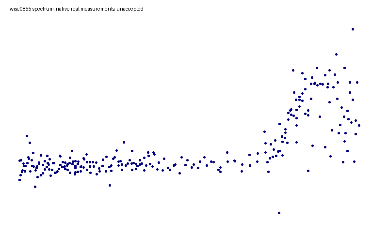

# G4b-wise-stacks — FAIL (L3)

# Native target acceptance
Complete measurements and rejected frames:
```json
{
  "ra": 133.76017495970984,
  "dec": -7.242245262123162,
  "rows": [
    {
      "lam": 2.3628344535827637,
      "dlam": 0.058327462524175644,
      "flux": 63.63740327797612,
      "err": 31.240701724813647,
      "mjd": 60800.70069465,
      "visit": "V1",
      "detector": 3,
      "flags": [
        "SOURCE"
      ],
      "rchi2": 1.1664543884209768,
      "contaminated": false,
      "release": "qr2",
      "quality": {
        "lam": 2.3628344535827637,
        "dlam": 0.058327462524175644,
        "flux_uJy": 63.63740327797612,
        "err_uJy": 31.240701724813647,
        "stat_err_uJy": 31.18231385052121,
        "cal_err_uJy": 1.9091220983392836,
        "mjd": 60800.70069465,
        "detector": 3,
        "obsid": "2025W19_1B_0116_1",
        "rchi2": 1.1664543884209768,
        "flags_near": [
          "SOURCE"
        ],
        "wing_fit": false,
        "contaminated": false,
        "photometric_scale": "qr2",
        "blend_fit": true,
        "blend_registration": "joint shared translation",
        "omega_arcsec2": 37.51771926879883,
        "zone": 34
      },
      "frame_id": "level2_2025W19_1B_0116_1D3_spx_l2b-v20-2025-241.fits"
    },
    {
      "lam": 4.967217922210693,
      "dlam": 0.03865577653050423,
      "flux": 261.1545702475277,
      "err": 164.65326034936888,
      "mjd": 60800.70069465,
      "visit": "V1",
      "detector": 6,
      "flags": [
        "SOURCE"
      ],
      "rchi2": 1.0465043206094513,
      "contaminated": false,
      "release": "qr2",
      "quality": {
        "lam": 4.967217922210693,
        "dlam": 0.03865577653050423,
        "flux_uJy": 261.1545702475277,
        "err_uJy": 164.65326034936888,
        "stat_err_uJy": 164.46675835886106,
        "cal_err_uJy": 7.834637107425831,
        "mjd": 60800.70069465,
        "detector": 6,
        "obsid": "2025W19_1B_0116_1",
        "rchi2": 1.0465043206094513,
        "flags_near": [
          "SOURCE"
        ],
        "wing_fit": false,
        "contaminated": false,
        "photometric_scale": "qr2",
        "blend_fit": true,
        "blend_registration": "joint shared translation",
        "omega_arcsec2": 37.60438537597656,
        "zone": 24
      },
      "frame_id": "level2_2025W19_1B_0116_1D6_spx_l2b-v20-2025-241.fits"
    },
    {
      "lam": 2.4126639366149902,
      "dlam": 0.05181024223566055,
      "flux": -35.95794047177735,
      "err": 43.23067710943727,
      "mjd": 60800.702186907,
      "visit": "V1",
      "detector": 3,
      "flags": [
        "COLD",
        "DICHROIC",
        "OUTLIER",
        "SOURCE",
        "SUR_ERROR",
        "TRANSIENT"
      ],
      "rchi2": 1.2414987394171488,
      "contaminated": true,
      "release": "qr2",
      "quality": {
        "lam": 2.4126639366149902,
        "dlam": 0.05181024223566055,
        "flux_uJy": -35.95794047177735,
        "err_uJy": 43.23067710943727,
        "stat_err_uJy": 43.21721609735811,
        "cal_err_uJy": 1.0787382141533204,
        "mjd": 60800.702186907,
        "detector": 3,
        "obsid": "2025W19_1B_0116_2",
        "rchi2": 1.2414987394171488,
        "flags_near": [
          "COLD",
          "DICHROIC",
          "OUTLIER",
          "SOURCE",
          "SUR_ERROR",
          "TRANSIENT"
        ],
        "wing_fit": false,
        "contaminated": true,
        "photometric_scale": "qr2",
        "blend_fit": true,
        "blend_registration": "joint shared translation",
        "omega_arcsec2": 37.487396240234375,
        "zone": 1
      },
      "frame_id": "level2_2025W19_1B_0116_2D3_spx_l2b-v20-2025-241.fits"
    },
    {
      "lam": 5.004439353942871,
      "dlam": 0.037165168672800064,
      "flux": 341.18044716030533,
      "err": 186.15066742394797,
      "mjd": 60800.702186907,
      "visit": "V1",
      "detector": 6,
      "flags": [
        "SOURCE"
      ],
      "rchi2": 0.8671845215336889,
      "contaminated": false,
      "release": "qr2",
      "quality": {
        "lam": 5.004439353942871,
        "dlam": 0.037165168672800064,
        "flux_uJy": 341.18044716030533,
        "err_uJy": 186.15066742394797,
        "stat_err_uJy": 185.8690595408747,
        "cal_err_uJy": 10.235413414809159,
        "mjd": 60800.702186907,
        "detector": 6,
        "obsid": "2025W19_1B_0116_2",
        "rchi2": 0.8671845215336889,
        "flags_near": [
          "SOURCE"
        ],
        "wing_fit": false,
        "contaminated": false,
        "photometric_scale": "qr2",
        "blend_fit": true,
        "blend_registration": "joint shared translation",
        "omega_arcsec2": 37.57661819458008,
        "zone": 3
      },
      "frame_id": "level2_2025W19_1B_0116_2D6_spx_l2b-v20-2025-241.fits"
    },
    {
      "lam": 2.2074756622314453,
      "dlam": 0.05515826493501663,
      "flux": -13.941061140221386,
      "err": 20.66609248488683,
      "mjd": 60800.835104036,
      "visit": "V1",
      "detector": 3,
      "flags": [
        "SOURCE"
      ],
      "rchi2": 1.1760610658397213,
      "contaminated": false,
      "release": "qr2",
      "quality": {
        "lam": 2.2074756622314453,
        "dlam": 0.05515826493501663,
        "flux_uJy": -13.941061140221386,
        "err_uJy": 20.66609248488683,
        "stat_err_uJy": 20.661860050023375,
        "cal_err_uJy": 0.41823183420664156,
        "mjd": 60800.835104036,
        "detector": 3,
        "obsid": "2025W19_1B_0138_1",
        "rchi2": 1.1760610658397213,
        "flags_near": [
          "SOURCE"
        ],
        "wing_fit": false,
        "contaminated": false,
        "photometric_scale": "qr2",
        "blend_fit": true,
        "blend_registration": "joint shared translation",
        "omega_arcsec2": 37.613006591796875,
        "zone": 111
      },
      "frame_id": "level2_2025W19_1B_0138_1D3_spx_l2b-v20-2025-241.fits"
    },
    {
      "lam": 4.85945463180542,
      "dlam": 0.03546510264277458,
      "flux": 471.887724322061,
      "err": 145.82581718515422,
      "mjd": 60800.835104036,
      "visit": "V1",
      "detector": 6,
      "flags": [
        "SOURCE"
      ],
      "rchi2": 0.8370848849211797,
      "contaminated": false,
      "release": "qr2",
      "quality": {
        "lam": 4.85945463180542,
        "dlam": 0.03546510264277458,
        "flux_uJy": 471.887724322061,
        "err_uJy": 145.82581718515422,
        "stat_err_uJy": 145.1370343357916,
        "cal_err_uJy": 14.156631729661829,
        "mjd": 60800.835104036,
        "detector": 6,
        "obsid": "2025W19_1B_0138_1",
        "rchi2": 0.8370848849211797,
        "flags_near": [
          "SOURCE"
        ],
        "wing_fit": false,
        "contaminated": false,
        "photometric_scale": "qr2",
        "blend_fit": true,
        "blend_registration": "joint shared translation",
        "omega_arcsec2": 37.6927375793457,
        "zone": 108
      },
      "frame_id": "level2_2025W19_1B_0138_1D6_spx_l2b-v20-2025-241.fits"
    },
    {
      "lam": 1.5147364139556885,
      "dlam": 0.03721190616488457,
      "flux": -78.68871649895013,
      "err": 30.05549655009519,
      "mjd": 60801.107262601,
      "visit": "V1",
      "detector": 2,
      "flags": [
        "OUTLIER",
        "SOURCE"
      ],
      "rchi2": 1.0981034990755354,
      "contaminated": false,
      "release": "qr2",
      "quality": {
        "lam": 1.5147364139556885,
        "dlam": 0.03721190616488457,
        "flux_uJy": -78.68871649895013,
        "err_uJy": 30.05549655009519,
        "stat_err_uJy": 29.962645914187167,
        "cal_err_uJy": 2.360661494968504,
        "mjd": 60801.107262601,
        "detector": 2,
        "obsid": "2025W19_1B_0181_1",
        "rchi2": 1.0981034990755354,
        "flags_near": [
          "OUTLIER",
          "SOURCE"
        ],
        "wing_fit": false,
        "contaminated": false,
        "photometric_scale": "qr2",
        "blend_fit": true,
        "blend_registration": "joint shared translation",
        "omega_arcsec2": 37.520572662353516,
        "zone": 91
      },
      "frame_id": "level2_2025W19_1B_0181_1D2_spx_l2b-v20-2025-241.fits"
    },
    {
      "lam": 4.294766426086426,
      "dlam": 0.03684428334236145,
      "flux": 633.3882098042372,
      "err": 107.20530224100855,
      "mjd": 60801.107262601,
      "visit": "V1",
      "detector": 5,
      "flags": [
        "SOURCE"
      ],
      "rchi2": 1.1516787027879418,
      "contaminated": false,
      "release": "qr2",
      "quality": {
        "lam": 4.294766426086426,
        "dlam": 0.03684428334236145,
        "flux_uJy": 633.3882098042372,
        "err_uJy": 107.20530224100855,
        "stat_err_uJy": 105.50788722507374,
        "cal_err_uJy": 19.001646294127116,
        "mjd": 60801.107262601,
        "detector": 5,
        "obsid": "2025W19_1B_0181_1",
        "rchi2": 1.1516787027879418,
        "flags_near": [
          "SOURCE"
        ],
        "wing_fit": false,
        "contaminated": false,
        "photometric_scale": "qr2",
        "blend_fit": true,
        "blend_registration": "joint shared translation",
        "omega_arcsec2": 37.59602737426758,
        "zone": 91
      },
      "frame_id": "level2_2025W19_1B_0181_1D5_spx_l2b-v20-2025-241.fits"
    },
    {
      "lam": 1.551997184753418,
      "dlam": 0.03822125867009163,
      "flux": -43.7741683516948,
      "err": 26.69283327647658,
      "mjd": 60801.108754847,
      "visit": "V1",
      "detector": 2,
      "flags": [
        "SOURCE"
      ],
      "rchi2": 1.0563732778597066,
      "contaminated": false,
      "release": "qr2",
      "quality": {
        "lam": 1.551997184753418,
        "dlam": 0.03822125867009163,
        "flux_uJy": -43.7741683516948,
        "err_uJy": 26.69283327647658,
        "stat_err_uJy": 26.660509903082897,
        "cal_err_uJy": 1.3132250505508438,
        "mjd": 60801.108754847,
        "detector": 2,
        "obsid": "2025W19_1B_0181_2",
        "rchi2": 1.0563732778597066,
        "flags_near": [
          "SOURCE"
        ],
        "wing_fit": false,
        "contaminated": false,
        "photometric_scale": "qr2",
        "blend_fit": true,
        "blend_registration": "joint shared translation",
        "omega_arcsec2": 37.49062728881836,
        "zone": 70
      },
      "frame_id": "level2_2025W19_1B_0181_2D2_spx_l2b-v20-2025-241.fits"
    },
    {
      "lam": 4.331647872924805,
      "dlam": 0.0372602753341198,
      "flux": 673.1809323153202,
      "err": 92.96570462840515,
      "mjd": 60801.108754847,
      "visit": "V1",
      "detector": 5,
      "flags": [
        "SOURCE"
      ],
      "rchi2": 0.9670544304131439,
      "contaminated": false,
      "release": "qr2",
      "quality": {
        "lam": 4.331647872924805,
        "dlam": 0.0372602753341198,
        "flux_uJy": 673.1809323153202,
        "err_uJy": 92.96570462840515,
        "stat_err_uJy": 90.7456165673375,
        "cal_err_uJy": 20.195427969459605,
        "mjd": 60801.108754847,
        "detector": 5,
        "obsid": "2025W19_1B_0181_2",
        "rchi2": 0.9670544304131439,
        "flags_near": [
          "SOURCE"
        ],
        "wing_fit": false,
        "contaminated": false,
        "photometric_scale": "qr2",
        "blend_fit": true,
        "blend_registration": "joint shared translation",
        "omega_arcsec2": 37.56611633300781,
        "zone": 70
      },
      "frame_id": "level2_2025W19_1B_0181_2D5_spx_l2b-v20-2025-241.fits"
    },
    {
      "lam": 1.5898631811141968,
      "dlam": 0.03884069621562958,
      "flux": 4.843415527466799,
      "err": 30.121649786404298,
      "mjd": 60801.110247104,
      "visit": "V1",
      "detector": 2,
      "flags": [
        "SOURCE",
        "TRANSIENT"
      ],
      "rchi2": 1.4795338328309886,
      "contaminated": true,
      "release": "qr2",
      "quality": {
        "lam": 1.5898631811141968,
        "dlam": 0.03884069621562958,
        "flux_uJy": 4.843415527466799,
        "err_uJy": 30.121649786404298,
        "stat_err_uJy": 30.121299325364692,
        "cal_err_uJy": 0.14530246582400397,
        "mjd": 60801.110247104,
        "detector": 2,
        "obsid": "2025W19_1B_0181_3",
        "rchi2": 1.4795338328309886,
        "flags_near": [
          "SOURCE",
          "TRANSIENT"
        ],
        "wing_fit": false,
        "contaminated": true,
        "photometric_scale": "qr2",
        "blend_fit": true,
        "blend_registration": "joint shared translation",
        "omega_arcsec2": 37.461421966552734,
        "zone": 28
      },
      "frame_id": "level2_2025W19_1B_0181_3D2_spx_l2b-v20-2025-241.fits"
    },
    {
      "lam": 4.368845462799072,
      "dlam": 0.038155559450387955,
      "flux": 476.28656362644426,
      "err": 99.89267827222366,
      "mjd": 60801.110247104,
      "visit": "V1",
      "detector": 5,
      "flags": [
        "SOURCE",
        "TRANSIENT"
      ],
      "rchi2": 1.1270276594952913,
      "contaminated": true,
      "release": "qr2",
      "quality": {
        "lam": 4.368845462799072,
        "dlam": 0.038155559450387955,
        "flux_uJy": 476.28656362644426,
        "err_uJy": 99.89267827222366,
        "stat_err_uJy": 98.86548017774457,
        "cal_err_uJy": 14.288596908793327,
        "mjd": 60801.110247104,
        "detector": 5,
        "obsid": "2025W19_1B_0181_3",
        "rchi2": 1.1270276594952913,
        "flags_near": [
          "SOURCE",
          "TRANSIENT"
        ],
        "wing_fit": false,
        "contaminated": true,
        "photometric_scale": "qr2",
        "blend_fit": true,
        "blend_registration": "joint shared translation",
        "omega_arcsec2": 37.53697204589844,
        "zone": 28
      },
      "frame_id": "level2_2025W19_1B_0181_3D5_spx_l2b-v20-2025-241.fits"
    },
    {
      "lam": 1.6278156042099,
      "dlam": 0.0388767346739769,
      "flux": 3.9455241145763087,
      "err": 38.65550706605317,
      "mjd": 60801.111739349,
      "visit": "V1",
      "detector": 2,
      "flags": [
        "SOURCE"
      ],
      "rchi2": 1.426703425828434,
      "contaminated": false,
      "release": "qr2",
      "quality": {
        "lam": 1.6278156042099,
        "dlam": 0.0388767346739769,
        "flux_uJy": 3.9455241145763087,
        "err_uJy": 38.65550706605317,
        "stat_err_uJy": 38.655325843785114,
        "cal_err_uJy": 0.11836572343728925,
        "mjd": 60801.111739349,
        "detector": 2,
        "obsid": "2025W19_1B_0181_4",
        "rchi2": 1.426703425828434,
        "flags_near": [
          "SOURCE"
        ],
        "wing_fit": false,
        "contaminated": false,
        "photometric_scale": "qr2",
        "blend_fit": true,
        "blend_registration": "joint shared translation",
        "omega_arcsec2": 37.43318557739258,
        "zone": 7
      },
      "frame_id": "level2_2025W19_1B_0181_4D2_spx_l2b-v20-2025-241.fits"
    },
    {
      "lam": 4.40563440322876,
      "dlam": 0.03751873970031738,
      "flux": 721.1955629188567,
      "err": 98.40342254878144,
      "mjd": 60801.111739349,
      "visit": "V1",
      "detector": 5,
      "flags": [
        "SOURCE"
      ],
      "rchi2": 0.9829093779189161,
      "contaminated": false,
      "release": "qr2",
      "quality": {
        "lam": 4.40563440322876,
        "dlam": 0.03751873970031738,
        "flux_uJy": 721.1955629188567,
        "err_uJy": 98.40342254878144,
        "stat_err_uJy": 95.99543131492022,
        "cal_err_uJy": 21.6358668875657,
        "mjd": 60801.111739349,
        "detector": 5,
        "obsid": "2025W19_1B_0181_4",
        "rchi2": 0.9829093779189161,
        "flags_near": [
          "SOURCE"
        ],
        "wing_fit": false,
        "contaminated": false,
        "photometric_scale": "qr2",
        "blend_fit": true,
        "blend_registration": "joint shared translation",
        "omega_arcsec2": 37.50878143310547,
        "zone": 7
      },
      "frame_id": "level2_2025W19_1B_0181_4D5_spx_l2b-v20-2025-241.fits"
    },
    {
      "lam": 1.2792575359344482,
      "dlam": 0.031099624931812286,
      "flux": -40.548670452034585,
      "err": 27.009627661650338,
      "mjd": 60801.446306085,
      "visit": "V1",
      "detector": 2,
      "flags": [
        "SOURCE"
      ],
      "rchi2": 0.8219603506884539,
      "contaminated": false,
      "release": "qr2",
      "quality": {
        "lam": 1.2792575359344482,
        "dlam": 0.031099624931812286,
        "flux_uJy": -40.548670452034585,
        "err_uJy": 27.009627661650338,
        "stat_err_uJy": 26.98222027953041,
        "cal_err_uJy": 1.2164601135610376,
        "mjd": 60801.446306085,
        "detector": 2,
        "obsid": "2025W19_1B_0231_1",
        "rchi2": 0.8219603506884539,
        "flags_near": [
          "SOURCE"
        ],
        "wing_fit": false,
        "contaminated": false,
        "photometric_scale": "qr2",
        "blend_fit": true,
        "blend_registration": "joint shared translation",
        "omega_arcsec2": 37.774505615234375,
        "zone": 276
      },
      "frame_id": "level2_2025W19_1B_0231_1D2_spx_l2b-v20-2025-241.fits"
    },
    {
      "lam": 4.038520336151123,
      "dlam": 0.03681262955069542,
      "flux": 237.32749500157996,
      "err": 92.70331280682835,
      "mjd": 60801.446306085,
      "visit": "V1",
      "detector": 5,
      "flags": [
        "SOURCE"
      ],
      "rchi2": 1.2930106559097896,
      "contaminated": false,
      "release": "qr2",
      "quality": {
        "lam": 4.038520336151123,
        "dlam": 0.03681262955069542,
        "flux_uJy": 237.32749500157996,
        "err_uJy": 92.70331280682835,
        "stat_err_uJy": 92.4294990761354,
        "cal_err_uJy": 7.119824850047398,
        "mjd": 60801.446306085,
        "detector": 5,
        "obsid": "2025W19_1B_0231_1",
        "rchi2": 1.2930106559097896,
        "flags_near": [
          "SOURCE"
        ],
        "wing_fit": false,
        "contaminated": false,
        "photometric_scale": "qr2",
        "blend_fit": true,
        "blend_registration": "joint shared translation",
        "omega_arcsec2": 37.851356506347656,
        "zone": 255
      },
      "frame_id": "level2_2025W19_1B_0231_1D5_spx_l2b-v20-2025-241.fits"
    },
    {
      "lam": 1.3096519708633423,
      "dlam": 0.03164643794298172,
      "flux": -34.08503019646948,
      "err": 40.41202666543152,
      "mjd": 60801.44779833,
      "visit": "V1",
      "detector": 2,
      "flags": [
        "SOURCE"
      ],
      "rchi2": 1.2646193972904296,
      "contaminated": false,
      "release": "qr2",
      "quality": {
        "lam": 1.3096519708633423,
        "dlam": 0.03164643794298172,
        "flux_uJy": -34.08503019646948,
        "err_uJy": 40.41202666543152,
        "stat_err_uJy": 40.39908772302171,
        "cal_err_uJy": 1.0225509058940845,
        "mjd": 60801.44779833,
        "detector": 2,
        "obsid": "2025W19_1B_0231_2",
        "rchi2": 1.2646193972904296,
        "flags_near": [
          "SOURCE"
        ],
        "wing_fit": false,
        "contaminated": false,
        "photometric_scale": "qr2",
        "blend_fit": true,
        "blend_registration": "joint shared translation",
        "omega_arcsec2": 37.739723205566406,
        "zone": 234
      },
      "frame_id": "level2_2025W19_1B_0231_2D2_spx_l2b-v20-2025-241.fits"
    },
    {
      "lam": 4.073602199554443,
      "dlam": 0.03651406615972519,
      "flux": 227.69724718921125,
      "err": 72.18450757567854,
      "mjd": 60801.44779833,
      "visit": "V1",
      "detector": 5,
      "flags": [
        "SOURCE"
      ],
      "rchi2": 1.0438267385236306,
      "contaminated": false,
      "release": "qr2",
      "quality": {
        "lam": 4.073602199554443,
        "dlam": 0.03651406615972519,
        "flux_uJy": 227.69724718921125,
        "err_uJy": 72.18450757567854,
        "stat_err_uJy": 71.86057125575472,
        "cal_err_uJy": 6.830917415676337,
        "mjd": 60801.44779833,
        "detector": 5,
        "obsid": "2025W19_1B_0231_2",
        "rchi2": 1.0438267385236306,
        "flags_near": [
          "SOURCE"
        ],
        "wing_fit": false,
        "contaminated": false,
        "photometric_scale": "qr2",
        "blend_fit": true,
        "blend_registration": "joint shared translation",
        "omega_arcsec2": 37.81646728515625,
        "zone": 234
      },
      "frame_id": "level2_2025W19_1B_0231_2D5_spx_l2b-v20-2025-241.fits"
    },
    {
      "lam": 1.3407639265060425,
      "dlam": 0.03207793086767197,
      "flux": -29.024833351992864,
      "err": 34.74277782667092,
      "mjd": 60801.449290587,
      "visit": "V1",
      "detector": 2,
      "flags": [
        "SOURCE"
      ],
      "rchi2": 1.452754047022199,
      "contaminated": false,
      "release": "qr2",
      "quality": {
        "lam": 1.3407639265060425,
        "dlam": 0.03207793086767197,
        "flux_uJy": -29.024833351992864,
        "err_uJy": 34.74277782667092,
        "stat_err_uJy": 34.73186453758877,
        "cal_err_uJy": 0.8707450005597859,
        "mjd": 60801.449290587,
        "detector": 2,
        "obsid": "2025W19_1B_0231_3",
        "rchi2": 1.452754047022199,
        "flags_near": [
          "SOURCE"
        ],
        "wing_fit": false,
        "contaminated": false,
        "photometric_scale": "qr2",
        "blend_fit": true,
        "blend_registration": "joint shared translation",
        "omega_arcsec2": 37.705387115478516,
        "zone": 213
      },
      "frame_id": "level2_2025W19_1B_0231_3D2_spx_l2b-v20-2025-241.fits"
    },
    {
      "lam": 4.108796119689941,
      "dlam": 0.03666824847459793,
      "flux": 180.4965546486727,
      "err": 69.40507588314051,
      "mjd": 60801.449290576,
      "visit": "V1",
      "detector": 5,
      "flags": [
        "SOURCE"
      ],
      "rchi2": 1.0287994564258365,
      "contaminated": false,
      "release": "qr2",
      "quality": {
        "lam": 4.108796119689941,
        "dlam": 0.03666824847459793,
        "flux_uJy": 180.4965546486727,
        "err_uJy": 69.40507588314051,
        "stat_err_uJy": 69.19352175405191,
        "cal_err_uJy": 5.414896639460181,
        "mjd": 60801.449290576,
        "detector": 5,
        "obsid": "2025W19_1B_0231_3",
        "rchi2": 1.0287994564258365,
        "flags_near": [
          "SOURCE"
        ],
        "wing_fit": false,
        "contaminated": false,
        "photometric_scale": "qr2",
        "blend_fit": true,
        "blend_registration": "joint shared translation",
        "omega_arcsec2": 37.78227615356445,
        "zone": 213
      },
      "frame_id": "level2_2025W19_1B_0231_3D5_spx_l2b-v20-2025-241.fits"
    },
    {
      "lam": 1.3724098205566406,
      "dlam": 0.03333469107747078,
      "flux": -5.2674823795519865,
      "err": 31.709813035078426,
      "mjd": 60801.450782833,
      "visit": "V1",
      "detector": 2,
      "flags": [
        "SOURCE"
      ],
      "rchi2": 1.1575291644437329,
      "contaminated": false,
      "release": "qr2",
      "quality": {
        "lam": 1.3724098205566406,
        "dlam": 0.03333469107747078,
        "flux_uJy": -5.2674823795519865,
        "err_uJy": 31.709813035078426,
        "stat_err_uJy": 31.709419278600368,
        "cal_err_uJy": 0.1580244713865596,
        "mjd": 60801.450782833,
        "detector": 2,
        "obsid": "2025W19_1B_0231_4",
        "rchi2": 1.1575291644437329,
        "flags_near": [
          "SOURCE"
        ],
        "wing_fit": false,
        "contaminated": false,
        "photometric_scale": "qr2",
        "blend_fit": true,
        "blend_registration": "joint shared translation",
        "omega_arcsec2": 37.67205047607422,
        "zone": 192
      },
      "frame_id": "level2_2025W19_1B_0231_4D2_spx_l2b-v20-2025-241.fits"
    },
    {
      "lam": 4.144399166107178,
      "dlam": 0.03658374771475792,
      "flux": 480.2175873559009,
      "err": 91.74508573595827,
      "mjd": 60801.450782821,
      "visit": "V1",
      "detector": 5,
      "flags": [
        "SOURCE"
      ],
      "rchi2": 1.1048612858932905,
      "contaminated": false,
      "release": "qr2",
      "quality": {
        "lam": 4.144399166107178,
        "dlam": 0.03658374771475792,
        "flux_uJy": 480.2175873559009,
        "err_uJy": 91.74508573595827,
        "stat_err_uJy": 90.60691319437498,
        "cal_err_uJy": 14.406527620677027,
        "mjd": 60801.450782821,
        "detector": 5,
        "obsid": "2025W19_1B_0231_4",
        "rchi2": 1.1048612858932905,
        "flags_near": [
          "SOURCE"
        ],
        "wing_fit": false,
        "contaminated": false,
        "photometric_scale": "qr2",
        "blend_fit": true,
        "blend_registration": "joint shared translation",
        "omega_arcsec2": 37.748836517333984,
        "zone": 192
      },
      "frame_id": "level2_2025W19_1B_0231_4D5_spx_l2b-v20-2025-241.fits"
    },
    {
      "lam": 0.9923018217086792,
      "dlam": 0.026088815182447433,
      "flux": -2.421396045723198,
      "err": 36.32629877381836,
      "mjd": 60801.514843134,
      "visit": "V1",
      "detector": 1,
      "flags": [
        "SOURCE"
      ],
      "rchi2": 1.307817929150765,
      "contaminated": false,
      "release": "qr2",
      "quality": {
        "lam": 0.9923018217086792,
        "dlam": 0.026088815182447433,
        "flux_uJy": -2.421396045723198,
        "err_uJy": 36.32629877381836,
        "stat_err_uJy": 36.326226142578975,
        "cal_err_uJy": 0.07264188137169594,
        "mjd": 60801.514843134,
        "detector": 1,
        "obsid": "2025W19_1B_0241_1",
        "rchi2": 1.307817929150765,
        "flags_near": [
          "SOURCE"
        ],
        "wing_fit": false,
        "contaminated": false,
        "photometric_scale": "qr2",
        "blend_fit": true,
        "blend_registration": "joint shared translation",
        "omega_arcsec2": 37.70840835571289,
        "zone": 115
      },
      "frame_id": "level2_2025W19_1B_0241_1D1_spx_l2b-v20-2025-242.fits"
    },
    {
      "lam": 3.3563060760498047,
      "dlam": 0.09663751721382141,
      "flux": 10.532672308230339,
      "err": 38.94396541269412,
      "mjd": 60801.514843134,
      "visit": "V1",
      "detector": 4,
      "flags": [
        "SOURCE",
        "SUR_ERROR",
        "TRANSIENT"
      ],
      "rchi2": 2.178892866342311,
      "contaminated": true,
      "release": "qr2",
      "quality": {
        "lam": 3.3563060760498047,
        "dlam": 0.09663751721382141,
        "flux_uJy": 10.532672308230339,
        "err_uJy": 38.94396541269412,
        "stat_err_uJy": 38.94268350534871,
        "cal_err_uJy": 0.31598016924691014,
        "mjd": 60801.514843134,
        "detector": 4,
        "obsid": "2025W19_1B_0241_1",
        "rchi2": 2.178892866342311,
        "flags_near": [
          "SOURCE",
          "SUR_ERROR",
          "TRANSIENT"
        ],
        "wing_fit": false,
        "contaminated": true,
        "photometric_scale": "qr2",
        "blend_fit": true,
        "blend_registration": "joint shared translation",
        "omega_arcsec2": 37.77674102783203,
        "zone": 115
      },
      "frame_id": "level2_2025W19_1B_0241_1D4_spx_l2b-v20-2025-241.fits"
    },
    {
      "lam": 1.015901803970337,
      "dlam": 0.027164557948708534,
      "flux": 64.70600741047454,
      "err": 39.64813210343845,
      "mjd": 60801.516335379,
      "visit": "V1",
      "detector": 1,
      "flags": [
        "SOURCE"
      ],
      "rchi2": 1.2510057416620892,
      "contaminated": false,
      "release": "qr2",
      "quality": {
        "lam": 1.015901803970337,
        "dlam": 0.027164557948708534,
        "flux_uJy": 64.70600741047454,
        "err_uJy": 39.64813210343845,
        "stat_err_uJy": 39.600583311817545,
        "cal_err_uJy": 1.9411802223142363,
        "mjd": 60801.516335379,
        "detector": 1,
        "obsid": "2025W19_1B_0241_2",
        "rchi2": 1.2510057416620892,
        "flags_near": [
          "SOURCE"
        ],
        "wing_fit": false,
        "contaminated": false,
        "photometric_scale": "qr2",
        "blend_fit": true,
        "blend_registration": "joint shared translation",
        "omega_arcsec2": 37.6761360168457,
        "zone": 94
      },
      "frame_id": "level2_2025W19_1B_0241_2D1_spx_l2b-v20-2025-242.fits"
    },
    {
      "lam": 3.4483163356781006,
      "dlam": 0.09471051394939423,
      "flux": 12.572990392170196,
      "err": 28.785924378161763,
      "mjd": 60801.516335391,
      "visit": "V1",
      "detector": 4,
      "flags": [
        "SOURCE"
      ],
      "rchi2": 1.2700135750873816,
      "contaminated": false,
      "release": "qr2",
      "quality": {
        "lam": 3.4483163356781006,
        "dlam": 0.09471051394939423,
        "flux_uJy": 12.572990392170196,
        "err_uJy": 28.785924378161763,
        "stat_err_uJy": 28.783453062942016,
        "cal_err_uJy": 0.37718971176510585,
        "mjd": 60801.516335391,
        "detector": 4,
        "obsid": "2025W19_1B_0241_2",
        "rchi2": 1.2700135750873816,
        "flags_near": [
          "SOURCE"
        ],
        "wing_fit": false,
        "contaminated": false,
        "photometric_scale": "qr2",
        "blend_fit": true,
        "blend_registration": "joint shared translation",
        "omega_arcsec2": 37.74365997314453,
        "zone": 94
      },
      "frame_id": "level2_2025W19_1B_0241_2D4_spx_l2b-v20-2025-241.fits"
    },
    {
      "lam": 1.0405385494232178,
      "dlam": 0.027375807985663414,
      "flux": -23.775744719230193,
      "err": 32.20489568744496,
      "mjd": 60801.517827636,
      "visit": "V1",
      "detector": 1,
      "flags": [
        "SOURCE"
      ],
      "rchi2": 1.202067118287289,
      "contaminated": false,
      "release": "qr2",
      "quality": {
        "lam": 1.0405385494232178,
        "dlam": 0.027375807985663414,
        "flux_uJy": -23.775744719230193,
        "err_uJy": 32.20489568744496,
        "stat_err_uJy": 32.19699595934305,
        "cal_err_uJy": 0.7132723415769058,
        "mjd": 60801.517827636,
        "detector": 1,
        "obsid": "2025W19_1B_0241_3",
        "rchi2": 1.202067118287289,
        "flags_near": [
          "SOURCE"
        ],
        "wing_fit": false,
        "contaminated": false,
        "photometric_scale": "qr2",
        "blend_fit": true,
        "blend_registration": "joint shared translation",
        "omega_arcsec2": 37.6443977355957,
        "zone": 73
      },
      "frame_id": "level2_2025W19_1B_0241_3D1_spx_l2b-v20-2025-242.fits"
    },
    {
      "lam": 3.5419838428497314,
      "dlam": 0.09625247120857239,
      "flux": -17.25798260145621,
      "err": 26.473136811883123,
      "mjd": 60801.517827636,
      "visit": "V1",
      "detector": 4,
      "flags": [
        "OUTLIER",
        "SOURCE"
      ],
      "rchi2": 1.1021349272796932,
      "contaminated": false,
      "release": "qr2",
      "quality": {
        "lam": 3.5419838428497314,
        "dlam": 0.09625247120857239,
        "flux_uJy": -17.25798260145621,
        "err_uJy": 26.473136811883123,
        "stat_err_uJy": 26.468073569747315,
        "cal_err_uJy": 0.5177394780436863,
        "mjd": 60801.517827636,
        "detector": 4,
        "obsid": "2025W19_1B_0241_3",
        "rchi2": 1.1021349272796932,
        "flags_near": [
          "OUTLIER",
          "SOURCE"
        ],
        "wing_fit": false,
        "contaminated": false,
        "photometric_scale": "qr2",
        "blend_fit": true,
        "blend_registration": "joint shared translation",
        "omega_arcsec2": 37.71091842651367,
        "zone": 73
      },
      "frame_id": "level2_2025W19_1B_0241_3D4_spx_l2b-v20-2025-241.fits"
    },
    {
      "lam": 1.0652621984481812,
      "dlam": 0.028516625985503197,
      "flux": 15.041214800284513,
      "err": 42.17699194299895,
      "mjd": 60801.519319893,
      "visit": "V1",
      "detector": 1,
      "flags": [
        "SOURCE"
      ],
      "rchi2": 0.8903409462157846,
      "contaminated": false,
      "release": "qr2",
      "quality": {
        "lam": 1.0652621984481812,
        "dlam": 0.028516625985503197,
        "flux_uJy": 15.041214800284513,
        "err_uJy": 42.17699194299895,
        "stat_err_uJy": 42.17457806583721,
        "cal_err_uJy": 0.45123644400853535,
        "mjd": 60801.519319893,
        "detector": 1,
        "obsid": "2025W19_1B_0241_4",
        "rchi2": 0.8903409462157846,
        "flags_near": [
          "SOURCE"
        ],
        "wing_fit": false,
        "contaminated": false,
        "photometric_scale": "qr2",
        "blend_fit": true,
        "blend_registration": "joint shared translation",
        "omega_arcsec2": 37.613609313964844,
        "zone": 52
      },
      "frame_id": "level2_2025W19_1B_0241_4D1_spx_l2b-v20-2025-242.fits"
    },
    {
      "lam": 3.63769268989563,
      "dlam": 0.10356384515762329,
      "flux": -25.55342737207999,
      "err": 28.941680983260014,
      "mjd": 60801.519319893,
      "visit": "V1",
      "detector": 4,
      "flags": [
        "NONFUNC",
        "PERSIST",
        "SOURCE",
        "SUR_ERROR",
        "TRANSIENT"
      ],
      "rchi2": 1.8588065430985259,
      "contaminated": true,
      "release": "qr2",
      "quality": {
        "lam": 3.63769268989563,
        "dlam": 0.10356384515762329,
        "flux_uJy": -25.55342737207999,
        "err_uJy": 28.941680983260014,
        "stat_err_uJy": 28.93152637265065,
        "cal_err_uJy": 0.7666028211623998,
        "mjd": 60801.519319893,
        "detector": 4,
        "obsid": "2025W19_1B_0241_4",
        "rchi2": 1.8588065430985259,
        "flags_near": [
          "NONFUNC",
          "PERSIST",
          "SOURCE",
          "SUR_ERROR",
          "TRANSIENT"
        ],
        "wing_fit": false,
        "contaminated": true,
        "photometric_scale": "qr2",
        "blend_fit": true,
        "blend_registration": "joint shared translation",
        "omega_arcsec2": 37.67908477783203,
        "zone": 52
      },
      "frame_id": "level2_2025W19_1B_0241_4D4_spx_l2b-v20-2025-241.fits"
    },
    {
      "lam": 0.8609219193458557,
      "dlam": 0.021849341690540314,
      "flux": 33.87005013672743,
      "err": 32.85554870214131,
      "mjd": 60979.723343354,
      "visit": "V2",
      "detector": 1,
      "flags": [
        "SOURCE"
      ],
      "rchi2": 0.7916709432180921,
      "contaminated": false,
      "release": "qr2",
      "quality": {
        "lam": 0.8609219193458557,
        "dlam": 0.021849341690540314,
        "flux_uJy": 33.87005013672743,
        "err_uJy": 32.85554870214131,
        "stat_err_uJy": 32.8398327987848,
        "cal_err_uJy": 1.0161015041018229,
        "mjd": 60979.723343354,
        "detector": 1,
        "obsid": "2025W44_2B_0305_1",
        "rchi2": 0.7916709432180921,
        "flags_near": [
          "SOURCE"
        ],
        "wing_fit": false,
        "contaminated": false,
        "photometric_scale": "qr2",
        "blend_fit": true,
        "blend_registration": "joint shared translation",
        "omega_arcsec2": 38.07497024536133,
        "zone": 275
      },
      "frame_id": "level2_2025W44_2B_0305_1D1_spx_l2b-v20-2025-307.fits"
    },
    {
      "lam": 2.8527088165283203,
      "dlam": 0.08277446031570435,
      "flux": 23.56600569238061,
      "err": 36.22776414036346,
      "mjd": 60979.723343354,
      "visit": "V2",
      "detector": 4,
      "flags": [
        "SOURCE"
      ],
      "rchi2": 1.9403162663627345,
      "contaminated": false,
      "release": "qr2",
      "quality": {
        "lam": 2.8527088165283203,
        "dlam": 0.08277446031570435,
        "flux_uJy": 23.56600569238061,
        "err_uJy": 36.22776414036346,
        "stat_err_uJy": 36.220865169787714,
        "cal_err_uJy": 0.7069801707714183,
        "mjd": 60979.723343354,
        "detector": 4,
        "obsid": "2025W44_2B_0305_1",
        "rchi2": 1.9403162663627345,
        "flags_near": [
          "SOURCE"
        ],
        "wing_fit": false,
        "contaminated": false,
        "photometric_scale": "qr2",
        "blend_fit": true,
        "blend_registration": "joint shared translation",
        "omega_arcsec2": 38.14988708496094,
        "zone": 275
      },
      "frame_id": "level2_2025W44_2B_0305_1D4_spx_l2b-v20-2025-307.fits"
    },
    {
      "lam": 0.8813449740409851,
      "dlam": 0.0220778938382864,
      "flux": -81.40756378855426,
      "err": 46.0239733922329,
      "mjd": 60979.724835611,
      "visit": "V2",
      "detector": 1,
      "flags": [
        "SOURCE"
      ],
      "rchi2": 1.1696854704976871,
      "contaminated": false,
      "release": "qr2",
      "quality": {
        "lam": 0.8813449740409851,
        "dlam": 0.0220778938382864,
        "flux_uJy": -81.40756378855426,
        "err_uJy": 46.0239733922329,
        "stat_err_uJy": 45.959130262779915,
        "cal_err_uJy": 2.4422269136566275,
        "mjd": 60979.724835611,
        "detector": 1,
        "obsid": "2025W44_2B_0305_2",
        "rchi2": 1.1696854704976871,
        "flags_near": [
          "SOURCE"
        ],
        "wing_fit": false,
        "contaminated": false,
        "photometric_scale": "qr2",
        "blend_fit": true,
        "blend_registration": "joint shared translation",
        "omega_arcsec2": 38.03841018676758,
        "zone": 254
      },
      "frame_id": "level2_2025W44_2B_0305_2D1_spx_l2b-v20-2025-307.fits"
    },
    {
      "lam": 2.9309613704681396,
      "dlam": 0.08515335619449615,
      "flux": -17.51869129262171,
      "err": 33.76522646361095,
      "mjd": 60979.724835611,
      "visit": "V2",
      "detector": 4,
      "flags": [
        "SOURCE"
      ],
      "rchi2": 1.192963459652965,
      "contaminated": false,
      "release": "qr2",
      "quality": {
        "lam": 2.9309613704681396,
        "dlam": 0.08515335619449615,
        "flux_uJy": -17.51869129262171,
        "err_uJy": 33.76522646361095,
        "stat_err_uJy": 33.7611360005671,
        "cal_err_uJy": 0.5255607387786513,
        "mjd": 60979.724835611,
        "detector": 4,
        "obsid": "2025W44_2B_0305_2",
        "rchi2": 1.192963459652965,
        "flags_near": [
          "SOURCE"
        ],
        "wing_fit": false,
        "contaminated": false,
        "photometric_scale": "qr2",
        "blend_fit": true,
        "blend_registration": "joint shared translation",
        "omega_arcsec2": 38.11245346069336,
        "zone": 254
      },
      "frame_id": "level2_2025W44_2B_0305_2D4_spx_l2b-v20-2025-307.fits"
    },
    {
      "lam": 0.9024448990821838,
      "dlam": 0.02272484079003334,
      "flux": -30.43079777307234,
      "err": 44.95393319012972,
      "mjd": 60979.726327879,
      "visit": "V2",
      "detector": 1,
      "flags": [
        "SOURCE"
      ],
      "rchi2": 0.9949089696467,
      "contaminated": false,
      "release": "qr2",
      "quality": {
        "lam": 0.9024448990821838,
        "dlam": 0.02272484079003334,
        "flux_uJy": -30.43079777307234,
        "err_uJy": 44.95393319012972,
        "stat_err_uJy": 44.94466241006657,
        "cal_err_uJy": 0.9129239331921701,
        "mjd": 60979.726327879,
        "detector": 1,
        "obsid": "2025W44_2B_0305_3",
        "rchi2": 0.9949089696467,
        "flags_near": [
          "SOURCE"
        ],
        "wing_fit": false,
        "contaminated": false,
        "photometric_scale": "qr2",
        "blend_fit": true,
        "blend_registration": "joint shared translation",
        "omega_arcsec2": 38.002689361572266,
        "zone": 212
      },
      "frame_id": "level2_2025W44_2B_0305_3D1_spx_l2b-v20-2025-307.fits"
    },
    {
      "lam": 3.0110676288604736,
      "dlam": 0.08771640062332153,
      "flux": 6.265922518028367,
      "err": 30.662764128100857,
      "mjd": 60979.726327879,
      "visit": "V2",
      "detector": 4,
      "flags": [
        "SOURCE"
      ],
      "rchi2": 1.6043378306323572,
      "contaminated": false,
      "release": "qr2",
      "quality": {
        "lam": 3.0110676288604736,
        "dlam": 0.08771640062332153,
        "flux_uJy": 6.265922518028367,
        "err_uJy": 30.662764128100857,
        "stat_err_uJy": 30.662187925342952,
        "cal_err_uJy": 0.18797767554085099,
        "mjd": 60979.726327879,
        "detector": 4,
        "obsid": "2025W44_2B_0305_3",
        "rchi2": 1.6043378306323572,
        "flags_near": [
          "SOURCE"
        ],
        "wing_fit": false,
        "contaminated": false,
        "photometric_scale": "qr2",
        "blend_fit": true,
        "blend_registration": "joint shared translation",
        "omega_arcsec2": 38.075687408447266,
        "zone": 212
      },
      "frame_id": "level2_2025W44_2B_0305_3D4_spx_l2b-v20-2025-307.fits"
    },
    {
      "lam": 0.923876941204071,
      "dlam": 0.023951081559062004,
      "flux": -34.715711665495995,
      "err": 41.31812658255837,
      "mjd": 60979.727820136,
      "visit": "V2",
      "detector": 1,
      "flags": [
        "SOURCE"
      ],
      "rchi2": 1.2400662630251464,
      "contaminated": false,
      "release": "qr2",
      "quality": {
        "lam": 0.923876941204071,
        "dlam": 0.023951081559062004,
        "flux_uJy": -34.715711665495995,
        "err_uJy": 41.31812658255837,
        "stat_err_uJy": 41.30499874978232,
        "cal_err_uJy": 1.0414713499648798,
        "mjd": 60979.727820136,
        "detector": 1,
        "obsid": "2025W44_2B_0305_4",
        "rchi2": 1.2400662630251464,
        "flags_near": [
          "SOURCE"
        ],
        "wing_fit": false,
        "contaminated": false,
        "photometric_scale": "qr2",
        "blend_fit": true,
        "blend_registration": "joint shared translation",
        "omega_arcsec2": 37.96771240234375,
        "zone": 191
      },
      "frame_id": "level2_2025W44_2B_0305_4D1_spx_l2b-v20-2025-307.fits"
    },
    {
      "lam": 3.0937676429748535,
      "dlam": 0.09020697325468063,
      "flux": -27.399500810743476,
      "err": 36.32353816796244,
      "mjd": 60979.727820136,
      "visit": "V2",
      "detector": 4,
      "flags": [
        "SOURCE"
      ],
      "rchi2": 1.2458535658453744,
      "contaminated": false,
      "release": "qr2",
      "quality": {
        "lam": 3.0937676429748535,
        "dlam": 0.09020697325468063,
        "flux_uJy": -27.399500810743476,
        "err_uJy": 36.32353816796244,
        "stat_err_uJy": 36.31423640473821,
        "cal_err_uJy": 0.8219850243223042,
        "mjd": 60979.727820136,
        "detector": 4,
        "obsid": "2025W44_2B_0305_4",
        "rchi2": 1.2458535658453744,
        "flags_near": [
          "SOURCE"
        ],
        "wing_fit": false,
        "contaminated": false,
        "photometric_scale": "qr2",
        "blend_fit": true,
        "blend_registration": "joint shared translation",
        "omega_arcsec2": 38.03948974609375,
        "zone": 191
      },
      "frame_id": "level2_2025W44_2B_0305_4D4_spx_l2b-v20-2025-307.fits"
    },
    {
      "lam": 0.9458149671554565,
      "dlam": 0.02437712252140045,
      "flux": -69.89467635294287,
      "err": 46.43299367182457,
      "mjd": 60979.786089141,
      "visit": "V2",
      "detector": 1,
      "flags": [
        "SOURCE"
      ],
      "rchi2": 1.0565884111748511,
      "contaminated": false,
      "release": "qr2",
      "quality": {
        "lam": 0.9458149671554565,
        "dlam": 0.02437712252140045,
        "flux_uJy": -69.89467635294287,
        "err_uJy": 46.43299367182457,
        "stat_err_uJy": 46.38562452014057,
        "cal_err_uJy": 2.096840290588286,
        "mjd": 60979.786089141,
        "detector": 1,
        "obsid": "2025W44_2B_0321_1",
        "rchi2": 1.0565884111748511,
        "flags_near": [
          "SOURCE"
        ],
        "wing_fit": false,
        "contaminated": false,
        "photometric_scale": "qr2",
        "blend_fit": true,
        "blend_registration": "joint shared translation",
        "omega_arcsec2": 37.93306350708008,
        "zone": 170
      },
      "frame_id": "level2_2025W44_2B_0321_1D1_spx_l2b-v20-2025-307.fits"
    },
    {
      "lam": 3.1786463260650635,
      "dlam": 0.08955389261245728,
      "flux": 4.134454236733477,
      "err": 31.224261962993385,
      "mjd": 60979.786089152,
      "visit": "V2",
      "detector": 4,
      "flags": [
        "SOURCE"
      ],
      "rchi2": 1.4010438204333644,
      "contaminated": false,
      "release": "qr2",
      "quality": {
        "lam": 3.1786463260650635,
        "dlam": 0.08955389261245728,
        "flux_uJy": 4.134454236733477,
        "err_uJy": 31.224261962993385,
        "stat_err_uJy": 31.22401560967108,
        "cal_err_uJy": 0.12403362710200432,
        "mjd": 60979.786089152,
        "detector": 4,
        "obsid": "2025W44_2B_0321_1",
        "rchi2": 1.4010438204333644,
        "flags_near": [
          "SOURCE"
        ],
        "wing_fit": false,
        "contaminated": false,
        "photometric_scale": "qr2",
        "blend_fit": true,
        "blend_registration": "joint shared translation",
        "omega_arcsec2": 38.00394821166992,
        "zone": 170
      },
      "frame_id": "level2_2025W44_2B_0321_1D4_spx_l2b-v20-2025-307.fits"
    },
    {
      "lam": 0.9679388403892517,
      "dlam": 0.025411315262317657,
      "flux": -36.40493848050241,
      "err": 54.51355879963391,
      "mjd": 60979.787581398,
      "visit": "V2",
      "detector": 1,
      "flags": [
        "SOURCE"
      ],
      "rchi2": 0.8121391722227104,
      "contaminated": false,
      "release": "qr2",
      "quality": {
        "lam": 0.9679388403892517,
        "dlam": 0.025411315262317657,
        "flux_uJy": -36.40493848050241,
        "err_uJy": 54.51355879963391,
        "stat_err_uJy": 54.50261741797316,
        "cal_err_uJy": 1.0921481544150722,
        "mjd": 60979.787581398,
        "detector": 1,
        "obsid": "2025W44_2B_0321_2",
        "rchi2": 0.8121391722227104,
        "flags_near": [
          "SOURCE"
        ],
        "wing_fit": false,
        "contaminated": false,
        "photometric_scale": "qr2",
        "blend_fit": true,
        "blend_registration": "joint shared translation",
        "omega_arcsec2": 37.899356842041016,
        "zone": 149
      },
      "frame_id": "level2_2025W44_2B_0321_2D1_spx_l2b-v20-2025-307.fits"
    },
    {
      "lam": 3.2652251720428467,
      "dlam": 0.0945122241973877,
      "flux": -84.33878367606577,
      "err": 29.79224017801879,
      "mjd": 60979.787581398,
      "visit": "V2",
      "detector": 4,
      "flags": [
        "SOURCE"
      ],
      "rchi2": 1.0271087563114638,
      "contaminated": false,
      "release": "qr2",
      "quality": {
        "lam": 3.2652251720428467,
        "dlam": 0.0945122241973877,
        "flux_uJy": -84.33878367606577,
        "err_uJy": 29.79224017801879,
        "stat_err_uJy": 29.68460623683586,
        "cal_err_uJy": 2.530163510281973,
        "mjd": 60979.787581398,
        "detector": 4,
        "obsid": "2025W44_2B_0321_2",
        "rchi2": 1.0271087563114638,
        "flags_near": [
          "SOURCE"
        ],
        "wing_fit": false,
        "contaminated": false,
        "photometric_scale": "qr2",
        "blend_fit": true,
        "blend_registration": "joint shared translation",
        "omega_arcsec2": 37.96834182739258,
        "zone": 149
      },
      "frame_id": "level2_2025W44_2B_0321_2D4_spx_l2b-v20-2025-307.fits"
    },
    {
      "lam": 0.9911146759986877,
      "dlam": 0.02597234584391117,
      "flux": -7.22703657023634,
      "err": 47.87747509856423,
      "mjd": 60979.789304592,
      "visit": "V2",
      "detector": 1,
      "flags": [
        "SOURCE"
      ],
      "rchi2": 1.2441600404077982,
      "contaminated": false,
      "release": "qr2",
      "quality": {
        "lam": 0.9911146759986877,
        "dlam": 0.02597234584391117,
        "flux_uJy": -7.22703657023634,
        "err_uJy": 47.87747509856423,
        "stat_err_uJy": 47.876984186159945,
        "cal_err_uJy": 0.21681109710709018,
        "mjd": 60979.789304592,
        "detector": 1,
        "obsid": "2025W44_2B_0322_1",
        "rchi2": 1.2441600404077982,
        "flags_near": [
          "SOURCE"
        ],
        "wing_fit": false,
        "contaminated": false,
        "photometric_scale": "qr2",
        "blend_fit": true,
        "blend_registration": "joint shared translation",
        "omega_arcsec2": 37.8661994934082,
        "zone": 128
      },
      "frame_id": "level2_2025W44_2B_0322_1D1_spx_l2b-v20-2025-307.fits"
    },
    {
      "lam": 3.3541674613952637,
      "dlam": 0.0935373604297638,
      "flux": 90.6107547894988,
      "err": 32.38451712055094,
      "mjd": 60979.789304592,
      "visit": "V2",
      "detector": 4,
      "flags": [
        "SOURCE",
        "SUR_ERROR",
        "TRANSIENT"
      ],
      "rchi2": 1.2274354226079431,
      "contaminated": true,
      "release": "qr2",
      "quality": {
        "lam": 3.3541674613952637,
        "dlam": 0.0935373604297638,
        "flux_uJy": 90.6107547894988,
        "err_uJy": 32.38451712055094,
        "stat_err_uJy": 32.270228867116614,
        "cal_err_uJy": 2.7183226436849637,
        "mjd": 60979.789304592,
        "detector": 4,
        "obsid": "2025W44_2B_0322_1",
        "rchi2": 1.2274354226079431,
        "flags_near": [
          "SOURCE",
          "SUR_ERROR",
          "TRANSIENT"
        ],
        "wing_fit": false,
        "contaminated": true,
        "photometric_scale": "qr2",
        "blend_fit": true,
        "blend_registration": "joint shared translation",
        "omega_arcsec2": 37.933406829833984,
        "zone": 128
      },
      "frame_id": "level2_2025W44_2B_0322_1D4_spx_l2b-v20-2025-307.fits"
    },
    {
      "lam": 1.0147212743759155,
      "dlam": 0.02637474238872528,
      "flux": -117.36417077417465,
      "err": 38.254106792623105,
      "mjd": 60979.790796861,
      "visit": "V2",
      "detector": 1,
      "flags": [
        "OUTLIER",
        "SOURCE"
      ],
      "rchi2": 1.0769693510064886,
      "contaminated": false,
      "release": "qr2",
      "quality": {
        "lam": 1.0147212743759155,
        "dlam": 0.02637474238872528,
        "flux_uJy": -117.36417077417465,
        "err_uJy": 38.254106792623105,
        "stat_err_uJy": 38.09172840365812,
        "cal_err_uJy": 3.5209251232252394,
        "mjd": 60979.790796861,
        "detector": 1,
        "obsid": "2025W44_2B_0322_2",
        "rchi2": 1.0769693510064886,
        "flags_near": [
          "OUTLIER",
          "SOURCE"
        ],
        "wing_fit": false,
        "contaminated": false,
        "photometric_scale": "qr2",
        "blend_fit": true,
        "blend_registration": "joint shared translation",
        "omega_arcsec2": 37.83348846435547,
        "zone": 107
      },
      "frame_id": "level2_2025W44_2B_0322_2D1_spx_l2b-v20-2025-307.fits"
    },
    {
      "lam": 3.4443633556365967,
      "dlam": 0.09734196960926056,
      "flux": 15.726560735699302,
      "err": 34.52658993489857,
      "mjd": 60979.790796861,
      "visit": "V2",
      "detector": 4,
      "flags": [
        "SOURCE"
      ],
      "rchi2": 1.730875763856366,
      "contaminated": false,
      "release": "qr2",
      "quality": {
        "lam": 3.4443633556365967,
        "dlam": 0.09734196960926056,
        "flux_uJy": 15.726560735699302,
        "err_uJy": 34.52658993489857,
        "stat_err_uJy": 34.52336629431323,
        "cal_err_uJy": 0.471796822070979,
        "mjd": 60979.790796861,
        "detector": 4,
        "obsid": "2025W44_2B_0322_2",
        "rchi2": 1.730875763856366,
        "flags_near": [
          "SOURCE"
        ],
        "wing_fit": false,
        "contaminated": false,
        "photometric_scale": "qr2",
        "blend_fit": true,
        "blend_registration": "joint shared translation",
        "omega_arcsec2": 37.898738861083984,
        "zone": 86
      },
      "frame_id": "level2_2025W44_2B_0322_2D4_spx_l2b-v20-2025-307.fits"
    },
    {
      "lam": 1.0389132499694824,
      "dlam": 0.02682378888130188,
      "flux": -96.48643607626883,
      "err": 32.63813978260188,
      "mjd": 60979.792289106,
      "visit": "V2",
      "detector": 1,
      "flags": [
        "SOURCE"
      ],
      "rchi2": 1.1483438333580807,
      "contaminated": false,
      "release": "qr2",
      "quality": {
        "lam": 1.0389132499694824,
        "dlam": 0.02682378888130188,
        "flux_uJy": -96.48643607626883,
        "err_uJy": 32.63813978260188,
        "stat_err_uJy": 32.509529362275146,
        "cal_err_uJy": 2.894593082288065,
        "mjd": 60979.792289106,
        "detector": 1,
        "obsid": "2025W44_2B_0322_3",
        "rchi2": 1.1483438333580807,
        "flags_near": [
          "SOURCE"
        ],
        "wing_fit": false,
        "contaminated": false,
        "photometric_scale": "qr2",
        "blend_fit": true,
        "blend_registration": "joint shared translation",
        "omega_arcsec2": 37.801429748535156,
        "zone": 65
      },
      "frame_id": "level2_2025W44_2B_0322_3D1_spx_l2b-v20-2025-307.fits"
    },
    {
      "lam": 3.5366806983947754,
      "dlam": 0.09721297770738602,
      "flux": -79.24075943365132,
      "err": 32.25116006089917,
      "mjd": 60979.792289106,
      "visit": "V2",
      "detector": 4,
      "flags": [
        "SOURCE"
      ],
      "rchi2": 1.13769940107513,
      "contaminated": false,
      "release": "qr2",
      "quality": {
        "lam": 3.5366806983947754,
        "dlam": 0.09721297770738602,
        "flux_uJy": -79.24075943365132,
        "err_uJy": 32.25116006089917,
        "stat_err_uJy": 32.16342856589885,
        "cal_err_uJy": 2.3772227830095396,
        "mjd": 60979.792289106,
        "detector": 4,
        "obsid": "2025W44_2B_0322_3",
        "rchi2": 1.13769940107513,
        "flags_near": [
          "SOURCE"
        ],
        "wing_fit": false,
        "contaminated": false,
        "photometric_scale": "qr2",
        "blend_fit": true,
        "blend_registration": "joint shared translation",
        "omega_arcsec2": 37.864540100097656,
        "zone": 65
      },
      "frame_id": "level2_2025W44_2B_0322_3D4_spx_l2b-v20-2025-307.fits"
    },
    {
      "lam": 1.0636154413223267,
      "dlam": 0.028390051797032356,
      "flux": -64.31792771861971,
      "err": 67.54829334298498,
      "mjd": 60979.793781363,
      "visit": "V2",
      "detector": 1,
      "flags": [
        "SOURCE"
      ],
      "rchi2": 2.1051424523713225,
      "contaminated": false,
      "release": "qr2",
      "quality": {
        "lam": 1.0636154413223267,
        "dlam": 0.028390051797032356,
        "flux_uJy": -64.31792771861971,
        "err_uJy": 67.54829334298498,
        "stat_err_uJy": 67.5207287972111,
        "cal_err_uJy": 1.9295378315585914,
        "mjd": 60979.793781363,
        "detector": 1,
        "obsid": "2025W44_2B_0322_4",
        "rchi2": 2.1051424523713225,
        "flags_near": [
          "SOURCE"
        ],
        "wing_fit": false,
        "contaminated": false,
        "photometric_scale": "qr2",
        "blend_fit": true,
        "blend_registration": "joint shared translation",
        "omega_arcsec2": 37.770023345947266,
        "zone": 44
      },
      "frame_id": "level2_2025W44_2B_0322_4D1_spx_l2b-v20-2025-307.fits"
    },
    {
      "lam": 3.6319427490234375,
      "dlam": 0.09552481770515442,
      "flux": 70.1720697117605,
      "err": 51.87264016094873,
      "mjd": 60979.793781374,
      "visit": "V2",
      "detector": 4,
      "flags": [
        "SOURCE"
      ],
      "rchi2": 1.2177500761862994,
      "contaminated": false,
      "release": "qr2",
      "quality": {
        "lam": 3.6319427490234375,
        "dlam": 0.09552481770515442,
        "flux_uJy": 70.1720697117605,
        "err_uJy": 51.87264016094873,
        "stat_err_uJy": 51.82990536202436,
        "cal_err_uJy": 2.105162091352815,
        "mjd": 60979.793781374,
        "detector": 4,
        "obsid": "2025W44_2B_0322_4",
        "rchi2": 1.2177500761862994,
        "flags_near": [
          "SOURCE"
        ],
        "wing_fit": false,
        "contaminated": false,
        "photometric_scale": "qr2",
        "blend_fit": true,
        "blend_registration": "joint shared translation",
        "omega_arcsec2": 37.831016540527344,
        "zone": 44
      },
      "frame_id": "level2_2025W44_2B_0322_4D4_spx_l2b-v20-2025-307.fits"
    },
    {
      "lam": 1.088922381401062,
      "dlam": 0.030017660930752754,
      "flux": -39.87220146614842,
      "err": 96.89121875034083,
      "mjd": 60979.857397601,
      "visit": "V2",
      "detector": 1,
      "flags": [
        "SOURCE"
      ],
      "rchi2": 1.332449176902077,
      "contaminated": true,
      "release": "qr2",
      "quality": {
        "lam": 1.088922381401062,
        "dlam": 0.030017660930752754,
        "flux_uJy": -39.87220146614842,
        "err_uJy": 96.89121875034083,
        "stat_err_uJy": 96.88383486279646,
        "cal_err_uJy": 1.1961660439844526,
        "mjd": 60979.857397601,
        "detector": 1,
        "obsid": "2025W44_2B_0339_1",
        "rchi2": 1.332449176902077,
        "flags_near": [
          "SOURCE"
        ],
        "wing_fit": false,
        "contaminated": true,
        "photometric_scale": "qr2",
        "blend_fit": true,
        "blend_registration": "joint shared translation",
        "omega_arcsec2": 37.73927688598633,
        "zone": 22
      },
      "frame_id": "level2_2025W44_2B_0339_1D1_spx_l2b-v20-2025-307.fits"
    },
    {
      "lam": 3.730879783630371,
      "dlam": 0.10256755352020264,
      "flux": 6.522031247869728,
      "err": 57.69505917568168,
      "mjd": 60979.857397601,
      "visit": "V2",
      "detector": 4,
      "flags": [
        "SOURCE"
      ],
      "rchi2": 4.4234313107086045,
      "contaminated": false,
      "release": "qr2",
      "quality": {
        "lam": 3.730879783630371,
        "dlam": 0.10256755352020264,
        "flux_uJy": 6.522031247869728,
        "err_uJy": 57.69505917568168,
        "stat_err_uJy": 57.69472740279628,
        "cal_err_uJy": 0.19566093743609184,
        "mjd": 60979.857397601,
        "detector": 4,
        "obsid": "2025W44_2B_0339_1",
        "rchi2": 4.4234313107086045,
        "flags_near": [
          "SOURCE"
        ],
        "wing_fit": false,
        "contaminated": false,
        "photometric_scale": "qr2",
        "blend_fit": true,
        "blend_registration": "joint shared translation",
        "omega_arcsec2": 37.798057556152344,
        "zone": 23
      },
      "frame_id": "level2_2025W44_2B_0339_1D4_spx_l2b-v20-2025-307.fits"
    },
    {
      "lam": 1.1149541139602661,
      "dlam": 0.03061511181294918,
      "flux": -62.76970893128789,
      "err": 56.05731059143906,
      "mjd": 60979.858889858,
      "visit": "V2",
      "detector": 1,
      "flags": [
        "SOURCE",
        "TRANSIENT"
      ],
      "rchi2": 1.5127518724113302,
      "contaminated": true,
      "release": "qr2",
      "quality": {
        "lam": 1.1149541139602661,
        "dlam": 0.03061511181294918,
        "flux_uJy": -62.76970893128789,
        "err_uJy": 56.05731059143906,
        "stat_err_uJy": 56.02567302604833,
        "cal_err_uJy": 1.8830912679386365,
        "mjd": 60979.858889858,
        "detector": 1,
        "obsid": "2025W44_2B_0339_2",
        "rchi2": 1.5127518724113302,
        "flags_near": [
          "SOURCE",
          "TRANSIENT"
        ],
        "wing_fit": false,
        "contaminated": true,
        "photometric_scale": "qr2",
        "blend_fit": true,
        "blend_registration": "joint shared translation",
        "omega_arcsec2": 37.70918273925781,
        "zone": 1
      },
      "frame_id": "level2_2025W44_2B_0339_2D1_spx_l2b-v20-2025-307.fits"
    },
    {
      "lam": 3.830578088760376,
      "dlam": 0.10460096597671509,
      "flux": 92.75708381428187,
      "err": 33.70255201113785,
      "mjd": 60979.858889858,
      "visit": "V2",
      "detector": 4,
      "flags": [
        "SOURCE"
      ],
      "rchi2": 1.0652880316902122,
      "contaminated": false,
      "release": "qr2",
      "quality": {
        "lam": 3.830578088760376,
        "dlam": 0.10460096597671509,
        "flux_uJy": 92.75708381428187,
        "err_uJy": 33.70255201113785,
        "stat_err_uJy": 33.587475688498756,
        "cal_err_uJy": 2.782712514428456,
        "mjd": 60979.858889858,
        "detector": 4,
        "obsid": "2025W44_2B_0339_2",
        "rchi2": 1.0652880316902122,
        "flags_near": [
          "SOURCE"
        ],
        "wing_fit": false,
        "contaminated": false,
        "photometric_scale": "qr2",
        "blend_fit": true,
        "blend_registration": "joint shared translation",
        "omega_arcsec2": 37.76528549194336,
        "zone": 1
      },
      "frame_id": "level2_2025W44_2B_0339_2D4_spx_l2b-v20-2025-307.fits"
    },
    {
      "lam": 0.7490220069885254,
      "dlam": 0.017151592299342155,
      "flux": 16.94870930135948,
      "err": 32.43407318919352,
      "mjd": 60982.442853747,
      "visit": "V2",
      "detector": 1,
      "flags": [
        "SOURCE"
      ],
      "rchi2": 1.2608349261145217,
      "contaminated": false,
      "release": "qr2",
      "quality": {
        "lam": 0.7490220069885254,
        "dlam": 0.017151592299342155,
        "flux_uJy": 16.94870930135948,
        "err_uJy": 32.43407318919352,
        "stat_err_uJy": 32.43008743080534,
        "cal_err_uJy": 0.5084612790407843,
        "mjd": 60982.442853747,
        "detector": 1,
        "obsid": "2025W45_1A_0095_4",
        "rchi2": 1.2608349261145217,
        "flags_near": [
          "SOURCE"
        ],
        "wing_fit": false,
        "contaminated": false,
        "photometric_scale": "qr2",
        "blend_fit": true,
        "blend_registration": "joint shared translation",
        "omega_arcsec2": 38.078529357910156,
        "zone": 436
      },
      "frame_id": "level2_2025W45_1A_0095_4D1_spx_l2b-v20-2025-311.fits"
    },
    {
      "lam": 2.4386537075042725,
      "dlam": 0.05040643736720085,
      "flux": 75.05361509592926,
      "err": 39.97497209185359,
      "mjd": 60982.442853747,
      "visit": "V2",
      "detector": 4,
      "flags": [
        "SOURCE"
      ],
      "rchi2": 1.1665150171974872,
      "contaminated": false,
      "release": "qr2",
      "quality": {
        "lam": 2.4386537075042725,
        "dlam": 0.05040643736720085,
        "flux_uJy": 75.05361509592926,
        "err_uJy": 39.97497209185359,
        "stat_err_uJy": 39.91151028361871,
        "cal_err_uJy": 2.251608452877878,
        "mjd": 60982.442853747,
        "detector": 4,
        "obsid": "2025W45_1A_0095_4",
        "rchi2": 1.1665150171974872,
        "flags_near": [
          "SOURCE"
        ],
        "wing_fit": false,
        "contaminated": false,
        "photometric_scale": "qr2",
        "blend_fit": true,
        "blend_registration": "joint shared translation",
        "omega_arcsec2": 38.13636779785156,
        "zone": 437
      },
      "frame_id": "level2_2025W45_1A_0095_4D4_spx_l2b-v20-2025-311.fits"
    },
    {
      "lam": 0.7841023206710815,
      "dlam": 0.018071725964546204,
      "flux": -73.321230433529,
      "err": 41.13430100473468,
      "mjd": 60982.507251652,
      "visit": "V2",
      "detector": 1,
      "flags": [
        "SOURCE"
      ],
      "rchi2": 1.1066432908375539,
      "contaminated": false,
      "release": "qr2",
      "quality": {
        "lam": 0.7841023206710815,
        "dlam": 0.018071725964546204,
        "flux_uJy": -73.321230433529,
        "err_uJy": 41.13430100473468,
        "stat_err_uJy": 41.07544663906965,
        "cal_err_uJy": 2.19963691300587,
        "mjd": 60982.507251652,
        "detector": 1,
        "obsid": "2025W45_1A_0110_1",
        "rchi2": 1.1066432908375539,
        "flags_near": [
          "SOURCE"
        ],
        "wing_fit": false,
        "contaminated": false,
        "photometric_scale": "qr2",
        "blend_fit": true,
        "blend_registration": "joint shared translation",
        "omega_arcsec2": 38.000465393066406,
        "zone": 373
      },
      "frame_id": "level2_2025W45_1A_0110_1D1_spx_l2b-v20-2025-311.fits"
    },
    {
      "lam": 2.5623433589935303,
      "dlam": 0.07267165929079056,
      "flux": 34.843052035540346,
      "err": 41.84368449664814,
      "mjd": 60982.507251652,
      "visit": "V2",
      "detector": 4,
      "flags": [
        "SOURCE"
      ],
      "rchi2": 0.7818185596179361,
      "contaminated": false,
      "release": "qr2",
      "quality": {
        "lam": 2.5623433589935303,
        "dlam": 0.07267165929079056,
        "flux_uJy": 34.843052035540346,
        "err_uJy": 41.84368449664814,
        "stat_err_uJy": 41.830626313831296,
        "cal_err_uJy": 1.0452915610662104,
        "mjd": 60982.507251652,
        "detector": 4,
        "obsid": "2025W45_1A_0110_1",
        "rchi2": 0.7818185596179361,
        "flags_near": [
          "SOURCE"
        ],
        "wing_fit": false,
        "contaminated": false,
        "photometric_scale": "qr2",
        "blend_fit": true,
        "blend_registration": "joint shared translation",
        "omega_arcsec2": 38.062599182128906,
        "zone": 373
      },
      "frame_id": "level2_2025W45_1A_0110_1D4_spx_l2b-v20-2025-311.fits"
    },
    {
      "lam": 0.8027617931365967,
      "dlam": 0.02010035328567028,
      "flux": -29.81085197528637,
      "err": 47.714713377741816,
      "mjd": 60982.508743909,
      "visit": "V2",
      "detector": 1,
      "flags": [
        "SOURCE",
        "SUR_ERROR",
        "TRANSIENT"
      ],
      "rchi2": 1.5596320825038696,
      "contaminated": true,
      "release": "qr2",
      "quality": {
        "lam": 0.8027617931365967,
        "dlam": 0.02010035328567028,
        "flux_uJy": -29.81085197528637,
        "err_uJy": 47.714713377741816,
        "stat_err_uJy": 47.706331388130344,
        "cal_err_uJy": 0.894325559258591,
        "mjd": 60982.508743909,
        "detector": 1,
        "obsid": "2025W45_1A_0110_2",
        "rchi2": 1.5596320825038696,
        "flags_near": [
          "SOURCE",
          "SUR_ERROR",
          "TRANSIENT"
        ],
        "wing_fit": true,
        "contaminated": true,
        "photometric_scale": "qr2",
        "blend_fit": true,
        "blend_registration": "joint shared translation",
        "omega_arcsec2": 37.9622688293457,
        "zone": 352
      },
      "frame_id": "level2_2025W45_1A_0110_2D1_spx_l2b-v20-2025-311.fits"
    },
    {
      "lam": 2.6314969062805176,
      "dlam": 0.0757804736495018,
      "flux": -67.9792090933832,
      "err": 28.80886385647812,
      "mjd": 60982.508743909,
      "visit": "V2",
      "detector": 4,
      "flags": [
        "SOURCE"
      ],
      "rchi2": 0.9933904530469121,
      "contaminated": false,
      "release": "qr2",
      "quality": {
        "lam": 2.6314969062805176,
        "dlam": 0.0757804736495018,
        "flux_uJy": -67.9792090933832,
        "err_uJy": 28.80886385647812,
        "stat_err_uJy": 28.73658958747585,
        "cal_err_uJy": 2.039376272801496,
        "mjd": 60982.508743909,
        "detector": 4,
        "obsid": "2025W45_1A_0110_2",
        "rchi2": 0.9933904530469121,
        "flags_near": [
          "SOURCE"
        ],
        "wing_fit": false,
        "contaminated": false,
        "photometric_scale": "qr2",
        "blend_fit": true,
        "blend_registration": "joint shared translation",
        "omega_arcsec2": 38.0261116027832,
        "zone": 352
      },
      "frame_id": "level2_2025W45_1A_0110_2D4_spx_l2b-v20-2025-311.fits"
    },
    {
      "lam": 0.822140097618103,
      "dlam": 0.020726311951875687,
      "flux": -30.357090656876842,
      "err": 57.01631117929955,
      "mjd": 60982.510236178,
      "visit": "V2",
      "detector": 1,
      "flags": [
        "SOURCE"
      ],
      "rchi2": 1.215115844155488,
      "contaminated": false,
      "release": "qr2",
      "quality": {
        "lam": 0.822140097618103,
        "dlam": 0.020726311951875687,
        "flux_uJy": -30.357090656876842,
        "err_uJy": 57.01631117929955,
        "stat_err_uJy": 57.00903737861993,
        "cal_err_uJy": 0.9107127197063052,
        "mjd": 60982.510236178,
        "detector": 1,
        "obsid": "2025W45_1A_0110_3",
        "rchi2": 1.215115844155488,
        "flags_near": [
          "SOURCE"
        ],
        "wing_fit": false,
        "contaminated": false,
        "photometric_scale": "qr2",
        "blend_fit": true,
        "blend_registration": "joint shared translation",
        "omega_arcsec2": 37.924598693847656,
        "zone": 331
      },
      "frame_id": "level2_2025W45_1A_0110_3D1_spx_l2b-v20-2025-311.fits"
    },
    {
      "lam": 2.703387498855591,
      "dlam": 0.07764659076929092,
      "flux": -18.548108226424237,
      "err": 38.37184658764775,
      "mjd": 60982.510236178,
      "visit": "V2",
      "detector": 4,
      "flags": [
        "SOURCE"
      ],
      "rchi2": 2.024020045632231,
      "contaminated": false,
      "release": "qr2",
      "quality": {
        "lam": 2.703387498855591,
        "dlam": 0.07764659076929092,
        "flux_uJy": -18.548108226424237,
        "err_uJy": 38.37184658764775,
        "stat_err_uJy": 38.36781178877776,
        "cal_err_uJy": 0.556443246792727,
        "mjd": 60982.510236178,
        "detector": 4,
        "obsid": "2025W45_1A_0110_3",
        "rchi2": 2.024020045632231,
        "flags_near": [
          "SOURCE"
        ],
        "wing_fit": false,
        "contaminated": false,
        "photometric_scale": "qr2",
        "blend_fit": true,
        "blend_registration": "joint shared translation",
        "omega_arcsec2": 37.990196228027344,
        "zone": 331
      },
      "frame_id": "level2_2025W45_1A_0110_3D4_spx_l2b-v20-2025-311.fits"
    },
    {
      "lam": 0.8413943648338318,
      "dlam": 0.020868703722953796,
      "flux": -3.758109383610905,
      "err": 38.905661202036256,
      "mjd": 60982.511728423,
      "visit": "V2",
      "detector": 1,
      "flags": [
        "SOURCE"
      ],
      "rchi2": 1.1849034579892006,
      "contaminated": false,
      "release": "qr2",
      "quality": {
        "lam": 0.8413943648338318,
        "dlam": 0.020868703722953796,
        "flux_uJy": -3.758109383610905,
        "err_uJy": 38.905661202036256,
        "stat_err_uJy": 38.90549784439346,
        "cal_err_uJy": 0.11274328150832715,
        "mjd": 60982.511728423,
        "detector": 1,
        "obsid": "2025W45_1A_0110_4",
        "rchi2": 1.1849034579892006,
        "flags_near": [
          "SOURCE"
        ],
        "wing_fit": false,
        "contaminated": false,
        "photometric_scale": "qr2",
        "blend_fit": true,
        "blend_registration": "joint shared translation",
        "omega_arcsec2": 37.8876838684082,
        "zone": 310
      },
      "frame_id": "level2_2025W45_1A_0110_4D1_spx_l2b-v20-2025-311.fits"
    },
    {
      "lam": 2.7766988277435303,
      "dlam": 0.07987447082996368,
      "flux": 46.52584703690161,
      "err": 42.35237729512936,
      "mjd": 60982.511728435,
      "visit": "V2",
      "detector": 4,
      "flags": [
        "SOURCE"
      ],
      "rchi2": 2.3394320108844138,
      "contaminated": false,
      "release": "qr2",
      "quality": {
        "lam": 2.7766988277435303,
        "dlam": 0.07987447082996368,
        "flux_uJy": 46.52584703690161,
        "err_uJy": 42.35237729512936,
        "stat_err_uJy": 42.32937128697682,
        "cal_err_uJy": 1.3957754111070482,
        "mjd": 60982.511728435,
        "detector": 4,
        "obsid": "2025W45_1A_0110_4",
        "rchi2": 2.3394320108844138,
        "flags_near": [
          "SOURCE"
        ],
        "wing_fit": false,
        "contaminated": false,
        "photometric_scale": "qr2",
        "blend_fit": true,
        "blend_registration": "joint shared translation",
        "omega_arcsec2": 37.954742431640625,
        "zone": 310
      },
      "frame_id": "level2_2025W45_1A_0110_4D4_spx_l2b-v20-2025-311.fits"
    },
    {
      "lam": 0.7660309076309204,
      "dlam": 0.018511803820729256,
      "flux": 23.79723590405073,
      "err": 42.138248823496596,
      "mjd": 60982.709114661,
      "visit": "V2",
      "detector": 1,
      "flags": [
        "SOURCE"
      ],
      "rchi2": 1.0636841751137884,
      "contaminated": false,
      "release": "qr2",
      "quality": {
        "lam": 0.7660309076309204,
        "dlam": 0.018511803820729256,
        "flux_uJy": 23.79723590405073,
        "err_uJy": 42.138248823496596,
        "stat_err_uJy": 42.13220070584857,
        "cal_err_uJy": 0.7139170771215219,
        "mjd": 60982.709114661,
        "detector": 1,
        "obsid": "2025W45_1A_0153_1",
        "rchi2": 1.0636841751137884,
        "flags_near": [
          "SOURCE"
        ],
        "wing_fit": false,
        "contaminated": false,
        "photometric_scale": "qr2",
        "blend_fit": true,
        "blend_registration": "joint shared translation",
        "omega_arcsec2": 38.03941345214844,
        "zone": 415
      },
      "frame_id": "level2_2025W45_1A_0153_1D1_spx_l2b-v20-2025-311.fits"
    },
    {
      "lam": 2.4946672916412354,
      "dlam": 0.07253321260213852,
      "flux": 0.7179426426418192,
      "err": 43.665016173184796,
      "mjd": 60982.709114673,
      "visit": "V2",
      "detector": 4,
      "flags": [
        "SOURCE"
      ],
      "rchi2": 2.1509081123186204,
      "contaminated": false,
      "release": "qr2",
      "quality": {
        "lam": 2.4946672916412354,
        "dlam": 0.07253321260213852,
        "flux_uJy": 0.7179426426418192,
        "err_uJy": 43.665016173184796,
        "stat_err_uJy": 43.665010861180555,
        "cal_err_uJy": 0.021538279279254575,
        "mjd": 60982.709114673,
        "detector": 4,
        "obsid": "2025W45_1A_0153_1",
        "rchi2": 2.1509081123186204,
        "flags_near": [
          "SOURCE"
        ],
        "wing_fit": false,
        "contaminated": false,
        "photometric_scale": "qr2",
        "blend_fit": true,
        "blend_registration": "joint shared translation",
        "omega_arcsec2": 38.099098205566406,
        "zone": 394
      },
      "frame_id": "level2_2025W45_1A_0153_1D4_spx_l2b-v20-2025-311.fits"
    },
    {
      "lam": 1.1006755828857422,
      "dlam": 0.02590133063495159,
      "flux": -5.268615789544641,
      "err": 111.63429789188466,
      "mjd": 60986.241655321,
      "visit": "V2",
      "detector": 2,
      "flags": [
        "SOURCE"
      ],
      "rchi2": 4.395388066080655,
      "contaminated": false,
      "release": "qr2",
      "quality": {
        "lam": 1.1006755828857422,
        "dlam": 0.02590133063495159,
        "flux_uJy": -5.268615789544641,
        "err_uJy": 111.63429789188466,
        "stat_err_uJy": 111.63418599753814,
        "cal_err_uJy": 0.1580584736863392,
        "mjd": 60986.241655321,
        "detector": 2,
        "obsid": "2025W45_2A_0164_1",
        "rchi2": 4.395388066080655,
        "flags_near": [
          "SOURCE"
        ],
        "wing_fit": false,
        "contaminated": false,
        "photometric_scale": "qr2",
        "blend_fit": true,
        "blend_registration": "joint shared translation",
        "omega_arcsec2": 37.99064636230469,
        "zone": 433
      },
      "frame_id": "level2_2025W45_2A_0164_1D2_spx_l2b-v20-2025-314.fits"
    },
    {
      "lam": 3.8209662437438965,
      "dlam": 0.03488995134830475,
      "flux": 283.2594710991248,
      "err": 91.4583870218221,
      "mjd": 60986.241655321,
      "visit": "V2",
      "detector": 5,
      "flags": [
        "SOURCE"
      ],
      "rchi2": 0.8024500358603492,
      "contaminated": false,
      "release": "qr2",
      "quality": {
        "lam": 3.8209662437438965,
        "dlam": 0.03488995134830475,
        "flux_uJy": 283.2594710991248,
        "err_uJy": 91.4583870218221,
        "stat_err_uJy": 91.06274881345708,
        "cal_err_uJy": 8.497784132973745,
        "mjd": 60986.241655321,
        "detector": 5,
        "obsid": "2025W45_2A_0164_1",
        "rchi2": 0.8024500358603492,
        "flags_near": [
          "SOURCE"
        ],
        "wing_fit": false,
        "contaminated": false,
        "photometric_scale": "qr2",
        "blend_fit": true,
        "blend_registration": "joint shared translation",
        "omega_arcsec2": 38.06298065185547,
        "zone": 433
      },
      "frame_id": "level2_2025W45_2A_0164_1D5_spx_l2b-v20-2025-314.fits"
    },
    {
      "lam": 1.1265686750411987,
      "dlam": 0.02623162977397442,
      "flux": 31.762944255564477,
      "err": 39.338339940379136,
      "mjd": 60986.243147578,
      "visit": "V2",
      "detector": 2,
      "flags": [
        "SOURCE"
      ],
      "rchi2": 1.443915213067326,
      "contaminated": false,
      "release": "qr2",
      "quality": {
        "lam": 1.1265686750411987,
        "dlam": 0.02623162977397442,
        "flux_uJy": 31.762944255564477,
        "err_uJy": 39.338339940379136,
        "stat_err_uJy": 39.3267973918526,
        "cal_err_uJy": 0.9528883276669343,
        "mjd": 60986.243147578,
        "detector": 2,
        "obsid": "2025W45_2A_0164_2",
        "rchi2": 1.443915213067326,
        "flags_near": [
          "SOURCE"
        ],
        "wing_fit": false,
        "contaminated": false,
        "photometric_scale": "qr2",
        "blend_fit": true,
        "blend_registration": "joint shared translation",
        "omega_arcsec2": 37.951515197753906,
        "zone": 412
      },
      "frame_id": "level2_2025W45_2A_0164_2D2_spx_l2b-v20-2025-314.fits"
    },
    {
      "lam": 3.8544533252716064,
      "dlam": 0.0352625772356987,
      "flux": 5.654954176475142,
      "err": 60.752463397825935,
      "mjd": 60986.243147578,
      "visit": "V2",
      "detector": 5,
      "flags": [
        "SOURCE"
      ],
      "rchi2": 0.8354338167624821,
      "contaminated": false,
      "release": "qr2",
      "quality": {
        "lam": 3.8544533252716064,
        "dlam": 0.0352625772356987,
        "flux_uJy": 5.654954176475142,
        "err_uJy": 60.752463397825935,
        "stat_err_uJy": 60.75222652914143,
        "cal_err_uJy": 0.16964862529425426,
        "mjd": 60986.243147578,
        "detector": 5,
        "obsid": "2025W45_2A_0164_2",
        "rchi2": 0.8354338167624821,
        "flags_near": [
          "SOURCE"
        ],
        "wing_fit": false,
        "contaminated": false,
        "photometric_scale": "qr2",
        "blend_fit": true,
        "blend_registration": "joint shared translation",
        "omega_arcsec2": 38.024017333984375,
        "zone": 412
      },
      "frame_id": "level2_2025W45_2A_0164_2D5_spx_l2b-v20-2025-314.fits"
    },
    {
      "lam": 1.153416395187378,
      "dlam": 0.027582652866840363,
      "flux": -65.24327749541017,
      "err": 34.89043797499919,
      "mjd": 60986.244639835,
      "visit": "V2",
      "detector": 2,
      "flags": [
        "SOURCE"
      ],
      "rchi2": 1.056003627209056,
      "contaminated": false,
      "release": "qr2",
      "quality": {
        "lam": 1.153416395187378,
        "dlam": 0.027582652866840363,
        "flux_uJy": -65.24327749541017,
        "err_uJy": 34.89043797499919,
        "stat_err_uJy": 34.835494044935785,
        "cal_err_uJy": 1.957298324862305,
        "mjd": 60986.244639835,
        "detector": 2,
        "obsid": "2025W45_2A_0164_3",
        "rchi2": 1.056003627209056,
        "flags_near": [
          "SOURCE"
        ],
        "wing_fit": false,
        "contaminated": false,
        "photometric_scale": "qr2",
        "blend_fit": true,
        "blend_registration": "joint shared translation",
        "omega_arcsec2": 37.91307067871094,
        "zone": 370
      },
      "frame_id": "level2_2025W45_2A_0164_3D2_spx_l2b-v20-2025-314.fits"
    },
    {
      "lam": 3.887934684753418,
      "dlam": 0.03571583330631256,
      "flux": 40.957213856953715,
      "err": 101.68391585647511,
      "mjd": 60986.244639835,
      "visit": "V2",
      "detector": 5,
      "flags": [
        "SOURCE"
      ],
      "rchi2": 1.1731137433634427,
      "contaminated": false,
      "release": "qr2",
      "quality": {
        "lam": 3.887934684753418,
        "dlam": 0.03571583330631256,
        "flux_uJy": 40.957213856953715,
        "err_uJy": 101.68391585647511,
        "stat_err_uJy": 101.67649187435843,
        "cal_err_uJy": 1.2287164157086115,
        "mjd": 60986.244639835,
        "detector": 5,
        "obsid": "2025W45_2A_0164_3",
        "rchi2": 1.1731137433634427,
        "flags_near": [
          "SOURCE"
        ],
        "wing_fit": false,
        "contaminated": false,
        "photometric_scale": "qr2",
        "blend_fit": true,
        "blend_registration": "joint shared translation",
        "omega_arcsec2": 37.98573303222656,
        "zone": 370
      },
      "frame_id": "level2_2025W45_2A_0164_3D5_spx_l2b-v20-2025-314.fits"
    },
    {
      "lam": 1.1812183856964111,
      "dlam": 0.028228340670466423,
      "flux": -2.7145208160071244,
      "err": 35.69650120269044,
      "mjd": 60986.24613208,
      "visit": "V2",
      "detector": 2,
      "flags": [
        "SOURCE"
      ],
      "rchi2": 1.1934945829650647,
      "contaminated": false,
      "release": "qr2",
      "quality": {
        "lam": 1.1812183856964111,
        "dlam": 0.028228340670466423,
        "flux_uJy": -2.7145208160071244,
        "err_uJy": 35.69650120269044,
        "stat_err_uJy": 35.69640831165995,
        "cal_err_uJy": 0.08143562448021373,
        "mjd": 60986.24613208,
        "detector": 2,
        "obsid": "2025W45_2A_0164_4",
        "rchi2": 1.1934945829650647,
        "flags_near": [
          "SOURCE"
        ],
        "wing_fit": false,
        "contaminated": false,
        "photometric_scale": "qr2",
        "blend_fit": true,
        "blend_registration": "joint shared translation",
        "omega_arcsec2": 37.87528610229492,
        "zone": 349
      },
      "frame_id": "level2_2025W45_2A_0164_4D2_spx_l2b-v20-2025-314.fits"
    },
    {
      "lam": 3.9215736389160156,
      "dlam": 0.035929013043642044,
      "flux": 53.47598747291419,
      "err": 62.73662079900504,
      "mjd": 60986.246132092,
      "visit": "V2",
      "detector": 5,
      "flags": [
        "SOURCE"
      ],
      "rchi2": 1.1380898013254406,
      "contaminated": false,
      "release": "qr2",
      "quality": {
        "lam": 3.9215736389160156,
        "dlam": 0.035929013043642044,
        "flux_uJy": 53.47598747291419,
        "err_uJy": 62.73662079900504,
        "stat_err_uJy": 62.71610539698371,
        "cal_err_uJy": 1.6042796241874258,
        "mjd": 60986.246132092,
        "detector": 5,
        "obsid": "2025W45_2A_0164_4",
        "rchi2": 1.1380898013254406,
        "flags_near": [
          "SOURCE"
        ],
        "wing_fit": false,
        "contaminated": false,
        "photometric_scale": "qr2",
        "blend_fit": true,
        "blend_registration": "joint shared translation",
        "omega_arcsec2": 37.9481315612793,
        "zone": 349
      },
      "frame_id": "level2_2025W45_2A_0164_4D5_spx_l2b-v20-2025-314.fits"
    },
    {
      "lam": 1.2096021175384521,
      "dlam": 0.02911442331969738,
      "flux": -89.08078716959463,
      "err": 47.41791937270557,
      "mjd": 60986.377414997,
      "visit": "V2",
      "detector": 2,
      "flags": [
        "PERSIST",
        "SOURCE"
      ],
      "rchi2": 1.1795572685907025,
      "contaminated": true,
      "release": "qr2",
      "quality": {
        "lam": 1.2096021175384521,
        "dlam": 0.02911442331969738,
        "flux_uJy": -89.08078716959463,
        "err_uJy": 47.41791937270557,
        "stat_err_uJy": 47.34255199773167,
        "cal_err_uJy": 2.6724236150878387,
        "mjd": 60986.377414997,
        "detector": 2,
        "obsid": "2025W45_2A_0192_1",
        "rchi2": 1.1795572685907025,
        "flags_near": [
          "PERSIST",
          "SOURCE"
        ],
        "wing_fit": true,
        "contaminated": true,
        "photometric_scale": "qr2",
        "blend_fit": true,
        "blend_registration": "joint shared translation",
        "omega_arcsec2": 37.83818054199219,
        "zone": 328
      },
      "frame_id": "level2_2025W45_2A_0192_1D2_spx_l2b-v20-2025-314.fits"
    },
    {
      "lam": 3.9555747509002686,
      "dlam": 0.03627203032374382,
      "flux": 201.6049451507513,
      "err": 259.6871408855826,
      "mjd": 60986.377414997,
      "visit": "V2",
      "detector": 5,
      "flags": [
        "COLD",
        "PERSIST",
        "SOURCE",
        "SUR_ERROR",
        "TRANSIENT"
      ],
      "rchi2": 1.4417106450511719,
      "contaminated": true,
      "release": "qr2",
      "quality": {
        "lam": 3.9555747509002686,
        "dlam": 0.03627203032374382,
        "flux_uJy": 201.6049451507513,
        "err_uJy": 259.6871408855826,
        "stat_err_uJy": 259.61670023865975,
        "cal_err_uJy": 6.048148354522539,
        "mjd": 60986.377414997,
        "detector": 5,
        "obsid": "2025W45_2A_0192_1",
        "rchi2": 1.4417106450511719,
        "flags_near": [
          "COLD",
          "PERSIST",
          "SOURCE",
          "SUR_ERROR",
          "TRANSIENT"
        ],
        "wing_fit": true,
        "contaminated": true,
        "photometric_scale": "qr2",
        "blend_fit": true,
        "blend_registration": "joint shared translation",
        "omega_arcsec2": 37.911529541015625,
        "zone": 328
      },
      "frame_id": "level2_2025W45_2A_0192_1D5_spx_l2b-v20-2025-314.fits"
    },
    {
      "lam": 1.2383257150650024,
      "dlam": 0.0295198243111372,
      "flux": -56.59848011479153,
      "err": 39.6090701808697,
      "mjd": 60986.378907266,
      "visit": "V2",
      "detector": 2,
      "flags": [
        "PERSIST",
        "SOURCE"
      ],
      "rchi2": 1.8285313401473169,
      "contaminated": true,
      "release": "qr2",
      "quality": {
        "lam": 1.2383257150650024,
        "dlam": 0.0295198243111372,
        "flux_uJy": -56.59848011479153,
        "err_uJy": 39.6090701808697,
        "stat_err_uJy": 39.572659645731264,
        "cal_err_uJy": 1.6979544034437457,
        "mjd": 60986.378907266,
        "detector": 2,
        "obsid": "2025W45_2A_0192_2",
        "rchi2": 1.8285313401473169,
        "flags_near": [
          "PERSIST",
          "SOURCE"
        ],
        "wing_fit": true,
        "contaminated": true,
        "photometric_scale": "qr2",
        "blend_fit": true,
        "blend_registration": "joint shared translation",
        "omega_arcsec2": 37.80177688598633,
        "zone": 307
      },
      "frame_id": "level2_2025W45_2A_0192_2D2_spx_l2b-v20-2025-314.fits"
    },
    {
      "lam": 3.990074872970581,
      "dlam": 0.03660750389099121,
      "flux": 103.64975098318362,
      "err": 79.3843022339846,
      "mjd": 60986.378907266,
      "visit": "V2",
      "detector": 5,
      "flags": [
        "SOURCE"
      ],
      "rchi2": 1.1110207894357345,
      "contaminated": false,
      "release": "qr2",
      "quality": {
        "lam": 3.990074872970581,
        "dlam": 0.03660750389099121,
        "flux_uJy": 103.64975098318362,
        "err_uJy": 79.3843022339846,
        "stat_err_uJy": 79.32337926100743,
        "cal_err_uJy": 3.1094925294955087,
        "mjd": 60986.378907266,
        "detector": 5,
        "obsid": "2025W45_2A_0192_2",
        "rchi2": 1.1110207894357345,
        "flags_near": [
          "SOURCE"
        ],
        "wing_fit": false,
        "contaminated": false,
        "photometric_scale": "qr2",
        "blend_fit": true,
        "blend_registration": "joint shared translation",
        "omega_arcsec2": 37.87529754638672,
        "zone": 307
      },
      "frame_id": "level2_2025W45_2A_0192_2D5_spx_l2b-v20-2025-314.fits"
    },
    {
      "lam": 1.257014274597168,
      "dlam": 0.030169881880283356,
      "flux": -23.726170868656432,
      "err": 40.62123819718233,
      "mjd": 60986.783468215,
      "visit": "V2",
      "detector": 2,
      "flags": [
        "SOURCE"
      ],
      "rchi2": 1.008463912011754,
      "contaminated": false,
      "release": "qr2",
      "quality": {
        "lam": 1.257014274597168,
        "dlam": 0.030169881880283356,
        "flux_uJy": -23.726170868656432,
        "err_uJy": 40.62123819718233,
        "stat_err_uJy": 40.6150015955502,
        "cal_err_uJy": 0.7117851260596929,
        "mjd": 60986.783468215,
        "detector": 2,
        "obsid": "2025W45_2A_0278_1",
        "rchi2": 1.008463912011754,
        "flags_near": [
          "SOURCE"
        ],
        "wing_fit": false,
        "contaminated": false,
        "photometric_scale": "qr2",
        "blend_fit": true,
        "blend_registration": "joint shared translation",
        "omega_arcsec2": 37.79850387573242,
        "zone": 290
      },
      "frame_id": "level2_2025W45_2A_0278_1D2_spx_l2b-v20-2025-314.fits"
    },
    {
      "lam": 4.011849403381348,
      "dlam": 0.036726318299770355,
      "flux": 353.73812988207123,
      "err": 145.3064456572712,
      "mjd": 60986.783468215,
      "visit": "V2",
      "detector": 5,
      "flags": [
        "SOURCE",
        "SUR_ERROR",
        "TRANSIENT"
      ],
      "rchi2": 1.2458702405443935,
      "contaminated": true,
      "release": "qr2",
      "quality": {
        "lam": 4.011849403381348,
        "dlam": 0.036726318299770355,
        "flux_uJy": 353.73812988207123,
        "err_uJy": 145.3064456572712,
        "stat_err_uJy": 144.9184099811694,
        "cal_err_uJy": 10.612143896462136,
        "mjd": 60986.783468215,
        "detector": 5,
        "obsid": "2025W45_2A_0278_1",
        "rchi2": 1.2458702405443935,
        "flags_near": [
          "SOURCE",
          "SUR_ERROR",
          "TRANSIENT"
        ],
        "wing_fit": true,
        "contaminated": true,
        "photometric_scale": "qr2",
        "blend_fit": true,
        "blend_registration": "joint shared translation",
        "omega_arcsec2": 37.871734619140625,
        "zone": 290
      },
      "frame_id": "level2_2025W45_2A_0278_1D5_spx_l2b-v20-2025-314.fits"
    },
    {
      "lam": 1.2867320775985718,
      "dlam": 0.03076367825269699,
      "flux": 3.037854728999024,
      "err": 32.822283583674924,
      "mjd": 60986.784960483,
      "visit": "V2",
      "detector": 2,
      "flags": [
        "SOURCE"
      ],
      "rchi2": 1.452615152145701,
      "contaminated": false,
      "release": "qr2",
      "quality": {
        "lam": 1.2867320775985718,
        "dlam": 0.03076367825269699,
        "flux_uJy": 3.037854728999024,
        "err_uJy": 32.822283583674924,
        "stat_err_uJy": 32.822157058029525,
        "cal_err_uJy": 0.09113564186997072,
        "mjd": 60986.784960483,
        "detector": 2,
        "obsid": "2025W45_2A_0278_2",
        "rchi2": 1.452615152145701,
        "flags_near": [
          "SOURCE"
        ],
        "wing_fit": false,
        "contaminated": false,
        "photometric_scale": "qr2",
        "blend_fit": true,
        "blend_registration": "joint shared translation",
        "omega_arcsec2": 37.76313400268555,
        "zone": 269
      },
      "frame_id": "level2_2025W45_2A_0278_2D2_spx_l2b-v20-2025-314.fits"
    },
    {
      "lam": 4.04667329788208,
      "dlam": 0.03656500205397606,
      "flux": 189.14181137492722,
      "err": 86.8000877938751,
      "mjd": 60986.784960483,
      "visit": "V2",
      "detector": 5,
      "flags": [
        "SOURCE"
      ],
      "rchi2": 1.247244164319334,
      "contaminated": false,
      "release": "qr2",
      "quality": {
        "lam": 4.04667329788208,
        "dlam": 0.03656500205397606,
        "flux_uJy": 189.14181137492722,
        "err_uJy": 86.8000877938751,
        "stat_err_uJy": 86.61442188628436,
        "cal_err_uJy": 5.674254341247816,
        "mjd": 60986.784960483,
        "detector": 5,
        "obsid": "2025W45_2A_0278_2",
        "rchi2": 1.247244164319334,
        "flags_near": [
          "SOURCE"
        ],
        "wing_fit": false,
        "contaminated": false,
        "photometric_scale": "qr2",
        "blend_fit": true,
        "blend_registration": "joint shared translation",
        "omega_arcsec2": 37.83671188354492,
        "zone": 269
      },
      "frame_id": "level2_2025W45_2A_0278_2D5_spx_l2b-v20-2025-314.fits"
    },
    {
      "lam": 1.317043662071228,
      "dlam": 0.03178751468658447,
      "flux": -56.824432872819386,
      "err": 37.57755522235179,
      "mjd": 60986.78645274,
      "visit": "V2",
      "detector": 2,
      "flags": [
        "SOURCE"
      ],
      "rchi2": 2.13226935312512,
      "contaminated": false,
      "release": "qr2",
      "quality": {
        "lam": 1.317043662071228,
        "dlam": 0.03178751468658447,
        "flux_uJy": -56.824432872819386,
        "err_uJy": 37.57755522235179,
        "stat_err_uJy": 37.53886708379347,
        "cal_err_uJy": 1.7047329861845815,
        "mjd": 60986.78645274,
        "detector": 2,
        "obsid": "2025W45_2A_0278_3",
        "rchi2": 2.13226935312512,
        "flags_near": [
          "SOURCE"
        ],
        "wing_fit": false,
        "contaminated": false,
        "photometric_scale": "qr2",
        "blend_fit": true,
        "blend_registration": "joint shared translation",
        "omega_arcsec2": 37.72845458984375,
        "zone": 248
      },
      "frame_id": "level2_2025W45_2A_0278_3D2_spx_l2b-v20-2025-314.fits"
    },
    {
      "lam": 4.082149028778076,
      "dlam": 0.03659365326166153,
      "flux": 306.2282867379639,
      "err": 96.40232383143562,
      "mjd": 60986.78645274,
      "visit": "V2",
      "detector": 5,
      "flags": [
        "SOURCE"
      ],
      "rchi2": 1.0872057130599861,
      "contaminated": false,
      "release": "qr2",
      "quality": {
        "lam": 4.082149028778076,
        "dlam": 0.03659365326166153,
        "flux_uJy": 306.2282867379639,
        "err_uJy": 96.40232383143562,
        "stat_err_uJy": 95.96358607754485,
        "cal_err_uJy": 9.186848602138918,
        "mjd": 60986.78645274,
        "detector": 5,
        "obsid": "2025W45_2A_0278_3",
        "rchi2": 1.0872057130599861,
        "flags_near": [
          "SOURCE"
        ],
        "wing_fit": false,
        "contaminated": false,
        "photometric_scale": "qr2",
        "blend_fit": true,
        "blend_registration": "joint shared translation",
        "omega_arcsec2": 37.80204772949219,
        "zone": 248
      },
      "frame_id": "level2_2025W45_2A_0278_3D5_spx_l2b-v20-2025-314.fits"
    },
    {
      "lam": 1.3481097221374512,
      "dlam": 0.03191779926419258,
      "flux": -67.16659292967412,
      "err": 48.039332730611704,
      "mjd": 60986.787944986,
      "visit": "V2",
      "detector": 2,
      "flags": [
        "SOURCE"
      ],
      "rchi2": 1.3583767493533299,
      "contaminated": false,
      "release": "qr2",
      "quality": {
        "lam": 1.3481097221374512,
        "dlam": 0.03191779926419258,
        "flux_uJy": -67.16659292967412,
        "err_uJy": 48.039332730611704,
        "stat_err_uJy": 47.9970548379504,
        "cal_err_uJy": 2.0149977878902234,
        "mjd": 60986.787944986,
        "detector": 2,
        "obsid": "2025W45_2A_0278_4",
        "rchi2": 1.3583767493533299,
        "flags_near": [
          "SOURCE"
        ],
        "wing_fit": false,
        "contaminated": false,
        "photometric_scale": "qr2",
        "blend_fit": true,
        "blend_registration": "joint shared translation",
        "omega_arcsec2": 37.6944694519043,
        "zone": 227
      },
      "frame_id": "level2_2025W45_2A_0278_4D2_spx_l2b-v20-2025-314.fits"
    },
    {
      "lam": 4.117518901824951,
      "dlam": 0.03720575198531151,
      "flux": 394.7479797591554,
      "err": 173.74724521880745,
      "mjd": 60986.787944997,
      "visit": "V2",
      "detector": 5,
      "flags": [
        "SOURCE"
      ],
      "rchi2": 1.0416456019450389,
      "contaminated": false,
      "release": "qr2",
      "quality": {
        "lam": 4.117518901824951,
        "dlam": 0.03720575198531151,
        "flux_uJy": 394.7479797591554,
        "err_uJy": 173.74724521880745,
        "stat_err_uJy": 173.34319095468638,
        "cal_err_uJy": 11.842439392774661,
        "mjd": 60986.787944997,
        "detector": 5,
        "obsid": "2025W45_2A_0278_4",
        "rchi2": 1.0416456019450389,
        "flags_near": [
          "SOURCE"
        ],
        "wing_fit": false,
        "contaminated": false,
        "photometric_scale": "qr2",
        "blend_fit": true,
        "blend_registration": "joint shared translation",
        "omega_arcsec2": 37.76838302612305,
        "zone": 227
      },
      "frame_id": "level2_2025W45_2A_0278_4D5_spx_l2b-v20-2025-314.fits"
    },
    {
      "lam": 1.3798080682754517,
      "dlam": 0.033017225563526154,
      "flux": -93.05116085033134,
      "err": 43.53611507637383,
      "mjd": 60986.854350333,
      "visit": "V2",
      "detector": 2,
      "flags": [
        "PERSIST",
        "SOURCE"
      ],
      "rchi2": 1.4278236213989755,
      "contaminated": true,
      "release": "qr2",
      "quality": {
        "lam": 1.3798080682754517,
        "dlam": 0.033017225563526154,
        "flux_uJy": -93.05116085033134,
        "err_uJy": 43.53611507637383,
        "stat_err_uJy": 43.44652631984783,
        "cal_err_uJy": 2.7915348255099404,
        "mjd": 60986.854350333,
        "detector": 2,
        "obsid": "2025W45_2A_0292_1",
        "rchi2": 1.4278236213989755,
        "flags_near": [
          "PERSIST",
          "SOURCE"
        ],
        "wing_fit": true,
        "contaminated": true,
        "photometric_scale": "qr2",
        "blend_fit": true,
        "blend_registration": "joint shared translation",
        "omega_arcsec2": 37.661136627197266,
        "zone": 206
      },
      "frame_id": "level2_2025W45_2A_0292_1D2_spx_l2b-v20-2025-314.fits"
    },
    {
      "lam": 4.152681350708008,
      "dlam": 0.03682534769177437,
      "flux": 439.1159737438655,
      "err": 100.52574212978676,
      "mjd": 60986.854350333,
      "visit": "V2",
      "detector": 5,
      "flags": [
        "SOURCE",
        "TRANSIENT"
      ],
      "rchi2": 0.9681469980257661,
      "contaminated": true,
      "release": "qr2",
      "quality": {
        "lam": 4.152681350708008,
        "dlam": 0.03682534769177437,
        "flux_uJy": 439.1159737438655,
        "err_uJy": 100.52574212978676,
        "stat_err_uJy": 99.65883942825677,
        "cal_err_uJy": 13.173479212315964,
        "mjd": 60986.854350333,
        "detector": 5,
        "obsid": "2025W45_2A_0292_1",
        "rchi2": 0.9681469980257661,
        "flags_near": [
          "SOURCE",
          "TRANSIENT"
        ],
        "wing_fit": false,
        "contaminated": true,
        "photometric_scale": "qr2",
        "blend_fit": true,
        "blend_registration": "joint shared translation",
        "omega_arcsec2": 37.73569869995117,
        "zone": 206
      },
      "frame_id": "level2_2025W45_2A_0292_1D5_spx_l2b-v20-2025-314.fits"
    },
    {
      "lam": 1.4130439758300781,
      "dlam": 0.034176070243120193,
      "flux": 9.172068764113227,
      "err": 38.749108651272294,
      "mjd": 60986.85584259,
      "visit": "V2",
      "detector": 2,
      "flags": [
        "SOURCE"
      ],
      "rchi2": 1.184826151198004,
      "contaminated": false,
      "release": "qr2",
      "quality": {
        "lam": 1.4130439758300781,
        "dlam": 0.034176070243120193,
        "flux_uJy": 9.172068764113227,
        "err_uJy": 38.749108651272294,
        "stat_err_uJy": 38.74813165956822,
        "cal_err_uJy": 0.2751620629233968,
        "mjd": 60986.85584259,
        "detector": 2,
        "obsid": "2025W45_2A_0292_2",
        "rchi2": 1.184826151198004,
        "flags_near": [
          "SOURCE"
        ],
        "wing_fit": false,
        "contaminated": false,
        "photometric_scale": "qr2",
        "blend_fit": true,
        "blend_registration": "joint shared translation",
        "omega_arcsec2": 37.62826156616211,
        "zone": 185
      },
      "frame_id": "level2_2025W45_2A_0292_2D2_spx_l2b-v20-2025-314.fits"
    },
    {
      "lam": 4.188809394836426,
      "dlam": 0.036949802190065384,
      "flux": 641.0312375591163,
      "err": 116.04874945521676,
      "mjd": 60986.855842601,
      "visit": "V2",
      "detector": 5,
      "flags": [
        "SOURCE"
      ],
      "rchi2": 1.2868904751656256,
      "contaminated": false,
      "release": "qr2",
      "quality": {
        "lam": 4.188809394836426,
        "dlam": 0.036949802190065384,
        "flux_uJy": 641.0312375591163,
        "err_uJy": 116.04874945521676,
        "stat_err_uJy": 114.44423667160247,
        "cal_err_uJy": 19.23093712677349,
        "mjd": 60986.855842601,
        "detector": 5,
        "obsid": "2025W45_2A_0292_2",
        "rchi2": 1.2868904751656256,
        "flags_near": [
          "SOURCE"
        ],
        "wing_fit": false,
        "contaminated": false,
        "photometric_scale": "qr2",
        "blend_fit": true,
        "blend_registration": "joint shared translation",
        "omega_arcsec2": 37.70320129394531,
        "zone": 164
      },
      "frame_id": "level2_2025W45_2A_0292_2D5_spx_l2b-v20-2025-314.fits"
    },
    {
      "lam": 1.4466204643249512,
      "dlam": 0.03555726632475853,
      "flux": -33.17877306920215,
      "err": 37.175595416555886,
      "mjd": 60986.857334847,
      "visit": "V2",
      "detector": 2,
      "flags": [
        "SOURCE"
      ],
      "rchi2": 1.8207944833313081,
      "contaminated": false,
      "release": "qr2",
      "quality": {
        "lam": 1.4466204643249512,
        "dlam": 0.03555726632475853,
        "flux_uJy": -33.17877306920215,
        "err_uJy": 37.175595416555886,
        "stat_err_uJy": 37.16226778186863,
        "cal_err_uJy": 0.9953631920760645,
        "mjd": 60986.857334847,
        "detector": 2,
        "obsid": "2025W45_2A_0292_3",
        "rchi2": 1.8207944833313081,
        "flags_near": [
          "SOURCE"
        ],
        "wing_fit": false,
        "contaminated": false,
        "photometric_scale": "qr2",
        "blend_fit": true,
        "blend_registration": "joint shared translation",
        "omega_arcsec2": 37.596370697021484,
        "zone": 143
      },
      "frame_id": "level2_2025W45_2A_0292_3D2_spx_l2b-v20-2025-314.fits"
    },
    {
      "lam": 4.224607944488525,
      "dlam": 0.03698551282286644,
      "flux": 341.99189995556566,
      "err": 89.19607729897925,
      "mjd": 60986.857334847,
      "visit": "V2",
      "detector": 5,
      "flags": [
        "SOURCE"
      ],
      "rchi2": 1.1513907836791466,
      "contaminated": false,
      "release": "qr2",
      "quality": {
        "lam": 4.224607944488525,
        "dlam": 0.03698551282286644,
        "flux_uJy": 341.99189995556566,
        "err_uJy": 89.19607729897925,
        "stat_err_uJy": 88.6040495228846,
        "cal_err_uJy": 10.259756998666969,
        "mjd": 60986.857334847,
        "detector": 5,
        "obsid": "2025W45_2A_0292_3",
        "rchi2": 1.1513907836791466,
        "flags_near": [
          "SOURCE"
        ],
        "wing_fit": false,
        "contaminated": false,
        "photometric_scale": "qr2",
        "blend_fit": true,
        "blend_registration": "joint shared translation",
        "omega_arcsec2": 37.67164611816406,
        "zone": 143
      },
      "frame_id": "level2_2025W45_2A_0292_3D5_spx_l2b-v20-2025-314.fits"
    },
    {
      "lam": 1.517220377922058,
      "dlam": 0.03749610856175423,
      "flux": -37.22324233404808,
      "err": 40.75899050968076,
      "mjd": 60986.921910402,
      "visit": "V2",
      "detector": 2,
      "flags": [
        "SOURCE"
      ],
      "rchi2": 1.2260766190472372,
      "contaminated": false,
      "release": "qr2",
      "quality": {
        "lam": 1.517220377922058,
        "dlam": 0.03749610856175423,
        "flux_uJy": -37.22324233404808,
        "err_uJy": 40.75899050968076,
        "stat_err_uJy": 40.74369024248261,
        "cal_err_uJy": 1.1166972700214424,
        "mjd": 60986.921910402,
        "detector": 2,
        "obsid": "2025W45_2A_0308_1",
        "rchi2": 1.2260766190472372,
        "flags_near": [
          "SOURCE"
        ],
        "wing_fit": false,
        "contaminated": false,
        "photometric_scale": "qr2",
        "blend_fit": true,
        "blend_registration": "joint shared translation",
        "omega_arcsec2": 37.53466033935547,
        "zone": 101
      },
      "frame_id": "level2_2025W45_2A_0308_1D2_spx_l2b-v20-2025-314.fits"
    },
    {
      "lam": 4.296946048736572,
      "dlam": 0.03722737357020378,
      "flux": 566.3032378000753,
      "err": 102.7863736673241,
      "mjd": 60986.921910402,
      "visit": "V2",
      "detector": 5,
      "flags": [
        "SOURCE"
      ],
      "rchi2": 1.2223744641835093,
      "contaminated": false,
      "release": "qr2",
      "quality": {
        "lam": 4.296946048736572,
        "dlam": 0.03722737357020378,
        "flux_uJy": 566.3032378000753,
        "err_uJy": 102.7863736673241,
        "stat_err_uJy": 101.37262544814656,
        "cal_err_uJy": 16.989097134002257,
        "mjd": 60986.921910402,
        "detector": 5,
        "obsid": "2025W45_2A_0308_1",
        "rchi2": 1.2223744641835093,
        "flags_near": [
          "SOURCE"
        ],
        "wing_fit": false,
        "contaminated": false,
        "photometric_scale": "qr2",
        "blend_fit": true,
        "blend_registration": "joint shared translation",
        "omega_arcsec2": 37.61066436767578,
        "zone": 101
      },
      "frame_id": "level2_2025W45_2A_0308_1D5_spx_l2b-v20-2025-314.fits"
    },
    {
      "lam": 1.5541038513183594,
      "dlam": 0.0375731959939003,
      "flux": 28.569998422932464,
      "err": 38.46982191977831,
      "mjd": 60986.923402648,
      "visit": "V2",
      "detector": 2,
      "flags": [
        "SOURCE"
      ],
      "rchi2": 2.1433315994468405,
      "contaminated": false,
      "release": "qr2",
      "quality": {
        "lam": 1.5541038513183594,
        "dlam": 0.0375731959939003,
        "flux_uJy": 28.569998422932464,
        "err_uJy": 38.46982191977831,
        "stat_err_uJy": 38.460272726679385,
        "cal_err_uJy": 0.8570999526879739,
        "mjd": 60986.923402648,
        "detector": 2,
        "obsid": "2025W45_2A_0308_2",
        "rchi2": 2.1433315994468405,
        "flags_near": [
          "SOURCE"
        ],
        "wing_fit": false,
        "contaminated": false,
        "photometric_scale": "qr2",
        "blend_fit": true,
        "blend_registration": "joint shared translation",
        "omega_arcsec2": 37.50462341308594,
        "zone": 80
      },
      "frame_id": "level2_2025W45_2A_0308_2D2_spx_l2b-v20-2025-314.fits"
    },
    {
      "lam": 4.333784103393555,
      "dlam": 0.03738478943705559,
      "flux": 445.57213196070063,
      "err": 104.51548959541287,
      "mjd": 60986.923402648,
      "visit": "V2",
      "detector": 5,
      "flags": [
        "SOURCE",
        "SUR_ERROR",
        "TRANSIENT"
      ],
      "rchi2": 1.2648238235869222,
      "contaminated": true,
      "release": "qr2",
      "quality": {
        "lam": 4.333784103393555,
        "dlam": 0.03738478943705559,
        "flux_uJy": 445.57213196070063,
        "err_uJy": 104.51548959541287,
        "stat_err_uJy": 103.65715842654984,
        "cal_err_uJy": 13.367163958821019,
        "mjd": 60986.923402648,
        "detector": 5,
        "obsid": "2025W45_2A_0308_2",
        "rchi2": 1.2648238235869222,
        "flags_near": [
          "SOURCE",
          "SUR_ERROR",
          "TRANSIENT"
        ],
        "wing_fit": true,
        "contaminated": true,
        "photometric_scale": "qr2",
        "blend_fit": true,
        "blend_registration": "joint shared translation",
        "omega_arcsec2": 37.58098602294922,
        "zone": 80
      },
      "frame_id": "level2_2025W45_2A_0308_2D5_spx_l2b-v20-2025-314.fits"
    },
    {
      "lam": 1.5919398069381714,
      "dlam": 0.038679543882608414,
      "flux": -68.0373831173029,
      "err": 55.99316977393673,
      "mjd": 60986.924894905,
      "visit": "V2",
      "detector": 2,
      "flags": [
        "OUTLIER",
        "SOURCE"
      ],
      "rchi2": 2.739642538632473,
      "contaminated": false,
      "release": "qr2",
      "quality": {
        "lam": 1.5919398069381714,
        "dlam": 0.038679543882608414,
        "flux_uJy": -68.0373831173029,
        "err_uJy": 55.99316977393673,
        "stat_err_uJy": 55.95595486077953,
        "cal_err_uJy": 2.041121493519087,
        "mjd": 60986.924894905,
        "detector": 2,
        "obsid": "2025W45_2A_0308_3",
        "rchi2": 2.739642538632473,
        "flags_near": [
          "OUTLIER",
          "SOURCE"
        ],
        "wing_fit": false,
        "contaminated": false,
        "photometric_scale": "qr2",
        "blend_fit": true,
        "blend_registration": "joint shared translation",
        "omega_arcsec2": 37.475311279296875,
        "zone": 59
      },
      "frame_id": "level2_2025W45_2A_0308_3D2_spx_l2b-v20-2025-314.fits"
    },
    {
      "lam": 4.370585918426514,
      "dlam": 0.037773482501506805,
      "flux": 433.289468089362,
      "err": 168.42935423894508,
      "mjd": 60986.924894905,
      "visit": "V2",
      "detector": 5,
      "flags": [
        "SOURCE"
      ],
      "rchi2": 0.8714510535921233,
      "contaminated": false,
      "release": "qr2",
      "quality": {
        "lam": 4.370585918426514,
        "dlam": 0.037773482501506805,
        "flux_uJy": 433.289468089362,
        "err_uJy": 168.42935423894508,
        "stat_err_uJy": 167.92701266474847,
        "cal_err_uJy": 12.998684042680859,
        "mjd": 60986.924894905,
        "detector": 5,
        "obsid": "2025W45_2A_0308_3",
        "rchi2": 0.8714510535921233,
        "flags_near": [
          "SOURCE"
        ],
        "wing_fit": false,
        "contaminated": false,
        "photometric_scale": "qr2",
        "blend_fit": true,
        "blend_registration": "joint shared translation",
        "omega_arcsec2": 37.55228042602539,
        "zone": 38
      },
      "frame_id": "level2_2025W45_2A_0308_3D5_spx_l2b-v20-2025-314.fits"
    },
    {
      "lam": 1.629866123199463,
      "dlam": 0.038952406495809555,
      "flux": -36.74956519407106,
      "err": 49.83521441561207,
      "mjd": 60986.926387161,
      "visit": "V2",
      "detector": 2,
      "flags": [
        "SOURCE"
      ],
      "rchi2": 1.2205772862849669,
      "contaminated": false,
      "release": "qr2",
      "quality": {
        "lam": 1.629866123199463,
        "dlam": 0.038952406495809555,
        "flux_uJy": -36.74956519407106,
        "err_uJy": 49.83521441561207,
        "stat_err_uJy": 49.82301795718793,
        "cal_err_uJy": 1.1024869558221317,
        "mjd": 60986.926387161,
        "detector": 2,
        "obsid": "2025W45_2A_0308_4",
        "rchi2": 1.2205772862849669,
        "flags_near": [
          "SOURCE"
        ],
        "wing_fit": false,
        "contaminated": false,
        "photometric_scale": "qr2",
        "blend_fit": true,
        "blend_registration": "joint shared translation",
        "omega_arcsec2": 37.446956634521484,
        "zone": 17
      },
      "frame_id": "level2_2025W45_2A_0308_4D2_spx_l2b-v20-2025-314.fits"
    },
    {
      "lam": 4.4078216552734375,
      "dlam": 0.03776763379573822,
      "flux": 582.5242509562742,
      "err": 138.07294896699486,
      "mjd": 60986.926387161,
      "visit": "V2",
      "detector": 5,
      "flags": [
        "NONFUNC",
        "OVERFLOW",
        "PERSIST",
        "SOURCE"
      ],
      "rchi2": 1.5433592859774878,
      "contaminated": true,
      "release": "qr2",
      "quality": {
        "lam": 4.4078216552734375,
        "dlam": 0.03776763379573822,
        "flux_uJy": 582.5242509562742,
        "err_uJy": 138.07294896699486,
        "stat_err_uJy": 136.96254299546797,
        "cal_err_uJy": 17.475727528688225,
        "mjd": 60986.926387161,
        "detector": 5,
        "obsid": "2025W45_2A_0308_4",
        "rchi2": 1.5433592859774878,
        "flags_near": [
          "NONFUNC",
          "OVERFLOW",
          "PERSIST",
          "SOURCE"
        ],
        "wing_fit": false,
        "contaminated": true,
        "photometric_scale": "qr2",
        "blend_fit": true,
        "blend_registration": "joint shared translation",
        "omega_arcsec2": 37.52409362792969,
        "zone": 17
      },
      "frame_id": "level2_2025W45_2A_0308_4D5_spx_l2b-v20-2025-314.fits"
    },
    {
      "lam": 1.4814902544021606,
      "dlam": 0.03622352331876755,
      "flux": 8.327006096006802,
      "err": 51.7815716624938,
      "mjd": 60987.189468145,
      "visit": "V2",
      "detector": 2,
      "flags": [
        "SOURCE"
      ],
      "rchi2": 1.4954606018208074,
      "contaminated": false,
      "release": "qr2",
      "quality": {
        "lam": 1.4814902544021606,
        "dlam": 0.03622352331876755,
        "flux_uJy": 8.327006096006802,
        "err_uJy": 51.7815716624938,
        "stat_err_uJy": 51.78096907851871,
        "cal_err_uJy": 0.24981018288020404,
        "mjd": 60987.189468145,
        "detector": 2,
        "obsid": "2025W45_2A_0367_1",
        "rchi2": 1.4954606018208074,
        "flags_near": [
          "SOURCE"
        ],
        "wing_fit": false,
        "contaminated": false,
        "photometric_scale": "qr2",
        "blend_fit": true,
        "blend_registration": "joint shared translation",
        "omega_arcsec2": 37.565185546875,
        "zone": 122
      },
      "frame_id": "level2_2025W45_2A_0367_1D2_spx_l2b-v20-2025-314.fits"
    },
    {
      "lam": 4.260748386383057,
      "dlam": 0.03774388134479523,
      "flux": 603.5726162558657,
      "err": 98.11753815411036,
      "mjd": 60987.189468145,
      "visit": "V2",
      "detector": 5,
      "flags": [
        "COLD",
        "SOURCE",
        "SUR_ERROR",
        "TRANSIENT"
      ],
      "rchi2": 1.0584435740456029,
      "contaminated": true,
      "release": "qr2",
      "quality": {
        "lam": 4.260748386383057,
        "dlam": 0.03774388134479523,
        "flux_uJy": 603.5726162558657,
        "err_uJy": 98.11753815411036,
        "stat_err_uJy": 96.4322631728549,
        "cal_err_uJy": 18.10717848767597,
        "mjd": 60987.189468145,
        "detector": 5,
        "obsid": "2025W45_2A_0367_1",
        "rchi2": 1.0584435740456029,
        "flags_near": [
          "COLD",
          "SOURCE",
          "SUR_ERROR",
          "TRANSIENT"
        ],
        "wing_fit": true,
        "contaminated": true,
        "photometric_scale": "qr2",
        "blend_fit": true,
        "blend_registration": "joint shared translation",
        "omega_arcsec2": 37.64080047607422,
        "zone": 122
      },
      "frame_id": "level2_2025W45_2A_0367_1D5_spx_l2b-v20-2025-314.fits"
    },
    {
      "lam": 1.6305848360061646,
      "dlam": 0.038579631596803665,
      "flux": -40.85117185113769,
      "err": 39.775065632012115,
      "mjd": 60989.297473655,
      "visit": "V2",
      "detector": 3,
      "flags": [
        "SOURCE"
      ],
      "rchi2": 1.915210856072172,
      "contaminated": false,
      "release": "qr2",
      "quality": {
        "lam": 1.6305848360061646,
        "dlam": 0.038579631596803665,
        "flux_uJy": -40.85117185113769,
        "err_uJy": 39.775065632012115,
        "stat_err_uJy": 39.75618077247136,
        "cal_err_uJy": 1.2255351555341307,
        "mjd": 60989.297473655,
        "detector": 3,
        "obsid": "2025W46_1A_0075_4",
        "rchi2": 1.915210856072172,
        "flags_near": [
          "SOURCE"
        ],
        "wing_fit": false,
        "contaminated": false,
        "photometric_scale": "qr2",
        "blend_fit": true,
        "blend_registration": "joint shared translation",
        "omega_arcsec2": 38.15604019165039,
        "zone": 445
      },
      "frame_id": "level2_2025W46_1A_0075_4D3_spx_l2b-v20-2025-318.fits"
    },
    {
      "lam": 4.417096138000488,
      "dlam": 0.03493731841444969,
      "flux": 780.8403502065214,
      "err": 141.74994244506755,
      "mjd": 60989.297473643,
      "visit": "V2",
      "detector": 6,
      "flags": [
        "SOURCE"
      ],
      "rchi2": 1.1548539911911304,
      "contaminated": false,
      "release": "qr2",
      "quality": {
        "lam": 4.417096138000488,
        "dlam": 0.03493731841444969,
        "flux_uJy": 780.8403502065214,
        "err_uJy": 141.74994244506755,
        "stat_err_uJy": 139.80095026830247,
        "cal_err_uJy": 23.42521050619564,
        "mjd": 60989.297473643,
        "detector": 6,
        "obsid": "2025W46_1A_0075_4",
        "rchi2": 1.1548539911911304,
        "flags_near": [
          "SOURCE"
        ],
        "wing_fit": false,
        "contaminated": false,
        "photometric_scale": "qr2",
        "blend_fit": true,
        "blend_registration": "joint shared translation",
        "omega_arcsec2": 38.24624252319336,
        "zone": 429
      },
      "frame_id": "level2_2025W46_1A_0075_4D6_spx_l2b-v20-2025-318.fits"
    },
    {
      "lam": 1.668088436126709,
      "dlam": 0.0399189256131649,
      "flux": 2.32476870726955,
      "err": 74.13022273354497,
      "mjd": 60989.299214604,
      "visit": "V2",
      "detector": 3,
      "flags": [
        "SOURCE"
      ],
      "rchi2": 1.888243967361113,
      "contaminated": false,
      "release": "qr2",
      "quality": {
        "lam": 1.668088436126709,
        "dlam": 0.0399189256131649,
        "flux_uJy": 2.32476870726955,
        "err_uJy": 74.13022273354497,
        "stat_err_uJy": 74.13018992576775,
        "cal_err_uJy": 0.0697430612180865,
        "mjd": 60989.299214604,
        "detector": 3,
        "obsid": "2025W46_1A_0076_1",
        "rchi2": 1.888243967361113,
        "flags_near": [
          "SOURCE"
        ],
        "wing_fit": false,
        "contaminated": false,
        "photometric_scale": "qr2",
        "blend_fit": true,
        "blend_registration": "joint shared translation",
        "omega_arcsec2": 38.11613082885742,
        "zone": 412
      },
      "frame_id": "level2_2025W46_1A_0076_1D3_spx_l2b-v20-2025-318.fits"
    },
    {
      "lam": 4.4488019943237305,
      "dlam": 0.03479795157909393,
      "flux": 720.9118470482589,
      "err": 134.69315944307883,
      "mjd": 60989.299214604,
      "visit": "V2",
      "detector": 6,
      "flags": [
        "SOURCE"
      ],
      "rchi2": 0.7410776435597776,
      "contaminated": false,
      "release": "qr2",
      "quality": {
        "lam": 4.4488019943237305,
        "dlam": 0.03479795157909393,
        "flux_uJy": 720.9118470482589,
        "err_uJy": 134.69315944307883,
        "stat_err_uJy": 132.94549521764765,
        "cal_err_uJy": 21.627355411447766,
        "mjd": 60989.299214604,
        "detector": 6,
        "obsid": "2025W46_1A_0076_1",
        "rchi2": 0.7410776435597776,
        "flags_near": [
          "SOURCE"
        ],
        "wing_fit": false,
        "contaminated": false,
        "photometric_scale": "qr2",
        "blend_fit": true,
        "blend_registration": "joint shared translation",
        "omega_arcsec2": 38.20392608642578,
        "zone": 408
      },
      "frame_id": "level2_2025W46_1A_0076_1D6_spx_l2b-v20-2025-318.fits"
    },
    {
      "lam": 1.7068113088607788,
      "dlam": 0.040604349225759506,
      "flux": 1.2918713278880964,
      "err": 37.20806749285728,
      "mjd": 60989.300706861,
      "visit": "V2",
      "detector": 3,
      "flags": [
        "SOURCE"
      ],
      "rchi2": 2.0976387186248675,
      "contaminated": false,
      "release": "qr2",
      "quality": {
        "lam": 1.7068113088607788,
        "dlam": 0.040604349225759506,
        "flux_uJy": 1.2918713278880964,
        "err_uJy": 37.20806749285728,
        "stat_err_uJy": 37.2080473085413,
        "cal_err_uJy": 0.03875613983664289,
        "mjd": 60989.300706861,
        "detector": 3,
        "obsid": "2025W46_1A_0076_2",
        "rchi2": 2.0976387186248675,
        "flags_near": [
          "SOURCE"
        ],
        "wing_fit": false,
        "contaminated": false,
        "photometric_scale": "qr2",
        "blend_fit": true,
        "blend_registration": "joint shared translation",
        "omega_arcsec2": 38.07659149169922,
        "zone": 390
      },
      "frame_id": "level2_2025W46_1A_0076_2D3_spx_l2b-v20-2025-318.fits"
    },
    {
      "lam": 4.480703353881836,
      "dlam": 0.0359359011054039,
      "flux": 866.5961566534318,
      "err": 181.65189615638636,
      "mjd": 60989.300706861,
      "visit": "V2",
      "detector": 6,
      "flags": [
        "NONFUNC",
        "PERSIST",
        "SOURCE",
        "SUR_ERROR",
        "TRANSIENT"
      ],
      "rchi2": 0.9770555747776397,
      "contaminated": true,
      "release": "qr2",
      "quality": {
        "lam": 4.480703353881836,
        "dlam": 0.0359359011054039,
        "flux_uJy": 866.5961566534318,
        "err_uJy": 181.65189615638636,
        "stat_err_uJy": 179.78187163436897,
        "cal_err_uJy": 25.997884699602952,
        "mjd": 60989.300706861,
        "detector": 6,
        "obsid": "2025W46_1A_0076_2",
        "rchi2": 0.9770555747776397,
        "flags_near": [
          "NONFUNC",
          "PERSIST",
          "SOURCE",
          "SUR_ERROR",
          "TRANSIENT"
        ],
        "wing_fit": true,
        "contaminated": true,
        "photometric_scale": "qr2",
        "blend_fit": true,
        "blend_registration": "joint shared translation",
        "omega_arcsec2": 38.16188049316406,
        "zone": 387
      },
      "frame_id": "level2_2025W46_1A_0076_2D6_spx_l2b-v20-2025-318.fits"
    },
    {
      "lam": 1.7464511394500732,
      "dlam": 0.04294551908969879,
      "flux": -51.6042368123766,
      "err": 51.93596934639306,
      "mjd": 60989.302199117,
      "visit": "V2",
      "detector": 3,
      "flags": [
        "SOURCE"
      ],
      "rchi2": 0.8517201766019694,
      "contaminated": false,
      "release": "qr2",
      "quality": {
        "lam": 1.7464511394500732,
        "dlam": 0.04294551908969879,
        "flux_uJy": -51.6042368123766,
        "err_uJy": 51.93596934639306,
        "stat_err_uJy": 51.91289063824312,
        "cal_err_uJy": 1.5481271043712979,
        "mjd": 60989.302199117,
        "detector": 3,
        "obsid": "2025W46_1A_0076_3",
        "rchi2": 0.8517201766019694,
        "flags_near": [
          "SOURCE"
        ],
        "wing_fit": false,
        "contaminated": false,
        "photometric_scale": "qr2",
        "blend_fit": true,
        "blend_registration": "joint shared translation",
        "omega_arcsec2": 38.037635803222656,
        "zone": 368
      },
      "frame_id": "level2_2025W46_1A_0076_3D3_spx_l2b-v20-2025-318.fits"
    },
    {
      "lam": 4.51353645324707,
      "dlam": 0.03599988669157028,
      "flux": 419.6618402787629,
      "err": 161.88771644460758,
      "mjd": 60989.302199117,
      "visit": "V2",
      "detector": 6,
      "flags": [
        "SOURCE"
      ],
      "rchi2": 1.1674239544228264,
      "contaminated": false,
      "release": "qr2",
      "quality": {
        "lam": 4.51353645324707,
        "dlam": 0.03599988669157028,
        "flux_uJy": 419.6618402787629,
        "err_uJy": 161.88771644460758,
        "stat_err_uJy": 161.39742340409938,
        "cal_err_uJy": 12.589855208362886,
        "mjd": 60989.302199117,
        "detector": 6,
        "obsid": "2025W46_1A_0076_3",
        "rchi2": 1.1674239544228264,
        "flags_near": [
          "SOURCE"
        ],
        "wing_fit": false,
        "contaminated": false,
        "photometric_scale": "qr2",
        "blend_fit": true,
        "blend_registration": "joint shared translation",
        "omega_arcsec2": 38.12065505981445,
        "zone": 345
      },
      "frame_id": "level2_2025W46_1A_0076_3D6_spx_l2b-v20-2025-318.fits"
    },
    {
      "lam": 1.786820888519287,
      "dlam": 0.04391024634242058,
      "flux": -32.364013124432205,
      "err": 69.35874115394628,
      "mjd": 60989.3654423,
      "visit": "V2",
      "detector": 3,
      "flags": [
        "NONFUNC",
        "SOURCE"
      ],
      "rchi2": 5.829985395279882,
      "contaminated": true,
      "release": "qr2",
      "quality": {
        "lam": 1.786820888519287,
        "dlam": 0.04391024634242058,
        "flux_uJy": -32.364013124432205,
        "err_uJy": 69.35874115394628,
        "stat_err_uJy": 69.35194509203873,
        "cal_err_uJy": 0.9709203937329661,
        "mjd": 60989.3654423,
        "detector": 3,
        "obsid": "2025W46_1A_0090_1",
        "rchi2": 5.829985395279882,
        "flags_near": [
          "NONFUNC",
          "SOURCE"
        ],
        "wing_fit": false,
        "contaminated": true,
        "photometric_scale": "qr2",
        "blend_fit": true,
        "blend_registration": "joint shared translation",
        "omega_arcsec2": 37.999454498291016,
        "zone": 335
      },
      "frame_id": "level2_2025W46_1A_0090_1D3_spx_l2b-v20-2025-318.fits"
    },
    {
      "lam": 1.8286864757537842,
      "dlam": 0.04526669159531593,
      "flux": -78.95258011467199,
      "err": 115.86468260157977,
      "mjd": 60989.366934557,
      "visit": "V2",
      "detector": 3,
      "flags": [
        "PERSIST",
        "SOURCE"
      ],
      "rchi2": 2.7006641803577836,
      "contaminated": true,
      "release": "qr2",
      "quality": {
        "lam": 1.8286864757537842,
        "dlam": 0.04526669159531593,
        "flux_uJy": -78.95258011467199,
        "err_uJy": 115.86468260157977,
        "stat_err_uJy": 115.84047011061693,
        "cal_err_uJy": 2.3685774034401597,
        "mjd": 60989.366934557,
        "detector": 3,
        "obsid": "2025W46_1A_0090_2",
        "rchi2": 2.7006641803577836,
        "flags_near": [
          "PERSIST",
          "SOURCE"
        ],
        "wing_fit": true,
        "contaminated": true,
        "photometric_scale": "qr2",
        "blend_fit": true,
        "blend_registration": "joint shared translation",
        "omega_arcsec2": 37.96185302734375,
        "zone": 312
      },
      "frame_id": "level2_2025W46_1A_0090_2D3_spx_l2b-v20-2025-318.fits"
    },
    {
      "lam": 4.578829288482666,
      "dlam": 0.036423806101083755,
      "flux": 802.6124500478803,
      "err": 147.80460184957775,
      "mjd": 60989.366934557,
      "visit": "V2",
      "detector": 6,
      "flags": [
        "SOURCE",
        "SUR_ERROR",
        "TRANSIENT"
      ],
      "rchi2": 1.2608808222828327,
      "contaminated": true,
      "release": "qr2",
      "quality": {
        "lam": 4.578829288482666,
        "dlam": 0.036423806101083755,
        "flux_uJy": 802.6124500478803,
        "err_uJy": 147.80460184957775,
        "stat_err_uJy": 145.83014865739364,
        "cal_err_uJy": 24.07837350143641,
        "mjd": 60989.366934557,
        "detector": 6,
        "obsid": "2025W46_1A_0090_2",
        "rchi2": 1.2608808222828327,
        "flags_near": [
          "SOURCE",
          "SUR_ERROR",
          "TRANSIENT"
        ],
        "wing_fit": false,
        "contaminated": true,
        "photometric_scale": "qr2",
        "blend_fit": true,
        "blend_registration": "joint shared translation",
        "omega_arcsec2": 38.04152297973633,
        "zone": 303
      },
      "frame_id": "level2_2025W46_1A_0090_2D6_spx_l2b-v20-2025-318.fits"
    },
    {
      "lam": 1.8714942932128906,
      "dlam": 0.046096071600914,
      "flux": -39.597078566389094,
      "err": 32.53756115636237,
      "mjd": 60989.368426814,
      "visit": "V2",
      "detector": 3,
      "flags": [
        "SOURCE"
      ],
      "rchi2": 2.3199143633433663,
      "contaminated": false,
      "release": "qr2",
      "quality": {
        "lam": 1.8714942932128906,
        "dlam": 0.046096071600914,
        "flux_uJy": -39.597078566389094,
        "err_uJy": 32.53756115636237,
        "stat_err_uJy": 32.51586920622187,
        "cal_err_uJy": 1.1879123569916727,
        "mjd": 60989.368426814,
        "detector": 3,
        "obsid": "2025W46_1A_0090_3",
        "rchi2": 2.3199143633433663,
        "flags_near": [
          "SOURCE"
        ],
        "wing_fit": false,
        "contaminated": false,
        "photometric_scale": "qr2",
        "blend_fit": true,
        "blend_registration": "joint shared translation",
        "omega_arcsec2": 37.92466354370117,
        "zone": 290
      },
      "frame_id": "level2_2025W46_1A_0090_3D3_spx_l2b-v20-2025-318.fits"
    },
    {
      "lam": 4.612728118896484,
      "dlam": 0.0365498885512352,
      "flux": 690.0741807682085,
      "err": 159.40747148217645,
      "mjd": 60989.368426814,
      "visit": "V2",
      "detector": 6,
      "flags": [
        "SOURCE"
      ],
      "rchi2": 1.317980580377955,
      "contaminated": false,
      "release": "qr2",
      "quality": {
        "lam": 4.612728118896484,
        "dlam": 0.0365498885512352,
        "flux_uJy": 690.0741807682085,
        "err_uJy": 159.40747148217645,
        "stat_err_uJy": 158.05745735925996,
        "cal_err_uJy": 20.702225423046254,
        "mjd": 60989.368426814,
        "detector": 6,
        "obsid": "2025W46_1A_0090_3",
        "rchi2": 1.317980580377955,
        "flags_near": [
          "SOURCE"
        ],
        "wing_fit": false,
        "contaminated": false,
        "photometric_scale": "qr2",
        "blend_fit": true,
        "blend_registration": "joint shared translation",
        "omega_arcsec2": 38.002777099609375,
        "zone": 282
      },
      "frame_id": "level2_2025W46_1A_0090_3D6_spx_l2b-v20-2025-318.fits"
    },
    {
      "lam": 1.2569319009780884,
      "dlam": 0.03053845465183258,
      "flux": 56.43236420584635,
      "err": 57.148416515812855,
      "mjd": 60989.438651617,
      "visit": "V2",
      "detector": 2,
      "flags": [
        "PERSIST",
        "SOURCE"
      ],
      "rchi2": 1.1132570523762098,
      "contaminated": true,
      "release": "qr2",
      "quality": {
        "lam": 1.2569319009780884,
        "dlam": 0.03053845465183258,
        "flux_uJy": 56.43236420584635,
        "err_uJy": 57.148416515812855,
        "stat_err_uJy": 57.12333463400011,
        "cal_err_uJy": 1.6929709261753905,
        "mjd": 60989.438651617,
        "detector": 2,
        "obsid": "2025W46_1A_0108_1",
        "rchi2": 1.1132570523762098,
        "flags_near": [
          "PERSIST",
          "SOURCE"
        ],
        "wing_fit": false,
        "contaminated": true,
        "photometric_scale": "qr2",
        "blend_fit": true,
        "blend_registration": "joint shared translation",
        "omega_arcsec2": 37.798465728759766,
        "zone": 290
      },
      "frame_id": "level2_2025W46_1A_0108_1D2_spx_l2b-v20-2025-318.fits"
    },
    {
      "lam": 4.012130260467529,
      "dlam": 0.0367153137922287,
      "flux": 106.82399995893397,
      "err": 107.33386970338744,
      "mjd": 60989.438651617,
      "visit": "V2",
      "detector": 5,
      "flags": [
        "SOURCE",
        "SUR_ERROR",
        "TRANSIENT"
      ],
      "rchi2": 1.372684189528103,
      "contaminated": true,
      "release": "qr2",
      "quality": {
        "lam": 4.012130260467529,
        "dlam": 0.0367153137922287,
        "flux_uJy": 106.82399995893397,
        "err_uJy": 107.33386970338744,
        "stat_err_uJy": 107.28601658759284,
        "cal_err_uJy": 3.204719998768019,
        "mjd": 60989.438651617,
        "detector": 5,
        "obsid": "2025W46_1A_0108_1",
        "rchi2": 1.372684189528103,
        "flags_near": [
          "SOURCE",
          "SUR_ERROR",
          "TRANSIENT"
        ],
        "wing_fit": true,
        "contaminated": true,
        "photometric_scale": "qr2",
        "blend_fit": true,
        "blend_registration": "joint shared translation",
        "omega_arcsec2": 37.871429443359375,
        "zone": 290
      },
      "frame_id": "level2_2025W46_1A_0108_1D5_spx_l2b-v20-2025-318.fits"
    },
    {
      "lam": 1.898797631263733,
      "dlam": 0.046502385288476944,
      "flux": -74.37618772156388,
      "err": 75.76052511290746,
      "mjd": 60989.977657659,
      "visit": "V2",
      "detector": 3,
      "flags": [
        "SOURCE"
      ],
      "rchi2": 2.77752314886654,
      "contaminated": false,
      "release": "qr2",
      "quality": {
        "lam": 1.898797631263733,
        "dlam": 0.046502385288476944,
        "flux_uJy": -74.37618772156388,
        "err_uJy": 75.76052511290746,
        "stat_err_uJy": 75.72766026897628,
        "cal_err_uJy": 2.2312856316469163,
        "mjd": 60989.977657659,
        "detector": 3,
        "obsid": "2025W46_1A_0238_1",
        "rchi2": 2.77752314886654,
        "flags_near": [
          "SOURCE"
        ],
        "wing_fit": false,
        "contaminated": false,
        "photometric_scale": "qr2",
        "blend_fit": true,
        "blend_registration": "joint shared translation",
        "omega_arcsec2": 37.96614456176758,
        "zone": 271
      },
      "frame_id": "level2_2025W46_1A_0238_1D3_spx_l2b-v20-2025-318.fits"
    },
    {
      "lam": 4.633749485015869,
      "dlam": 0.03686220943927765,
      "flux": 844.700652074466,
      "err": 178.59613305855834,
      "mjd": 60989.977657659,
      "visit": "V2",
      "detector": 6,
      "flags": [
        "SOURCE"
      ],
      "rchi2": 1.1740751349380936,
      "contaminated": false,
      "release": "qr2",
      "quality": {
        "lam": 4.633749485015869,
        "dlam": 0.03686220943927765,
        "flux_uJy": 844.700652074466,
        "err_uJy": 178.59613305855834,
        "stat_err_uJy": 176.78917238059788,
        "cal_err_uJy": 25.341019562233978,
        "mjd": 60989.977657659,
        "detector": 6,
        "obsid": "2025W46_1A_0238_1",
        "rchi2": 1.1740751349380936,
        "flags_near": [
          "SOURCE"
        ],
        "wing_fit": false,
        "contaminated": false,
        "photometric_scale": "qr2",
        "blend_fit": true,
        "blend_registration": "joint shared translation",
        "omega_arcsec2": 38.04275131225586,
        "zone": 265
      },
      "frame_id": "level2_2025W46_1A_0238_1D6_spx_l2b-v20-2025-318.fits"
    },
    {
      "lam": 1.9424216747283936,
      "dlam": 0.04712098091840744,
      "flux": 46.339737667014056,
      "err": 64.66970512453258,
      "mjd": 60989.979149905,
      "visit": "V2",
      "detector": 3,
      "flags": [
        "SOURCE"
      ],
      "rchi2": 2.9856410401939333,
      "contaminated": false,
      "release": "qr2",
      "quality": {
        "lam": 1.9424216747283936,
        "dlam": 0.04712098091840744,
        "flux_uJy": 46.339737667014056,
        "err_uJy": 64.66970512453258,
        "stat_err_uJy": 64.65476105234364,
        "cal_err_uJy": 1.3901921300104216,
        "mjd": 60989.979149905,
        "detector": 3,
        "obsid": "2025W46_1A_0238_2",
        "rchi2": 2.9856410401939333,
        "flags_near": [
          "SOURCE"
        ],
        "wing_fit": false,
        "contaminated": false,
        "photometric_scale": "qr2",
        "blend_fit": true,
        "blend_registration": "joint shared translation",
        "omega_arcsec2": 37.93006134033203,
        "zone": 249
      },
      "frame_id": "level2_2025W46_1A_0238_2D3_spx_l2b-v20-2025-318.fits"
    },
    {
      "lam": 4.667912483215332,
      "dlam": 0.03758961334824562,
      "flux": 297.29264781865743,
      "err": 292.8036126124658,
      "mjd": 60989.979149916,
      "visit": "V2",
      "detector": 6,
      "flags": [
        "SOURCE",
        "SUR_ERROR",
        "TRANSIENT"
      ],
      "rchi2": 0.9696498129666962,
      "contaminated": true,
      "release": "qr2",
      "quality": {
        "lam": 4.667912483215332,
        "dlam": 0.03758961334824562,
        "flux_uJy": 297.29264781865743,
        "err_uJy": 292.8036126124658,
        "stat_err_uJy": 292.6677483637523,
        "cal_err_uJy": 8.918779434559722,
        "mjd": 60989.979149916,
        "detector": 6,
        "obsid": "2025W46_1A_0238_2",
        "rchi2": 0.9696498129666962,
        "flags_near": [
          "SOURCE",
          "SUR_ERROR",
          "TRANSIENT"
        ],
        "wing_fit": false,
        "contaminated": true,
        "photometric_scale": "qr2",
        "blend_fit": true,
        "blend_registration": "joint shared translation",
        "omega_arcsec2": 38.00473403930664,
        "zone": 244
      },
      "frame_id": "level2_2025W46_1A_0238_2D6_spx_l2b-v20-2025-318.fits"
    },
    {
      "lam": 1.987052321434021,
      "dlam": 0.04866603761911392,
      "flux": 7.99667126978413,
      "err": 28.910347761160683,
      "mjd": 60993.505774916,
      "visit": "V2",
      "detector": 3,
      "flags": [
        "SOURCE"
      ],
      "rchi2": 1.760052503290635,
      "contaminated": false,
      "release": "qr2",
      "quality": {
        "lam": 1.987052321434021,
        "dlam": 0.04866603761911392,
        "flux_uJy": 7.99667126978413,
        "err_uJy": 28.910347761160683,
        "stat_err_uJy": 28.909352389754275,
        "cal_err_uJy": 0.2399001380935239,
        "mjd": 60993.505774916,
        "detector": 3,
        "obsid": "2025W46_2A_0214_1",
        "rchi2": 1.760052503290635,
        "flags_near": [
          "SOURCE"
        ],
        "wing_fit": false,
        "contaminated": false,
        "photometric_scale": "qr2",
        "blend_fit": true,
        "blend_registration": "joint shared translation",
        "omega_arcsec2": 37.89426040649414,
        "zone": 227
      },
      "frame_id": "level2_2025W46_2A_0214_1D3_spx_l2b-v20-2025-321.fits"
    },
    {
      "lam": 2.03293776512146,
      "dlam": 0.05031203851103783,
      "flux": -68.82364909397538,
      "err": 44.99466130548859,
      "mjd": 60993.507267173,
      "visit": "V2",
      "detector": 3,
      "flags": [
        "SOURCE"
      ],
      "rchi2": 1.4932718580327649,
      "contaminated": false,
      "release": "qr2",
      "quality": {
        "lam": 2.03293776512146,
        "dlam": 0.05031203851103783,
        "flux_uJy": -68.82364909397538,
        "err_uJy": 44.99466130548859,
        "stat_err_uJy": 44.9472637742108,
        "cal_err_uJy": 2.064709472819261,
        "mjd": 60993.507267173,
        "detector": 3,
        "obsid": "2025W46_2A_0214_2",
        "rchi2": 1.4932718580327649,
        "flags_near": [
          "SOURCE"
        ],
        "wing_fit": false,
        "contaminated": false,
        "photometric_scale": "qr2",
        "blend_fit": true,
        "blend_registration": "joint shared translation",
        "omega_arcsec2": 37.85923767089844,
        "zone": 205
      },
      "frame_id": "level2_2025W46_2A_0214_2D3_spx_l2b-v20-2025-321.fits"
    },
    {
      "lam": 4.736369609832764,
      "dlam": 0.037540238350629807,
      "flux": 582.9802592870326,
      "err": 216.61506542505794,
      "mjd": 60993.507267173,
      "visit": "V2",
      "detector": 6,
      "flags": [
        "NONFUNC",
        "SOURCE",
        "TRANSIENT"
      ],
      "rchi2": 2.087009907283507,
      "contaminated": true,
      "release": "qr2",
      "quality": {
        "lam": 4.736369609832764,
        "dlam": 0.037540238350629807,
        "flux_uJy": 582.9802592870326,
        "err_uJy": 216.61506542505794,
        "stat_err_uJy": 215.90786735238618,
        "cal_err_uJy": 17.48940777861098,
        "mjd": 60993.507267173,
        "detector": 6,
        "obsid": "2025W46_2A_0214_2",
        "rchi2": 2.087009907283507,
        "flags_near": [
          "NONFUNC",
          "SOURCE",
          "TRANSIENT"
        ],
        "wing_fit": true,
        "contaminated": true,
        "photometric_scale": "qr2",
        "blend_fit": true,
        "blend_registration": "joint shared translation",
        "omega_arcsec2": 37.930206298828125,
        "zone": 202
      },
      "frame_id": "level2_2025W46_2A_0214_2D6_spx_l2b-v20-2025-321.fits"
    },
    {
      "lam": 2.0802948474884033,
      "dlam": 0.05186193436384201,
      "flux": -26.477772517222384,
      "err": 29.291201870871916,
      "mjd": 60993.508759418,
      "visit": "V2",
      "detector": 3,
      "flags": [
        "SOURCE"
      ],
      "rchi2": 1.1329987700539963,
      "contaminated": false,
      "release": "qr2",
      "quality": {
        "lam": 2.0802948474884033,
        "dlam": 0.05186193436384201,
        "flux_uJy": -26.477772517222384,
        "err_uJy": 29.291201870871916,
        "stat_err_uJy": 29.280429331661857,
        "cal_err_uJy": 0.7943331755166715,
        "mjd": 60993.508759418,
        "detector": 3,
        "obsid": "2025W46_2A_0214_3",
        "rchi2": 1.1329987700539963,
        "flags_near": [
          "SOURCE"
        ],
        "wing_fit": false,
        "contaminated": false,
        "photometric_scale": "qr2",
        "blend_fit": true,
        "blend_registration": "joint shared translation",
        "omega_arcsec2": 37.82464599609375,
        "zone": 172
      },
      "frame_id": "level2_2025W46_2A_0214_3D3_spx_l2b-v20-2025-321.fits"
    },
    {
      "lam": 4.770557403564453,
      "dlam": 0.036341939121484756,
      "flux": 346.13884159742054,
      "err": 137.8312976366505,
      "mjd": 60993.508759418,
      "visit": "V2",
      "detector": 6,
      "flags": [
        "SOURCE"
      ],
      "rchi2": 1.0772466746410114,
      "contaminated": false,
      "release": "qr2",
      "quality": {
        "lam": 4.770557403564453,
        "dlam": 0.036341939121484756,
        "flux_uJy": 346.13884159742054,
        "err_uJy": 137.8312976366505,
        "stat_err_uJy": 137.43957115877063,
        "cal_err_uJy": 10.384165247922615,
        "mjd": 60993.508759418,
        "detector": 6,
        "obsid": "2025W46_2A_0214_3",
        "rchi2": 1.0772466746410114,
        "flags_near": [
          "SOURCE"
        ],
        "wing_fit": false,
        "contaminated": false,
        "photometric_scale": "qr2",
        "blend_fit": true,
        "blend_registration": "joint shared translation",
        "omega_arcsec2": 37.89420700073242,
        "zone": 160
      },
      "frame_id": "level2_2025W46_2A_0214_3D6_spx_l2b-v20-2025-321.fits"
    },
    {
      "lam": 2.128807306289673,
      "dlam": 0.05343916267156601,
      "flux": 22.19696360682014,
      "err": 25.601862418441918,
      "mjd": 60993.510251698,
      "visit": "V2",
      "detector": 3,
      "flags": [
        "SOURCE"
      ],
      "rchi2": 1.4955352025204844,
      "contaminated": false,
      "release": "qr2",
      "quality": {
        "lam": 2.128807306289673,
        "dlam": 0.05343916267156601,
        "flux_uJy": 22.19696360682014,
        "err_uJy": 25.601862418441918,
        "stat_err_uJy": 25.593200749785137,
        "cal_err_uJy": 0.6659089082046042,
        "mjd": 60993.510251698,
        "detector": 3,
        "obsid": "2025W46_2A_0214_4",
        "rchi2": 1.4955352025204844,
        "flags_near": [
          "SOURCE"
        ],
        "wing_fit": false,
        "contaminated": false,
        "photometric_scale": "qr2",
        "blend_fit": true,
        "blend_registration": "joint shared translation",
        "omega_arcsec2": 37.790836334228516,
        "zone": 150
      },
      "frame_id": "level2_2025W46_2A_0214_4D3_spx_l2b-v20-2025-321.fits"
    },
    {
      "lam": 4.804523468017578,
      "dlam": 0.03555617108941078,
      "flux": 3.8739789417771195,
      "err": 167.19458092858014,
      "mjd": 60993.510251698,
      "visit": "V2",
      "detector": 6,
      "flags": [
        "SOURCE"
      ],
      "rchi2": 1.4019198715802537,
      "contaminated": false,
      "release": "qr2",
      "quality": {
        "lam": 4.804523468017578,
        "dlam": 0.03555617108941078,
        "flux_uJy": 3.8739789417771195,
        "err_uJy": 167.19458092858014,
        "stat_err_uJy": 167.19454053569447,
        "cal_err_uJy": 0.11621936825331358,
        "mjd": 60993.510251698,
        "detector": 6,
        "obsid": "2025W46_2A_0214_4",
        "rchi2": 1.4019198715802537,
        "flags_near": [
          "SOURCE"
        ],
        "wing_fit": false,
        "contaminated": false,
        "photometric_scale": "qr2",
        "blend_fit": true,
        "blend_registration": "joint shared translation",
        "omega_arcsec2": 37.85951232910156,
        "zone": 139
      },
      "frame_id": "level2_2025W46_2A_0214_4D6_spx_l2b-v20-2025-321.fits"
    },
    {
      "lam": 2.1780505180358887,
      "dlam": 0.05453254655003548,
      "flux": -5.020854360853638,
      "err": 51.01263637948843,
      "mjd": 60993.574916062,
      "visit": "V2",
      "detector": 3,
      "flags": [
        "SOURCE"
      ],
      "rchi2": 1.47164509069644,
      "contaminated": false,
      "release": "qr2",
      "quality": {
        "lam": 2.1780505180358887,
        "dlam": 0.05453254655003548,
        "flux_uJy": -5.020854360853638,
        "err_uJy": 51.01263637948843,
        "stat_err_uJy": 51.01241400193922,
        "cal_err_uJy": 0.15062563082560912,
        "mjd": 60993.574916062,
        "detector": 3,
        "obsid": "2025W46_2A_0226_1",
        "rchi2": 1.47164509069644,
        "flags_near": [
          "SOURCE"
        ],
        "wing_fit": false,
        "contaminated": false,
        "photometric_scale": "qr2",
        "blend_fit": true,
        "blend_registration": "joint shared translation",
        "omega_arcsec2": 37.7579231262207,
        "zone": 128
      },
      "frame_id": "level2_2025W46_2A_0226_1D3_spx_l2b-v20-2025-321.fits"
    },
    {
      "lam": 4.8384175300598145,
      "dlam": 0.037916045635938644,
      "flux": 272.01204893908886,
      "err": 451.95506596498495,
      "mjd": 60993.574916062,
      "visit": "V2",
      "detector": 6,
      "flags": [
        "SOURCE"
      ],
      "rchi2": 1.0563496177319458,
      "contaminated": false,
      "release": "qr2",
      "quality": {
        "lam": 4.8384175300598145,
        "dlam": 0.037916045635938644,
        "flux_uJy": 272.01204893908886,
        "err_uJy": 451.95506596498495,
        "stat_err_uJy": 451.88138947308136,
        "cal_err_uJy": 8.160361468172665,
        "mjd": 60993.574916062,
        "detector": 6,
        "obsid": "2025W46_2A_0226_1",
        "rchi2": 1.0563496177319458,
        "flags_near": [
          "SOURCE"
        ],
        "wing_fit": false,
        "contaminated": false,
        "photometric_scale": "qr2",
        "blend_fit": true,
        "blend_registration": "joint shared translation",
        "omega_arcsec2": 37.825199127197266,
        "zone": 118
      },
      "frame_id": "level2_2025W46_2A_0226_1D6_spx_l2b-v20-2025-321.fits"
    },
    {
      "lam": 2.2284646034240723,
      "dlam": 0.05585800111293793,
      "flux": -33.34738678092935,
      "err": 33.37408468941957,
      "mjd": 60993.576408319,
      "visit": "V2",
      "detector": 3,
      "flags": [
        "SOURCE"
      ],
      "rchi2": 1.568470291181063,
      "contaminated": false,
      "release": "qr2",
      "quality": {
        "lam": 2.2284646034240723,
        "dlam": 0.05585800111293793,
        "flux_uJy": -33.34738678092935,
        "err_uJy": 33.37408468941957,
        "stat_err_uJy": 33.35908699997565,
        "cal_err_uJy": 1.0004216034278803,
        "mjd": 60993.576408319,
        "detector": 3,
        "obsid": "2025W46_2A_0226_2",
        "rchi2": 1.568470291181063,
        "flags_near": [
          "SOURCE"
        ],
        "wing_fit": false,
        "contaminated": false,
        "photometric_scale": "qr2",
        "blend_fit": true,
        "blend_registration": "joint shared translation",
        "omega_arcsec2": 37.725154876708984,
        "zone": 95
      },
      "frame_id": "level2_2025W46_2A_0226_2D3_spx_l2b-v20-2025-321.fits"
    },
    {
      "lam": 4.874138832092285,
      "dlam": 0.03709586337208748,
      "flux": 400.6474491130862,
      "err": 265.7587506522554,
      "mjd": 60993.576408319,
      "visit": "V2",
      "detector": 6,
      "flags": [
        "SOURCE"
      ],
      "rchi2": 1.1110494371834583,
      "contaminated": false,
      "release": "qr2",
      "quality": {
        "lam": 4.874138832092285,
        "dlam": 0.03709586337208748,
        "flux_uJy": 400.6474491130862,
        "err_uJy": 265.7587506522554,
        "stat_err_uJy": 265.4868113628527,
        "cal_err_uJy": 12.019423473392587,
        "mjd": 60993.576408319,
        "detector": 6,
        "obsid": "2025W46_2A_0226_2",
        "rchi2": 1.1110494371834583,
        "flags_near": [
          "SOURCE"
        ],
        "wing_fit": false,
        "contaminated": false,
        "photometric_scale": "qr2",
        "blend_fit": true,
        "blend_registration": "joint shared translation",
        "omega_arcsec2": 37.7917366027832,
        "zone": 97
      },
      "frame_id": "level2_2025W46_2A_0226_2D6_spx_l2b-v20-2025-321.fits"
    },
    {
      "lam": 2.279770851135254,
      "dlam": 0.05662883073091507,
      "flux": -8.918992487733835,
      "err": 59.15840036099153,
      "mjd": 60993.577900564,
      "visit": "V2",
      "detector": 3,
      "flags": [
        "SOURCE"
      ],
      "rchi2": 4.618149512696902,
      "contaminated": false,
      "release": "qr2",
      "quality": {
        "lam": 2.279770851135254,
        "dlam": 0.05662883073091507,
        "flux_uJy": -8.918992487733835,
        "err_uJy": 59.15840036099153,
        "stat_err_uJy": 59.15779525715158,
        "cal_err_uJy": 0.26756977463201503,
        "mjd": 60993.577900564,
        "detector": 3,
        "obsid": "2025W46_2A_0226_3",
        "rchi2": 4.618149512696902,
        "flags_near": [
          "SOURCE"
        ],
        "wing_fit": false,
        "contaminated": false,
        "photometric_scale": "qr2",
        "blend_fit": true,
        "blend_registration": "joint shared translation",
        "omega_arcsec2": 37.69317626953125,
        "zone": 73
      },
      "frame_id": "level2_2025W46_2A_0226_3D3_spx_l2b-v20-2025-321.fits"
    },
    {
      "lam": 4.90981912612915,
      "dlam": 0.037930458784103394,
      "flux": 367.15685568937886,
      "err": 166.77365849438908,
      "mjd": 60993.577900564,
      "visit": "V2",
      "detector": 6,
      "flags": [
        "SOURCE",
        "SUR_ERROR",
        "TRANSIENT"
      ],
      "rchi2": 1.0522079693811581,
      "contaminated": true,
      "release": "qr2",
      "quality": {
        "lam": 4.90981912612915,
        "dlam": 0.037930458784103394,
        "flux_uJy": 367.15685568937886,
        "err_uJy": 166.77365849438908,
        "stat_err_uJy": 166.40952324488936,
        "cal_err_uJy": 11.014705670681366,
        "mjd": 60993.577900564,
        "detector": 6,
        "obsid": "2025W46_2A_0226_3",
        "rchi2": 1.0522079693811581,
        "flags_near": [
          "SOURCE",
          "SUR_ERROR",
          "TRANSIENT"
        ],
        "wing_fit": false,
        "contaminated": true,
        "photometric_scale": "qr2",
        "blend_fit": true,
        "blend_registration": "joint shared translation",
        "omega_arcsec2": 37.75927734375,
        "zone": 76
      },
      "frame_id": "level2_2025W46_2A_0226_3D6_spx_l2b-v20-2025-321.fits"
    },
    {
      "lam": 2.3322713375091553,
      "dlam": 0.05764218792319298,
      "flux": -25.075782925358165,
      "err": 39.37143701985072,
      "mjd": 60993.579392821,
      "visit": "V2",
      "detector": 3,
      "flags": [
        "PERSIST",
        "SOURCE"
      ],
      "rchi2": 1.3061523654555223,
      "contaminated": true,
      "release": "qr2",
      "quality": {
        "lam": 2.3322713375091553,
        "dlam": 0.05764218792319298,
        "flux_uJy": -25.075782925358165,
        "err_uJy": 39.37143701985072,
        "stat_err_uJy": 39.364249486147756,
        "cal_err_uJy": 0.752273487760745,
        "mjd": 60993.579392821,
        "detector": 3,
        "obsid": "2025W46_2A_0226_4",
        "rchi2": 1.3061523654555223,
        "flags_near": [
          "PERSIST",
          "SOURCE"
        ],
        "wing_fit": true,
        "contaminated": true,
        "photometric_scale": "qr2",
        "blend_fit": true,
        "blend_registration": "joint shared translation",
        "omega_arcsec2": 37.66136932373047,
        "zone": 51
      },
      "frame_id": "level2_2025W46_2A_0226_4D3_spx_l2b-v20-2025-321.fits"
    },
    {
      "lam": 4.94641637802124,
      "dlam": 0.03696051239967346,
      "flux": 8.375773151688989,
      "err": 174.93331551741846,
      "mjd": 60993.579392833,
      "visit": "V2",
      "detector": 6,
      "flags": [
        "SOURCE"
      ],
      "rchi2": 1.1216996627715365,
      "contaminated": false,
      "release": "qr2",
      "quality": {
        "lam": 4.94641637802124,
        "dlam": 0.03696051239967346,
        "flux_uJy": 8.375773151688989,
        "err_uJy": 174.93331551741846,
        "stat_err_uJy": 174.93313505364952,
        "cal_err_uJy": 0.25127319455066965,
        "mjd": 60993.579392833,
        "detector": 6,
        "obsid": "2025W46_2A_0226_4",
        "rchi2": 1.1216996627715365,
        "flags_near": [
          "SOURCE"
        ],
        "wing_fit": false,
        "contaminated": false,
        "photometric_scale": "qr2",
        "blend_fit": true,
        "blend_registration": "joint shared translation",
        "omega_arcsec2": 37.72751998901367,
        "zone": 55
      },
      "frame_id": "level2_2025W46_2A_0226_4D6_spx_l2b-v20-2025-321.fits"
    },
    {
      "lam": 2.385096311569214,
      "dlam": 0.058277565985918045,
      "flux": -13.832064190772472,
      "err": 47.052220167818206,
      "mjd": 60993.913551317,
      "visit": "V2",
      "detector": 3,
      "flags": [
        "SOURCE"
      ],
      "rchi2": 1.34788280899798,
      "contaminated": false,
      "release": "qr2",
      "quality": {
        "lam": 2.385096311569214,
        "dlam": 0.058277565985918045,
        "flux_uJy": -13.832064190772472,
        "err_uJy": 47.052220167818206,
        "stat_err_uJy": 47.050390320602425,
        "cal_err_uJy": 0.41496192572317414,
        "mjd": 60993.913551317,
        "detector": 3,
        "obsid": "2025W46_2A_0289_1",
        "rchi2": 1.34788280899798,
        "flags_near": [
          "SOURCE"
        ],
        "wing_fit": false,
        "contaminated": false,
        "photometric_scale": "qr2",
        "blend_fit": true,
        "blend_registration": "joint shared translation",
        "omega_arcsec2": 37.63089370727539,
        "zone": 18
      },
      "frame_id": "level2_2025W46_2A_0289_1D3_spx_l2b-v20-2025-321.fits"
    },
    {
      "lam": 4.982486724853516,
      "dlam": 0.03911202400922775,
      "flux": 736.2357593940516,
      "err": 188.76786220533066,
      "mjd": 60993.913551328,
      "visit": "V2",
      "detector": 6,
      "flags": [
        "SOURCE"
      ],
      "rchi2": 1.0204525375211344,
      "contaminated": false,
      "release": "qr2",
      "quality": {
        "lam": 4.982486724853516,
        "dlam": 0.03911202400922775,
        "flux_uJy": 736.2357593940516,
        "err_uJy": 188.76786220533066,
        "stat_err_uJy": 187.47124317478992,
        "cal_err_uJy": 22.087072781821547,
        "mjd": 60993.913551328,
        "detector": 6,
        "obsid": "2025W46_2A_0289_1",
        "rchi2": 1.0204525375211344,
        "flags_near": [
          "SOURCE"
        ],
        "wing_fit": false,
        "contaminated": false,
        "photometric_scale": "qr2",
        "blend_fit": true,
        "blend_registration": "joint shared translation",
        "omega_arcsec2": 37.69688034057617,
        "zone": 13
      },
      "frame_id": "level2_2025W46_2A_0289_1D6_spx_l2b-v20-2025-321.fits"
    },
    {
      "lam": 1.2863149642944336,
      "dlam": 0.03084750659763813,
      "flux": -41.37143683572944,
      "err": 31.383329410685885,
      "mjd": 61020.80435546,
      "visit": "V3",
      "detector": 2,
      "flags": [
        "PERSIST",
        "SOURCE"
      ],
      "rchi2": 1.172469443528083,
      "contaminated": true,
      "release": "qr2",
      "quality": {
        "lam": 1.2863149642944336,
        "dlam": 0.03084750659763813,
        "flux_uJy": -41.37143683572944,
        "err_uJy": 31.383329410685885,
        "stat_err_uJy": 31.358777538232484,
        "cal_err_uJy": 1.241143105071883,
        "mjd": 61020.80435546,
        "detector": 2,
        "obsid": "2025W50_2A_0086_1",
        "rchi2": 1.172469443528083,
        "flags_near": [
          "PERSIST",
          "SOURCE"
        ],
        "wing_fit": false,
        "contaminated": true,
        "photometric_scale": "qr2",
        "blend_fit": true,
        "blend_registration": "joint shared translation",
        "omega_arcsec2": 37.76289749145508,
        "zone": 269
      },
      "frame_id": "level2_2025W50_2A_0086_1D2_spx_l2b-v20-2025-349.fits"
    },
    {
      "lam": 4.046875953674316,
      "dlam": 0.03671896457672119,
      "flux": 65.9030868897572,
      "err": 141.35917295917926,
      "mjd": 61020.80435546,
      "visit": "V3",
      "detector": 5,
      "flags": [
        "SOURCE",
        "SUR_ERROR",
        "TRANSIENT"
      ],
      "rchi2": 1.066165638701942,
      "contaminated": true,
      "release": "qr2",
      "quality": {
        "lam": 4.046875953674316,
        "dlam": 0.03671896457672119,
        "flux_uJy": 65.9030868897572,
        "err_uJy": 141.35917295917926,
        "stat_err_uJy": 141.3453461721599,
        "cal_err_uJy": 1.9770926066927161,
        "mjd": 61020.80435546,
        "detector": 5,
        "obsid": "2025W50_2A_0086_1",
        "rchi2": 1.066165638701942,
        "flags_near": [
          "SOURCE",
          "SUR_ERROR",
          "TRANSIENT"
        ],
        "wing_fit": false,
        "contaminated": true,
        "photometric_scale": "qr2",
        "blend_fit": true,
        "blend_registration": "joint shared translation",
        "omega_arcsec2": 37.836158752441406,
        "zone": 269
      },
      "frame_id": "level2_2025W50_2A_0086_1D5_spx_l2b-v20-2025-349.fits"
    },
    {
      "lam": 1.3169745206832886,
      "dlam": 0.03148992359638214,
      "flux": -1.5660709452132637,
      "err": 30.996547164261745,
      "mjd": 61021.076105749,
      "visit": "V3",
      "detector": 2,
      "flags": [
        "SOURCE"
      ],
      "rchi2": 1.5134341431790523,
      "contaminated": false,
      "release": "qr2",
      "quality": {
        "lam": 1.3169745206832886,
        "dlam": 0.03148992359638214,
        "flux_uJy": -1.5660709452132637,
        "err_uJy": 30.996547164261745,
        "stat_err_uJy": 30.996511558333754,
        "cal_err_uJy": 0.04698212835639791,
        "mjd": 61021.076105749,
        "detector": 2,
        "obsid": "2025W50_2A_0164_1",
        "rchi2": 1.5134341431790523,
        "flags_near": [
          "SOURCE"
        ],
        "wing_fit": false,
        "contaminated": false,
        "photometric_scale": "qr2",
        "blend_fit": true,
        "blend_registration": "joint shared translation",
        "omega_arcsec2": 37.728214263916016,
        "zone": 248
      },
      "frame_id": "level2_2025W50_2A_0164_1D2_spx_l2b-v20-2025-349.fits"
    },
    {
      "lam": 4.081722259521484,
      "dlam": 0.036558594554662704,
      "flux": 276.05421821992144,
      "err": 86.78788765080726,
      "mjd": 61021.076105738,
      "visit": "V3",
      "detector": 5,
      "flags": [
        "SOURCE",
        "SUR_ERROR",
        "TRANSIENT"
      ],
      "rchi2": 1.0140610911502075,
      "contaminated": true,
      "release": "qr2",
      "quality": {
        "lam": 4.081722259521484,
        "dlam": 0.036558594554662704,
        "flux_uJy": 276.05421821992144,
        "err_uJy": 86.78788765080726,
        "stat_err_uJy": 86.39185207316622,
        "cal_err_uJy": 8.281626546597643,
        "mjd": 61021.076105738,
        "detector": 5,
        "obsid": "2025W50_2A_0164_1",
        "rchi2": 1.0140610911502075,
        "flags_near": [
          "SOURCE",
          "SUR_ERROR",
          "TRANSIENT"
        ],
        "wing_fit": true,
        "contaminated": true,
        "photometric_scale": "qr2",
        "blend_fit": true,
        "blend_registration": "joint shared translation",
        "omega_arcsec2": 37.80208969116211,
        "zone": 248
      },
      "frame_id": "level2_2025W50_2A_0164_1D5_spx_l2b-v20-2025-349.fits"
    },
    {
      "lam": 1.898679494857788,
      "dlam": 0.04700855910778046,
      "flux": -25.88841691999905,
      "err": 35.410531046424374,
      "mjd": 61021.283493666,
      "visit": "V3",
      "detector": 3,
      "flags": [
        "SOURCE"
      ],
      "rchi2": 1.6882879065883762,
      "contaminated": false,
      "release": "qr2",
      "quality": {
        "lam": 1.898679494857788,
        "dlam": 0.04700855910778046,
        "flux_uJy": -25.88841691999905,
        "err_uJy": 35.410531046424374,
        "stat_err_uJy": 35.40201293531518,
        "cal_err_uJy": 0.7766525075999714,
        "mjd": 61021.283493666,
        "detector": 3,
        "obsid": "2025W50_2A_0232_1",
        "rchi2": 1.6882879065883762,
        "flags_near": [
          "SOURCE"
        ],
        "wing_fit": false,
        "contaminated": false,
        "photometric_scale": "qr2",
        "blend_fit": true,
        "blend_registration": "joint shared translation",
        "omega_arcsec2": 37.96525955200195,
        "zone": 271
      },
      "frame_id": "level2_2025W50_2A_0232_1D3_spx_l2b-v20-2025-349.fits"
    },
    {
      "lam": 4.633575916290283,
      "dlam": 0.03640901669859886,
      "flux": 551.7445530732585,
      "err": 117.55777696435871,
      "mjd": 61021.283493666,
      "visit": "V3",
      "detector": 6,
      "flags": [
        "SOURCE"
      ],
      "rchi2": 1.0986721910730088,
      "contaminated": false,
      "release": "qr2",
      "quality": {
        "lam": 4.633575916290283,
        "dlam": 0.03640901669859886,
        "flux_uJy": 551.7445530732585,
        "err_uJy": 117.55777696435871,
        "stat_err_uJy": 116.38664475849667,
        "cal_err_uJy": 16.552336592197754,
        "mjd": 61021.283493666,
        "detector": 6,
        "obsid": "2025W50_2A_0232_1",
        "rchi2": 1.0986721910730088,
        "flags_near": [
          "SOURCE"
        ],
        "wing_fit": false,
        "contaminated": false,
        "photometric_scale": "qr2",
        "blend_fit": true,
        "blend_registration": "joint shared translation",
        "omega_arcsec2": 38.04206848144531,
        "zone": 265
      },
      "frame_id": "level2_2025W50_2A_0232_1D6_spx_l2b-v20-2025-349.fits"
    },
    {
      "lam": 1.9869812726974487,
      "dlam": 0.04853970184922218,
      "flux": -27.86186054455028,
      "err": 35.657107951959425,
      "mjd": 61021.352084106,
      "visit": "V3",
      "detector": 3,
      "flags": [
        "SOURCE"
      ],
      "rchi2": 2.697053309059003,
      "contaminated": false,
      "release": "qr2",
      "quality": {
        "lam": 1.9869812726974487,
        "dlam": 0.04853970184922218,
        "flux_uJy": -27.86186054455028,
        "err_uJy": 35.657107951959425,
        "stat_err_uJy": 35.64730975195722,
        "cal_err_uJy": 0.8358558163365083,
        "mjd": 61021.352084106,
        "detector": 3,
        "obsid": "2025W50_2A_0254_1",
        "rchi2": 2.697053309059003,
        "flags_near": [
          "SOURCE"
        ],
        "wing_fit": false,
        "contaminated": false,
        "photometric_scale": "qr2",
        "blend_fit": true,
        "blend_registration": "joint shared translation",
        "omega_arcsec2": 37.893550872802734,
        "zone": 227
      },
      "frame_id": "level2_2025W50_2A_0254_1D3_spx_l2b-v20-2025-349.fits"
    },
    {
      "lam": 4.702078342437744,
      "dlam": 0.036392610520124435,
      "flux": 805.4844286943237,
      "err": 212.12486493039722,
      "mjd": 61021.352084106,
      "visit": "V3",
      "detector": 6,
      "flags": [
        "NONFUNC",
        "SOURCE"
      ],
      "rchi2": 1.3633185853444223,
      "contaminated": true,
      "release": "qr2",
      "quality": {
        "lam": 4.702078342437744,
        "dlam": 0.036392610520124435,
        "flux_uJy": 805.4844286943237,
        "err_uJy": 212.12486493039722,
        "stat_err_uJy": 210.74400032588625,
        "cal_err_uJy": 24.16453286082971,
        "mjd": 61021.352084106,
        "detector": 6,
        "obsid": "2025W50_2A_0254_1",
        "rchi2": 1.3633185853444223,
        "flags_near": [
          "NONFUNC",
          "SOURCE"
        ],
        "wing_fit": false,
        "contaminated": true,
        "photometric_scale": "qr2",
        "blend_fit": true,
        "blend_registration": "joint shared translation",
        "omega_arcsec2": 37.96622085571289,
        "zone": 223
      },
      "frame_id": "level2_2025W50_2A_0254_1D6_spx_l2b-v20-2025-349.fits"
    },
    {
      "lam": 1.348004937171936,
      "dlam": 0.0322185643017292,
      "flux": -13.795944972893663,
      "err": 39.37253425538813,
      "mjd": 61021.824187428,
      "visit": "V3",
      "detector": 2,
      "flags": [
        "SOURCE"
      ],
      "rchi2": 1.2602606533293408,
      "contaminated": false,
      "release": "qr2",
      "quality": {
        "lam": 1.348004937171936,
        "dlam": 0.0322185643017292,
        "flux_uJy": -13.795944972893663,
        "err_uJy": 39.37253425538813,
        "stat_err_uJy": 39.370358880810144,
        "cal_err_uJy": 0.4138783491868099,
        "mjd": 61021.824187428,
        "detector": 2,
        "obsid": "2025W50_2A_0374_1",
        "rchi2": 1.2602606533293408,
        "flags_near": [
          "SOURCE"
        ],
        "wing_fit": false,
        "contaminated": false,
        "photometric_scale": "qr2",
        "blend_fit": true,
        "blend_registration": "joint shared translation",
        "omega_arcsec2": 37.6942253112793,
        "zone": 227
      },
      "frame_id": "level2_2025W50_2A_0374_1D2_spx_l2b-v20-2025-349.fits"
    },
    {
      "lam": 4.117404937744141,
      "dlam": 0.03687640279531479,
      "flux": 454.7119350217458,
      "err": 90.20684524411914,
      "mjd": 61021.824187428,
      "visit": "V3",
      "detector": 5,
      "flags": [
        "SOURCE"
      ],
      "rchi2": 1.1829449810366177,
      "contaminated": false,
      "release": "qr2",
      "quality": {
        "lam": 4.117404937744141,
        "dlam": 0.03687640279531479,
        "flux_uJy": 454.7119350217458,
        "err_uJy": 90.20684524411914,
        "stat_err_uJy": 89.16943579181356,
        "cal_err_uJy": 13.641358050652373,
        "mjd": 61021.824187428,
        "detector": 5,
        "obsid": "2025W50_2A_0374_1",
        "rchi2": 1.1829449810366177,
        "flags_near": [
          "SOURCE"
        ],
        "wing_fit": false,
        "contaminated": false,
        "photometric_scale": "qr2",
        "blend_fit": true,
        "blend_registration": "joint shared translation",
        "omega_arcsec2": 37.768123626708984,
        "zone": 227
      },
      "frame_id": "level2_2025W50_2A_0374_1D5_spx_l2b-v20-2025-349.fits"
    },
    {
      "lam": 1.3801254034042358,
      "dlam": 0.0332077294588089,
      "flux": 46.04622436320325,
      "err": 48.67010008615932,
      "mjd": 61021.892866687,
      "visit": "V3",
      "detector": 2,
      "flags": [
        "SOURCE"
      ],
      "rchi2": 1.6107768620533238,
      "contaminated": false,
      "release": "qr2",
      "quality": {
        "lam": 1.3801254034042358,
        "dlam": 0.0332077294588089,
        "flux_uJy": 46.04622436320325,
        "err_uJy": 48.67010008615932,
        "stat_err_uJy": 48.65049242398755,
        "cal_err_uJy": 1.3813867308960974,
        "mjd": 61021.892866687,
        "detector": 2,
        "obsid": "2025W50_2A_0391_1",
        "rchi2": 1.6107768620533238,
        "flags_near": [
          "SOURCE"
        ],
        "wing_fit": false,
        "contaminated": false,
        "photometric_scale": "qr2",
        "blend_fit": true,
        "blend_registration": "joint shared translation",
        "omega_arcsec2": 37.660606384277344,
        "zone": 206
      },
      "frame_id": "level2_2025W50_2A_0391_1D2_spx_l2b-v20-2025-349.fits"
    },
    {
      "lam": 4.152864456176758,
      "dlam": 0.036735519766807556,
      "flux": 485.51620571032464,
      "err": 92.68497656421881,
      "mjd": 61021.892866687,
      "visit": "V3",
      "detector": 5,
      "flags": [
        "SOURCE"
      ],
      "rchi2": 1.1067480338932778,
      "contaminated": false,
      "release": "qr2",
      "quality": {
        "lam": 4.152864456176758,
        "dlam": 0.036735519766807556,
        "flux_uJy": 485.51620571032464,
        "err_uJy": 92.68497656421881,
        "stat_err_uJy": 91.53333542105399,
        "cal_err_uJy": 14.565486171309738,
        "mjd": 61021.892866687,
        "detector": 5,
        "obsid": "2025W50_2A_0391_1",
        "rchi2": 1.1067480338932778,
        "flags_near": [
          "SOURCE"
        ],
        "wing_fit": false,
        "contaminated": false,
        "photometric_scale": "qr2",
        "blend_fit": true,
        "blend_registration": "joint shared translation",
        "omega_arcsec2": 37.73515701293945,
        "zone": 206
      },
      "frame_id": "level2_2025W50_2A_0391_1D5_spx_l2b-v20-2025-349.fits"
    },
    {
      "lam": 2.03291916847229,
      "dlam": 0.050003912299871445,
      "flux": -17.317320655472503,
      "err": 36.06624375555703,
      "mjd": 61022.029798828,
      "visit": "V3",
      "detector": 3,
      "flags": [
        "SOURCE"
      ],
      "rchi2": 1.3540337815709238,
      "contaminated": false,
      "release": "qr2",
      "quality": {
        "lam": 2.03291916847229,
        "dlam": 0.050003912299871445,
        "flux_uJy": -17.317320655472503,
        "err_uJy": 36.06624375555703,
        "stat_err_uJy": 36.06250182669029,
        "cal_err_uJy": 0.519519619664175,
        "mjd": 61022.029798828,
        "detector": 3,
        "obsid": "2025W50_2A_0428_1",
        "rchi2": 1.3540337815709238,
        "flags_near": [
          "SOURCE"
        ],
        "wing_fit": false,
        "contaminated": false,
        "photometric_scale": "qr2",
        "blend_fit": true,
        "blend_registration": "joint shared translation",
        "omega_arcsec2": 37.85835266113281,
        "zone": 205
      },
      "frame_id": "level2_2025W50_2A_0428_1D3_spx_l2b-v20-2025-349.fits"
    },
    {
      "lam": 4.736752986907959,
      "dlam": 0.03677020221948624,
      "flux": 736.7349738400528,
      "err": 168.5772987524545,
      "mjd": 61022.029798828,
      "visit": "V3",
      "detector": 6,
      "flags": [
        "SOURCE"
      ],
      "rchi2": 1.5209586127633727,
      "contaminated": false,
      "release": "qr2",
      "quality": {
        "lam": 4.736752986907959,
        "dlam": 0.03677020221948624,
        "flux_uJy": 736.7349738400528,
        "err_uJy": 168.5772987524545,
        "stat_err_uJy": 167.12212622858502,
        "cal_err_uJy": 22.102049215201582,
        "mjd": 61022.029798828,
        "detector": 6,
        "obsid": "2025W50_2A_0428_1",
        "rchi2": 1.5209586127633727,
        "flags_near": [
          "SOURCE"
        ],
        "wing_fit": false,
        "contaminated": false,
        "photometric_scale": "qr2",
        "blend_fit": true,
        "blend_registration": "joint shared translation",
        "omega_arcsec2": 37.92939376831055,
        "zone": 202
      },
      "frame_id": "level2_2025W50_2A_0428_1D6_spx_l2b-v20-2025-349.fits"
    },
    {
      "lam": 1.4129678010940552,
      "dlam": 0.033777009695768356,
      "flux": -15.300026488941727,
      "err": 36.4599599362493,
      "mjd": 61022.23175068,
      "visit": "V3",
      "detector": 2,
      "flags": [
        "SOURCE"
      ],
      "rchi2": 1.3787014435411566,
      "contaminated": false,
      "release": "qr2",
      "quality": {
        "lam": 1.4129678010940552,
        "dlam": 0.033777009695768356,
        "flux_uJy": -15.300026488941727,
        "err_uJy": 36.4599599362493,
        "stat_err_uJy": 36.45707060123451,
        "cal_err_uJy": 0.4590007946682518,
        "mjd": 61022.23175068,
        "detector": 2,
        "obsid": "2025W50_2A_0479_1",
        "rchi2": 1.3787014435411566,
        "flags_near": [
          "SOURCE"
        ],
        "wing_fit": false,
        "contaminated": false,
        "photometric_scale": "qr2",
        "blend_fit": true,
        "blend_registration": "joint shared translation",
        "omega_arcsec2": 37.628013610839844,
        "zone": 185
      },
      "frame_id": "level2_2025W50_2A_0479_1D2_spx_l2b-v20-2025-349.fits"
    },
    {
      "lam": 4.188642501831055,
      "dlam": 0.03717152774333954,
      "flux": 430.1834135988355,
      "err": 120.8988403287196,
      "mjd": 61022.23175068,
      "visit": "V3",
      "detector": 5,
      "flags": [
        "SOURCE"
      ],
      "rchi2": 1.0091130265305026,
      "contaminated": false,
      "release": "qr2",
      "quality": {
        "lam": 4.188642501831055,
        "dlam": 0.03717152774333954,
        "flux_uJy": 430.1834135988355,
        "err_uJy": 120.8988403287196,
        "stat_err_uJy": 120.20805963173703,
        "cal_err_uJy": 12.905502407965065,
        "mjd": 61022.23175068,
        "detector": 5,
        "obsid": "2025W50_2A_0479_1",
        "rchi2": 1.0091130265305026,
        "flags_near": [
          "SOURCE"
        ],
        "wing_fit": false,
        "contaminated": false,
        "photometric_scale": "qr2",
        "blend_fit": true,
        "blend_registration": "joint shared translation",
        "omega_arcsec2": 37.702938079833984,
        "zone": 164
      },
      "frame_id": "level2_2025W50_2A_0479_1D5_spx_l2b-v20-2025-349.fits"
    },
    {
      "lam": 1.4465370178222656,
      "dlam": 0.035276416689157486,
      "flux": -48.00065270293349,
      "err": 39.35462701882656,
      "mjd": 61022.368771664,
      "visit": "V3",
      "detector": 2,
      "flags": [
        "SOURCE"
      ],
      "rchi2": 2.797804355623586,
      "contaminated": false,
      "release": "qr2",
      "quality": {
        "lam": 1.4465370178222656,
        "dlam": 0.035276416689157486,
        "flux_uJy": -48.00065270293349,
        "err_uJy": 39.35462701882656,
        "stat_err_uJy": 39.32827241816041,
        "cal_err_uJy": 1.4400195810880048,
        "mjd": 61022.368771664,
        "detector": 2,
        "obsid": "2025W50_2A_0512_1",
        "rchi2": 2.797804355623586,
        "flags_near": [
          "SOURCE"
        ],
        "wing_fit": false,
        "contaminated": false,
        "photometric_scale": "qr2",
        "blend_fit": true,
        "blend_registration": "joint shared translation",
        "omega_arcsec2": 37.596126556396484,
        "zone": 143
      },
      "frame_id": "level2_2025W50_2A_0512_1D2_spx_l2b-v20-2025-349.fits"
    },
    {
      "lam": 4.224499225616455,
      "dlam": 0.03674190118908882,
      "flux": 483.31503179531603,
      "err": 95.70406314297146,
      "mjd": 61022.368771652,
      "visit": "V3",
      "detector": 5,
      "flags": [
        "PERSIST",
        "SOURCE"
      ],
      "rchi2": 1.4655157778276733,
      "contaminated": true,
      "release": "qr2",
      "quality": {
        "lam": 4.224499225616455,
        "dlam": 0.03674190118908882,
        "flux_uJy": 483.31503179531603,
        "err_uJy": 95.70406314297146,
        "stat_err_uJy": 94.59933204896583,
        "cal_err_uJy": 14.49945095385948,
        "mjd": 61022.368771652,
        "detector": 5,
        "obsid": "2025W50_2A_0512_1",
        "rchi2": 1.4655157778276733,
        "flags_near": [
          "PERSIST",
          "SOURCE"
        ],
        "wing_fit": false,
        "contaminated": true,
        "photometric_scale": "qr2",
        "blend_fit": true,
        "blend_registration": "joint shared translation",
        "omega_arcsec2": 37.671382904052734,
        "zone": 143
      },
      "frame_id": "level2_2025W50_2A_0512_1D5_spx_l2b-v20-2025-349.fits"
    },
    {
      "lam": 1.637839674949646,
      "dlam": 0.038754645735025406,
      "flux": -92.8175922124854,
      "err": 96.97167237842282,
      "mjd": 61151.198599395,
      "visit": "V4",
      "detector": 3,
      "flags": [
        "SOURCE"
      ],
      "rchi2": 1.9185829213987315,
      "contaminated": false,
      "release": "qr2",
      "quality": {
        "lam": 1.637839674949646,
        "dlam": 0.038754645735025406,
        "flux_uJy": -92.8175922124854,
        "err_uJy": 96.97167237842282,
        "stat_err_uJy": 96.93168547480468,
        "cal_err_uJy": 2.784527766374562,
        "mjd": 61151.198599395,
        "detector": 3,
        "obsid": "2026W17_1B_0227_2",
        "rchi2": 1.9185829213987315,
        "flags_near": [
          "SOURCE"
        ],
        "wing_fit": false,
        "contaminated": false,
        "photometric_scale": "qr2",
        "blend_fit": true,
        "blend_registration": "joint shared translation",
        "omega_arcsec2": 38.31298828125,
        "zone": 449
      },
      "frame_id": "level2_2026W17_1B_0227_2D3_spx_l2b-v24-2026-115.fits"
    },
    {
      "lam": 4.423023700714111,
      "dlam": 0.03390483185648918,
      "flux": 156.50899862312733,
      "err": 359.96945640060824,
      "mjd": 61151.198599395,
      "visit": "V4",
      "detector": 6,
      "flags": [
        "SOURCE"
      ],
      "rchi2": 1.0062918010600796,
      "contaminated": false,
      "release": "qr2",
      "quality": {
        "lam": 4.423023700714111,
        "dlam": 0.03390483185648918,
        "flux_uJy": 156.50899862312733,
        "err_uJy": 359.96945640060824,
        "stat_err_uJy": 359.9388336667279,
        "cal_err_uJy": 4.69526995869382,
        "mjd": 61151.198599395,
        "detector": 6,
        "obsid": "2026W17_1B_0227_2",
        "rchi2": 1.0062918010600796,
        "flags_near": [
          "SOURCE"
        ],
        "wing_fit": false,
        "contaminated": false,
        "photometric_scale": "qr2",
        "blend_fit": true,
        "blend_registration": "joint shared translation",
        "omega_arcsec2": 38.41254425048828,
        "zone": 438
      },
      "frame_id": "level2_2026W17_1B_0227_2D6_spx_l2b-v24-2026-115.fits"
    },
    {
      "lam": 1.6753592491149902,
      "dlam": 0.04044434428215027,
      "flux": -35.4069041040368,
      "err": 133.3950302933054,
      "mjd": 61151.200091652,
      "visit": "V4",
      "detector": 3,
      "flags": [
        "SOURCE"
      ],
      "rchi2": 2.3729135874770972,
      "contaminated": false,
      "release": "qr2",
      "quality": {
        "lam": 1.6753592491149902,
        "dlam": 0.04044434428215027,
        "flux_uJy": -35.4069041040368,
        "err_uJy": 133.3950302933054,
        "stat_err_uJy": 133.390801118291,
        "cal_err_uJy": 1.0622071231211039,
        "mjd": 61151.200091652,
        "detector": 3,
        "obsid": "2026W17_1B_0227_3",
        "rchi2": 2.3729135874770972,
        "flags_near": [
          "SOURCE"
        ],
        "wing_fit": false,
        "contaminated": false,
        "photometric_scale": "qr2",
        "blend_fit": true,
        "blend_registration": "joint shared translation",
        "omega_arcsec2": 38.273372650146484,
        "zone": 427
      },
      "frame_id": "level2_2026W17_1B_0227_3D3_spx_l2b-v24-2026-115.fits"
    },
    {
      "lam": 4.454165458679199,
      "dlam": 0.035401832312345505,
      "flux": 729.78644165695,
      "err": 215.24861184992665,
      "mjd": 61151.200091652,
      "visit": "V4",
      "detector": 6,
      "flags": [
        "SOURCE"
      ],
      "rchi2": 1.0590296943954518,
      "contaminated": false,
      "release": "qr2",
      "quality": {
        "lam": 4.454165458679199,
        "dlam": 0.035401832312345505,
        "flux_uJy": 729.78644165695,
        "err_uJy": 215.24861184992665,
        "stat_err_uJy": 214.13228499676714,
        "cal_err_uJy": 21.893593249708502,
        "mjd": 61151.200091652,
        "detector": 6,
        "obsid": "2026W17_1B_0227_3",
        "rchi2": 1.0590296943954518,
        "flags_near": [
          "SOURCE"
        ],
        "wing_fit": false,
        "contaminated": false,
        "photometric_scale": "qr2",
        "blend_fit": true,
        "blend_registration": "joint shared translation",
        "omega_arcsec2": 38.36777877807617,
        "zone": 417
      },
      "frame_id": "level2_2026W17_1B_0227_3D6_spx_l2b-v24-2026-115.fits"
    },
    {
      "lam": 1.7138441801071167,
      "dlam": 0.041092902421951294,
      "flux": -105.86496875018423,
      "err": 108.64385146818195,
      "mjd": 61151.201583909,
      "visit": "V4",
      "detector": 3,
      "flags": [
        "SOURCE"
      ],
      "rchi2": 1.9006330035666945,
      "contaminated": false,
      "release": "qr2",
      "quality": {
        "lam": 1.7138441801071167,
        "dlam": 0.041092902421951294,
        "flux_uJy": -105.86496875018423,
        "err_uJy": 108.64385146818195,
        "stat_err_uJy": 108.59742082293093,
        "cal_err_uJy": 3.1759490625055267,
        "mjd": 61151.201583909,
        "detector": 3,
        "obsid": "2026W17_1B_0227_4",
        "rchi2": 1.9006330035666945,
        "flags_near": [
          "SOURCE"
        ],
        "wing_fit": false,
        "contaminated": false,
        "photometric_scale": "qr2",
        "blend_fit": true,
        "blend_registration": "joint shared translation",
        "omega_arcsec2": 38.234310150146484,
        "zone": 394
      },
      "frame_id": "level2_2026W17_1B_0227_4D3_spx_l2b-v24-2026-115.fits"
    },
    {
      "lam": 4.4863600730896,
      "dlam": 0.035723164677619934,
      "flux": 709.7073623120311,
      "err": 257.40154562993604,
      "mjd": 61151.201583909,
      "visit": "V4",
      "detector": 6,
      "flags": [
        "SOURCE"
      ],
      "rchi2": 1.1094684267360502,
      "contaminated": false,
      "release": "qr2",
      "quality": {
        "lam": 4.4863600730896,
        "dlam": 0.035723164677619934,
        "flux_uJy": 709.7073623120311,
        "err_uJy": 257.40154562993604,
        "stat_err_uJy": 256.51947217818014,
        "cal_err_uJy": 21.291220869360934,
        "mjd": 61151.201583909,
        "detector": 6,
        "obsid": "2026W17_1B_0227_4",
        "rchi2": 1.1094684267360502,
        "flags_near": [
          "SOURCE"
        ],
        "wing_fit": false,
        "contaminated": false,
        "photometric_scale": "qr2",
        "blend_fit": true,
        "blend_registration": "joint shared translation",
        "omega_arcsec2": 38.32400894165039,
        "zone": 396
      },
      "frame_id": "level2_2026W17_1B_0227_4D6_spx_l2b-v24-2026-115.fits"
    },
    {
      "lam": 1.7531590461730957,
      "dlam": 0.04235375300049782,
      "flux": -78.39822036372966,
      "err": 113.9874022731314,
      "mjd": 61152.757969777,
      "visit": "V4",
      "detector": 3,
      "flags": [
        "SOURCE"
      ],
      "rchi2": 2.1736880198284423,
      "contaminated": false,
      "release": "qr2",
      "quality": {
        "lam": 1.7531590461730957,
        "dlam": 0.04235375300049782,
        "flux_uJy": -78.39822036372966,
        "err_uJy": 113.9874022731314,
        "stat_err_uJy": 113.96313537331316,
        "cal_err_uJy": 2.35194661091189,
        "mjd": 61152.757969777,
        "detector": 3,
        "obsid": "2026W17_1B_0507_1",
        "rchi2": 2.1736880198284423,
        "flags_near": [
          "SOURCE"
        ],
        "wing_fit": false,
        "contaminated": false,
        "photometric_scale": "qr2",
        "blend_fit": true,
        "blend_registration": "joint shared translation",
        "omega_arcsec2": 38.19580841064453,
        "zone": 372
      },
      "frame_id": "level2_2026W17_1B_0507_1D3_spx_l2b-v24-2026-115.fits"
    },
    {
      "lam": 4.518390655517578,
      "dlam": 0.03607190400362015,
      "flux": 722.4334360376275,
      "err": 149.82846779155992,
      "mjd": 61152.757969777,
      "visit": "V4",
      "detector": 6,
      "flags": [
        "SOURCE"
      ],
      "rchi2": 1.0219630597868208,
      "contaminated": false,
      "release": "qr2",
      "quality": {
        "lam": 4.518390655517578,
        "dlam": 0.03607190400362015,
        "flux_uJy": 722.4334360376275,
        "err_uJy": 149.82846779155992,
        "stat_err_uJy": 148.25265831752188,
        "cal_err_uJy": 21.673003081128826,
        "mjd": 61152.757969777,
        "detector": 6,
        "obsid": "2026W17_1B_0507_1",
        "rchi2": 1.0219630597868208,
        "flags_near": [
          "SOURCE"
        ],
        "wing_fit": false,
        "contaminated": false,
        "photometric_scale": "qr2",
        "blend_fit": true,
        "blend_registration": "joint shared translation",
        "omega_arcsec2": 38.281028747558594,
        "zone": 375
      },
      "frame_id": "level2_2026W17_1B_0507_1D6_spx_l2b-v24-2026-115.fits"
    },
    {
      "lam": 1.7934741973876953,
      "dlam": 0.04380480945110321,
      "flux": 25.59055736172663,
      "err": 136.91281023179468,
      "mjd": 61152.759462023,
      "visit": "V4",
      "detector": 3,
      "flags": [
        "SOURCE"
      ],
      "rchi2": 1.6231138449590568,
      "contaminated": false,
      "release": "qr2",
      "quality": {
        "lam": 1.7934741973876953,
        "dlam": 0.04380480945110321,
        "flux_uJy": 25.59055736172663,
        "err_uJy": 136.91281023179468,
        "stat_err_uJy": 136.91065779041435,
        "cal_err_uJy": 0.7677167208517989,
        "mjd": 61152.759462023,
        "detector": 3,
        "obsid": "2026W17_1B_0507_2",
        "rchi2": 1.6231138449590568,
        "flags_near": [
          "SOURCE"
        ],
        "wing_fit": false,
        "contaminated": false,
        "photometric_scale": "qr2",
        "blend_fit": true,
        "blend_registration": "joint shared translation",
        "omega_arcsec2": 38.15787124633789,
        "zone": 350
      },
      "frame_id": "level2_2026W17_1B_0507_2D3_spx_l2b-v24-2026-115.fits"
    },
    {
      "lam": 4.550881862640381,
      "dlam": 0.03538168594241142,
      "flux": 719.1528606028699,
      "err": 636.5677977146961,
      "mjd": 61152.759462023,
      "visit": "V4",
      "detector": 6,
      "flags": [
        "SOURCE"
      ],
      "rchi2": 1.2285517579116507,
      "contaminated": false,
      "release": "qr2",
      "quality": {
        "lam": 4.550881862640381,
        "dlam": 0.03538168594241142,
        "flux_uJy": 719.1528606028699,
        "err_uJy": 636.5677977146961,
        "stat_err_uJy": 636.2020892248911,
        "cal_err_uJy": 21.574585818086096,
        "mjd": 61152.759462023,
        "detector": 6,
        "obsid": "2026W17_1B_0507_2",
        "rchi2": 1.2285517579116507,
        "flags_near": [
          "SOURCE"
        ],
        "wing_fit": false,
        "contaminated": false,
        "photometric_scale": "qr2",
        "blend_fit": true,
        "blend_registration": "joint shared translation",
        "omega_arcsec2": 38.23884201049805,
        "zone": 333
      },
      "frame_id": "level2_2026W17_1B_0507_2D6_spx_l2b-v24-2026-115.fits"
    },
    {
      "lam": 1.835787057876587,
      "dlam": 0.04530303552746773,
      "flux": 52.93357874515372,
      "err": 91.11257915819074,
      "mjd": 61152.76095428,
      "visit": "V4",
      "detector": 3,
      "flags": [
        "SOURCE"
      ],
      "rchi2": 1.0485712075827764,
      "contaminated": false,
      "release": "qr2",
      "quality": {
        "lam": 1.835787057876587,
        "dlam": 0.04530303552746773,
        "flux_uJy": 52.93357874515372,
        "err_uJy": 91.11257915819074,
        "stat_err_uJy": 91.09873936270843,
        "cal_err_uJy": 1.5880073623546114,
        "mjd": 61152.76095428,
        "detector": 3,
        "obsid": "2026W17_1B_0507_3",
        "rchi2": 1.0485712075827764,
        "flags_near": [
          "SOURCE"
        ],
        "wing_fit": false,
        "contaminated": false,
        "photometric_scale": "qr2",
        "blend_fit": true,
        "blend_registration": "joint shared translation",
        "omega_arcsec2": 38.12017822265625,
        "zone": 317
      },
      "frame_id": "level2_2026W17_1B_0507_3D3_spx_l2b-v24-2026-115.fits"
    },
    {
      "lam": 4.583934783935547,
      "dlam": 0.03647288307547569,
      "flux": 143.2891631081268,
      "err": 310.2342830433136,
      "mjd": 61152.76095428,
      "visit": "V4",
      "detector": 6,
      "flags": [
        "SOURCE"
      ],
      "rchi2": 0.9307378430755456,
      "contaminated": false,
      "release": "qr2",
      "quality": {
        "lam": 4.583934783935547,
        "dlam": 0.03647288307547569,
        "flux_uJy": 143.2891631081268,
        "err_uJy": 310.2342830433136,
        "stat_err_uJy": 310.2044999182975,
        "cal_err_uJy": 4.2986748932438035,
        "mjd": 61152.76095428,
        "detector": 6,
        "obsid": "2026W17_1B_0507_3",
        "rchi2": 0.9307378430755456,
        "flags_near": [
          "SOURCE"
        ],
        "wing_fit": false,
        "contaminated": false,
        "photometric_scale": "qr2",
        "blend_fit": true,
        "blend_registration": "joint shared translation",
        "omega_arcsec2": 38.1972541809082,
        "zone": 312
      },
      "frame_id": "level2_2026W17_1B_0507_3D6_spx_l2b-v24-2026-115.fits"
    },
    {
      "lam": 1.8781771659851074,
      "dlam": 0.046492621302604675,
      "flux": -208.712081975742,
      "err": 153.38688803942784,
      "mjd": 61153.437123226,
      "visit": "V4",
      "detector": 3,
      "flags": [
        "SOURCE"
      ],
      "rchi2": 3.948843732111566,
      "contaminated": false,
      "release": "qr2",
      "quality": {
        "lam": 1.8781771659851074,
        "dlam": 0.046492621302604675,
        "flux_uJy": -208.712081975742,
        "err_uJy": 153.38688803942784,
        "stat_err_uJy": 153.25903811055838,
        "cal_err_uJy": 6.261362459272259,
        "mjd": 61153.437123226,
        "detector": 3,
        "obsid": "2026W17_1B_0634_1",
        "rchi2": 3.948843732111566,
        "flags_near": [
          "SOURCE"
        ],
        "wing_fit": false,
        "contaminated": false,
        "photometric_scale": "qr2",
        "blend_fit": true,
        "blend_registration": "joint shared translation",
        "omega_arcsec2": 38.08338928222656,
        "zone": 295
      },
      "frame_id": "level2_2026W17_1B_0634_1D3_spx_l2b-v24-2026-115.fits"
    },
    {
      "lam": 4.617260932922363,
      "dlam": 0.03675195202231407,
      "flux": 723.2554016585236,
      "err": 180.26232893974802,
      "mjd": 61153.437123226,
      "visit": "V4",
      "detector": 6,
      "flags": [
        "SOURCE"
      ],
      "rchi2": 1.2265019157018235,
      "contaminated": false,
      "release": "qr2",
      "quality": {
        "lam": 4.617260932922363,
        "dlam": 0.03675195202231407,
        "flux_uJy": 723.2554016585236,
        "err_uJy": 180.26232893974802,
        "stat_err_uJy": 178.9517216915124,
        "cal_err_uJy": 21.697662049755706,
        "mjd": 61153.437123226,
        "detector": 6,
        "obsid": "2026W17_1B_0634_1",
        "rchi2": 1.2265019157018235,
        "flags_near": [
          "SOURCE"
        ],
        "wing_fit": false,
        "contaminated": false,
        "photometric_scale": "qr2",
        "blend_fit": true,
        "blend_registration": "joint shared translation",
        "omega_arcsec2": 38.15666961669922,
        "zone": 291
      },
      "frame_id": "level2_2026W17_1B_0634_1D6_spx_l2b-v24-2026-115.fits"
    },
    {
      "lam": 1.9212322235107422,
      "dlam": 0.047280874103307724,
      "flux": 33.993835963313174,
      "err": 56.23082583398651,
      "mjd": 61153.438615495,
      "visit": "V4",
      "detector": 3,
      "flags": [
        "SOURCE"
      ],
      "rchi2": 1.3460262447036448,
      "contaminated": false,
      "release": "qr2",
      "quality": {
        "lam": 1.9212322235107422,
        "dlam": 0.047280874103307724,
        "flux_uJy": 33.993835963313174,
        "err_uJy": 56.23082583398651,
        "stat_err_uJy": 56.22157727400552,
        "cal_err_uJy": 1.0198150788993952,
        "mjd": 61153.438615495,
        "detector": 3,
        "obsid": "2026W17_1B_0634_2",
        "rchi2": 1.3460262447036448,
        "flags_near": [
          "SOURCE"
        ],
        "wing_fit": false,
        "contaminated": false,
        "photometric_scale": "qr2",
        "blend_fit": true,
        "blend_registration": "joint shared translation",
        "omega_arcsec2": 38.04696273803711,
        "zone": 273
      },
      "frame_id": "level2_2026W17_1B_0634_2D3_spx_l2b-v24-2026-115.fits"
    },
    {
      "lam": 4.650671482086182,
      "dlam": 0.03694423660635948,
      "flux": 56.16586057150819,
      "err": 393.3603383024659,
      "mjd": 61153.438615495,
      "visit": "V4",
      "detector": 6,
      "flags": [
        "SOURCE"
      ],
      "rchi2": 1.188455403827538,
      "contaminated": false,
      "release": "qr2",
      "quality": {
        "lam": 4.650671482086182,
        "dlam": 0.03694423660635948,
        "flux_uJy": 56.16586057150819,
        "err_uJy": 393.3603383024659,
        "stat_err_uJy": 393.3567294529561,
        "cal_err_uJy": 1.6849758171452456,
        "mjd": 61153.438615495,
        "detector": 6,
        "obsid": "2026W17_1B_0634_2",
        "rchi2": 1.188455403827538,
        "flags_near": [
          "SOURCE"
        ],
        "wing_fit": false,
        "contaminated": false,
        "photometric_scale": "qr2",
        "blend_fit": true,
        "blend_registration": "joint shared translation",
        "omega_arcsec2": 38.116695404052734,
        "zone": 270
      },
      "frame_id": "level2_2026W17_1B_0634_2D6_spx_l2b-v24-2026-115.fits"
    },
    {
      "lam": 1.9656091928482056,
      "dlam": 0.0483836755156517,
      "flux": 108.29491401961914,
      "err": 120.67038051265868,
      "mjd": 61153.44010774,
      "visit": "V4",
      "detector": 3,
      "flags": [
        "SOURCE"
      ],
      "rchi2": 2.7649987124587607,
      "contaminated": false,
      "release": "qr2",
      "quality": {
        "lam": 1.9656091928482056,
        "dlam": 0.0483836755156517,
        "flux_uJy": 108.29491401961914,
        "err_uJy": 120.67038051265868,
        "stat_err_uJy": 120.62663770290362,
        "cal_err_uJy": 3.2488474205885742,
        "mjd": 61153.44010774,
        "detector": 3,
        "obsid": "2026W17_1B_0634_3",
        "rchi2": 2.7649987124587607,
        "flags_near": [
          "SOURCE"
        ],
        "wing_fit": false,
        "contaminated": false,
        "photometric_scale": "qr2",
        "blend_fit": true,
        "blend_registration": "joint shared translation",
        "omega_arcsec2": 38.011016845703125,
        "zone": 251
      },
      "frame_id": "level2_2026W17_1B_0634_3D3_spx_l2b-v24-2026-115.fits"
    },
    {
      "lam": 4.684814453125,
      "dlam": 0.03703826293349266,
      "flux": 689.1725128311173,
      "err": 402.4915299753733,
      "mjd": 61153.44010774,
      "visit": "V4",
      "detector": 6,
      "flags": [
        "SOURCE"
      ],
      "rchi2": 1.1989412088083962,
      "contaminated": false,
      "release": "qr2",
      "quality": {
        "lam": 4.684814453125,
        "dlam": 0.03703826293349266,
        "flux_uJy": 689.1725128311173,
        "err_uJy": 402.4915299753733,
        "stat_err_uJy": 401.96015825541593,
        "cal_err_uJy": 20.675175384933517,
        "mjd": 61153.44010774,
        "detector": 6,
        "obsid": "2026W17_1B_0634_3",
        "rchi2": 1.1989412088083962,
        "flags_near": [
          "SOURCE"
        ],
        "wing_fit": false,
        "contaminated": false,
        "photometric_scale": "qr2",
        "blend_fit": true,
        "blend_registration": "joint shared translation",
        "omega_arcsec2": 38.077728271484375,
        "zone": 249
      },
      "frame_id": "level2_2026W17_1B_0634_3D6_spx_l2b-v24-2026-115.fits"
    },
    {
      "lam": 2.010369300842285,
      "dlam": 0.04913575202226639,
      "flux": 11.08698941385294,
      "err": 110.88961251994867,
      "mjd": 61153.441599986,
      "visit": "V4",
      "detector": 3,
      "flags": [
        "SOURCE"
      ],
      "rchi2": 1.5945374926102969,
      "contaminated": false,
      "release": "qr2",
      "quality": {
        "lam": 2.010369300842285,
        "dlam": 0.04913575202226639,
        "flux_uJy": 11.08698941385294,
        "err_uJy": 110.88961251994867,
        "stat_err_uJy": 110.88911369302002,
        "cal_err_uJy": 0.3326096824155882,
        "mjd": 61153.441599986,
        "detector": 3,
        "obsid": "2026W17_1B_0634_4",
        "rchi2": 1.5945374926102969,
        "flags_near": [
          "SOURCE"
        ],
        "wing_fit": false,
        "contaminated": false,
        "photometric_scale": "qr2",
        "blend_fit": true,
        "blend_registration": "joint shared translation",
        "omega_arcsec2": 37.97596740722656,
        "zone": 218
      },
      "frame_id": "level2_2026W17_1B_0634_4D3_spx_l2b-v24-2026-115.fits"
    },
    {
      "lam": 4.718799114227295,
      "dlam": 0.036693159490823746,
      "flux": 993.9644772304662,
      "err": 264.19831231574045,
      "mjd": 61153.441599997,
      "visit": "V4",
      "detector": 6,
      "flags": [
        "SOURCE"
      ],
      "rchi2": 0.9255425540683014,
      "contaminated": false,
      "release": "qr2",
      "quality": {
        "lam": 4.718799114227295,
        "dlam": 0.036693159490823746,
        "flux_uJy": 993.9644772304662,
        "err_uJy": 264.19831231574045,
        "stat_err_uJy": 262.5101510164685,
        "cal_err_uJy": 29.818934316913985,
        "mjd": 61153.441599997,
        "detector": 6,
        "obsid": "2026W17_1B_0634_4",
        "rchi2": 0.9255425540683014,
        "flags_near": [
          "SOURCE"
        ],
        "wing_fit": false,
        "contaminated": false,
        "photometric_scale": "qr2",
        "blend_fit": true,
        "blend_registration": "joint shared translation",
        "omega_arcsec2": 38.03924560546875,
        "zone": 207
      },
      "frame_id": "level2_2026W17_1B_0634_4D6_spx_l2b-v24-2026-115.fits"
    },
    {
      "lam": 2.1529829502105713,
      "dlam": 0.05468480661511421,
      "flux": -8.605031772065647,
      "err": 70.09856011902684,
      "mjd": 61156.086177138,
      "visit": "V4",
      "detector": 3,
      "flags": [
        "HALO",
        "SOURCE",
        "SUR_ERROR",
        "TRANSIENT"
      ],
      "rchi2": 3.1499749262556196,
      "contaminated": true,
      "release": "qr2",
      "quality": {
        "lam": 2.1529829502105713,
        "dlam": 0.05468480661511421,
        "flux_uJy": -8.605031772065647,
        "err_uJy": 70.09856011902684,
        "stat_err_uJy": 70.09808477302502,
        "cal_err_uJy": 0.2581509531619694,
        "mjd": 61156.086177138,
        "detector": 3,
        "obsid": "2026W17_2A_0591_1",
        "rchi2": 3.1499749262556196,
        "flags_near": [
          "HALO",
          "SOURCE",
          "SUR_ERROR",
          "TRANSIENT"
        ],
        "wing_fit": true,
        "contaminated": true,
        "photometric_scale": "qr2",
        "blend_fit": true,
        "blend_registration": "joint shared translation",
        "omega_arcsec2": 37.87377166748047,
        "zone": 141
      },
      "frame_id": "level2_2026W17_2A_0591_1D3_spx_l2b-v24-2026-118.fits"
    },
    {
      "lam": 4.821086406707764,
      "dlam": 0.03660004213452339,
      "flux": 420.3029023664627,
      "err": 806.4167536472569,
      "mjd": 61156.086177138,
      "visit": "V4",
      "detector": 6,
      "flags": [
        "SOURCE"
      ],
      "rchi2": 1.129991693990502,
      "contaminated": false,
      "release": "qr2",
      "quality": {
        "lam": 4.821086406707764,
        "dlam": 0.03660004213452339,
        "flux_uJy": 420.3029023664627,
        "err_uJy": 806.4167536472569,
        "stat_err_uJy": 806.3181701327441,
        "cal_err_uJy": 12.609087070993882,
        "mjd": 61156.086177138,
        "detector": 6,
        "obsid": "2026W17_2A_0591_1",
        "rchi2": 1.129991693990502,
        "flags_near": [
          "SOURCE"
        ],
        "wing_fit": false,
        "contaminated": false,
        "photometric_scale": "qr2",
        "blend_fit": true,
        "blend_registration": "joint shared translation",
        "omega_arcsec2": 37.92922592163086,
        "zone": 144
      },
      "frame_id": "level2_2026W17_2A_0591_1D6_spx_l2b-v24-2026-118.fits"
    },
    {
      "lam": 2.0568442344665527,
      "dlam": 0.05131399631500244,
      "flux": 187.8980585335229,
      "err": 110.60116652523135,
      "mjd": 61156.153381895,
      "visit": "V4",
      "detector": 3,
      "flags": [
        "SOURCE"
      ],
      "rchi2": 1.0962663803654717,
      "contaminated": false,
      "release": "qr2",
      "quality": {
        "lam": 2.0568442344665527,
        "dlam": 0.05131399631500244,
        "flux_uJy": 187.8980585335229,
        "err_uJy": 110.60116652523135,
        "stat_err_uJy": 110.45742584535162,
        "cal_err_uJy": 5.636941756005688,
        "mjd": 61156.153381895,
        "detector": 3,
        "obsid": "2026W17_2A_0609_1",
        "rchi2": 1.0962663803654717,
        "flags_near": [
          "SOURCE"
        ],
        "wing_fit": false,
        "contaminated": false,
        "photometric_scale": "qr2",
        "blend_fit": true,
        "blend_registration": "joint shared translation",
        "omega_arcsec2": 37.94120788574219,
        "zone": 196
      },
      "frame_id": "level2_2026W17_2A_0609_1D3_spx_l2b-v24-2026-118.fits"
    },
    {
      "lam": 4.753143787384033,
      "dlam": 0.035810504108667374,
      "flux": 271.8337346156723,
      "err": 845.4406497576601,
      "mjd": 61156.153381895,
      "visit": "V4",
      "detector": 6,
      "flags": [
        "SOURCE"
      ],
      "rchi2": 1.1533058969870567,
      "contaminated": false,
      "release": "qr2",
      "quality": {
        "lam": 4.753143787384033,
        "dlam": 0.035810504108667374,
        "flux_uJy": 271.8337346156723,
        "err_uJy": 845.4406497576601,
        "stat_err_uJy": 845.4013177428262,
        "cal_err_uJy": 8.155012038470169,
        "mjd": 61156.153381895,
        "detector": 6,
        "obsid": "2026W17_2A_0609_1",
        "rchi2": 1.1533058969870567,
        "flags_near": [
          "SOURCE"
        ],
        "wing_fit": false,
        "contaminated": false,
        "photometric_scale": "qr2",
        "blend_fit": true,
        "blend_registration": "joint shared translation",
        "omega_arcsec2": 38.00172805786133,
        "zone": 186
      },
      "frame_id": "level2_2026W17_2A_0609_1D6_spx_l2b-v24-2026-118.fits"
    },
    {
      "lam": 2.103841543197632,
      "dlam": 0.05320994555950165,
      "flux": -7.195103211331081,
      "err": 80.20384338638463,
      "mjd": 61156.154891907,
      "visit": "V4",
      "detector": 3,
      "flags": [
        "SOURCE"
      ],
      "rchi2": 2.4710863042973252,
      "contaminated": false,
      "release": "qr2",
      "quality": {
        "lam": 2.103841543197632,
        "dlam": 0.05320994555950165,
        "flux_uJy": -7.195103211331081,
        "err_uJy": 80.20384338638463,
        "stat_err_uJy": 80.20355292247666,
        "cal_err_uJy": 0.21585309633993244,
        "mjd": 61156.154891907,
        "detector": 3,
        "obsid": "2026W17_2A_0609_2",
        "rchi2": 2.4710863042973252,
        "flags_near": [
          "SOURCE"
        ],
        "wing_fit": false,
        "contaminated": false,
        "photometric_scale": "qr2",
        "blend_fit": true,
        "blend_registration": "joint shared translation",
        "omega_arcsec2": 37.90712356567383,
        "zone": 174
      },
      "frame_id": "level2_2026W17_2A_0609_2D3_spx_l2b-v24-2026-118.fits"
    },
    {
      "lam": 4.786957740783691,
      "dlam": 0.03625566139817238,
      "flux": 505.7312777467576,
      "err": 433.854888009037,
      "mjd": 61156.154891907,
      "visit": "V4",
      "detector": 6,
      "flags": [
        "SOURCE"
      ],
      "rchi2": 0.8439321306113968,
      "contaminated": false,
      "release": "qr2",
      "quality": {
        "lam": 4.786957740783691,
        "dlam": 0.03625566139817238,
        "flux_uJy": 505.7312777467576,
        "err_uJy": 433.854888009037,
        "stat_err_uJy": 433.58952493870487,
        "cal_err_uJy": 15.171938332402727,
        "mjd": 61156.154891907,
        "detector": 6,
        "obsid": "2026W17_2A_0609_2",
        "rchi2": 0.8439321306113968,
        "flags_near": [
          "SOURCE"
        ],
        "wing_fit": false,
        "contaminated": false,
        "photometric_scale": "qr2",
        "blend_fit": true,
        "blend_registration": "joint shared translation",
        "omega_arcsec2": 37.96490478515625,
        "zone": 165
      },
      "frame_id": "level2_2026W17_2A_0609_2D6_spx_l2b-v24-2026-118.fits"
    },
    {
      "lam": 2.257542133331299,
      "dlam": 0.05609757453203201,
      "flux": -19.348028909389154,
      "err": 89.07135882946497,
      "mjd": 61156.493846861,
      "visit": "V4",
      "detector": 3,
      "flags": [
        "SOURCE"
      ],
      "rchi2": 3.1329912606273482,
      "contaminated": false,
      "release": "qr2",
      "quality": {
        "lam": 2.257542133331299,
        "dlam": 0.05609757453203201,
        "flux_uJy": -19.348028909389154,
        "err_uJy": 89.07135882946497,
        "stat_err_uJy": 89.06946756395762,
        "cal_err_uJy": 0.5804408672816745,
        "mjd": 61156.493846861,
        "detector": 3,
        "obsid": "2026W17_2A_0692_1",
        "rchi2": 3.1329912606273482,
        "flags_near": [
          "SOURCE"
        ],
        "wing_fit": false,
        "contaminated": false,
        "photometric_scale": "qr2",
        "blend_fit": true,
        "blend_registration": "joint shared translation",
        "omega_arcsec2": 37.58098602294922,
        "zone": 78
      },
      "frame_id": "level2_2026W17_2A_0692_1D3_spx_l2b-v24-2026-118.fits"
    },
    {
      "lam": 4.894769668579102,
      "dlam": 0.0366273932158947,
      "flux": 736.8881908875002,
      "err": 223.80217222530018,
      "mjd": 61156.493846861,
      "visit": "V4",
      "detector": 6,
      "flags": [
        "SOURCE"
      ],
      "rchi2": 1.1903307236382459,
      "contaminated": false,
      "release": "qr2",
      "quality": {
        "lam": 4.894769668579102,
        "dlam": 0.0366273932158947,
        "flux_uJy": 736.8881908875002,
        "err_uJy": 223.80217222530018,
        "stat_err_uJy": 222.70767500802575,
        "cal_err_uJy": 22.106645726625004,
        "mjd": 61156.493846861,
        "detector": 6,
        "obsid": "2026W17_2A_0692_1",
        "rchi2": 1.1903307236382459,
        "flags_near": [
          "SOURCE"
        ],
        "wing_fit": false,
        "contaminated": false,
        "photometric_scale": "qr2",
        "blend_fit": true,
        "blend_registration": "joint shared translation",
        "omega_arcsec2": 37.66262435913086,
        "zone": 66
      },
      "frame_id": "level2_2026W17_2A_0692_1D6_spx_l2b-v24-2026-118.fits"
    },
    {
      "lam": 2.3098230361938477,
      "dlam": 0.05782660096883774,
      "flux": 42.593771729782475,
      "err": 90.4718677253865,
      "mjd": 61156.495339106,
      "visit": "V4",
      "detector": 3,
      "flags": [
        "SOURCE"
      ],
      "rchi2": 3.4607619878175493,
      "contaminated": false,
      "release": "qr2",
      "quality": {
        "lam": 2.3098230361938477,
        "dlam": 0.05782660096883774,
        "flux_uJy": 42.593771729782475,
        "err_uJy": 90.4718677253865,
        "stat_err_uJy": 90.46284344010351,
        "cal_err_uJy": 1.277813151893474,
        "mjd": 61156.495339106,
        "detector": 3,
        "obsid": "2026W17_2A_0692_2",
        "rchi2": 3.4607619878175493,
        "flags_near": [
          "SOURCE"
        ],
        "wing_fit": false,
        "contaminated": false,
        "photometric_scale": "qr2",
        "blend_fit": true,
        "blend_registration": "joint shared translation",
        "omega_arcsec2": 37.54893493652344,
        "zone": 56
      },
      "frame_id": "level2_2026W17_2A_0692_2D3_spx_l2b-v24-2026-118.fits"
    },
    {
      "lam": 4.930599689483643,
      "dlam": 0.0368669331073761,
      "flux": 573.7923876501212,
      "err": 255.02753955718416,
      "mjd": 61156.495339106,
      "visit": "V4",
      "detector": 6,
      "flags": [
        "SOURCE"
      ],
      "rchi2": 1.2915380861817507,
      "contaminated": false,
      "release": "qr2",
      "quality": {
        "lam": 4.930599689483643,
        "dlam": 0.0368669331073761,
        "flux_uJy": 573.7923876501212,
        "err_uJy": 255.02753955718416,
        "stat_err_uJy": 254.44593138597918,
        "cal_err_uJy": 17.213771629503636,
        "mjd": 61156.495339106,
        "detector": 6,
        "obsid": "2026W17_2A_0692_2",
        "rchi2": 1.2915380861817507,
        "flags_near": [
          "SOURCE"
        ],
        "wing_fit": false,
        "contaminated": false,
        "photometric_scale": "qr2",
        "blend_fit": true,
        "blend_registration": "joint shared translation",
        "omega_arcsec2": 37.63319778442383,
        "zone": 45
      },
      "frame_id": "level2_2026W17_2A_0692_2D6_spx_l2b-v24-2026-118.fits"
    },
    {
      "lam": 2.1566355228424072,
      "dlam": 0.054703809320926666,
      "flux": 107.1732953780535,
      "err": 114.43862871623642,
      "mjd": 61160.771483435,
      "visit": "V4",
      "detector": 3,
      "flags": [
        "SOURCE"
      ],
      "rchi2": 1.1261090673602503,
      "contaminated": false,
      "release": "qr2",
      "quality": {
        "lam": 2.1566355228424072,
        "dlam": 0.054703809320926666,
        "flux_uJy": 107.1732953780535,
        "err_uJy": 114.43862871623642,
        "stat_err_uJy": 114.39345365332161,
        "cal_err_uJy": 3.2151988613416047,
        "mjd": 61160.771483435,
        "detector": 3,
        "obsid": "2026W18_2A_0065_1",
        "rchi2": 1.1261090673602503,
        "flags_near": [
          "SOURCE"
        ],
        "wing_fit": false,
        "contaminated": false,
        "photometric_scale": "qr2",
        "blend_fit": true,
        "blend_registration": "joint shared translation",
        "omega_arcsec2": 37.6461181640625,
        "zone": 133
      },
      "frame_id": "level2_2026W18_2A_0065_1D3_spx_l2b-v24-2026-125.fits"
    },
    {
      "lam": 4.8238525390625,
      "dlam": 0.036692697554826736,
      "flux": 194.80236223914457,
      "err": 682.2173893516929,
      "mjd": 61160.771483435,
      "visit": "V4",
      "detector": 6,
      "flags": [
        "SOURCE"
      ],
      "rchi2": 1.6815645170137261,
      "contaminated": false,
      "release": "qr2",
      "quality": {
        "lam": 4.8238525390625,
        "dlam": 0.036692697554826736,
        "flux_uJy": 194.80236223914457,
        "err_uJy": 682.2173893516929,
        "stat_err_uJy": 682.1923578944129,
        "cal_err_uJy": 5.844070867174337,
        "mjd": 61160.771483435,
        "detector": 6,
        "obsid": "2026W18_2A_0065_1",
        "rchi2": 1.6815645170137261,
        "flags_near": [
          "SOURCE"
        ],
        "wing_fit": false,
        "contaminated": false,
        "photometric_scale": "qr2",
        "blend_fit": true,
        "blend_registration": "joint shared translation",
        "omega_arcsec2": 37.72404861450195,
        "zone": 129
      },
      "frame_id": "level2_2026W18_2A_0065_1D6_spx_l2b-v24-2026-125.fits"
    },
    {
      "lam": 1.1102814674377441,
      "dlam": 0.02623884752392769,
      "flux": -15.994066990818308,
      "err": 73.6312296187067,
      "mjd": 61161.58753355,
      "visit": "V4",
      "detector": 2,
      "flags": [
        "SOURCE"
      ],
      "rchi2": 2.2966688585863166,
      "contaminated": false,
      "release": "qr2",
      "quality": {
        "lam": 1.1102814674377441,
        "dlam": 0.02623884752392769,
        "flux_uJy": -15.994066990818308,
        "err_uJy": 73.6312296187067,
        "stat_err_uJy": 73.62966620868042,
        "cal_err_uJy": 0.4798220097245492,
        "mjd": 61161.58753355,
        "detector": 2,
        "obsid": "2026W18_2A_0247_1",
        "rchi2": 2.2966688585863166,
        "flags_near": [
          "SOURCE"
        ],
        "wing_fit": false,
        "contaminated": false,
        "photometric_scale": "qr2",
        "blend_fit": true,
        "blend_registration": "joint shared translation",
        "omega_arcsec2": 37.99711227416992,
        "zone": 423
      },
      "frame_id": "level2_2026W18_2A_0247_1D2_spx_l2b-v24-2026-125.fits"
    },
    {
      "lam": 3.8345348834991455,
      "dlam": 0.035276345908641815,
      "flux": 178.55329031940215,
      "err": 403.0921598581334,
      "mjd": 61161.58753355,
      "visit": "V4",
      "detector": 5,
      "flags": [
        "SOURCE"
      ],
      "rchi2": 1.170291655280664,
      "contaminated": false,
      "release": "qr2",
      "quality": {
        "lam": 3.8345348834991455,
        "dlam": 0.035276345908641815,
        "flux_uJy": 178.55329031940215,
        "err_uJy": 403.0921598581334,
        "stat_err_uJy": 403.05656698453566,
        "cal_err_uJy": 5.356598709582064,
        "mjd": 61161.58753355,
        "detector": 5,
        "obsid": "2026W18_2A_0247_1",
        "rchi2": 1.170291655280664,
        "flags_near": [
          "SOURCE"
        ],
        "wing_fit": false,
        "contaminated": false,
        "photometric_scale": "qr2",
        "blend_fit": true,
        "blend_registration": "joint shared translation",
        "omega_arcsec2": 38.074462890625,
        "zone": 423
      },
      "frame_id": "level2_2026W18_2A_0247_1D5_spx_l2b-v24-2026-125.fits"
    },
    {
      "lam": 1.1368263959884644,
      "dlam": 0.02727152593433857,
      "flux": -121.11810588058053,
      "err": 73.83706480266753,
      "mjd": 61161.589025807,
      "visit": "V4",
      "detector": 2,
      "flags": [
        "SOURCE"
      ],
      "rchi2": 2.3016095896355733,
      "contaminated": false,
      "release": "qr2",
      "quality": {
        "lam": 1.1368263959884644,
        "dlam": 0.02727152593433857,
        "flux_uJy": -121.11810588058053,
        "err_uJy": 73.83706480266753,
        "stat_err_uJy": 73.7476067588531,
        "cal_err_uJy": 3.6335431764174158,
        "mjd": 61161.589025807,
        "detector": 2,
        "obsid": "2026W18_2A_0247_2",
        "rchi2": 2.3016095896355733,
        "flags_near": [
          "SOURCE"
        ],
        "wing_fit": false,
        "contaminated": false,
        "photometric_scale": "qr2",
        "blend_fit": true,
        "blend_registration": "joint shared translation",
        "omega_arcsec2": 37.958351135253906,
        "zone": 381
      },
      "frame_id": "level2_2026W18_2A_0247_2D2_spx_l2b-v24-2026-125.fits"
    },
    {
      "lam": 3.867349863052368,
      "dlam": 0.03573300316929817,
      "flux": -85.13394714510133,
      "err": 84.92178023507549,
      "mjd": 61161.589025807,
      "visit": "V4",
      "detector": 5,
      "flags": [
        "SOURCE"
      ],
      "rchi2": 1.1268485891248847,
      "contaminated": false,
      "release": "qr2",
      "quality": {
        "lam": 3.867349863052368,
        "dlam": 0.03573300316929817,
        "flux_uJy": -85.13394714510133,
        "err_uJy": 84.92178023507549,
        "stat_err_uJy": 84.8833655567073,
        "cal_err_uJy": 2.55401841435304,
        "mjd": 61161.589025807,
        "detector": 5,
        "obsid": "2026W18_2A_0247_2",
        "rchi2": 1.1268485891248847,
        "flags_near": [
          "SOURCE"
        ],
        "wing_fit": false,
        "contaminated": false,
        "photometric_scale": "qr2",
        "blend_fit": true,
        "blend_registration": "joint shared translation",
        "omega_arcsec2": 38.0358772277832,
        "zone": 381
      },
      "frame_id": "level2_2026W18_2A_0247_2D5_spx_l2b-v24-2026-125.fits"
    },
    {
      "lam": 1.1640167236328125,
      "dlam": 0.027397211641073227,
      "flux": -2.841753477923895,
      "err": 94.73722854707671,
      "mjd": 61161.590518064,
      "visit": "V4",
      "detector": 2,
      "flags": [
        "SOURCE"
      ],
      "rchi2": 2.365886995314324,
      "contaminated": false,
      "release": "qr2",
      "quality": {
        "lam": 1.1640167236328125,
        "dlam": 0.027397211641073227,
        "flux_uJy": -2.841753477923895,
        "err_uJy": 94.73722854707671,
        "stat_err_uJy": 94.73719018830198,
        "cal_err_uJy": 0.08525260433771684,
        "mjd": 61161.590518064,
        "detector": 2,
        "obsid": "2026W18_2A_0247_3",
        "rchi2": 2.365886995314324,
        "flags_near": [
          "SOURCE"
        ],
        "wing_fit": false,
        "contaminated": false,
        "photometric_scale": "qr2",
        "blend_fit": true,
        "blend_registration": "joint shared translation",
        "omega_arcsec2": 37.92022705078125,
        "zone": 360
      },
      "frame_id": "level2_2026W18_2A_0247_3D2_spx_l2b-v24-2026-125.fits"
    },
    {
      "lam": 3.9008123874664307,
      "dlam": 0.03606409206986427,
      "flux": 167.9801880123258,
      "err": 819.2149369270782,
      "mjd": 61161.590518064,
      "visit": "V4",
      "detector": 5,
      "flags": [
        "SOURCE"
      ],
      "rchi2": 1.2108037368867874,
      "contaminated": false,
      "release": "qr2",
      "quality": {
        "lam": 3.9008123874664307,
        "dlam": 0.03606409206986427,
        "flux_uJy": 167.9801880123258,
        "err_uJy": 819.2149369270782,
        "stat_err_uJy": 819.1994368133004,
        "cal_err_uJy": 5.0394056403697745,
        "mjd": 61161.590518064,
        "detector": 5,
        "obsid": "2026W18_2A_0247_3",
        "rchi2": 1.2108037368867874,
        "flags_near": [
          "SOURCE"
        ],
        "wing_fit": false,
        "contaminated": false,
        "photometric_scale": "qr2",
        "blend_fit": true,
        "blend_registration": "joint shared translation",
        "omega_arcsec2": 37.997581481933594,
        "zone": 360
      },
      "frame_id": "level2_2026W18_2A_0247_3D5_spx_l2b-v24-2026-125.fits"
    },
    {
      "lam": 1.1920312643051147,
      "dlam": 0.029002957046031952,
      "flux": -93.41719474401424,
      "err": 115.8569590208127,
      "mjd": 61161.592010321,
      "visit": "V4",
      "detector": 2,
      "flags": [
        "HALO",
        "SOURCE"
      ],
      "rchi2": 2.820304932258208,
      "contaminated": true,
      "release": "qr2",
      "quality": {
        "lam": 1.1920312643051147,
        "dlam": 0.029002957046031952,
        "flux_uJy": -93.41719474401424,
        "err_uJy": 115.8569590208127,
        "stat_err_uJy": 115.82305840593148,
        "cal_err_uJy": 2.8025158423204273,
        "mjd": 61161.592010321,
        "detector": 2,
        "obsid": "2026W18_2A_0247_4",
        "rchi2": 2.820304932258208,
        "flags_near": [
          "HALO",
          "SOURCE"
        ],
        "wing_fit": true,
        "contaminated": true,
        "photometric_scale": "qr2",
        "blend_fit": true,
        "blend_registration": "joint shared translation",
        "omega_arcsec2": 37.88273620605469,
        "zone": 339
      },
      "frame_id": "level2_2026W18_2A_0247_4D2_spx_l2b-v24-2026-125.fits"
    },
    {
      "lam": 3.9346463680267334,
      "dlam": 0.03629797697067261,
      "flux": 117.35639764972743,
      "err": 275.9072124450454,
      "mjd": 61161.592010321,
      "visit": "V4",
      "detector": 5,
      "flags": [
        "SOURCE"
      ],
      "rchi2": 1.0915881595827763,
      "contaminated": false,
      "release": "qr2",
      "quality": {
        "lam": 3.9346463680267334,
        "dlam": 0.03629797697067261,
        "flux_uJy": 117.35639764972743,
        "err_uJy": 275.9072124450454,
        "stat_err_uJy": 275.8847487766097,
        "cal_err_uJy": 3.520691929491823,
        "mjd": 61161.592010321,
        "detector": 5,
        "obsid": "2026W18_2A_0247_4",
        "rchi2": 1.0915881595827763,
        "flags_near": [
          "SOURCE"
        ],
        "wing_fit": false,
        "contaminated": false,
        "photometric_scale": "qr2",
        "blend_fit": true,
        "blend_registration": "joint shared translation",
        "omega_arcsec2": 37.96001434326172,
        "zone": 339
      },
      "frame_id": "level2_2026W18_2A_0247_4D5_spx_l2b-v24-2026-125.fits"
    },
    {
      "lam": 1.0905156135559082,
      "dlam": 0.029624588787555695,
      "flux": 59.794126549467634,
      "err": 207.27713809976555,
      "mjd": 61161.655839742,
      "visit": "V4",
      "detector": 1,
      "flags": [
        "SOURCE"
      ],
      "rchi2": 1.5363348647716732,
      "contaminated": true,
      "release": "qr2",
      "quality": {
        "lam": 1.0905156135559082,
        "dlam": 0.029624588787555695,
        "flux_uJy": 59.794126549467634,
        "err_uJy": 207.27713809976555,
        "stat_err_uJy": 207.26937587356326,
        "cal_err_uJy": 1.793823796484029,
        "mjd": 61161.655839742,
        "detector": 1,
        "obsid": "2026W18_2A_0264_1",
        "rchi2": 1.5363348647716732,
        "flags_near": [
          "SOURCE"
        ],
        "wing_fit": false,
        "contaminated": true,
        "photometric_scale": "qr2",
        "blend_fit": true,
        "blend_registration": "joint shared translation",
        "omega_arcsec2": 37.58430480957031,
        "zone": 31
      },
      "frame_id": "level2_2026W18_2A_0264_1D1_spx_l2b-v24-2026-125.fits"
    },
    {
      "lam": 3.7342512607574463,
      "dlam": 0.10549382865428925,
      "flux": 83.9968704419979,
      "err": 122.45846665916409,
      "mjd": 61161.655839731,
      "visit": "V4",
      "detector": 4,
      "flags": [
        "SOURCE"
      ],
      "rchi2": 1.3944898780271384,
      "contaminated": false,
      "release": "qr2",
      "quality": {
        "lam": 3.7342512607574463,
        "dlam": 0.10549382865428925,
        "flux_uJy": 83.9968704419979,
        "err_uJy": 122.45846665916409,
        "stat_err_uJy": 122.43253705487753,
        "cal_err_uJy": 2.5199061132599367,
        "mjd": 61161.655839731,
        "detector": 4,
        "obsid": "2026W18_2A_0264_1",
        "rchi2": 1.3944898780271384,
        "flags_near": [
          "SOURCE"
        ],
        "wing_fit": false,
        "contaminated": false,
        "photometric_scale": "qr2",
        "blend_fit": true,
        "blend_registration": "joint shared translation",
        "omega_arcsec2": 37.64839172363281,
        "zone": 10
      },
      "frame_id": "level2_2026W18_2A_0264_1D4_spx_l2b-v24-2026-125.fits"
    },
    {
      "lam": 0.7434321641921997,
      "dlam": 0.016965270042419434,
      "flux": -161.7321567856055,
      "err": 131.19660135017816,
      "mjd": 61162.334637937,
      "visit": "V4",
      "detector": 1,
      "flags": [
        "SOURCE"
      ],
      "rchi2": 2.0225040564111256,
      "contaminated": false,
      "release": "qr2",
      "quality": {
        "lam": 0.7434321641921997,
        "dlam": 0.016965270042419434,
        "flux_uJy": -161.7321567856055,
        "err_uJy": 131.19660135017816,
        "stat_err_uJy": 131.10685201145247,
        "cal_err_uJy": 4.851964703568164,
        "mjd": 61162.334637937,
        "detector": 1,
        "obsid": "2026W18_2A_0424_2",
        "rchi2": 2.0225040564111256,
        "flags_near": [
          "SOURCE"
        ],
        "wing_fit": false,
        "contaminated": false,
        "photometric_scale": "qr2",
        "blend_fit": true,
        "blend_registration": "joint shared translation",
        "omega_arcsec2": 38.22062683105469,
        "zone": 427
      },
      "frame_id": "level2_2026W18_2A_0424_2D1_spx_l2b-v24-2026-125.fits"
    },
    {
      "lam": 2.42700457572937,
      "dlam": 0.04497309774160385,
      "flux": 92.47784141968475,
      "err": 134.84584489301244,
      "mjd": 61162.334637937,
      "visit": "V4",
      "detector": 4,
      "flags": [
        "DICHROIC",
        "SOURCE"
      ],
      "rchi2": 1.4429533536063077,
      "contaminated": true,
      "release": "qr2",
      "quality": {
        "lam": 2.42700457572937,
        "dlam": 0.04497309774160385,
        "flux_uJy": 92.47784141968475,
        "err_uJy": 134.84584489301244,
        "stat_err_uJy": 134.81730211242208,
        "cal_err_uJy": 2.7743352425905425,
        "mjd": 61162.334637937,
        "detector": 4,
        "obsid": "2026W18_2A_0424_2",
        "rchi2": 1.4429533536063077,
        "flags_near": [
          "DICHROIC",
          "SOURCE"
        ],
        "wing_fit": false,
        "contaminated": true,
        "photometric_scale": "qr2",
        "blend_fit": true,
        "blend_registration": "joint shared translation",
        "omega_arcsec2": 38.28837203979492,
        "zone": 427
      },
      "frame_id": "level2_2026W18_2A_0424_2D4_spx_l2b-v24-2026-125.fits"
    },
    {
      "lam": 0.7608201503753662,
      "dlam": 0.017503147944808006,
      "flux": -115.03273904837671,
      "err": 101.34833652409976,
      "mjd": 61162.336130194,
      "visit": "V4",
      "detector": 1,
      "flags": [
        "SOURCE"
      ],
      "rchi2": 1.1187982183134146,
      "contaminated": false,
      "release": "qr2",
      "quality": {
        "lam": 0.7608201503753662,
        "dlam": 0.017503147944808006,
        "flux_uJy": -115.03273904837671,
        "err_uJy": 101.34833652409976,
        "stat_err_uJy": 101.28956529798369,
        "cal_err_uJy": 3.4509821714513014,
        "mjd": 61162.336130194,
        "detector": 1,
        "obsid": "2026W18_2A_0424_3",
        "rchi2": 1.1187982183134146,
        "flags_near": [
          "SOURCE"
        ],
        "wing_fit": false,
        "contaminated": false,
        "photometric_scale": "qr2",
        "blend_fit": true,
        "blend_registration": "joint shared translation",
        "omega_arcsec2": 38.180450439453125,
        "zone": 406
      },
      "frame_id": "level2_2026W18_2A_0424_3D1_spx_l2b-v24-2026-125.fits"
    },
    {
      "lam": 2.475186824798584,
      "dlam": 0.07062189280986786,
      "flux": -61.8159197868997,
      "err": 56.93814290128387,
      "mjd": 61162.336130194,
      "visit": "V4",
      "detector": 4,
      "flags": [
        "NONFUNC",
        "SOURCE"
      ],
      "rchi2": 1.6153928466434084,
      "contaminated": true,
      "release": "qr2",
      "quality": {
        "lam": 2.475186824798584,
        "dlam": 0.07062189280986786,
        "flux_uJy": -61.8159197868997,
        "err_uJy": 56.93814290128387,
        "stat_err_uJy": 56.90793468315145,
        "cal_err_uJy": 1.8544775936069908,
        "mjd": 61162.336130194,
        "detector": 4,
        "obsid": "2026W18_2A_0424_3",
        "rchi2": 1.6153928466434084,
        "flags_near": [
          "NONFUNC",
          "SOURCE"
        ],
        "wing_fit": false,
        "contaminated": true,
        "photometric_scale": "qr2",
        "blend_fit": true,
        "blend_registration": "joint shared translation",
        "omega_arcsec2": 38.249427795410156,
        "zone": 406
      },
      "frame_id": "level2_2026W18_2A_0424_3D4_spx_l2b-v24-2026-125.fits"
    },
    {
      "lam": 0.7788267731666565,
      "dlam": 0.018882321193814278,
      "flux": -84.03906081215021,
      "err": 54.49018855449671,
      "mjd": 61162.337622451,
      "visit": "V4",
      "detector": 1,
      "flags": [
        "OUTLIER",
        "SOURCE"
      ],
      "rchi2": 1.040616689390487,
      "contaminated": false,
      "release": "qr2",
      "quality": {
        "lam": 0.7788267731666565,
        "dlam": 0.018882321193814278,
        "flux_uJy": -84.03906081215021,
        "err_uJy": 54.49018855449671,
        "stat_err_uJy": 54.43183205934405,
        "cal_err_uJy": 2.5211718243645063,
        "mjd": 61162.337622451,
        "detector": 1,
        "obsid": "2026W18_2A_0424_4",
        "rchi2": 1.040616689390487,
        "flags_near": [
          "OUTLIER",
          "SOURCE"
        ],
        "wing_fit": false,
        "contaminated": false,
        "photometric_scale": "qr2",
        "blend_fit": true,
        "blend_registration": "joint shared translation",
        "omega_arcsec2": 38.1412353515625,
        "zone": 385
      },
      "frame_id": "level2_2026W18_2A_0424_4D1_spx_l2b-v24-2026-125.fits"
    },
    {
      "lam": 2.5432779788970947,
      "dlam": 0.07487474381923676,
      "flux": -73.21606712990119,
      "err": 89.96173033655124,
      "mjd": 61162.337622451,
      "visit": "V4",
      "detector": 4,
      "flags": [
        "SOURCE"
      ],
      "rchi2": 2.6047295274673417,
      "contaminated": false,
      "release": "qr2",
      "quality": {
        "lam": 2.5432779788970947,
        "dlam": 0.07487474381923676,
        "flux_uJy": -73.21606712990119,
        "err_uJy": 89.96173033655124,
        "stat_err_uJy": 89.93491197476645,
        "cal_err_uJy": 2.1964820138970356,
        "mjd": 61162.337622451,
        "detector": 4,
        "obsid": "2026W18_2A_0424_4",
        "rchi2": 2.6047295274673417,
        "flags_near": [
          "SOURCE"
        ],
        "wing_fit": false,
        "contaminated": false,
        "photometric_scale": "qr2",
        "blend_fit": true,
        "blend_registration": "joint shared translation",
        "omega_arcsec2": 38.2105712890625,
        "zone": 364
      },
      "frame_id": "level2_2026W18_2A_0424_4D4_spx_l2b-v24-2026-125.fits"
    },
    {
      "lam": 1.2203434705734253,
      "dlam": 0.02867121994495392,
      "flux": -80.07261033486137,
      "err": 87.71742735148733,
      "mjd": 61162.402197983,
      "visit": "V4",
      "detector": 2,
      "flags": [
        "SOURCE"
      ],
      "rchi2": 1.3810471161898377,
      "contaminated": false,
      "release": "qr2",
      "quality": {
        "lam": 1.2203434705734253,
        "dlam": 0.02867121994495392,
        "flux_uJy": -80.07261033486137,
        "err_uJy": 87.71742735148733,
        "stat_err_uJy": 87.6845288550392,
        "cal_err_uJy": 2.4021783100458407,
        "mjd": 61162.402197983,
        "detector": 2,
        "obsid": "2026W18_2A_0441_1",
        "rchi2": 1.3810471161898377,
        "flags_near": [
          "SOURCE"
        ],
        "wing_fit": false,
        "contaminated": false,
        "photometric_scale": "qr2",
        "blend_fit": true,
        "blend_registration": "joint shared translation",
        "omega_arcsec2": 37.845970153808594,
        "zone": 318
      },
      "frame_id": "level2_2026W18_2A_0441_1D2_spx_l2b-v24-2026-125.fits"
    },
    {
      "lam": 3.968829870223999,
      "dlam": 0.036427129060029984,
      "flux": 61.54322618778856,
      "err": 212.63457159962357,
      "mjd": 61162.402197983,
      "visit": "V4",
      "detector": 5,
      "flags": [
        "NONFUNC",
        "SOURCE",
        "SUR_ERROR",
        "TRANSIENT"
      ],
      "rchi2": 0.7483155760153444,
      "contaminated": true,
      "release": "qr2",
      "quality": {
        "lam": 3.968829870223999,
        "dlam": 0.036427129060029984,
        "flux_uJy": 61.54322618778856,
        "err_uJy": 212.63457159962357,
        "stat_err_uJy": 212.62655579098018,
        "cal_err_uJy": 1.8462967856336567,
        "mjd": 61162.402197983,
        "detector": 5,
        "obsid": "2026W18_2A_0441_1",
        "rchi2": 0.7483155760153444,
        "flags_near": [
          "NONFUNC",
          "SOURCE",
          "SUR_ERROR",
          "TRANSIENT"
        ],
        "wing_fit": false,
        "contaminated": true,
        "photometric_scale": "qr2",
        "blend_fit": true,
        "blend_registration": "joint shared translation",
        "omega_arcsec2": 37.92308807373047,
        "zone": 318
      },
      "frame_id": "level2_2026W18_2A_0441_1D5_spx_l2b-v24-2026-125.fits"
    },
    {
      "lam": 1.2494425773620605,
      "dlam": 0.030363555997610092,
      "flux": 60.40957870205856,
      "err": 203.30801813423267,
      "mjd": 61162.403690252,
      "visit": "V4",
      "detector": 2,
      "flags": [
        "SOURCE"
      ],
      "rchi2": 3.3805882042370414,
      "contaminated": false,
      "release": "qr2",
      "quality": {
        "lam": 1.2494425773620605,
        "dlam": 0.030363555997610092,
        "flux_uJy": 60.40957870205856,
        "err_uJy": 203.30801813423267,
        "stat_err_uJy": 203.2999406103957,
        "cal_err_uJy": 1.8122873610617567,
        "mjd": 61162.403690252,
        "detector": 2,
        "obsid": "2026W18_2A_0441_2",
        "rchi2": 3.3805882042370414,
        "flags_near": [
          "SOURCE"
        ],
        "wing_fit": false,
        "contaminated": false,
        "photometric_scale": "qr2",
        "blend_fit": true,
        "blend_registration": "joint shared translation",
        "omega_arcsec2": 37.80989456176758,
        "zone": 297
      },
      "frame_id": "level2_2026W18_2A_0441_2D2_spx_l2b-v24-2026-125.fits"
    },
    {
      "lam": 4.003606796264648,
      "dlam": 0.03629303351044655,
      "flux": -459.14187271532035,
      "err": 134.7233116748867,
      "mjd": 61162.403690252,
      "visit": "V4",
      "detector": 5,
      "flags": [
        "HALO",
        "SOURCE",
        "SUR_ERROR",
        "TRANSIENT"
      ],
      "rchi2": 1.1071189075971894,
      "contaminated": true,
      "release": "qr2",
      "quality": {
        "lam": 4.003606796264648,
        "dlam": 0.03629303351044655,
        "flux_uJy": -459.14187271532035,
        "err_uJy": 134.7233116748867,
        "stat_err_uJy": 134.0173144608419,
        "cal_err_uJy": 13.77425618145961,
        "mjd": 61162.403690252,
        "detector": 5,
        "obsid": "2026W18_2A_0441_2",
        "rchi2": 1.1071189075971894,
        "flags_near": [
          "HALO",
          "SOURCE",
          "SUR_ERROR",
          "TRANSIENT"
        ],
        "wing_fit": true,
        "contaminated": true,
        "photometric_scale": "qr2",
        "blend_fit": true,
        "blend_registration": "joint shared translation",
        "omega_arcsec2": 37.886898040771484,
        "zone": 297
      },
      "frame_id": "level2_2026W18_2A_0441_2D5_spx_l2b-v24-2026-125.fits"
    },
    {
      "lam": 1.4438837766647339,
      "dlam": 0.03509844094514847,
      "flux": -87.74603420540787,
      "err": 79.43191967023124,
      "mjd": 61162.674321282,
      "visit": "V4",
      "detector": 2,
      "flags": [
        "SOURCE"
      ],
      "rchi2": 2.3046174473546888,
      "contaminated": false,
      "release": "qr2",
      "quality": {
        "lam": 1.4438837766647339,
        "dlam": 0.03509844094514847,
        "flux_uJy": -87.74603420540787,
        "err_uJy": 79.43191967023124,
        "stat_err_uJy": 79.38828901438278,
        "cal_err_uJy": 2.632381026162236,
        "mjd": 61162.674321282,
        "detector": 2,
        "obsid": "2026W18_2A_0519_1",
        "rchi2": 2.3046174473546888,
        "flags_near": [
          "SOURCE"
        ],
        "wing_fit": false,
        "contaminated": false,
        "photometric_scale": "qr2",
        "blend_fit": true,
        "blend_registration": "joint shared translation",
        "omega_arcsec2": 37.58232116699219,
        "zone": 133
      },
      "frame_id": "level2_2026W18_2A_0519_1D2_spx_l2b-v24-2026-125.fits"
    },
    {
      "lam": 4.221911907196045,
      "dlam": 0.03667614609003067,
      "flux": 407.887361189044,
      "err": 213.72559529907466,
      "mjd": 61162.674321282,
      "visit": "V4",
      "detector": 5,
      "flags": [
        "NONFUNC",
        "SOURCE"
      ],
      "rchi2": 0.9559284882658056,
      "contaminated": true,
      "release": "qr2",
      "quality": {
        "lam": 4.221911907196045,
        "dlam": 0.03667614609003067,
        "flux_uJy": 407.887361189044,
        "err_uJy": 213.72559529907466,
        "stat_err_uJy": 213.37501071228527,
        "cal_err_uJy": 12.236620835671319,
        "mjd": 61162.674321282,
        "detector": 5,
        "obsid": "2026W18_2A_0519_1",
        "rchi2": 0.9559284882658056,
        "flags_near": [
          "NONFUNC",
          "SOURCE"
        ],
        "wing_fit": true,
        "contaminated": true,
        "photometric_scale": "qr2",
        "blend_fit": true,
        "blend_registration": "joint shared translation",
        "omega_arcsec2": 37.65768051147461,
        "zone": 133
      },
      "frame_id": "level2_2026W18_2A_0519_1D5_spx_l2b-v24-2026-125.fits"
    },
    {
      "lam": 1.478684425354004,
      "dlam": 0.035796720534563065,
      "flux": -14.630824279012236,
      "err": 100.19180482626867,
      "mjd": 61162.675813539,
      "visit": "V4",
      "detector": 2,
      "flags": [
        "SOURCE"
      ],
      "rchi2": 2.3796876886091343,
      "contaminated": false,
      "release": "qr2",
      "quality": {
        "lam": 1.478684425354004,
        "dlam": 0.035796720534563065,
        "flux_uJy": -14.630824279012236,
        "err_uJy": 100.19180482626867,
        "stat_err_uJy": 100.19084339113998,
        "cal_err_uJy": 0.43892472837036706,
        "mjd": 61162.675813539,
        "detector": 2,
        "obsid": "2026W18_2A_0519_2",
        "rchi2": 2.3796876886091343,
        "flags_near": [
          "SOURCE"
        ],
        "wing_fit": false,
        "contaminated": false,
        "photometric_scale": "qr2",
        "blend_fit": true,
        "blend_registration": "joint shared translation",
        "omega_arcsec2": 37.55122375488281,
        "zone": 112
      },
      "frame_id": "level2_2026W18_2A_0519_2D2_spx_l2b-v24-2026-125.fits"
    },
    {
      "lam": 4.258278846740723,
      "dlam": 0.037286654114723206,
      "flux": 514.0772111872318,
      "err": 269.1580372006363,
      "mjd": 61162.675813539,
      "visit": "V4",
      "detector": 5,
      "flags": [
        "SOURCE"
      ],
      "rchi2": 1.3739917781566202,
      "contaminated": false,
      "release": "qr2",
      "quality": {
        "lam": 4.258278846740723,
        "dlam": 0.037286654114723206,
        "flux_uJy": 514.0772111872318,
        "err_uJy": 269.1580372006363,
        "stat_err_uJy": 268.71583717478075,
        "cal_err_uJy": 15.422316335616953,
        "mjd": 61162.675813539,
        "detector": 5,
        "obsid": "2026W18_2A_0519_2",
        "rchi2": 1.3739917781566202,
        "flags_near": [
          "SOURCE"
        ],
        "wing_fit": false,
        "contaminated": false,
        "photometric_scale": "qr2",
        "blend_fit": true,
        "blend_registration": "joint shared translation",
        "omega_arcsec2": 37.62636184692383,
        "zone": 112
      },
      "frame_id": "level2_2026W18_2A_0519_2D5_spx_l2b-v24-2026-125.fits"
    },
    {
      "lam": 1.4046937227249146,
      "dlam": 0.03362799808382988,
      "flux": 107.65512452310955,
      "err": 112.70286404890398,
      "mjd": 61163.21638281,
      "visit": "V4",
      "detector": 2,
      "flags": [
        "SOURCE"
      ],
      "rchi2": 2.5483888638852576,
      "contaminated": false,
      "release": "qr2",
      "quality": {
        "lam": 1.4046937227249146,
        "dlam": 0.03362799808382988,
        "flux_uJy": 107.65512452310955,
        "err_uJy": 112.70286404890398,
        "stat_err_uJy": 112.65657948638977,
        "cal_err_uJy": 3.229653735693286,
        "mjd": 61163.21638281,
        "detector": 2,
        "obsid": "2026W18_2A_0663_1",
        "rchi2": 2.5483888638852576,
        "flags_near": [
          "SOURCE"
        ],
        "wing_fit": false,
        "contaminated": false,
        "photometric_scale": "qr2",
        "blend_fit": true,
        "blend_registration": "joint shared translation",
        "omega_arcsec2": 37.63991928100586,
        "zone": 170
      },
      "frame_id": "level2_2026W18_2A_0663_1D2_spx_l2b-v24-2026-125.fits"
    },
    {
      "lam": 4.179911136627197,
      "dlam": 0.03684595227241516,
      "flux": 844.8569012695916,
      "err": 116.00259596349787,
      "mjd": 61163.216382821,
      "visit": "V4",
      "detector": 5,
      "flags": [
        "SOURCE"
      ],
      "rchi2": 0.9071304011801864,
      "contaminated": false,
      "release": "qr2",
      "quality": {
        "lam": 4.179911136627197,
        "dlam": 0.03684595227241516,
        "flux_uJy": 844.8569012695916,
        "err_uJy": 116.00259596349787,
        "stat_err_uJy": 113.19981185942828,
        "cal_err_uJy": 25.34570703808775,
        "mjd": 61163.216382821,
        "detector": 5,
        "obsid": "2026W18_2A_0663_1",
        "rchi2": 0.9071304011801864,
        "flags_near": [
          "SOURCE"
        ],
        "wing_fit": false,
        "contaminated": false,
        "photometric_scale": "qr2",
        "blend_fit": true,
        "blend_registration": "joint shared translation",
        "omega_arcsec2": 37.71657943725586,
        "zone": 170
      },
      "frame_id": "level2_2026W18_2A_0663_1D5_spx_l2b-v24-2026-125.fits"
    },
    {
      "lam": 1.4381550550460815,
      "dlam": 0.035165272653102875,
      "flux": -104.81549639922598,
      "err": 72.88976326937663,
      "mjd": 61163.217875078,
      "visit": "V4",
      "detector": 2,
      "flags": [
        "SOURCE"
      ],
      "rchi2": 2.6169235324587796,
      "contaminated": false,
      "release": "qr2",
      "quality": {
        "lam": 1.4381550550460815,
        "dlam": 0.035165272653102875,
        "flux_uJy": -104.81549639922598,
        "err_uJy": 72.88976326937663,
        "stat_err_uJy": 72.82190556425239,
        "cal_err_uJy": 3.1444648919767793,
        "mjd": 61163.217875078,
        "detector": 2,
        "obsid": "2026W18_2A_0663_2",
        "rchi2": 2.6169235324587796,
        "flags_near": [
          "SOURCE"
        ],
        "wing_fit": false,
        "contaminated": false,
        "photometric_scale": "qr2",
        "blend_fit": true,
        "blend_registration": "joint shared translation",
        "omega_arcsec2": 37.608028411865234,
        "zone": 149
      },
      "frame_id": "level2_2026W18_2A_0663_2D2_spx_l2b-v24-2026-125.fits"
    },
    {
      "lam": 4.216301918029785,
      "dlam": 0.0366327203810215,
      "flux": 577.0614775026147,
      "err": 208.19549942506103,
      "mjd": 61163.217875078,
      "visit": "V4",
      "detector": 5,
      "flags": [
        "SOURCE"
      ],
      "rchi2": 1.4354068125808883,
      "contaminated": false,
      "release": "qr2",
      "quality": {
        "lam": 4.216301918029785,
        "dlam": 0.0366327203810215,
        "flux_uJy": 577.0614775026147,
        "err_uJy": 208.19549942506103,
        "stat_err_uJy": 207.4744948829008,
        "cal_err_uJy": 17.31184432507844,
        "mjd": 61163.217875078,
        "detector": 5,
        "obsid": "2026W18_2A_0663_2",
        "rchi2": 1.4354068125808883,
        "flags_near": [
          "SOURCE"
        ],
        "wing_fit": false,
        "contaminated": false,
        "photometric_scale": "qr2",
        "blend_fit": true,
        "blend_registration": "joint shared translation",
        "omega_arcsec2": 37.68427276611328,
        "zone": 149
      },
      "frame_id": "level2_2026W18_2A_0663_2D5_spx_l2b-v24-2026-125.fits"
    },
    {
      "lam": 0.7971978187561035,
      "dlam": 0.01935616135597229,
      "flux": -11.22048319454687,
      "err": 76.29141842384915,
      "mjd": 61163.283996166,
      "visit": "V4",
      "detector": 1,
      "flags": [
        "SOURCE"
      ],
      "rchi2": 1.642428093232822,
      "contaminated": false,
      "release": "qr2",
      "quality": {
        "lam": 0.7971978187561035,
        "dlam": 0.01935616135597229,
        "flux_uJy": -11.22048319454687,
        "err_uJy": 76.29141842384915,
        "stat_err_uJy": 76.29067581168765,
        "cal_err_uJy": 0.3366144958364061,
        "mjd": 61163.283996166,
        "detector": 1,
        "obsid": "2026W18_2A_0684_1",
        "rchi2": 1.642428093232822,
        "flags_near": [
          "SOURCE"
        ],
        "wing_fit": false,
        "contaminated": false,
        "photometric_scale": "qr2",
        "blend_fit": true,
        "blend_registration": "joint shared translation",
        "omega_arcsec2": 38.102638244628906,
        "zone": 343
      },
      "frame_id": "level2_2026W18_2A_0684_1D1_spx_l2b-v24-2026-125.fits"
    },
    {
      "lam": 2.6115355491638184,
      "dlam": 0.07482040673494339,
      "flux": -50.13906034422412,
      "err": 126.10107730495619,
      "mjd": 61163.283996155,
      "visit": "V4",
      "detector": 4,
      "flags": [
        "NONFUNC",
        "SOURCE"
      ],
      "rchi2": 1.5452252925982295,
      "contaminated": true,
      "release": "qr2",
      "quality": {
        "lam": 2.6115355491638184,
        "dlam": 0.07482040673494339,
        "flux_uJy": -50.13906034422412,
        "err_uJy": 126.10107730495619,
        "stat_err_uJy": 126.09210587755109,
        "cal_err_uJy": 1.5041718103267236,
        "mjd": 61163.283996155,
        "detector": 4,
        "obsid": "2026W18_2A_0684_1",
        "rchi2": 1.5452252925982295,
        "flags_near": [
          "NONFUNC",
          "SOURCE"
        ],
        "wing_fit": false,
        "contaminated": true,
        "photometric_scale": "qr2",
        "blend_fit": true,
        "blend_registration": "joint shared translation",
        "omega_arcsec2": 38.1724967956543,
        "zone": 343
      },
      "frame_id": "level2_2026W18_2A_0684_1D4_spx_l2b-v24-2026-125.fits"
    },
    {
      "lam": 0.816364049911499,
      "dlam": 0.02015184797346592,
      "flux": -81.42777376641261,
      "err": 93.74950152626083,
      "mjd": 61163.285488411,
      "visit": "V4",
      "detector": 1,
      "flags": [
        "SOURCE"
      ],
      "rchi2": 1.115134316064979,
      "contaminated": false,
      "release": "qr2",
      "quality": {
        "lam": 0.816364049911499,
        "dlam": 0.02015184797346592,
        "flux_uJy": -81.42777376641261,
        "err_uJy": 93.74950152626083,
        "stat_err_uJy": 93.7176696376723,
        "cal_err_uJy": 2.442833212992378,
        "mjd": 61163.285488411,
        "detector": 1,
        "obsid": "2026W18_2A_0684_2",
        "rchi2": 1.115134316064979,
        "flags_near": [
          "SOURCE"
        ],
        "wing_fit": false,
        "contaminated": false,
        "photometric_scale": "qr2",
        "blend_fit": true,
        "blend_registration": "joint shared translation",
        "omega_arcsec2": 38.06432342529297,
        "zone": 322
      },
      "frame_id": "level2_2026W18_2A_0684_2D1_spx_l2b-v24-2026-125.fits"
    },
    {
      "lam": 2.6817479133605957,
      "dlam": 0.07656340301036835,
      "flux": -28.48625404848261,
      "err": 61.248330634759824,
      "mjd": 61163.285488411,
      "visit": "V4",
      "detector": 4,
      "flags": [
        "SOURCE"
      ],
      "rchi2": 1.632913929733718,
      "contaminated": false,
      "release": "qr2",
      "quality": {
        "lam": 2.6817479133605957,
        "dlam": 0.07656340301036835,
        "flux_uJy": -28.48625404848261,
        "err_uJy": 61.248330634759824,
        "stat_err_uJy": 61.24236838612723,
        "cal_err_uJy": 0.8545876214544783,
        "mjd": 61163.285488411,
        "detector": 4,
        "obsid": "2026W18_2A_0684_2",
        "rchi2": 1.632913929733718,
        "flags_near": [
          "SOURCE"
        ],
        "wing_fit": false,
        "contaminated": false,
        "photometric_scale": "qr2",
        "blend_fit": true,
        "blend_registration": "joint shared translation",
        "omega_arcsec2": 38.135040283203125,
        "zone": 322
      },
      "frame_id": "level2_2026W18_2A_0684_2D4_spx_l2b-v24-2026-125.fits"
    },
    {
      "lam": 0.8357081413269043,
      "dlam": 0.02129029482603073,
      "flux": 241.9128789330466,
      "err": 165.5364888997556,
      "mjd": 61163.286980668,
      "visit": "V4",
      "detector": 1,
      "flags": [
        "COLD",
        "NONFUNC",
        "SOURCE",
        "SUR_ERROR",
        "TRANSIENT"
      ],
      "rchi2": 1.1142445583008969,
      "contaminated": true,
      "release": "qr2",
      "quality": {
        "lam": 0.8357081413269043,
        "dlam": 0.02129029482603073,
        "flux_uJy": 241.9128789330466,
        "err_uJy": 165.5364888997556,
        "stat_err_uJy": 165.37732462573157,
        "cal_err_uJy": 7.257386367991398,
        "mjd": 61163.286980668,
        "detector": 1,
        "obsid": "2026W18_2A_0684_3",
        "rchi2": 1.1142445583008969,
        "flags_near": [
          "COLD",
          "NONFUNC",
          "SOURCE",
          "SUR_ERROR",
          "TRANSIENT"
        ],
        "wing_fit": false,
        "contaminated": true,
        "photometric_scale": "qr2",
        "blend_fit": true,
        "blend_registration": "joint shared translation",
        "omega_arcsec2": 38.026641845703125,
        "zone": 301
      },
      "frame_id": "level2_2026W18_2A_0684_3D1_spx_l2b-v24-2026-125.fits"
    },
    {
      "lam": 2.7553791999816895,
      "dlam": 0.07607042044401169,
      "flux": -98.82228672017916,
      "err": 67.38056672733765,
      "mjd": 61163.286980668,
      "visit": "V4",
      "detector": 4,
      "flags": [
        "SOURCE"
      ],
      "rchi2": 1.1057597628274,
      "contaminated": false,
      "release": "qr2",
      "quality": {
        "lam": 2.7553791999816895,
        "dlam": 0.07607042044401169,
        "flux_uJy": -98.82228672017916,
        "err_uJy": 67.38056672733765,
        "stat_err_uJy": 67.31531410147217,
        "cal_err_uJy": 2.964668601605375,
        "mjd": 61163.286980668,
        "detector": 4,
        "obsid": "2026W18_2A_0684_3",
        "rchi2": 1.1057597628274,
        "flags_near": [
          "SOURCE"
        ],
        "wing_fit": false,
        "contaminated": false,
        "photometric_scale": "qr2",
        "blend_fit": true,
        "blend_registration": "joint shared translation",
        "omega_arcsec2": 38.09751510620117,
        "zone": 301
      },
      "frame_id": "level2_2026W18_2A_0684_3D4_spx_l2b-v24-2026-125.fits"
    },
    {
      "lam": 0.8552206754684448,
      "dlam": 0.02067086659371853,
      "flux": 50.27015140003752,
      "err": 97.48145192252755,
      "mjd": 61163.288472914,
      "visit": "V4",
      "detector": 1,
      "flags": [
        "SOURCE"
      ],
      "rchi2": 2.1825732917470595,
      "contaminated": false,
      "release": "qr2",
      "quality": {
        "lam": 0.8552206754684448,
        "dlam": 0.02067086659371853,
        "flux_uJy": 50.27015140003752,
        "err_uJy": 97.48145192252755,
        "stat_err_uJy": 97.4697855215371,
        "cal_err_uJy": 1.5081045420011256,
        "mjd": 61163.288472914,
        "detector": 1,
        "obsid": "2026W18_2A_0684_4",
        "rchi2": 2.1825732917470595,
        "flags_near": [
          "SOURCE"
        ],
        "wing_fit": false,
        "contaminated": false,
        "photometric_scale": "qr2",
        "blend_fit": true,
        "blend_registration": "joint shared translation",
        "omega_arcsec2": 37.989925384521484,
        "zone": 280
      },
      "frame_id": "level2_2026W18_2A_0684_4D1_spx_l2b-v24-2026-125.fits"
    },
    {
      "lam": 2.8310976028442383,
      "dlam": 0.08237072080373764,
      "flux": -23.252880712040916,
      "err": 69.41330667196468,
      "mjd": 61163.288472925,
      "visit": "V4",
      "detector": 4,
      "flags": [
        "SOURCE"
      ],
      "rchi2": 2.102644138714446,
      "contaminated": false,
      "release": "qr2",
      "quality": {
        "lam": 2.8310976028442383,
        "dlam": 0.08237072080373764,
        "flux_uJy": -23.252880712040916,
        "err_uJy": 69.41330667196468,
        "stat_err_uJy": 69.4098012986707,
        "cal_err_uJy": 0.6975864213612275,
        "mjd": 61163.288472925,
        "detector": 4,
        "obsid": "2026W18_2A_0684_4",
        "rchi2": 2.102644138714446,
        "flags_near": [
          "SOURCE"
        ],
        "wing_fit": false,
        "contaminated": false,
        "photometric_scale": "qr2",
        "blend_fit": true,
        "blend_registration": "joint shared translation",
        "omega_arcsec2": 38.06061935424805,
        "zone": 280
      },
      "frame_id": "level2_2026W18_2A_0684_4D4_spx_l2b-v24-2026-125.fits"
    },
    {
      "lam": 0.9689157605171204,
      "dlam": 0.024660417810082436,
      "flux": -135.5404037876271,
      "err": 76.12135528097241,
      "mjd": 61164.570764013,
      "visit": "V4",
      "detector": 1,
      "flags": [
        "SOURCE"
      ],
      "rchi2": 1.4199300520783709,
      "contaminated": false,
      "release": "qr2",
      "quality": {
        "lam": 0.9689157605171204,
        "dlam": 0.024660417810082436,
        "flux_uJy": -135.5404037876271,
        "err_uJy": 76.12135528097241,
        "stat_err_uJy": 76.01267426461855,
        "cal_err_uJy": 4.066212113628813,
        "mjd": 61164.570764013,
        "detector": 1,
        "obsid": "2026W19_1A_0201_1",
        "rchi2": 1.4199300520783709,
        "flags_near": [
          "SOURCE"
        ],
        "wing_fit": false,
        "contaminated": false,
        "photometric_scale": "qr2",
        "blend_fit": true,
        "blend_registration": "joint shared translation",
        "omega_arcsec2": 37.741493225097656,
        "zone": 157
      },
      "frame_id": "level2_2026W19_1A_0201_1D1_spx_l2b-v24-2026-131.fits"
    },
    {
      "lam": 3.2666172981262207,
      "dlam": 0.0926923081278801,
      "flux": -45.610857525309164,
      "err": 62.78101828869852,
      "mjd": 61164.570764013,
      "visit": "V4",
      "detector": 4,
      "flags": [
        "SOURCE"
      ],
      "rchi2": 2.16952863101856,
      "contaminated": false,
      "release": "qr2",
      "quality": {
        "lam": 3.2666172981262207,
        "dlam": 0.0926923081278801,
        "flux_uJy": -45.610857525309164,
        "err_uJy": 62.78101828869852,
        "stat_err_uJy": 62.76610504144831,
        "cal_err_uJy": 1.368325725759275,
        "mjd": 61164.570764013,
        "detector": 4,
        "obsid": "2026W19_1A_0201_1",
        "rchi2": 2.16952863101856,
        "flags_near": [
          "SOURCE"
        ],
        "wing_fit": false,
        "contaminated": false,
        "photometric_scale": "qr2",
        "blend_fit": true,
        "blend_registration": "joint shared translation",
        "omega_arcsec2": 37.81033706665039,
        "zone": 136
      },
      "frame_id": "level2_2026W19_1A_0201_1D4_spx_l2b-v24-2026-131.fits"
    },
    {
      "lam": 0.8753772377967834,
      "dlam": 0.02169935218989849,
      "flux": 182.9513696705847,
      "err": 147.06677108814756,
      "mjd": 61164.639656444,
      "visit": "V4",
      "detector": 1,
      "flags": [
        "SOURCE"
      ],
      "rchi2": 1.2508824619668164,
      "contaminated": false,
      "release": "qr2",
      "quality": {
        "lam": 0.8753772377967834,
        "dlam": 0.02169935218989849,
        "flux_uJy": 182.9513696705847,
        "err_uJy": 147.06677108814756,
        "stat_err_uJy": 146.96431905396523,
        "cal_err_uJy": 5.4885410901175415,
        "mjd": 61164.639656444,
        "detector": 1,
        "obsid": "2026W19_1A_0227_1",
        "rchi2": 1.2508824619668164,
        "flags_near": [
          "SOURCE"
        ],
        "wing_fit": false,
        "contaminated": false,
        "photometric_scale": "qr2",
        "blend_fit": true,
        "blend_registration": "joint shared translation",
        "omega_arcsec2": 37.95351791381836,
        "zone": 259
      },
      "frame_id": "level2_2026W19_1A_0227_1D1_spx_l2b-v24-2026-131.fits"
    },
    {
      "lam": 2.9072234630584717,
      "dlam": 0.08513980358839035,
      "flux": -43.76910808295819,
      "err": 128.9565792160397,
      "mjd": 61164.639656444,
      "visit": "V4",
      "detector": 4,
      "flags": [
        "SOURCE"
      ],
      "rchi2": 2.4614422278249064,
      "contaminated": false,
      "release": "qr2",
      "quality": {
        "lam": 2.9072234630584717,
        "dlam": 0.08513980358839035,
        "flux_uJy": -43.76910808295819,
        "err_uJy": 128.9565792160397,
        "stat_err_uJy": 128.94989399670936,
        "cal_err_uJy": 1.3130732424887457,
        "mjd": 61164.639656444,
        "detector": 4,
        "obsid": "2026W19_1A_0227_1",
        "rchi2": 2.4614422278249064,
        "flags_near": [
          "SOURCE"
        ],
        "wing_fit": false,
        "contaminated": false,
        "photometric_scale": "qr2",
        "blend_fit": true,
        "blend_registration": "joint shared translation",
        "omega_arcsec2": 38.02415084838867,
        "zone": 259
      },
      "frame_id": "level2_2026W19_1A_0227_1D4_spx_l2b-v24-2026-131.fits"
    },
    {
      "lam": 0.8959991335868835,
      "dlam": 0.023656699806451797,
      "flux": 22.77359829225921,
      "err": 84.48954839987745,
      "mjd": 61164.641148689,
      "visit": "V4",
      "detector": 1,
      "flags": [
        "SOURCE"
      ],
      "rchi2": 1.4665451626926216,
      "contaminated": false,
      "release": "qr2",
      "quality": {
        "lam": 0.8959991335868835,
        "dlam": 0.023656699806451797,
        "flux_uJy": 22.77359829225921,
        "err_uJy": 84.48954839987745,
        "stat_err_uJy": 84.48678604204314,
        "cal_err_uJy": 0.6832079487677762,
        "mjd": 61164.641148689,
        "detector": 1,
        "obsid": "2026W19_1A_0227_2",
        "rchi2": 1.4665451626926216,
        "flags_near": [
          "SOURCE"
        ],
        "wing_fit": false,
        "contaminated": false,
        "photometric_scale": "qr2",
        "blend_fit": true,
        "blend_registration": "joint shared translation",
        "omega_arcsec2": 37.91806411743164,
        "zone": 238
      },
      "frame_id": "level2_2026W19_1A_0227_2D1_spx_l2b-v24-2026-131.fits"
    },
    {
      "lam": 2.9867119789123535,
      "dlam": 0.08913207054138184,
      "flux": -48.549318511810974,
      "err": 81.41950719027618,
      "mjd": 61164.641148689,
      "visit": "V4",
      "detector": 4,
      "flags": [
        "SOURCE"
      ],
      "rchi2": 1.7572551940936854,
      "contaminated": false,
      "release": "qr2",
      "quality": {
        "lam": 2.9867119789123535,
        "dlam": 0.08913207054138184,
        "flux_uJy": -48.549318511810974,
        "err_uJy": 81.41950719027618,
        "stat_err_uJy": 81.40647897073224,
        "cal_err_uJy": 1.456479555354329,
        "mjd": 61164.641148689,
        "detector": 4,
        "obsid": "2026W19_1A_0227_2",
        "rchi2": 1.7572551940936854,
        "flags_near": [
          "SOURCE"
        ],
        "wing_fit": false,
        "contaminated": false,
        "photometric_scale": "qr2",
        "blend_fit": true,
        "blend_registration": "joint shared translation",
        "omega_arcsec2": 37.988487243652344,
        "zone": 217
      },
      "frame_id": "level2_2026W19_1A_0227_2D4_spx_l2b-v24-2026-131.fits"
    },
    {
      "lam": 0.9175412058830261,
      "dlam": 0.023815765976905823,
      "flux": 86.32494285312939,
      "err": 66.5512148826106,
      "mjd": 61165.320870749,
      "visit": "V4",
      "detector": 1,
      "flags": [
        "SOURCE"
      ],
      "rchi2": 1.134892741326565,
      "contaminated": false,
      "release": "qr2",
      "quality": {
        "lam": 0.9175412058830261,
        "dlam": 0.023815765976905823,
        "flux_uJy": 86.32494285312939,
        "err_uJy": 66.5512148826106,
        "stat_err_uJy": 66.50080756027458,
        "cal_err_uJy": 2.5897482855938816,
        "mjd": 61165.320870749,
        "detector": 1,
        "obsid": "2026W19_1A_0493_1",
        "rchi2": 1.134892741326565,
        "flags_near": [
          "SOURCE"
        ],
        "wing_fit": false,
        "contaminated": false,
        "photometric_scale": "qr2",
        "blend_fit": true,
        "blend_registration": "joint shared translation",
        "omega_arcsec2": 37.8829460144043,
        "zone": 195
      },
      "frame_id": "level2_2026W19_1A_0493_1D1_spx_l2b-v24-2026-131.fits"
    },
    {
      "lam": 3.068711519241333,
      "dlam": 0.09197312593460083,
      "flux": 49.316895023117326,
      "err": 97.51838612819621,
      "mjd": 61165.320870749,
      "visit": "V4",
      "detector": 4,
      "flags": [
        "HALO",
        "NONFUNC",
        "SOURCE"
      ],
      "rchi2": 1.378311091734555,
      "contaminated": true,
      "release": "qr2",
      "quality": {
        "lam": 3.068711519241333,
        "dlam": 0.09197312593460083,
        "flux_uJy": 49.316895023117326,
        "err_uJy": 97.51838612819621,
        "stat_err_uJy": 97.50716226271136,
        "cal_err_uJy": 1.4795068506935196,
        "mjd": 61165.320870749,
        "detector": 4,
        "obsid": "2026W19_1A_0493_1",
        "rchi2": 1.378311091734555,
        "flags_near": [
          "HALO",
          "NONFUNC",
          "SOURCE"
        ],
        "wing_fit": true,
        "contaminated": true,
        "photometric_scale": "qr2",
        "blend_fit": true,
        "blend_registration": "joint shared translation",
        "omega_arcsec2": 37.952789306640625,
        "zone": 196
      },
      "frame_id": "level2_2026W19_1A_0493_1D4_spx_l2b-v24-2026-131.fits"
    },
    {
      "lam": 0.9394609332084656,
      "dlam": 0.02394191175699234,
      "flux": -221.59870520514522,
      "err": 115.77484994450832,
      "mjd": 61165.589316733,
      "visit": "V4",
      "detector": 1,
      "flags": [
        "SOURCE"
      ],
      "rchi2": 1.3176086044784283,
      "contaminated": false,
      "release": "qr2",
      "quality": {
        "lam": 0.9394609332084656,
        "dlam": 0.02394191175699234,
        "flux_uJy": -221.59870520514522,
        "err_uJy": 115.77484994450832,
        "stat_err_uJy": 115.58382452635698,
        "cal_err_uJy": 6.647961156154357,
        "mjd": 61165.589316733,
        "detector": 1,
        "obsid": "2026W19_1A_0594_1",
        "rchi2": 1.3176086044784283,
        "flags_near": [
          "SOURCE"
        ],
        "wing_fit": false,
        "contaminated": false,
        "photometric_scale": "qr2",
        "blend_fit": true,
        "blend_registration": "joint shared translation",
        "omega_arcsec2": 37.848472595214844,
        "zone": 174
      },
      "frame_id": "level2_2026W19_1A_0594_1D1_spx_l2b-v24-2026-131.fits"
    },
    {
      "lam": 3.1532626152038574,
      "dlam": 0.09183918684720993,
      "flux": 8.297095661952575,
      "err": 92.8519526095634,
      "mjd": 61165.589316733,
      "visit": "V4",
      "detector": 4,
      "flags": [
        "SOURCE"
      ],
      "rchi2": 1.387485145769385,
      "contaminated": false,
      "release": "qr2",
      "quality": {
        "lam": 3.1532626152038574,
        "dlam": 0.09183918684720993,
        "flux_uJy": 8.297095661952575,
        "err_uJy": 92.8519526095634,
        "stat_err_uJy": 92.85161897237886,
        "cal_err_uJy": 0.24891286985857725,
        "mjd": 61165.589316733,
        "detector": 4,
        "obsid": "2026W19_1A_0594_1",
        "rchi2": 1.387485145769385,
        "flags_near": [
          "SOURCE"
        ],
        "wing_fit": false,
        "contaminated": false,
        "photometric_scale": "qr2",
        "blend_fit": true,
        "blend_registration": "joint shared translation",
        "omega_arcsec2": 37.91756057739258,
        "zone": 174
      },
      "frame_id": "level2_2026W19_1A_0594_1D4_spx_l2b-v24-2026-131.fits"
    },
    {
      "lam": 0.961664617061615,
      "dlam": 0.0243375264108181,
      "flux": -49.92533385375609,
      "err": 112.83967635084002,
      "mjd": 61165.590808979,
      "visit": "V4",
      "detector": 1,
      "flags": [
        "SOURCE"
      ],
      "rchi2": 1.1771294220086697,
      "contaminated": false,
      "release": "qr2",
      "quality": {
        "lam": 0.961664617061615,
        "dlam": 0.0243375264108181,
        "flux_uJy": -49.92533385375609,
        "err_uJy": 112.83967635084002,
        "stat_err_uJy": 112.8297357698668,
        "cal_err_uJy": 1.4977600156126825,
        "mjd": 61165.590808979,
        "detector": 1,
        "obsid": "2026W19_1A_0594_2",
        "rchi2": 1.1771294220086697,
        "flags_near": [
          "SOURCE"
        ],
        "wing_fit": false,
        "contaminated": false,
        "photometric_scale": "qr2",
        "blend_fit": true,
        "blend_registration": "joint shared translation",
        "omega_arcsec2": 37.81465530395508,
        "zone": 153
      },
      "frame_id": "level2_2026W19_1A_0594_2D1_spx_l2b-v24-2026-131.fits"
    },
    {
      "lam": 3.2397658824920654,
      "dlam": 0.09247903525829315,
      "flux": -67.19120504690876,
      "err": 64.81655507041724,
      "mjd": 61165.590808979,
      "visit": "V4",
      "detector": 4,
      "flags": [
        "SOURCE"
      ],
      "rchi2": 2.4178328016688058,
      "contaminated": false,
      "release": "qr2",
      "quality": {
        "lam": 3.2397658824920654,
        "dlam": 0.09247903525829315,
        "flux_uJy": -67.19120504690876,
        "err_uJy": 64.81655507041724,
        "stat_err_uJy": 64.78520370396578,
        "cal_err_uJy": 2.0157361514072627,
        "mjd": 61165.590808979,
        "detector": 4,
        "obsid": "2026W19_1A_0594_2",
        "rchi2": 2.4178328016688058,
        "flags_near": [
          "SOURCE"
        ],
        "wing_fit": false,
        "contaminated": false,
        "photometric_scale": "qr2",
        "blend_fit": true,
        "blend_registration": "joint shared translation",
        "omega_arcsec2": 37.88280487060547,
        "zone": 153
      },
      "frame_id": "level2_2026W19_1A_0594_2D4_spx_l2b-v24-2026-131.fits"
    },
    {
      "lam": 2.156648635864258,
      "dlam": 0.0547262467443943,
      "flux": -65.76556883891355,
      "err": 82.43690924849504,
      "mjd": 61168.985404546,
      "visit": "V4",
      "detector": 3,
      "flags": [
        "SOURCE"
      ],
      "rchi2": 1.3394278486584275,
      "contaminated": false,
      "release": "qr2",
      "quality": {
        "lam": 2.156648635864258,
        "dlam": 0.0547262467443943,
        "flux_uJy": -65.76556883891355,
        "err_uJy": 82.43690924849504,
        "stat_err_uJy": 82.41329630226164,
        "cal_err_uJy": 1.9729670651674065,
        "mjd": 61168.985404546,
        "detector": 3,
        "obsid": "2026W19_2A_0568_1",
        "rchi2": 1.3394278486584275,
        "flags_near": [
          "SOURCE"
        ],
        "wing_fit": false,
        "contaminated": false,
        "photometric_scale": "qr2",
        "blend_fit": true,
        "blend_registration": "joint shared translation",
        "omega_arcsec2": 37.646018981933594,
        "zone": 133
      },
      "frame_id": "level2_2026W19_2A_0568_1D3_spx_l2b-v24-2026-131.fits"
    },
    {
      "lam": 4.823854923248291,
      "dlam": 0.03682580590248108,
      "flux": 869.5691314853797,
      "err": 226.4184948938334,
      "mjd": 61168.985404546,
      "visit": "V4",
      "detector": 6,
      "flags": [
        "SOURCE"
      ],
      "rchi2": 1.362240148130407,
      "contaminated": false,
      "release": "qr2",
      "quality": {
        "lam": 4.823854923248291,
        "dlam": 0.03682580590248108,
        "flux_uJy": 869.5691314853797,
        "err_uJy": 226.4184948938334,
        "stat_err_uJy": 224.91064759810695,
        "cal_err_uJy": 26.08707394456139,
        "mjd": 61168.985404546,
        "detector": 6,
        "obsid": "2026W19_2A_0568_1",
        "rchi2": 1.362240148130407,
        "flags_near": [
          "SOURCE"
        ],
        "wing_fit": false,
        "contaminated": false,
        "photometric_scale": "qr2",
        "blend_fit": true,
        "blend_registration": "joint shared translation",
        "omega_arcsec2": 37.72394943237305,
        "zone": 129
      },
      "frame_id": "level2_2026W19_2A_0568_1D6_spx_l2b-v24-2026-131.fits"
    },
    {
      "lam": 2.2068898677825928,
      "dlam": 0.055332958698272705,
      "flux": -60.22525696227703,
      "err": 64.50416100712322,
      "mjd": 61169.194888736,
      "visit": "V4",
      "detector": 3,
      "flags": [
        "SOURCE"
      ],
      "rchi2": 1.1056278308147087,
      "contaminated": false,
      "release": "qr2",
      "quality": {
        "lam": 2.2068898677825928,
        "dlam": 0.055332958698272705,
        "flux_uJy": -60.22525696227703,
        "err_uJy": 64.50416100712322,
        "stat_err_uJy": 64.47885245422967,
        "cal_err_uJy": 1.8067577088683109,
        "mjd": 61169.194888736,
        "detector": 3,
        "obsid": "2026W19_2A_0651_1",
        "rchi2": 1.1056278308147087,
        "flags_near": [
          "SOURCE"
        ],
        "wing_fit": false,
        "contaminated": false,
        "photometric_scale": "qr2",
        "blend_fit": true,
        "blend_registration": "joint shared translation",
        "omega_arcsec2": 37.61309051513672,
        "zone": 111
      },
      "frame_id": "level2_2026W19_2A_0651_1D3_spx_l2b-v24-2026-131.fits"
    },
    {
      "lam": 4.859357833862305,
      "dlam": 0.035431575030088425,
      "flux": 103.87791645915264,
      "err": 522.8886304061899,
      "mjd": 61169.194888736,
      "visit": "V4",
      "detector": 6,
      "flags": [
        "SOURCE"
      ],
      "rchi2": 1.2786466970241468,
      "contaminated": false,
      "release": "qr2",
      "quality": {
        "lam": 4.859357833862305,
        "dlam": 0.035431575030088425,
        "flux_uJy": 103.87791645915264,
        "err_uJy": 522.8886304061899,
        "stat_err_uJy": 522.8793438726433,
        "cal_err_uJy": 3.116337493774579,
        "mjd": 61169.194888736,
        "detector": 6,
        "obsid": "2026W19_2A_0651_1",
        "rchi2": 1.2786466970241468,
        "flags_near": [
          "SOURCE"
        ],
        "wing_fit": false,
        "contaminated": false,
        "photometric_scale": "qr2",
        "blend_fit": true,
        "blend_registration": "joint shared translation",
        "omega_arcsec2": 37.69281005859375,
        "zone": 108
      },
      "frame_id": "level2_2026W19_2A_0651_1D6_spx_l2b-v24-2026-131.fits"
    },
    {
      "lam": 2.2576074600219727,
      "dlam": 0.05568189173936844,
      "flux": 21.284746632812706,
      "err": 120.87100537826335,
      "mjd": 61169.528318874,
      "visit": "V4",
      "detector": 3,
      "flags": [
        "SOURCE"
      ],
      "rchi2": 2.1094081454339135,
      "contaminated": false,
      "release": "qr2",
      "quality": {
        "lam": 2.2576074600219727,
        "dlam": 0.05568189173936844,
        "flux_uJy": 21.284746632812706,
        "err_uJy": 120.87100537826335,
        "stat_err_uJy": 120.86931870725866,
        "cal_err_uJy": 0.6385423989843811,
        "mjd": 61169.528318874,
        "detector": 3,
        "obsid": "2026W19_2A_0782_1",
        "rchi2": 2.1094081454339135,
        "flags_near": [
          "SOURCE"
        ],
        "wing_fit": false,
        "contaminated": false,
        "photometric_scale": "qr2",
        "blend_fit": true,
        "blend_registration": "joint shared translation",
        "omega_arcsec2": 37.580787658691406,
        "zone": 78
      },
      "frame_id": "level2_2026W19_2A_0782_1D3_spx_l2b-v24-2026-131.fits"
    },
    {
      "lam": 4.8948187828063965,
      "dlam": 0.03664921224117279,
      "flux": 642.1841252137859,
      "err": 176.51295098088664,
      "mjd": 61169.528318874,
      "visit": "V4",
      "detector": 6,
      "flags": [
        "SOURCE"
      ],
      "rchi2": 0.9419174772131209,
      "contaminated": false,
      "release": "qr2",
      "quality": {
        "lam": 4.8948187828063965,
        "dlam": 0.03664921224117279,
        "flux_uJy": 642.1841252137859,
        "err_uJy": 176.51295098088664,
        "stat_err_uJy": 175.45843228061727,
        "cal_err_uJy": 19.26552375641358,
        "mjd": 61169.528318874,
        "detector": 6,
        "obsid": "2026W19_2A_0782_1",
        "rchi2": 0.9419174772131209,
        "flags_near": [
          "SOURCE"
        ],
        "wing_fit": false,
        "contaminated": false,
        "photometric_scale": "qr2",
        "blend_fit": true,
        "blend_registration": "joint shared translation",
        "omega_arcsec2": 37.66252899169922,
        "zone": 66
      },
      "frame_id": "level2_2026W19_2A_0782_1D6_spx_l2b-v24-2026-131.fits"
    },
    {
      "lam": 2.309812545776367,
      "dlam": 0.05711320415139198,
      "flux": -71.06270332009022,
      "err": 112.41236707236172,
      "mjd": 61169.933874661,
      "visit": "V4",
      "detector": 3,
      "flags": [
        "SOURCE"
      ],
      "rchi2": 2.1723530454952042,
      "contaminated": false,
      "release": "qr2",
      "quality": {
        "lam": 2.309812545776367,
        "dlam": 0.05711320415139198,
        "flux_uJy": -71.06270332009022,
        "err_uJy": 112.41236707236172,
        "stat_err_uJy": 112.39214987617484,
        "cal_err_uJy": 2.1318810996027064,
        "mjd": 61169.933874661,
        "detector": 3,
        "obsid": "2026W19_2A_0952_1",
        "rchi2": 2.1723530454952042,
        "flags_near": [
          "SOURCE"
        ],
        "wing_fit": false,
        "contaminated": false,
        "photometric_scale": "qr2",
        "blend_fit": true,
        "blend_registration": "joint shared translation",
        "omega_arcsec2": 37.54883575439453,
        "zone": 56
      },
      "frame_id": "level2_2026W19_2A_0952_1D3_spx_l2b-v24-2026-131.fits"
    },
    {
      "lam": 4.930810928344727,
      "dlam": 0.03671766072511673,
      "flux": 1225.133439444509,
      "err": 294.0933346065865,
      "mjd": 61169.933874661,
      "visit": "V4",
      "detector": 6,
      "flags": [
        "SOURCE"
      ],
      "rchi2": 1.087533388335445,
      "contaminated": false,
      "release": "qr2",
      "quality": {
        "lam": 4.930810928344727,
        "dlam": 0.03671766072511673,
        "flux_uJy": 1225.133439444509,
        "err_uJy": 294.0933346065865,
        "stat_err_uJy": 291.78765002998506,
        "cal_err_uJy": 36.754003183335264,
        "mjd": 61169.933874661,
        "detector": 6,
        "obsid": "2026W19_2A_0952_1",
        "rchi2": 1.087533388335445,
        "flags_near": [
          "SOURCE"
        ],
        "wing_fit": false,
        "contaminated": false,
        "photometric_scale": "qr2",
        "blend_fit": true,
        "blend_registration": "joint shared translation",
        "omega_arcsec2": 37.63310623168945,
        "zone": 45
      },
      "frame_id": "level2_2026W19_2A_0952_1D6_spx_l2b-v24-2026-131.fits"
    },
    {
      "lam": 2.3624155521392822,
      "dlam": 0.059098511934280396,
      "flux": 90.9548047186164,
      "err": 81.32681358099228,
      "mjd": 61171.097016444,
      "visit": "V4",
      "detector": 3,
      "flags": [
        "SOURCE"
      ],
      "rchi2": 1.8234783190458876,
      "contaminated": false,
      "release": "qr2",
      "quality": {
        "lam": 2.3624155521392822,
        "dlam": 0.059098511934280396,
        "flux_uJy": 90.9548047186164,
        "err_uJy": 81.32681358099228,
        "stat_err_uJy": 81.2810255126386,
        "cal_err_uJy": 2.728644141558492,
        "mjd": 61171.097016444,
        "detector": 3,
        "obsid": "2026W20_1A_0033_1",
        "rchi2": 1.8234783190458876,
        "flags_near": [
          "SOURCE"
        ],
        "wing_fit": false,
        "contaminated": false,
        "photometric_scale": "qr2",
        "blend_fit": true,
        "blend_registration": "joint shared translation",
        "omega_arcsec2": 37.51778793334961,
        "zone": 34
      },
      "frame_id": "level2_2026W20_1A_0033_1D3_spx_l2b-v24-2026-135.fits"
    },
    {
      "lam": 4.9671759605407715,
      "dlam": 0.03911532834172249,
      "flux": 384.53236787448344,
      "err": 1313.2474331112514,
      "mjd": 61171.097016444,
      "visit": "V4",
      "detector": 6,
      "flags": [
        "SOURCE"
      ],
      "rchi2": 1.1272899848084212,
      "contaminated": false,
      "release": "qr2",
      "quality": {
        "lam": 4.9671759605407715,
        "dlam": 0.03911532834172249,
        "flux_uJy": 384.53236787448344,
        "err_uJy": 1313.2474331112514,
        "stat_err_uJy": 1313.196764367603,
        "cal_err_uJy": 11.535971036234503,
        "mjd": 61171.097016444,
        "detector": 6,
        "obsid": "2026W20_1A_0033_1",
        "rchi2": 1.1272899848084212,
        "flags_near": [
          "SOURCE"
        ],
        "wing_fit": false,
        "contaminated": false,
        "photometric_scale": "qr2",
        "blend_fit": true,
        "blend_registration": "joint shared translation",
        "omega_arcsec2": 37.60429763793945,
        "zone": 24
      },
      "frame_id": "level2_2026W20_1A_0033_1D6_spx_l2b-v24-2026-135.fits"
    },
    {
      "lam": 1.4438837766647339,
      "dlam": 0.03509844094514847,
      "flux": 10.866140464597095,
      "err": 108.9143288785028,
      "mjd": 61171.567858446,
      "visit": "V4",
      "detector": 2,
      "flags": [
        "SOURCE"
      ],
      "rchi2": 2.6690369102836677,
      "contaminated": false,
      "release": "qr2",
      "quality": {
        "lam": 1.4438837766647339,
        "dlam": 0.03509844094514847,
        "flux_uJy": 10.866140464597095,
        "err_uJy": 108.9143288785028,
        "stat_err_uJy": 108.91384103660532,
        "cal_err_uJy": 0.3259842139379128,
        "mjd": 61171.567858446,
        "detector": 2,
        "obsid": "2026W20_1A_0214_1",
        "rchi2": 2.6690369102836677,
        "flags_near": [
          "SOURCE"
        ],
        "wing_fit": false,
        "contaminated": false,
        "photometric_scale": "qr2",
        "blend_fit": true,
        "blend_registration": "joint shared translation",
        "omega_arcsec2": 37.58232116699219,
        "zone": 133
      },
      "frame_id": "level2_2026W20_1A_0214_1D2_spx_l2b-v24-2026-135.fits"
    },
    {
      "lam": 4.2219061851501465,
      "dlam": 0.03660530596971512,
      "flux": 186.01434952223215,
      "err": 400.2367257543523,
      "mjd": 61171.567858446,
      "visit": "V4",
      "detector": 5,
      "flags": [
        "NONFUNC",
        "SOURCE"
      ],
      "rchi2": 1.1530473067277023,
      "contaminated": true,
      "release": "qr2",
      "quality": {
        "lam": 4.2219061851501465,
        "dlam": 0.03660530596971512,
        "flux_uJy": 186.01434952223215,
        "err_uJy": 400.2367257543523,
        "stat_err_uJy": 400.19782038156984,
        "cal_err_uJy": 5.580430485666964,
        "mjd": 61171.567858446,
        "detector": 5,
        "obsid": "2026W20_1A_0214_1",
        "rchi2": 1.1530473067277023,
        "flags_near": [
          "NONFUNC",
          "SOURCE"
        ],
        "wing_fit": false,
        "contaminated": true,
        "photometric_scale": "qr2",
        "blend_fit": true,
        "blend_registration": "joint shared translation",
        "omega_arcsec2": 37.65769958496094,
        "zone": 133
      },
      "frame_id": "level2_2026W20_1A_0214_1D5_spx_l2b-v24-2026-135.fits"
    },
    {
      "lam": 1.478654384613037,
      "dlam": 0.03665798529982567,
      "flux": -84.88562240137885,
      "err": 91.0953535514289,
      "mjd": 61172.175970113,
      "visit": "V4",
      "detector": 2,
      "flags": [
        "SOURCE"
      ],
      "rchi2": 2.589182198528289,
      "contaminated": false,
      "release": "qr2",
      "quality": {
        "lam": 1.478654384613037,
        "dlam": 0.03665798529982567,
        "flux_uJy": -84.88562240137885,
        "err_uJy": 91.0953535514289,
        "stat_err_uJy": 91.05975195803252,
        "cal_err_uJy": 2.5465686720413654,
        "mjd": 61172.175970113,
        "detector": 2,
        "obsid": "2026W20_1A_0455_1",
        "rchi2": 2.589182198528289,
        "flags_near": [
          "SOURCE"
        ],
        "wing_fit": false,
        "contaminated": false,
        "photometric_scale": "qr2",
        "blend_fit": true,
        "blend_registration": "joint shared translation",
        "omega_arcsec2": 37.55126190185547,
        "zone": 112
      },
      "frame_id": "level2_2026W20_1A_0455_1D2_spx_l2b-v24-2026-135.fits"
    },
    {
      "lam": 4.258031368255615,
      "dlam": 0.037637535482645035,
      "flux": 577.1007885162403,
      "err": 342.3591554367092,
      "mjd": 61172.175970113,
      "visit": "V4",
      "detector": 5,
      "flags": [
        "SOURCE"
      ],
      "rchi2": 1.1760024140882075,
      "contaminated": false,
      "release": "qr2",
      "quality": {
        "lam": 4.258031368255615,
        "dlam": 0.037637535482645035,
        "flux_uJy": 577.1007885162403,
        "err_uJy": 342.3591554367092,
        "stat_err_uJy": 341.9211173987962,
        "cal_err_uJy": 17.313023655487207,
        "mjd": 61172.175970113,
        "detector": 5,
        "obsid": "2026W20_1A_0455_1",
        "rchi2": 1.1760024140882075,
        "flags_near": [
          "SOURCE"
        ],
        "wing_fit": false,
        "contaminated": false,
        "photometric_scale": "qr2",
        "blend_fit": true,
        "blend_registration": "joint shared translation",
        "omega_arcsec2": 37.62664794921875,
        "zone": 112
      },
      "frame_id": "level2_2026W20_1A_0455_1D5_spx_l2b-v24-2026-135.fits"
    },
    {
      "lam": 1.5148053169250488,
      "dlam": 0.03733031451702118,
      "flux": -41.233200734251774,
      "err": 84.00292318998406,
      "mjd": 61173.064732196,
      "visit": "V4",
      "detector": 2,
      "flags": [
        "SOURCE"
      ],
      "rchi2": 0.8199795900889191,
      "contaminated": false,
      "release": "qr2",
      "quality": {
        "lam": 1.5148053169250488,
        "dlam": 0.03733031451702118,
        "flux_uJy": -41.233200734251774,
        "err_uJy": 84.00292318998406,
        "stat_err_uJy": 83.99381492290875,
        "cal_err_uJy": 1.236996022027553,
        "mjd": 61173.064732196,
        "detector": 2,
        "obsid": "2026W20_1A_0728_1",
        "rchi2": 0.8199795900889191,
        "flags_near": [
          "SOURCE"
        ],
        "wing_fit": false,
        "contaminated": false,
        "photometric_scale": "qr2",
        "blend_fit": true,
        "blend_registration": "joint shared translation",
        "omega_arcsec2": 37.52061462402344,
        "zone": 91
      },
      "frame_id": "level2_2026W20_1A_0728_1D2_spx_l2b-v24-2026-135.fits"
    },
    {
      "lam": 4.294825077056885,
      "dlam": 0.03676854819059372,
      "flux": 817.4741459956193,
      "err": 181.12564043167228,
      "mjd": 61173.064732208,
      "visit": "V4",
      "detector": 5,
      "flags": [
        "SOURCE"
      ],
      "rchi2": 1.163174616378316,
      "contaminated": false,
      "release": "qr2",
      "quality": {
        "lam": 4.294825077056885,
        "dlam": 0.03676854819059372,
        "flux_uJy": 817.4741459956193,
        "err_uJy": 181.12564043167228,
        "stat_err_uJy": 179.4576831466106,
        "cal_err_uJy": 24.524224379868578,
        "mjd": 61173.064732208,
        "detector": 5,
        "obsid": "2026W20_1A_0728_1",
        "rchi2": 1.163174616378316,
        "flags_near": [
          "SOURCE"
        ],
        "wing_fit": false,
        "contaminated": false,
        "photometric_scale": "qr2",
        "blend_fit": true,
        "blend_registration": "joint shared translation",
        "omega_arcsec2": 37.5960693359375,
        "zone": 91
      },
      "frame_id": "level2_2026W20_1A_0728_1D5_spx_l2b-v24-2026-135.fits"
    },
    {
      "lam": 1.5519871711730957,
      "dlam": 0.037624623626470566,
      "flux": 39.01625316902213,
      "err": 120.15767169531374,
      "mjd": 61173.676840981,
      "visit": "V4",
      "detector": 2,
      "flags": [
        "SOURCE"
      ],
      "rchi2": 1.79158933523012,
      "contaminated": false,
      "release": "qr2",
      "quality": {
        "lam": 1.5519871711730957,
        "dlam": 0.037624623626470566,
        "flux_uJy": 39.01625316902213,
        "err_uJy": 120.15767169531374,
        "stat_err_uJy": 120.15197054575754,
        "cal_err_uJy": 1.170487595070664,
        "mjd": 61173.676840981,
        "detector": 2,
        "obsid": "2026W20_1A_0939_1",
        "rchi2": 1.79158933523012,
        "flags_near": [
          "SOURCE"
        ],
        "wing_fit": false,
        "contaminated": false,
        "photometric_scale": "qr2",
        "blend_fit": true,
        "blend_registration": "joint shared translation",
        "omega_arcsec2": 37.49070739746094,
        "zone": 70
      },
      "frame_id": "level2_2026W20_1A_0939_1D2_spx_l2b-v24-2026-135.fits"
    },
    {
      "lam": 4.331347942352295,
      "dlam": 0.03737402334809303,
      "flux": 766.2383354546179,
      "err": 335.404421433081,
      "mjd": 61173.676840981,
      "visit": "V4",
      "detector": 5,
      "flags": [
        "SOURCE"
      ],
      "rchi2": 1.0806107804260747,
      "contaminated": false,
      "release": "qr2",
      "quality": {
        "lam": 4.331347942352295,
        "dlam": 0.03737402334809303,
        "flux_uJy": 766.2383354546179,
        "err_uJy": 335.404421433081,
        "stat_err_uJy": 334.6157749551141,
        "cal_err_uJy": 22.987150063638534,
        "mjd": 61173.676840981,
        "detector": 5,
        "obsid": "2026W20_1A_0939_1",
        "rchi2": 1.0806107804260747,
        "flags_near": [
          "SOURCE"
        ],
        "wing_fit": false,
        "contaminated": false,
        "photometric_scale": "qr2",
        "blend_fit": true,
        "blend_registration": "joint shared translation",
        "omega_arcsec2": 37.56644821166992,
        "zone": 70
      },
      "frame_id": "level2_2026W20_1A_0939_1D5_spx_l2b-v24-2026-135.fits"
    },
    {
      "lam": 1.5894511938095093,
      "dlam": 0.03828608989715576,
      "flux": 73.61929153571946,
      "err": 75.23938955590414,
      "mjd": 61174.287883944,
      "visit": "V4",
      "detector": 2,
      "flags": [
        "SOURCE"
      ],
      "rchi2": 1.0415214531711536,
      "contaminated": false,
      "release": "qr2",
      "quality": {
        "lam": 1.5894511938095093,
        "dlam": 0.03828608989715576,
        "flux_uJy": 73.61929153571946,
        "err_uJy": 75.23938955590414,
        "stat_err_uJy": 75.20696723487458,
        "cal_err_uJy": 2.2085787460715838,
        "mjd": 61174.287883944,
        "detector": 2,
        "obsid": "2026W20_1A_1166_1",
        "rchi2": 1.0415214531711536,
        "flags_near": [
          "SOURCE"
        ],
        "wing_fit": false,
        "contaminated": false,
        "photometric_scale": "qr2",
        "blend_fit": true,
        "blend_registration": "joint shared translation",
        "omega_arcsec2": 37.46177291870117,
        "zone": 28
      },
      "frame_id": "level2_2026W20_1A_1166_1D2_spx_l2b-v24-2026-135.fits"
    },
    {
      "lam": 4.368570804595947,
      "dlam": 0.037816647440195084,
      "flux": -77.44371050817647,
      "err": 215.2638677276536,
      "mjd": 61174.287883944,
      "visit": "V4",
      "detector": 5,
      "flags": [
        "HALO",
        "SOURCE"
      ],
      "rchi2": 0.9255616164963777,
      "contaminated": true,
      "release": "qr2",
      "quality": {
        "lam": 4.368570804595947,
        "dlam": 0.037816647440195084,
        "flux_uJy": -77.44371050817647,
        "err_uJy": 215.2638677276536,
        "stat_err_uJy": 215.2513297835839,
        "cal_err_uJy": 2.3233113152452938,
        "mjd": 61174.287883944,
        "detector": 5,
        "obsid": "2026W20_1A_1166_1",
        "rchi2": 0.9255616164963777,
        "flags_near": [
          "HALO",
          "SOURCE"
        ],
        "wing_fit": false,
        "contaminated": true,
        "photometric_scale": "qr2",
        "blend_fit": true,
        "blend_registration": "joint shared translation",
        "omega_arcsec2": 37.53730010986328,
        "zone": 28
      },
      "frame_id": "level2_2026W20_1A_1166_1D5_spx_l2b-v24-2026-135.fits"
    }
  ],
  "indices": {
    "methane_rel": -0.2427798922970573,
    "w1w2_syn": null
  },
  "indices_by_visit": {
    "V1:qr2": {
      "w1w2_syn": 3.8527297030067564
    },
    "V2:qr2": {
      "methane_rel": -0.2427798922970573,
      "error": 0.09578301117964023,
      "field_median": 1.301354650303201,
      "n_field": 6
    }
  },
  "validity": "unvalidated",
  "notes": [
    "Signed native-frame flux; 3% calibration floor retained separately. Methane indices require at least three field-star spectra in the same visit and release scale.",
    "QR2 and QR3 rows are separate scales; cross-release indices and light curves prohibited until F4.",
    "Synthetic W1-W2 uses official WISE responses and Vega offsets; W2 is approximate because SPHEREx ends at 5 microns."
  ],
  "skipped": [],
  "photometric_scales": [
    "qr2"
  ],
  "pin": "325c57328320"
}
```
A passing numerical sample is still subject to foundations, external comparison and I review.

## Metrics

| metric | value | threshold | pass |
|---|---|---|---|
| V2_D1 | -3.237098687936012 | abs(S/N)<3 (signed blend flux must be consistent with zero) | False |
| V2_D2 | -1.8253961128426848 | abs(S/N)<3 (signed blend flux must be consistent with zero) | True |
| V2_D3 | -1.4745421090903839 | abs(S/N)<3 (signed blend flux must be consistent with zero) | True |
| V2_D6 | 9.643254678561831 | >=5 | True |
| V4_D1 | -1.6777786798701757 | abs(S/N)<3 (signed blend flux must be consistent with zero) | True |
| V4_D2 | -1.446257001865851 | abs(S/N)<3 (signed blend flux must be consistent with zero) | True |
| V4_D3 | 0.03668927815869494 | abs(S/N)<3 (signed blend flux must be consistent with zero) | True |
| V4_D6 | 10.647734494839924 | >=5 | True |

## Caveats

- recorded on a dirty working tree: code_digest identifies the exact code

## Figures



git 8d12a02 (dirty) · contracts {'spherex.types': '0.1.0', 'http-api': '0.1.0'} · calibration 94e18b883fdc9b28 · author M · reviewer pending
