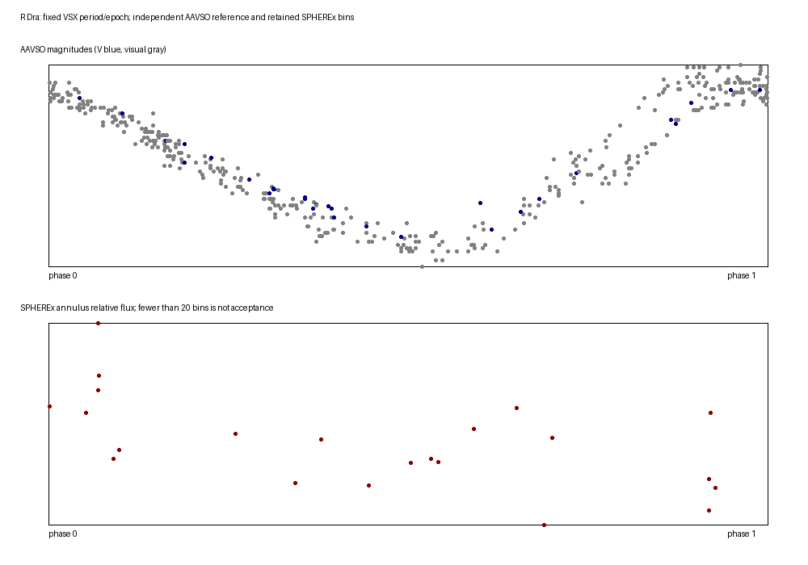

# M-aavso-phase — INCONCLUSIVE (L4)

# Independent R Dra phase comparison
```json
{
  "period_days": 246.12,
  "epoch_hjd": 2457370.0,
  "observations_by_band": {
    "Vis.": 406,
    "V": 325
  },
  "spherex_points_by_detector": {
    "1": 6,
    "3": 2,
    "4": 2,
    "6": 12
  },
  "independent_spherex_bins": 18,
  "criterion_met": false,
  "timing_note": "JD/UTC phase used at plotting precision; heliocentric correction bounded by 8.4 minutes (phase <0.000024), negligible relative to 14-day bins. No sub-minute phase comparison claimed.",
  "comparison_note": "AAVSO V/visual magnitudes and SPHEREx IR relative flux are separate observables; phase lag and wavelength-dependent amplitude are not assumed zero. Visual uncertainties missing in archive remain missing. Figure is for independent coherence review, not an automatic pass."
}
```
Thanks to AAVSO and its worldwide contributing observers for these public observations. This comparison does not pass G5.lc without sufficient SPHEREx bins, a successful periodogram, and independent coherence review.

## Metrics

| metric | value | threshold | pass |
|---|---|---|---|

## Caveats

- recorded on a dirty working tree: code_digest identifies the exact code

## Figures



git d6d2e45 (dirty) · contracts {'spherex.types': '0.1.0', 'http-api': '0.1.0'} · calibration 94e18b883fdc9b28 · author M · reviewer pending
